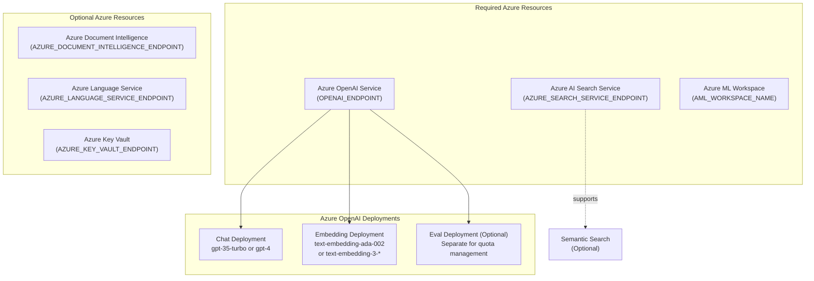
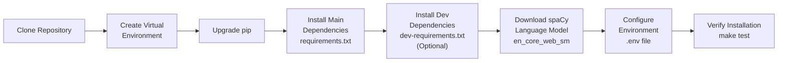
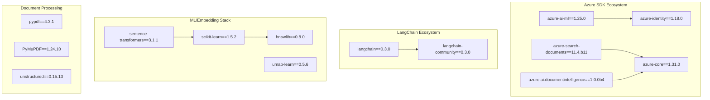
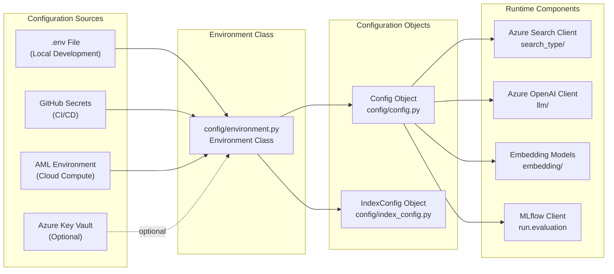
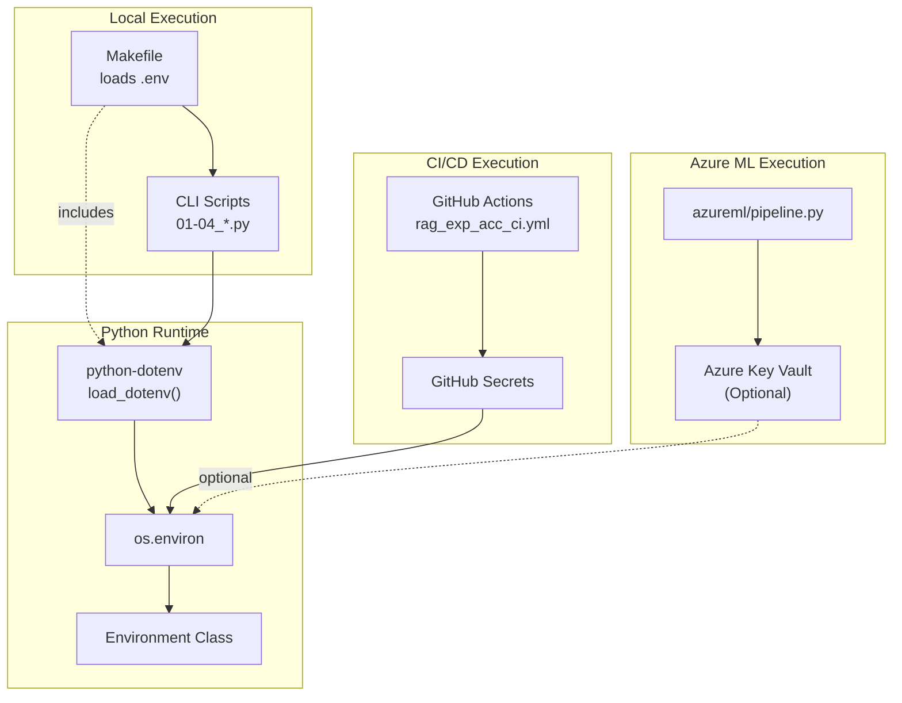

<!-- source: DeepWiki mcp.deepwiki.com · repo microsoft/rag-experiment-accelerator · page 2.1 Installation and Dependencies · fetched 2026-10-26 -->

# Installation and Dependencies

<details>
<summary>Relevant source files</summary>

The following files were used as context for generating this wiki page:

- [.env.template](.env.template)
- [.github/workflows/build_validation_workflow.yml](.github/workflows/build_validation_workflow.yml)
- [.github/workflows/rag_exp_acc_ci.yml](.github/workflows/rag_exp_acc_ci.yml)
- [Makefile](Makefile)
- [dev-requirements.txt](dev-requirements.txt)
- [docs/environment-variables.md](docs/environment-variables.md)
- [rag_experiment_accelerator/embedding/st_embedding_model.py](rag_experiment_accelerator/embedding/st_embedding_model.py)
- [rag_experiment_accelerator/embedding/tests/test_st_embedding_model.py](rag_experiment_accelerator/embedding/tests/test_st_embedding_model.py)
- [requirements.txt](requirements.txt)

</details>


This page details the complete installation process for the RAG Experiment Accelerator, including Python dependencies, Azure service prerequisites, and environment configuration. 

**Scope**: This page covers local development environment setup and package installation. For running experiments on Azure ML compute clusters, see [Azure ML and MLflow](#9.3). For development dependencies and testing setup, see [Development Environment Setup](#11.1).

---

## Prerequisites

### System Requirements

The RAG Experiment Accelerator requires:

| Component | Requirement | Notes |
|-----------|-------------|-------|
| **Python Version** | 3.11 | As specified in [.github/workflows/build_validation_workflow.yml:31]() |
| **Operating System** | Linux, macOS, Windows | Primary testing on Ubuntu (CI/CD) |
| **Network Access** | Internet connectivity | Required for Azure services and HuggingFace model downloads |
| **Memory** | 8GB+ RAM recommended | For embedding generation and document processing |

### Azure Service Prerequisites

The following Azure resources must be provisioned before installation:



**Sources**: [docs/environment-variables.md:1-36](), [.env.template:1-49]()

#### Required Azure Resources

1. **Azure AI Search Service**
   - Used for vector and text indexing
   - Semantic Search capability is optional but recommended
   - Required environment variables: `AZURE_SEARCH_SERVICE_ENDPOINT`, `AZURE_SEARCH_ADMIN_KEY`

2. **Azure OpenAI Service**
   - Minimum deployments required:
     - **Chat model**: `gpt-35-turbo` or `gpt-4` for QA generation and response generation
     - **Embedding model**: `text-embedding-ada-002` or `text-embedding-3-small/large` for document embeddings
   - Required environment variables: `OPENAI_API_KEY`, `OPENAI_ENDPOINT`, `OPENAI_API_VERSION`

3. **Azure ML Workspace**
   - Used for experiment tracking via MLflow
   - Required for Stages 3-4 (querying and evaluation)
   - Required environment variables: `AML_SUBSCRIPTION_ID`, `AML_WORKSPACE_NAME`, `AML_RESOURCE_GROUP_NAME`

#### Optional Azure Resources

1. **Azure Document Intelligence** - Advanced PDF parsing with table extraction (see [Azure Document Intelligence Integration](#5.2))
2. **Azure Language Service** - For skillset-based language detection
3. **Azure Key Vault** - For centralized secret management

**Sources**: [docs/environment-variables.md:4-11](), [.env.template:27-48]()

---

## Python Package Installation

### Installation Process Flow



**Sources**: [.github/workflows/build_validation_workflow.yml:32-42](), [Makefile:65-67]()

### Step 1: Clone Repository and Create Virtual Environment

```bash
git clone https://github.com/microsoft/rag-experiment-accelerator
cd rag-experiment-accelerator
python3.11 -m venv venv
source venv/bin/activate  # On Windows: venv\Scripts\activate
```

### Step 2: Install Main Dependencies

```bash
python -m pip install --upgrade pip
pip install -e . -r requirements.txt
```

#### Core Dependency Categories

The [requirements.txt:1-41]() file specifies 40+ dependencies organized by function:

| Category | Key Packages | Purpose |
|----------|--------------|---------|
| **Azure SDKs** | `azure-ai-ml==1.25.0`<br/>`azure-search-documents==11.4.b11`<br/>`azure-identity==1.18.0`<br/>`azure.ai.documentintelligence==1.0.0b4` | Azure service integration for Search, OpenAI, ML, Document Intelligence |
| **Document Processing** | `langchain==0.3.0`<br/>`langchain-community==0.3.0`<br/>`pypdf==4.3.1`<br/>`PyMuPDF==1.24.10`<br/>`beautifulsoup4==4.12.3`<br/>`unstructured==0.15.13` | Document loading, parsing, and chunking via `doc_loader/` modules |
| **Embeddings** | `sentence-transformers==3.1.1`<br/>`openai==1.64.0` | `STEmbeddingModel` and Azure OpenAI embeddings |
| **ML/NLP** | `spacy==3.7.6`<br/>`scikit-learn==1.5.2`<br/>`hnswlib==0.8.0` | Text preprocessing, clustering (K-means), and vector indexing |
| **Evaluation** | `rouge-score==0.1.2`<br/>`levenshtein==0.26.0`<br/>`rapidfuzz==3.9.7`<br/>`textdistance==4.6.3` | Algorithm-based metrics in `evaluation/metrics/` |
| **Experiment Tracking** | `mlflow==2.16.1`<br/>`azureml-mlflow==1.57.0.post1` | MLflow integration for experiment logging |
| **Visualization** | `matplotlib==3.9.2`<br/>`plotly==5.24.1`<br/>`kaleido==0.2.1` | Evaluation result visualizations |
| **Utilities** | `python-dotenv==1.0.1`<br/>`tqdm==4.66.5`<br/>`tiktoken==0.7.0` | Environment loading, progress bars, token counting |

**Sources**: [requirements.txt:1-41]()

#### Version-Specific Dependencies



**Critical Version Notes**:
- `azure-search-documents==11.4.b11` is a **beta version** required for vector search features
- `azure.ai.documentintelligence==1.0.0b4` is a **beta version** for Document Intelligence integration
- `langchain==0.3.0` and `langchain-community==0.3.0` must match versions for compatibility

**Sources**: [requirements.txt:1-41]()

### Step 3: Install Development Dependencies (Optional)

For running tests, linting, and prompt flow development:

```bash
pip install -r dev-requirements.txt
```

Development dependencies from [dev-requirements.txt:1-8]():

| Package | Version | Purpose |
|---------|---------|---------|
| `pytest` | 8.3.3 | Unit test framework |
| `pytest-cov` | 5.0.0 | Coverage reporting |
| `flake8` | 7.1.1 | Code linting |
| `black` | 24.8.0 | Code formatting |
| `pre-commit` | 3.8.0 | Git hook management |
| `promptflow` | 1.15.0 | Low-code prompt flow variant (see [Prompt Flow Integration](#10.3)) |
| `promptflow-tools` | 1.4.0 | Prompt flow tooling |

**Sources**: [dev-requirements.txt:1-8]()

### Step 4: Download spaCy Language Model

The `nlp/Preprocess` class requires the spaCy English model:

```bash
python -m spacy download en_core_web_sm
```

This model is used for:
- Text preprocessing in [rag_experiment_accelerator/nlp/]()
- Query term extraction
- Data sampling via K-means clustering

**Sources**: [.github/workflows/build_validation_workflow.yml:39-42](), [requirements.txt:35]()

---

## Environment Configuration

### Environment Variable Architecture



**Sources**: [.env.template:1-49](), [.github/workflows/rag_exp_acc_ci.yml:25-39]()

### Step 5: Create .env File

Copy the template and configure required variables:

```bash
cp .env.template .env
```

Edit `.env` with your Azure resource values.

#### Required Environment Variables

From [.env.template:3-22]():

```bash
# Azure AI Search
AZURE_SEARCH_SERVICE_ENDPOINT=https://your-search-service.search.windows.net
AZURE_SEARCH_ADMIN_KEY=your-search-admin-key
AZURE_SEARCH_USE_SEMANTIC_SEARCH=True

# Azure OpenAI
OPENAI_API_KEY=your-openai-api-key
OPENAI_API_TYPE=azure  # Must be 'azure' or 'open_ai'
OPENAI_ENDPOINT=https://your-openai-resource.openai.azure.com/
OPENAI_API_VERSION=2023-03-15-preview

# Azure Machine Learning
AML_SUBSCRIPTION_ID=your-subscription-id
AML_WORKSPACE_NAME=your-workspace-name
AML_RESOURCE_GROUP_NAME=your-resource-group-name
```

**Variable Details**:

| Variable | Type | Description | Used By |
|----------|------|-------------|---------|
| `AZURE_SEARCH_SERVICE_ENDPOINT` | URL | Azure AI Search endpoint | `search_type/acs_search_methods.py` |
| `AZURE_SEARCH_ADMIN_KEY` | Secret | Admin key for index management | `ingest_data/acs_ingest.py`, `search_type/acs_search_methods.py` |
| `AZURE_SEARCH_USE_SEMANTIC_SEARCH` | Boolean | Enable semantic search (L2 reranking) | `config/environment.py` |
| `OPENAI_API_KEY` | Secret | Azure OpenAI API key | `llm/` modules |
| `OPENAI_API_TYPE` | Enum | Must be `azure` or `open_ai` | `llm/response_generator.py` |
| `OPENAI_ENDPOINT` | URL | Azure OpenAI endpoint | `llm/`, `embedding/` modules |
| `OPENAI_API_VERSION` | String | API version (e.g., `2023-03-15-preview`) | Azure OpenAI SDK initialization |
| `AML_SUBSCRIPTION_ID` | GUID | Azure subscription ID | `run.querying`, `run.evaluation` for MLflow tracking |
| `AML_WORKSPACE_NAME` | String | Azure ML workspace name | MLflow backend configuration |
| `AML_RESOURCE_GROUP_NAME` | String | Resource group containing workspace | MLflow backend configuration |

**Sources**: [.env.template:3-22](), [docs/environment-variables.md:18-30]()

#### Optional Environment Variables

From [.env.template:23-49]():

```bash
# Azure Document Intelligence (Optional)
AZURE_DOCUMENT_INTELLIGENCE_ENDPOINT=https://your-doc-intel.cognitiveservices.azure.com/
AZURE_DOCUMENT_INTELLIGENCE_ADMIN_KEY=your-doc-intel-key

# Azure Language Service (Optional)
AZURE_LANGUAGE_SERVICE_ENDPOINT=https://your-language-service.cognitiveservices.azure.com/
AZURE_LANGUAGE_SERVICE_KEY=your-language-key

# Performance Tuning
MAX_WORKER_THREADS=4  # Default: optimized by CPU cores

# Logging
LOGGING_LEVEL=INFO  # One of: NOTSET, DEBUG, INFO, WARN, ERROR, CRITICAL

# Azure ML Compute (for azureml/pipeline.py)
AML_COMPUTE_NAME=your-compute-cluster
AML_COMPUTE_INSTANCES_NUMBER=4

# Azure Key Vault
AZURE_KEY_VAULT_ENDPOINT=https://your-keyvault.vault.azure.net/
```

**Optional Variable Details**:

| Variable | Default | Description | Impact |
|----------|---------|-------------|--------|
| `AZURE_DOCUMENT_INTELLIGENCE_ENDPOINT` | None | Document Intelligence endpoint | Enables advanced PDF parsing with table extraction via `doc_loader/documentIntelligenceLoader.py` |
| `AZURE_LANGUAGE_SERVICE_ENDPOINT` | None | Language service endpoint | Used for language detection skillsets |
| `MAX_WORKER_THREADS` | CPU cores | Thread pool size | Controls parallelism in `ThreadPoolExecutor` for embedding generation and QA processing |
| `LOGGING_LEVEL` | INFO | Log verbosity | Affects `utils/logging.py` output |
| `AML_COMPUTE_NAME` | None | Compute cluster name | Required for `azureml/pipeline.py` (cloud execution) |
| `AZURE_KEY_VAULT_ENDPOINT` | None | Key Vault endpoint | Enables centralized secret management via `env_to_keyvault.py` |

**Sources**: [.env.template:27-49](), [docs/environment-variables.md:33-36]()

### Environment Variable Loading Mechanisms

The system supports multiple environment loading strategies:



**Sources**: [Makefile:4-13](), [.github/workflows/rag_exp_acc_ci.yml:25-39]()

---

## Verification and Testing

### Verify Installation

After completing installation and environment configuration:

```bash
# Verify Python dependencies
python -c "import azure.search.documents; import sentence_transformers; import mlflow; print('Dependencies OK')"

# Verify spaCy model
python -c "import spacy; nlp = spacy.load('en_core_web_sm'); print('spaCy model OK')"

# Run unit tests
make test
# Or directly:
pytest . --cov=. --cov-report=html --cov-config=.coveragerc
```

**Expected Test Output**: From [.github/workflows/build_validation_workflow.yml:49-58](), the test suite should:
- Execute all unit tests in the repository
- Generate coverage report in `htmlcov/`
- Pass with no failures

### Verify Azure Connectivity

```bash
# Test Azure Search connectivity (requires valid .env)
python -c "from azure.search.documents import SearchClient; from azure.core.credentials import AzureKeyCredential; import os; client = SearchClient(os.getenv('AZURE_SEARCH_SERVICE_ENDPOINT'), 'test-index', AzureKeyCredential(os.getenv('AZURE_SEARCH_ADMIN_KEY'))); print('Azure Search connectivity OK')"

# Test Azure OpenAI connectivity
python -c "from openai import AzureOpenAI; import os; client = AzureOpenAI(api_key=os.getenv('OPENAI_API_KEY'), api_version=os.getenv('OPENAI_API_VERSION'), azure_endpoint=os.getenv('OPENAI_ENDPOINT')); print('Azure OpenAI connectivity OK')"
```

**Sources**: [.github/workflows/build_validation_workflow.yml:49-58](), [Makefile:65-67]()

### Code Quality Validation

```bash
# Run linting
make flake
# Or directly:
flake8 --extend-ignore=E501
```

The CI/CD pipeline enforces code quality via [.github/workflows/build_validation_workflow.yml:44-47]().

---

## Dependency Management Best Practices

### Version Pinning Strategy

The project uses **exact version pinning** for reproducibility:
- All versions in [requirements.txt:1-41]() use `==` (exact match)
- Exception: `PyPDF2~=3.0` uses compatible release clause
- **Reason**: Ensures consistent behavior across environments and experiments

### Updating Dependencies

When updating dependencies:

1. **Test in isolation**: Create a separate virtual environment
2. **Run full test suite**: `make test`
3. **Test integration**: Run a complete experiment with `make all`
4. **Update both files**: Modify both `requirements.txt` and `dev-requirements.txt` if needed
5. **Document breaking changes**: Update this page if new Azure resources or configuration is required

### Handling Beta Dependencies

Two core dependencies are beta versions:
- `azure-search-documents==11.4.b11` - Required for vector search
- `azure.ai.documentintelligence==1.0.0b4` - Required for Document Intelligence

**Mitigation**:
- Pin to specific beta versions for stability
- Monitor Azure SDK release notes for GA versions
- Document Intelligence integration has graceful fallback to `prebuilt-read`

**Sources**: [requirements.txt:7-8]()

---

## Troubleshooting Installation Issues

### Common Issues

| Issue | Symptom | Solution |
|-------|---------|----------|
| **spaCy model missing** | `OSError: [E050] Can't find model 'en_core_web_sm'` | Run `python -m spacy download en_core_web_sm` |
| **Azure SDK authentication** | `DefaultAzureCredential failed` | Run `az login` or set `AZURE_TENANT_ID` |
| **Sentence Transformer download failure** | `OSError` from `STEmbeddingModel` | Check internet connectivity; HuggingFace models downloaded on first use (see [rag_experiment_accelerator/embedding/st_embedding_model.py:58-64]()) |
| **MLflow connection failure** | `MlflowException` during Stage 3/4 | Verify `AML_*` environment variables and Azure ML workspace access |
| **Import errors after installation** | `ModuleNotFoundError` | Ensure virtual environment is activated and `pip install -e .` was run |

### Dependency Conflict Resolution

If `pip` reports dependency conflicts:

```bash
# Check for conflicts
pip check

# Create fresh environment
deactivate
rm -rf venv
python3.11 -m venv venv
source venv/bin/activate
pip install --upgrade pip
pip install -e . -r requirements.txt
```

**Sources**: [rag_experiment_accelerator/embedding/st_embedding_model.py:58-64](), [.github/workflows/build_validation_workflow.yml:32-42]()

---

## Next Steps

After completing installation:

1. **Configure Experiments**: Review [Configuration Guide](#2.2) for `config.json` structure
2. **Prepare Data**: Place documents in `data/` directory (see [Running Your First Experiment](#2.3))
3. **Run Pipeline**: Execute `make all` or individual stages (`make index`, `make qnagen`, etc.)
4. **Advanced Setup**: For Azure ML execution, see [Azure ML and MLflow](#9.3)

**Sources**: [Makefile:21-43](), [.github/workflows/rag_exp_acc_ci.yml:51-66]()

---

