<!-- source: DeepWiki mcp.deepwiki.com · repo microsoft/rag-experiment-accelerator · page 2.2 Configuration Guide · fetched 2026-10-26 -->

# Configuration Guide

<details>
<summary>Relevant source files</summary>

The following files were used as context for generating this wiki page:

- [.github/workflows/config.json](.github/workflows/config.json)
- [README.md](README.md)
- [config.sample.json](config.sample.json)
- [config.schema.json](config.schema.json)
- [docs/evaluation-metrics.md](docs/evaluation-metrics.md)
- [promptflow/rag-experiment-accelerator/README.md](promptflow/rag-experiment-accelerator/README.md)
- [rag_experiment_accelerator/config/config.py](rag_experiment_accelerator/config/config.py)
- [rag_experiment_accelerator/config/eval_config.py](rag_experiment_accelerator/config/eval_config.py)
- [rag_experiment_accelerator/config/tests/test_config.py](rag_experiment_accelerator/config/tests/test_config.py)
- [rag_experiment_accelerator/evaluation/plain_metrics.py](rag_experiment_accelerator/evaluation/plain_metrics.py)
- [rag_experiment_accelerator/evaluation/tests/test_plain_metrics.py](rag_experiment_accelerator/evaluation/tests/test_plain_metrics.py)

</details>


This guide provides comprehensive documentation for configuring the RAG Experiment Accelerator through the `config.json` file. It explains the hierarchical configuration structure, parameter options, and how to set up multi-configuration experiments for systematic hyperparameter exploration.

For information about environment variables and Azure service credentials, see [Installation and Dependencies](#2.1). For guidance on running your first experiment with an example configuration, see [Running Your First Experiment](#2.3).

---

## Configuration System Overview

The RAG Experiment Accelerator uses a hierarchical, configuration-driven architecture where all experiment parameters are specified in a single `config.json` file. This configuration is validated against a JSON schema, loaded into typed Python dataclasses, and used to control all four pipeline stages.

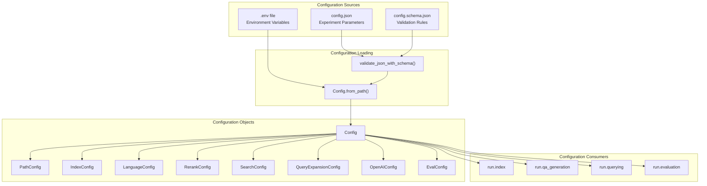

**Configuration Hierarchy**: `config.json` is parsed into a `Config` object containing nested configuration objects for each pipeline concern.

Sources: [rag_experiment_accelerator/config/config.py:34-51](), [README.md:283-356]()

---

## Config.json File Structure

The configuration file follows this structure:

```json
{
    "experiment_name": "string",
    "job_name": "string",
    "job_description": "string",
    "data_formats": ["*"],
    "use_checkpoints": true,
    "path": {},
    "index": {
        "index_name_prefix": "string",
        "ef_construction": [400],
        "ef_search": [400],
        "chunking": {},
        "embedding_model": [],
        "sampling": {}
    },
    "language": {},
    "rerank": {},
    "search": {},
    "query_expansion": {},
    "openai": {},
    "eval": {}
}
```

A complete example is provided in [config.sample.json:1-87]().

Sources: [config.sample.json:1-87](), [config.schema.json:1-605]()

---

## Configuration Validation

All configurations are validated against [config.schema.json:1-605]() before use. The validation occurs in [rag_experiment_accelerator/config/config.py:61-65]():

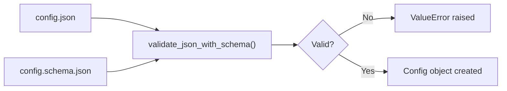

**Validation Process**: The JSON schema enforces type constraints, required fields, enum values, and value ranges.

The schema validation includes:
- Type checking (string, integer, boolean, array, object)
- Required field validation
- Enum constraint checking for search types, metric types, etc.
- Range validation (e.g., `ef_construction` between 100-1000)
- Conditional validation (e.g., analyzer configuration mutual exclusivity)

Sources: [rag_experiment_accelerator/config/config.py:61-65](), [rag_experiment_accelerator/config/config_validator.py]()

---

## Top-Level Configuration Parameters

### Experiment Identification

| Parameter | Type | Description | Code Reference |
|-----------|------|-------------|----------------|
| `experiment_name` | string | Azure ML experiment name for grouping job runs | [Config.experiment_name:37]() |
| `job_name` | string | Job name prefix (timestamp appended automatically) | [Config.job_name:38]() |
| `job_description` | string | Human-readable description of the experiment | [Config.job_description:39]() |

**MLflow Integration**: If `experiment_name` is provided, all runs are grouped under this experiment in Azure ML. Otherwise, `index_name_prefix` is used.

Sources: [rag_experiment_accelerator/config/config.py:37-39](), [config.schema.json:5-17]()

---

### Global Processing Parameters

| Parameter | Type | Default | Description |
|-----------|------|---------|-------------|
| `data_formats` | array | `["*"]` | File formats to process: `"*"`, `"pdf"`, `"html"`, `"markdown"`, `"json"`, `"text"`, `"docx"` |
| `use_checkpoints` | boolean | `true` | Enable checkpoint system to cache expensive operations |
| `max_worker_threads` | integer | env var | Maximum parallel threads for concurrent operations |

**Data Formats**: Set to `["*"]` to process all supported formats, or specify a subset like `["pdf", "docx"]`.

**Checkpointing**: When enabled, expensive operations (embeddings, LLM calls, clustering) are cached in `artifacts/checkpoints/` with content-based hashing. See [Checkpointing System](#10.1) for details.

Sources: [rag_experiment_accelerator/config/config.py:40-43](), [config.schema.json:19-42]()

---

## Index Configuration

The `index` section controls document processing, chunking, embedding, and Azure AI Search index creation.

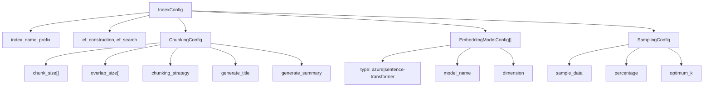

**IndexConfig Structure**: Nested configuration controlling all aspects of document indexing.

Sources: [rag_experiment_accelerator/config/index_config.py](), [README.md:296-318]()

---

### Index Naming and Vector Search Parameters

| Parameter | Type | Example | Description |
|-----------|------|---------|-------------|
| `index_name_prefix` | string | `"idx"` | Prefix for generated index names |
| `ef_construction` | array | `[400]` | HNSW ef_construction values (100-1000) |
| `ef_search` | array | `[400]` | HNSW ef_search values (100-1000) |

**Index Naming Convention**: Generated index names follow the pattern:
```
{prefix}-chunk{size}-overlap{size}-dim{dimension}-efc{ef_construction}-efs{ef_search}
```

Example: `idx-chunk1000-overlap200-dim384-efc400-efs400`

**HNSW Parameters**:
- `ef_construction`: Controls index build time and quality (higher = better quality, slower build)
- `ef_search`: Controls query time and recall (higher = better recall, slower queries)

Sources: [rag_experiment_accelerator/config/index_config.py:11-13](), [README.md:298-299]()

---

### Chunking Configuration

| Parameter | Type | Default | Description |
|-----------|------|---------|-------------|
| `preprocess` | boolean | `false` | Enable NLP preprocessing (tokenization, lemmatization) |
| `chunk_size` | array | `[1000]` | Character count per chunk (supports multiple values) |
| `overlap_size` | array | `[200]` | Character overlap between chunks (must be < chunk_size) |
| `generate_title` | boolean | `false` | Use LLM to generate titles for chunks |
| `generate_summary` | boolean | `false` | Use LLM to generate summaries for chunks |
| `override_content_with_summary` | boolean | `false` | Replace chunk content with generated summary |
| `chunking_strategy` | enum | `"basic"` | `"basic"` or `"azure-document-intelligence"` |
| `azure_document_intelligence_model` | string | `"prebuilt-read"` | Model for Document Intelligence: `"prebuilt-layout"` or `"prebuilt-read"` |

**Chunking Strategies**:

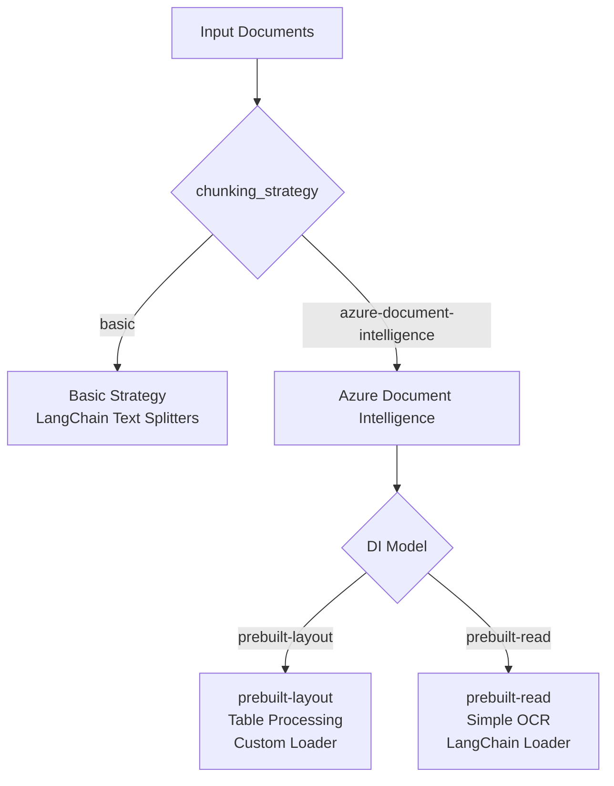

**Document Intelligence Features**: When using `"prebuilt-layout"`, the custom loader:
- Formats tables with column headers into key-value pairs
- Removes page numbers, footers, and recurring patterns (regex-based)
- Chunks recursively by paragraph and line to preserve table rows
- Falls back to `"prebuilt-read"` on errors

Sources: [rag_experiment_accelerator/config/index_config.py:18-39](), [README.md:300-309](), [README.md:37-38]()

---

### Embedding Model Configuration

The `embedding_model` parameter is an array supporting multiple embedding models for experimentation:

```json
"embedding_model": [
    {
        "type": "sentence-transformer",
        "model_name": "all-mpnet-base-v2"
    },
    {
        "type": "azure",
        "model_name": "text-embedding-ada-002",
        "dimension": 1536
    },
    {
        "type": "azure",
        "model_name": "text-embedding-3-large",
        "dimension": 256,
        "shorten_dimensions": true
    }
]
```

**Embedding Model Types**:

| Type | Description | Dimension Handling |
|------|-------------|-------------------|
| `sentence-transformer` | HuggingFace models | Auto-detected for common models |
| `azure` | Azure OpenAI embeddings | Must specify `dimension` |

**Azure OpenAI Embedding Models**:

| Model | Native Dimension | Supports Shortening |
|-------|-----------------|-------------------|
| `text-embedding-ada-002` | 1536 | No |
| `text-embedding-3-small` | 1536 | Yes |
| `text-embedding-3-large` | 3072 | Yes |

**Dimension Shortening**: For v3 models, set `shorten_dimensions: true` to use a custom dimension value less than the native dimension. This leverages the model's built-in dimension reduction capability.

Sources: [README.md:364-409](), [rag_experiment_accelerator/config/embedding_model_config.py](), [rag_experiment_accelerator/embedding/factory.py]()

---

### Sampling Configuration

The sampling feature creates a representative subset of documents using K-means clustering:

| Parameter | Type | Example | Description |
|-----------|------|---------|-------------|
| `sample_data` | boolean | `false` | Enable sampling |
| `percentage` | number | `5` | Percentage of corpus to sample (0-100) |
| `optimum_k` | string/int | `"auto"` | Cluster count: `"auto"` or specific integer |
| `min_cluster` | integer | `2` | Minimum clusters for auto mode |
| `max_cluster` | integer | `30` | Maximum clusters for auto mode |
| `only_sample` | boolean | `false` | Only run sampling, skip indexing |

**Sampling Process**:

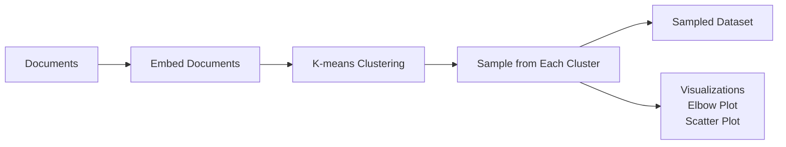

**Sampling Artifacts**:
- `artifacts/sampling/{job_name}/` - Sampled document files
- `all_cluster_predictions_cluster_number_{k}.csv` - Full dataset with cluster assignments
- `sampled_cluster_predictions_cluster_number_{k}.csv` - Sampled dataset
- `all_cluster_predictions_cluster_number_{k}.jpg` - Cluster visualization
- `elbow_{k}.png` - Elbow plot for optimal k (if `optimum_k: "auto"`)

Sources: [README.md:226-282](), [rag_experiment_accelerator/config/sampling_config.py](), [rag_experiment_accelerator/sampling/]()

---

## Language Configuration

The `language` section controls linguistic analysis for Azure AI Search indexes:

```json
"language": {
    "analyzer": {
        "analyzer_name": "en.microsoft",
        "index_analyzer_name": "",
        "search_analyzer_name": "",
        "char_filters": [],
        "tokenizers": [],
        "token_filters": []
    },
    "query_language": "en-us"
}
```

**Analyzer Configuration Rules**:
1. Either set `analyzer_name` alone (same analyzer for indexing and search)
2. Or set both `index_analyzer_name` and `search_analyzer_name` (different analyzers)
3. Cannot mix both patterns - enforced by [config.schema.json:291-332]()

**Supported Analyzers**: Built-in language analyzers (e.g., `"en.microsoft"`, `"fr.lucene"`) or custom analyzers defined via `char_filters`, `tokenizers`, and `token_filters`.

**Query Languages**: Supports 50+ language codes including `"en-us"`, `"fr-fr"`, `"de-de"`, `"ja-jp"`, `"zh-cn"`. Set to `"none"` to disable language-specific features.

Sources: [rag_experiment_accelerator/config/language_config.py](), [config.schema.json:224-416](), [README.md:319-329]()

---

## Search Configuration

The `search` section controls retrieval behavior:

```json
"search": {
    "retrieve_num_of_documents": 5,
    "search_type": [
        "search_for_manual_hybrid",
        "search_for_match_Hybrid_multi",
        "search_for_match_semantic"
    ],
    "search_relevancy_threshold": 0.8
}
```

### Search Type Taxonomy

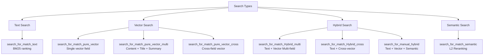

**Search Type Descriptions**:

| Search Type | Algorithm | Fields Used | Requirements |
|------------|-----------|-------------|--------------|
| `search_for_match_text` | BM25 | `content` | None |
| `search_for_match_pure_vector` | Vector similarity | `contentVector` | Embedding model |
| `search_for_match_pure_vector_multi` | Vector similarity | `contentVector`, `titleVector`, `summaryVector` | Multi-vector embeddings |
| `search_for_match_pure_vector_cross` | Cross-field vector | Multiple vector fields | Multi-vector embeddings |
| `search_for_match_Hybrid_multi` | BM25 + Vector | Text + Vector fields | Embedding model |
| `search_for_match_Hybrid_cross` | BM25 + Cross-vector | Text + Vector fields | Embedding model |
| `search_for_manual_hybrid` | BM25 + Vector + Semantic | All fields | Semantic search enabled |
| `search_for_match_semantic` | Semantic L2 reranking | `content` | Semantic search enabled |

**Semantic Search Requirement**: The search types `search_for_match_semantic` and `search_for_manual_hybrid` require Azure AI Search semantic search to be enabled (Basic tier or higher). This is validated in [rag_experiment_accelerator/config/config.py:94-106]().

Sources: [rag_experiment_accelerator/config/search_config.py](), [rag_experiment_accelerator/search_type/acs_search_methods.py](), [README.md:337-341]()

---

## Reranking Configuration

The `rerank` section controls post-retrieval reranking:

```json
"rerank": {
    "enabled": true,
    "type": "cross_encoder",
    "llm_rerank_threshold": 3,
    "cross_encoder_at_k": 4,
    "cross_encoder_model": "cross-encoder/stsb-roberta-base"
}
```

### Reranking Strategy Comparison

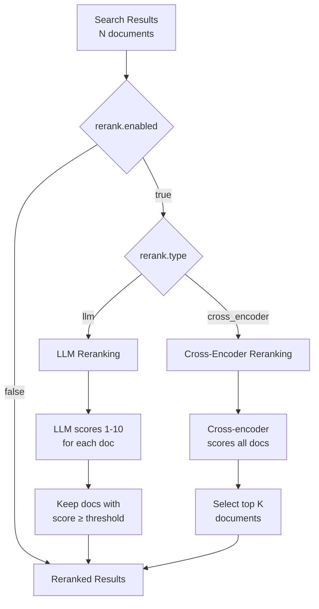

**Reranking Parameters**:

| Parameter | Type | Description | Used By |
|-----------|------|-------------|---------|
| `enabled` | boolean | Enable/disable reranking | Both |
| `type` | enum | `"llm"` or `"cross_encoder"` | Both |
| `llm_rerank_threshold` | integer | Score threshold (1-10) | LLM only |
| `cross_encoder_at_k` | integer | Number of docs to keep | Cross-encoder only |
| `cross_encoder_model` | string | Model name | Cross-encoder only |

**LLM Reranking**: Uses Azure OpenAI to score each document's relevance on a 1-10 scale. Only documents scoring at or above `llm_rerank_threshold` are retained.

**Cross-Encoder Reranking**: Uses a sentence-transformers cross-encoder model to score query-document pairs. Keeps the top `cross_encoder_at_k` documents.

**Model Support**: Currently only `"cross-encoder/stsb-roberta-base"` is supported for cross-encoder reranking.

Sources: [rag_experiment_accelerator/config/rerank_config.py](), [rag_experiment_accelerator/llm/llm_rerank.py](), [rag_experiment_accelerator/llm/cross_encoder_rerank.py](), [README.md:330-336]()

---

## Query Expansion Configuration

The `query_expansion` section controls query preprocessing and expansion strategies:

```json
"query_expansion": {
    "hyde": "disabled",
    "query_expansion": false,
    "min_query_expansion_related_question_similarity_score": 90,
    "expand_to_multiple_questions": false
}
```

### Query Expansion Strategies

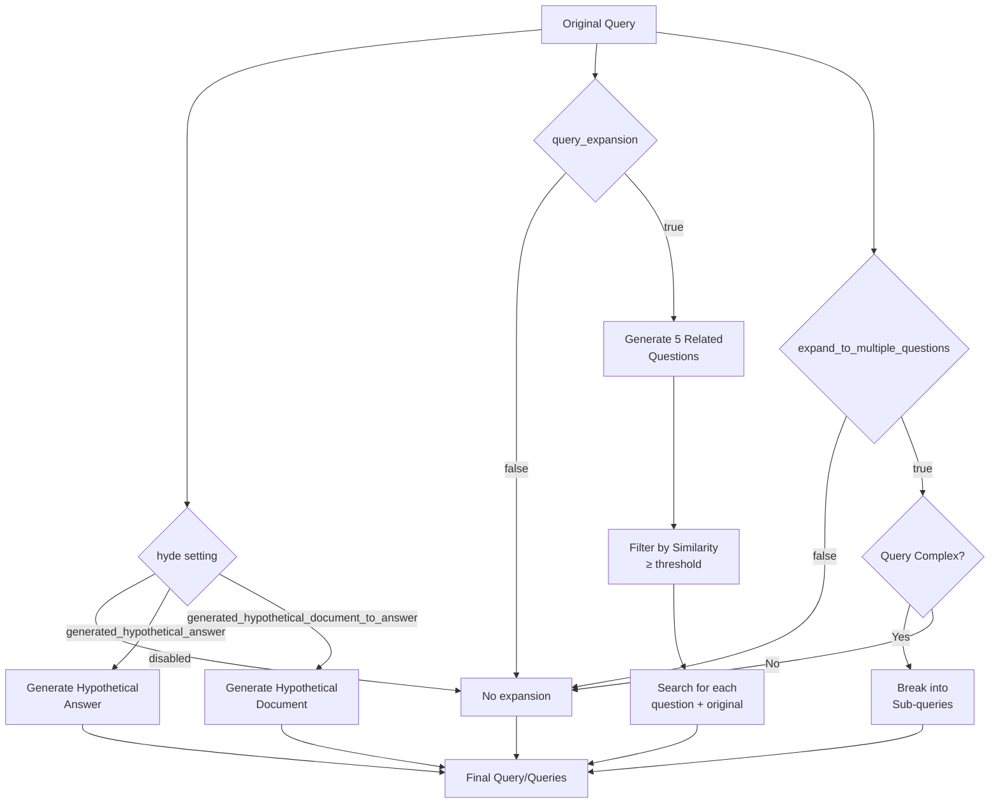

**Query Expansion Parameters**:

| Parameter | Type | Values | Description |
|-----------|------|--------|-------------|
| `hyde` | enum | `"disabled"`, `"generated_hypothetical_answer"`, `"generated_hypothetical_document_to_answer"` | HyDE strategy |
| `query_expansion` | boolean | | Generate related questions |
| `min_query_expansion_related_question_similarity_score` | integer | 0-100 | Similarity threshold (%) |
| `expand_to_multiple_questions` | boolean | | Break complex queries into sub-queries |

**HyDE (Hypothetical Document Embeddings)**: Based on [Precise Zero-Shot Dense Retrieval without Relevance Labels](https://arxiv.org/abs/2212.10496):
- `generated_hypothetical_answer`: LLM generates a hypothetical answer, which is embedded and used for search
- `generated_hypothetical_document_to_answer`: LLM generates a hypothetical document containing an answer, which is embedded and used for search

**Related Question Expansion**: Generates 5 related questions using LLM, filters those with similarity ≥ threshold using cosine similarity, and searches for each question. Results are deduplicated before reranking.

**Sub-Query Decomposition**: For complex queries, LLM breaks them into simpler sub-queries that are each searched independently.

Sources: [rag_experiment_accelerator/config/query_expansion.py](), [README.md:342-446](), [rag_experiment_accelerator/llm/prompt/prompts.py]()

---

## OpenAI Configuration

The `openai` section specifies Azure OpenAI deployment settings:

```json
"openai": {
    "azure_oai_chat_deployment_name": "gpt-35-turbo",
    "azure_oai_eval_deployment_name": "gpt-35-turbo",
    "temperature": 0
}
```

**Dual Deployment Strategy**:

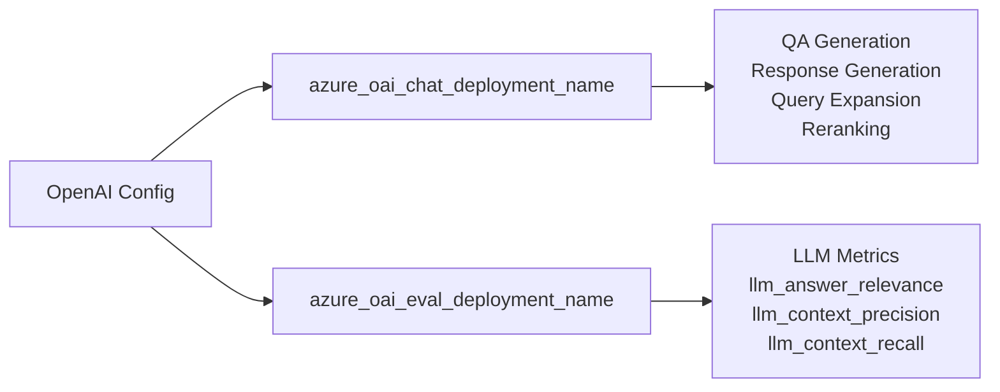

**Deployment Separation Rationale**: Using separate deployments prevents quota conflicts and allows different model selection:
- **Chat deployment**: Higher rate limits for bulk operations (QA generation, querying)
- **Eval deployment**: Can use more powerful model for evaluation without impacting main pipeline

**Temperature**: Controls randomness (0-1):
- `0`: Deterministic, reproducible outputs (recommended for evaluation)
- Higher values: More creative but less consistent outputs

Sources: [rag_experiment_accelerator/config/openai_config.py](), [rag_experiment_accelerator/llm/response_generator.py](), [README.md:348-352]()

---

## Evaluation Configuration

The `eval` section specifies metrics for evaluation:

```json
"eval": {
    "metric_types": [
        "fuzzy_score",
        "bert_all_MiniLM_L6_v2",
        "cosine_ochiai",
        "bert_distilbert_base_nli_stsb_mean_tokens",
        "llm_answer_relevance",
        "llm_context_precision"
    ]
}
```

### Evaluation Metrics Taxonomy

| Metric Category | Metrics | Cost | Use Case |
|----------------|---------|------|----------|
| **Algorithm-Based** | `lcsstr`, `lcsseq`, `hamming`, `jaro_winkler`, `jaccard`, `levenshtein`, `fuzzy_score`, `cosine_ochiai` | Free | Quick iteration, string similarity |
| **ROUGE** | `rouge{1\|2\|L}_{precision\|recall\|fmeasure}` | Free | Token overlap, summarization |
| **BERT-Based** | `bert_all_MiniLM_L6_v2`, `bert_base_nli_mean_tokens`, `bert_large_nli_mean_tokens`, `bert_large_nli_stsb_mean_tokens`, `bert_distilbert_base_nli_stsb_mean_tokens`, `bert_paraphrase_multilingual_MiniLM_L12_v2` | Low | Semantic similarity |
| **LLM-Based** | `llm_answer_relevance`, `llm_context_precision`, `llm_context_recall` | High | Deep semantic understanding |

**Metric Selection Strategy**:

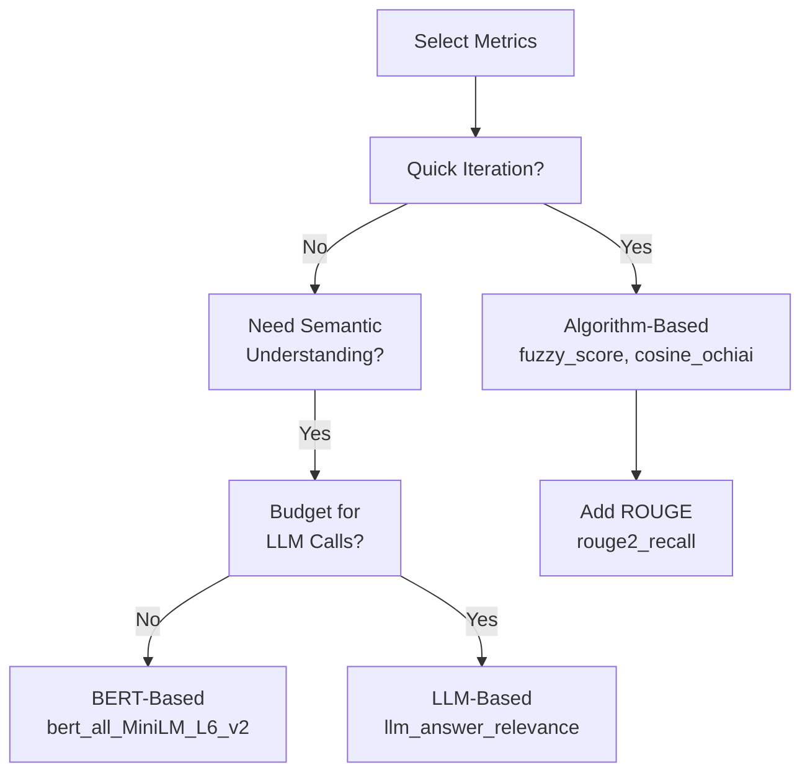

**Algorithm-Based Metrics**: Fast, deterministic, good for initial experimentation. Best for string matching but miss semantic nuances.

**ROUGE Metrics**: Token-based overlap, commonly used for summarization tasks. Middle ground between string distance and semantic similarity.

**BERT-Based Metrics**: Capture semantic similarity via embeddings. Six models available with different speed/quality/language tradeoffs:
- `bert_all_MiniLM_L6_v2`: Fastest, 384-dim
- `bert_paraphrase_multilingual_MiniLM_L12_v2`: Multilingual support (50+ languages)
- `bert_large_nli_stsb_mean_tokens`: Highest quality, 1024-dim

**LLM-Based Metrics**: Most expensive but capture nuanced semantic understanding:
- `llm_answer_relevance`: Scores completeness and redundancy
- `llm_context_precision`: Evaluates retrieval quality
- `llm_context_recall`: Measures coverage

For complete metric descriptions, see [Evaluation Metrics](#8).

Sources: [rag_experiment_accelerator/config/eval_config.py:6-16](), [rag_experiment_accelerator/evaluation/plain_metrics.py](), [docs/evaluation-metrics.md:1-191](), [README.md:353-356]()

---

## Multi-Configuration Experiments

The configuration system supports **array values** for most parameters, enabling grid search experimentation:

### Flatten Mechanism

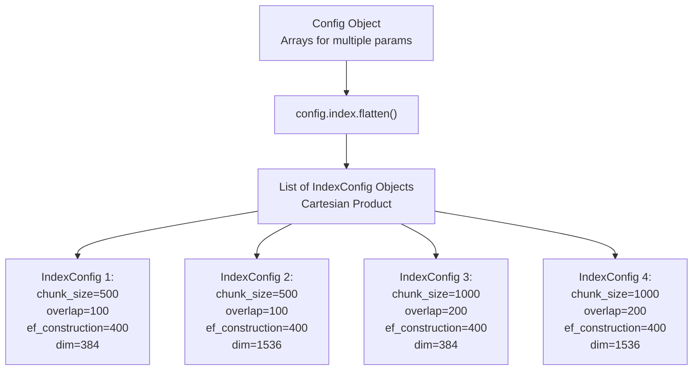

**Flatten Process**: The `flatten()` method generates all combinations of array parameters.

### Example Multi-Configuration

```json
{
    "index": {
        "index_name_prefix": "exp",
        "ef_construction": [400, 800],
        "ef_search": [400],
        "chunking": {
            "chunk_size": [500, 1000],
            "overlap_size": [100, 200]
        },
        "embedding_model": [
            {
                "type": "sentence-transformer",
                "model_name": "all-MiniLM-L6-v2"
            },
            {
                "type": "azure",
                "model_name": "text-embedding-ada-002",
                "dimension": 1536
            }
        ]
    },
    "search": {
        "search_type": [
            "search_for_match_text",
            "search_for_match_pure_vector",
            "search_for_match_Hybrid_multi"
        ]
    }
}
```

**Generated Configurations**: This produces 2 (ef_construction) × 2 (chunk_size) × 2 (overlap_size) × 2 (embedding_model) = **16 index configurations** × 3 (search_type) = **48 total experiment variants**.

**Index Creation**: Each unique index configuration creates a separate Azure AI Search index with a unique name.

**Querying**: Each index is queried with each search type, creating a full matrix of experiments.

Sources: [rag_experiment_accelerator/config/base_config.py](), [rag_experiment_accelerator/config/index_config.py](), [README.md:283-287]()

---

## Path Configuration

The `path` section is typically left empty (`{}`) as paths are auto-configured:

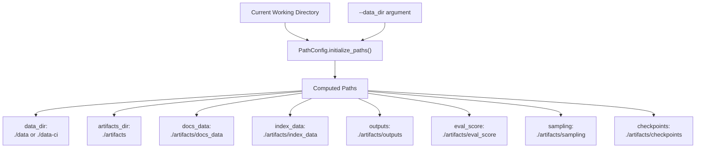

**Path Initialization**: Paths are computed in [rag_experiment_accelerator/config/path_config.py]() based on the config file location and optional `--data_dir` argument.

**Default Paths**:
- `data_dir`: `./data` (or specified via CLI)
- `artifacts_dir`: `./artifacts`
- `docs_data`: `./artifacts/docs_data` (chunked documents)
- `index_data`: `./artifacts/index_data` (index metadata)
- `outputs`: `./artifacts/outputs` (QA pairs, query results)
- `eval_score`: `./artifacts/eval_score` (evaluation metrics, visualizations)
- `sampling`: `./artifacts/sampling` (sampling artifacts)
- `checkpoints`: `./artifacts/checkpoints` (cached results)

Sources: [rag_experiment_accelerator/config/path_config.py](), [rag_experiment_accelerator/config/config.py:69]()

---

## Configuration Validation and Error Handling

The configuration system performs multiple levels of validation:

### Schema Validation

Performed during `Config.from_path()`:
1. JSON structure matches schema
2. All required fields present
3. Field types correct
4. Enum values valid
5. Numeric ranges satisfied

### Business Logic Validation

Performed in `Config.validate_inputs()`:

```python
def validate_inputs(self, use_semantic_search: bool = False):
    # Overlap must be smaller than chunk size
    if max(self.index.chunking.overlap_size) > min(self.index.chunking.chunk_size):
        raise ValueError(
            "Config param validation error: overlap_size must be less than chunk_size"
        )
    
    # Semantic search types require semantic search to be enabled
    if (
        "search_for_match_semantic" in self.search.search_type
        or "search_for_manual_hybrid" in self.search.search_type
    ) and not use_semantic_search:
        raise ValueError(
            "Semantic search is required for search types 'search_for_match_semantic' "
            "or 'search_for_manual_hybrid', but it's not enabled."
        )
```

Sources: [rag_experiment_accelerator/config/config.py:94-106](), [rag_experiment_accelerator/config/tests/test_config.py:192-238]()

---

## Configuration Best Practices

### 1. Start Small, Then Scale

```json
{
    "index": {
        "chunking": {
            "chunk_size": [1000],
            "overlap_size": [200]
        },
        "embedding_model": [
            {
                "type": "sentence-transformer",
                "model_name": "all-MiniLM-L6-v2"
            }
        ]
    },
    "search": {
        "search_type": ["search_for_match_Hybrid_multi"]
    },
    "eval": {
        "metric_types": ["fuzzy_score", "bert_all_MiniLM_L6_v2"]
    }
}
```

Once validated, expand to grid search:

```json
{
    "index": {
        "chunking": {
            "chunk_size": [500, 1000, 2000],
            "overlap_size": [100, 200, 300]
        }
    }
}
```

### 2. Use Checkpointing

Always enable `use_checkpoints: true` to avoid redundant expensive operations when re-running experiments.

### 3. Separate Chat and Eval Deployments

Use different deployments to prevent quota exhaustion during evaluation:

```json
{
    "openai": {
        "azure_oai_chat_deployment_name": "gpt-35-turbo-high-capacity",
        "azure_oai_eval_deployment_name": "gpt-4-32k"
    }
}
```

### 4. Sampling for Large Datasets

Enable sampling for initial experiments with large corpora:

```json
{
    "index": {
        "sampling": {
            "sample_data": true,
            "percentage": 10,
            "optimum_k": "auto"
        }
    }
}
```

### 5. Metric Selection by Cost

Start with algorithm-based metrics, add BERT for semantic understanding, and only add LLM metrics for final evaluation:

```json
{
    "eval": {
        "metric_types": [
            "fuzzy_score",
            "rouge2_recall",
            "bert_all_MiniLM_L6_v2"
        ]
    }
}
```

### 6. Consistent Naming

Use descriptive `experiment_name` and `job_name` values for MLflow tracking:

```json
{
    "experiment_name": "chunk-size-optimization",
    "job_name": "chunk-500-1000-2000",
    "job_description": "Comparing chunk sizes 500, 1000, 2000 with 20% overlap"
}
```

Sources: [README.md:283-356](), [config.sample.json:1-87]()

---

## Related Configuration Files

When modifying configurations, remember to update all three configuration files:

1. **`config.sample.json`**: Example configuration for users to copy
2. **`.github/workflows/config.json`**: Configuration used by CI/CD tests
3. **`run/tests/data/config.json`**: Configuration used by unit tests

This ensures consistency across development, testing, and documentation.

Sources: [README.md:359-362]()

---

