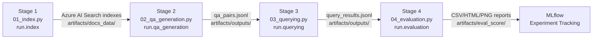
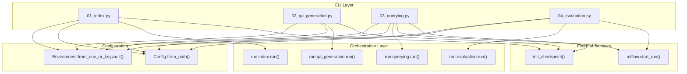
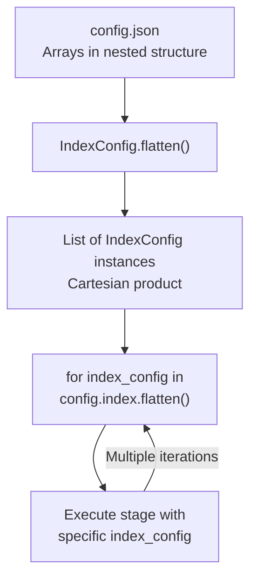
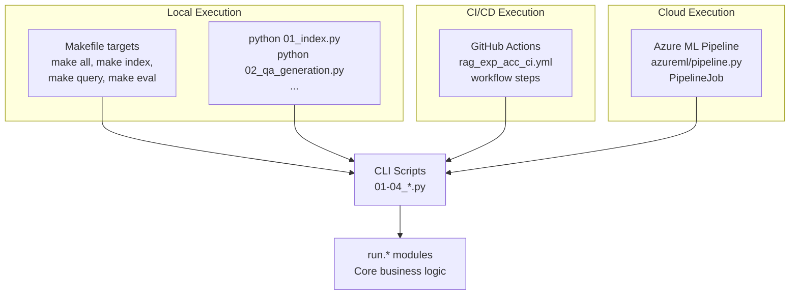
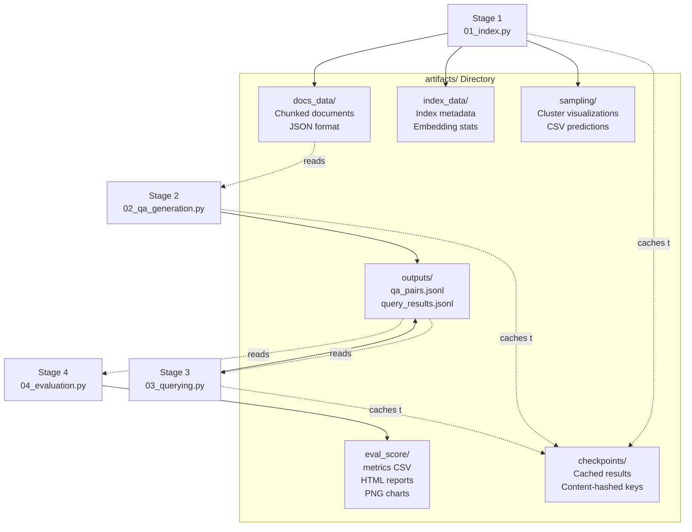
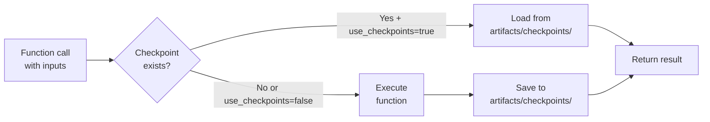
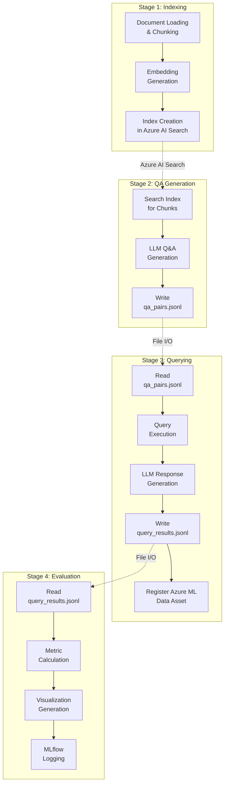
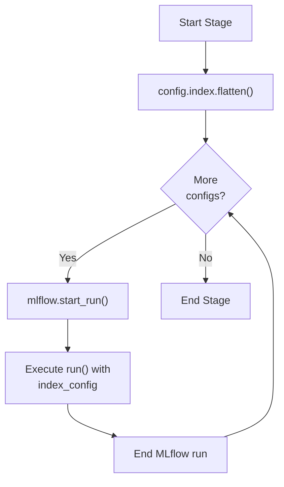
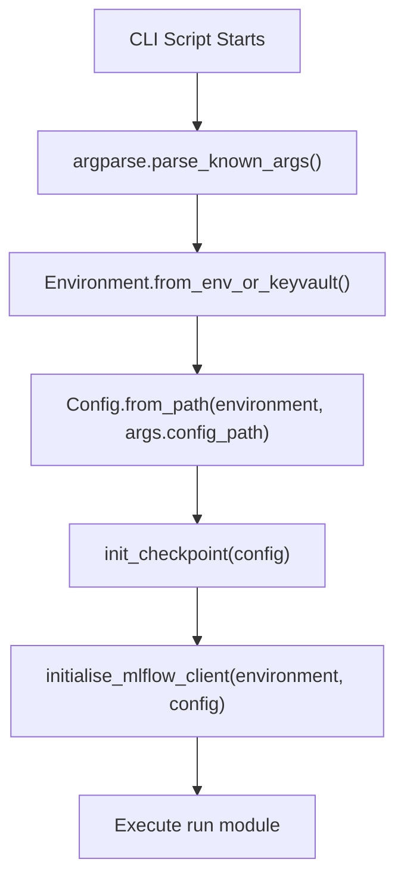
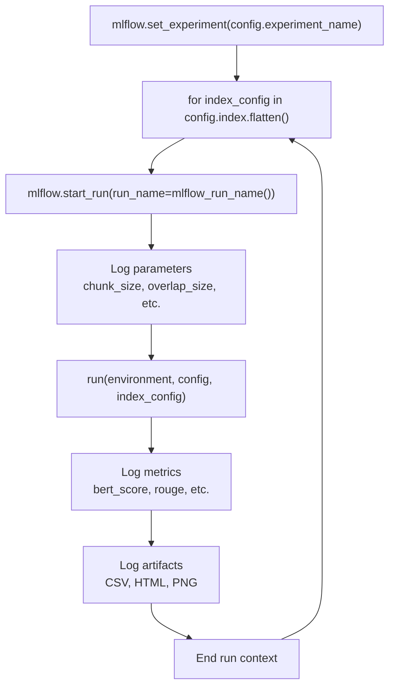

<!-- source: DeepWiki mcp.deepwiki.com · repo microsoft/rag-experiment-accelerator · page 3 Pipeline Architecture · fetched 2026-10-26 -->

# Pipeline Architecture

<details>
<summary>Relevant source files</summary>

The following files were used as context for generating this wiki page:

- [.env.template](.env.template)
- [.github/workflows/build_validation_workflow.yml](.github/workflows/build_validation_workflow.yml)
- [.github/workflows/rag_exp_acc_ci.yml](.github/workflows/rag_exp_acc_ci.yml)
- [02_qa_generation.py](02_qa_generation.py)
- [03_querying.py](03_querying.py)
- [04_evaluation.py](04_evaluation.py)
- [Makefile](Makefile)
- [README.md](README.md)
- [config.sample.json](config.sample.json)
- [docs/environment-variables.md](docs/environment-variables.md)

</details>


## Purpose and Scope

This document describes the overall architecture of the RAG Experiment Accelerator's 4-stage pipeline, including how stages execute sequentially, how data flows between them, and how configuration drives experimentation. For detailed information about individual stages, see:
- Stage 1 (Indexing): [Stage 1: Document Indexing](#3.1)
- Stage 2 (QA Generation): [Stage 2: QA Generation](#3.2)
- Stage 3 (Querying): [Stage 3: Querying and Retrieval](#3.3)
- Stage 4 (Evaluation): [Stage 4: Evaluation and Metrics](#3.4)

For configuration details, see [Configuration System](#4).

---

## Sequential Four-Stage Architecture

The RAG Experiment Accelerator implements a linear pipeline consisting of four mandatory stages that must execute in order. Each stage produces artifacts consumed by subsequent stages.

### Pipeline Stages Overview



| Stage | Entry Point | Core Module | Primary Output | Purpose |
|-------|-------------|-------------|----------------|---------|
| 1 | `01_index.py` | `run.index` | Azure AI Search indexes | Document loading, chunking, embedding, index creation |
| 2 | `02_qa_generation.py` | `run.qa_generation` | `qa_pairs.jsonl` | Ground truth Q&A pair generation using LLM |
| 3 | `03_querying.py` | `run.querying` | `query_results.jsonl` | Query execution, retrieval, reranking, LLM response generation |
| 4 | `04_evaluation.py` | `run.evaluation` | Metrics CSV/HTML/PNG | Metric calculation and visualization generation |

**Sources:** [README.md:197-222](), [01_index.py](), [02_qa_generation.py](), [03_querying.py](), [04_evaluation.py]()

---

## CLI Entry Points and Run Modules

Each stage is orchestrated by a CLI script that delegates to a corresponding `run` module. This separation enables testing, reusability, and multiple execution modes.

### CLI Script Structure



All CLI scripts follow a consistent pattern:

1. **Parse arguments**: `argparse` extracts `--config_path` and `--data_dir`
2. **Load environment**: `Environment.from_env_or_keyvault()` loads secrets
3. **Load configuration**: `Config.from_path()` parses `config.json`
4. **Initialize systems**: Checkpoint and MLflow (Stages 3-4 only)
5. **Execute run module**: Delegate to `run.<stage>.run()`

**Sources:** [01_index.py:16-52](), [02_qa_generation.py:10-22](), [03_querying.py:16-52](), [04_evaluation.py:15-43]()

---

## Configuration-Driven Experimentation

The pipeline supports systematic experimentation through configuration arrays that generate multiple index configurations via `Config.index.flatten()`.

### Index Configuration Expansion



When configuration parameters are specified as arrays, `flatten()` generates all combinations:

```json
{
  "index": {
    "chunk_size": [500, 1000],
    "overlap_size": [100, 200],
    "embedding_model": [
      {"type": "sentence-transformer", "model_name": "all-MiniLM-L6-v2"},
      {"type": "azure", "model_name": "text-embedding-ada-002"}
    ]
  }
}
```

This generates 2 × 2 × 2 = 8 index configurations, each creating a separate Azure AI Search index with a unique name like: `idx-chunk500-overlap100-dim384-ef_construction400-ef_search400`

**Sources:** [README.md:283-357](), [config.sample.json:10-37](), [03_querying.py:40-52](), [04_evaluation.py:34-42]()

---

## Execution Orchestration Modes

The pipeline supports three execution modes that all invoke the same CLI scripts, ensuring consistent behavior across environments.

### Orchestration Modes Comparison



| Mode | Entry Point | Use Case | Compute |
|------|-------------|----------|---------|
| **Direct** | `python 01_index.py` | Development, debugging | Local machine |
| **Makefile** | `make all`, `make query_eval` | Simplified local workflows | Local machine |
| **GitHub Actions** | `.github/workflows/rag_exp_acc_ci.yml` | Automated testing on PR | GitHub runners |
| **Azure ML** | `azureml/pipeline.py` | Production experiments | Azure ML compute clusters |

### Makefile Targets

The `Makefile` provides convenient aliases for common workflows:

- `make index` → `python3 01_index.py`
- `make qnagen` → `python3 02_qa_generation.py`
- `make query` → `python3 03_querying.py`
- `make eval` → `python3 04_evaluation.py`
- `make all` → Runs all four stages sequentially
- `make query_eval` → Runs only querying and evaluation stages

**Sources:** [Makefile:21-47](), [README.md:181-224](), [.github/workflows/rag_exp_acc_ci.yml:51-66]()

---

## Data Flow and Artifact Management

Each stage produces artifacts stored in the `artifacts/` directory. These artifacts serve as inputs to subsequent stages and enable inspection and debugging.

### Artifact Directory Structure



### Artifact Lifecycle

| Directory | Created By | Contains | Consumed By | Persistence |
|-----------|------------|----------|-------------|-------------|
| `artifacts/docs_data/` | Stage 1 | Chunked document JSON files | Stage 2 | Local filesystem |
| `artifacts/index_data/` | Stage 1 | Index metadata, embedding statistics | Inspection only | Local filesystem |
| `artifacts/sampling/` | Stage 1 (optional) | Cluster plots, prediction CSVs | Inspection only | Local filesystem |
| `artifacts/outputs/` | Stages 2-3 | `qa_pairs.jsonl`, `query_results.jsonl` | Subsequent stages | Local + Azure ML Data Assets |
| `artifacts/eval_score/` | Stage 4 | Metrics CSV, HTML reports, PNG charts | MLflow logging | Local + MLflow |
| `artifacts/checkpoints/` | All stages | Content-hashed cached results | Same stage on re-run | Local filesystem |

**Sources:** [README.md:247-256](), Diagram 4 from context

---

## Checkpointing System

The checkpoint system enables fault tolerance and avoids redundant expensive operations (LLM calls, embeddings, clustering) by caching results keyed by content hash.

### Checkpoint Behavior



The `use_checkpoints` configuration parameter controls checkpoint behavior globally. When enabled, the `init_checkpoint()` function configures the checkpoint decorator to cache expensive operations.

### Checkpoint Configuration

```json
{
  "use_checkpoints": true
}
```

Operations commonly checkpointed include:
- Document embedding generation
- LLM-based title/summary generation
- K-means clustering for sampling
- Q&A pair generation
- Query expansion (HyDE, related questions)
- LLM-based evaluation metrics

Checkpoint files are stored with content-based hashes to ensure cache invalidation when inputs change. The `make clear_checkpoints` command removes all cached data.

**Sources:** [README.md:295](), [config.sample.json:8](), [01_index.py:52](), [02_qa_generation.py:20](), [03_querying.py:38](), [Makefile:61-63]()

---

## Stage Interaction Patterns

Stages interact through three primary mechanisms: artifact files, Azure services, and MLflow tracking.

### Inter-Stage Dependencies



### Interaction Mechanisms

**1. File-Based Artifact Passing**
- Stage 2 reads chunked documents from `artifacts/docs_data/`
- Stage 3 reads Q&A pairs from `artifacts/outputs/qa_pairs.jsonl`
- Stage 4 reads query results from `artifacts/outputs/query_results.jsonl`

**2. Azure Service Integration**
- Stage 1 creates indexes in Azure AI Search
- Stages 2-3 query Azure AI Search indexes
- Stages 2-4 invoke Azure OpenAI for LLM operations
- Stage 3 registers Azure ML Data Assets
- Stage 4 logs to MLflow (via Azure ML)

**3. MLflow Experiment Tracking**
- Stage 3 initiates MLflow runs with `mlflow.start_run()`
- Stage 4 logs metrics, parameters, and artifacts to the same experiment
- Both stages use `mlflow_run_name()` to generate consistent run identifiers

**Sources:** [03_querying.py:29-52](), [04_evaluation.py:28-42](), [rag_experiment_accelerator/artifact/handlers/query_output_handler.py]()

---

## Multi-Index Experimentation

When configuration arrays generate multiple index configurations, each stage processes all configurations in sequence.

### Multi-Configuration Execution Flow



Each index configuration produces:
- **Stage 1**: A separate Azure AI Search index with unique name
- **Stage 2**: A separate `qa_pairs.jsonl` file in `artifacts/outputs/<index_name>/`
- **Stage 3**: A separate `query_results.jsonl` and Azure ML Data Asset
- **Stage 4**: Separate metric CSV/HTML/PNG files and MLflow run

This enables parallel experimentation across different chunking strategies, embedding models, and index configurations within a single pipeline execution.

**Sources:** [03_querying.py:40-52](), [04_evaluation.py:34-42](), [README.md:283-357]()

---

## Pipeline Execution Example

A typical complete pipeline execution follows this sequence:

```bash
# 1. Configure environment and experiment
cp .env.template .env
cp config.sample.json config.json
# Edit .env and config.json

# 2. Place documents in data/
# Copy PDFs, HTML, MD, JSON, or DOCX files

# 3. Run Stage 1: Indexing
python 01_index.py --config_path config.json --data_dir data
# Creates indexes in Azure AI Search
# Outputs: artifacts/docs_data/, artifacts/index_data/

# 4. Run Stage 2: QA Generation
python 02_qa_generation.py --config_path config.json --data_dir data
# Generates Q&A pairs from indexed chunks
# Outputs: artifacts/outputs/qa_pairs.jsonl

# 5. Run Stage 3: Querying
python 03_querying.py --config_path config.json
# Executes queries, retrieves context, generates responses
# Outputs: artifacts/outputs/query_results.jsonl
# Registers: Azure ML Data Asset

# 6. Run Stage 4: Evaluation
python 04_evaluation.py --config_path config.json
# Calculates metrics, generates visualizations
# Outputs: artifacts/eval_score/*.csv, *.html, *.png
# Logs: MLflow experiment tracking
```

Or use the Makefile shorthand:

```bash
make all  # Runs all stages sequentially
```

**Sources:** [README.md:181-224](), [Makefile:21-47]()

---

## Command-Line Arguments

All CLI scripts accept consistent arguments for configuration and data location.

| Argument | Type | Default | Description |
|----------|------|---------|-------------|
| `--config_path` | `str` | `config.json` | Path to JSON configuration file |
| `--data_dir` | `str` | `data` (Stages 1-2)<br/>`None` (Stages 3-4) | Directory containing input documents |

The `--data_dir` argument is only used by Stages 1-2 because they require document input. Stages 3-4 read from artifact files produced by earlier stages.

**Example usage:**

```bash
# Use custom config location
python 01_index.py --config_path experiments/exp1/config.json

# Use custom data directory (useful for sampling)
python 01_index.py --data_dir artifacts/sampling/job-name-sample

# Combine both arguments
python 02_qa_generation.py \
  --config_path experiments/exp1/config.json \
  --data_dir data-custom
```

**Sources:** [01_index.py:41-51](), [02_qa_generation.py:11-16](), [03_querying.py:17-27](), [04_evaluation.py:16-26]()

---

## Environment and Configuration Loading

The pipeline initializes environment secrets and configuration at the start of each stage using a two-step process.

### Initialization Sequence



**Step 1: Environment Loading**
- `Environment.from_env_or_keyvault()` loads secrets from:
  - `.env` file (local development)
  - Azure Key Vault (optional, specified in `.env`)
- Contains Azure service endpoints, API keys, subscription IDs

**Step 2: Configuration Loading**
- `Config.from_path()` parses JSON configuration file
- Validates configuration structure against schema
- Initializes path objects for artifact directories
- Loads experiment and job metadata

**Step 3: System Initialization**
- `init_checkpoint(config)` enables checkpoint system if `use_checkpoints=true`
- `initialise_mlflow_client()` connects to Azure ML workspace (Stages 3-4 only)
- `mlflow.set_experiment()` creates or reuses experiment by name

**Sources:** [01_index.py:27-52](), [02_qa_generation.py:17-22](), [03_querying.py:29-42](), [04_evaluation.py:28-35](), [.env.template:1-49]()

---

## MLflow Integration

Stages 3 and 4 use MLflow for experiment tracking, logging parameters, metrics, and artifacts to Azure ML.

### MLflow Context Management



Each index configuration generates a separate MLflow run with:
- **Run name**: `mlflow_run_name(config.job_name)` generates timestamp-suffixed identifier
- **Experiment name**: `config.experiment_name` groups related runs
- **Parameters**: Index configuration (chunk size, overlap, embedding model)
- **Metrics**: Evaluation scores (BERT, ROUGE, LLM-based metrics)
- **Artifacts**: CSV files, HTML reports, PNG visualizations

This enables comparison of different configurations in the Azure ML UI.

**Sources:** [03_querying.py:34-52](), [04_evaluation.py:30-42]()

---

## Error Handling and Fault Tolerance

The pipeline implements several fault tolerance mechanisms:

### Checkpoint-Based Recovery

If a stage fails mid-execution, enabling `use_checkpoints: true` allows the pipeline to resume from the last successful checkpoint rather than starting from scratch. Expensive operations (embeddings, LLM calls) are cached.

### Stage Isolation

Each stage is independent and can be re-run individually. If Stage 4 fails, you can fix the issue and re-run only `04_evaluation.py` without re-executing Stages 1-3.

### Configuration Validation

The `Config` class validates configuration structure on load, catching errors before expensive computation begins. The JSON schema at `config.schema.json` provides IDE validation support.

### Artifact Cleanup

The Makefile provides cleanup targets:
- `make clear_artifacts` - Remove all intermediate artifacts
- `make clear_checkpoints` - Clear checkpoint cache
- `make clear_docs` - Remove downloaded documents

**Sources:** [README.md:295](), [Makefile:50-63](), [config.sample.json:8]()

---

## Summary

The RAG Experiment Accelerator implements a linear 4-stage pipeline where:

1. **Stage 1** loads documents, chunks them, generates embeddings, and creates Azure AI Search indexes
2. **Stage 2** generates Q&A pairs from indexed chunks using LLM
3. **Stage 3** executes queries, retrieves context, reranks, and generates LLM responses
4. **Stage 4** calculates metrics, generates visualizations, and logs to MLflow

The pipeline supports:
- **Multiple execution modes**: Local (CLI/Makefile), CI/CD (GitHub Actions), Cloud (Azure ML)
- **Configuration-driven experimentation**: Array-based config generates multiple index configurations
- **Fault tolerance**: Checkpoint system caches expensive operations
- **Experiment tracking**: MLflow integration for parameter/metric comparison

Each stage produces artifacts consumed by subsequent stages, enabling inspection, debugging, and resumption from failure points.

**Sources:** [README.md:1-224](), [01_index.py](), [02_qa_generation.py](), [03_querying.py](), [04_evaluation.py](), [Makefile:21-47]()

---

