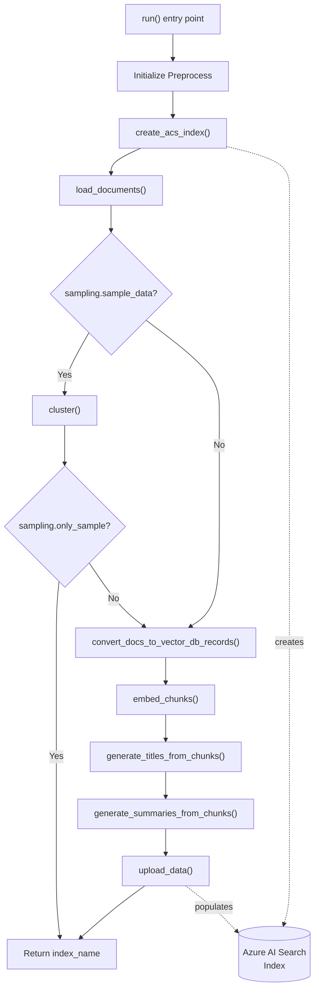
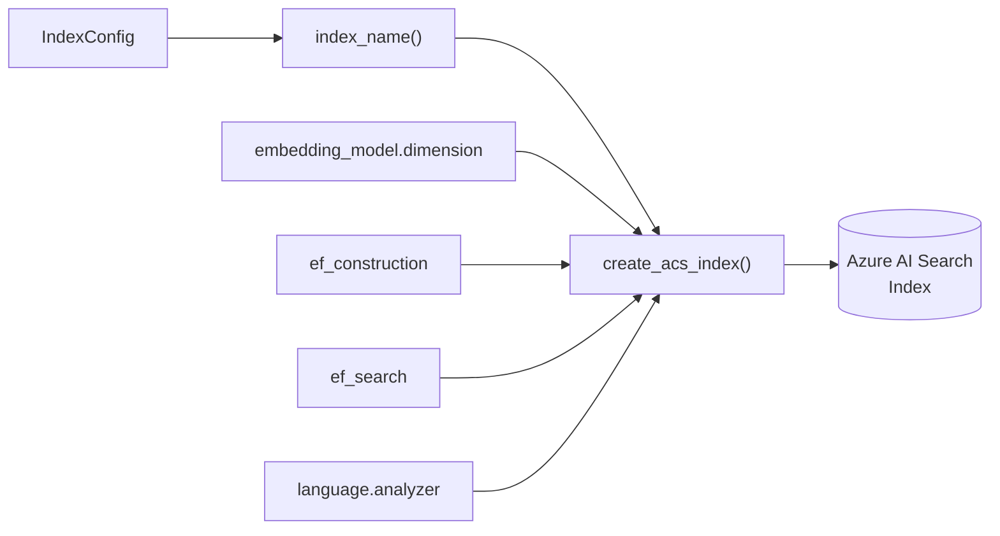
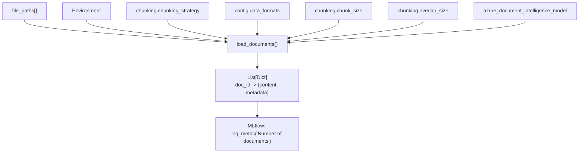
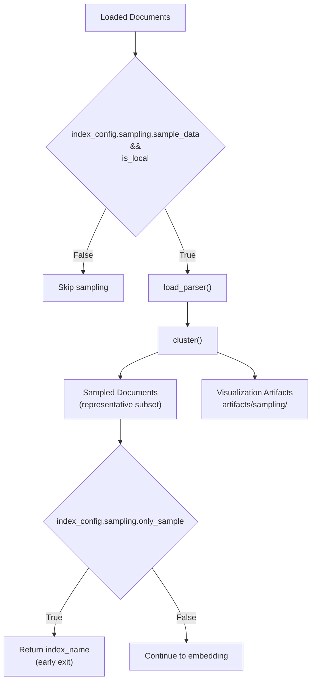
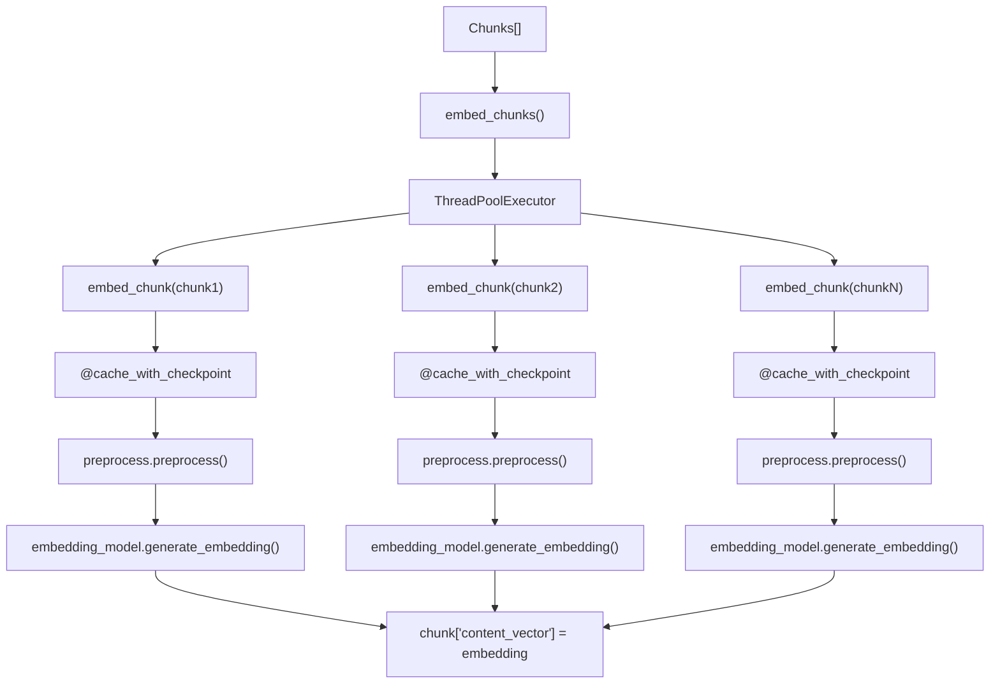
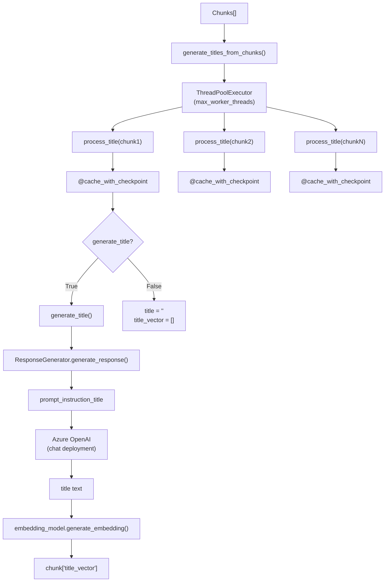
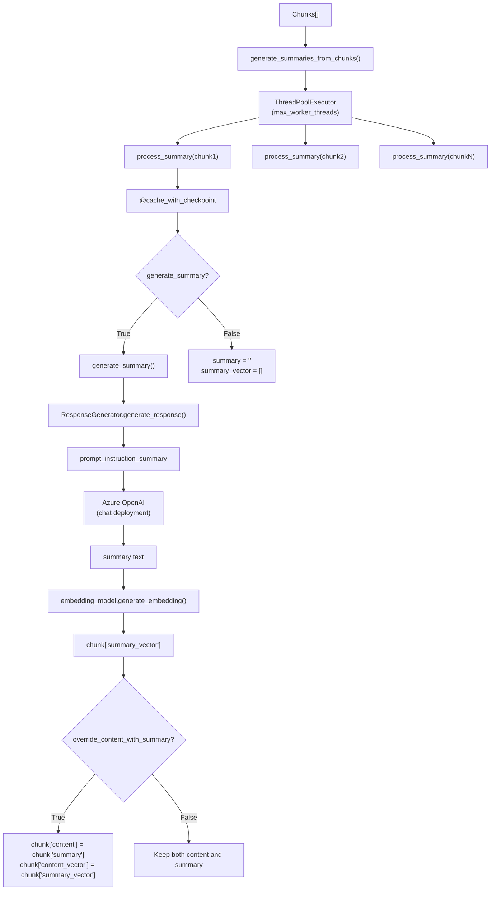
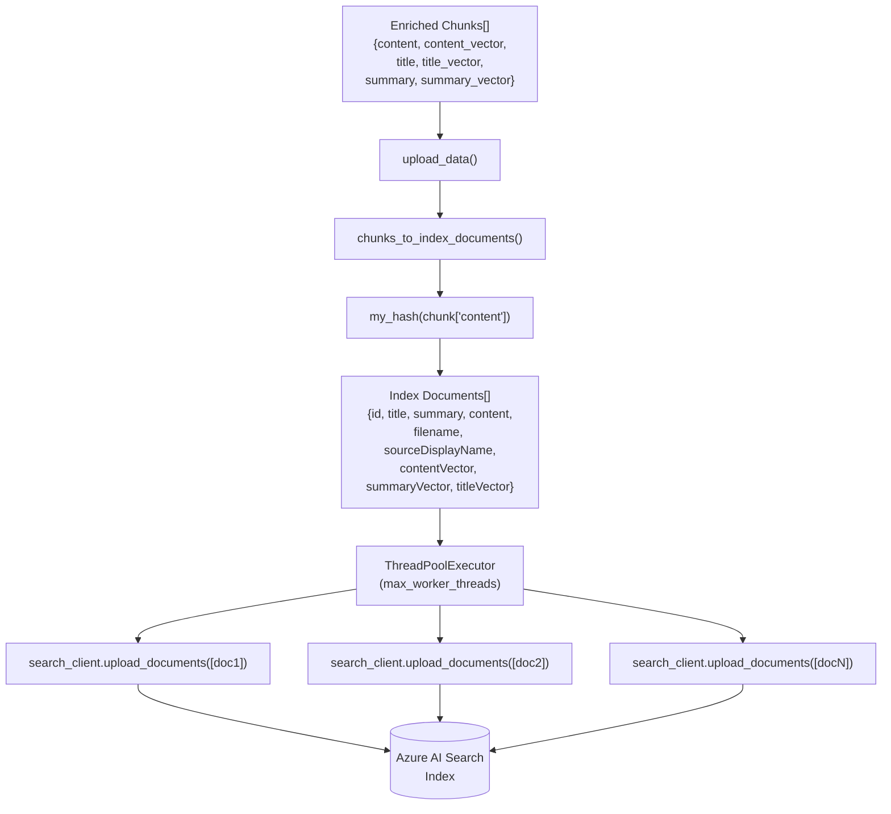
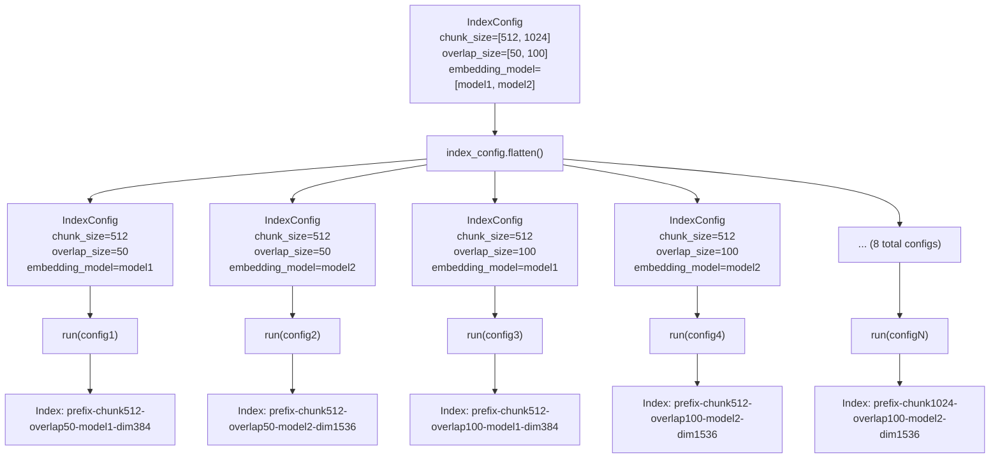

<!-- source: DeepWiki mcp.deepwiki.com · repo microsoft/rag-experiment-accelerator · page 3.1 Stage 1: Document Indexing · fetched 2026-10-26 -->

# Stage 1: Document Indexing

<details>
<summary>Relevant source files</summary>

The following files were used as context for generating this wiki page:

- [rag_experiment_accelerator/config/tests/data/config.json](rag_experiment_accelerator/config/tests/data/config.json)
- [rag_experiment_accelerator/doc_loader/pdfLoader.py](rag_experiment_accelerator/doc_loader/pdfLoader.py)
- [rag_experiment_accelerator/ingest_data/acs_ingest.py](rag_experiment_accelerator/ingest_data/acs_ingest.py)
- [rag_experiment_accelerator/ingest_data/tests/test_acs_ingest.py](rag_experiment_accelerator/ingest_data/tests/test_acs_ingest.py)
- [rag_experiment_accelerator/nlp/preprocess.py](rag_experiment_accelerator/nlp/preprocess.py)
- [rag_experiment_accelerator/nlp/tests/test_preprocessor.py](rag_experiment_accelerator/nlp/tests/test_preprocessor.py)
- [rag_experiment_accelerator/run/index.py](rag_experiment_accelerator/run/index.py)
- [rag_experiment_accelerator/run/tests/test_index.py](rag_experiment_accelerator/run/tests/test_index.py)

</details>


## Purpose and Scope

This document details Stage 1 of the RAG Experiment Accelerator pipeline, which transforms raw documents into searchable, embedded content stored in Azure AI Search indexes. This stage encompasses document loading, chunking, optional sampling, embedding generation, optional title/summary generation, and index population.

For document loader implementations, see [Document Loaders](#5.1). For chunking strategy details, see [Chunking Strategies](#5.3). For sampling mechanics, see [Data Sampling and Clustering](#5.4). For embedding model configuration, see [Embedding Models](#6). For Azure AI Search setup, see [Azure AI Search Configuration](#9.1).

**Sources:** High-level diagrams, [rag_experiment_accelerator/run/index.py](rag_experiment_accelerator/run/index.py)

---

## Stage 1 Workflow Overview



**Diagram: Stage 1 Execution Flow**

The orchestration function `run()` in [rag_experiment_accelerator/run/index.py:30-100]() executes the complete indexing pipeline. It accepts an `Environment` object, `Config` object, `IndexConfig` object, file paths list, and MLflow client.

**Sources:** [rag_experiment_accelerator/run/index.py:30-100]()

---

## Key Components and Execution Flow

### Index Creation



**Diagram: Azure AI Search Index Creation**

Before document processing begins, an Azure AI Search index is created using `create_acs_index()` with parameters derived from `IndexConfig`:

| Parameter | Source | Purpose |
|-----------|--------|---------|
| `index_name` | `index_config.index_name()` | Unique identifier combining prefix, chunk size, overlap, and embedding dimension |
| `dimension` | `config.get_embedding_model().dimension` | Vector dimension for HNSW index |
| `ef_construction` | `index_config.ef_construction` | HNSW index construction parameter |
| `ef_search` | `index_config.ef_search` | HNSW index search parameter |
| `analyzer` | `config.language.analyzer` | Text analyzer for BM25 search |

**Sources:** [rag_experiment_accelerator/run/index.py:46-58]()

---

### Document Loading and Chunking



**Diagram: Document Loading Pipeline**

The `load_documents()` function (from the `doc_loader` module) processes documents according to the configured strategy:

- **Chunking Strategy:** Controls how documents are split (e.g., `basic`, `advanced`)
- **Chunk Size:** Target size in characters for each chunk
- **Overlap Size:** Character overlap between consecutive chunks
- **Data Formats:** File extensions to process (e.g., `pdf`, `html`, `json`, `docx`)
- **Azure Document Intelligence Model:** For PDF processing (e.g., `prebuilt-read`, `prebuilt-layout`)

Each document is returned as a dictionary mapping a UUID to content and metadata:

```python
{
    "uuid-string": {
        "content": "document text...",
        "metadata": {
            "source": "path/to/file.pdf",
            "page": 1
        }
    }
}
```

**Sources:** [rag_experiment_accelerator/run/index.py:60-68](), [rag_experiment_accelerator/doc_loader/pdfLoader.py:40-91]()

---

### Optional Data Sampling



**Diagram: Optional Sampling Flow**

When `index_config.sampling.sample_data` is `True` and execution is local, the system uses K-means clustering to select a representative subset of documents. This is useful for rapid prototyping with large corpora.

The `cluster()` function from [rag_experiment_accelerator/sampling/clustering.py]() generates:
- A sampled subset of documents
- Visualization artifacts saved to `artifacts/sampling/`
- Cluster statistics logged to MLflow

If `sampling.only_sample` is `True`, the pipeline exits after sampling without creating embeddings or uploading to Azure AI Search.

**Sources:** [rag_experiment_accelerator/run/index.py:70-75]()

---

### Document to Vector DB Record Conversion


**Diagram: Vector DB Record Conversion**

The `convert_docs_to_vector_db_records()` function transforms document dictionaries into a format suitable for Azure AI Search:

| Field | Source | Example |
|-------|--------|---------|
| `id` | Document UUID key | `"abc-123-def-456"` |
| `content` | `doc_dict["content"]` | `"Document text content..."` |
| `filename` | `basename(metadata["source"])` | `"document.pdf"` |
| `source_display_name` | `filename#page=N` or `filename` | `"document.pdf#page=5"` |

**Sources:** [rag_experiment_accelerator/run/index.py:103-131]()

---

## Chunk Enrichment Pipeline

### Embedding Generation



**Diagram: Parallel Embedding Generation**

The `embed_chunks()` function uses a `ThreadPoolExecutor` to parallelize embedding generation. Each chunk is processed by the `embed_chunk()` function, which:

1. Applies the checkpoint decorator `@cache_with_checkpoint` keyed by `chunk['content']+embedding_model.name`
2. Preprocesses the content using `Preprocess.preprocess()` (if enabled)
3. Generates embeddings via the configured embedding model
4. Adds the `content_vector` field to the chunk dictionary

**Preprocessing:** When `index_config.chunking.preprocess` is `True`, the `Preprocess` class applies:
- Lowercasing
- Punctuation removal
- HTML tag removal
- Stop word removal
- Tokenization

**Sources:** [rag_experiment_accelerator/run/index.py:134-184](), [rag_experiment_accelerator/run/index.py:187-209](), [rag_experiment_accelerator/nlp/preprocess.py:25-48]()

---

### Title Generation



**Diagram: Title Generation Pipeline**

When `index_config.chunking.generate_title` is `True`, the system generates titles for each chunk using an LLM:

1. **Parallel Processing:** Uses `ThreadPoolExecutor` with `config.max_worker_threads`
2. **Checkpoint Decorator:** `@cache_with_checkpoint` keyed by `chunk['content']+str(config.index.chunking.generate_title)`
3. **LLM Call:** `ResponseGenerator` invokes Azure OpenAI with `prompt_instruction_title`
4. **Embedding:** Generated title is embedded using the same embedding model as content
5. **Fields Added:** `chunk['title']` and `chunk['title_vector']`

**Sources:** [rag_experiment_accelerator/run/index.py:212-251](), [rag_experiment_accelerator/run/index.py:292-327](), [rag_experiment_accelerator/run/index.py:373-390]()

---

### Summary Generation



**Diagram: Summary Generation and Override Pipeline**

Summary generation follows the same pattern as title generation but with an additional step:

When `index_config.chunking.override_content_with_summary` is `True`, the system replaces the chunk's content with its summary. This enables experimentation with summary-based retrieval.

**Sources:** [rag_experiment_accelerator/run/index.py:253-290](), [rag_experiment_accelerator/run/index.py:330-370](), [rag_experiment_accelerator/run/index.py:393-412](), [rag_experiment_accelerator/run/index.py:174-183]()

---

## Index Upload



**Diagram: Document Upload to Azure AI Search**

The `upload_data()` function performs the final step of Stage 1:

### Index Document Structure

The `chunks_to_index_documents()` function transforms enriched chunks into Azure AI Search documents:

```python
{
    "id": "md5_hash_of_content",
    "title": "Generated or empty title",
    "summary": "Generated or empty summary", 
    "content": "Chunk text content",
    "filename": "source_file.pdf",
    "sourceDisplayName": "source_file.pdf#page=5",
    "contentVector": [0.1, 0.2, ...],  # Embedding vector
    "summaryVector": [0.3, 0.4, ...],  # Summary embedding or empty
    "titleVector": [0.5, 0.6, ...]     # Title embedding or empty
}
```

### Parallel Upload

Documents are uploaded in parallel using `ThreadPoolExecutor` with `config.max_worker_threads`. Each document is uploaded individually to handle failures gracefully. Failed uploads are logged but don't halt the pipeline.

**Sources:** [rag_experiment_accelerator/ingest_data/acs_ingest.py:36-90](), [rag_experiment_accelerator/ingest_data/acs_ingest.py:198-230](), [rag_experiment_accelerator/ingest_data/acs_ingest.py:23-33]()

---

## Configuration Parameters

### IndexConfig Fields

The `IndexConfig` object controls Stage 1 behavior through multiple nested configurations:

```mermaid
graph TB
    INDEX_CFG["IndexConfig"] --> NAME["index_name_prefix"]
    INDEX_CFG --> EF_CONST["ef_construction[]"]
    INDEX_CFG --> EF_SEARCH["ef_search[]"]
    INDEX_CFG --> CHUNK_CFG["ChunkingConfig"]
    INDEX_CFG --> EMB_CFG["EmbeddingModelConfig[]"]
    INDEX_CFG --> SAMP_CFG["SamplingConfig"]
    
    CHUNK_CFG --> PREPROC["preprocess: bool"]
    CHUNK_CFG --> CHUNK_SIZE["chunk_size[]"]
    CHUNK_CFG --> OVERLAP["overlap_size[]"]
    CHUNK_CFG --> STRATEGY["chunking_strategy"]
    CHUNK_CFG --> GEN_TITLE["generate_title: bool"]
    CHUNK_CFG --> GEN_SUMM["generate_summary: bool"]
    CHUNK_CFG --> OVERRIDE["override_content_with_summary: bool"]
    CHUNK_CFG --> DI_MODEL["azure_document_intelligence_model"]
    
    EMB_CFG --> EMB_TYPE["type: 'sentence-transformer' | 'azure'"]
    EMB_CFG --> MODEL_NAME["model_name"]
    EMB_CFG --> DIMENSION["dimension (optional)"]
    EMB_CFG --> SHORTEN["shorten_dimensions (optional)"]
    
    SAMP_CFG --> SAMPLE_DATA["sample_data: bool"]
    SAMP_CFG --> PERCENTAGE["percentage: int"]
    SAMP_CFG --> OPTIMUM_K["optimum_k: 'auto' | int"]
    SAMP_CFG --> MIN_CLUST["min_cluster: int"]
    SAMP_CFG --> MAX_CLUST["max_cluster: int"]
    SAMP_CFG --> ONLY_SAMPLE["only_sample: bool"]
```



**Diagram: IndexConfig Hierarchy**

### Key Configuration Parameters

| Parameter | Type | Purpose | Example |
|-----------|------|---------|---------|
| `index_name_prefix` | `str` | Prefix for generated index names | `"experiment1"` |
| `ef_construction` | `list[int]` | HNSW construction parameter (quality vs build time) | `[300, 400]` |
| `ef_search` | `list[int]` | HNSW search parameter (recall vs latency) | `[300, 400]` |
| `chunking.preprocess` | `bool` | Enable spaCy preprocessing | `false` |
| `chunking.chunk_size` | `list[int]` | Target chunk sizes in characters | `[512, 1024]` |
| `chunking.overlap_size` | `list[int]` | Overlap between chunks | `[50, 100]` |
| `chunking.chunking_strategy` | `str` | Chunking algorithm | `"basic"` |
| `chunking.generate_title` | `bool` | Generate LLM titles | `false` |
| `chunking.generate_summary` | `bool` | Generate LLM summaries | `false` |
| `chunking.override_content_with_summary` | `bool` | Replace content with summary | `false` |
| `embedding_model[].type` | `str` | `"sentence-transformer"` or `"azure"` | `"sentence-transformer"` |
| `embedding_model[].model_name` | `str` | Model identifier | `"all-MiniLM-L6-v2"` |
| `sampling.sample_data` | `bool` | Enable clustering-based sampling | `false` |
| `sampling.percentage` | `int` | Percentage of data to sample | `5` |
| `sampling.only_sample` | `bool` | Exit after sampling without indexing | `false` |

**Sources:** [rag_experiment_accelerator/config/tests/data/config.json:9-51](), [rag_experiment_accelerator/run/tests/test_index.py:55-74]()

---

## Multi-Configuration Experiments



**Diagram: Configuration Grid Search via flatten()**

The `IndexConfig.flatten()` method generates the Cartesian product of all list-valued configuration parameters, enabling systematic experimentation. For example, if:
- `chunk_size = [512, 1024]`
- `overlap_size = [50, 100]`
- `embedding_model = [model1, model2]`

Then `flatten()` produces 2 × 2 × 2 = 8 distinct `IndexConfig` objects, each resulting in a separate Azure AI Search index.

The CLI script iterates over these configurations:

```python
for index_config in config.index.flatten():
    run(environment, config, index_config, file_paths, mlflow_client)
```

**Sources:** [rag_experiment_accelerator/run/tests/test_index.py:110-118]()

---

## Artifact Generation

Stage 1 produces several artifact types:

### Checkpoint Artifacts

Location: `artifacts/checkpoints/`

Expensive operations are cached using the `@cache_with_checkpoint` decorator:

| Function | Cache Key | Purpose |
|----------|-----------|---------|
| `embed_chunk` | `chunk['content']+embedding_model.name` | Cache embedding generation |
| `process_title` | `chunk['content']+str(config.index.chunking.generate_title)` | Cache title generation |
| `process_summary` | `chunk['content']+str(config.index.chunking.generate_summary)` | Cache summary generation |

These caches enable pipeline resumption and avoid redundant LLM/embedding API calls across runs.

### Sampling Artifacts

Location: `artifacts/sampling/<index_name>/`

When `sampling.sample_data` is `True`, the clustering process generates visualization artifacts showing cluster distributions and sample selection.

### Azure AI Search Indexes

The primary output is one or more populated Azure AI Search indexes. Index names follow the pattern:

```
{index_name_prefix}-chunk{chunk_size}-overlap{overlap_size}-{model_name}-dim{dimension}
```

Example: `experiment1-chunk512-overlap50-minilm-dim384`

### MLflow Metrics

Stage 1 logs metrics to MLflow (when available):

- `Number of documents`: Count of loaded documents before chunking
- `Number of document chunks`: Count of chunks after splitting

**Sources:** [rag_experiment_accelerator/run/index.py:7](), [rag_experiment_accelerator/run/index.py:77-79](), [rag_experiment_accelerator/run/index.py:187](), [rag_experiment_accelerator/run/index.py:292](), [rag_experiment_accelerator/run/index.py:330]()

---

## Execution Entry Points

### CLI Script

The primary entry point is `01_index.py`, which:
1. Loads environment variables and configuration
2. Initializes checkpoint system
3. Calls `run()` for each flattened `IndexConfig`
4. Returns created index names

### Makefile Target

```bash
make index
```

Executes `01_index.py` with the default configuration.

### GitHub Actions

The CI/CD workflow `.github/workflows/rag_exp_acc_ci.yml` executes indexing as part of the automated pipeline using test data from `data-ci/`.

### Azure ML Pipeline

The Azure ML pipeline in `azureml/pipeline.py` can submit Stage 1 as a distributed job on Azure ML compute clusters.

**Sources:** High-level Diagram 2 (Configuration & Orchestration Layer)

---

## Code Entity Reference

### Primary Classes and Functions

| Entity | Location | Role |
|--------|----------|------|
| `run()` | [rag_experiment_accelerator/run/index.py:30-100]() | Main orchestration function for Stage 1 |
| `Preprocess` | [rag_experiment_accelerator/nlp/preprocess.py:10-129]() | Text preprocessing with spaCy |
| `create_acs_index()` | [rag_experiment_accelerator/init_Index/create_index.py]() | Creates Azure AI Search index schema |
| `load_documents()` | [rag_experiment_accelerator/doc_loader/documentLoader.py]() | Loads and chunks documents |
| `cluster()` | [rag_experiment_accelerator/sampling/clustering.py]() | K-means sampling |
| `convert_docs_to_vector_db_records()` | [rag_experiment_accelerator/run/index.py:103-131]() | Transforms docs to vector DB format |
| `embed_chunks()` | [rag_experiment_accelerator/run/index.py:134-184]() | Parallel embedding generation |
| `embed_chunk()` | [rag_experiment_accelerator/run/index.py:187-209]() | Single chunk embedding (cached) |
| `generate_titles_from_chunks()` | [rag_experiment_accelerator/run/index.py:212-251]() | Parallel title generation |
| `process_title()` | [rag_experiment_accelerator/run/index.py:292-327]() | Single chunk title (cached) |
| `generate_summaries_from_chunks()` | [rag_experiment_accelerator/run/index.py:253-290]() | Parallel summary generation |
| `process_summary()` | [rag_experiment_accelerator/run/index.py:330-370]() | Single chunk summary (cached) |
| `upload_data()` | [rag_experiment_accelerator/ingest_data/acs_ingest.py:36-90]() | Uploads to Azure AI Search |
| `chunks_to_index_documents()` | [rag_experiment_accelerator/ingest_data/acs_ingest.py:198-230]() | Formats chunks for upload |
| `ResponseGenerator` | [rag_experiment_accelerator/llm/response_generator.py]() | LLM interaction wrapper |

### Configuration Classes

| Class | Location | Purpose |
|-------|----------|---------|
| `Config` | [rag_experiment_accelerator/config/config.py]() | Global experiment configuration |
| `IndexConfig` | [rag_experiment_accelerator/config/index_config.py]() | Per-index configuration |
| `ChunkingConfig` | [rag_experiment_accelerator/config/chunking_config.py]() | Chunking parameters |
| `EmbeddingModelConfig` | [rag_experiment_accelerator/config/embedding_model_config.py]() | Embedding model settings |
| `SamplingConfig` | [rag_experiment_accelerator/config/sampling_config.py]() | Sampling parameters |
| `Environment` | [rag_experiment_accelerator/config/environment.py]() | Azure service credentials |

**Sources:** [rag_experiment_accelerator/run/index.py](), [rag_experiment_accelerator/ingest_data/acs_ingest.py](), [rag_experiment_accelerator/nlp/preprocess.py]()

---

