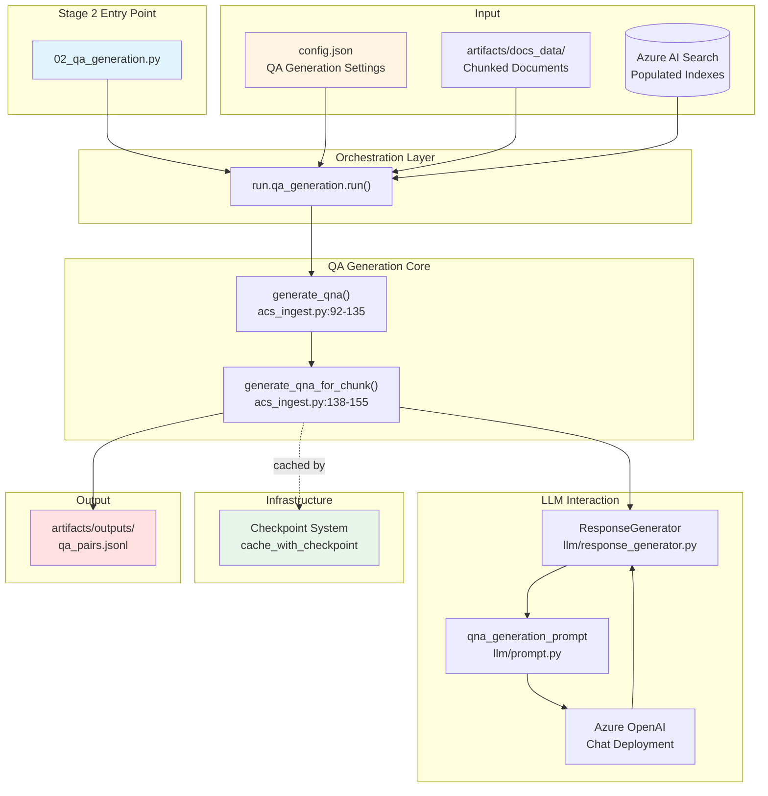
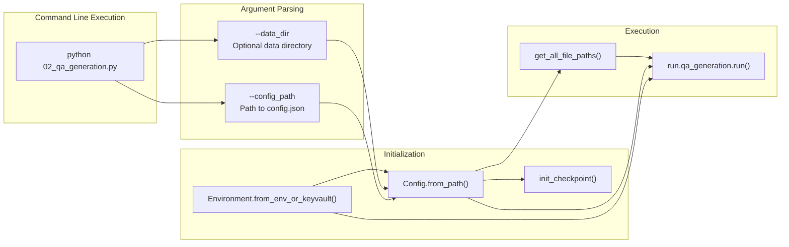
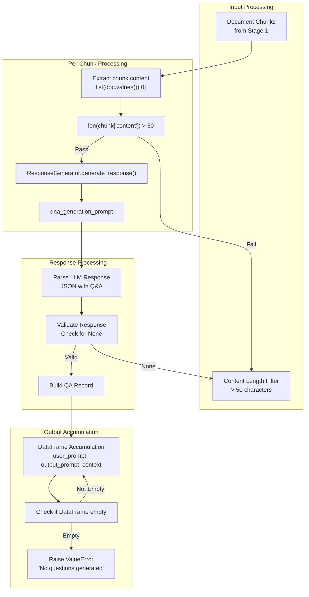
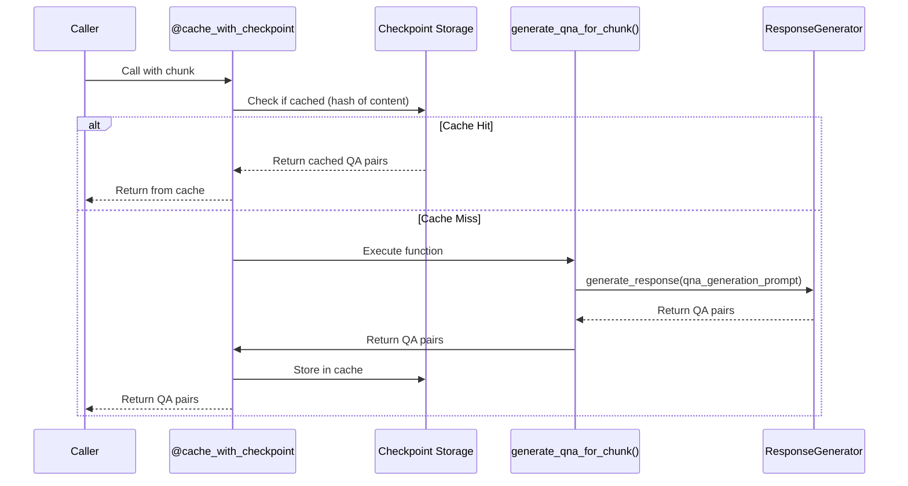
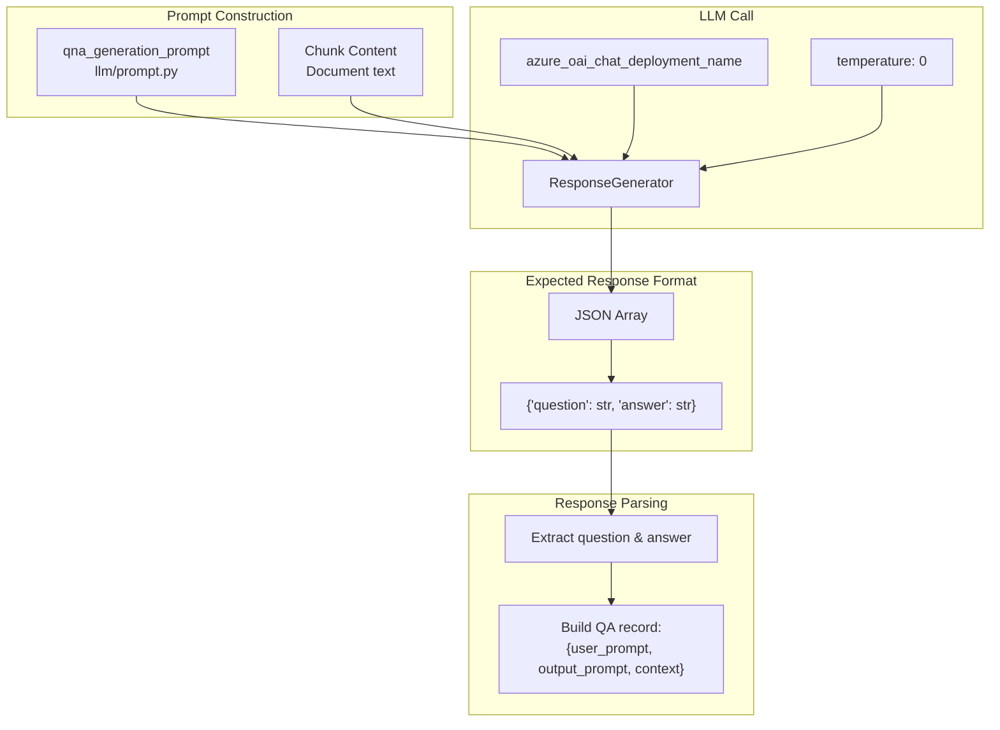
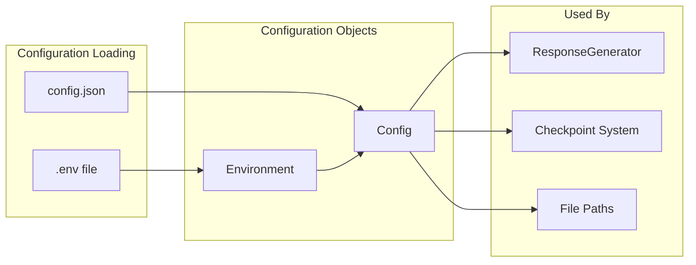
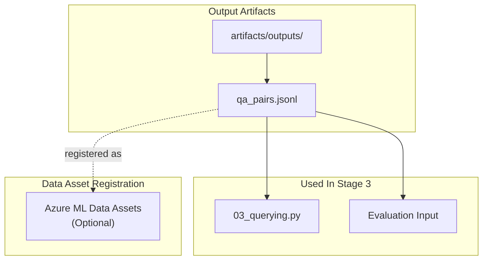
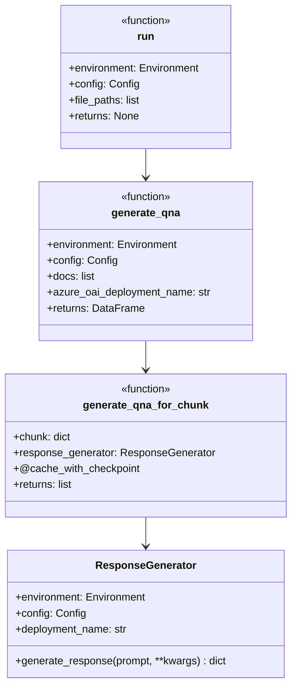
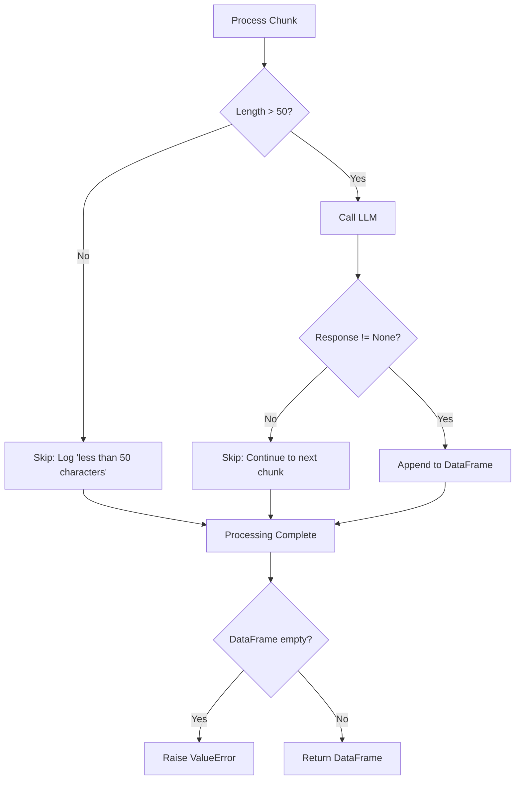
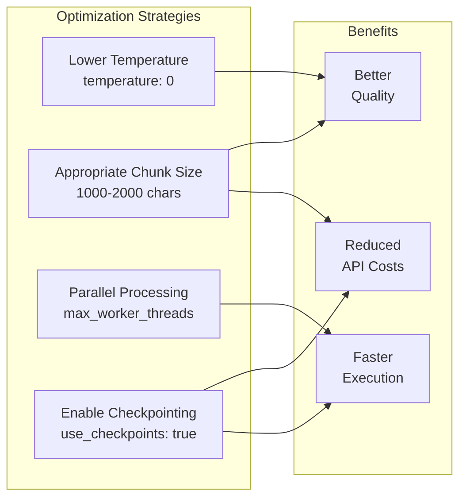

<!-- source: DeepWiki mcp.deepwiki.com · repo microsoft/rag-experiment-accelerator · page 3.2 Stage 2: QA Generation · fetched 2026-10-26 -->

# Stage 2: QA Generation

<details>
<summary>Relevant source files</summary>

The following files were used as context for generating this wiki page:

- [02_qa_generation.py](02_qa_generation.py)
- [03_querying.py](03_querying.py)
- [04_evaluation.py](04_evaluation.py)
- [README.md](README.md)
- [config.sample.json](config.sample.json)
- [rag_experiment_accelerator/doc_loader/pdfLoader.py](rag_experiment_accelerator/doc_loader/pdfLoader.py)
- [rag_experiment_accelerator/ingest_data/acs_ingest.py](rag_experiment_accelerator/ingest_data/acs_ingest.py)
- [rag_experiment_accelerator/ingest_data/tests/test_acs_ingest.py](rag_experiment_accelerator/ingest_data/tests/test_acs_ingest.py)

</details>


## Overview

Stage 2 of the RAG Experiment Accelerator pipeline generates question-answer (QA) pairs from the indexed documents created in Stage 1. These QA pairs serve as **ground truth evaluation data** for assessing the quality of the RAG system in subsequent stages. The system uses Azure OpenAI LLMs to automatically generate diverse, contextually-relevant questions and their corresponding answers from document chunks, creating a synthetic evaluation dataset.

This stage is executed via the `02_qa_generation.py` CLI script and produces a JSONL file containing QA pairs that will be used in Stage 3 (querying) and Stage 4 (evaluation). For information about document indexing, see [Stage 1: Document Indexing](#3.1). For information about using these QA pairs in queries, see [Stage 3: Querying and Retrieval](#3.3).

Sources: [README.md:1-231](), [02_qa_generation.py:1-23]()

## Architecture and Data Flow



**Stage 2: QA Generation Pipeline**

The stage follows this flow:
1. CLI script initializes environment and configuration
2. Orchestration layer retrieves document chunks from Stage 1
3. For each chunk, the LLM generates question-answer pairs
4. Results are cached via checkpoint system to avoid redundant LLM calls
5. All QA pairs are aggregated and written to JSONL output

Sources: [02_qa_generation.py:1-23](), [rag_experiment_accelerator/ingest_data/acs_ingest.py:92-155]()

## CLI Execution and Entry Point

The `02_qa_generation.py` script serves as the entry point for Stage 2:



**CLI Workflow**

The script performs these steps:
1. Parses command-line arguments for configuration file and data directory paths
2. Loads environment variables from `.env` or Azure Key Vault
3. Initializes configuration object from `config.json`
4. Initializes checkpoint system for caching expensive operations
5. Retrieves all file paths from the data directory
6. Executes the QA generation run

Sources: [02_qa_generation.py:10-22](), [README.md:204-210]()

## QA Generation Process

### Document Retrieval and Filtering



**Document Processing Flow**

The `generate_qna()` function implements the core logic:
- Iterates through document chunks
- Filters out chunks with less than 50 characters
- Calls Azure OpenAI to generate QA pairs
- Accumulates valid responses in a pandas DataFrame
- Raises an error if no questions were generated

Sources: [rag_experiment_accelerator/ingest_data/acs_ingest.py:92-135]()

### Checkpoint-Cached Generation

The system uses a checkpoint decorator to cache expensive LLM calls:

| Component | Purpose | Implementation |
|-----------|---------|----------------|
| `@cache_with_checkpoint` | Decorator for caching | Applied to `generate_qna_for_chunk()` |
| Cache Key | Content-based hashing | `id="chunk['content']"` |
| Cache Storage | Filesystem persistence | `artifacts/checkpoints/` directory |
| Benefit | Avoid redundant LLM calls | Skip already-processed chunks on re-runs |

The `generate_qna_for_chunk()` function [rag_experiment_accelerator/ingest_data/acs_ingest.py:138-155]() demonstrates the checkpointing pattern:



**Checkpoint Caching Flow**

This pattern provides:
- **Idempotency**: Re-running Stage 2 skips already-processed chunks
- **Cost Reduction**: Avoids redundant Azure OpenAI API calls
- **Fault Tolerance**: Can resume from failures without losing progress

Sources: [rag_experiment_accelerator/ingest_data/acs_ingest.py:138-155](), [README.md:8-9]()

### LLM Prompt and Response Structure

The QA generation relies on the `ResponseGenerator` class and the `qna_generation_prompt`:



**Prompt and Response Structure**

The response generator is configured with:
- **Deployment**: Uses `config.openai.azure_oai_chat_deployment_name` from configuration
- **Temperature**: Controlled via `config.openai.temperature` (typically 0 for deterministic output)
- **Prompt**: Instructs the LLM to generate questions and answers based on the provided context

The expected response is a JSON array where each item contains:
- `question`: The generated question
- `answer`: The corresponding answer
- These are mapped to `user_prompt` and `output_prompt` in the output

Sources: [rag_experiment_accelerator/ingest_data/acs_ingest.py:106-125](), [rag_experiment_accelerator/ingest_data/acs_ingest.py:142-153]()

## Configuration

### QA Generation Configuration Parameters

Stage 2 behavior is controlled through several configuration sections:

| Configuration Path | Parameter | Purpose | Example Values |
|-------------------|-----------|---------|----------------|
| `openai.azure_oai_chat_deployment_name` | Chat deployment name | LLM to use for QA generation | `"gpt-35-turbo"`, `"gpt-4"` |
| `openai.temperature` | Temperature | Controls response randomness | `0` (deterministic), `0.7` (creative) |
| `use_checkpoints` | Enable caching | Whether to cache LLM responses | `true`, `false` |
| `path.data_dir` | Data directory | Location of input documents | `"data"`, `"data-ci"` |
| `path.query_data_dir` | Output directory | Where to write QA pairs | `"artifacts/outputs"` |

Sources: [config.sample.json:72-76](), [README.md:348-352]()

### Configuration in Practice

The configuration object is initialized at the start of `02_qa_generation.py`:



**Configuration Flow**

The environment and configuration are loaded early and passed throughout the pipeline:
1. `Environment.from_env_or_keyvault()` loads Azure credentials
2. `Config.from_path()` loads experiment parameters
3. Both are passed to `run()` function for execution

Sources: [02_qa_generation.py:18-19](), [README.md:185-194]()

## Output Format

### QA Pairs JSONL Structure

The generated QA pairs are written to a JSONL file with the following schema:

| Field | Type | Description | Source |
|-------|------|-------------|--------|
| `user_prompt` | string | The generated question | LLM response `question` field |
| `output_prompt` | string | The generated answer | LLM response `answer` field |
| `context` | string | The document chunk used to generate the QA | Original chunk content |

Each line in the JSONL file represents one QA pair as a JSON object:

```json
{"user_prompt": "What is the purpose of...", "output_prompt": "The purpose is...", "context": "Original document text..."}
```

Sources: [rag_experiment_accelerator/ingest_data/acs_ingest.py:103-125]()

### Output File Location



**Output Artifact Flow**

The QA pairs file:
- Is written to `artifacts/outputs/qa_pairs.jsonl` by default
- Serves as input for Stage 3 querying
- Provides ground truth for Stage 4 evaluation
- Can be registered as an Azure ML data asset for versioning

Sources: [README.md:204-210](), [03_querying.py:37-51]()

## Implementation Details

### Core Classes and Functions



**Class Relationships**

Key implementation components:
- **`run()`**: Orchestrates the entire QA generation process in `run.qa_generation` module
- **`generate_qna()`**: Iterates through documents and accumulates QA pairs
- **`generate_qna_for_chunk()`**: Handles individual chunk processing with caching
- **`ResponseGenerator`**: Encapsulates Azure OpenAI interaction logic

Sources: [rag_experiment_accelerator/ingest_data/acs_ingest.py:92-155](), [02_qa_generation.py:4-22]()

### Error Handling and Validation

The QA generation process includes several validation steps:

| Check | Location | Action on Failure |
|-------|----------|-------------------|
| Chunk length validation | `generate_qna()` [line 112] | Skip chunk, log info message |
| LLM response validation | `generate_qna()` [line 117-118] | Skip response, continue to next chunk |
| Empty DataFrame check | `generate_qna()` [line 131-133] | Raise `ValueError` with message |
| JSON parsing errors | `ResponseGenerator` | Return `None` (handled by validation) |



**Error Handling Flow**

The system is designed to be resilient:
- **Graceful degradation**: Invalid chunks are skipped without halting the entire process
- **Logging**: Skipped chunks are logged for debugging
- **Final validation**: Ensures at least some QA pairs were generated before completing

Sources: [rag_experiment_accelerator/ingest_data/acs_ingest.py:112-133](), [README.md:506-513]()

## Best Practices and Considerations

### Content Filtering and Quality

The QA generation stage may encounter issues related to Azure OpenAI's content filtering:

| Issue | Cause | Mitigation |
|-------|-------|------------|
| JSON parsing errors | Malformed LLM output | Response validation returns `None`, chunk is skipped |
| Content filter triggers | Inappropriate content in source documents | Clean/filter input documents in Stage 1 |
| Rate limiting | Too many concurrent requests | Configure `max_worker_threads` appropriately |
| Token limits | Extremely long chunks | Use appropriate `chunk_size` in Stage 1 configuration |

Sources: [README.md:506-513]()

### Checkpoint Management

The checkpoint system provides several benefits and considerations:

**Benefits:**
- **Cost savings**: Avoid redundant Azure OpenAI API calls on re-runs
- **Time savings**: Skip already-processed chunks
- **Fault tolerance**: Resume from failures without losing progress

**Considerations:**
- Checkpoints are keyed by chunk content hash
- Changing chunk content invalidates the cache for that chunk
- To force regeneration, disable checkpoints (`use_checkpoints: false`) or clear checkpoint directory
- Checkpoint storage location: `artifacts/checkpoints/`

**Clearing Checkpoints:**

The Makefile provides utilities for checkpoint management:
- `make clear_checkpoints`: Remove all cached checkpoint data
- `make clear_artifacts`: Remove all artifacts including checkpoints

Sources: [README.md:295-296](), [rag_experiment_accelerator/ingest_data/acs_ingest.py:138]()

### Performance Optimization



**Optimization Recommendations**

To optimize QA generation:
1. **Use temperature 0**: Ensures deterministic, focused outputs
2. **Optimize chunk size**: Balance between context richness and processing cost
3. **Enable checkpoints**: Critical for large datasets and re-runs
4. **Configure threading**: Adjust `max_worker_threads` based on rate limits

Sources: [config.sample.json:72-76](), [README.md:8-9]()

---

