<!-- source: DeepWiki mcp.deepwiki.com · repo microsoft/rag-experiment-accelerator · page 3.3 Stage 3: Querying and Retrieval · fetched 2026-10-26 -->

# Stage 3: Querying and Retrieval

<details>
<summary>Relevant source files</summary>

The following files were used as context for generating this wiki page:

- [02_qa_generation.py](02_qa_generation.py)
- [03_querying.py](03_querying.py)
- [04_evaluation.py](04_evaluation.py)
- [README.md](README.md)
- [config.sample.json](config.sample.json)
- [rag_experiment_accelerator/run/querying.py](rag_experiment_accelerator/run/querying.py)
- [rag_experiment_accelerator/run/tests/test_querying.py](rag_experiment_accelerator/run/tests/test_querying.py)
- [rag_experiment_accelerator/search_type/acs_search_methods.py](rag_experiment_accelerator/search_type/acs_search_methods.py)
- [rag_experiment_accelerator/search_type/tests/test_acs_search_methods.py](rag_experiment_accelerator/search_type/tests/test_acs_search_methods.py)

</details>


## Purpose and Scope

Stage 3 implements the query processing and retrieval pipeline that executes questions against the indexed documents created in [Stage 1](#3.1) and uses the QA pairs generated in [Stage 2](#3.2) as ground truth for evaluation. This stage orchestrates query expansion, search execution across multiple strategies, optional reranking, and LLM response generation. The outputs from this stage are consumed by [Stage 4](#3.4) for comprehensive evaluation.

For configuration of search parameters, see [Search Configuration](#4.1). For embedding model selection, see [Embedding Models](#6). For evaluation metrics that assess retrieval quality, see [Evaluation Metrics](#8).

---

## Stage 3 Pipeline Architecture

The following diagram illustrates the complete flow through Stage 3, from question input to final response output:

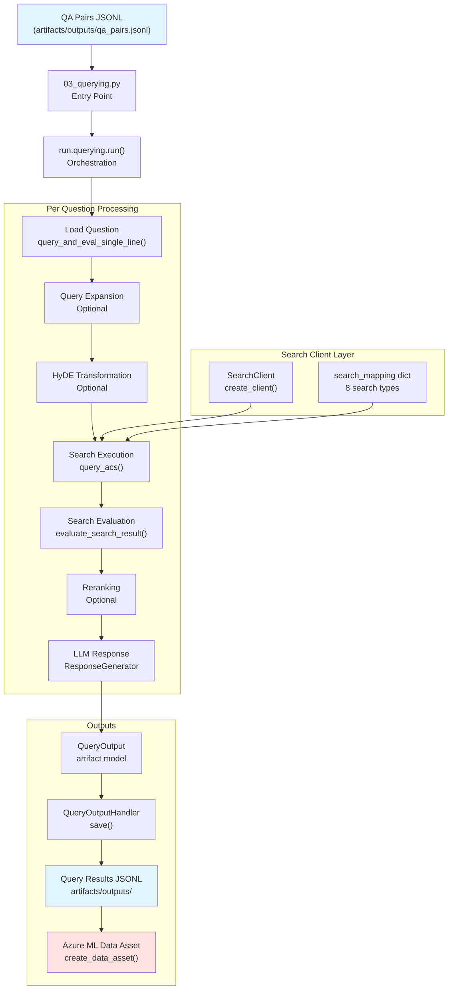

**Sources:** [03_querying.py:1-52](), [rag_experiment_accelerator/run/querying.py:560-632]()

---

## Entry Point and Configuration

### CLI Entry Point

The `03_querying.py` script serves as the entry point for Stage 3. It handles MLflow initialization, checkpoint setup, and orchestrates processing across multiple index configurations.

**Key responsibilities:**
- Initialize `Environment` and `Config` from configuration files
- Set up MLflow experiment tracking
- Initialize checkpoint system for caching expensive operations
- Iterate through flattened index configurations (`config.index.flatten()`)
- Create Azure ML data assets for each index's query results

**Configuration parameters:**
| Parameter | Type | Description |
|-----------|------|-------------|
| `--config_path` | str | Path to `config.json` file |
| `--data_dir` | str | Path to data directory (optional) |

**Sources:** [03_querying.py:16-52]()

---

## Main Orchestration Flow

### run() Function

The `run()` function in `rag_experiment_accelerator/run/querying.py` orchestrates the entire querying process:

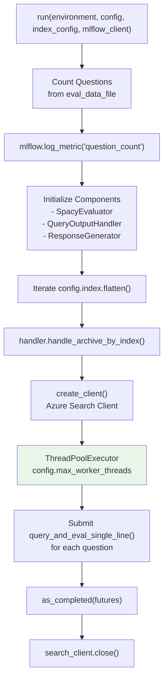

**Parallel Processing:** The function uses `ThreadPoolExecutor` with `config.max_worker_threads` to process multiple questions concurrently, significantly reducing total execution time.

**Sources:** [rag_experiment_accelerator/run/querying.py:560-632]()

---

## Query Processing Pipeline

### Per-Question Processing

Each question from the QA pairs file is processed by `query_and_eval_single_line()`, which delegates to `get_query_output()` (decorated with `@cache_with_checkpoint` for caching):

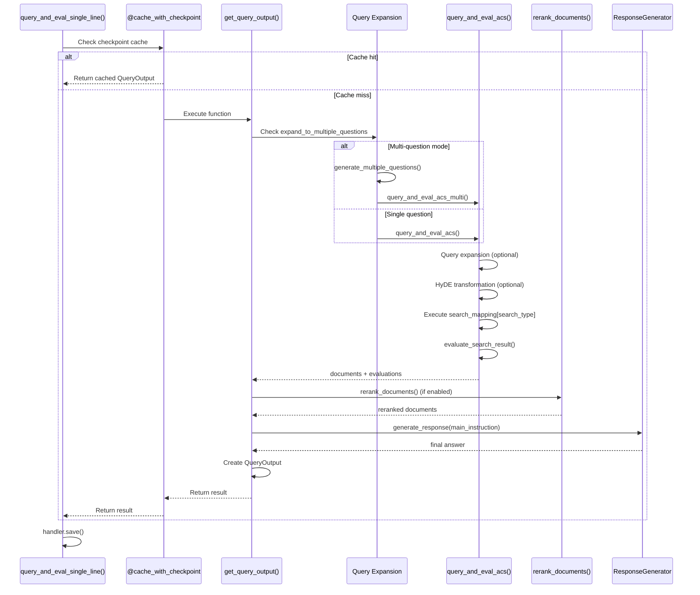

**Sources:** [rag_experiment_accelerator/run/querying.py:398-464](), [rag_experiment_accelerator/run/querying.py:466-558]()

---

## Query Expansion Techniques

### Multi-Question Expansion

When `config.query_expansion.expand_to_multiple_questions` is enabled, the system can decompose complex questions into simpler sub-questions:

**Process:**
1. Check if question requires decomposition using `do_we_need_multiple_questions()`
2. Generate sub-questions via `generate_multiple_questions()` using LLM
3. Execute search for each sub-question
4. Aggregate results and generate final response

**Sources:** [rag_experiment_accelerator/run/querying.py:416-432]()

### Query Expansion with Related Questions

When `config.query_expansion.query_expansion` is `true`, the system generates related questions to improve retrieval:

```mermaid
graph LR
    ORIG["Original Query"]
    GEN["generate_response()<br/>prompt_generate_hypothetical_questions"]
    FILTER["filter_non_related_questions()"]
    EMBED["Cosine Similarity<br/>vs Original Query"]
    THRESHOLD["Keep if similarity >=<br/>min_query_expansion_related_question_similarity_score"]
    SEARCH["Execute Search<br/>for Each Question"]
    DEDUP["deduplicate_search_results()"]
    
    ORIG --> GEN
    GEN --> FILTER
    FILTER --> EMBED
    EMBED --> THRESHOLD
    THRESHOLD --> SEARCH
    SEARCH --> DEDUP
```

**Configuration:**
- `query_expansion.query_expansion`: Enable feature
- `query_expansion.min_query_expansion_related_question_similarity_score`: Minimum cosine similarity threshold (default: 90%)

**Sources:** [rag_experiment_accelerator/run/querying.py:172-197](), [rag_experiment_accelerator/run/querying.py:286-314]()

### HyDE (Hypothetical Document Embeddings)

HyDE transforms the query into a hypothetical document or answer before embedding, following the paper "Precise Zero-Shot Dense Retrieval without Relevance Labels".

**Supported HyDE modes:**

| Mode | Config Value | Description |
|------|--------------|-------------|
| Disabled | `"disabled"` | No HyDE transformation |
| Hypothetical Answer | `"generated_hypothetical_answer"` | Generate expected answer, embed that |
| Hypothetical Document | `"generated_hypothetical_document_to_answer"` | Generate document that would contain answer |

**Implementation:**

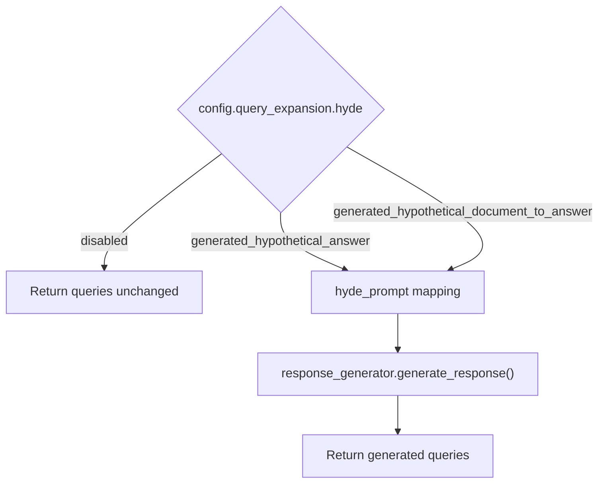

**Prompt mapping:**
- `generated_hypothetical_answer` → `prompt_generate_hypothetical_answer`
- `generated_hypothetical_document_to_answer` → `prompt_generate_hypothetical_document`

**Sources:** [rag_experiment_accelerator/run/querying.py:145-170](), [rag_experiment_accelerator/llm/prompt.py]()

---

## Search Execution

### Search Type Mapping

The system supports 8 distinct search strategies, mapped in the `search_mapping` dictionary:

| Search Type | Function | Description |
|-------------|----------|-------------|
| `search_for_match_semantic` | `search_for_match_semantic()` | Semantic search with vector + text + L2 reranking |
| `search_for_match_Hybrid_multi` | `search_for_match_Hybrid_multi()` | Hybrid search across content, title, summary vectors separately |
| `search_for_match_Hybrid_cross` | `search_for_match_Hybrid_cross()` | Hybrid search with cross-field vectors (title+summary) |
| `search_for_match_text` | `search_for_match_text()` | Pure BM25 text search |
| `search_for_match_pure_vector` | `search_for_match_pure_vector()` | Pure vector search on content only |
| `search_for_match_pure_vector_multi` | `search_for_match_pure_vector_multi()` | Pure vector search across multiple fields |
| `search_for_match_pure_vector_cross` | `search_for_match_pure_vector_cross()` | Pure vector search on cross-field vectors |
| `search_for_manual_hybrid` | `search_for_manual_hybrid()` | Manual combination of text, vector, and semantic |

**Sources:** [rag_experiment_accelerator/run/querying.py:61-70]()

### Search Method Implementation

All search methods follow a common pattern:

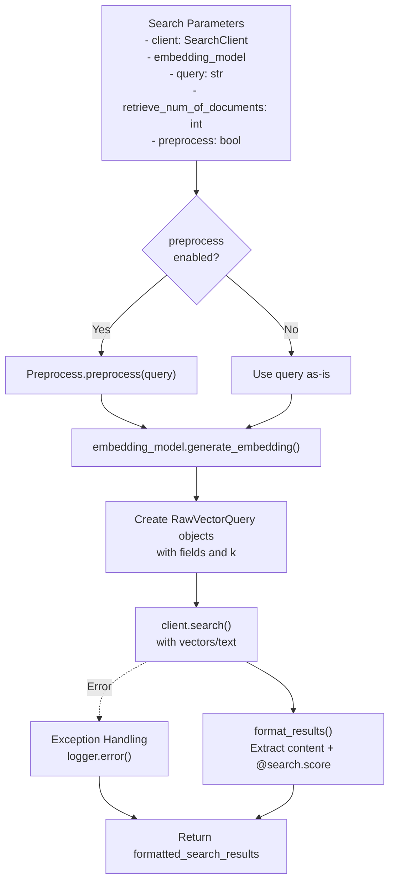

**Example: Semantic Search**

The `search_for_match_semantic()` function demonstrates the pattern:

1. **Preprocessing** (optional): Apply NLP preprocessing to query
2. **Embedding generation**: Generate vector from preprocessed query
3. **Vector query creation**: Create multiple `RawVectorQuery` objects:
   - `vector1`: Search `contentVector` field
   - `vector2`: Search `titleVector, summaryVector` fields (cross-field)
4. **Search execution**: Call `client.search()` with:
   - `search_text=query` (for text matching)
   - `vector_queries=[vector1, vector2]` (for vector matching)
   - `query_type=QueryType.SEMANTIC` (enables L2 reranking)
   - `semantic_configuration_name="my-semantic-config"`
5. **Result formatting**: Extract content and scores

**Sources:** [rag_experiment_accelerator/search_type/acs_search_methods.py:58-110]()

### Manual Hybrid Search

The `search_for_manual_hybrid()` function combines results from three search types:

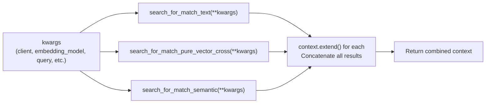

**Sources:** [rag_experiment_accelerator/search_type/acs_search_methods.py:396-419]()

---

## Search Result Evaluation

### Immediate Evaluation

The `evaluate_search_result()` function from `rag_experiment_accelerator.evaluation.search_eval` assesses search quality immediately after retrieval:

**Evaluation components:**
1. **SpacyEvaluator**: Computes similarity between retrieved chunks and expected context
2. **Relevance threshold**: Determines which chunks are relevant based on `config.search.search_relevancy_threshold`
3. **MAP@k calculation**: Mean Average Precision at k for retrieval quality assessment

**Sources:** [rag_experiment_accelerator/run/querying.py:278-283](), [rag_experiment_accelerator/evaluation/search_eval.py]()

### Deduplication

Search results from multiple queries (when using query expansion) are deduplicated:

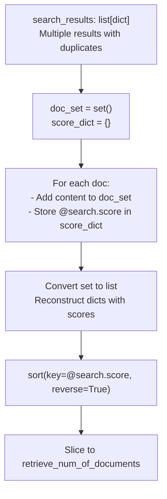

**Sources:** [rag_experiment_accelerator/run/querying.py:199-214](), [rag_experiment_accelerator/run/querying.py:275-277]()

---

## Reranking

### Reranking Strategy Selection

Reranking is configured via `config.rerank` and executed by `rerank_documents()`:

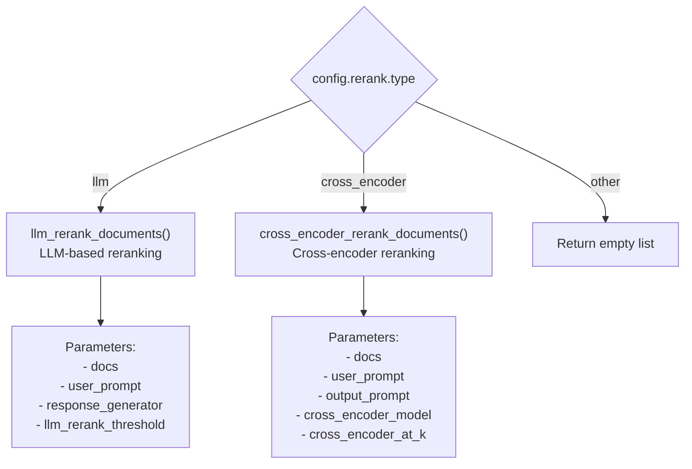

**Configuration:**
- `rerank.enabled`: Boolean to enable/disable reranking
- `rerank.type`: `"llm"` or `"cross_encoder"`
- `rerank.llm_rerank_threshold`: For LLM reranking, keep chunks with rank ≤ this value (1-10)
- `rerank.cross_encoder_at_k`: For cross-encoder, keep top k chunks
- `rerank.cross_encoder_model`: Model name (e.g., `"cross-encoder/stsb-roberta-base"`)

**Sources:** [rag_experiment_accelerator/run/querying.py:106-143]()

### LLM-Based Reranking

LLM reranking uses an LLM to score each document's relevance to the query:

1. Send documents + query to LLM
2. LLM assigns relevance scores (1-10)
3. Keep documents with score ≤ `llm_rerank_threshold`
4. Return reranked documents

**Sources:** [rag_experiment_accelerator/reranking/reranker.py](), specifically `llm_rerank_documents()`

### Cross-Encoder Reranking

Cross-encoder reranking uses a BERT-based cross-encoder model:

1. For each (query, document) pair, compute relevance score
2. Sort documents by score
3. Return top `cross_encoder_at_k` documents

**Sources:** [rag_experiment_accelerator/reranking/reranker.py](), specifically `cross_encoder_rerank_documents()`

---

## Response Generation

### Context Assembly and LLM Call

After retrieval and optional reranking, the system generates the final response:

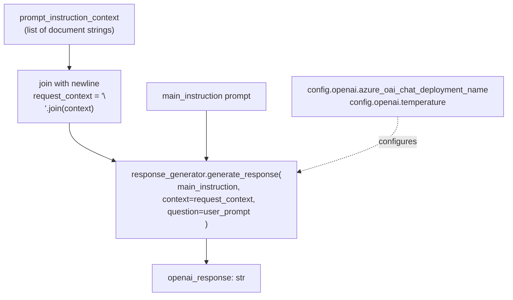

**Prompt structure:**
- **System message**: Defined in `main_instruction` prompt
- **Context**: Retrieved and reranked documents joined with newlines
- **Question**: Original user query

**Sources:** [rag_experiment_accelerator/run/querying.py:534-538](), [rag_experiment_accelerator/llm/response_generator.py](), [rag_experiment_accelerator/llm/prompt.py]()

### Multi-Question Response Generation

When using multi-question expansion, the system generates intermediate responses for each sub-question, then uses those as context for the final response:

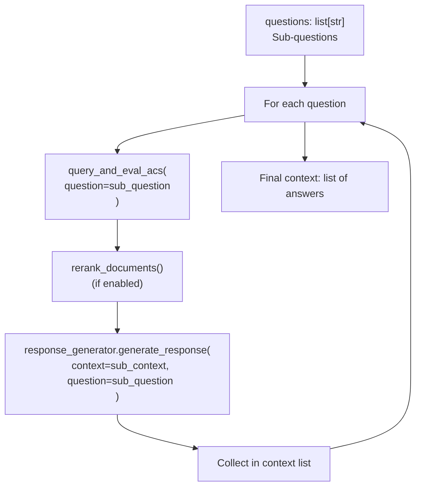

**Sources:** [rag_experiment_accelerator/run/querying.py:316-396]()

---

## Output Handling

### QueryOutput Model

Each processed question produces a `QueryOutput` object containing:

| Field | Type | Description |
|-------|------|-------------|
| `question` | str | Original user question |
| `expected` | str | Ground truth answer from QA generation |
| `actual` | str | Generated response from LLM |
| `context` | str | Original context from QA pair |
| `retrieved_contexts` | list[str] | Documents retrieved from search |
| `search_type` | str | Search strategy used |
| `search_evals` | list[dict] | Evaluation metrics for search results |
| `question_count` | int | Total number of questions in dataset |
| `retrieve_num_of_documents` | int | Number of documents retrieved |
| `rerank` | bool | Whether reranking was enabled |
| `rerank_type` | str | Type of reranking used |
| `cross_encoder_model` | str | Cross-encoder model name (if used) |
| `cross_encoder_at_k` | int | Top-k for cross-encoder |
| `llm_rerank_threshold` | int | Threshold for LLM reranking |

**Sources:** [rag_experiment_accelerator/run/querying.py:540-556](), [rag_experiment_accelerator/artifact/models/query_output.py]()

### QueryOutputHandler

The `QueryOutputHandler` class manages saving and organizing query results:

**Key methods:**
- `save(index_name, data, experiment_name, job_name)`: Save QueryOutput to JSONL file
- `get_output_path(index_name, experiment_name, job_name)`: Get path for results
- `handle_archive_by_index(index_name, experiment_name, job_name)`: Archive existing results

**Output structure:**
```
artifacts/outputs/
  ├── {experiment_name}/
  │   └── {job_name}/
  │       └── {index_name}/
  │           └── query_results.jsonl
```

**Sources:** [rag_experiment_accelerator/artifact/handlers/query_output_handler.py](), [rag_experiment_accelerator/run/querying.py:584](), [03_querying.py:37]()

### MLflow Integration

Stage 3 integrates with MLflow for experiment tracking:

**Tracked metrics:**
- `question_count`: Total number of questions processed

**MLflow run structure:**
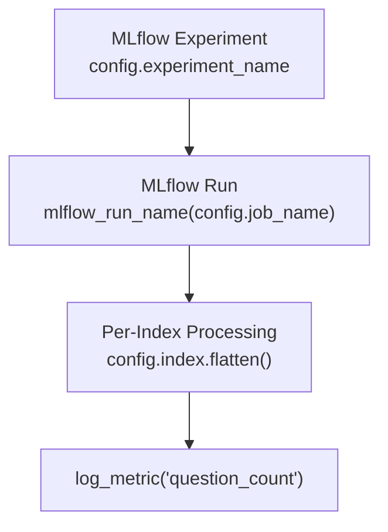

**Sources:** [03_querying.py:34-42](), [rag_experiment_accelerator/run/querying.py:581]()

### Azure ML Data Assets

After processing, query results are registered as Azure ML data assets for version control and reproducibility:

**Process:**
1. Process all questions for an index
2. Save results to JSONL file
3. Call `create_data_asset()` with:
   - `data_path`: Path to query results JSONL
   - `data_asset_name`: Index name
   - `environment`: Azure credentials

**Benefits:**
- Version control for query results
- Easy reference in evaluation stage
- Reproducibility across experiments

**Sources:** [03_querying.py:45-51](), [rag_experiment_accelerator/data_assets/data_asset.py]()

---

## Configuration Reference

### Query-Related Configuration

The following configuration parameters affect Stage 3 behavior:

**Search configuration:**
```json
{
  "search": {
    "retrieve_num_of_documents": 5,
    "search_type": ["search_for_manual_hybrid", "search_for_match_semantic"],
    "search_relevancy_threshold": 0.8
  }
}
```

**Query expansion configuration:**
```json
{
  "query_expansion": {
    "hyde": "disabled",
    "query_expansion": false,
    "min_query_expansion_related_question_similarity_score": 90,
    "expand_to_multiple_questions": false
  }
}
```

**Reranking configuration:**
```json
{
  "rerank": {
    "enabled": true,
    "type": "cross_encoder",
    "llm_rerank_threshold": 3,
    "cross_encoder_at_k": 4,
    "cross_encoder_model": "cross-encoder/stsb-roberta-base"
  }
}
```

**OpenAI configuration:**
```json
{
  "openai": {
    "azure_oai_chat_deployment_name": "gpt-35-turbo",
    "temperature": 0
  }
}
```

**Parallelism:**
```json
{
  "max_worker_threads": 4
}
```

For complete configuration documentation, see [Configuration Guide](#2.2).

**Sources:** [config.sample.json:50-76](), [README.md:337-356]()

---

## Checkpoint System

Stage 3 extensively uses the checkpoint system to cache expensive operations:

**Cached function:** `get_query_output()` is decorated with `@cache_with_checkpoint` using the cache key:
```python
"user_prompt+output_prompt+qna_context+index_config.index_name()"
```

**Benefits:**
- Skip redundant search executions
- Avoid repeated LLM calls for same questions
- Enable partial re-runs after failures
- Reduce Azure OpenAI and Search costs

**Configuration:**
- `use_checkpoints`: Boolean to enable/disable checkpointing
- Checkpoints stored in: `artifacts/checkpoints/`

For details on the checkpoint mechanism, see [Checkpointing System](#10.1).

**Sources:** [rag_experiment_accelerator/run/querying.py:466-468](), [03_querying.py:38]()

---

## Testing

Stage 3 includes comprehensive unit tests covering:

- `query_acs()`: Search function dispatching
- `rerank_documents()`: Reranking strategy selection
- `query_and_eval_acs()`: Single question processing
- `query_and_eval_acs_multi()`: Multi-question processing
- Search method implementations for all 8 search types
- Exception handling and error cases

**Test location:** [rag_experiment_accelerator/run/tests/test_querying.py](), [rag_experiment_accelerator/search_type/tests/test_acs_search_methods.py]()

---

## Common Patterns and Best Practices

### Parallel Processing

Stage 3 uses `ThreadPoolExecutor` for parallel question processing:

```python
with ThreadPoolExecutor(config.max_worker_threads) as executor:
    futures = {
        executor.submit(query_and_eval_single_line, line, ...): line
        for line_number, line in enumerate(file)
    }
    for future in as_completed(futures):
        future.result()
```

**Best practices:**
- Set `max_worker_threads` based on API rate limits
- Handle exceptions within submitted tasks
- Use `as_completed()` for progress tracking

**Sources:** [rag_experiment_accelerator/run/querying.py:602-629]()

### Error Handling

Stage 3 implements multiple layers of error handling:

1. **Search method level**: Try-except blocks with `logger.error()`
2. **Question processing level**: Catches `BadRequestError` from OpenAI API
3. **Future execution level**: Exception logging for failed tasks

**Sources:** [rag_experiment_accelerator/run/querying.py:459-464](), [rag_experiment_accelerator/search_type/acs_search_methods.py:107-109]()

### Search Client Management

Search clients are properly managed to avoid resource leaks:

```python
search_client = create_client(endpoint, index_name, key)
try:
    # Process all questions
finally:
    search_client.close()
```

**Sources:** [rag_experiment_accelerator/run/querying.py:596-631]()

---

