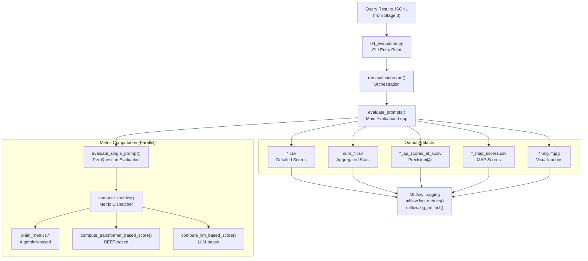
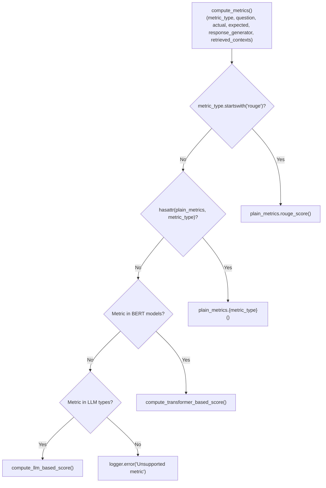
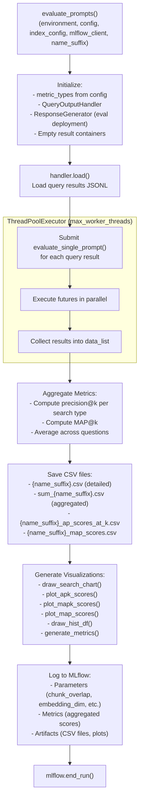
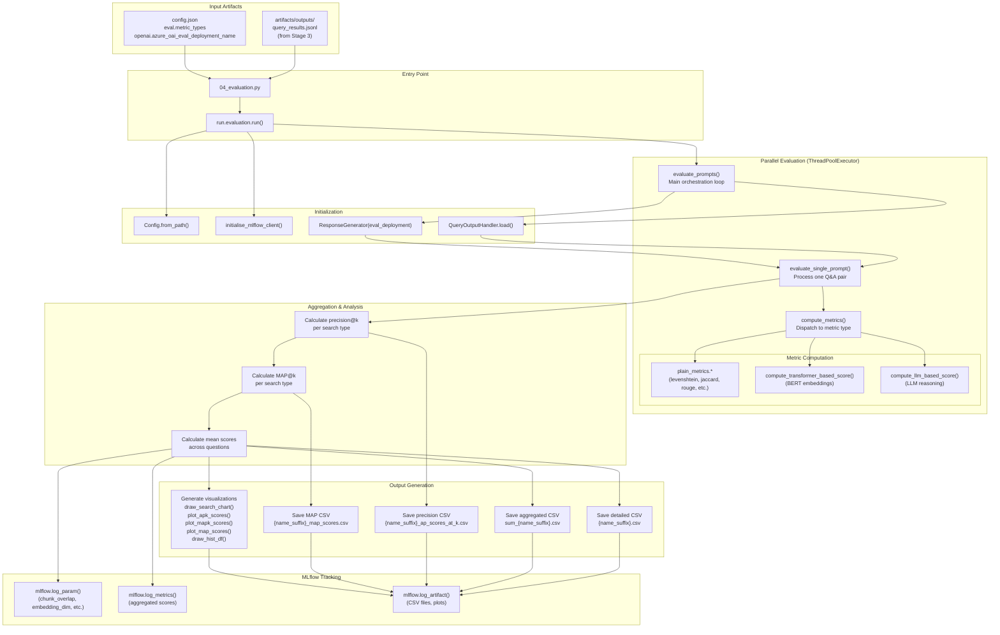

<!-- source: DeepWiki mcp.deepwiki.com · repo microsoft/rag-experiment-accelerator · page 3.4 Stage 4: Evaluation and Metrics · fetched 2026-10-26 -->

# Stage 4: Evaluation and Metrics

<details>
<summary>Relevant source files</summary>

The following files were used as context for generating this wiki page:

- [.github/workflows/config.json](.github/workflows/config.json)
- [02_qa_generation.py](02_qa_generation.py)
- [03_querying.py](03_querying.py)
- [04_evaluation.py](04_evaluation.py)
- [config.schema.json](config.schema.json)
- [docs/evaluation-metrics.md](docs/evaluation-metrics.md)
- [promptflow/rag-experiment-accelerator/README.md](promptflow/rag-experiment-accelerator/README.md)
- [rag_experiment_accelerator/config/eval_config.py](rag_experiment_accelerator/config/eval_config.py)
- [rag_experiment_accelerator/evaluation/LICENSE.txt](rag_experiment_accelerator/evaluation/LICENSE.txt)
- [rag_experiment_accelerator/evaluation/eval.py](rag_experiment_accelerator/evaluation/eval.py)
- [rag_experiment_accelerator/evaluation/plain_metrics.py](rag_experiment_accelerator/evaluation/plain_metrics.py)
- [rag_experiment_accelerator/evaluation/tests/test_plain_metrics.py](rag_experiment_accelerator/evaluation/tests/test_plain_metrics.py)

</details>


## Purpose and Scope

Stage 4 is the final stage of the RAG Experiment Accelerator pipeline. It evaluates the quality of query responses generated in Stage 3 by computing similarity metrics between generated answers and ground truth answers. The evaluation system supports three tiers of metrics—algorithm-based, BERT-based, and LLM-based—with increasing computational cost and semantic depth. Results are logged to MLflow for experiment tracking and comparison, along with visualizations and detailed metric breakdowns.

For information about generating the query results that this stage evaluates, see [Stage 3: Querying and Retrieval](#3.3). For details on configuring which metrics to compute, see [Config Object Reference](#4.1).

---

## Overview

Stage 4 consumes the query output artifacts from Stage 3 (JSONL files containing questions, expected answers, actual answers, and retrieved contexts) and produces:

1. **Metric scores** for each question-answer pair across multiple search types
2. **Aggregated statistics** (mean scores, precision@k, MAP@k)
3. **Visualizations** (histograms, line plots, comparison charts)
4. **MLflow experiment records** with parameters, metrics, and artifacts

The evaluation process is parallelized using `ThreadPoolExecutor` to handle large question sets efficiently.



**Sources:** [04_evaluation.py:1-43](), [rag_experiment_accelerator/evaluation/eval.py:178-327]()

---

## Entry Point and Orchestration

### CLI Script: 04_evaluation.py

The evaluation stage is invoked via the `04_evaluation.py` script, which:

1. Parses command-line arguments (`--config_path`, `--data_dir`)
2. Loads environment variables and configuration
3. Initializes MLflow client and sets experiment name
4. Iterates over flattened index configurations
5. Starts an MLflow run for each configuration
6. Calls `run.evaluation.run()` to execute evaluation

The script uses a timestamped name suffix to ensure unique artifact names across runs.

**Key Code Flow:**
```
04_evaluation.py
  └─> Config.from_path() loads configuration
  └─> initialise_mlflow_client() sets up MLflow tracking
  └─> config.index.flatten() generates index configurations
  └─> mlflow.start_run() creates MLflow run
  └─> run.evaluation.run() executes evaluation logic
```

**Sources:** [04_evaluation.py:1-43](), [rag_experiment_accelerator/config/paths.py:10-12]()

### Orchestration Module: run.evaluation

The `run.evaluation.run()` function serves as the main orchestration point, calling `evaluate_prompts()` with the appropriate configuration, environment, and MLflow client.

**Sources:** [04_evaluation.py:36-42]()

---

## Metric Computation Architecture

The evaluation system implements a three-tier hierarchy of metrics, trading off computational cost for semantic understanding:

### Metric Tier Comparison

| Tier | Computation Type | Cost | Use Case | Example Metrics |
|------|-----------------|------|----------|-----------------|
| **Algorithm-Based** | String similarity algorithms | Low | Fast iteration, baseline | `levenshtein`, `jaccard`, `rouge1_fmeasure` |
| **BERT-Based** | Sentence transformer embeddings | Medium | Semantic validation | `bert_all_MiniLM_L6_v2`, `bert_distilbert_base_nli_stsb_mean_tokens` |
| **LLM-Based** | LLM reasoning (GPT-3.5/4) | High | Nuanced assessment | `llm_answer_relevance`, `llm_context_precision` |

**Sources:** [rag_experiment_accelerator/evaluation/eval.py:44-126](), [docs/evaluation-metrics.md:1-191]()

### Metric Dispatcher: compute_metrics()

The `compute_metrics()` function serves as the central dispatcher for all metric types. It:

1. Checks if the metric is a ROUGE variant (starts with `"rouge"`)
2. Attempts to find the metric in `plain_metrics` module
3. Falls back to `compute_transformer_based_score()` for BERT metrics
4. Falls back to `compute_llm_based_score()` for LLM metrics
5. Returns a numeric score



**Sources:** [rag_experiment_accelerator/evaluation/eval.py:44-126]()

---

## Algorithm-Based Metrics

Algorithm-based metrics use deterministic string comparison algorithms to compute similarity scores. These metrics are fast, reproducible, and useful for establishing baselines.

### String Distance Metrics

Implemented in `plain_metrics.py`, these functions return normalized similarity scores (0-100):

| Function | Algorithm | Description |
|----------|-----------|-------------|
| `lcsstr()` | Longest Common Substring | Maximum contiguous character sequence shared between strings |
| `lcsseq()` | Longest Common Subsequence | Maximum non-contiguous character sequence (preserves order) |
| `levenshtein()` | Levenshtein Distance | Minimum edit operations (insert/delete/substitute) |
| `hamming()` | Hamming Distance | Number of position mismatches (requires equal length) |
| `jaro_winkler()` | Jaro-Winkler | Weighted by matching characters and transpositions |
| `jaccard()` | Jaccard Similarity | Set intersection divided by set union |
| `cosine_ochiai()` | Cosine Similarity (Ochiai) | Dot product of term-frequency vectors |

**Sources:** [rag_experiment_accelerator/evaluation/plain_metrics.py:110-213]()

### Fuzzy Matching

The `fuzzy_score()` function uses the RapidFuzz library (faster than FuzzyWuzzy) with configurable matching strategies:

- `token_set_ratio` (default): Ignores word order, compares token sets
- `partial_ratio`: Best substring match
- `token_sort_ratio`: Sorts tokens before comparison
- `WRatio`, `QRatio`: Weighted variants

**Sources:** [rag_experiment_accelerator/evaluation/plain_metrics.py:33-72]()

### ROUGE Metrics

ROUGE (Recall-Oriented Understudy for Gisting Evaluation) metrics evaluate token-level overlap:

| Metric | Description | Formula Component |
|--------|-------------|-------------------|
| `rouge1_precision` | Unigram precision | Overlap unigrams / Unigrams in ground truth |
| `rouge1_recall` | Unigram recall | Overlap unigrams / Unigrams in prediction |
| `rouge1_fmeasure` | Unigram F1 | Harmonic mean of precision and recall |
| `rouge2_*` | Bigram variants | Uses bigrams instead of unigrams |
| `rougeL_*` | Longest common subsequence | Uses LCS length instead of n-grams |

The `rouge_score()` function uses the `rouge-score` package with stemming enabled.

**Sources:** [rag_experiment_accelerator/evaluation/plain_metrics.py:74-108](), [docs/evaluation-metrics.md:122-139]()

---

## BERT-Based Semantic Similarity

BERT-based metrics compute semantic similarity by:

1. Encoding both `actual` and `expected` answers using a sentence transformer model
2. Computing cosine similarity between the resulting embeddings
3. Returning a normalized score (0-100)

### Supported BERT Models

The system supports six pre-trained models with different trade-offs:

| Configuration Key | Model Name | Dimensions | Characteristics |
|-------------------|------------|------------|-----------------|
| `bert_all_MiniLM_L6_v2` | `all-MiniLM-L6-v2` | 384 | Lightweight, fast inference |
| `bert_base_nli_mean_tokens` | `bert-base-nli-mean-tokens` | 768 | NLI-trained, general purpose |
| `bert_large_nli_mean_tokens` | `bert-large-nli-mean-tokens` | 1024 | Higher quality, slower |
| `bert_large_nli_stsb_mean_tokens` | `bert-large-nli-stsb-mean-tokens` | 1024 | STS-B optimized for similarity |
| `bert_distilbert_base_nli_stsb_mean_tokens` | `distilbert-base-nli-stsb-mean-tokens` | 768 | Distilled, efficient |
| `bert_paraphrase_multilingual_MiniLM_L12_v2` | `paraphrase-multilingual-MiniLM-L12-v2` | 384 | 50+ languages supported |

**Model Selection Guidelines:**
- Start with `bert_all_MiniLM_L6_v2` for fast prototyping
- Use `bert_distilbert_base_nli_stsb_mean_tokens` for production (balanced)
- Use `bert_large_nli_stsb_mean_tokens` for highest quality
- Use `bert_paraphrase_multilingual_MiniLM_L12_v2` for non-English content

**Sources:** [docs/evaluation-metrics.md:140-158](), [config.schema.json:574-579]()

### Implementation

The `compute_transformer_based_score()` function (referenced but not shown in provided files) likely:

1. Maps metric keys to model names
2. Loads the sentence transformer model (cached after first use)
3. Encodes both strings
4. Computes cosine similarity
5. Returns normalized score

**Sources:** [rag_experiment_accelerator/evaluation/eval.py:30-32]()

---

## LLM-Based Evaluation

LLM-based metrics use GPT models to evaluate answers through structured prompts. These metrics require the separate Azure OpenAI evaluation deployment (`azure_oai_eval_deployment_name`).

### LLM Metric Types

| Metric Key | Input Requirements | Output | Purpose |
|------------|-------------------|--------|---------|
| `llm_answer_relevance` | `question`, `actual` | 0.0 - 1.0 | Scores answer completeness and redundancy |
| `llm_context_precision` | `question`, `retrieved_contexts` | 0.0 - 1.0 | Proportion of relevant contexts retrieved |
| `llm_context_recall` | `question`, `expected`, `retrieved_contexts` | 0.0 - 1.0 | Coverage of ground truth in retrieved contexts |

**Sources:** [docs/evaluation-metrics.md:159-191](), [config.schema.json:580-583]()

### LLM Answer Relevance

Evaluates whether the generated answer:
- Completely addresses the question
- Contains no unnecessary information
- Is free of hallucinations

The LLM is prompted to score the answer based on these criteria.

### LLM Context Precision

Verifies whether retrieved contexts are useful for answering the question. This metric evaluates the retrieval system's precision—did it fetch relevant chunks?

### LLM Context Recall

Estimates whether the retrieved contexts contain sufficient information to generate the ground truth answer. This metric evaluates the retrieval system's coverage.

**Implementation Note:** The `compute_llm_based_score()` function uses the `ResponseGenerator` with the eval deployment to generate structured prompts and parse LLM responses.

**Sources:** [rag_experiment_accelerator/evaluation/eval.py:18-21](), [rag_experiment_accelerator/evaluation/eval.py:115-122]()

---

## Evaluation Pipeline

### Main Evaluation Loop: evaluate_prompts()

The `evaluate_prompts()` function orchestrates the entire evaluation process:



**Key Data Structures:**

- `data_list`: List of dictionaries, each containing metrics for one question-answer pair
- `total_precision_scores_by_search_type`: Dict mapping search types to precision scores at each k
- `average_precision_for_search_type`: Dict mapping search types to mean average precision
- `map_scores_by_search_type`: Dict for MAP calculations

**Sources:** [rag_experiment_accelerator/evaluation/eval.py:178-327]()

### Per-Question Evaluation: evaluate_single_prompt()

The `evaluate_single_prompt()` function processes a single query result:

1. Normalizes actual and expected answers using `lower_and_strip()`
2. Iterates through configured metric types
3. Calls `compute_metrics()` for each metric
4. Stores results in `metric_dic` with question, contexts, answers, search type
5. Appends to shared `data_list`
6. Updates precision tracking dictionaries

This function is executed in parallel for all query results.

**Sources:** [rag_experiment_accelerator/evaluation/eval.py:129-176]()

---

## MLflow Integration

### Logged Parameters

The evaluation stage logs experiment configuration parameters to MLflow for reproducibility:

| Parameter | Source | Example Value |
|-----------|--------|---------------|
| `question_count` | Query results | 50 |
| `retrieve_num_of_documents` | Query results | 5 |
| `cross_encoder_at_k` | Query results | 4 |
| `chunk_overlap` | `index_config.chunking.overlap_size` | 200 |
| `embedding_dimension` | `config.get_embedding_model()` | 384 |
| `embedding_model_name` | `index_config.embedding_model.model_name` | "all-mpnet-base-v2" |
| `ef_construction` | `index_config.ef_construction` | 400 |
| `ef_search` | `index_config.ef_search` | 400 |
| `run_metrics` | Aggregated metric dictionary | (dict of all metrics) |

**Sources:** [rag_experiment_accelerator/evaluation/eval.py:306-319]()

### Logged Metrics

The aggregated metric scores are logged as MLflow metrics using `mlflow.log_metrics(sum_dict)`. Each metric type (e.g., `fuzzy_score`, `bert_all_MiniLM_L6_v2`) appears as a separate metric with its mean value across all questions and search types.

**Sources:** [rag_experiment_accelerator/evaluation/eval.py:278-284](), [rag_experiment_accelerator/evaluation/eval.py:319]()

### Logged Artifacts

The following artifacts are logged to MLflow runs:

1. **Detailed scores CSV** (`{name_suffix}.csv`): One row per question-search type combination with all metric scores
2. **Aggregated scores CSV** (`sum_{name_suffix}.csv`): Mean scores across all questions
3. **Precision@k CSV** (`{name_suffix}_ap_scores_at_k_test.csv`): Precision at each k value
4. **MAP CSV** (`{name_suffix}_map_scores_test.csv`): Mean average precision per search type
5. **Visualizations**: PNG/JPG plots generated by plotting functions

**Sources:** [rag_experiment_accelerator/evaluation/eval.py:266-326]()

---

## Output Artifacts

All evaluation outputs are written to `config.path.eval_data_dir` (default: `artifacts/eval_score/`):

### Detailed Metrics CSV

Contains one row per evaluated question with columns:
- `question`: The original question
- `retrieved_contexts`: List of retrieved document chunks
- `actual`: Generated answer from Stage 3
- `expected`: Ground truth answer
- `search_type`: Search strategy used (e.g., `search_for_manual_hybrid`)
- One column per metric type with the computed score

**Sources:** [rag_experiment_accelerator/evaluation/eval.py:263-269]()

### Aggregated Metrics CSV

Contains a single row with mean scores for each metric type, averaged across:
- All questions in the evaluation set
- All search types tested

Formula: `sum_all_columns = temp_df.sum() / (question_count * len(num_search_type))`

**Sources:** [rag_experiment_accelerator/evaluation/eval.py:276-287]()

### Precision and MAP CSVs

**Average Precision @ k CSV** columns:
- `search_type`: Search strategy
- `k`: Rank position (1, 2, 3, ...)
- `score`: Mean precision at rank k
- `map_at_k`: Mean average precision up to rank k

**MAP Scores CSV** columns:
- `search_type`: Search strategy
- `mean`: Overall mean average precision

**Sources:** [rag_experiment_accelerator/evaluation/eval.py:241-304]()

### Visualizations

Generated by the `plot_metrics` module (not shown in provided files):

| Function | Output | Purpose |
|----------|--------|---------|
| `draw_search_chart()` | Line/bar chart | Compare metrics across search types |
| `plot_apk_scores()` | Line plot | Precision@k curves per search type |
| `plot_mapk_scores()` | Line plot | MAP@k curves per search type |
| `plot_map_scores()` | Bar chart | Overall MAP comparison |
| `draw_hist_df()` | Histogram | Distribution of aggregated metrics |
| `generate_metrics()` | HTML report | Interactive metric comparison |

**Sources:** [rag_experiment_accelerator/evaluation/eval.py:22-29](), [rag_experiment_accelerator/evaluation/eval.py:272-325]()

---

## Configuration

### EvalConfig Class

The evaluation configuration is defined in `EvalConfig`:

```python
@dataclass
class EvalConfig(BaseConfig):
    metric_types: list[str] = field(
        default_factory=lambda: [
            "fuzzy_score",
            "bert_all_MiniLM_L6_v2",
            "cosine_ochiai",
            "bert_distilbert_base_nli_stsb_mean_tokens",
            "llm_answer_relevance",
            "llm_context_precision",
        ]
    )
```

**Sources:** [rag_experiment_accelerator/config/eval_config.py:1-17]()

### Configuration in config.json

The `eval` section of `config.json` specifies which metrics to compute:

```json
{
  "eval": {
    "metric_types": [
      "fuzzy_score",
      "cosine_ochiai",
      "rouge2_recall",
      "bert_all_MiniLM_L6_v2",
      "bert_distilbert_base_nli_stsb_mean_tokens",
      "llm_answer_relevance",
      "llm_context_precision"
    ]
  }
}
```

**Metric Selection Strategy:**
1. **Minimum set**: Include at least one algorithm-based metric (`fuzzy_score` or `rouge1_fmeasure`)
2. **Add semantic validation**: Include one BERT metric (`bert_all_MiniLM_L6_v2`)
3. **For production**: Add LLM metrics for nuanced evaluation (but consider cost)

**Sources:** [.github/workflows/config.json:76-86](), [config.schema.json:549-588]()

### OpenAI Evaluation Deployment

LLM-based metrics require a separate Azure OpenAI deployment to avoid quota conflicts with the main chat deployment:

```json
{
  "openai": {
    "azure_oai_chat_deployment_name": "gpt-35-turbo",
    "azure_oai_eval_deployment_name": "gpt-35-turbo",
    "temperature": 0
  }
}
```

The evaluation deployment is loaded separately in `evaluate_prompts()`:

**Sources:** [rag_experiment_accelerator/evaluation/eval.py:210-212](), [config.schema.json:523-548]()

---

## Parallel Processing

The evaluation stage uses `ThreadPoolExecutor` for parallel metric computation:

```python
with ExitStack() as stack:
    executor = stack.enter_context(ThreadPoolExecutor(config.max_worker_threads))
    futures = {
        executor.submit(
            evaluate_single_prompt,
            data,
            response_generator,
            metric_types,
            data_list,
            total_precision_scores_by_search_type,
            map_scores_by_search_type,
            average_precision_for_search_type,
        ): data
        for data in query_data_load
    }
    
    for future in as_completed(futures):
        try:
            future.result()
        except Exception as exc:
            logger.error(f"Evaluate query line generated an exception: {exc}")
```

**Benefits:**
- **I/O Bound Operations**: LLM API calls and BERT model inference benefit from parallelization
- **Fault Tolerance**: Individual failures are caught and logged without stopping the entire evaluation
- **Configurable Concurrency**: `config.max_worker_threads` controls parallelism

**Thread Safety:** Shared data structures (`data_list`, `total_precision_scores_by_search_type`) are thread-safe because Python lists and dictionaries support atomic append operations when accessed from different threads (GIL protection).

**Sources:** [rag_experiment_accelerator/evaluation/eval.py:219-240]()

---

## Complete Evaluation Flow Diagram



**Sources:** [04_evaluation.py:1-43](), [rag_experiment_accelerator/evaluation/eval.py:1-327]()

---

