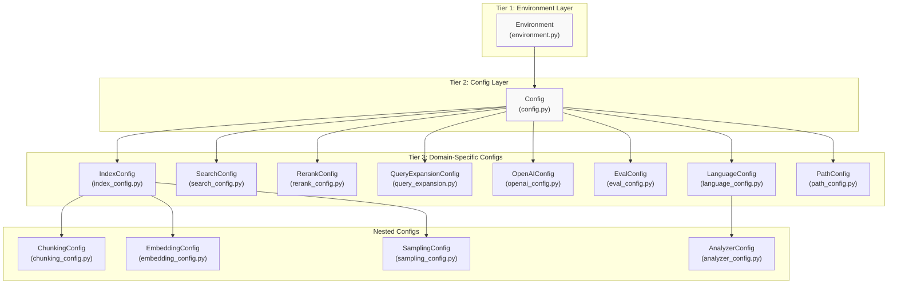
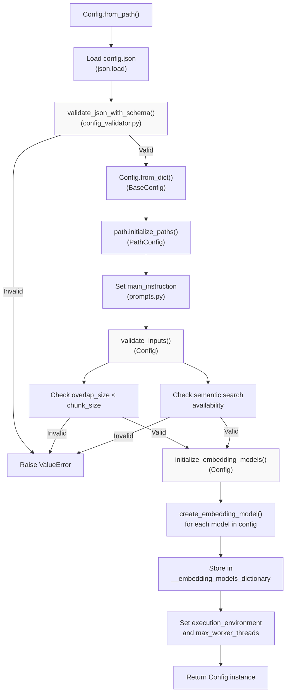
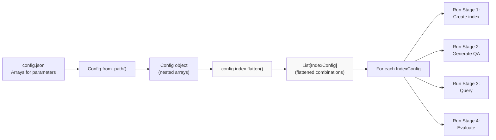
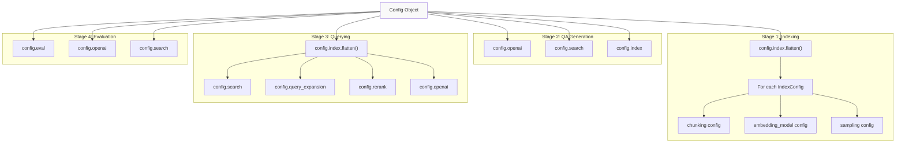

<!-- source: DeepWiki mcp.deepwiki.com · repo microsoft/rag-experiment-accelerator · page 4 Configuration System · fetched 2026-10-26 -->

# Configuration System

<details>
<summary>Relevant source files</summary>

The following files were used as context for generating this wiki page:

- [README.md](README.md)
- [config.sample.json](config.sample.json)
- [rag_experiment_accelerator/config/config.py](rag_experiment_accelerator/config/config.py)
- [rag_experiment_accelerator/config/tests/test_config.py](rag_experiment_accelerator/config/tests/test_config.py)

</details>


## Purpose and Scope

The Configuration System provides a hierarchical, type-safe framework for defining and managing all experiment parameters in the RAG Experiment Accelerator. It enables:

- **Declarative experiment definition** through JSON configuration files
- **Grid search experimentation** via parameter arrays and the `flatten()` mechanism
- **Strong validation** of parameter combinations before execution
- **Type-safe access** to configuration values throughout the pipeline

This page covers the architecture and mechanics of the configuration system itself. For detailed reference of individual configuration parameters, see [Config Object Reference](#4.1). For information about running multi-configuration experiments, see [IndexConfig and Multi-Configuration Experiments](#4.2).

**Sources:** [README.md:283-357](), [rag_experiment_accelerator/config/config.py:1-118]()

---

## Architecture Overview

The configuration system follows a **three-tier hierarchy** where each tier has distinct responsibilities:



**Tier 1: Environment Layer** - Contains secrets, Azure service endpoints, and infrastructure configuration loaded from `.env` file.

**Tier 2: Config Layer** - The root `Config` object coordinates all experiment parameters and provides methods for validation, embedding model initialization, and configuration flattening.

**Tier 3: Domain-Specific Configs** - Specialized configuration objects for each pipeline stage and cross-cutting concern.

**Sources:** [rag_experiment_accelerator/config/config.py:34-51]()

---

## Configuration Loading Flow

The configuration system follows a deterministic loading and initialization process:



**Key Loading Steps:**

1. **JSON Loading** - Reads `config.json` from specified path [rag_experiment_accelerator/config/config.py:59-60]()
2. **Schema Validation** - Validates against JSON schema to catch structural errors [rag_experiment_accelerator/config/config.py:61-65]()
3. **Object Construction** - Recursively constructs `Config` and nested config objects using `from_dict()` [rag_experiment_accelerator/config/config.py:67]()
4. **Path Initialization** - Resolves relative paths and creates artifact directories [rag_experiment_accelerator/config/config.py:69]()
5. **Parameter Validation** - Checks logical constraints (e.g., overlap < chunk_size, semantic search availability) [rag_experiment_accelerator/config/config.py:74-77]()
6. **Embedding Model Initialization** - Instantiates embedding models and stores in internal dictionary [rag_experiment_accelerator/config/config.py:79]()

**Sources:** [rag_experiment_accelerator/config/config.py:53-92](), [rag_experiment_accelerator/config/config.py:94-107]()

---

## Configuration Hierarchy

### Environment Class

The `Environment` class encapsulates all infrastructure and service configuration loaded from environment variables (`.env` file). It is **not** part of `config.json` but is passed to `Config.from_path()` during initialization.

**Key responsibilities:**
- Azure service endpoints (Azure AI Search, Azure OpenAI, Azure ML)
- Authentication credentials and API keys
- Service-specific settings (semantic search enablement, API versions)

The `Environment` object is used during:
- Embedding model initialization [rag_experiment_accelerator/config/config.py:108-114]()
- Search index creation
- LLM client instantiation

**Sources:** [rag_experiment_accelerator/config/config.py:7](), [rag_experiment_accelerator/config/config.py:54-55]()

### Config Class

The root `Config` class ([rag_experiment_accelerator/config/config.py:34-118]()) coordinates all experiment settings:

| Property | Type | Description |
|----------|------|-------------|
| `execution_environment` | `ExecutionEnvironment` | `LOCAL` or `AZURE_ML` execution mode |
| `experiment_name` | `str` | Groups related runs in Azure ML |
| `job_name` | `str` | Names individual job runs |
| `job_description` | `str` | Human-readable experiment description |
| `data_formats` | `list[str]` | Supported document formats (PDF, JSON, etc.) |
| `main_instruction` | `Prompt` | System prompt for LLM interactions |
| `max_worker_threads` | `int` | Parallel processing thread count |
| `use_checkpoints` | `bool` | Enable checkpoint-based caching |
| `path` | `PathConfig` | File system path configuration |
| `index` | `IndexConfig` | Document indexing parameters |
| `language` | `LanguageConfig` | Language analyzer configuration |
| `rerank` | `RerankConfig` | Reranking strategy parameters |
| `search` | `SearchConfig` | Search retrieval parameters |
| `query_expansion` | `QueryExpansionConfig` | Query expansion settings |
| `openai` | `OpenAIConfig` | Azure OpenAI deployment settings |
| `eval` | `EvalConfig` | Evaluation metric configuration |

**Key methods:**

- `from_path(environment, config_path, data_dir)` - Static factory method for loading configuration [rag_experiment_accelerator/config/config.py:53-92]()
- `validate_inputs(use_semantic_search)` - Validates configuration constraints [rag_experiment_accelerator/config/config.py:94-106]()
- `initialize_embedding_models(environment)` - Creates embedding model instances [rag_experiment_accelerator/config/config.py:108-114]()
- `get_embedding_model(model_name)` - Retrieves initialized embedding model by name [rag_experiment_accelerator/config/config.py:116-117]()

**Sources:** [rag_experiment_accelerator/config/config.py:34-118](), [README.md:288-356]()

### Sub-Configuration Objects

Each domain-specific config class inherits from `BaseConfig`, which provides serialization methods (`to_dict()`, `from_dict()`):

**IndexConfig** - Controls document processing and index creation:
- `index_name_prefix` - Search index name prefix
- `ef_construction`, `ef_search` - HNSW vector algorithm parameters
- `chunking` - Nested `ChunkingConfig` for document splitting
- `embedding_model` - List of `EmbeddingConfig` objects for multi-model experiments
- `sampling` - Nested `SamplingConfig` for data sampling

**SearchConfig** - Controls retrieval behavior:
- `retrieve_num_of_documents` - Number of chunks to retrieve
- `search_type` - List of search strategies (e.g., `["search_for_match_semantic", "search_for_manual_hybrid"]`)
- `search_relevancy_threshold` - Similarity threshold for relevance filtering

**RerankConfig** - Controls reranking strategy:
- `enabled` - Boolean flag to enable/disable reranking
- `type` - Either `"llm"` or `"cross_encoder"`
- `llm_rerank_threshold` - Top-k threshold for LLM reranking (1-10)
- `cross_encoder_at_k` - Top-k threshold for cross-encoder reranking
- `cross_encoder_model` - Model name (e.g., `"cross-encoder/stsb-roberta-base"`)

**QueryExpansionConfig** - Controls query expansion techniques:
- `query_expansion` - Enable multi-question generation
- `hyde` - HyDE mode: `"disabled"`, `"generated_hypothetical_answer"`, or `"generated_hypothetical_document_to_answer"`
- `expand_to_multiple_questions` - Generate related questions
- `min_query_expansion_related_question_similarity_score` - Similarity threshold (0-100)

**OpenAIConfig** - Azure OpenAI deployment settings:
- `azure_oai_chat_deployment_name` - Deployment for generation tasks
- `azure_oai_eval_deployment_name` - Separate deployment for evaluation (avoids quota conflicts)
- `temperature` - LLM temperature (0.0-1.0)

**EvalConfig** - Evaluation metric selection:
- `metric_types` - List of metric names (e.g., `["fuzzy_score", "bert_all_MiniLM_L6_v2", "llm_answer_relevance"]`)

**LanguageConfig** - Language analysis configuration:
- `query_language` - Query language code (e.g., `"en-us"`)
- `analyzer` - Nested `AnalyzerConfig` for custom analyzers

**PathConfig** - File system path management:
- `data_dir` - Input document directory
- `artifacts_dir` - Output artifacts directory
- `eval_data_file` - QA pairs output file path
- Multiple subdirectory paths initialized by `initialize_paths()`

**Sources:** [README.md:296-356](), [config.sample.json:1-88]()

---

## Grid Search and Configuration Flattening

### The flatten() Mechanism

The configuration system supports **grid search experimentation** by allowing any configuration parameter to be specified as an **array of values**. The `flatten()` method (inherited from `BaseConfig`) generates all possible combinations.



**Example Configuration with Arrays:**

```json
{
  "index": {
    "index_name_prefix": "exp",
    "ef_construction": [200, 400],
    "ef_search": [200, 400],
    "chunking": {
      "chunk_size": [500, 1000],
      "overlap_size": [100, 200]
    },
    "embedding_model": [
      {"type": "sentence-transformer", "model_name": "all-MiniLM-L6-v2"},
      {"type": "azure", "model_name": "text-embedding-ada-002", "dimension": 1536}
    ]
  },
  "search": {
    "search_type": ["search_for_match_semantic", "search_for_manual_hybrid"]
  }
}
```

**Generated Combinations:**
- 2 `ef_construction` values × 2 `ef_search` values × 2 `chunk_size` values × 2 `overlap_size` values × 2 embedding models = **32 index configurations**
- Each index configuration × 2 search types = **64 total experiment runs**

### Flattening Behavior

The `flatten()` method recursively expands nested arrays. From [BaseConfig](rag_experiment_accelerator/config/base_config.py):

1. **Leaf nodes** (non-list values) are returned as-is
2. **Array parameters** generate multiple copies of the parent config, one for each array element
3. **Nested configs** are recursively flattened
4. **Cartesian product** is computed across all array parameters at the same level

**Usage in Pipeline:**
```python
# Stage 1: Indexing
configs = config.index.flatten()  # Returns List[IndexConfig]
for index_config in configs:
    # Create separate Azure AI Search index for each configuration
    create_index(index_config)
```

**Sources:** [README.md:285-286](), [rag_experiment_accelerator/config/index_config.py]()

---

## Configuration Validation

The configuration system performs **two levels of validation**:

### Schema Validation

**JSON Schema validation** occurs during loading to catch structural errors:

- Missing required fields
- Incorrect data types
- Invalid enum values
- Array vs. scalar mismatches

Implemented in `validate_json_with_schema()` [rag_experiment_accelerator/config/config_validator.py]().

**Example validation errors:**
```json
{
  "index": {
    "chunk_size": "not-a-number"  // ERROR: Expected number or array of numbers
  }
}
```

### Semantic Validation

**Parameter constraint validation** occurs after object construction in `Config.validate_inputs()`:

**Overlap Size Constraint:**
```python
if max(self.index.chunking.overlap_size) > min(self.index.chunking.chunk_size):
    raise ValueError(
        "Config param validation error: overlap_size must be less than chunk_size"
    )
```
[rag_experiment_accelerator/config/config.py:95-98]()

**Semantic Search Availability:**
```python
if ("search_for_match_semantic" in self.search.search_type 
    or "search_for_manual_hybrid" in self.search.search_type) 
    and not use_semantic_search:
    raise ValueError(
        "Semantic search is required for search types 'search_for_match_semantic' "
        "or 'search_for_manual_hybrid', but it's not enabled."
    )
```
[rag_experiment_accelerator/config/config.py:100-106]()

**Sources:** [rag_experiment_accelerator/config/config.py:94-106](), [rag_experiment_accelerator/config/tests/test_config.py:192-238]()

---

## Configuration in Practice

### Loading Configuration

The standard pattern for loading configuration in CLI scripts:

```python
from rag_experiment_accelerator.config.config import Config
from rag_experiment_accelerator.config.environment import Environment

# Load environment from .env file
environment = Environment.from_env_or_keyvault()

# Load config from JSON
config = Config.from_path(
    environment=environment,
    config_path="./config.json",
    data_dir="./data"
)
```

Used in:
- [01_index.py]()
- [02_qa_generation.py]()
- [03_querying.py]()
- [04_evaluation.py]()

### Accessing Configuration Values

Configuration values are accessed through the object hierarchy:

```python
# Top-level settings
experiment_name = config.experiment_name
use_checkpoints = config.use_checkpoints

# Nested settings
chunk_size = config.index.chunking.chunk_size[0]
embedding_model_name = config.index.embedding_model[0].model_name
search_types = config.search.search_type
rerank_enabled = config.rerank.enabled
temperature = config.openai.temperature

# Embedding model retrieval
embedding_model = config.get_embedding_model("all-MiniLM-L6-v2")
```

### Multi-Configuration Experiments

To run experiments across multiple configurations:

```python
# Flatten index configurations
index_configs = config.index.flatten()

for idx, index_config in enumerate(index_configs):
    logger.info(f"Processing configuration {idx + 1}/{len(index_configs)}")
    
    # Generate unique index name
    index_name = generate_index_name(config, index_config)
    
    # Create search index
    create_search_index(index_name, index_config)
    
    # Process documents
    process_documents(index_name, index_config)
```

This pattern is used throughout Stage 1 (indexing) and Stage 3 (querying) to iterate over all configuration combinations.

**Sources:** [rag_experiment_accelerator/config/config.py:53-92](), [rag_experiment_accelerator/config/tests/test_config.py:10-16]()

---

## Configuration File Structure

### Minimal Configuration

A minimal `config.json` requires:

```json
{
  "experiment_name": "my-experiment",
  "index": {
    "index_name_prefix": "idx",
    "embedding_model": [
      {
        "type": "sentence-transformer",
        "model_name": "all-MiniLM-L6-v2"
      }
    ]
  },
  "openai": {
    "azure_oai_chat_deployment_name": "gpt-35-turbo"
  }
}
```

All other parameters have defaults defined in their respective config classes.

### Complete Configuration Template

For a complete configuration template with all available parameters and descriptions, see [config.sample.json:1-88]() and [README.md:288-446]().

**Sources:** [config.sample.json:1-88](), [README.md:283-357]()

---

## Integration with Pipeline Stages

The configuration system is consumed differently by each pipeline stage:



**Stage 1 (Indexing):** Uses `config.index.flatten()` to create multiple search indexes with different chunking, embedding, and vector algorithm configurations.

**Stage 2 (QA Generation):** Uses OpenAI configuration for LLM-based question generation and search configuration to determine retrieval parameters.

**Stage 3 (Querying):** Uses all configurations - flattens index configs to query each index with multiple search types, applies query expansion, reranking, and LLM generation.

**Stage 4 (Evaluation):** Uses eval configuration to select metrics, OpenAI configuration for LLM-based evaluation, and search configuration to understand experiment structure.

**Sources:** [README.md:182-223](), High-Level Diagram 1

---

## Key Design Patterns

### Dataclass-Based Configuration

All configuration classes use Python `@dataclass` decorator for:
- Automatic `__init__()` generation
- Type hints for IDE support
- Default value specification
- Inheritance from `BaseConfig`

[rag_experiment_accelerator/config/config.py:34-51]()

### Factory Pattern for Embedding Models

Embedding models are instantiated using a factory function rather than directly:

```python
def initialize_embedding_models(self, environment: Environment):
    self.__embedding_models_dictionary = {}
    for model_config in self.index.embedding_model:
        kwargs = {"environment": environment, **model_config.to_dict()}
        self.__embedding_models_dictionary[
            model_config.model_name
        ] = create_embedding_model(model_config.type, **kwargs)
```

This enables:
- Pluggable embedding model types (sentence-transformer vs. Azure OpenAI)
- Lazy initialization
- Configuration-driven model selection

[rag_experiment_accelerator/config/config.py:108-114]()

### Composition Over Inheritance

Configuration classes use **composition** to organize related settings:
- `Config` contains `IndexConfig`, `SearchConfig`, etc.
- `IndexConfig` contains `ChunkingConfig`, `SamplingConfig`, etc.

This creates clear ownership boundaries and enables independent testing of config subsystems.

**Sources:** [rag_experiment_accelerator/config/config.py:1-118](), [rag_experiment_accelerator/config/index_config.py]()

---

