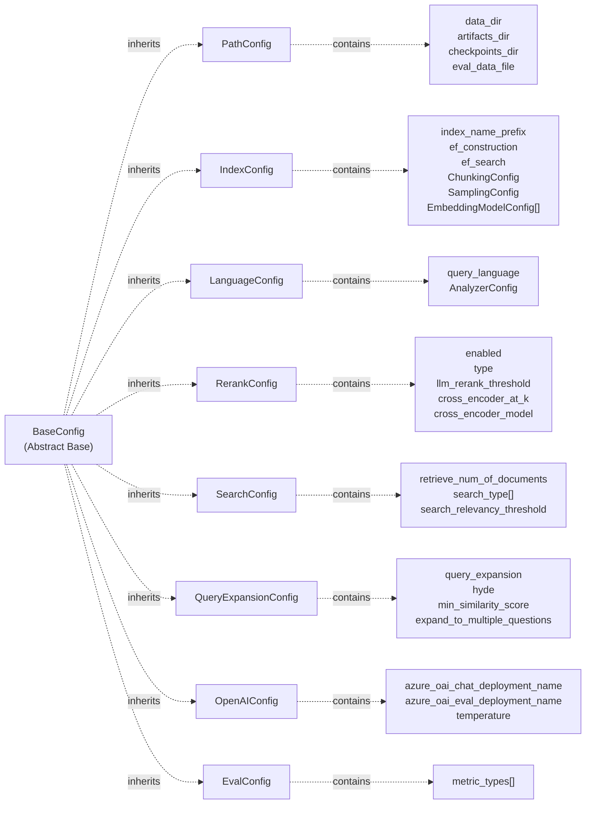
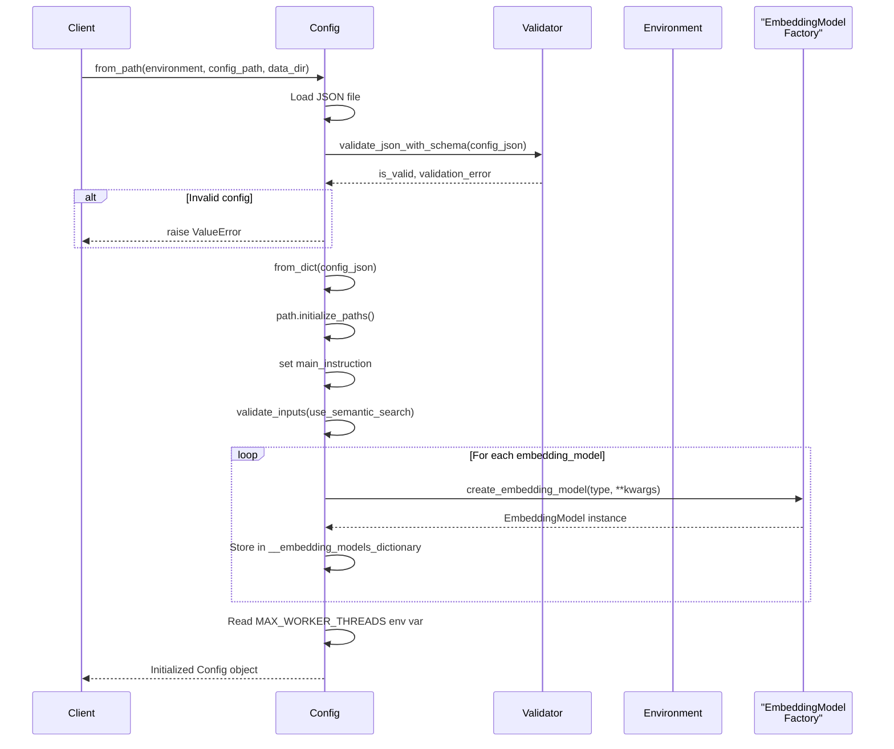
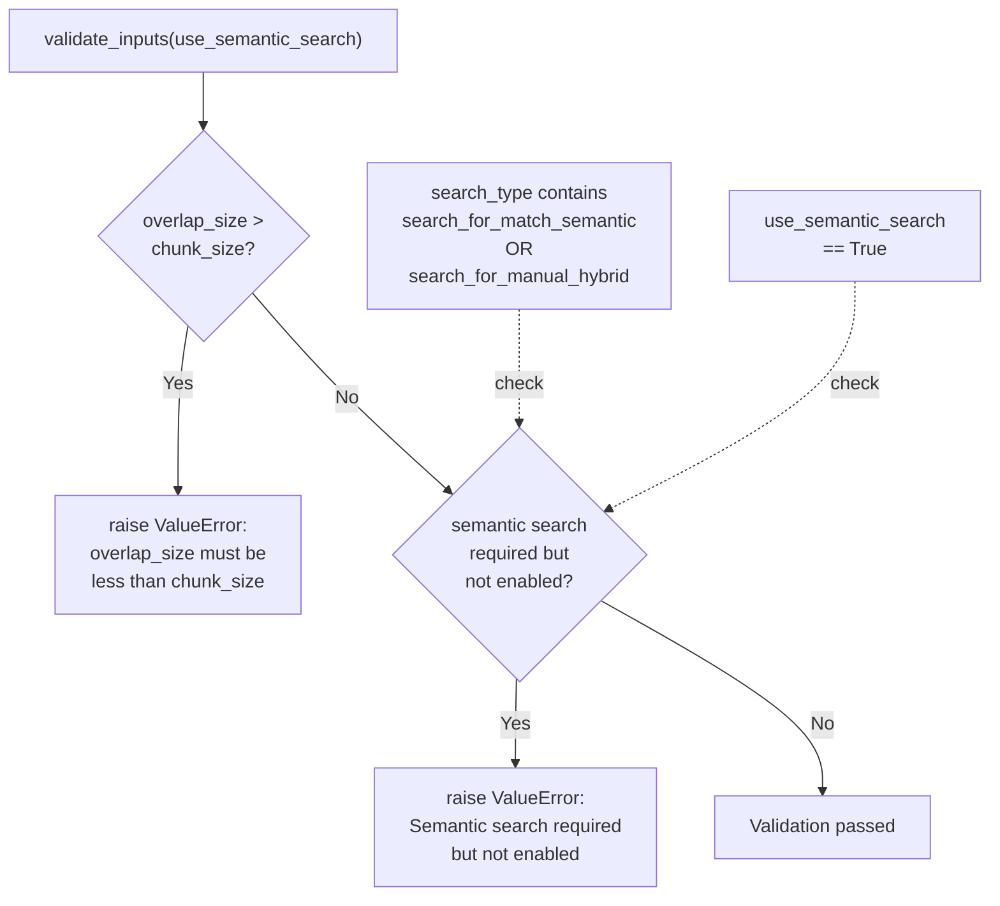

<!-- source: DeepWiki mcp.deepwiki.com · repo microsoft/rag-experiment-accelerator · page 4.1 Config Object Reference · fetched 2026-10-26 -->

# Config Object Reference

<details>
<summary>Relevant source files</summary>

The following files were used as context for generating this wiki page:

- [.github/workflows/config.json](.github/workflows/config.json)
- [config.schema.json](config.schema.json)
- [docs/evaluation-metrics.md](docs/evaluation-metrics.md)
- [promptflow/rag-experiment-accelerator/README.md](promptflow/rag-experiment-accelerator/README.md)
- [rag_experiment_accelerator/config/config.py](rag_experiment_accelerator/config/config.py)
- [rag_experiment_accelerator/config/eval_config.py](rag_experiment_accelerator/config/eval_config.py)
- [rag_experiment_accelerator/config/tests/test_config.py](rag_experiment_accelerator/config/tests/test_config.py)
- [rag_experiment_accelerator/evaluation/plain_metrics.py](rag_experiment_accelerator/evaluation/plain_metrics.py)
- [rag_experiment_accelerator/evaluation/tests/test_plain_metrics.py](rag_experiment_accelerator/evaluation/tests/test_plain_metrics.py)

</details>


This document provides a complete reference for the `Config` object, which serves as the primary configuration container for RAG experiments. The `Config` object aggregates all experiment parameters and orchestrates initialization of dependencies like embedding models and validation of parameter combinations.

For information about the nested `IndexConfig` object and multi-configuration experiments, see [IndexConfig and Multi-Configuration Experiments](#4.2). For a comprehensive guide to creating and editing `config.json` files, see [Configuration Guide](#2.2).

## Config Object Structure

The `Config` class is defined as a dataclass in [rag_experiment_accelerator/config/config.py:34-51]() and serves as the root configuration object for all RAG experiments. It contains both top-level experiment settings and nested configuration objects for each pipeline stage.

```mermaid
graph TB
    Config["Config<br/>(Root Configuration)"]
    
    subgraph "Top-Level Properties"
        EXP["experiment_name<br/>job_name<br/>job_description"]
        EXEC["execution_environment<br/>max_worker_threads<br/>use_checkpoints"]
        DATA["data_formats<br/>main_instruction"]
    end
    
    subgraph "Nested Configuration Objects"
        PathConfig["PathConfig<br/>artifact/data paths"]
        IndexConfig["IndexConfig<br/>chunking/embedding/sampling"]
        LanguageConfig["LanguageConfig<br/>analyzers/query_language"]
        RerankConfig["RerankConfig<br/>reranking strategy"]
        SearchConfig["SearchConfig<br/>search types/thresholds"]
        QueryExpansionConfig["QueryExpansionConfig<br/>HyDE/expansion"]
        OpenAIConfig["OpenAIConfig<br/>deployments/temperature"]
        EvalConfig["EvalConfig<br/>metric_types"]
    end
    
    Config --> EXP
    Config --> EXEC
    Config --> DATA
    Config --> PathConfig
    Config --> IndexConfig
    Config --> LanguageConfig
    Config --> RerankConfig
    Config --> SearchConfig
    Config --> QueryExpansionConfig
    Config --> OpenAIConfig
    Config --> EvalConfig
    
    IndexConfig -.referenced by.-> Stage1["Stage 1: Indexing"]
    SearchConfig -.referenced by.-> Stage3["Stage 3: Querying"]
    EvalConfig -.referenced by.-> Stage4["Stage 4: Evaluation"]
    QueryExpansionConfig -.referenced by.-> Stage3
    RerankConfig -.referenced by.-> Stage3
```



**Sources:** [rag_experiment_accelerator/config/config.py:34-51]()

## Top-Level Properties

### Experiment Identification

These properties identify and describe the experiment for tracking in Azure ML and MLflow.

| Property | Type | Required | Description |
|----------|------|----------|-------------|
| `experiment_name` | `str` | Yes | Azure ML experiment name for grouping related runs |
| `job_name` | `str` | Yes | Azure ML job name prefix for individual runs |
| `job_description` | `str` | Yes | Human-readable description of the experiment's purpose |

**Example:**
```json
{
  "experiment_name": "baseline",
  "job_name": "baseline_job",
  "job_description": "Testing different chunking strategies"
}
```

**Sources:** [rag_experiment_accelerator/config/config.py:37-39](), [config.schema.json:5-18]()

### Execution Environment

Properties controlling how and where the experiment executes.

| Property | Type | Default | Description |
|----------|------|---------|-------------|
| `execution_environment` | `ExecutionEnvironment` | `LOCAL` | Runtime environment: `LOCAL` or `AZURE_ML` |
| `max_worker_threads` | `int` | `None` | Maximum concurrent threads for parallel operations; `None` uses system default |
| `use_checkpoints` | `bool` | `True` | Enable checkpoint caching for expensive operations (embeddings, LLM calls) |

The `execution_environment` is set programmatically during initialization (not read from JSON). When `None`, `max_worker_threads` allows Python's `ThreadPoolExecutor` to determine optimal concurrency. The environment variable `MAX_WORKER_THREADS` can override this value.

**Sources:** [rag_experiment_accelerator/config/config.py:36,42-43,81-85](), [config.schema.json:40-43]()

### Data Processing

Properties controlling document loading and prompt templates.

| Property | Type | Default | Description |
|----------|------|---------|-------------|
| `data_formats` | `list[str]` | `["*"]` | Document formats to process: `["*"]` for all, or specific formats like `["pdf", "html", "json"]` |
| `main_instruction` | `Prompt` | (auto-set) | Main instruction prompt template applied to all queries; not configurable via JSON |

Valid `data_formats` values include: `"*"`, `"pdf"`, `"html"`, `"markdown"`, `"json"`, `"text"`, `"docx"`. The wildcard `"*"` processes all supported formats.

The `main_instruction` property is initialized from [rag_experiment_accelerator/llm/prompt/main_instruction.py]() and cannot be overridden in `config.json`.

**Sources:** [rag_experiment_accelerator/config/config.py:40-41,71-72](), [config.schema.json:19-35]()

## Nested Configuration Objects

The `Config` object contains eight nested configuration objects, each managing settings for a specific subsystem. All nested objects inherit from `BaseConfig` which provides `to_dict()` and `from_dict()` serialization methods.

### Configuration Object Hierarchy



**Sources:** [rag_experiment_accelerator/config/config.py:7-16,44-51]()

### PathConfig

Manages all filesystem paths for data, artifacts, and outputs. Initialized via `initialize_paths()` method which resolves relative paths to absolute paths.

**Key Properties:**
- `data_dir`: Input document directory
- `artifacts_dir`: Root directory for all artifacts
- `checkpoints_dir`: Checkpoint cache location
- `eval_data_file`: Ground truth QA pairs file path

See the file [rag_experiment_accelerator/config/path_config.py]() for complete details.

### IndexConfig

Contains all settings related to document indexing, chunking, embedding generation, and sampling. This is the most complex nested configuration object and supports multi-configuration experiments via the `flatten()` method.

**Key Sub-Objects:**
- `ChunkingConfig`: chunk_size, overlap_size, preprocessing, title/summary generation
- `SamplingConfig`: K-means clustering parameters for representative subset selection
- `EmbeddingModelConfig[]`: Array of embedding model configurations

For detailed documentation, see [IndexConfig and Multi-Configuration Experiments](#4.2).

**Sources:** [rag_experiment_accelerator/config/config.py:45](), [rag_experiment_accelerator/config/index_config.py]()

### LanguageConfig

Configures language-specific text analysis for Azure AI Search.

**Key Properties:**
- `query_language`: Query language code (e.g., `"en-us"`, `"fr-fr"`)
- `analyzer`: Analyzer configuration including char_filters, tokenizers, token_filters

**Sources:** [rag_experiment_accelerator/config/config.py:46](), [config.schema.json:224-416]()

### RerankConfig

Controls reranking of search results to improve precision.

| Property | Type | Description |
|----------|------|-------------|
| `enabled` | `bool` | Enable/disable reranking |
| `type` | `str` | Reranking strategy: `"llm"` or `"cross_encoder"` |
| `llm_rerank_threshold` | `int` | Threshold (1-10) for LLM reranking; chunks ranked above this are selected |
| `cross_encoder_at_k` | `int` | Number of top results to rerank with cross-encoder |
| `cross_encoder_model` | `str` | HuggingFace cross-encoder model name |

**Sources:** [rag_experiment_accelerator/config/config.py:47](), [config.schema.json:418-448]()

### SearchConfig

Defines search retrieval parameters.

| Property | Type | Description |
|----------|------|-------------|
| `retrieve_num_of_documents` | `int` | Number of chunks to retrieve from search index |
| `search_type` | `list[str]` | Search strategies to test (e.g., `["search_for_match_semantic", "search_for_manual_hybrid"]`) |
| `search_relevancy_threshold` | `float` | Similarity threshold (0.0-1.0) for relevance filtering |

**Valid search_type values:**
- `search_for_match_semantic`: Semantic search using Azure AI Search
- `search_for_match_Hybrid_multi`: Hybrid (vector + text) with multi-field matching
- `search_for_match_Hybrid_cross`: Hybrid with cross-field matching
- `search_for_match_text`: Pure text search (BM25)
- `search_for_match_pure_vector`: Pure vector search
- `search_for_match_pure_vector_multi`: Vector search across multiple fields
- `search_for_match_pure_vector_cross`: Vector search with cross-field matching
- `search_for_manual_hybrid`: Manual hybrid combining vector and text scores

**Sources:** [rag_experiment_accelerator/config/config.py:48](), [config.schema.json:450-485]()

### QueryExpansionConfig

Controls query expansion techniques for improved retrieval.

| Property | Type | Default | Description |
|----------|------|---------|-------------|
| `query_expansion` | `bool` | `False` | Enable query expansion using related questions |
| `hyde` | `str` | `"disabled"` | HyDE mode: `"disabled"`, `"generated_hypothetical_answer"`, or `"generated_hypothetical_document_to_answer"` |
| `min_query_expansion_related_question_similarity_score` | `int` | `90` | Minimum similarity score (0-100) for expanded questions |
| `expand_to_multiple_questions` | `bool` | `False` | Generate multiple related questions for expansion |

**Sources:** [rag_experiment_accelerator/config/config.py:49](), [config.schema.json:487-521]()

### OpenAIConfig

Azure OpenAI deployment settings.

| Property | Type | Required | Description |
|----------|------|----------|-------------|
| `azure_oai_chat_deployment_name` | `str` | Yes | Deployment name for chat/response generation (e.g., `"gpt-35-turbo"`, `"gpt-4"`) |
| `azure_oai_eval_deployment_name` | `str` | Yes | Separate deployment for LLM-based evaluation metrics |
| `temperature` | `float` | Yes | Temperature (0.0-1.0) for LLM generation |

Using separate chat and eval deployments prevents quota conflicts and allows different model selection for generation vs. evaluation.

**Sources:** [rag_experiment_accelerator/config/config.py:50](), [config.schema.json:523-547]()

### EvalConfig

Evaluation metric configuration.

| Property | Type | Description |
|----------|------|-------------|
| `metric_types` | `list[str]` | List of metric identifiers to calculate |

**Metric Categories:**

**Algorithm-based:** `lcsstr`, `lcsseq`, `jaro_winkler`, `hamming`, `jaccard`, `levenshtein`, `fuzzy_score`, `cosine_ochiai`, `rouge1_precision`, `rouge1_recall`, `rouge1_fmeasure`, `rouge2_precision`, `rouge2_recall`, `rouge2_fmeasure`, `rougeL_precision`, `rougeL_recall`, `rougeL_fmeasure`

**BERT-based:** `bert_all_MiniLM_L6_v2`, `bert_base_nli_mean_tokens`, `bert_large_nli_mean_tokens`, `bert_large_nli_stsb_mean_tokens`, `bert_distilbert_base_nli_stsb_mean_tokens`, `bert_paraphrase_multilingual_MiniLM_L12_v2`

**LLM-based:** `llm_answer_relevance`, `llm_context_precision`, `llm_context_recall`

For detailed metric descriptions, see [Algorithm-Based Metrics](#8.1), [BERT-Based Semantic Similarity](#8.2), and [LLM-Based Evaluation](#8.3).

**Sources:** [rag_experiment_accelerator/config/config.py:51](), [rag_experiment_accelerator/config/eval_config.py:6-16](), [config.schema.json:549-587]()

## Config Loading and Initialization

### Loading from JSON

The `Config.from_path()` class method loads configuration from a JSON file and initializes all dependencies.



**Key Steps:**

1. **JSON Loading**: Reads and parses `config.json` file [rag_experiment_accelerator/config/config.py:59-60]()
2. **Schema Validation**: Validates against `config.schema.json` using JSON Schema [rag_experiment_accelerator/config/config.py:61-65]()
3. **Deserialization**: Converts JSON dict to Config object using `from_dict()` [rag_experiment_accelerator/config/config.py:67]()
4. **Path Resolution**: Calls `path.initialize_paths()` to resolve all paths [rag_experiment_accelerator/config/config.py:69]()
5. **Main Instruction**: Sets the prompt template from [rag_experiment_accelerator/llm/prompt/main_instruction.py]() [rag_experiment_accelerator/config/config.py:72]()
6. **Input Validation**: Validates parameter combinations [rag_experiment_accelerator/config/config.py:74-77]()
7. **Embedding Models**: Instantiates all embedding models via factory [rag_experiment_accelerator/config/config.py:79]()
8. **Thread Configuration**: Reads `MAX_WORKER_THREADS` environment variable if present [rag_experiment_accelerator/config/config.py:83-85]()

**Sources:** [rag_experiment_accelerator/config/config.py:53-92]()

### Environment Integration

The `Config` initialization requires an `Environment` object that provides Azure service credentials and endpoints. The `Environment` is passed to embedding model factories which need API keys and endpoints for Azure OpenAI embeddings.

**Sources:** [rag_experiment_accelerator/config/config.py:54,79](), [rag_experiment_accelerator/config/environment.py]()

## Config Validation

The `Config` class implements validation at multiple levels to ensure parameter consistency.

### Schema Validation

JSON configuration files are validated against [config.schema.json:1-605]() which enforces:
- Required properties
- Data types
- Enumerated values
- Numeric ranges
- Array constraints

**Sources:** [rag_experiment_accelerator/config/config.py:61-65](), [config.schema.json:1-605]()

### Runtime Validation

The `validate_inputs()` method performs runtime checks on parameter combinations:



**Validation Rules:**

1. **Chunk/Overlap Consistency**: `max(overlap_size)` must be less than `min(chunk_size)` [rag_experiment_accelerator/config/config.py:95-98]()

2. **Semantic Search Dependency**: If `search_type` includes `"search_for_match_semantic"` or `"search_for_manual_hybrid"`, then Azure AI Search must have semantic search enabled [rag_experiment_accelerator/config/config.py:100-106]()

**Sources:** [rag_experiment_accelerator/config/config.py:94-106]()

## Embedding Model Management

The `Config` object manages a dictionary of initialized embedding models for efficient reuse across the pipeline.

### Initialization

During `from_path()`, the `initialize_embedding_models()` method creates all configured embedding models:

```python
def initialize_embedding_models(self, environment: Environment):
    self.__embedding_models_dictionary = {}
    for model_config in self.index.embedding_model:
        kwargs = {"environment": environment, **model_config.to_dict()}
        self.__embedding_models_dictionary[
            model_config.model_name
        ] = create_embedding_model(model_config.type, **kwargs)
```

The factory function `create_embedding_model()` instantiates the appropriate class (`STEmbeddingModel` for sentence-transformers, `AzureOpenAIEmbeddingModel` for Azure OpenAI) based on the `type` field.

**Sources:** [rag_experiment_accelerator/config/config.py:108-114]()

### Retrieval

Components retrieve embedding models by name:

```python
embedding_model = config.get_embedding_model(model_name)
```

This avoids redundant initialization of expensive models (which load large neural networks into memory).

**Sources:** [rag_experiment_accelerator/config/config.py:116-117]()

## Configuration Code Map

The following diagram maps `Config` object properties to the code entities that consume them:

```mermaid
graph TB
    subgraph "Config Object"
        Config["Config"]
        
        IndexCfg["config.index<br/>(IndexConfig)"]
        SearchCfg["config.search<br/>(SearchConfig)"]
        EvalCfg["config.eval<br/>(EvalConfig)"]
        OpenAICfg["config.openai<br/>(OpenAIConfig)"]
        QueryExpCfg["config.query_expansion<br/>(QueryExpansionConfig)"]
        RerankCfg["config.rerank<br/>(RerankConfig)"]
        PathCfg["config.path<br/>(PathConfig)"]
    end
    
    subgraph "Stage 1: Indexing"
        RunIndex["run.index.main()"]
        DocLoader["documentLoader"]
        ACSIngest["acs_ingest.py"]
        Sampling["sampling.py"]
    end
    
    subgraph "Stage 2: QA Generation"
        RunQA["run.qa_generation.main()"]
        ResponseGen1["ResponseGenerator"]
    end
    
    subgraph "Stage 3: Querying"
        RunQuerying["run.querying.main()"]
        SearchMethods["acs_search_methods.py"]
        QueryExpansion["query_expansion.py"]
        Reranker["llm_rerank.py<br/>cross_encoder_rerank.py"]
        ResponseGen2["ResponseGenerator"]
    end
    
    subgraph "Stage 4: Evaluation"
        RunEval["run.evaluation.main()"]
        Eval["evaluation.eval.py"]
        Metrics["evaluation.metrics.py"]
    end
    
    Config --> IndexCfg
    Config --> SearchCfg
    Config --> EvalCfg
    Config --> OpenAICfg
    Config --> QueryExpCfg
    Config --> RerankCfg
    Config --> PathCfg
    
    IndexCfg --> RunIndex
    IndexCfg --> DocLoader
    IndexCfg --> ACSIngest
    IndexCfg --> Sampling
    
    OpenAICfg --> ResponseGen1
    IndexCfg --> RunQA
    
    SearchCfg --> RunQuerying
    SearchCfg --> SearchMethods
    QueryExpCfg --> QueryExpansion
    RerankCfg --> Reranker
    OpenAICfg --> ResponseGen2
    IndexCfg --> SearchMethods
    
    EvalCfg --> RunEval
    EvalCfg --> Eval
    EvalCfg --> Metrics
    OpenAICfg --> Metrics
    
    PathCfg -.paths.-> RunIndex
    PathCfg -.paths.-> RunQA
    PathCfg -.paths.-> RunQuerying
    PathCfg -.paths.-> RunEval
```



**Sources:** [rag_experiment_accelerator/config/config.py:1-118](), [rag_experiment_accelerator/run/]()

## Usage Examples

### Basic Config Loading

```python
from rag_experiment_accelerator.config.config import Config
from rag_experiment_accelerator.config.environment import Environment

# Initialize environment with Azure credentials
environment = Environment.from_env_or_keyvault()

# Load config from file
config = Config.from_path(
    environment=environment,
    config_path="./config.json",
    data_dir="./data"
)

# Access properties
print(f"Experiment: {config.experiment_name}")
print(f"Chunk sizes: {config.index.chunking.chunk_size}")
print(f"Search types: {config.search.search_type}")
```

### Accessing Nested Configuration

```python
# Access chunking parameters
chunk_sizes = config.index.chunking.chunk_size  # [512, 1024]
overlap_sizes = config.index.chunking.overlap_size  # [100, 200]
generate_summary = config.index.chunking.generate_summary  # True/False

# Access search configuration
num_results = config.search.retrieve_num_of_documents  # 5
search_types = config.search.search_type  # ["search_for_match_semantic", ...]

# Access evaluation metrics
metrics = config.eval.metric_types  # ["fuzzy_score", "bert_all_MiniLM_L6_v2", ...]
```

### Retrieving Embedding Models

```python
# Get embedding model by name
model_name = config.index.embedding_model[0].model_name
embedding_model = config.get_embedding_model(model_name)

# Generate embeddings
text = "Sample document chunk"
embedding_vector = embedding_model.embed([text])[0]
print(f"Dimension: {len(embedding_vector)}")
```

### Conditional Logic Based on Config

```python
# Check if checkpointing is enabled
if config.use_checkpoints:
    # Use cached results if available
    result = get_from_checkpoint_or_compute(...)
else:
    # Always compute fresh
    result = compute(...)

# Check reranking configuration
if config.rerank.enabled:
    if config.rerank.type == "llm":
        reranked = llm_rerank(results, config.rerank.llm_rerank_threshold)
    elif config.rerank.type == "cross_encoder":
        reranked = cross_encoder_rerank(results, config.rerank.cross_encoder_at_k)
```

**Sources:** [rag_experiment_accelerator/config/config.py:53-117](), [rag_experiment_accelerator/config/tests/test_config.py:10-176]()

## Complete Property Reference Table

The following table provides a comprehensive reference of all `Config` properties:

| Property Path | Type | Default | Required | Validation |
|--------------|------|---------|----------|------------|
| `experiment_name` | `str` | - | Yes | minLength: 1 |
| `job_name` | `str` | - | Yes | minLength: 1 |
| `job_description` | `str` | - | Yes | - |
| `execution_environment` | `ExecutionEnvironment` | `LOCAL` | No | `LOCAL` or `AZURE_ML` |
| `data_formats` | `list[str]` | `["*"]` | Yes | Valid formats or `"*"` |
| `main_instruction` | `Prompt` | (auto) | No | Set programmatically |
| `max_worker_threads` | `int` | `None` | No | - |
| `use_checkpoints` | `bool` | `True` | Yes | - |
| `path.*` | `PathConfig` | - | Yes | See PathConfig docs |
| `index.*` | `IndexConfig` | - | Yes | See section 4.2 |
| `language.query_language` | `str` | - | Yes | Language code enum |
| `language.analyzer.*` | `AnalyzerConfig` | - | Yes | Analyzer properties |
| `rerank.enabled` | `bool` | - | No | - |
| `rerank.type` | `str` | - | No | `"llm"` or `"cross_encoder"` |
| `rerank.llm_rerank_threshold` | `int` | - | No | 1-10 |
| `rerank.cross_encoder_at_k` | `int` | - | No | - |
| `rerank.cross_encoder_model` | `str` | - | No | Valid model name |
| `search.retrieve_num_of_documents` | `int` | - | Yes | - |
| `search.search_type` | `list[str]` | - | Yes | Valid search types |
| `search.search_relevancy_threshold` | `float` | `0.8` | No | 0.0-1.0 |
| `query_expansion.query_expansion` | `bool` | `False` | Yes | - |
| `query_expansion.hyde` | `str` | `"disabled"` | Yes | Valid HyDE mode |
| `query_expansion.min_query_expansion_related_question_similarity_score` | `int` | `90` | Yes | 0-100 |
| `query_expansion.expand_to_multiple_questions` | `bool` | `False` | Yes | - |
| `openai.azure_oai_chat_deployment_name` | `str` | - | Yes | minLength: 1 |
| `openai.azure_oai_eval_deployment_name` | `str` | - | Yes | minLength: 1 |
| `openai.temperature` | `float` | - | Yes | 0.0-1.0 |
| `eval.metric_types` | `list[str]` | - | No | Valid metric names |

**Sources:** [rag_experiment_accelerator/config/config.py:34-51](), [config.schema.json:1-605]()

---

