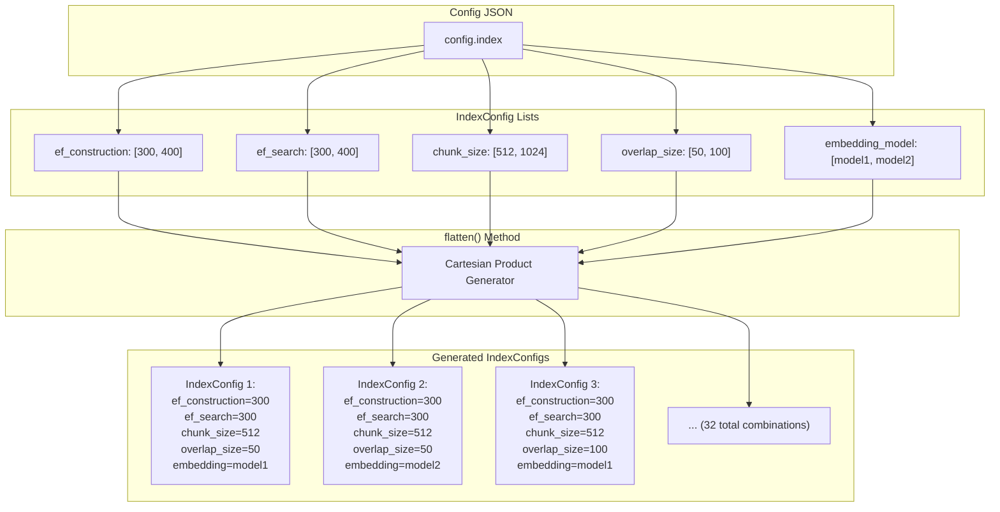
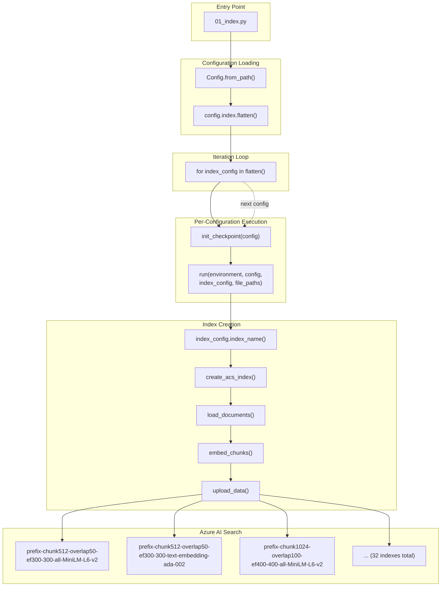
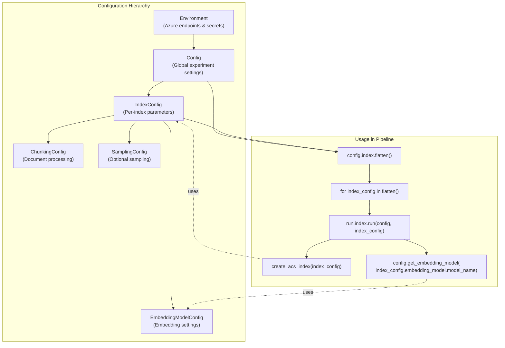

<!-- source: DeepWiki mcp.deepwiki.com · repo microsoft/rag-experiment-accelerator · page 4.2 IndexConfig and Multi-Configuration Experiments · fetched 2026-10-26 -->

# IndexConfig and Multi-Configuration Experiments

<details>
<summary>Relevant source files</summary>

The following files were used as context for generating this wiki page:

- [rag_experiment_accelerator/config/config.py](rag_experiment_accelerator/config/config.py)
- [rag_experiment_accelerator/config/tests/data/config.json](rag_experiment_accelerator/config/tests/data/config.json)
- [rag_experiment_accelerator/config/tests/test_config.py](rag_experiment_accelerator/config/tests/test_config.py)
- [rag_experiment_accelerator/nlp/preprocess.py](rag_experiment_accelerator/nlp/preprocess.py)
- [rag_experiment_accelerator/nlp/tests/test_preprocessor.py](rag_experiment_accelerator/nlp/tests/test_preprocessor.py)
- [rag_experiment_accelerator/run/index.py](rag_experiment_accelerator/run/index.py)
- [rag_experiment_accelerator/run/tests/test_index.py](rag_experiment_accelerator/run/tests/test_index.py)

</details>


## Purpose and Scope

This document explains the `IndexConfig` class and the multi-configuration experiment system that enables systematic testing of different indexing parameters. `IndexConfig` holds all parameters specific to a single Azure AI Search index configuration, while the `flatten()` mechanism generates multiple configurations for grid search experiments.

For general configuration settings that apply across all indexes, see [Config Object Reference](#4.1). For details on document chunking strategies specifically, see [Chunking Strategies](#5.3). For embedding model configuration, see [Embedding Models](#6).

---

## IndexConfig Structure

`IndexConfig` is a nested configuration object within the main `Config` class that defines parameters for document indexing and Azure AI Search index creation. Unlike most configuration parameters which are scalar values, `IndexConfig` supports **list-based parameters** that enable automated grid search experimentation.

### Core Parameters

| Parameter | Type | Description |
|-----------|------|-------------|
| `index_name_prefix` | `str` | Prefix for all generated index names |
| `ef_construction` | `list[int]` | HNSW graph construction parameters (higher = better recall, slower indexing) |
| `ef_search` | `list[int]` | HNSW search parameters (higher = better recall, slower queries) |
| `chunking` | `ChunkingConfig` | Document chunking configuration with list-based parameters |
| `embedding_model` | `list[EmbeddingModelConfig]` | Embedding models to use for vector generation |
| `sampling` | `SamplingConfig` | Optional data sampling configuration |

### ChunkingConfig Sub-Parameters

The `chunking` field contains parameters for document processing:

| Parameter | Type | Description |
|-----------|------|-------------|
| `chunk_size` | `list[int]` | Size of each document chunk in characters/tokens |
| `overlap_size` | `list[int]` | Overlap between consecutive chunks |
| `preprocess` | `bool` | Whether to apply NLP preprocessing (lemmatization, stopword removal) |
| `chunking_strategy` | `str` | Chunking algorithm (e.g., "basic", "semantic") |
| `generate_title` | `bool` | Whether to generate LLM titles for chunks |
| `generate_summary` | `bool` | Whether to generate LLM summaries for chunks |
| `override_content_with_summary` | `bool` | Replace chunk content with summary for indexing |
| `azure_document_intelligence_model` | `str` | Document Intelligence model for PDF processing |

**Sources:** [rag_experiment_accelerator/config/config.py:45](), [rag_experiment_accelerator/config/tests/data/config.json:9-51](), [rag_experiment_accelerator/run/tests/test_index.py:55-74]()

---

## The flatten() Mechanism

The `flatten()` method is the core of the multi-configuration experiment system. It generates a **cartesian product** of all list-based parameters, creating individual `IndexConfig` instances for each combination.



**How flatten() Works:**

The `flatten()` method iterates through all possible combinations of list-based parameters. For example, with the configuration:

```json
{
  "index": {
    "ef_construction": [300, 400],
    "ef_search": [300, 400],
    "chunking": {
      "chunk_size": [512, 1024],
      "overlap_size": [50, 100]
    },
    "embedding_model": [
      {"model_name": "all-MiniLM-L6-v2"},
      {"model_name": "text-embedding-ada-002"}
    ]
  }
}
```

The `flatten()` method generates: **2 × 2 × 2 × 2 × 2 = 32 different configurations**

Each generated `IndexConfig` has all list parameters converted to scalar values, representing one specific experiment configuration.

**Sources:** [rag_experiment_accelerator/run/tests/test_index.py:110-127](), [rag_experiment_accelerator/config/config.py:45]()

---

## Multi-Configuration Experiment Execution

The experiment pipeline iterates through all flattened configurations, creating a separate Azure AI Search index for each combination and tracking results independently.



**Sources:** [rag_experiment_accelerator/run/tests/test_index.py:110-112](), [rag_experiment_accelerator/run/index.py:30-100]()

---

## Index Naming Convention

Each `IndexConfig` generates a unique index name that encodes its configuration parameters using the `index_name()` method. This naming scheme enables identification of which parameters were used for a given index.

### Naming Pattern

```
{index_name_prefix}-chunk{chunk_size}-overlap{overlap_size}-ef{ef_construction}-{ef_search}-{embedding_model_name}
```

### Example Index Names

```
baseline-chunk512-overlap50-ef300-300-all-MiniLM-L6-v2
baseline-chunk1024-overlap100-ef400-400-text-embedding-ada-002
experiment1-chunk256-overlap25-ef200-200-text-embedding-3-small
```

The index name serves as a unique identifier in Azure AI Search and is used throughout the pipeline for:
- Creating the index in Stage 1 (Indexing)
- Querying the index in Stage 3 (Querying)
- Tracking metrics in Stage 4 (Evaluation)
- MLflow experiment organization

**Sources:** [rag_experiment_accelerator/run/index.py:46]()

---

## Configuring Multi-Configuration Experiments

### Basic Single-Configuration Example

To run a single configuration, use scalar values or single-element lists:

```json
{
  "index": {
    "index_name_prefix": "baseline",
    "ef_construction": [400],
    "ef_search": [400],
    "chunking": {
      "chunk_size": [1024],
      "overlap_size": [100]
    },
    "embedding_model": [
      {
        "type": "sentence-transformer",
        "model_name": "all-MiniLM-L6-v2"
      }
    ]
  }
}
```

This generates **1 configuration** and creates **1 index**.

### Multi-Configuration Grid Search Example

To test multiple chunk sizes and embedding models:

```json
{
  "index": {
    "index_name_prefix": "chunking-experiment",
    "ef_construction": [400],
    "ef_search": [400],
    "chunking": {
      "chunk_size": [256, 512, 1024, 2048],
      "overlap_size": [50, 100]
    },
    "embedding_model": [
      {
        "type": "sentence-transformer",
        "model_name": "all-MiniLM-L6-v2"
      },
      {
        "type": "azure",
        "model_name": "text-embedding-ada-002"
      }
    ]
  }
}
```

This generates **4 × 2 × 2 = 16 configurations** and creates **16 indexes**.

### HNSW Parameter Tuning Example

To optimize HNSW vector search parameters:

```json
{
  "index": {
    "index_name_prefix": "hnsw-tuning",
    "ef_construction": [200, 400, 800],
    "ef_search": [200, 400, 800],
    "chunking": {
      "chunk_size": [1024],
      "overlap_size": [100]
    },
    "embedding_model": [
      {
        "type": "azure",
        "model_name": "text-embedding-3-large",
        "dimension": 3072
      }
    ]
  }
}
```

This generates **3 × 3 = 9 configurations** for testing different HNSW parameters.

**Sources:** [rag_experiment_accelerator/config/tests/data/config.json:9-51](), [rag_experiment_accelerator/run/tests/test_index.py:55-74]()

---

## Integration with Other Configuration Layers

`IndexConfig` is part of a hierarchical configuration system:



Key interactions:

1. **Environment**: Provides Azure credentials and endpoints used during index creation
2. **Config**: Contains the `IndexConfig` and provides `get_embedding_model()` method
3. **IndexConfig**: Flattened to generate multiple configurations
4. **Individual runs**: Each flattened `IndexConfig` is passed to `run.index.run()`

The `Config` class initializes embedding model instances based on `IndexConfig.embedding_model` entries and stores them in a dictionary accessible via `config.get_embedding_model(model_name)`.

**Sources:** [rag_experiment_accelerator/config/config.py:108-117](), [rag_experiment_accelerator/run/index.py:52-54]()

---

## Checkpointing and Multi-Configuration Experiments

The checkpoint system ([Checkpointing System](#10.1)) is configuration-aware, caching expensive operations per configuration. This is critical for multi-configuration experiments because:

1. **Embeddings are cached per chunk content and model name**: [rag_experiment_accelerator/run/index.py:187]()
   ```python
   @cache_with_checkpoint(id="chunk['content']+embedding_model.name")
   def embed_chunk(pre_process, embedding_model, chunk):
   ```

2. **Title generation is cached per chunk and generate_title setting**: [rag_experiment_accelerator/run/index.py:292]()
   ```python
   @cache_with_checkpoint(id="chunk['content']+str(config.index.chunking.generate_title)")
   def process_title(config: Config, index_config: IndexConfig, pre_process, chunk, environment):
   ```

3. **Summary generation is cached per chunk and generate_summary setting**: [rag_experiment_accelerator/run/index.py:330-331]()

This means:
- If two configurations use the same embedding model and chunk size, embeddings are reused
- If two configurations differ only in HNSW parameters, chunking and embedding are skipped
- When `use_checkpoints: true`, subsequent runs skip expensive LLM and embedding operations

**Sources:** [rag_experiment_accelerator/run/index.py:187-209](), [rag_experiment_accelerator/run/index.py:292-327](), [rag_experiment_accelerator/run/index.py:330-370]()

---

## Preprocessing and Index Configuration

The `Preprocess` class is instantiated per `IndexConfig` based on the `chunking.preprocess` flag:

[rag_experiment_accelerator/run/index.py:44]()
```python
pre_process = Preprocess(index_config.chunking.preprocess)
```

When `preprocess: true`, the `Preprocess` class performs NLP operations:
- Lowercasing
- Punctuation removal
- Stopword removal
- Tokenization

This preprocessing is applied before:
1. **Embedding generation**: [rag_experiment_accelerator/run/index.py:205-207]()
2. **Title embedding**: [rag_experiment_accelerator/run/index.py:317-319]()
3. **Summary embedding**: [rag_experiment_accelerator/run/index.py:360-362]()

Preprocessing can significantly impact retrieval quality and should be tested as part of multi-configuration experiments.

**Sources:** [rag_experiment_accelerator/nlp/preprocess.py:10-48](), [rag_experiment_accelerator/run/index.py:44]()

---

## Best Practices for Multi-Configuration Experiments

### Start Small, Then Expand

Begin with a small parameter space to validate the pipeline:

```json
{
  "index": {
    "ef_construction": [400],
    "ef_search": [400],
    "chunking": {
      "chunk_size": [512, 1024],
      "overlap_size": [50]
    },
    "embedding_model": [
      {"model_name": "all-MiniLM-L6-v2"}
    ]
  }
}
```

Once validated, expand to full grid search.

### Consider Resource Constraints

| Configuration Count | Approximate Time (100 docs) | Azure AI Search Indexes | Storage Impact |
|---------------------|------------------------------|-------------------------|----------------|
| 1-5 configs | Minutes to hours | 1-5 indexes | Low |
| 5-20 configs | Hours to day | 5-20 indexes | Moderate |
| 20-50 configs | Days | 20-50 indexes | High |
| 50+ configs | Days to weeks | 50+ indexes | Very High |

Each index in Azure AI Search:
- Consumes storage quota
- Has associated costs
- Requires cleanup after experiments

Use the `clear_indexes` Makefile target to remove old indexes.

### Parameter Selection Strategy

1. **Chunk Size & Overlap**: Primary drivers of retrieval quality
   - Test: `[256, 512, 1024, 2048]`
   - Overlap: Typically 10-20% of chunk size

2. **Embedding Models**: Different dimensions and capabilities
   - Test sentence-transformers vs Azure OpenAI
   - Consider cost vs quality tradeoffs

3. **HNSW Parameters**: Fine-tuning for performance
   - Start with defaults: `ef_construction: [400]`, `ef_search: [400]`
   - Only optimize if retrieval performance is critical

4. **Preprocessing**: Binary decision with large impact
   - Test both `true` and `false`
   - Consider language-specific requirements

### Validation Strategy

The test suite validates that multi-configuration iteration works correctly:

[rag_experiment_accelerator/run/tests/test_index.py:109-127]()
```python
for index_config in mock_config.index.flatten():
    init_checkpoint(mock_config)
    run(mock_environment, mock_config, index_config, file_paths, mock_mlflow_client)

# Assert correct number of calls for 32 configurations
assert mock_preprocess.call_count == 32
assert mock_create_acs_index.call_count == 32
assert mock_load_documents.call_count == 32
assert mock_upload_data.call_count == 32
```

This validates that each configuration is processed independently.

**Sources:** [rag_experiment_accelerator/run/tests/test_index.py:110-127]()

---

## Integration with Later Pipeline Stages

The `IndexConfig` impacts all four pipeline stages:

### Stage 2: QA Generation
QA pairs are generated from documents retrieved from **all indexes** created in Stage 1. The system queries each index to ensure comprehensive question coverage.

### Stage 3: Querying
Each `IndexConfig` corresponds to a distinct index name. During querying, the pipeline:
1. Iterates through search strategies (from `config.search.search_type`)
2. For each strategy, queries all available indexes
3. Records which index was queried for each result

### Stage 4: Evaluation
Evaluation metrics are computed per `(search_type, index_name)` combination, enabling comparison of:
- Different chunk sizes
- Different embedding models
- Different HNSW parameters
- Different preprocessing strategies

MLflow logs metrics with index names as parameters, enabling filtering and comparison in the MLflow UI.

**Sources:** [rag_experiment_accelerator/run/index.py:30-100]()

---

## Configuration Validation

The `Config` class validates `IndexConfig` parameters:

[rag_experiment_accelerator/config/config.py:94-98]()
```python
def validate_inputs(self, use_semantic_search: bool = False):
    if max(self.index.chunking.overlap_size) > min(self.index.chunking.chunk_size):
        raise ValueError(
            "Config param validation error: overlap_size must be less than chunk_size"
        )
```

This validation ensures that **all combinations** generated by `flatten()` satisfy the constraint: `overlap_size < chunk_size`.

Example that would fail validation:
```json
{
  "chunking": {
    "chunk_size": [256, 512],
    "overlap_size": [100, 300]
  }
}
```

The maximum `overlap_size` (300) exceeds the minimum `chunk_size` (256), causing validation to fail during `Config.from_path()`.

**Sources:** [rag_experiment_accelerator/config/config.py:94-106](), [rag_experiment_accelerator/config/tests/test_config.py:192-203]()

---

