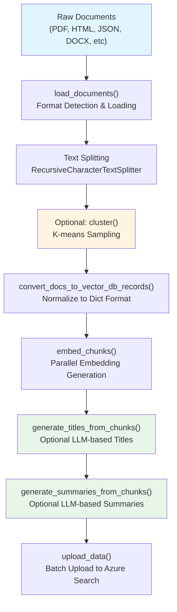
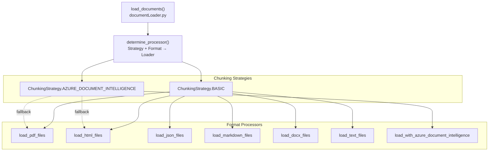
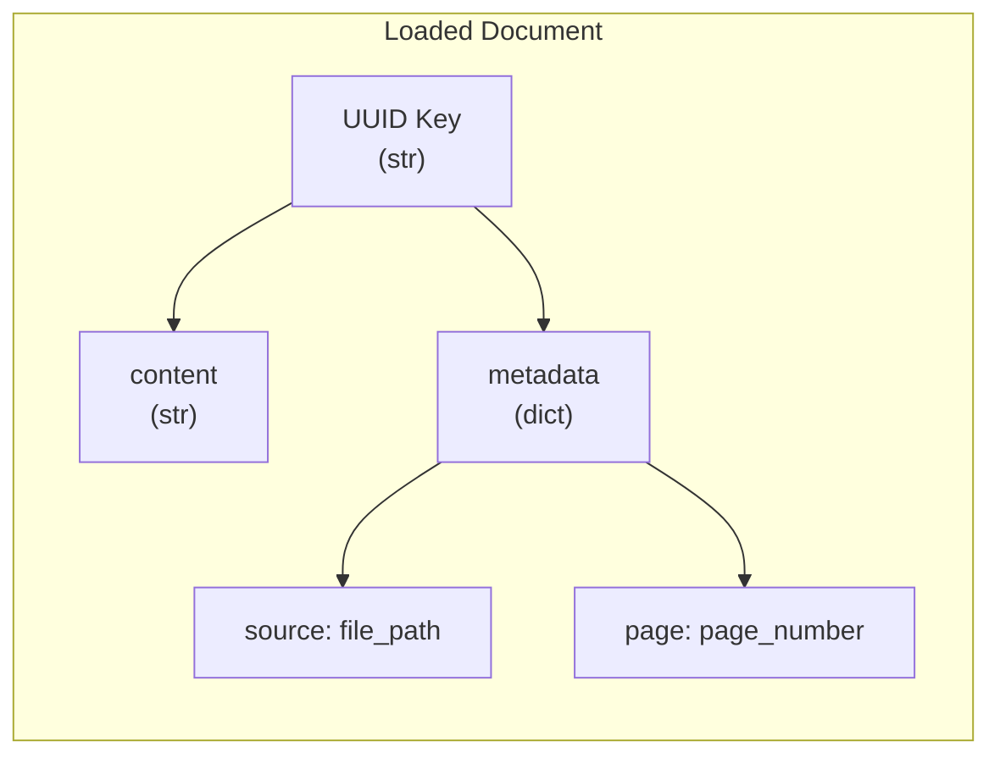
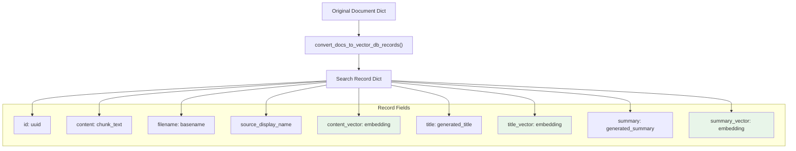
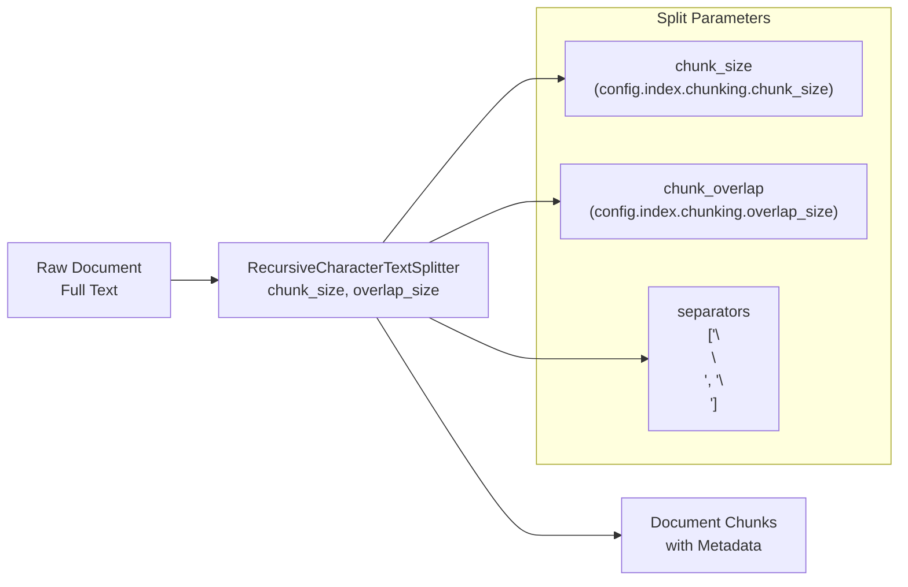
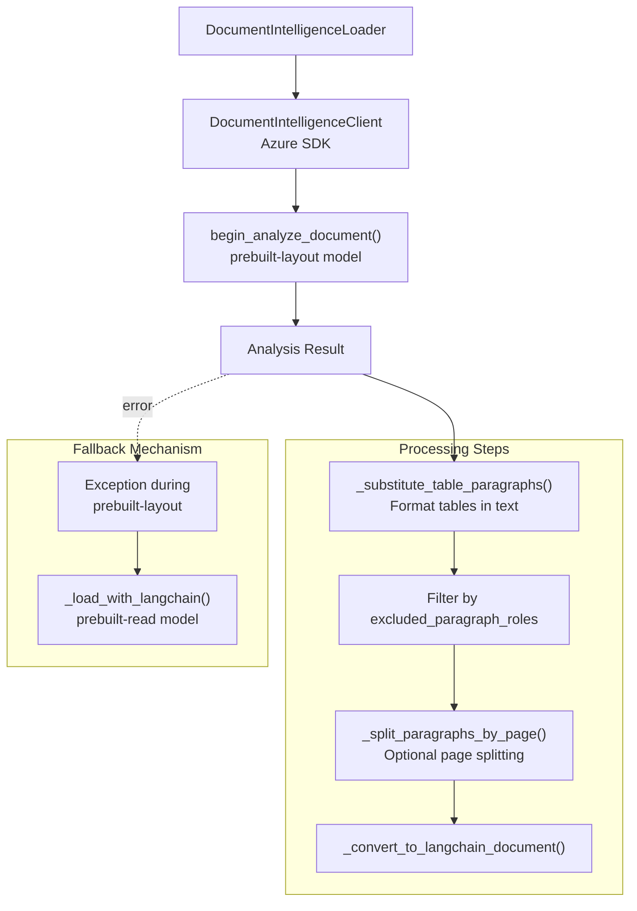
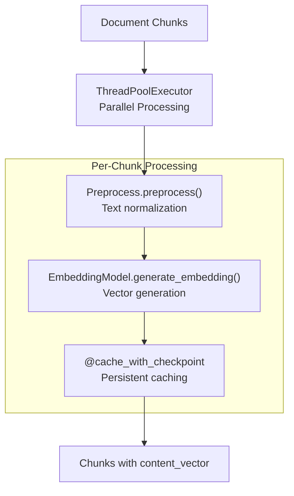
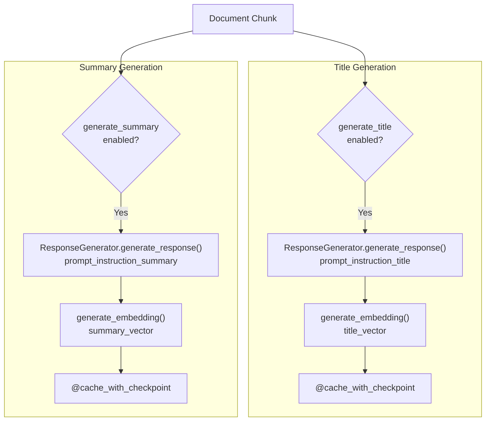
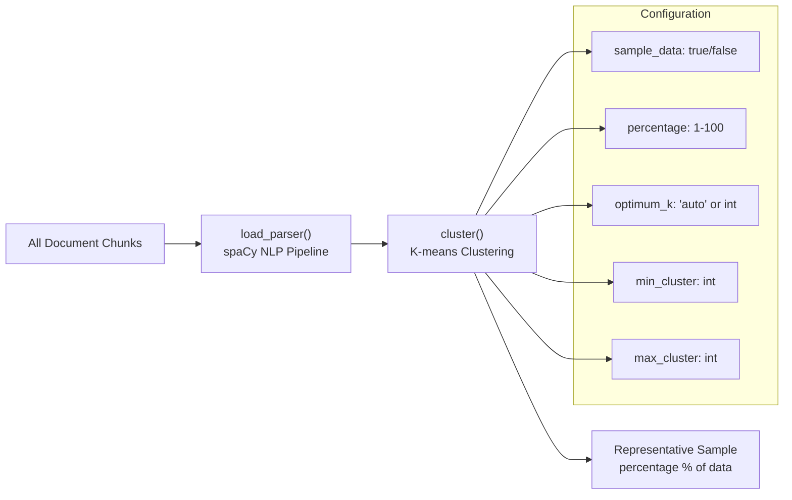
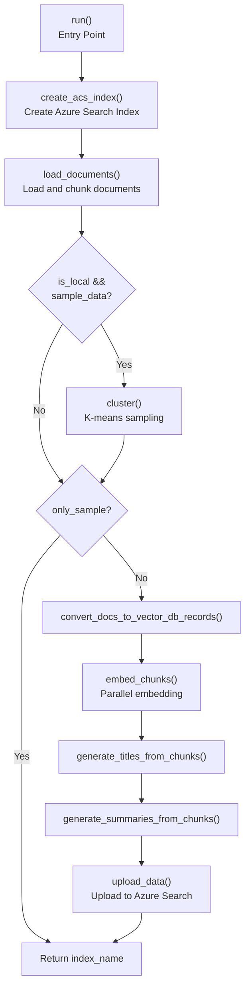

<!-- source: DeepWiki mcp.deepwiki.com · repo microsoft/rag-experiment-accelerator · page 5 Document Processing · fetched 2026-10-26 -->

# Document Processing

<details>
<summary>Relevant source files</summary>

The following files were used as context for generating this wiki page:

- [rag_experiment_accelerator/config/tests/data/config.json](rag_experiment_accelerator/config/tests/data/config.json)
- [rag_experiment_accelerator/doc_loader/documentIntelligenceLoader.py](rag_experiment_accelerator/doc_loader/documentIntelligenceLoader.py)
- [rag_experiment_accelerator/doc_loader/documentLoader.py](rag_experiment_accelerator/doc_loader/documentLoader.py)
- [rag_experiment_accelerator/doc_loader/jsonLoader.py](rag_experiment_accelerator/doc_loader/jsonLoader.py)
- [rag_experiment_accelerator/doc_loader/structuredLoader.py](rag_experiment_accelerator/doc_loader/structuredLoader.py)
- [rag_experiment_accelerator/doc_loader/tests/test_data/document_intelligence_response/multiple_pages.json](rag_experiment_accelerator/doc_loader/tests/test_data/document_intelligence_response/multiple_pages.json)
- [rag_experiment_accelerator/doc_loader/tests/test_data/document_intelligence_response/simple_response.json](rag_experiment_accelerator/doc_loader/tests/test_data/document_intelligence_response/simple_response.json)
- [rag_experiment_accelerator/doc_loader/tests/test_data/document_intelligence_response/table_without_headers.json](rag_experiment_accelerator/doc_loader/tests/test_data/document_intelligence_response/table_without_headers.json)
- [rag_experiment_accelerator/doc_loader/tests/test_document_intelligence_loader.py](rag_experiment_accelerator/doc_loader/tests/test_document_intelligence_loader.py)
- [rag_experiment_accelerator/run/index.py](rag_experiment_accelerator/run/index.py)

</details>


## Purpose and Scope

This document describes the **Document Processing** subsystem in Stage 1 (Indexing) of the RAG Experiment Accelerator pipeline. Document processing encompasses loading raw documents from various formats, splitting them into chunks, optionally generating metadata (titles and summaries), and preparing them for embedding and indexing in Azure AI Search.

For details on specific document loaders, see [Document Loaders](#5.1). For Azure Document Intelligence integration, see [Azure Document Intelligence Integration](#5.2). For chunking configuration and strategies, see [Chunking Strategies](#5.3). For data sampling techniques, see [Data Sampling and Clustering](#5.4).

---

## Overview

Document processing is orchestrated by the `run.index.run()` function and consists of several sequential stages:



**Key Processing Stages:**
1. **Loading**: Documents are loaded using format-specific loaders
2. **Chunking**: Text is split into overlapping chunks
3. **Sampling** (optional): Representative subset selection via clustering
4. **Normalization**: Chunks converted to standard dictionary format
5. **Embedding**: Vector embeddings generated for each chunk
6. **Metadata Generation** (optional): LLM generates titles and/or summaries
7. **Upload**: Processed chunks uploaded to Azure AI Search

**Sources:** [rag_experiment_accelerator/run/index.py:30-100]()

---

## Document Loading Architecture

### Format Support and Processor Selection

The system supports multiple document formats through a pluggable loader architecture:



**Format Version Mappings** (defined in `_FORMAT_VERSIONS`):

| Format | File Extensions |
|--------|----------------|
| `pdf` | pdf, pdfa, pdfa-1, pdfl |
| `html` | html, htm, xhtml, html5 |
| `markdown` | md, markdown |
| `json` | json |
| `text` | txt, rtf |
| `docx` | docx |

**Sources:** [rag_experiment_accelerator/doc_loader/documentLoader.py:19-48]()

### Processor Selection Logic

The `determine_processor()` function selects the appropriate loader based on:

1. **Chunking Strategy**: `basic` or `azure-document-intelligence`
2. **File Format**: Determined from file extension
3. **Format Compatibility**: Azure Document Intelligence only supports specific formats

```python
# From documentLoader.py:37-47
def determine_processor(chunking_strategy: ChunkingStrategy, format: str) -> callable:
    if (
        chunking_strategy == ChunkingStrategy.AZURE_DOCUMENT_INTELLIGENCE
        and is_supported_by_document_intelligence(format)
    ):
        return load_with_azure_document_intelligence
    else:
        return _FORMAT_PROCESSORS[format]
```

**Azure Document Intelligence Supported Formats:**
- PDF, JPEG, JPG, PNG, BMP, HEIF, TIFF
- DOCX, XLSX, PPTX, HTML

**Sources:** [rag_experiment_accelerator/doc_loader/documentLoader.py:37-48](), [rag_experiment_accelerator/doc_loader/documentIntelligenceLoader.py:22-42]()

---

## Document Data Structure

### Raw Document Format

Documents are loaded and converted to a standardized dictionary format:



**Structure:**
```python
{
    "uuid-string": {
        "content": "chunk text content",
        "metadata": {
            "source": "/path/to/file.pdf",
            "page": 0  # or None for non-paginated formats
        }
    }
}
```

**Sources:** [rag_experiment_accelerator/doc_loader/structuredLoader.py:66-70](), [rag_experiment_accelerator/doc_loader/documentIntelligenceLoader.py:102]()

### Vector DB Record Format

After processing, documents are converted to Azure Search-compatible records:



**Key Fields:**
- `id`: Unique identifier (preserved from UUID)
- `content`: The text chunk
- `filename`: Extracted from source path
- `source_display_name`: User-friendly display (includes page number if available)
- `content_vector`: Embedding of the content
- `title` / `title_vector`: Optional LLM-generated title and its embedding
- `summary` / `summary_vector`: Optional LLM-generated summary and its embedding

**Sources:** [rag_experiment_accelerator/run/index.py:103-131]()

---

## Chunking and Text Splitting

### Chunking Process

Documents are split into chunks using LangChain's `RecursiveCharacterTextSplitter`:



**Configuration Parameters:**
- `chunk_size`: Number of characters per chunk
- `overlap_size`: Number of overlapping characters between consecutive chunks
- `separators`: Hierarchical list of split points (double newline, then single newline)

**Sources:** [rag_experiment_accelerator/doc_loader/documentIntelligenceLoader.py:90-100](), [rag_experiment_accelerator/doc_loader/structuredLoader.py:49-63]()

### Chunking Strategies

Two chunking strategies are available:

| Strategy | Description | Use Case |
|----------|-------------|----------|
| `basic` | Uses format-specific loaders with RecursiveCharacterTextSplitter | Simple text extraction, fast processing |
| `azure-document-intelligence` | Uses Azure Document Intelligence API for layout-aware parsing | Complex PDFs with tables, forms, better OCR |

**Sources:** [rag_experiment_accelerator/doc_loader/documentLoader.py:37-47]()

---

## Azure Document Intelligence Integration

### DocumentIntelligenceLoader Architecture

The `DocumentIntelligenceLoader` class provides advanced document processing with table extraction and layout preservation:



**Key Features:**
1. **Table Detection**: Extracts tables and formats them as structured text
2. **Paragraph Role Filtering**: Excludes headers, footers, footnotes, page numbers
3. **Page-based Splitting**: Optional split into separate documents per page
4. **Fallback Handling**: Gracefully degrades to simpler `prebuilt-read` model on failure
5. **Parallel Processing**: Uses ThreadPoolExecutor for multiple files

**Sources:** [rag_experiment_accelerator/doc_loader/documentIntelligenceLoader.py:105-226]()

### Table Formatting

Azure Document Intelligence tables are formatted into a structured text representation:

**Format:**
```
<Table Caption>
<Header1>: <ValueRow1>, <Header2>: <ValueRow1>, <Header3>: <ValueRow1>
<Header1>: <ValueRow2>, <Header2>: <ValueRow2>, <Header3>: <ValueRow2>
...
```

**Implementation:**
- `_assign_tables_to_paragraphs()`: Maps paragraphs to their containing tables using bounding regions
- `_format_table()`: Converts table cells to structured text format
- `_substitute_table_paragraphs()`: Replaces table paragraphs with formatted text

**Sources:** [rag_experiment_accelerator/doc_loader/documentIntelligenceLoader.py:293-381]()

---

## Embedding Generation

### Parallel Embedding Process

Embeddings are generated in parallel using `ThreadPoolExecutor`:



**Key Function: `embed_chunk()`**
```python
@cache_with_checkpoint(id="chunk['content']+embedding_model.name")
def embed_chunk(pre_process, embedding_model, chunk):
    chunk["content_vector"] = embedding_model.generate_embedding(
        pre_process.preprocess(chunk["content"])
    )
    return chunk
```

**Caching:** 
- Each chunk embedding is cached based on content hash + model name
- Prevents redundant API calls on re-runs
- Uses `@cache_with_checkpoint` decorator

**Sources:** [rag_experiment_accelerator/run/index.py:134-184](), [rag_experiment_accelerator/run/index.py:187-209]()

---

## Optional Metadata Generation

### Title and Summary Generation

LLM-based title and summary generation enhances retrieval quality:



**Configuration:**
- `config.index.chunking.generate_title`: Enable/disable title generation
- `config.index.chunking.generate_summary`: Enable/disable summary generation
- `config.index.chunking.override_content_with_summary`: Replace content with summary for retrieval

**Processing:**
1. Prompts sent to Azure OpenAI via `ResponseGenerator`
2. Generated text embedded using same embedding model as content
3. Results cached to avoid redundant LLM calls
4. Parallel processing via `ThreadPoolExecutor` (configured by `config.max_worker_threads`)

**Sources:** [rag_experiment_accelerator/run/index.py:212-290](), [rag_experiment_accelerator/run/index.py:292-412]()

---

## Data Sampling

### Clustering-Based Sampling

Optional K-means clustering selects a representative subset of documents:



**Configuration Parameters:**
- `config.index.sampling.sample_data`: Enable sampling
- `config.index.sampling.percentage`: Percentage of data to retain
- `config.index.sampling.optimum_k`: Number of clusters ('auto' or specific number)
- `config.index.sampling.min_cluster`: Minimum clusters for auto mode
- `config.index.sampling.max_cluster`: Maximum clusters for auto mode
- `config.index.sampling.only_sample`: If true, skip indexing (only create sample visualization)

**Use Case:** When working with large document corpora, sampling reduces the dataset size while maintaining diversity, useful for faster experimentation.

**Sources:** [rag_experiment_accelerator/run/index.py:70-75](), [rag_experiment_accelerator/sampling/clustering.py]()

---

## Processing Flow Integration

### Complete Stage 1 Flow

The complete document processing flow in `run.index.run()`:



**Function Parameters:**
- `environment`: Azure service endpoints and credentials
- `config`: Global experiment configuration
- `index_config`: Index-specific configuration (chunking, embedding model, etc.)
- `file_paths`: List of document file paths to process
- `mlflow_client`: MLflow client for experiment tracking
- `is_local`: Whether running locally (affects sampling behavior)

**Logged Metrics:**
- Number of documents loaded
- Number of document chunks created

**Sources:** [rag_experiment_accelerator/run/index.py:30-100]()

---

## Error Handling and Resilience

### Fallback Mechanisms

The document processing system includes multiple fallback strategies:

| Scenario | Primary Approach | Fallback | Implementation |
|----------|-----------------|----------|----------------|
| Azure Document Intelligence failure | `prebuilt-layout` model | `prebuilt-read` model | [documentIntelligenceLoader.py:182-225]() |
| Document load failure | Format-specific loader | Log warning, continue | [documentIntelligenceLoader.py:84-86]() |
| Parallel processing exception | Process chunk | Log error, continue | [index.py:166-172]() |
| Title/summary generation failure | LLM generation | Empty string, empty vector | [index.py:310-327, 353-370]() |

**Checkpoint System:**
- All expensive operations (embeddings, LLM calls) are decorated with `@cache_with_checkpoint`
- Cache key derived from content + model name
- Enables resumption from failures without reprocessing
- Configurable via `config.use_checkpoints`

**Sources:** [rag_experiment_accelerator/run/index.py:187-209](), [rag_experiment_accelerator/doc_loader/documentIntelligenceLoader.py:182-225]()

---

## Configuration Reference

### Key Configuration Parameters

The document processing behavior is controlled by `config.index.chunking` and related sections:

| Parameter | Type | Description | Default |
|-----------|------|-------------|---------|
| `chunking_strategy` | str | `"basic"` or `"azure-document-intelligence"` | `"basic"` |
| `chunk_size` | int | Characters per chunk | 512 |
| `overlap_size` | int | Overlapping characters | 128 |
| `preprocess` | bool | Enable text preprocessing | false |
| `generate_title` | bool | Generate LLM titles | false |
| `generate_summary` | bool | Generate LLM summaries | false |
| `override_content_with_summary` | bool | Replace content with summary | false |
| `azure_document_intelligence_model` | str | Model name: `"prebuilt-layout"` or `"prebuilt-read"` | `"prebuilt-read"` |

**Example Configuration:**
```json
{
    "index": {
        "chunking": {
            "chunking_strategy": "azure-document-intelligence",
            "chunk_size": 1024,
            "overlap_size": 200,
            "preprocess": true,
            "generate_title": true,
            "generate_summary": false,
            "azure_document_intelligence_model": "prebuilt-layout"
        }
    }
}
```

**Sources:** [rag_experiment_accelerator/config/tests/data/config.json:13-22]()

---

