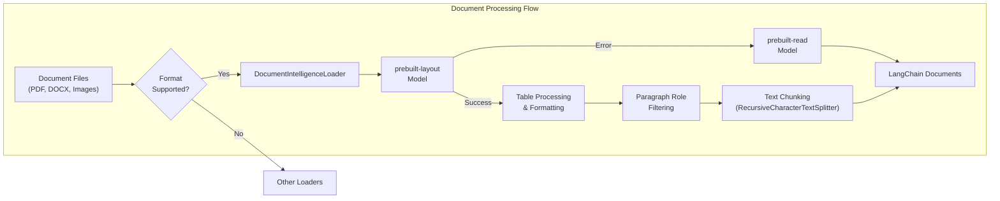
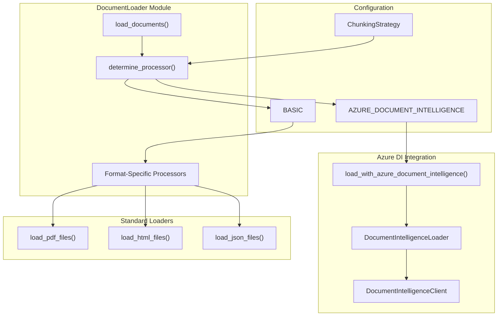
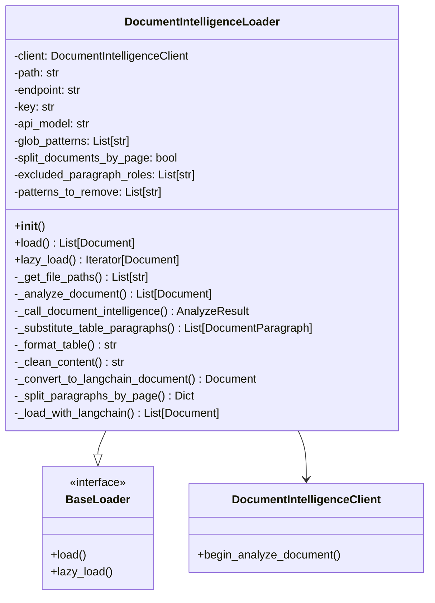
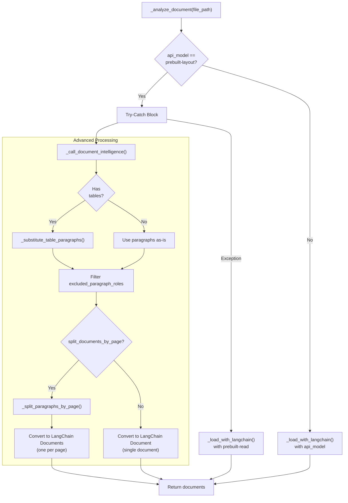
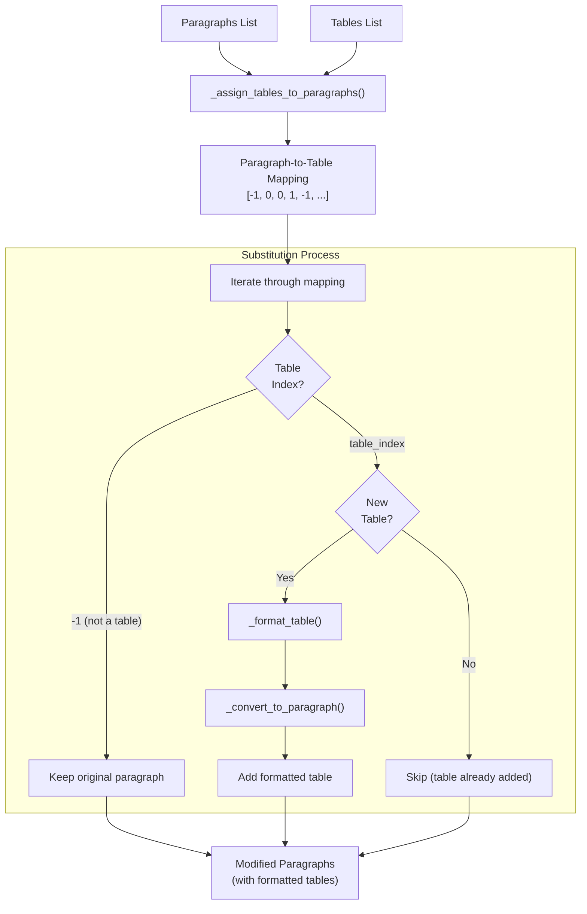
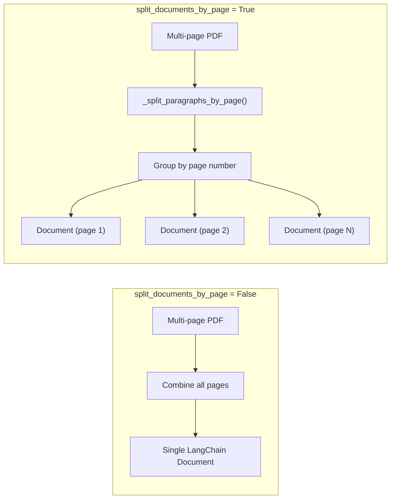
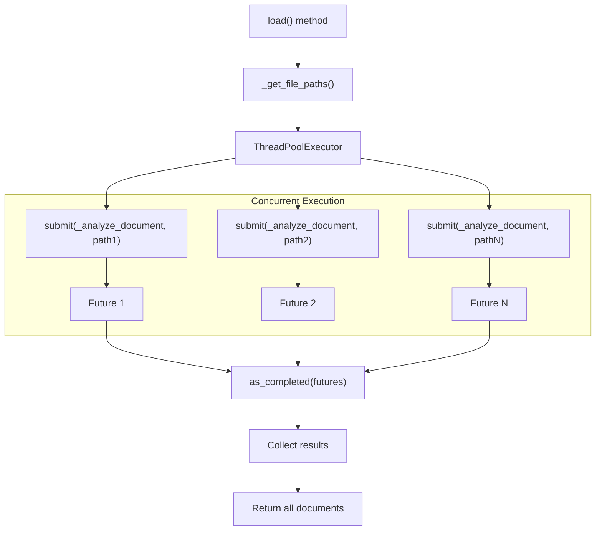
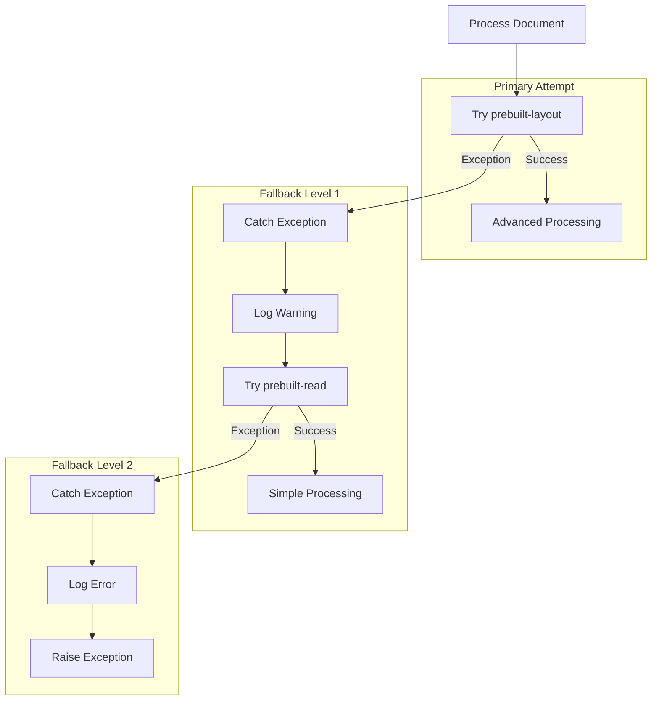

<!-- source: DeepWiki mcp.deepwiki.com · repo microsoft/rag-experiment-accelerator · page 5.2 Azure Document Intelligence Integration · fetched 2026-10-26 -->

# Azure Document Intelligence Integration

<details>
<summary>Relevant source files</summary>

The following files were used as context for generating this wiki page:

- [rag_experiment_accelerator/doc_loader/documentIntelligenceLoader.py](rag_experiment_accelerator/doc_loader/documentIntelligenceLoader.py)
- [rag_experiment_accelerator/doc_loader/documentLoader.py](rag_experiment_accelerator/doc_loader/documentLoader.py)
- [rag_experiment_accelerator/doc_loader/jsonLoader.py](rag_experiment_accelerator/doc_loader/jsonLoader.py)
- [rag_experiment_accelerator/doc_loader/structuredLoader.py](rag_experiment_accelerator/doc_loader/structuredLoader.py)
- [rag_experiment_accelerator/doc_loader/tests/test_data/document_intelligence_response/multiple_pages.json](rag_experiment_accelerator/doc_loader/tests/test_data/document_intelligence_response/multiple_pages.json)
- [rag_experiment_accelerator/doc_loader/tests/test_data/document_intelligence_response/simple_response.json](rag_experiment_accelerator/doc_loader/tests/test_data/document_intelligence_response/simple_response.json)
- [rag_experiment_accelerator/doc_loader/tests/test_data/document_intelligence_response/table_without_headers.json](rag_experiment_accelerator/doc_loader/tests/test_data/document_intelligence_response/table_without_headers.json)
- [rag_experiment_accelerator/doc_loader/tests/test_document_intelligence_loader.py](rag_experiment_accelerator/doc_loader/tests/test_document_intelligence_loader.py)

</details>


## Purpose and Scope

This document describes the Azure Document Intelligence integration in the RAG Experiment Accelerator, which provides advanced document processing capabilities including table extraction, layout analysis, and OCR. For general document loading concepts, see [Document Loaders](#5.1). For chunking strategies that follow document loading, see [Chunking Strategies](#5.3).

## Overview

The Azure Document Intelligence integration enables sophisticated document parsing beyond basic text extraction. It uses Azure's AI-powered document analysis service to extract structured content from documents, with particular emphasis on table processing and layout preservation.

The system implements a **two-tier model strategy**:
1. **Primary**: `prebuilt-layout` model for advanced table extraction and structural analysis
2. **Fallback**: `prebuilt-read` model for simple OCR when the primary fails



**Sources**: [rag_experiment_accelerator/doc_loader/documentIntelligenceLoader.py:1-422]()

## Supported Formats

Azure Document Intelligence supports a wide range of document and image formats determined by the `is_supported_by_document_intelligence()` function.

| Format Category | Extensions | Use Case |
|----------------|------------|----------|
| **Documents** | PDF, DOCX, XLSX, PPTX, HTML | Structured business documents |
| **Images** | JPEG, JPG, PNG, BMP, TIFF, HEIF | Scanned documents, photos of documents |

```python
def is_supported_by_document_intelligence(format: str) -> bool
```

**Sources**: [rag_experiment_accelerator/doc_loader/documentIntelligenceLoader.py:22-42]()

## Integration Architecture

The Document Intelligence loader integrates into the broader document processing pipeline through the `determine_processor()` routing function.



The routing logic in `determine_processor()`:

```python
if (
    chunking_strategy == ChunkingStrategy.AZURE_DOCUMENT_INTELLIGENCE
    and is_supported_by_document_intelligence(format)
):
    return load_with_azure_document_intelligence
else:
    return _FORMAT_PROCESSORS[format]
```

**Sources**: [rag_experiment_accelerator/doc_loader/documentLoader.py:37-48](), [rag_experiment_accelerator/doc_loader/documentLoader.py:50-112]()

## DocumentIntelligenceLoader Class

The `DocumentIntelligenceLoader` class is the core implementation that manages document analysis and loading.

### Class Structure



### Key Parameters

| Parameter | Type | Default | Description |
|-----------|------|---------|-------------|
| `path` | str | Required | File or directory path to load |
| `endpoint` | str | Required | Azure DI endpoint URL |
| `key` | str | Required | Azure DI API key |
| `api_model` | str | Required | Model name: `prebuilt-layout` or `prebuilt-read` |
| `glob_patterns` | List[str] | None | File patterns for directory loading |
| `split_documents_by_page` | bool | False | Whether to create separate documents per page |
| `excluded_paragraph_roles` | List[str] | [] | Paragraph roles to exclude (e.g., `pageHeader`, `pageFooter`) |
| `patterns_to_remove` | List[str] | [] | Regex patterns to remove from content |

**Sources**: [rag_experiment_accelerator/doc_loader/documentIntelligenceLoader.py:105-144]()

### Loading Methods

The loader supports both eager and lazy loading:

```python
def load(self) -> List[Document]:
    """Eager loading with parallel processing using ThreadPoolExecutor"""
    
def lazy_load(self) -> Iterator[Document]:
    """Lazy loading one document at a time"""
```

Parallel loading implementation uses `ThreadPoolExecutor` for concurrent document analysis:

**Sources**: [rag_experiment_accelerator/doc_loader/documentIntelligenceLoader.py:146-169]()

## Two-Tier Model Strategy

The system implements graceful degradation between Azure DI models to ensure reliable document processing.



### Model Comparison

| Feature | prebuilt-layout | prebuilt-read |
|---------|-----------------|---------------|
| **Table Extraction** | ✓ Advanced with structure | ✗ Raw text only |
| **Paragraph Roles** | ✓ Identifies headers, footers, titles | ✗ Basic text extraction |
| **Layout Analysis** | ✓ Preserves document structure | ✗ Sequential text |
| **Bounding Regions** | ✓ Spatial information preserved | ✗ Not available |
| **Performance** | Slower, more resource-intensive | Faster, simpler |
| **Reliability** | May fail on complex layouts | High reliability |
| **Use Case** | Documents with tables, complex layouts | Fallback for simple extraction |

### Fallback Implementation

The fallback logic is implemented in `_analyze_document()`:

```python
try:
    result = self._call_document_intelligence(file_path)
    # ... advanced processing with prebuilt-layout
    return documents
except Exception as exc:
    logger.warning(
        f"Failed to load {file_path} with Azure Document Intelligence using "
        f"the 'prebuilt-layout' model: {exc}. "
        f"Attempting to load using the simpler 'prebuilt-read' model..."
    )
    return self._load_with_langchain(file_path, "prebuilt-read")
```

**Sources**: [rag_experiment_accelerator/doc_loader/documentIntelligenceLoader.py:182-225](), [rag_experiment_accelerator/doc_loader/documentIntelligenceLoader.py:393-421]()

## Table Processing

Table extraction and formatting is a key feature of the Document Intelligence integration. Tables are detected, extracted, and formatted into a structured text representation.

### Table Detection and Substitution

The system identifies paragraphs that intersect with table bounding regions and replaces them with formatted table content.



### Table Intersection Logic

Tables are matched to paragraphs by comparing bounding regions using polygon intersection detection:

```python
def _is_intersecting_regions(self, bounding_region1, bounding_region2):
    """Returns whether two bounding regions intersect or not"""
    for region1 in bounding_region1:
        for region2 in bounding_region2:
            if region1["pageNumber"] == region2["pageNumber"] and \
               self._is_intersecting_polygons(region1.polygon, region2.polygon):
                return True
    return False

def _is_intersecting_polygons(self, polygon1, polygon2):
    """Returns whether two polygons intersect or not"""
    # Check for overlap along x-axis and y-axis
```

**Sources**: [rag_experiment_accelerator/doc_loader/documentIntelligenceLoader.py:259-291](), [rag_experiment_accelerator/doc_loader/documentIntelligenceLoader.py:293-316]()

### Table Formatting

Tables are converted from Azure DI's cell-based structure into a human-readable text format:

**Format Pattern:**
```
<Table Caption>
<Header1>: <ValueRow1>, <Header2>: <ValueRow1>, <Header3>: <ValueRow1>, ...
<Header1>: <ValueRow2>, <Header2>: <ValueRow2>, <Header3>: <ValueRow2>, ...
```

**Example Input (Azure DI Response):**
```json
{
  "tables": [{
    "caption": {"content": "Employee Data"},
    "cells": [
      {"kind": "columnHeader", "columnIndex": 0, "content": "Name"},
      {"kind": "columnHeader", "columnIndex": 1, "content": "Age"},
      {"rowIndex": 1, "columnIndex": 0, "content": "Alice"},
      {"rowIndex": 1, "columnIndex": 1, "content": "25"}
    ]
  }]
}
```

**Example Output (Formatted Text):**
```
Employee Data
Name: Alice, Age: 25
```

The formatting logic:

```python
def _format_table(self, table):
    table_headers = []
    for cell in table["cells"]:
        if cell.get("kind") == "columnHeader":
            table_headers.append(cell["content"])
    
    content = table.get("caption", {}).get("content", "")
    
    previous_row_index = -1
    for cell in table.cells:
        if cell.get("kind") == "columnHeader":
            continue
        
        header = f"{table_headers[cell['columnIndex']]}: " \
                 if cell["columnIndex"] < len(table_headers) else ""
        
        is_new_row = previous_row_index != cell["rowIndex"]
        if is_new_row:
            content += "\n" if content else ""
            previous_row_index = cell["rowIndex"]
        
        content += f"{header}{cell.content}"
        content += ", " if cell["columnIndex"] < len(table_headers) - 1 else " "
    return content
```

**Sources**: [rag_experiment_accelerator/doc_loader/documentIntelligenceLoader.py:324-358](), [rag_experiment_accelerator/doc_loader/documentIntelligenceLoader.py:360-381]()

### Test Examples

The test data shows the expected formatting for different table scenarios:

| Test Case | Input | Expected Output | Test File |
|-----------|-------|-----------------|-----------|
| **Simple Table** | 3x3 table with headers | `Col 1: Row 1 Col 1, Col 2: Row 1 Col 2, Col 3: Row 1 Col 3 \n...` | [simple_response.json:972-1263]() |
| **Table Without Headers** | 4x2 table, no header row | `A B \nC D \nE F \nG H \n` | [table_without_headers.json:629-889]() |
| **Multi-page Table** | Table spanning pages | Headers and content preserved across pages | [multiple_pages.json:1132-1336]() |

**Sources**: [rag_experiment_accelerator/doc_loader/tests/test_document_intelligence_loader.py:37-58](), [rag_experiment_accelerator/doc_loader/tests/test_document_intelligence_loader.py:123-142]()

## Paragraph Role Filtering

Azure Document Intelligence assigns semantic roles to paragraphs (e.g., `pageHeader`, `pageFooter`, `title`, `sectionHeading`). The loader can filter these to exclude non-content elements.

### Common Paragraph Roles

| Role | Description | Typical Use Case |
|------|-------------|------------------|
| `pageHeader` | Page header text | Exclude (repetitive) |
| `pageFooter` | Page footer text | Exclude (repetitive) |
| `pageNumber` | Page numbers | Exclude (non-content) |
| `footnote` | Footnote references | Exclude or include based on needs |
| `title` | Document titles | Usually include |
| `sectionHeading` | Section headers | Usually include |

### Filtering Implementation

```python
relevant_paragraphs = []
for paragraph in paragraphs:
    if "role" in paragraph.keys():
        if paragraph["role"] not in self.excluded_paragraph_roles:
            relevant_paragraphs.append(paragraph)
    else:
        relevant_paragraphs.append(paragraph)
```

### Default Exclusions

The entry point function `load_with_azure_document_intelligence()` applies default exclusions:

```python
loader = DocumentIntelligenceLoader(
    file_path,
    environment.azure_document_intelligence_endpoint,
    environment.azure_document_intelligence_admin_key,
    azure_document_intelligence_model,
    glob_patterns=["*"],
    excluded_paragraph_roles=[
        "pageHeader",
        "pageFooter",
        "footnote",
        "pageNumber",
    ],
)
```

**Sources**: [rag_experiment_accelerator/doc_loader/documentIntelligenceLoader.py:197-203](), [rag_experiment_accelerator/doc_loader/documentIntelligenceLoader.py:71-83](), [rag_experiment_accelerator/doc_loader/tests/test_document_intelligence_loader.py:223-242]()

## Content Cleaning

The system applies multiple content cleaning operations to remove artifacts and unwanted patterns.

### Automatic Cleaning

**Azure DI Artifacts**: Removes Document Intelligence-specific markers:
```python
pattern = re.compile(r":selected:|:unselected:")
content = pattern.sub("", content)
```

### Custom Pattern Removal

Users can specify custom regex patterns to remove via the `patterns_to_remove` parameter:

```python
for regex_pattern in self.patterns_to_remove:
    pattern = re.compile(regex_pattern)
    content = pattern.sub("", content)
```

**Example Usage:**
```python
loader = DocumentIntelligenceLoader(
    path="documents/",
    endpoint=endpoint,
    key=key,
    api_model="prebuilt-layout",
    patterns_to_remove=[r"CONFIDENTIAL", r"Page \d+ of \d+"]
)
```

**Sources**: [rag_experiment_accelerator/doc_loader/documentIntelligenceLoader.py:240-249](), [rag_experiment_accelerator/doc_loader/tests/test_document_intelligence_loader.py:94-113]()

## Document Splitting Options

The loader supports two document splitting strategies controlled by the `split_documents_by_page` parameter.



### Single Document Mode (Default)

All pages are combined into one LangChain `Document`:

```python
documents.append(
    self._convert_to_langchain_document(
        relevant_paragraphs, file_path, 1
    )
)
```

**Metadata:**
- `source`: File path
- `page`: Always 0 (indicates combined content)

### Per-Page Mode

Each page becomes a separate `Document`:

```python
if self.split_documents_by_page:
    paragraphs_by_page = self._split_paragraphs_by_page(relevant_paragraphs)
    for page_number, page_paragraphs in paragraphs_by_page.items():
        documents.append(
            self._convert_to_langchain_document(
                page_paragraphs, file_path, page_number
            )
        )
```

**Metadata:**
- `source`: File path
- `page`: Actual page number (0-indexed)

### Page Splitting Logic

```python
def _split_paragraphs_by_page(self, paragraphs):
    paragraphs_by_page = {}
    for paragraph in paragraphs:
        page_number = paragraph.bounding_regions[0]["pageNumber"]
        is_new_page = page_number not in paragraphs_by_page
        if is_new_page:
            paragraphs_by_page[page_number] = []
        paragraphs_by_page[page_number].append(paragraph)
    return paragraphs_by_page
```

**Sources**: [rag_experiment_accelerator/doc_loader/documentIntelligenceLoader.py:205-218](), [rag_experiment_accelerator/doc_loader/documentIntelligenceLoader.py:383-391](), [rag_experiment_accelerator/doc_loader/tests/test_document_intelligence_loader.py:151-214]()

## Configuration and Usage

### Environment Configuration

The loader requires Azure Document Intelligence credentials from the `Environment` object:

| Environment Variable | Purpose |
|---------------------|---------|
| `AZURE_DOCUMENT_INTELLIGENCE_ENDPOINT` | Service endpoint URL |
| `AZURE_DOCUMENT_INTELLIGENCE_ADMIN_KEY` | API key for authentication |

### Usage in Pipeline

The Document Intelligence loader is invoked through the main document loading pipeline:

```python
def load_with_azure_document_intelligence(
    environment: Environment,
    file_paths: list[str],
    chunk_size: int,
    overlap_size: int,
    azure_document_intelligence_model: str,
    **kwargs: dict,
) -> list[Document]:
```

**Process Flow:**
1. Iterate through `file_paths`
2. Create `DocumentIntelligenceLoader` instance for each file
3. Load and process documents with Azure DI
4. Apply `RecursiveCharacterTextSplitter` with specified `chunk_size` and `overlap_size`
5. Return UUID-keyed document dictionaries

### Chunking Integration

After document intelligence processing, documents are chunked using LangChain's text splitter:

```python
text_splitter = RecursiveCharacterTextSplitter(
    chunk_size=chunk_size,
    chunk_overlap=overlap_size,
    separators=["\n\n", "\n"],
)

docs = text_splitter.split_documents(documents)

return [{str(uuid.uuid4()): doc.__dict__} for doc in docs]
```

**Sources**: [rag_experiment_accelerator/doc_loader/documentIntelligenceLoader.py:45-102]()

## Parallel Processing

The loader implements concurrent document processing using Python's `ThreadPoolExecutor` with context management.



### Implementation

```python
def load(self) -> List[Document]:
    documents = []
    file_paths = self._get_file_paths()

    with ExitStack() as stack:
        executor = stack.enter_context(ThreadPoolExecutor())

        futures = {
            executor.submit(self._analyze_document, file_path)
            for file_path in file_paths
        }

        for future in as_completed(futures):
            try:
                documents += future.result()
            except Exception as exc:
                logger.error(f"Processing document generated an exception: {exc}")

        return documents
```

**Benefits:**
- **Concurrent API Calls**: Multiple documents analyzed simultaneously
- **Resource Management**: `ExitStack` ensures proper executor cleanup
- **Error Isolation**: Failures in individual documents don't stop the entire batch
- **Progress Tracking**: `as_completed()` allows processing results as they finish

**Sources**: [rag_experiment_accelerator/doc_loader/documentIntelligenceLoader.py:146-164]()

## File Discovery

The loader supports both single-file and directory loading with glob pattern matching.

### Single File Mode

```python
if not os.path.isdir(self.path):
    return [self.path]
```

### Directory Mode with Glob Patterns

```python
directory = Path(self.path)
file_paths = []
for pattern in self.glob_patterns:
    file_paths += list(directory.rglob(f"*.{pattern}"))

return [str(path) for path in file_paths]
```

**Example:**
```python
loader = DocumentIntelligenceLoader(
    path="documents/",
    endpoint=endpoint,
    key=key,
    api_model="prebuilt-layout",
    glob_patterns=["pdf", "docx", "png"]
)
# Recursively finds all PDF, DOCX, and PNG files in documents/
```

**Sources**: [rag_experiment_accelerator/doc_loader/documentIntelligenceLoader.py:171-180](), [rag_experiment_accelerator/doc_loader/tests/test_document_intelligence_loader.py:245-285]()

## Error Handling and Resilience

The system implements multiple layers of error handling to ensure robust document processing.

### Fallback Hierarchy



### Error Handling Code

**Primary Fallback (prebuilt-layout → prebuilt-read):**

```python
try:
    result = self._call_document_intelligence(file_path)
    # ... process with prebuilt-layout
    return documents
except Exception as exc:
    logger.warning(
        f"Failed to load {file_path} with Azure Document Intelligence using "
        f"the 'prebuilt-layout' model: {exc}. "
        f"Attempting to load using the simpler 'prebuilt-read' model..."
    )
    return self._load_with_langchain(file_path, "prebuilt-read")
```

**Secondary Error (prebuilt-read failure):**

```python
try:
    loader = AzureAIDocumentIntelligenceLoader(
        file_path=file_path,
        api_key=self.key,
        api_endpoint=self.endpoint,
        api_model=api_model,
    )
    doc = loader.load()[0]
    # ... process
    return documents
except Exception as e:
    logger.error(
        f"Failed to load {file_path} with Azure Document Intelligence using "
        f"the 'prebuilt-read' model: {e}"
    )
    raise e
```

### Parallel Processing Error Handling

Individual document failures don't stop batch processing:

```python
for future in as_completed(futures):
    try:
        documents += future.result()
    except Exception as exc:
        logger.error(f"Processing document generated an exception: {exc}")
```

**Sources**: [rag_experiment_accelerator/doc_loader/documentIntelligenceLoader.py:221-225](), [rag_experiment_accelerator/doc_loader/documentIntelligenceLoader.py:412-416](), [rag_experiment_accelerator/doc_loader/documentIntelligenceLoader.py:158-162](), [rag_experiment_accelerator/doc_loader/tests/test_document_intelligence_loader.py:72-84]()

## Integration with Environment

The Document Intelligence loader integrates with the `Environment` class for credential management:

```python
loader = DocumentIntelligenceLoader(
    file_path,
    environment.azure_document_intelligence_endpoint,
    environment.azure_document_intelligence_admin_key,
    azure_document_intelligence_model,
    # ...
)
```

The `Environment` object provides centralized configuration for:
- **Endpoint**: `azure_document_intelligence_endpoint` property
- **Authentication**: `azure_document_intelligence_admin_key` property

**Sources**: [rag_experiment_accelerator/doc_loader/documentIntelligenceLoader.py:71-84]()

## Testing

The system includes comprehensive unit tests covering all major functionality.

### Test Coverage Areas

| Test Category | Test Cases | Purpose |
|---------------|------------|---------|
| **Basic Loading** | `test__load` | Verifies document loading and table formatting |
| **Fallback Mechanism** | `test_load_with_langchain_is_used_as_fallback` | Ensures prebuilt-read fallback works |
| **Content Cleaning** | `test_content_cleaning` | Tests custom regex pattern removal |
| **Table Handling** | `test_table_without_headers` | Tests tables without column headers |
| **Multi-page Documents** | `test_document_with_multiple_pages_*` | Tests page splitting options |
| **Paragraph Filtering** | `test_excluding_paragraphs` | Tests role-based paragraph exclusion |
| **File Discovery** | `test_get_file_paths*` | Tests glob pattern matching |

### Mock Test Data

Tests use mocked Azure DI responses stored as JSON files:
- [simple_response.json]() - Basic document with table
- [table_without_headers.json]() - Table without header row
- [multiple_pages.json]() - Multi-page document with table

**Sources**: [rag_experiment_accelerator/doc_loader/tests/test_document_intelligence_loader.py:1-286]()

---

