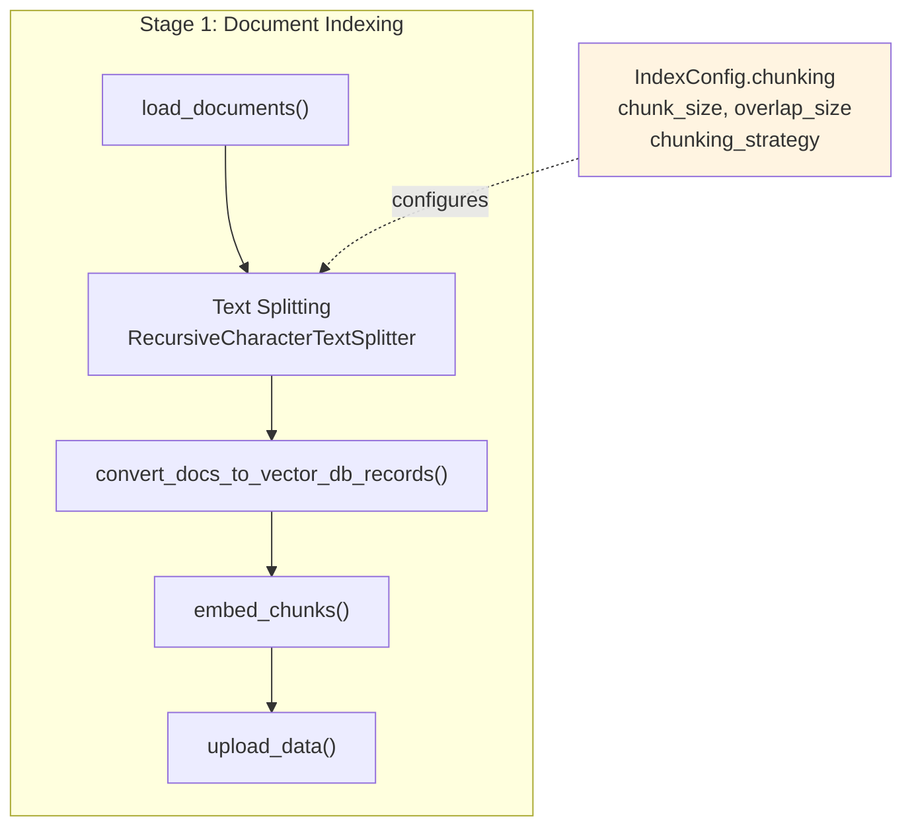
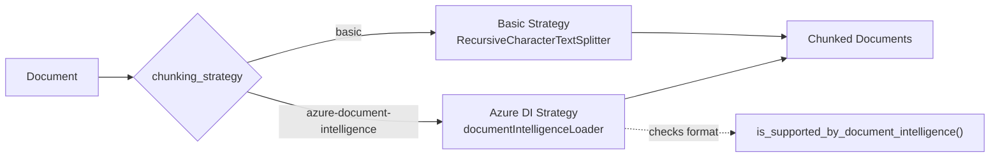
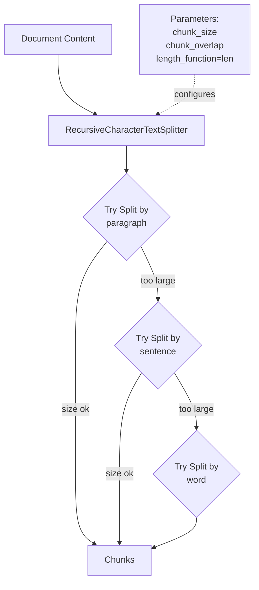
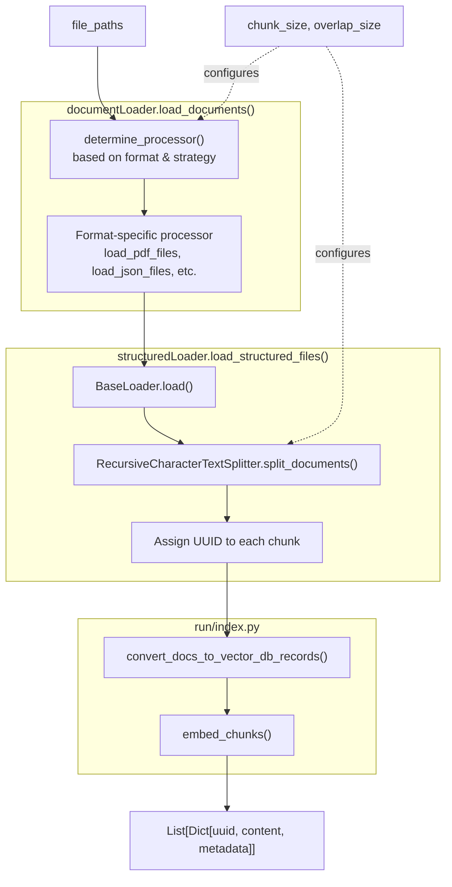
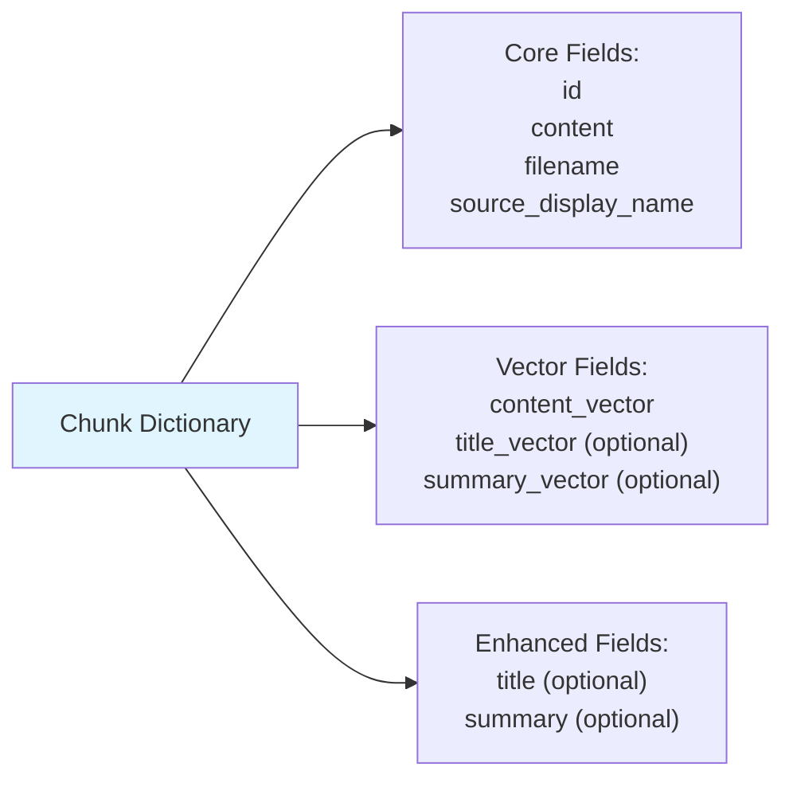
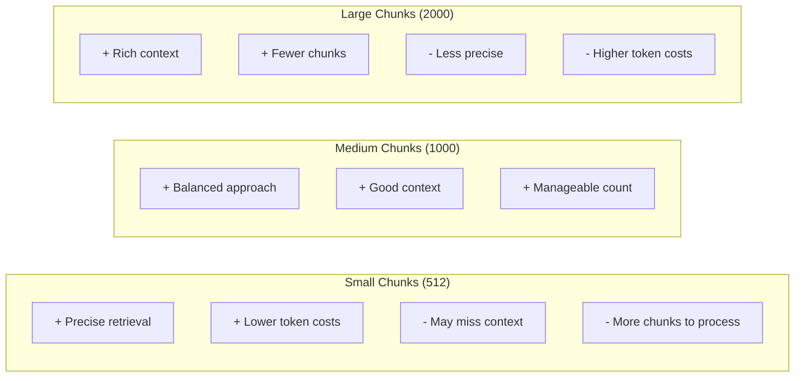
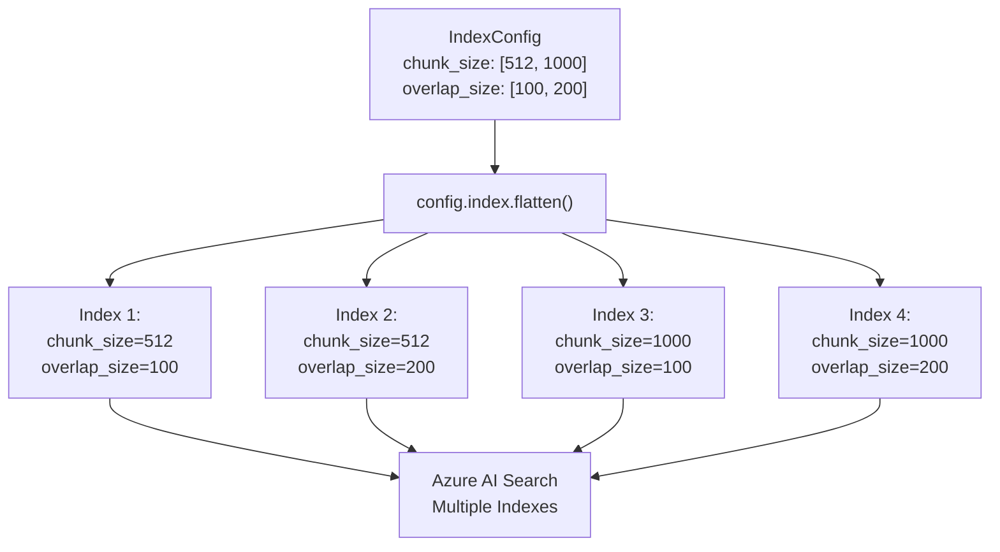

<!-- source: DeepWiki mcp.deepwiki.com · repo microsoft/rag-experiment-accelerator · page 5.3 Chunking Strategies · fetched 2026-10-26 -->

# Chunking Strategies

<details>
<summary>Relevant source files</summary>

The following files were used as context for generating this wiki page:

- [README.md](README.md)
- [config.sample.json](config.sample.json)
- [rag_experiment_accelerator/config/tests/data/config.json](rag_experiment_accelerator/config/tests/data/config.json)
- [rag_experiment_accelerator/doc_loader/documentLoader.py](rag_experiment_accelerator/doc_loader/documentLoader.py)
- [rag_experiment_accelerator/doc_loader/jsonLoader.py](rag_experiment_accelerator/doc_loader/jsonLoader.py)
- [rag_experiment_accelerator/doc_loader/structuredLoader.py](rag_experiment_accelerator/doc_loader/structuredLoader.py)
- [rag_experiment_accelerator/run/index.py](rag_experiment_accelerator/run/index.py)

</details>


## Purpose and Scope

This page describes the document chunking strategies available in the RAG Experiment Accelerator, including configuration parameters, implementation details, and their impact on retrieval performance. Chunking is the process of breaking down documents into smaller, overlapping segments that can be efficiently embedded and retrieved.

For information about document loading and format support, see [Document Loaders](#5.1). For details on Azure Document Intelligence integration, see [Azure Document Intelligence Integration](#5.2). For optional data sampling after chunking, see [Data Sampling and Clustering](#5.4).

---

## Overview of Chunking in the Pipeline

Chunking occurs in Stage 1 (Indexing) of the pipeline, immediately after document loading and before embedding generation. The strategy and parameters used for chunking directly affect retrieval quality, context size, and downstream performance.



**Sources:** [rag_experiment_accelerator/run/index.py:60-68](), [rag_experiment_accelerator/doc_loader/documentLoader.py:50-112]()

---

## Chunking Strategy Types

The system supports two primary chunking strategies, configured via `config.index.chunking.chunking_strategy`:

### Basic Strategy

The `basic` strategy uses LangChain's text splitters to chunk documents based on character count. This is the default and most commonly used strategy.

**When to Use:**
- Standard text documents (markdown, HTML, JSON, plain text)
- When table structure preservation is not critical
- When processing speed is important

**Configuration:**
```json
{
    "chunking_strategy": "basic"
}
```

### Azure Document Intelligence Strategy

The `azure-document-intelligence` strategy uses Azure's Document Intelligence service for more sophisticated document parsing, particularly beneficial for PDFs with complex layouts and tables.

**When to Use:**
- PDFs with complex table structures
- Documents requiring OCR
- When table column headers need to be preserved as key-value pairs

**Configuration:**
```json
{
    "chunking_strategy": "azure-document-intelligence",
    "azure_document_intelligence_model": "prebuilt-layout"
}
```

**Supported Models:**
- `prebuilt-layout`: Advanced parsing with table formatting
- `prebuilt-read`: Simple OCR fallback



**Sources:** [rag_experiment_accelerator/doc_loader/documentLoader.py:37-47](), [rag_experiment_accelerator/config/chunking_config.py](), [README.md:307-308]()

---

## Core Chunking Parameters

### chunk_size

The `chunk_size` parameter determines the maximum number of characters in each chunk. This is the primary control for balancing context granularity versus completeness.

**Common Values:**
- **512**: Fine-grained chunks for precise retrieval
- **1000**: Balanced approach (default in sample config)
- **2000**: Larger context per chunk

**Configuration:**
```json
{
    "chunk_size": [512, 1000, 2000]
}
```

Note: `chunk_size` is an array, allowing experimentation with multiple sizes in a single run.

### overlap_size

The `overlap_size` parameter specifies how many characters adjacent chunks share. Overlap ensures that relevant information near chunk boundaries is not split awkwardly.

**Common Values:**
- **50-100**: Minimal overlap (10% of chunk_size=512)
- **100-200**: Standard overlap (10-20% of chunk_size=1000)
- **200-300**: High overlap (10-15% of chunk_size=2000)

**Rule of Thumb:** Overlap should typically be 10-20% of chunk_size.

**Configuration:**
```json
{
    "chunk_size": [1000],
    "overlap_size": [200]
}
```

### Parameter Relationship Table

| chunk_size | Recommended overlap_size | Chunks per Document | Context Granularity | Use Case |
|------------|-------------------------|---------------------|---------------------|----------|
| 512        | 50-100                  | High                | Fine                | Precise fact retrieval |
| 1000       | 100-200                 | Medium              | Balanced            | General purpose |
| 2000       | 200-400                 | Low                 | Coarse              | Broad context needed |

**Sources:** [config.sample.json:14-17](), [README.md:301-303]()

---

## Text Splitting Implementation

The system uses LangChain's `RecursiveCharacterTextSplitter` for basic chunking strategy. This splitter recursively attempts to split text using different separators until achieving the target chunk size.

### RecursiveCharacterTextSplitter Behavior



**Implementation Code Path:**

For structured files (JSON, HTML, Markdown, etc.):
[rag_experiment_accelerator/doc_loader/structuredLoader.py:49-59]()

```python
# Language-agnostic splitting
text_splitter = RecursiveCharacterTextSplitter(
    chunk_size=chunk_size,
    chunk_overlap=overlap_size,
    length_function=len,
)
```

For language-specific splitting:
```python
# Language-specific splitting (preserves code syntax)
text_splitter = RecursiveCharacterTextSplitter().from_language(
    language=language,
    chunk_size=chunk_size,
    chunk_overlap=overlap_size,
)
```

**Sources:** [rag_experiment_accelerator/doc_loader/structuredLoader.py:11-74]()

---

## Document Processing Flow with Chunking



**Key Functions:**

1. **determine_processor**: Selects appropriate loader based on chunking strategy
   - [rag_experiment_accelerator/doc_loader/documentLoader.py:37-47]()

2. **load_structured_files**: Performs text splitting for structured formats
   - [rag_experiment_accelerator/doc_loader/structuredLoader.py:11-74]()

3. **convert_docs_to_vector_db_records**: Transforms chunks into indexable records
   - [rag_experiment_accelerator/run/index.py:103-131]()

**Sources:** [rag_experiment_accelerator/doc_loader/documentLoader.py:50-112](), [rag_experiment_accelerator/run/index.py:60-100]()

---

## Advanced Chunking Features

### Title Generation

When `generate_title` is enabled, the system uses an LLM to generate a descriptive title for each chunk. The title is embedded separately and stored in the `title_vector` field.

**Configuration:**
```json
{
    "generate_title": true
}
```

**Implementation:**
- [rag_experiment_accelerator/run/index.py:212-250]()
- [rag_experiment_accelerator/run/index.py:292-327]()

The `process_title()` function generates titles using the `prompt_instruction_title` prompt and embeds them separately.

### Summary Generation

When `generate_summary` is enabled, the system generates a summary of each chunk using an LLM. The summary is embedded separately and stored in the `summary_vector` field.

**Configuration:**
```json
{
    "generate_summary": true
}
```

**Implementation:**
- [rag_experiment_accelerator/run/index.py:253-289]()
- [rag_experiment_accelerator/run/index.py:330-370]()

### Content Override with Summary

When `override_content_with_summary` is enabled, the chunk's content is replaced with its summary, and the `content_vector` is replaced with the `summary_vector`. This reduces storage size and can improve retrieval for high-level queries.

**Configuration:**
```json
{
    "generate_summary": true,
    "override_content_with_summary": true
}
```

**Implementation:**
[rag_experiment_accelerator/run/index.py:174-182]()

### Preprocessing

The `preprocess` flag enables text preprocessing before embedding. This includes operations like lowercasing, punctuation removal, and stopword filtering.

**Configuration:**
```json
{
    "preprocess": false
}
```

**Sources:** [config.sample.json:14-22](), [README.md:300-308]()

---

## Chunk Data Structure

After processing, each chunk becomes a dictionary with the following structure:



**Field Descriptions:**

| Field | Type | Source | Purpose |
|-------|------|--------|---------|
| `id` | string | UUID | Unique identifier for Azure AI Search |
| `content` | string | Original chunk text | Main searchable content |
| `filename` | string | Document metadata | Source file reference |
| `source_display_name` | string | Filename + page | User-friendly source identifier |
| `content_vector` | float[] | Embedding model | Vector for semantic search |
| `title` | string | LLM generation (optional) | Chunk title |
| `title_vector` | float[] | Embedding model (optional) | Title vector for search |
| `summary` | string | LLM generation (optional) | Chunk summary |
| `summary_vector` | float[] | Embedding model (optional) | Summary vector for search |

**Sources:** [rag_experiment_accelerator/run/index.py:103-131](), [rag_experiment_accelerator/doc_loader/structuredLoader.py:65-70]()

---

## Configuration Examples

### Minimal Configuration (Fast Indexing)

```json
{
    "chunking": {
        "preprocess": false,
        "chunk_size": [1000],
        "overlap_size": [200],
        "generate_title": false,
        "generate_summary": false,
        "override_content_with_summary": false,
        "chunking_strategy": "basic"
    }
}
```

**Use Case:** Quick experimentation, minimal LLM costs

### Enhanced Configuration (Better Retrieval)

```json
{
    "chunking": {
        "preprocess": false,
        "chunk_size": [512, 1000],
        "overlap_size": [100, 200],
        "generate_title": true,
        "generate_summary": true,
        "override_content_with_summary": false,
        "chunking_strategy": "basic"
    }
}
```

**Use Case:** Multi-vector search with titles and summaries

### Document Intelligence Configuration (PDF-Optimized)

```json
{
    "chunking": {
        "preprocess": false,
        "chunk_size": [1000],
        "overlap_size": [200],
        "generate_title": false,
        "generate_summary": false,
        "override_content_with_summary": false,
        "chunking_strategy": "azure-document-intelligence",
        "azure_document_intelligence_model": "prebuilt-layout"
    }
}
```

**Use Case:** PDFs with tables requiring structure preservation

### Grid Search Configuration

```json
{
    "chunking": {
        "preprocess": false,
        "chunk_size": [512, 1000, 2000],
        "overlap_size": [50, 100, 200],
        "generate_title": false,
        "generate_summary": false,
        "override_content_with_summary": false,
        "chunking_strategy": "basic"
    }
}
```

**Use Case:** Systematic experimentation to find optimal parameters

This configuration produces 9 index combinations (3 chunk sizes × 3 overlap sizes) via `config.index.flatten()`.

**Sources:** [config.sample.json:14-22](), [rag_experiment_accelerator/config/tests/data/config.json:13-22]()

---

## Impact on Retrieval Performance

Chunking parameters significantly affect retrieval metrics and downstream performance:

### Chunk Size Effects



### Overlap Size Effects

**Too Little Overlap (< 5%):**
- Information at chunk boundaries may be lost
- Decreased retrieval recall
- Context fragmentation

**Optimal Overlap (10-20%):**
- Ensures boundary information is captured
- Improves retrieval consistency
- Minimal redundancy

**Too Much Overlap (> 30%):**
- Excessive redundancy
- Increased storage and processing costs
- Marginal retrieval improvement

### Retrieval Metric Impact

| Metric | Affected By | Optimal Strategy |
|--------|-------------|------------------|
| Precision@k | chunk_size | Smaller chunks for focused results |
| Recall@k | overlap_size | Adequate overlap (10-20%) |
| MAP@k | Both | Medium chunks with standard overlap |
| Context Quality | chunk_size | Larger chunks for complete context |
| Response Latency | Both | Fewer, larger chunks reduce search calls |

**Sources:** [README.md:300-308](), [README.md:492-498]()

---

## Checkpointing and Caching

Chunking operations are not explicitly checkpointed, but the results flow into checkpointed operations:

- **embed_chunks**: Cached per chunk content and embedding model
  - [rag_experiment_accelerator/run/index.py:187-209]()
  
- **process_title**: Cached per chunk content and title generation setting
  - [rag_experiment_accelerator/run/index.py:292]()
  
- **process_summary**: Cached per chunk content and summary generation setting
  - [rag_experiment_accelerator/run/index.py:330]()

This means re-running with the same chunking parameters reuses cached embeddings, titles, and summaries.

**Sources:** [rag_experiment_accelerator/run/index.py:187-209]()

---

## Integration with Multi-Index Experiments

The `chunk_size` and `overlap_size` parameters support arrays, enabling multi-configuration experiments via `config.index.flatten()`:



Each flattened configuration creates a separate Azure AI Search index with a name reflecting the parameters:

Format: `{index_name_prefix}-chunk{chunk_size}-overlap{overlap_size}-dim{dimension}`

**Example:** `idx-chunk512-overlap100-dim384`

**Sources:** [README.md:283-357](), [rag_experiment_accelerator/config/index_config.py]()

---

## Best Practices

### 1. Start with Defaults

Begin with the sample configuration values:
- `chunk_size`: 1000
- `overlap_size`: 200
- `chunking_strategy`: basic

### 2. Iterate Based on Data Type

- **Technical documentation:** Smaller chunks (512) for precise code/API references
- **Legal documents:** Larger chunks (2000) for complete clauses
- **General knowledge:** Medium chunks (1000) for balanced retrieval

### 3. Maintain Overlap Ratio

Keep `overlap_size` at 10-20% of `chunk_size`:
- chunk_size=512 → overlap_size=50-100
- chunk_size=1000 → overlap_size=100-200
- chunk_size=2000 → overlap_size=200-400

### 4. Use Document Intelligence for PDFs

Enable `chunking_strategy: "azure-document-intelligence"` when:
- Documents contain complex tables
- Table structure is important for understanding
- OCR is needed for scanned documents

### 5. Enable Title/Summary Generation Selectively

- **Titles:** Useful for multi-vector search strategies
- **Summaries:** Useful when `override_content_with_summary` can reduce noise
- **Cost:** Both require LLM calls per chunk, increasing indexing time and cost

### 6. Experiment Systematically

Use array notation to test multiple configurations:
```json
{
    "chunk_size": [512, 1000, 2000],
    "overlap_size": [100, 200, 300]
}
```

Evaluate using Stage 4 metrics to determine optimal settings.

**Sources:** [README.md:492-498](), [config.sample.json:14-22]()

---

