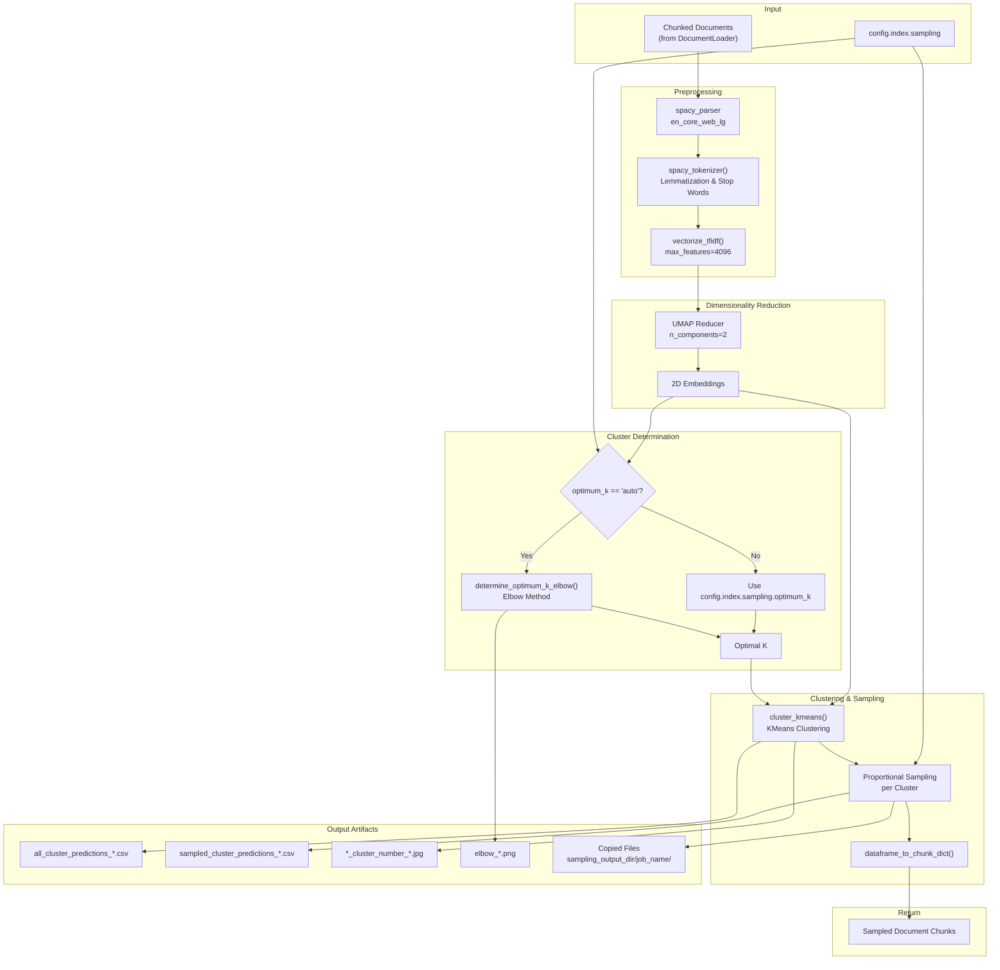
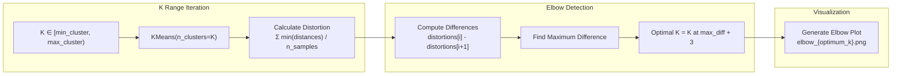
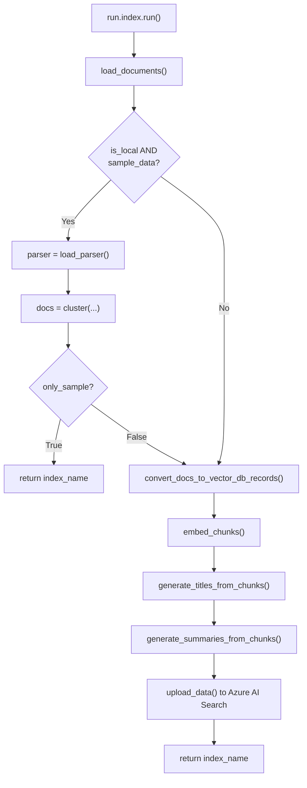

<!-- source: DeepWiki mcp.deepwiki.com · repo microsoft/rag-experiment-accelerator · page 5.4 Data Sampling and Clustering · fetched 2026-10-26 -->

# Data Sampling and Clustering

<details>
<summary>Relevant source files</summary>

The following files were used as context for generating this wiki page:

- [01_index.py](01_index.py)
- [images/all_cluster_predictions_cluster_number_5.jpg](images/all_cluster_predictions_cluster_number_5.jpg)
- [images/elbow_5.png](images/elbow_5.png)
- [rag_experiment_accelerator/config/tests/data/config.json](rag_experiment_accelerator/config/tests/data/config.json)
- [rag_experiment_accelerator/run/index.py](rag_experiment_accelerator/run/index.py)
- [rag_experiment_accelerator/sampling/clustering.py](rag_experiment_accelerator/sampling/clustering.py)
- [rag_experiment_accelerator/sampling/tests/data/test1.txt](rag_experiment_accelerator/sampling/tests/data/test1.txt)
- [rag_experiment_accelerator/sampling/tests/test_clustering.py](rag_experiment_accelerator/sampling/tests/test_clustering.py)

</details>


## Purpose and Scope

This document covers the optional data sampling and clustering system that enables representative subset selection from large document corpora during the indexing stage. The sampling system uses K-means clustering on TF-IDF vectorized document chunks to ensure that sampled subsets maintain the diversity and representative characteristics of the full dataset.

For information about document loading and chunking strategies, see [Chunking Strategies](#5.3). For details about the overall indexing pipeline, see [Stage 1: Document Indexing](#3.1).

---

## Overview

The sampling system is designed for development, testing, and experimentation scenarios where working with a full document corpus is impractical. Rather than random sampling, it employs clustering algorithms to identify representative samples that preserve the semantic diversity of the complete dataset.

**Key characteristics:**
- **Local execution only**: Sampling runs only when `is_local=True` to avoid resource constraints on distributed compute
- **Checkpoint-enabled**: Results are cached to avoid re-computation
- **Visualization-driven**: Generates plots for cluster analysis and optimal K determination
- **Configuration-controlled**: All parameters are configurable via `config.index.sampling`

Sources: [rag_experiment_accelerator/sampling/clustering.py:1-360](), [rag_experiment_accelerator/run/index.py:70-75]()

---

## Architecture and Data Flow



**Diagram: Sampling Pipeline Architecture**

Sources: [rag_experiment_accelerator/sampling/clustering.py:249-359](), [rag_experiment_accelerator/run/index.py:70-72]()

---

## Core Components

### Entry Point: `cluster()` Function

The main entry point for the sampling system is the `cluster()` function, which orchestrates the entire pipeline.

**Function Signature:**
```python
@cache_with_checkpoint(id="index_name")
def cluster(index_name, all_chunks, config: Config, parser)
```

**Parameters:**

| Parameter | Type | Description |
|-----------|------|-------------|
| `index_name` | `str` | Index identifier used for checkpoint caching key |
| `all_chunks` | `list[dict]` | List of document chunks from DocumentLoader |
| `config` | `Config` | Configuration object containing sampling parameters |
| `parser` | `spacy.Language` | Pre-loaded spaCy parser for text processing |

**Returns:** `list[dict]` - Sampled subset of document chunks

Sources: [rag_experiment_accelerator/sampling/clustering.py:248-359]()

---

### Text Preprocessing Pipeline

#### spaCy Parser Loading

```python
def load_parser()
```

Loads the `en_core_web_lg` spaCy model with Named Entity Recognition (NER) disabled for performance. The function automatically downloads the model if not present and sets `max_length` to 7,000,000 characters to handle large documents.

**Key characteristics:**
- Lazy downloads model on first run
- Disables NER for better performance: `disable=["ner"]`
- High character limit for processing large chunks

Sources: [rag_experiment_accelerator/sampling/clustering.py:24-38]()

#### Text Tokenization and Lemmatization

```python
def spacy_tokenizer(sentence, parser)
```

Processes text through lemmatization and removes stop words and punctuation.

**Processing steps:**
1. Parse text with spaCy
2. Lemmatize tokens (convert to base form)
3. Filter out stop words (`word.is_stop`)
4. Filter out punctuation (`word.is_punct`)
5. Convert to lowercase
6. Join tokens into processed string

**Example transformation:**
- Input: `"Pigeons have been domesticated for thousands of years"`
- Output: `"pigeon domesticate thousand year"`

Sources: [rag_experiment_accelerator/sampling/clustering.py:41-62]()

---

### Feature Extraction and Vectorization

#### TF-IDF Vectorization

```python
def vectorize_tfidf(text, max_features)
```

Converts processed text to TF-IDF (Term Frequency-Inverse Document Frequency) matrix representation using scikit-learn's `TfidfVectorizer`.

**Configuration:**
- **max_features**: 4096 (2^12) features
- **Output**: Sparse CSR matrix of shape `(n_documents, 4096)`

TF-IDF scoring emphasizes:
- Terms frequent in a document but rare across the corpus
- Discriminative features for clustering

Sources: [rag_experiment_accelerator/sampling/clustering.py:140-153](), [rag_experiment_accelerator/sampling/clustering.py:274-275]()

#### UMAP Dimensionality Reduction

After TF-IDF vectorization, UMAP (Uniform Manifold Approximation and Projection) reduces the 4096-dimensional vectors to 2D for visualization and efficient clustering.

**Implementation:**
```python
from umap import UMAP
reducer = UMAP()
embeddings_2d = reducer.fit_transform(X)
```

**Benefits:**
- Preserves local and global structure better than PCA
- Enables visualization of cluster separation
- Reduces computational cost of K-means

Sources: [rag_experiment_accelerator/sampling/clustering.py:277-279]()

---

## Optimal K Determination: Elbow Method

### Algorithm Overview

When `config.index.sampling.optimum_k = "auto"`, the system automatically determines the optimal number of clusters using the elbow method.



**Diagram: Elbow Method for K Selection**

### Implementation Details

The function iterates through K values from `min_cluster` to `max_cluster` (default: 2 to 30):

```python
def determine_optimum_k_elbow(embeddings_2d, X, min_cluster, max_cluster, result_dir)
```

**Key steps:**

1. **Fit K-means for each K**: Compute cluster assignments and centroids
2. **Calculate distortion**: Average minimum distance from points to their cluster centers
3. **Find largest drop**: Identify the K where distortion decreases most significantly
4. **Apply offset**: Return `K + 3` as the optimal value (empirical heuristic)
5. **Generate plot**: Save elbow curve visualization showing distortion vs. K

**Distortion formula:**
```
distortion = Σ min(euclidean_distance(point, centroids)) / n_samples
```

The "elbow" represents the point where adding more clusters provides diminishing returns in reducing distortion.

Sources: [rag_experiment_accelerator/sampling/clustering.py:65-137]()

---

## K-means Clustering and Sampling

### Clustering Execution

```python
def cluster_kmeans(embeddings_2d, optimum_k, df, result_dir)
```

Performs K-means clustering on the 2D UMAP embeddings and generates visualizations.

**Returns:** Tuple containing:
- `x`, `y`: 2D coordinates of embeddings
- `text`: Original chunk text
- `processed_text`: Tokenized/lemmatized text
- `chunk`: Chunk identifiers
- `prediction`: Cluster labels (0 to K-1)
- `prediction_values`: Unique cluster labels
- `filenames`: Source file paths

**Visualization:**
- Generates scatter plot colored by cluster assignment
- Saves as `.jpg` in format: `all_cluster_predictions_cluster_number_{optimum_k}.jpg`

Sources: [rag_experiment_accelerator/sampling/clustering.py:200-245]()

### Proportional Sampling Strategy

After clustering, the system samples from each cluster proportionally to ensure representativeness.

**Sampling logic:**

```python
samples_per_cluster = round(
    (total_documents * percentage / 100) / num_clusters
)

for each cluster:
    if cluster_size > samples_per_cluster:
        sample = cluster.sample(n=samples_per_cluster, random_state=42)
    else:
        sample = entire_cluster  # Keep all if cluster is small
```

**Example calculation:**
- Total documents: 1000
- Sampling percentage: 5%
- Number of clusters: 10
- Samples per cluster: `round((1000 * 5 / 100) / 10)` = 5 samples per cluster
- Total sampled: ~50 documents (5% of 1000)

Sources: [rag_experiment_accelerator/sampling/clustering.py:313-329]()

---

## Configuration Parameters

### Sampling Configuration Schema

```json
{
  "index": {
    "sampling": {
      "sample_data": false,
      "percentage": 5,
      "optimum_k": "auto",
      "min_cluster": 2,
      "max_cluster": 30,
      "only_sample": false
    }
  }
}
```

**Parameter descriptions:**

| Parameter | Type | Default | Description |
|-----------|------|---------|-------------|
| `sample_data` | `bool` | `false` | Enable/disable sampling. Must be `true` to activate. |
| `percentage` | `int` | `5` | Percentage of documents to sample (1-100). |
| `optimum_k` | `str` or `int` | `"auto"` | Number of clusters. Use `"auto"` for elbow method or specify integer. |
| `min_cluster` | `int` | `2` | Minimum K to test when `optimum_k="auto"`. |
| `max_cluster` | `int` | `30` | Maximum K to test when `optimum_k="auto"`. |
| `only_sample` | `bool` | `false` | If `true`, stop after sampling without indexing. Used for sampling experiments. |

Sources: [rag_experiment_accelerator/config/tests/data/config.json:44-51]()

---

## Integration with Indexing Pipeline

### Execution Flow in `run.index.run()`



**Diagram: Sampling Integration in Index Pipeline**

### Code Integration Points

The sampling system integrates at lines 70-75 of `run/index.py`:

```python
if is_local and index_config.sampling.sample_data:
    parser = load_parser()
    docs = cluster(index_config.index_name(), docs, config, parser)

if index_config.sampling.only_sample:
    return index_name
```

**Key constraints:**
- **Local-only execution**: `is_local` must be `True` (sampling disabled on Azure ML distributed compute)
- **Optional early return**: When `only_sample=True`, the pipeline terminates after sampling without indexing
- **Replaces document set**: Sampled chunks replace the original `docs` list for subsequent processing

Sources: [rag_experiment_accelerator/run/index.py:70-75](), [01_index.py:34]()

---

## Output Artifacts

### CSV Files

The clustering process generates two primary CSV files:

#### 1. All Cluster Predictions
**Filename:** `all_cluster_predictions_cluster_number_{optimum_k}.csv`

Contains all documents with cluster assignments:

| Column | Description |
|--------|-------------|
| `x` | X-coordinate in 2D UMAP space |
| `y` | Y-coordinate in 2D UMAP space |
| `text` | Original chunk content |
| `prediction` | Cluster label (0 to K-1) |
| `chunk` | Chunk identifier |

#### 2. Sampled Cluster Predictions
**Filename:** `sampled_cluster_predictions_cluster_number_{optimum_k}.csv`

Contains only the sampled subset with the same schema as above.

**Path resolution:**
```python
config.path.sampled_cluster_predictions_path(config.index.sampling.optimum_k)
```

Sources: [rag_experiment_accelerator/sampling/clustering.py:308-337]()

### Visualization Files

#### Cluster Scatter Plot
- **Filename:** `all_cluster_predictions_cluster_number_{optimum_k}.jpg`
- **Content:** Scatter plot of 2D embeddings colored by cluster assignment
- **Library:** plotly (exported as static image)

#### Elbow Plot
- **Filename:** `elbow_{optimum_k}.png`
- **Content:** Line plot showing distortion vs. number of clusters
- **Includes:** Red line showing the ideal linear decrease from K=min to K=max

Sources: [rag_experiment_accelerator/sampling/clustering.py:227-229](), [rag_experiment_accelerator/sampling/clustering.py:135]()

### File Preservation

Sampled documents are copied to preserve the subset for later reference:

**Destination:** `{sampling_output_dir}/{job_name}/{filename}`

The system copies the original source files (PDFs, HTMLs, etc.) corresponding to sampled chunks using `shutil.copy2()` to preserve metadata.

**Error handling:** Continues on `OSError` (e.g., if source file no longer exists) and logs the error.

Sources: [rag_experiment_accelerator/sampling/clustering.py:343-357]()

---

## Checkpointing and Caching

### Checkpoint Decorator

The `cluster()` function is decorated with `@cache_with_checkpoint`:

```python
@cache_with_checkpoint(id="index_name")
def cluster(index_name, all_chunks, config: Config, parser):
    ...
```

**Behavior:**
- **Cache key**: Uses `index_name` as the identifier
- **Cache location**: `artifacts/checkpoints/` directory
- **Invalidation**: Automatically invalidated if input data changes (content-based hashing)
- **Benefit**: Avoids re-running expensive TF-IDF, UMAP, and K-means operations during iterative development

**Control:**
- Enabled/disabled via `config.use_checkpoints`
- Must call `init_checkpoint(config)` before running pipeline

Sources: [rag_experiment_accelerator/sampling/clustering.py:248](), [rag_experiment_accelerator/checkpoint.py:1-100](), [01_index.py:29]()

---

## Performance Considerations

### Computational Complexity

| Operation | Time Complexity | Notes |
|-----------|----------------|-------|
| spaCy Tokenization | O(n × m) | n=documents, m=avg tokens per doc |
| TF-IDF Vectorization | O(n × v) | v=vocabulary size (4096) |
| UMAP Reduction | O(n × log(n)) | Approximate nearest neighbors |
| K-means (single K) | O(n × k × i × d) | k=clusters, i=iterations, d=dimensions (2) |
| Elbow Method | O(K × n × k × i × d) | K=range of k values tested |

### Memory Requirements

**Peak memory usage:**
- TF-IDF sparse matrix: ~4096 features × n documents × 8 bytes ≈ 32KB per document
- UMAP embeddings: n documents × 2 dimensions × 8 bytes = 16 bytes per document
- DataFrames: n documents × (text content + metadata)

**Mitigation:**
- TF-IDF uses sparse matrices (scipy.sparse.csr_matrix)
- UMAP reduces dimensionality early in pipeline
- Only 2D embeddings retained for clustering

### Scalability Limits

**Recommended limits:**
- **Documents**: < 100,000 chunks (based on memory and computation time)
- **Elbow method**: Testing 2-30 clusters is reasonable for < 10,000 chunks
- **UMAP**: Handles up to ~100K points efficiently

**For larger datasets:**
- Disable elbow method: Set `optimum_k` to explicit value
- Reduce max_cluster range: e.g., `min_cluster=2, max_cluster=10`
- Consider mini-batch K-means for very large datasets

Sources: [rag_experiment_accelerator/sampling/clustering.py:265-279]()

---

## Use Cases and Best Practices

### When to Use Sampling

**Recommended scenarios:**

1. **Development and testing**: Rapidly iterate on pipeline configurations with 5-10% samples
2. **Proof-of-concept**: Validate approach on representative subset before full indexing
3. **Resource-constrained environments**: Reduce Azure OpenAI API costs during experimentation
4. **Dataset exploration**: Visualize document diversity through cluster analysis

**Not recommended:**

1. **Production deployments**: Sampling introduces selection bias
2. **Final evaluation**: Always evaluate on full dataset for production metrics
3. **Distributed compute**: Sampling disabled on Azure ML for resource management

### Configuration Best Practices

**For quick testing (5% sample):**
```json
{
  "sampling": {
    "sample_data": true,
    "percentage": 5,
    "optimum_k": 5,
    "only_sample": false
  }
}
```

**For cluster analysis only:**
```json
{
  "sampling": {
    "sample_data": true,
    "percentage": 100,
    "optimum_k": "auto",
    "min_cluster": 2,
    "max_cluster": 20,
    "only_sample": true
  }
}
```

**For balanced sampling (10 clusters):**
```json
{
  "sampling": {
    "sample_data": true,
    "percentage": 10,
    "optimum_k": 10,
    "only_sample": false
  }
}
```

### Interpreting Visualizations

**Elbow plot interpretation:**
- **Sharp elbow**: Clear optimal K (good cluster separation)
- **Gradual curve**: No obvious optimal K (consider domain knowledge)
- **Early plateau**: Few distinct clusters in data
- **No plateau**: Data may not have natural clusters

**Cluster scatter plot interpretation:**
- **Well-separated clusters**: Clear semantic groupings
- **Overlapping clusters**: Topics may be related or K too high
- **Unbalanced sizes**: Some topics more prevalent than others
- **Outliers**: Documents with unique characteristics

Sources: [rag_experiment_accelerator/sampling/clustering.py:65-137](), [rag_experiment_accelerator/sampling/clustering.py:227-229]()

---

## Command-Line Usage

### Running with Sampling Enabled

```bash
# Enable sampling in config.json first
python 01_index.py \
    --config_path config.json \
    --data_dir ./data \
    --sampling
```

The `--sampling` (or `-s`) flag sets `is_local=True` and triggers the sampling logic.

**Without the flag:**
```bash
# Sampling disabled even if config.sample_data=true
python 01_index.py \
    --config_path config.json \
    --data_dir ./data
```

### Makefile Targets

The Makefile does not expose a specific sampling target, but you can modify the `index` target:

```makefile
index:
    python 01_index.py \
        --config_path $(CONFIG_PATH) \
        --data_dir $(DATA_DIR) \
        --sampling
```

Sources: [01_index.py:13-24](), [01_index.py:34]()

---

## Testing

### Unit Test Structure

The sampling system includes comprehensive unit tests in `rag_experiment_accelerator/sampling/tests/test_clustering.py`.

**Test approach:**
- Mock external dependencies (spaCy, UMAP, K-means)
- Verify file output generation
- Check sampling logic correctness
- Validate logging messages

**Key test:** `test_cluster()`

**Mocked components:**
```python
@patch("rag_experiment_accelerator.sampling.clustering.logger")
@patch("rag_experiment_accelerator.sampling.clustering.chunk_dict_to_dataframe")
@patch("rag_experiment_accelerator.sampling.clustering.vectorize_tfidf")
@patch("rag_experiment_accelerator.sampling.clustering.UMAP")
@patch("rag_experiment_accelerator.sampling.clustering.determine_optimum_k_elbow")
@patch("rag_experiment_accelerator.sampling.clustering.cluster_kmeans")
```

**Assertions:**
- Output CSV files exist in correct paths
- Logging messages confirm expected execution flow
- Sampled document count matches expected percentage

Sources: [rag_experiment_accelerator/sampling/tests/test_clustering.py:74-165]()

### Running Tests

```bash
# Run all sampling tests
pytest rag_experiment_accelerator/sampling/tests/

# Run with coverage
pytest rag_experiment_accelerator/sampling/tests/ --cov=rag_experiment_accelerator.sampling
```

---

## Limitations and Known Issues

### Current Limitations

1. **English-only**: spaCy parser (`en_core_web_lg`) only processes English text
2. **Local execution only**: Disabled on Azure ML distributed compute to avoid resource contention
3. **Memory-intensive**: Holds entire document set in memory during processing
4. **Fixed UMAP parameters**: No configuration exposed for UMAP hyperparameters
5. **TF-IDF only**: No support for alternative vectorization methods (e.g., embeddings)

### Known Issues

1. **Large document handling**: Documents exceeding spaCy's `max_length=7000000` may fail
2. **File copy errors**: Silent failures when source files cannot be copied (logs error but continues)
3. **K+3 heuristic**: The elbow method adds 3 to the detected elbow point, which may not be optimal for all datasets
4. **No stratified sampling**: Sampling is proportional by cluster but doesn't consider other metadata (e.g., document source)

Sources: [rag_experiment_accelerator/sampling/clustering.py:24-38](), [rag_experiment_accelerator/sampling/clustering.py:343-357](), [rag_experiment_accelerator/sampling/clustering.py:120-127]()

---

## Related Systems

- **[Document Loaders](#5.1)**: Provides input documents and chunks to the sampling system
- **[Chunking Strategies](#5.3)**: Determines chunk size and overlap before sampling
- **[Checkpointing System](#10.1)**: Provides caching mechanism for expensive clustering operations
- **[Stage 1: Document Indexing](#3.1)**: Overall indexing pipeline that integrates sampling

---

## Summary

The data sampling and clustering system provides a scientifically grounded approach to selecting representative subsets from large document corpora. By using K-means clustering on TF-IDF vectors with UMAP dimensionality reduction, it ensures that sampled documents maintain the semantic diversity of the full dataset. The system is particularly valuable during development and testing phases, reducing computational costs while preserving the characteristics needed for meaningful experimentation.

Key takeaways:
- Clustering-based sampling preserves document diversity better than random sampling
- Automatic K selection via elbow method eliminates manual tuning
- Checkpointing makes iterative development efficient
- Visualization outputs enable data exploration and validation
- Local-only execution prevents resource conflicts in production environments

---

