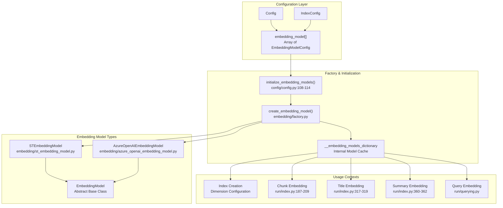
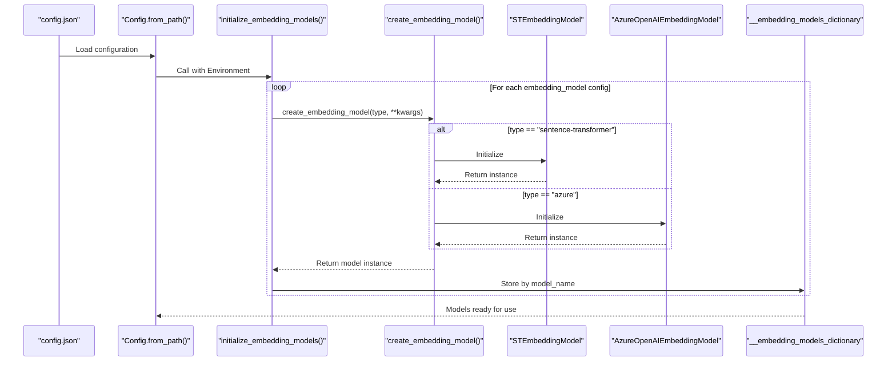
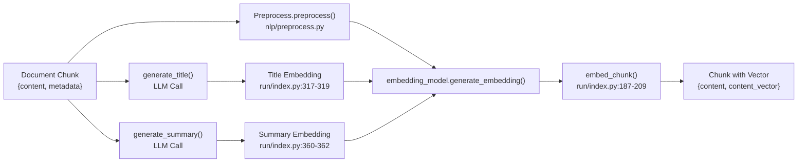

<!-- source: DeepWiki mcp.deepwiki.com · repo microsoft/rag-experiment-accelerator · page 6 Embedding Models · fetched 2026-10-26 -->

# Embedding Models

<details>
<summary>Relevant source files</summary>

The following files were used as context for generating this wiki page:

- [dev-requirements.txt](dev-requirements.txt)
- [rag_experiment_accelerator/config/config.py](rag_experiment_accelerator/config/config.py)
- [rag_experiment_accelerator/config/tests/data/config.json](rag_experiment_accelerator/config/tests/data/config.json)
- [rag_experiment_accelerator/config/tests/test_config.py](rag_experiment_accelerator/config/tests/test_config.py)
- [rag_experiment_accelerator/embedding/st_embedding_model.py](rag_experiment_accelerator/embedding/st_embedding_model.py)
- [rag_experiment_accelerator/embedding/tests/test_st_embedding_model.py](rag_experiment_accelerator/embedding/tests/test_st_embedding_model.py)
- [rag_experiment_accelerator/run/index.py](rag_experiment_accelerator/run/index.py)
- [requirements.txt](requirements.txt)

</details>


## Purpose and Scope

This document covers the embedding model system in the RAG Experiment Accelerator, which provides a unified interface for generating vector embeddings from text. Embedding models are critical components used throughout the pipeline to convert text into dense vector representations for semantic search and retrieval.

The system supports two types of embedding models:
- **Sentence Transformer models** from HuggingFace (local execution)
- **Azure OpenAI embedding models** (API-based)

For information about how embeddings are used during document indexing, see [Stage 1: Document Indexing](#3.1). For search and retrieval using embeddings, see [Search and Retrieval](#7).

---

## Architecture Overview

The embedding system uses a factory pattern to create and manage multiple embedding models simultaneously, allowing experiments to compare different embedding strategies.



**Sources:** [rag_experiment_accelerator/config/config.py:108-117](), [rag_experiment_accelerator/embedding/st_embedding_model.py](), [rag_experiment_accelerator/run/index.py:134-209]()

---

## Embedding Model Types

### Sentence Transformer Models

Sentence Transformer models are HuggingFace models that run locally using the `sentence-transformers` library. These models provide fast, cost-free embeddings suitable for experimentation and development.

**Class:** `STEmbeddingModel` at [rag_experiment_accelerator/embedding/st_embedding_model.py:10-78]()

**Key Characteristics:**
- Local execution (no API costs)
- Fixed dimensions based on model architecture
- Requires model download on first use
- Suitable for environments with GPU acceleration

**Supported Models:**

| Model Name | Dimension | Description |
|------------|-----------|-------------|
| `all-MiniLM-L6-v2` | 384 | Fast, lightweight model suitable for quick experimentation |
| `all-mpnet-base-v2` | 768 | Balanced performance and quality |
| `bert-large-nli-mean-tokens` | 1024 | Larger model with higher quality embeddings |

The model dimension mapping is defined at [rag_experiment_accelerator/embedding/st_embedding_model.py:30-34]():

```python
_size_model_mapping = {
    "all-MiniLM-L6-v2": 384,
    "all-mpnet-base-v2": 768,
    "bert-large-nli-mean-tokens": 1024,
}
```

**Configuration Example:**
```json
{
    "type": "sentence-transformer",
    "model_name": "all-MiniLM-L6-v2"
}
```

**Sources:** [rag_experiment_accelerator/embedding/st_embedding_model.py:10-78](), [rag_experiment_accelerator/config/tests/data/config.json:23-27]()

### Azure OpenAI Embedding Models

Azure OpenAI embedding models provide API-based embeddings with support for the latest OpenAI embedding models, including dimension shortening capabilities.

**Key Characteristics:**
- API-based (requires Azure OpenAI deployment)
- Supports dimension shortening for `text-embedding-3-*` models
- Higher quality embeddings for production use
- Incurs API costs per token

**Supported Models:**

| Model Name | Default Dimension | Max Dimension | Shortening Supported |
|------------|-------------------|---------------|----------------------|
| `text-embedding-ada-002` | 1536 | 1536 | No |
| `text-embedding-3-small` | 1536 | 1536 | Yes |
| `text-embedding-3-large` | 3072 | 3072 | Yes |

**Dimension Shortening:**

The `text-embedding-3-small` and `text-embedding-3-large` models support dimension shortening, allowing you to trade off quality for storage and compute efficiency. When `shorten_dimensions: true` is set, the API returns embeddings with the specified dimension.

**Configuration Examples:**

Standard configuration (full dimension):
```json
{
    "type": "azure",
    "model_name": "text-embedding-3-large",
    "dimension": 3072
}
```

With dimension shortening:
```json
{
    "type": "azure",
    "model_name": "text-embedding-3-small",
    "dimension": 256,
    "shorten_dimensions": true
}
```

**Sources:** [rag_experiment_accelerator/config/tests/data/config.json:28-42](), [requirements.txt:24]()

---

## Configuration Structure

Embedding models are configured as an array within the `index` section of `config.json`, allowing multiple models to be defined for experimentation.

**Configuration Schema:**

```json
{
    "index": {
        "embedding_model": [
            {
                "type": "sentence-transformer | azure",
                "model_name": "string",
                "dimension": "number (optional for sentence-transformer, required for azure)",
                "shorten_dimensions": "boolean (optional, only for azure text-embedding-3-*)"
            }
        ]
    }
}
```

**Multi-Model Configuration Example:**

```json
{
    "index": {
        "embedding_model": [
            {
                "type": "sentence-transformer",
                "model_name": "all-MiniLM-L6-v2"
            },
            {
                "type": "azure",
                "model_name": "text-embedding-ada-002"
            },
            {
                "type": "azure",
                "model_name": "text-embedding-3-large",
                "dimension": 3072
            }
        ]
    }
}
```

When combined with `IndexConfig.flatten()`, this configuration generates separate Azure AI Search indexes for each embedding model configuration, enabling systematic comparison of embedding quality and search performance.

**Sources:** [rag_experiment_accelerator/config/tests/data/config.json:23-42](), [rag_experiment_accelerator/config/tests/test_config.py:94-108]()

---

## Model Initialization and Factory Pattern

### Initialization Flow



**Sources:** [rag_experiment_accelerator/config/config.py:79-117]()

### Model Retrieval

The `Config` class provides a `get_embedding_model(model_name)` method to retrieve initialized models by name:

```python
def get_embedding_model(self, model_name) -> EmbeddingModel:
    return self.__embedding_models_dictionary.get(model_name)
```

This method is used throughout the pipeline at [rag_experiment_accelerator/run/index.py:52-54](), [rag_experiment_accelerator/run/index.py:157](), [rag_experiment_accelerator/run/index.py:317-319](), and [rag_experiment_accelerator/run/index.py:360-362]().

**Sources:** [rag_experiment_accelerator/config/config.py:116-117]()

---

## EmbeddingModel Interface

All embedding models implement the `EmbeddingModel` abstract base class, providing a consistent interface:

**Key Methods:**

| Method | Purpose | Returns |
|--------|---------|---------|
| `generate_embedding(chunk: str)` | Generate embedding vector for text | `list[float]` |
| `dimension` | Get embedding dimension | `int` (property) |
| `name` | Get model name | `str` (property) |

**Example Usage:**

```python
# Get embedding model from config
embedding_model = config.get_embedding_model("all-MiniLM-L6-v2")

# Generate embedding
text = "This is a sample document chunk"
embedding_vector = embedding_model.generate_embedding(text)

# Get model properties
dimension = embedding_model.dimension  # e.g., 384
model_name = embedding_model.name      # "all-MiniLM-L6-v2"
```

**Sources:** [rag_experiment_accelerator/embedding/embedding_model.py](), [rag_experiment_accelerator/run/index.py:205-208]()

---

## Usage in the Pipeline

### Stage 1: Document Indexing

Embedding models are used extensively during document indexing to create vector representations of content, titles, and summaries.



**Key Functions:**

1. **Chunk Embedding** at [rag_experiment_accelerator/run/index.py:187-209]():
```python
@cache_with_checkpoint(id="chunk['content']+embedding_model.name")
def embed_chunk(pre_process, embedding_model, chunk):
    chunk["content_vector"] = embedding_model.generate_embedding(
        pre_process.preprocess(chunk["content"])
    )
    return chunk
```

2. **Title Embedding** at [rag_experiment_accelerator/run/index.py:317-319]():
```python
title_vector = config.get_embedding_model(
    index_config.embedding_model.model_name
).generate_embedding(pre_process.preprocess(title))
```

3. **Summary Embedding** at [rag_experiment_accelerator/run/index.py:360-362]():
```python
summaryVector = config.get_embedding_model(
    index_config.embedding_model.model_name
).generate_embedding(pre_process.preprocess(summary))
```

**Parallel Processing:**

The `embed_chunks()` function uses `ThreadPoolExecutor` to generate embeddings in parallel at [rag_experiment_accelerator/run/index.py:134-184](), significantly improving throughput for large document sets.

**Sources:** [rag_experiment_accelerator/run/index.py:134-184](), [rag_experiment_accelerator/run/index.py:187-209](), [rag_experiment_accelerator/run/index.py:292-327](), [rag_experiment_accelerator/run/index.py:330-370]()

### Index Dimension Configuration

When creating Azure AI Search indexes, the embedding model's dimension is used to configure the vector field at [rag_experiment_accelerator/run/index.py:48-58]():

```python
create_acs_index(
    environment.azure_search_service_endpoint,
    index_name,
    environment.azure_search_admin_key,
    config.get_embedding_model(
        index_config.embedding_model.model_name
    ).dimension,  # Vector field dimension
    index_config.ef_construction,
    index_config.ef_search,
    config.language.analyzer,
)
```

**Sources:** [rag_experiment_accelerator/run/index.py:46-58]()

### Stage 3: Query Embedding

During query processing, the same embedding model used for indexing is used to embed queries for vector search:

```python
# Query embedding for vector search
query_vector = config.get_embedding_model(
    index_config.embedding_model.model_name
).generate_embedding(preprocessed_query)
```

This ensures semantic consistency between document and query embeddings, which is critical for accurate retrieval.

**Sources:** [rag_experiment_accelerator/run/querying.py]()

---

## Checkpoint Caching

Embedding generation is an expensive operation. The system uses the `@cache_with_checkpoint` decorator to cache embeddings at [rag_experiment_accelerator/run/index.py:187]():

```python
@cache_with_checkpoint(id="chunk['content']+embedding_model.name")
def embed_chunk(pre_process, embedding_model, chunk):
    # Embedding generation cached by content + model name
```

**Cache Key:** The cache key combines the chunk content and embedding model name, ensuring that:
- Embeddings are reused across runs for identical content
- Different models generate separate cached embeddings
- Changes to content invalidate the cache appropriately

To enable/disable checkpointing, set `use_checkpoints` in `config.json`. See [Checkpointing System](#10.1) for more details.

**Sources:** [rag_experiment_accelerator/run/index.py:187](), [rag_experiment_accelerator/checkpoint/cache_with_checkpoint.py]()

---

## Model Selection Guide

### Choosing Between Model Types

| Consideration | Sentence Transformers | Azure OpenAI |
|--------------|----------------------|--------------|
| **Cost** | Free (compute only) | Pay per API call |
| **Latency** | Low (local inference) | Higher (network + API) |
| **Quality** | Good for most use cases | State-of-the-art |
| **Scale** | Limited by local resources | Unlimited (cloud) |
| **Offline** | Fully offline capable | Requires internet |
| **GPU** | Benefits significantly | Not applicable |

### Choosing a Specific Model

**For Experimentation and Development:**
- `all-MiniLM-L6-v2` (384 dim) - Fast iteration, low resource usage
- Good for CI/CD pipelines and quick validation

**For Production with Cost Constraints:**
- `text-embedding-3-small` with dimension shortening (256 dim)
- Balance between quality and cost/storage

**For Maximum Quality:**
- `text-embedding-3-large` (3072 dim) - Best retrieval performance
- `all-mpnet-base-v2` (768 dim) - Best open-source option

**For Multi-Language:**
- Sentence Transformers offers specialized multilingual models
- Azure OpenAI models support 100+ languages natively

### Dimension Considerations

Higher dimensions generally provide better semantic representation but come with tradeoffs:

| Aspect | Lower Dimensions (256-384) | Higher Dimensions (1536-3072) |
|--------|---------------------------|------------------------------|
| Storage | ~4x less storage | More storage required |
| Search Speed | Faster vector search | Slower vector search |
| Quality | Good for most cases | Better fine-grained semantics |
| Memory | Lower RAM requirements | Higher RAM requirements |

**Sources:** [rag_experiment_accelerator/embedding/st_embedding_model.py:30-34](), [rag_experiment_accelerator/config/tests/data/config.json:23-42]()

---

## Integration with IndexConfig

Embedding model configuration is tightly integrated with `IndexConfig` to enable systematic experimentation. When `IndexConfig.flatten()` is called, it generates multiple index configurations—one for each combination of parameters including embedding models.

**Example:**

```json
{
    "index": {
        "index_name_prefix": "exp1",
        "chunk_size": [512, 1024],
        "embedding_model": [
            {"type": "sentence-transformer", "model_name": "all-MiniLM-L6-v2"},
            {"type": "azure", "model_name": "text-embedding-ada-002"}
        ]
    }
}
```

This configuration generates 4 indexes:
- `exp1-chunk512-all-MiniLM-L6-v2-dim384`
- `exp1-chunk512-text-embedding-ada-002-dim1536`
- `exp1-chunk1024-all-MiniLM-L6-v2-dim384`
- `exp1-chunk1024-text-embedding-ada-002-dim1536`

Each index uses its configured embedding model for all embedding operations, enabling direct comparison of embedding model performance.

For details on multi-configuration experiments, see [IndexConfig and Multi-Configuration Experiments](#4.2).

**Sources:** [rag_experiment_accelerator/config/index_config.py](), [rag_experiment_accelerator/config/tests/test_config.py:94-108]()

---

## Testing

The embedding system includes comprehensive unit tests:

**Test Coverage:**
- Model initialization and validation at [rag_experiment_accelerator/embedding/tests/test_st_embedding_model.py]()
- Embedding generation correctness at [rag_experiment_accelerator/embedding/tests/test_st_embedding_model.py:8-16]()
- Error handling for non-existent models at [rag_experiment_accelerator/embedding/tests/test_st_embedding_model.py:19-26]()
- Configuration parsing at [rag_experiment_accelerator/config/tests/test_config.py:94-117]()

**Running Tests:**
```bash
pytest rag_experiment_accelerator/embedding/tests/
```

**Sources:** [rag_experiment_accelerator/embedding/tests/test_st_embedding_model.py](), [rag_experiment_accelerator/config/tests/test_config.py:94-117]()

---

## Common Issues and Troubleshooting

### Model Download Failures

**Symptom:** `OSError` when initializing `STEmbeddingModel`

**Cause:** Model not found or network issues during download

**Solution:**
- Verify internet connection
- Check model name spelling
- Pre-download models: `python -c "from sentence_transformers import SentenceTransformer; SentenceTransformer('all-MiniLM-L6-v2')"`

### Dimension Mismatch

**Symptom:** Azure AI Search indexing fails with dimension error

**Cause:** Embedding dimension doesn't match index vector field configuration

**Solution:**
- Ensure `dimension` in config matches model's actual output dimension
- Recreate index if dimension changed
- Verify `shorten_dimensions` is correctly set for text-embedding-3-* models

### Memory Issues with Large Models

**Symptom:** Out-of-memory errors during embedding generation

**Solution:**
- Use smaller models (all-MiniLM-L6-v2 instead of bert-large)
- Reduce `max_worker_threads` to limit parallel processing
- Process documents in batches
- Consider using Azure OpenAI models instead of local models

**Sources:** [rag_experiment_accelerator/embedding/st_embedding_model.py:58-64](), [rag_experiment_accelerator/run/index.py:134-184]()

---

