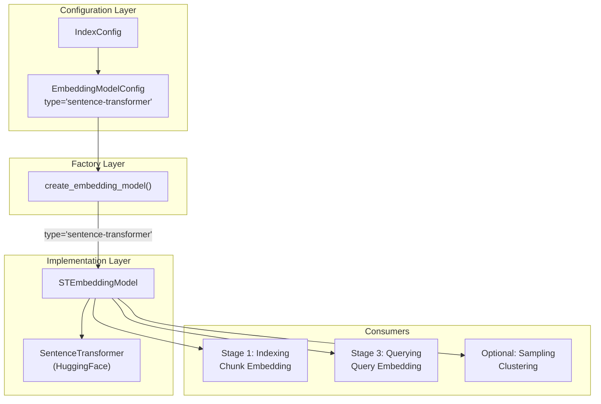
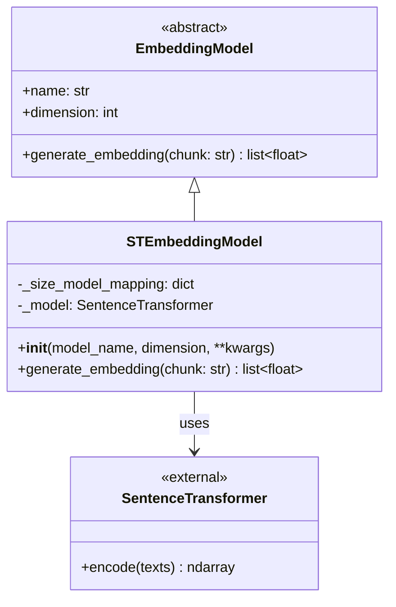
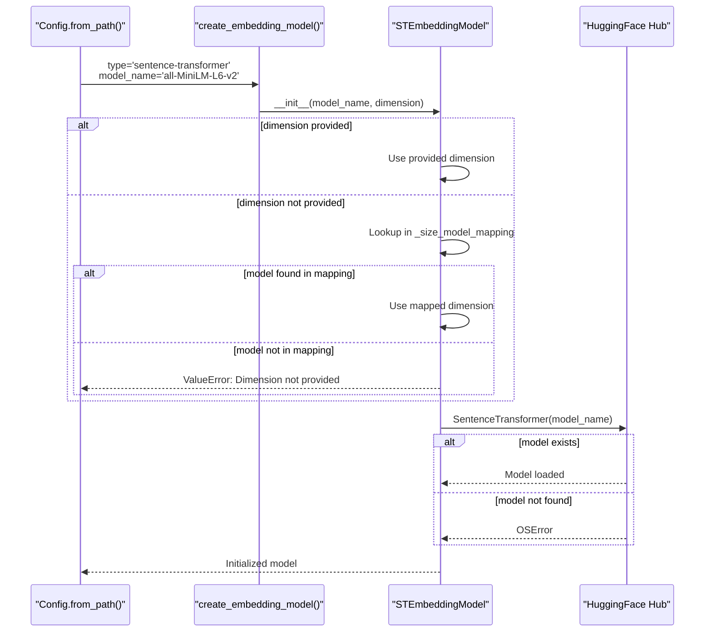
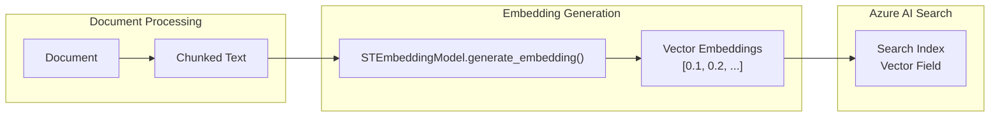
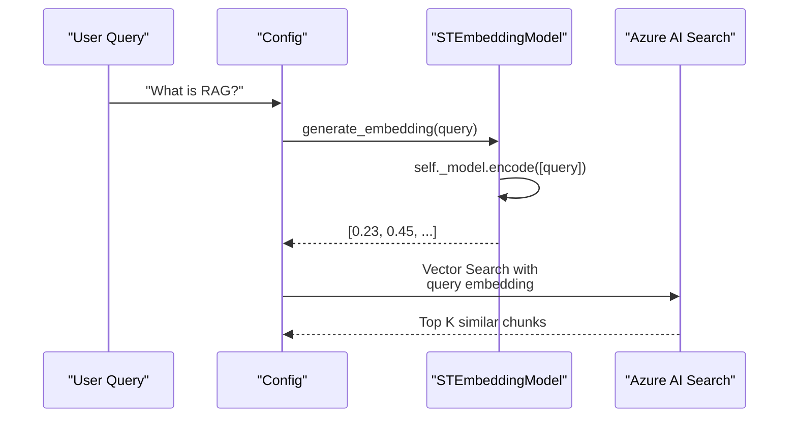
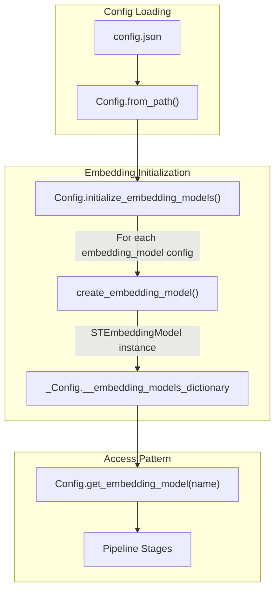

<!-- source: DeepWiki mcp.deepwiki.com · repo microsoft/rag-experiment-accelerator · page 6.1 Sentence Transformer Embeddings · fetched 2026-10-26 -->

# Sentence Transformer Embeddings

<details>
<summary>Relevant source files</summary>

The following files were used as context for generating this wiki page:

- [dev-requirements.txt](dev-requirements.txt)
- [rag_experiment_accelerator/config/config.py](rag_experiment_accelerator/config/config.py)
- [rag_experiment_accelerator/config/tests/test_config.py](rag_experiment_accelerator/config/tests/test_config.py)
- [rag_experiment_accelerator/embedding/st_embedding_model.py](rag_experiment_accelerator/embedding/st_embedding_model.py)
- [rag_experiment_accelerator/embedding/tests/test_st_embedding_model.py](rag_experiment_accelerator/embedding/tests/test_st_embedding_model.py)
- [requirements.txt](requirements.txt)

</details>


## Purpose and Scope

This page documents the `STEmbeddingModel` class, which provides integration with HuggingFace sentence-transformers models for generating document and query embeddings in the RAG Experiment Accelerator. Sentence transformers enable the use of open-source, locally-executable embedding models as an alternative to Azure OpenAI embeddings.

For information about Azure OpenAI embeddings, see [Azure OpenAI Embeddings](#6.2). For the overall embedding model abstraction and factory pattern, see [Embedding Models](#6).

**Sources:** [rag_experiment_accelerator/embedding/st_embedding_model.py:1-78]()

---

## Overview

The `STEmbeddingModel` class wraps HuggingFace `sentence-transformers` models to provide consistent embedding generation within the RAG pipeline. Sentence transformers are pre-trained models optimized for semantic similarity tasks, making them well-suited for retrieval applications. The system uses the `sentence-transformers` library (version 3.1.1) to download and execute these models locally.



**Diagram:** Sentence Transformer Integration Architecture

**Sources:** [rag_experiment_accelerator/embedding/st_embedding_model.py:1-78](), [rag_experiment_accelerator/config/config.py:108-117]()

---

## STEmbeddingModel Class

### Class Structure

The `STEmbeddingModel` class inherits from the abstract `EmbeddingModel` base class and implements the sentence-transformers backend. It maintains a static mapping of supported model names to their output dimensions and instantiates the underlying HuggingFace model.



**Diagram:** STEmbeddingModel Class Hierarchy

**Sources:** [rag_experiment_accelerator/embedding/st_embedding_model.py:10-78]()

### Supported Models

The class maintains a hardcoded mapping of commonly used sentence-transformer models to their dimensions. If a model name is not in this mapping, the dimension must be explicitly provided in the configuration.

| Model Name | Dimension | Use Case |
|------------|-----------|----------|
| `all-MiniLM-L6-v2` | 384 | Fast, lightweight embeddings for quick experiments |
| `all-mpnet-base-v2` | 768 | Balanced quality and performance |
| `bert-large-nli-mean-tokens` | 1024 | Higher quality embeddings for production use |

**Sources:** [rag_experiment_accelerator/embedding/st_embedding_model.py:30-34]()

### Initialization Process

The initialization flow validates the model configuration and downloads the model from HuggingFace if not already cached locally.



**Diagram:** STEmbeddingModel Initialization Sequence

The constructor performs the following steps:

1. **Dimension Resolution**: If `dimension` is `None`, attempts to look up the dimension in `_size_model_mapping`. Raises `ValueError` if the model is not found and no dimension is provided [rag_experiment_accelerator/embedding/st_embedding_model.py:51-56]().

2. **Base Class Initialization**: Calls `super().__init__()` with the model name and dimension [rag_experiment_accelerator/embedding/st_embedding_model.py:57]().

3. **Model Loading**: Instantiates a `SentenceTransformer` object with the model name. This triggers download from HuggingFace Hub if the model is not cached locally. Catches `OSError` and re-raises with additional context [rag_experiment_accelerator/embedding/st_embedding_model.py:58-64]().

**Sources:** [rag_experiment_accelerator/embedding/st_embedding_model.py:36-64]()

### Embedding Generation

The `generate_embedding()` method converts input text to a fixed-dimensional vector representation.

```python
def generate_embedding(self, chunk: str) -> list[float]:
    return self._model.encode([str(chunk)]).tolist()[0]
```

**Implementation Details:**
- Converts input to string to handle non-string types [rag_experiment_accelerator/embedding/st_embedding_model.py:77]()
- Wraps input in a list for batch processing (single item batch) [rag_experiment_accelerator/embedding/st_embedding_model.py:77]()
- Returns a Python list of floats suitable for Azure AI Search index upload [rag_experiment_accelerator/embedding/st_embedding_model.py:77]()

**Sources:** [rag_experiment_accelerator/embedding/st_embedding_model.py:66-77]()

---

## Configuration

Sentence transformer models are configured in the `config.json` file under `index.embedding_model` with `type` set to `"sentence-transformer"`.

### Basic Configuration

```json
{
  "index": {
    "embedding_model": [
      {
        "type": "sentence-transformer",
        "model_name": "all-MiniLM-L6-v2"
      }
    ]
  }
}
```

For models in the `_size_model_mapping`, the dimension is automatically inferred.

### Custom Model Configuration

For models not in the predefined mapping, explicitly specify the dimension:

```json
{
  "index": {
    "embedding_model": [
      {
        "type": "sentence-transformer",
        "model_name": "custom-model-name",
        "dimension": 512
      }
    ]
  }
}
```

**Sources:** [rag_experiment_accelerator/embedding/st_embedding_model.py:30-56](), [rag_experiment_accelerator/config/tests/test_config.py:95-96]()

### Multi-Model Configuration

The system supports multiple embedding models simultaneously for experimentation. Each model configuration creates a separate Azure AI Search index:

```json
{
  "index": {
    "embedding_model": [
      {
        "type": "sentence-transformer",
        "model_name": "all-MiniLM-L6-v2"
      },
      {
        "type": "sentence-transformer",
        "model_name": "all-mpnet-base-v2"
      }
    ]
  }
}
```

The configuration system initializes all models during `Config.from_path()` and stores them in a dictionary accessible via `config.get_embedding_model(model_name)` [rag_experiment_accelerator/config/config.py:108-117]().

**Sources:** [rag_experiment_accelerator/config/config.py:108-117](), [rag_experiment_accelerator/config/tests/test_config.py:94-112]()

---

## Usage in the Pipeline

### Stage 1: Indexing

During document indexing, the `STEmbeddingModel` generates embeddings for each document chunk. These embeddings are uploaded to Azure AI Search as vector fields.



**Diagram:** Sentence Transformer Usage in Indexing Pipeline

**Sources:** [rag_experiment_accelerator/embedding/st_embedding_model.py:66-77]()

### Stage 3: Querying

During query processing, the same embedding model generates vectors for user queries. These query embeddings are used for vector similarity search against the indexed document embeddings.



**Diagram:** Query Embedding Generation Flow

The system ensures the same embedding model used during indexing is used during querying to maintain embedding space consistency.

**Sources:** [rag_experiment_accelerator/embedding/st_embedding_model.py:66-77](), [rag_experiment_accelerator/config/config.py:116-117]()

---

## Model Selection Considerations

### Performance vs. Quality Trade-offs

| Model | Dimension | Speed | Quality | Typical Use Case |
|-------|-----------|-------|---------|------------------|
| `all-MiniLM-L6-v2` | 384 | Fast | Good | Development, CI/CD, large-scale indexing |
| `all-mpnet-base-v2` | 768 | Medium | Better | General production use |
| `bert-large-nli-mean-tokens` | 1024 | Slow | Best | High-precision retrieval requirements |

### Dependency Requirements

The sentence-transformers library is specified in `requirements.txt`:

```
sentence-transformers==3.1.1
```

This library has significant transitive dependencies including PyTorch/TensorFlow, which may impact deployment size and startup time.

**Sources:** [requirements.txt:34]()

### Error Handling

The implementation includes error handling for common failure scenarios:

1. **Missing Dimension**: Raises `ValueError` with a descriptive message listing supported models [rag_experiment_accelerator/embedding/st_embedding_model.py:54-56]()

2. **Network Errors**: Catches `OSError` from HuggingFace downloads and logs helpful context about connectivity [rag_experiment_accelerator/embedding/st_embedding_model.py:60-64]()

3. **Invalid Model Names**: HuggingFace library raises `OSError` for non-existent models, which is caught and re-raised with context [rag_experiment_accelerator/embedding/st_embedding_model.py:58-64]()

**Sources:** [rag_experiment_accelerator/embedding/st_embedding_model.py:36-64](), [rag_experiment_accelerator/embedding/tests/test_st_embedding_model.py:19-26]()

---

## Integration with Configuration System

The embedding model initialization is orchestrated by the `Config` class during application startup:



**Diagram:** Configuration System Integration

The `Config.initialize_embedding_models()` method:
1. Iterates over all embedding model configurations [rag_experiment_accelerator/config/config.py:110]()
2. Calls the factory with model type and configuration [rag_experiment_accelerator/config/config.py:111-114]()
3. Stores initialized models in a dictionary keyed by model name [rag_experiment_accelerator/config/config.py:112-114]()

Pipeline stages retrieve embedding models via `Config.get_embedding_model(model_name)` [rag_experiment_accelerator/config/config.py:116-117]().

**Sources:** [rag_experiment_accelerator/config/config.py:108-117](), [rag_experiment_accelerator/config/tests/test_config.py:110-112]()

---

