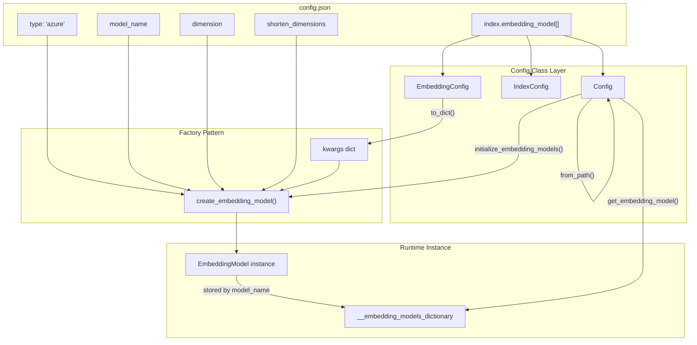
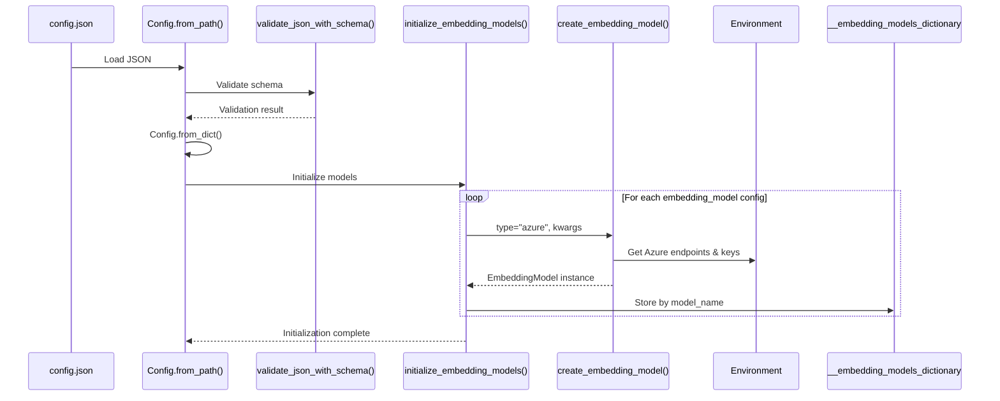
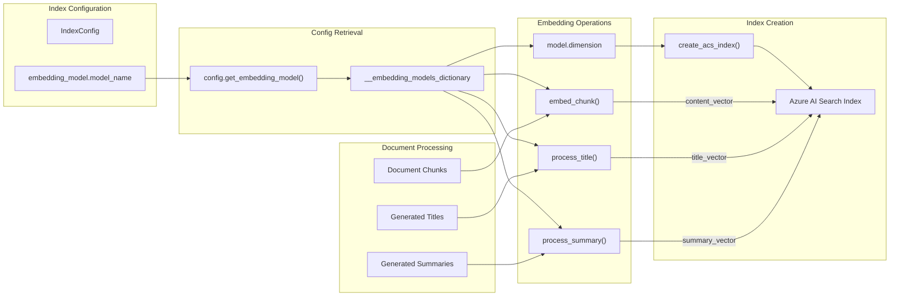

<!-- source: DeepWiki mcp.deepwiki.com · repo microsoft/rag-experiment-accelerator · page 6.2 Azure OpenAI Embeddings · fetched 2026-10-26 -->

# Azure OpenAI Embeddings

<details>
<summary>Relevant source files</summary>

The following files were used as context for generating this wiki page:

- [README.md](README.md)
- [config.sample.json](config.sample.json)
- [rag_experiment_accelerator/config/config.py](rag_experiment_accelerator/config/config.py)
- [rag_experiment_accelerator/config/tests/data/config.json](rag_experiment_accelerator/config/tests/data/config.json)
- [rag_experiment_accelerator/config/tests/test_config.py](rag_experiment_accelerator/config/tests/test_config.py)
- [rag_experiment_accelerator/run/index.py](rag_experiment_accelerator/run/index.py)

</details>


## Purpose and Scope

This document describes the Azure OpenAI embedding models supported by the RAG Experiment Accelerator, including their configuration, capabilities, and integration within the pipeline. Azure OpenAI embeddings are one of two embedding model types supported by the system; for information about sentence-transformer models from HuggingFace, see [Sentence Transformer Embeddings](#6.1).

Azure OpenAI embedding models are used to generate vector representations of document chunks, titles, summaries, and queries. These embeddings enable semantic search capabilities in Azure AI Search indexes.

**Sources:** [README.md:364-399](), [config.sample.json:24-29]()

## Configuration Structure

Azure OpenAI embedding models are configured in the `config.json` file within the `index.embedding_model` array. Each embedding model configuration requires the following fields:

| Field | Required | Description |
|-------|----------|-------------|
| `type` | Yes | Must be `"azure"` for Azure OpenAI models |
| `model_name` | Yes | The deployment name of the Azure OpenAI embedding model |
| `dimension` | Conditional | The embedding vector dimension. Required for all models except `text-embedding-ada-002` |
| `shorten_dimensions` | No | Boolean flag to enable dimension shortening for v3 models. Default: `false` |

### Basic Configuration Example

```json
{
    "type": "azure",
    "model_name": "text-embedding-ada-002"
}
```

For v3 models, the dimension must be explicitly specified:

```json
{
    "type": "azure",
    "model_name": "text-embedding-3-large",
    "dimension": 3072
}
```

**Sources:** [README.md:364-388](), [rag_experiment_accelerator/config/tests/data/config.json:28-42]()

## Supported Models

The RAG Experiment Accelerator supports the following Azure OpenAI embedding models:

### text-embedding-ada-002

The original Azure OpenAI embedding model with a fixed dimension of 1536. This model does not require the `dimension` field in configuration as its dimension is predetermined.

```json
{
    "type": "azure",
    "model_name": "text-embedding-ada-002"
}
```

### text-embedding-3-small

A newer generation model that produces 1536-dimensional embeddings by default. This model supports dimension shortening (see below).

```json
{
    "type": "azure",
    "model_name": "text-embedding-3-small",
    "dimension": 1536
}
```

### text-embedding-3-large

A high-quality model that produces 3072-dimensional embeddings by default. This model also supports dimension shortening.

```json
{
    "type": "azure",
    "model_name": "text-embedding-3-large",
    "dimension": 3072
}
```

**Sources:** [README.md:378-388](), [rag_experiment_accelerator/config/tests/data/config.json:32-42]()

## Dimension Shortening

Azure OpenAI's v3 embedding models (`text-embedding-3-small` and `text-embedding-3-large`) support dimension shortening, allowing you to reduce the embedding vector size while retaining most of the semantic information. This capability enables trade-offs between index size, query performance, and accuracy.

To enable dimension shortening, set the `shorten_dimensions` flag to `true` and specify the desired dimension count:

```json
{
    "type": "azure",
    "model_name": "text-embedding-3-large",
    "dimension": 256,
    "shorten_dimensions": true
}
```

In this example, the model generates 3072-dimensional embeddings but returns only the first 256 dimensions. According to OpenAI's research, shortened embeddings maintain significant semantic similarity despite the dimensionality reduction.

### Benefits of Dimension Shortening

- **Reduced storage costs**: Smaller vectors require less disk space in Azure AI Search
- **Faster search performance**: Lower-dimensional vectors improve query latency
- **Lower memory footprint**: Reduced RAM requirements for in-memory operations
- **Maintained accuracy**: Research shows minimal quality degradation with moderate dimension reduction

**Sources:** [README.md:390-399](), [rag_experiment_accelerator/config/tests/data/config.json:38-42]()

## Configuration to Code Entity Mapping



**Diagram: Configuration Loading and Embedding Model Instantiation**

**Sources:** [rag_experiment_accelerator/config/config.py:108-117](), [rag_experiment_accelerator/embedding/factory.py]()

## Initialization Process

Azure OpenAI embedding models are instantiated during configuration loading through the following sequence:

1. **Configuration Parsing**: The `Config.from_path()` method loads the `config.json` file
2. **Validation**: Configuration schema validation ensures all required fields are present
3. **Model Initialization**: The `initialize_embedding_models()` method iterates over each embedding model configuration
4. **Factory Creation**: The `create_embedding_model()` factory function creates instances based on the `type` field
5. **Dictionary Storage**: Created instances are stored in `__embedding_models_dictionary` keyed by `model_name`



**Diagram: Embedding Model Initialization Sequence**

**Sources:** [rag_experiment_accelerator/config/config.py:54-92](), [rag_experiment_accelerator/config/config.py:108-117]()

## Usage in the Indexing Pipeline

Azure OpenAI embedding models are retrieved and used throughout the indexing stage (Stage 1) of the RAG pipeline. The `Config.get_embedding_model()` method provides access to instantiated models by their `model_name`.

### Key Usage Points

| Usage Point | File Location | Purpose |
|-------------|---------------|---------|
| Index Dimension | [rag_experiment_accelerator/run/index.py:52-54]() | Retrieves embedding dimension for Azure AI Search index creation |
| Chunk Embedding | [rag_experiment_accelerator/run/index.py:157]() | Embeds document chunks for vector search |
| Title Embedding | [rag_experiment_accelerator/run/index.py:317-319]() | Embeds generated titles (if enabled) |
| Summary Embedding | [rag_experiment_accelerator/run/index.py:360-362]() | Embeds generated summaries (if enabled) |

### Embedding Generation Flow



**Diagram: Azure OpenAI Embeddings in the Indexing Pipeline**

**Sources:** [rag_experiment_accelerator/run/index.py:30-413]()

## Embedding Generation Implementation

The actual embedding generation occurs in the `embed_chunk()` function, which is decorated with `@cache_with_checkpoint` to avoid redundant API calls for identical content:

```python
@cache_with_checkpoint(id="chunk['content']+embedding_model.name")
def embed_chunk(pre_process, embedding_model, chunk):
    chunk["content_vector"] = embedding_model.generate_embedding(
        pre_process.preprocess(chunk["content"])
    )
    return chunk
```

The process follows these steps:

1. **Preprocessing**: Text is preprocessed using the `Preprocess` class
2. **Embedding Generation**: The `generate_embedding()` method is called on the embedding model instance
3. **Checkpoint Caching**: Results are cached based on content hash to avoid duplicate API calls
4. **Vector Assignment**: Generated embeddings are stored in the chunk dictionary under `content_vector`, `title_vector`, or `summary_vector` keys

### Parallel Processing

Embedding generation is parallelized using `ThreadPoolExecutor` to improve performance:

```python
with ThreadPoolExecutor() as executor:
    futures = {
        executor.submit(embed_chunk, pre_process, embedding_model, doc): doc
        for doc in chunks
    }
    
    for future in as_completed(futures):
        try:
            chunk_dict = future.result()
            embedded_chunks.append(chunk_dict)
        except Exception as exc:
            logger.error(f"Exception: {exc}")
```

**Sources:** [rag_experiment_accelerator/run/index.py:134-184](), [rag_experiment_accelerator/run/index.py:187-209]()

## Multi-Model Experimentation

The RAG Experiment Accelerator supports configuring multiple embedding models simultaneously in the same `config.json`. When the `Config.index.flatten()` method is called, it generates separate index configurations for each embedding model, enabling systematic comparison of different models:

```json
{
    "index": {
        "embedding_model": [
            {
                "type": "azure",
                "model_name": "text-embedding-ada-002"
            },
            {
                "type": "azure",
                "model_name": "text-embedding-3-large",
                "dimension": 3072
            },
            {
                "type": "azure",
                "model_name": "text-embedding-3-large",
                "dimension": 256,
                "shorten_dimensions": true
            }
        ]
    }
}
```

This configuration generates three separate Azure AI Search indexes, each using a different embedding model, allowing direct comparison of retrieval quality and performance characteristics.

**Sources:** [rag_experiment_accelerator/config/tests/data/config.json:23-42](), [README.md:285-287]()

## Environment Variables

Azure OpenAI embedding models require the following environment variables to be configured in the `.env` file:

| Variable | Description |
|----------|-------------|
| `AZURE_OPENAI_API_KEY` | Authentication key for Azure OpenAI service |
| `AZURE_OPENAI_ENDPOINT` | The endpoint URL for Azure OpenAI service |
| `AZURE_OPENAI_API_VERSION` | API version to use (e.g., `2023-05-15`) |

These environment variables are loaded into the `Environment` class and passed to the embedding model factory during initialization.

**Sources:** [README.md:185](), [rag_experiment_accelerator/config/environment.py]()

## Dimension Configuration Requirements

The table below summarizes dimension configuration requirements for each Azure OpenAI model:

| Model | Default Dimension | `dimension` Field | `shorten_dimensions` Support |
|-------|-------------------|-------------------|------------------------------|
| `text-embedding-ada-002` | 1536 | Optional (inferred) | No |
| `text-embedding-3-small` | 1536 | Required | Yes |
| `text-embedding-3-large` | 3072 | Required | Yes |

When using v3 models, you must explicitly specify the `dimension` field in the configuration, even if using the default dimension. Omitting this field will result in a configuration validation error.

**Sources:** [README.md:378-388](), [README.md:364-376]()

## Integration with Azure AI Search

The embedding model dimension directly impacts the Azure AI Search index schema. When `create_acs_index()` is called, it retrieves the dimension from the embedding model instance:

```python
create_acs_index(
    environment.azure_search_service_endpoint,
    index_name,
    environment.azure_search_admin_key,
    config.get_embedding_model(
        index_config.embedding_model.model_name
    ).dimension,
    index_config.ef_construction,
    index_config.ef_search,
    config.language.analyzer,
)
```

The dimension value determines the vector field dimensions in the search index, which must match the embeddings generated during indexing and querying. Mismatched dimensions will cause index creation or upload failures.

**Sources:** [rag_experiment_accelerator/run/index.py:47-58]()

## Best Practices

### Model Selection

- **text-embedding-ada-002**: Use for baseline experiments and compatibility with existing indexes
- **text-embedding-3-small**: Use for cost-effective semantic search with modern improvements
- **text-embedding-3-large**: Use for highest quality semantic search when accuracy is paramount

### Dimension Shortening Guidelines

When using dimension shortening with v3 models:

- Start with full dimensions to establish a quality baseline
- Experiment with progressively smaller dimensions (e.g., 3072 → 1536 → 768 → 256)
- Monitor retrieval metrics (MAP@k, precision, recall) to assess quality degradation
- Consider storage and performance gains versus accuracy trade-offs
- Dimensions below 256 may show significant quality degradation for most use cases

### Configuration Validation

Always validate that:
- The `model_name` matches your Azure OpenAI deployment name
- The `dimension` field is specified for v3 models
- The dimension value is appropriate for the chosen model
- Environment variables are correctly configured in `.env`

**Sources:** [README.md:390-399](), [README.md:48-49]()

---

