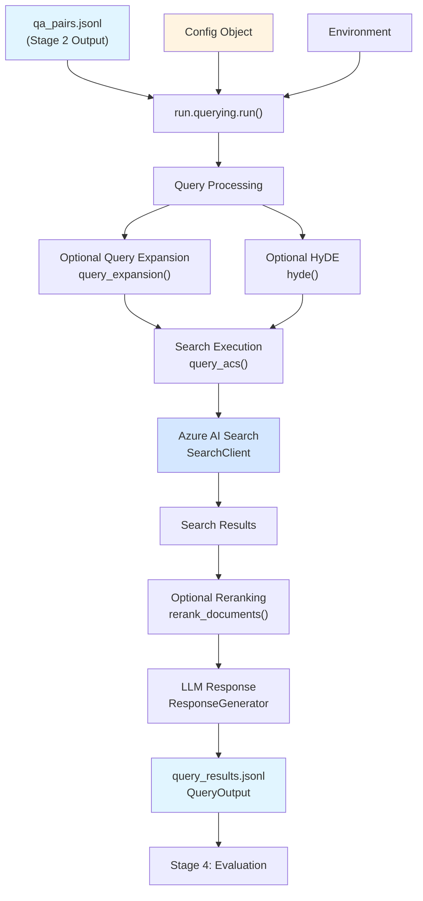
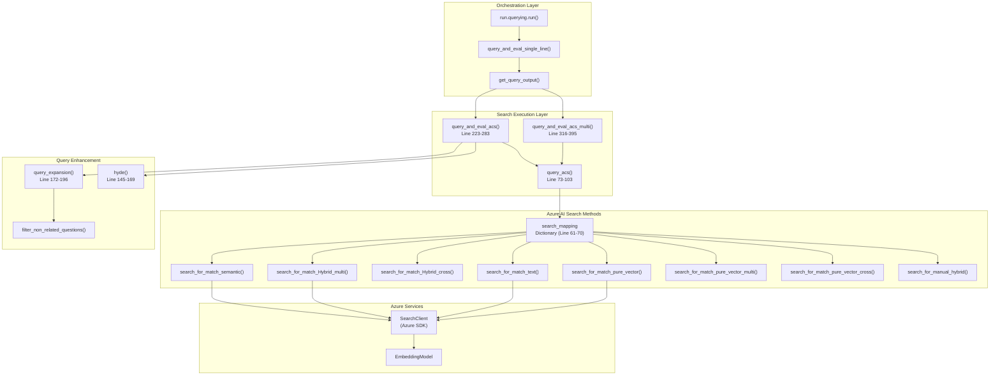
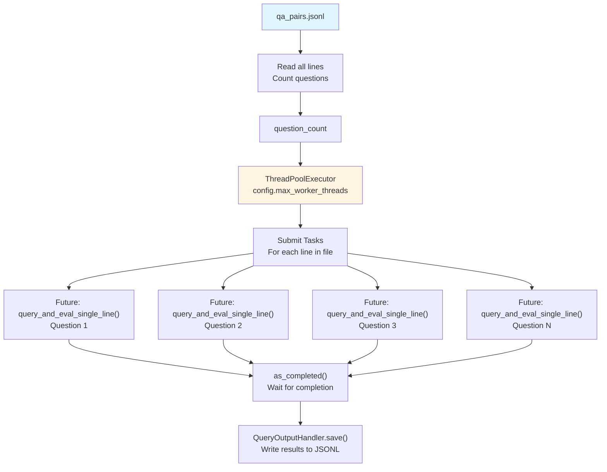

<!-- source: DeepWiki mcp.deepwiki.com · repo microsoft/rag-experiment-accelerator · page 7 Search and Retrieval · fetched 2026-10-26 -->

# Search and Retrieval

<details>
<summary>Relevant source files</summary>

The following files were used as context for generating this wiki page:

- [README.md](README.md)
- [config.sample.json](config.sample.json)
- [rag_experiment_accelerator/doc_loader/pdfLoader.py](rag_experiment_accelerator/doc_loader/pdfLoader.py)
- [rag_experiment_accelerator/ingest_data/acs_ingest.py](rag_experiment_accelerator/ingest_data/acs_ingest.py)
- [rag_experiment_accelerator/ingest_data/tests/test_acs_ingest.py](rag_experiment_accelerator/ingest_data/tests/test_acs_ingest.py)
- [rag_experiment_accelerator/run/querying.py](rag_experiment_accelerator/run/querying.py)
- [rag_experiment_accelerator/run/tests/test_querying.py](rag_experiment_accelerator/run/tests/test_querying.py)
- [rag_experiment_accelerator/search_type/acs_search_methods.py](rag_experiment_accelerator/search_type/acs_search_methods.py)
- [rag_experiment_accelerator/search_type/tests/test_acs_search_methods.py](rag_experiment_accelerator/search_type/tests/test_acs_search_methods.py)

</details>


## Purpose and Scope

This page documents the search and retrieval system in Stage 3 of the RAG pipeline, which queries Azure AI Search indexes to retrieve relevant document chunks for a given question and generates LLM responses. This covers the query processing flow, Azure AI Search integration, and the orchestration of search strategies. For detailed information on specific search types (text, vector, hybrid, semantic), see [Search Types and Strategies](#7.1). For query expansion techniques including HyDE, see [Query Expansion and HyDE](#7.2). For reranking strategies, see [Reranking](#7.3).

The search and retrieval system is implemented primarily in [rag_experiment_accelerator/run/querying.py]() and [rag_experiment_accelerator/search_type/acs_search_methods.py]().

Sources: [rag_experiment_accelerator/run/querying.py:1-632](), [README.md:211-222]()

## System Architecture Overview

The search and retrieval system operates as the third stage of the four-stage pipeline, taking question-answer pairs generated in Stage 2 as input and producing LLM-generated responses with retrieved context.

**High-Level Pipeline Flow**



Sources: [rag_experiment_accelerator/run/querying.py:560-632](), [README.md:211-222]()

## Core Components and Code Entity Mapping

The search and retrieval system consists of several interconnected components that handle different aspects of query processing.

**Component Architecture with Code Entities**



Sources: [rag_experiment_accelerator/run/querying.py:61-70](), [rag_experiment_accelerator/run/querying.py:73-103](), [rag_experiment_accelerator/run/querying.py:223-283](), [rag_experiment_accelerator/search_type/acs_search_methods.py:1-419]()

## Query Processing Flow

The system processes each question through a multi-step pipeline that can optionally expand queries, apply HyDE, execute searches, rerank results, and generate final responses.

### Search Strategy Mapping

The `search_mapping` dictionary [rag_experiment_accelerator/run/querying.py:61-70]() maps configuration string values to actual search function implementations:

| Config Value | Function | Description |
|-------------|----------|-------------|
| `search_for_match_semantic` | `search_for_match_semantic()` | Semantic search with vector + BM25 |
| `search_for_match_Hybrid_multi` | `search_for_match_Hybrid_multi()` | Hybrid search across content, title, summary vectors |
| `search_for_match_Hybrid_cross` | `search_for_match_Hybrid_cross()` | Hybrid search with cross-field vectors |
| `search_for_match_text` | `search_for_match_text()` | Pure BM25 text search |
| `search_for_match_pure_vector` | `search_for_match_pure_vector()` | Pure vector search on content |
| `search_for_match_pure_vector_multi` | `search_for_match_pure_vector_multi()` | Pure vector search across multiple fields |
| `search_for_match_pure_vector_cross` | `search_for_match_pure_vector_cross()` | Pure vector cross-field search |
| `search_for_manual_hybrid` | `search_for_manual_hybrid()` | Manual combination of text, vector, and semantic |

Sources: [rag_experiment_accelerator/run/querying.py:61-70](), [rag_experiment_accelerator/search_type/acs_search_methods.py:58-419]()

### Detailed Query Execution Flow

```mermaid
graph TD
    START["User Question from QA Pair"] --> MULTI_CHECK{"expand_to_multiple_questions<br/>enabled?"}
    
    MULTI_CHECK -->|Yes| NEED_MULTI["do_we_need_multiple_questions()<br/>LLM judges complexity"]
    MULTI_CHECK -->|No| SINGLE_PATH["Single Question Path"]
    
    NEED_MULTI -->|Complex| GEN_MULTI["generate_multiple_questions()<br/>LLM generates sub-questions"]
    NEED_MULTI -->|Simple| SINGLE_PATH
    
    GEN_MULTI --> MULTI_PATH["query_and_eval_acs_multi()<br/>Process each sub-question"]
    SINGLE_PATH --> SINGLE_QUERY["query_and_eval_acs()<br/>Process single question"]
    
    SINGLE_QUERY --> EXPAND_CHECK{"query_expansion<br/>enabled?"}
    MULTI_PATH --> EXPAND_CHECK
    
    EXPAND_CHECK -->|Yes| EXPAND["query_expansion()<br/>Generate related questions"]
    EXPAND_CHECK -->|No| QUERIES["queries: list[str]"]
    
    EXPAND --> FILTER["filter_non_related_questions()<br/>Cosine similarity filtering"]
    FILTER --> QUERIES
    
    QUERIES --> HYDE_CHECK{"hyde != 'disabled'?"}
    HYDE_CHECK -->|Yes| HYDE["hyde()<br/>Generate hypothetical docs/answers"]
    HYDE_CHECK -->|No| SEARCH_LOOP
    
    HYDE --> SEARCH_LOOP["For each query"]
    SEARCH_LOOP --> QUERY_ACS["query_acs()<br/>Execute search"]
    
    QUERY_ACS --> SEARCH_FUNC["search_mapping[search_type]<br/>Call specific search function"]
    SEARCH_FUNC --> ACS_CALL["SearchClient.search()<br/>Azure AI Search API"]
    
    ACS_CALL --> RESULTS["Search Results"]
    RESULTS --> DEDUP["deduplicate_search_results()<br/>Remove duplicates"]
    
    DEDUP --> EVAL["evaluate_search_result()<br/>SpacyEvaluator scoring"]
    
    EVAL --> RERANK_CHECK{"rerank.enabled?"}
    RERANK_CHECK -->|Yes| RERANK["rerank_documents()<br/>LLM or CrossEncoder"]
    RERANK_CHECK -->|No| CONTEXT["Retrieved Context"]
    
    RERANK --> CONTEXT
    CONTEXT --> LLM_GEN["ResponseGenerator.generate_response()<br/>main_instruction prompt"]
    
    LLM_GEN --> OUTPUT["QueryOutput object<br/>Saved to JSONL"]
    
    style START fill:#e1f5ff
    style OUTPUT fill:#e1f5ff
    style ACS_CALL fill:#d4e7ff
```



Sources: [rag_experiment_accelerator/run/querying.py:398-558](), [rag_experiment_accelerator/run/querying.py:223-283](), [rag_experiment_accelerator/run/querying.py:316-395]()

## Azure AI Search Integration

The system interfaces with Azure AI Search through the `SearchClient` from the Azure SDK, which is created and managed by the `create_client()` function.

### SearchClient Initialization

The `create_client()` function [rag_experiment_accelerator/search_type/acs_search_methods.py:18-35]() creates a `SearchClient` instance:

```python
# From acs_search_methods.py:18-35
def create_client(service_endpoint, index_name, key):
    credential = AzureKeyCredential(key)
    client = SearchClient(
        endpoint=service_endpoint, 
        index_name=index_name, 
        credential=credential
    )
    return client
```

This client is instantiated once per index in the main execution loop [rag_experiment_accelerator/run/querying.py:596-600]() and reused for all queries against that index.

### Search Execution Parameters

Each search function receives a `SearchClient`, `EmbeddingModel`, query string, and `retrieve_num_of_documents` parameter. The search functions construct `RawVectorQuery` objects and call `client.search()` with appropriate parameters:

**Example: Semantic Search** [rag_experiment_accelerator/search_type/acs_search_methods.py:58-109]()

```python
vector1 = RawVectorQuery(
    k=retrieve_num_of_documents,
    fields="contentVector",
    vector=embedding,
)
vector2 = RawVectorQuery(
    k=retrieve_num_of_documents,
    fields="titleVector, summaryVector",
    vector=embedding,
)

results = client.search(
    search_text=query,
    vector_queries=[vector1, vector2],
    top=retrieve_num_of_documents,
    select=["title", "content", "summary"],
    query_type=QueryType.SEMANTIC,
    query_language=QueryLanguage.EN_US,
    semantic_configuration_name="my-semantic-config",
    query_caption=QueryCaptionType.EXTRACTIVE,
    query_answer=QueryAnswerType.EXTRACTIVE,
)
```

### Result Formatting

All search functions return results in a standardized format using `format_results()` [rag_experiment_accelerator/search_type/acs_search_methods.py:38-55]():

```python
[
    {
        "@search.score": 0.95,
        "content": "Document content text..."
    },
    ...
]
```

Sources: [rag_experiment_accelerator/search_type/acs_search_methods.py:18-55](), [rag_experiment_accelerator/search_type/acs_search_methods.py:58-109]()

## Multi-Question Processing

When a user question is deemed complex, the system can decompose it into multiple sub-questions and process each independently before synthesizing a final answer.

**Sub-Question Processing Flow**


The `query_and_eval_acs_multi()` function [rag_experiment_accelerator/run/querying.py:316-395]() implements this multi-question processing. It iterates through each sub-question, executes the search pipeline, optionally reranks results, generates an LLM response for that sub-question, and collects all partial answers.

Sources: [rag_experiment_accelerator/run/querying.py:316-395](), [rag_experiment_accelerator/ingest_data/acs_ingest.py:176-196](), [rag_experiment_accelerator/ingest_data/acs_ingest.py:158-173]()

## Parallel Execution

The system processes multiple questions concurrently using `ThreadPoolExecutor` to improve throughput.

**Parallel Processing Architecture**



The main execution loop [rag_experiment_accelerator/run/querying.py:602-630]() uses `ThreadPoolExecutor` with the `max_worker_threads` configuration parameter to control concurrency. Each question is processed independently by `query_and_eval_single_line()`, and results are collected as futures complete.

Sources: [rag_experiment_accelerator/run/querying.py:602-630](), [rag_experiment_accelerator/run/querying.py:398-464]()

## Query Result Output

The `QueryOutput` data model [rag_experiment_accelerator/artifact/models/query_output.py]() captures all information about a query execution, including configuration parameters, search evaluations, and the generated response.

**QueryOutput Structure**

| Field | Type | Description |
|-------|------|-------------|
| `question` | str | Original user question |
| `expected` | str | Ground truth answer from QA generation |
| `actual` | str | LLM-generated response |
| `context` | str | Original context chunk used for QA generation |
| `retrieved_contexts` | list[str] | Chunks retrieved by search |
| `search_type` | str | Search strategy used |
| `search_evals` | list[dict] | Search evaluation metrics (MAP@k, etc.) |
| `rerank` | bool | Whether reranking was enabled |
| `rerank_type` | str | Type of reranking (llm/cross_encoder) |
| `retrieve_num_of_documents` | int | Number of documents requested |
| Additional fields | - | Reranking thresholds, model names, etc. |

Results are saved to `artifacts/outputs/query_results.jsonl` by the `QueryOutputHandler` [rag_experiment_accelerator/artifact/handlers/query_output_handler.py](), with one JSON object per line.

Sources: [rag_experiment_accelerator/run/querying.py:540-557](), [rag_experiment_accelerator/artifact/handlers/query_output_handler.py]()

## Configuration Parameters

The search and retrieval system is configured through several sections of `config.json`.

**Key Configuration Parameters**

| Parameter | Location | Type | Description |
|-----------|----------|------|-------------|
| `search.retrieve_num_of_documents` | config.search | int | Number of chunks to retrieve from search |
| `search.search_type` | config.search | list[str] | Search strategies to execute |
| `search.search_relevancy_threshold` | config.search | float | Similarity threshold (0.0-1.0) for relevance |
| `query_expansion.query_expansion` | config.query_expansion | bool | Enable query expansion |
| `query_expansion.hyde` | config.query_expansion | str | HyDE mode: disabled/generated_hypothetical_answer/generated_hypothetical_document_to_answer |
| `query_expansion.expand_to_multiple_questions` | config.query_expansion | bool | Enable sub-question generation |
| `query_expansion.min_query_expansion_related_question_similarity_score` | config.query_expansion | int | Minimum similarity % for related questions (default: 90) |
| `rerank.enabled` | config.rerank | bool | Enable reranking |
| `rerank.type` | config.rerank | str | Reranker type: llm/cross_encoder |
| `max_worker_threads` | config | int | Number of parallel worker threads |

**Example Configuration** [config.sample.json:50-71]()

```json
{
    "search": {
        "retrieve_num_of_documents": 5,
        "search_type": [
            "search_for_manual_hybrid",
            "search_for_match_Hybrid_multi",
            "search_for_match_semantic"
        ],
        "search_relevancy_threshold": 0.8
    },
    "query_expansion": {
        "hyde": "disabled",
        "query_expansion": false,
        "min_query_expansion_related_question_similarity_score": 90,
        "expand_to_multiple_questions": false
    }
}
```

Sources: [config.sample.json:50-71](), [README.md:337-356]()

## Checkpointing and Caching

The `get_query_output()` function [rag_experiment_accelerator/run/querying.py:466-557]() is decorated with `@cache_with_checkpoint()` to cache expensive query operations. The cache key is based on the user prompt, output prompt, context, and index name [rag_experiment_accelerator/run/querying.py:466-468]().

When `config.use_checkpoints` is enabled, previously computed query results are loaded from `artifacts/checkpoints/` rather than re-executing the full search and LLM generation pipeline. This is particularly useful when experimenting with evaluation metrics (Stage 4) without re-running the expensive querying stage.

Sources: [rag_experiment_accelerator/run/querying.py:466-557](), [rag_experiment_accelerator/checkpoint/__init__.py]()

## Error Handling

The system includes error handling at multiple levels:

1. **Search Function Level**: Each search function wraps `client.search()` in try-except blocks [rag_experiment_accelerator/search_type/acs_search_methods.py:92-109](), logging errors and returning empty results on failure.

2. **Question Processing Level**: `query_and_eval_single_line()` catches `BadRequestError` exceptions [rag_experiment_accelerator/run/querying.py:459-463]() from Azure OpenAI and skips problematic questions while continuing with others.

3. **Future Processing Level**: The main execution loop catches exceptions from completed futures [rag_experiment_accelerator/run/querying.py:623-629]() and logs errors without stopping the entire run.

This multi-layered approach ensures that individual failures don't crash the entire experiment, allowing maximum data collection even when some queries fail.

Sources: [rag_experiment_accelerator/run/querying.py:459-463](), [rag_experiment_accelerator/run/querying.py:623-629](), [rag_experiment_accelerator/search_type/acs_search_methods.py:92-109]()

## Integration with Other Pipeline Stages

The search and retrieval system acts as a bridge between QA generation (Stage 2) and evaluation (Stage 4):

**Input**: `artifacts/outputs/qa_pairs.jsonl` from Stage 2 containing:
- `user_prompt`: Generated question
- `output_prompt`: Ground truth answer
- `context`: Original document chunk

**Output**: `artifacts/outputs/query_results.jsonl` for Stage 4 containing:
- `question`: User question
- `expected`: Ground truth answer
- `actual`: LLM-generated response
- `retrieved_contexts`: Retrieved chunks
- `search_evals`: Search quality metrics

The `QueryOutput` objects are registered as Azure ML data assets [rag_experiment_accelerator/run/querying.py]() for reproducibility and tracked in MLflow experiments for comparison across configurations.

For details on how these outputs are evaluated, see [Stage 4: Evaluation and Metrics](#3.4). For information on how the indexes used for search are created, see [Stage 1: Document Indexing](#3.1).

Sources: [rag_experiment_accelerator/run/querying.py:560-632](), [rag_experiment_accelerator/artifact/handlers/query_output_handler.py]()

---

