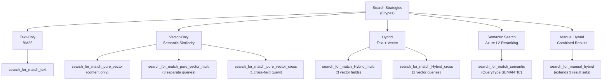
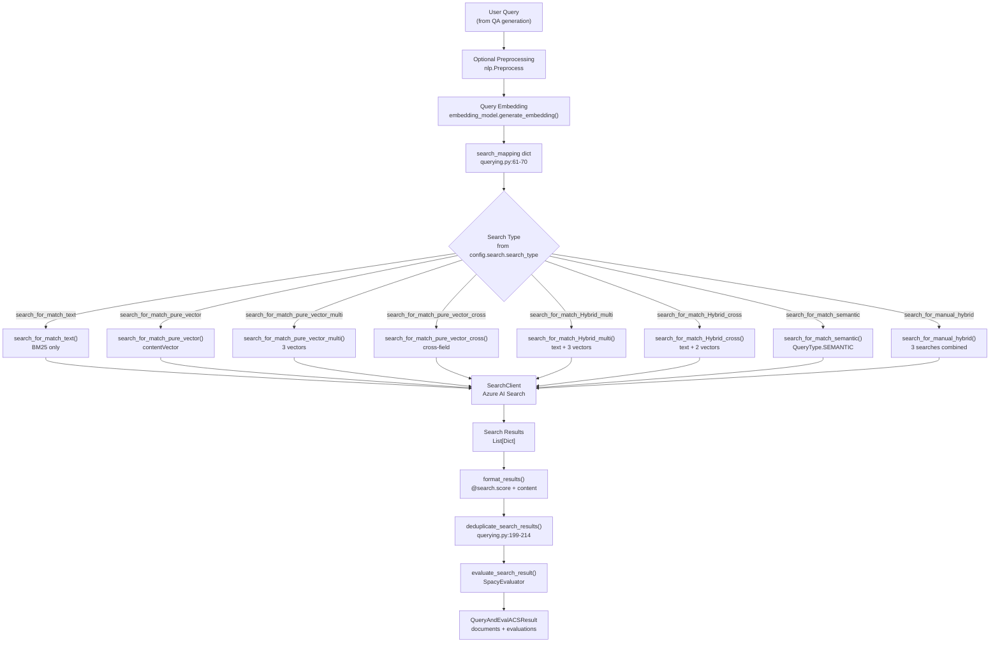
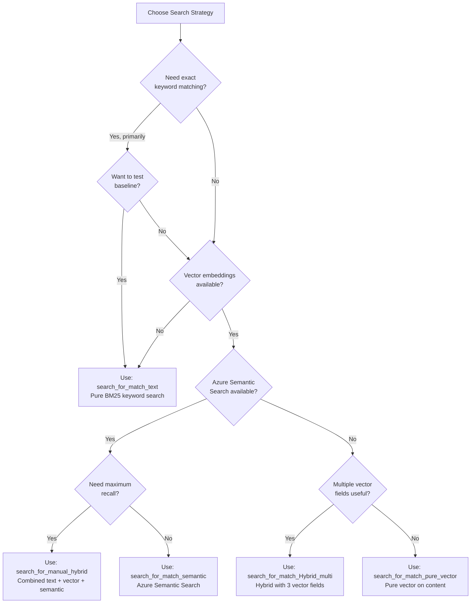
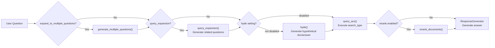

<!-- source: DeepWiki mcp.deepwiki.com · repo microsoft/rag-experiment-accelerator · page 7.1 Search Types and Strategies · fetched 2026-10-26 -->

# Search Types and Strategies

<details>
<summary>Relevant source files</summary>

The following files were used as context for generating this wiki page:

- [.github/workflows/config.json](.github/workflows/config.json)
- [README.md](README.md)
- [config.sample.json](config.sample.json)
- [config.schema.json](config.schema.json)
- [docs/evaluation-metrics.md](docs/evaluation-metrics.md)
- [promptflow/rag-experiment-accelerator/README.md](promptflow/rag-experiment-accelerator/README.md)
- [rag_experiment_accelerator/config/eval_config.py](rag_experiment_accelerator/config/eval_config.py)
- [rag_experiment_accelerator/evaluation/plain_metrics.py](rag_experiment_accelerator/evaluation/plain_metrics.py)
- [rag_experiment_accelerator/evaluation/tests/test_plain_metrics.py](rag_experiment_accelerator/evaluation/tests/test_plain_metrics.py)
- [rag_experiment_accelerator/run/querying.py](rag_experiment_accelerator/run/querying.py)
- [rag_experiment_accelerator/run/tests/test_querying.py](rag_experiment_accelerator/run/tests/test_querying.py)
- [rag_experiment_accelerator/search_type/acs_search_methods.py](rag_experiment_accelerator/search_type/acs_search_methods.py)
- [rag_experiment_accelerator/search_type/tests/test_acs_search_methods.py](rag_experiment_accelerator/search_type/tests/test_acs_search_methods.py)

</details>


## Purpose and Scope

This document details the eight search strategies available in the RAG Experiment Accelerator and explains when to use each approach. The search types represent different combinations of text-based (BM25) and vector-based (HNSW) retrieval methods supported by Azure AI Search.

For information about query expansion techniques (HyDE, related questions), see [Query Expansion and HyDE](#7.2). For reranking strategies applied after search, see [Reranking](#7.3). For Azure AI Search index configuration, see [Azure AI Search Configuration](#9.1).

---

## Overview

The RAG Experiment Accelerator supports eight distinct search strategies, each implemented as a separate function in the `acs_search_methods` module. These strategies can be mixed and compared within a single experiment to determine optimal retrieval performance for a given corpus and query set.

All search types operate on Azure AI Search indexes containing document chunks with the following vector fields:
- `contentVector`: Embedding of the chunk's text content
- `titleVector`: Embedding of the LLM-generated or extracted title
- `summaryVector`: Embedding of the LLM-generated summary (if enabled)

### Search Type Taxonomy



**Sources:** [rag_experiment_accelerator/search_type/acs_search_methods.py:61-70](), [rag_experiment_accelerator/run/querying.py:61-70]()

---

## Search Type Implementations

### Code Entity Mapping

The following table maps configuration values to implementation functions:

| Configuration Value | Function Name | Vector Fields Used | Text Search | Azure Semantic |
|---------------------|---------------|-------------------|-------------|----------------|
| `search_for_match_text` | `search_for_match_text` | None | ✓ | ✗ |
| `search_for_match_pure_vector` | `search_for_match_pure_vector` | `contentVector` | ✗ | ✗ |
| `search_for_match_pure_vector_multi` | `search_for_match_pure_vector_multi` | `contentVector`, `titleVector`, `summaryVector` | ✗ | ✗ |
| `search_for_match_pure_vector_cross` | `search_for_match_pure_vector_cross` | `contentVector, titleVector, summaryVector` | ✗ | ✗ |
| `search_for_match_Hybrid_multi` | `search_for_match_Hybrid_multi` | `contentVector`, `titleVector`, `summaryVector` | ✓ | ✗ |
| `search_for_match_Hybrid_cross` | `search_for_match_Hybrid_cross` | `contentVector`, `titleVector+summaryVector` | ✓ | ✗ |
| `search_for_match_semantic` | `search_for_match_semantic` | `contentVector`, `titleVector+summaryVector` | ✓ | ✓ |
| `search_for_manual_hybrid` | `search_for_manual_hybrid` | All (composite) | ✓ | ✓ |

**Sources:** [rag_experiment_accelerator/search_type/acs_search_methods.py:61-70](), [config.sample.json:57-64]()

---

## Detailed Search Type Descriptions

### 1. Text-Only Search (`search_for_match_text`)

Pure keyword-based search using Azure AI Search's BM25 algorithm. Does not use embeddings or vector similarity.

**Implementation Details:**
- Function: `search_for_match_text(client, query, retrieve_num_of_documents, **kwargs)`
- Uses `client.search()` with only `search_text` parameter
- Returns documents ranked by BM25 relevance score

**When to Use:**
- Testing baseline text retrieval performance
- Queries with precise terminology or exact phrases
- Comparing against vector-based approaches
- Scenarios where embedding models are not available

**Limitations:**
- Cannot capture semantic similarity
- Sensitive to vocabulary mismatch between query and documents
- No understanding of synonyms or paraphrases

**Sources:** [rag_experiment_accelerator/search_type/acs_search_methods.py:222-252]()

---

### 2. Pure Vector Search - Content Only (`search_for_match_pure_vector`)

Vector similarity search using only the `contentVector` field. Embeds the query and retrieves documents with highest cosine similarity.

**Implementation Details:**
- Function: `search_for_match_pure_vector(client, embedding_model, query, retrieve_num_of_documents, preprocess)`
- Creates single `RawVectorQuery` for `contentVector` field
- Sets `search_text=None` to disable BM25
- Optionally preprocesses query via `Preprocess` class if `preprocess=True`

**Vector Query Construction:**
```python
vector1 = RawVectorQuery(
    k=retrieve_num_of_documents,
    fields="contentVector",
    vector=embedding,
)
```

**When to Use:**
- Semantic similarity is more important than keyword matching
- Testing pure vector retrieval performance
- Queries that are conceptual rather than terminology-specific
- Baseline for comparing multi-field vector strategies

**Sources:** [rag_experiment_accelerator/search_type/acs_search_methods.py:255-295]()

---

### 3. Pure Vector Search - Multi-Field (`search_for_match_pure_vector_multi`)

Vector similarity search across content, title, and summary fields using three separate vector queries.

**Implementation Details:**
- Creates three `RawVectorQuery` objects, one per field
- Each query searches independently with `k=retrieve_num_of_documents`
- Azure AI Search merges results from all three queries

**Vector Query Construction:**
```python
vector1 = RawVectorQuery(k=retrieve_num_of_documents, fields="contentVector", vector=embedding)
vector2 = RawVectorQuery(k=retrieve_num_of_documents, fields="titleVector", vector=embedding)
vector3 = RawVectorQuery(k=retrieve_num_of_documents, fields="summaryVector", vector=embedding)
```

**When to Use:**
- Titles and summaries may contain query-relevant information
- Want to leverage all enriched fields from indexing stage (see [Stage 1: Document Indexing](#3.1))
- Testing whether multi-field search improves recall

**Sources:** [rag_experiment_accelerator/search_type/acs_search_methods.py:298-349]()

---

### 4. Pure Vector Search - Cross-Field (`search_for_match_pure_vector_cross`)

Vector similarity search across content, title, and summary fields using a single cross-field query.

**Implementation Details:**
- Creates single `RawVectorQuery` spanning multiple fields
- Azure AI Search computes similarity across all specified fields simultaneously
- Different from `pure_vector_multi` in how Azure Search combines field scores

**Vector Query Construction:**
```python
vector1 = RawVectorQuery(
    k=retrieve_num_of_documents,
    fields="contentVector, titleVector, summaryVector",
    vector=embedding,
)
```

**When to Use:**
- Similar to `pure_vector_multi` but with different scoring behavior
- Experimenting with cross-field vector search performance
- May perform differently than multi-field approach depending on corpus

**Sources:** [rag_experiment_accelerator/search_type/acs_search_methods.py:352-393]()

---

### 5. Hybrid Search - Multi-Field (`search_for_match_Hybrid_multi`)

Combines BM25 text search with three separate vector queries (content, title, summary). Azure AI Search uses RRF (Reciprocal Rank Fusion) to merge results.

**Implementation Details:**
- Combines `search_text=query` with three `RawVectorQuery` objects
- RRF merges text and vector results into unified ranking
- Each vector field searched independently

**When to Use:**
- Best of both worlds: keyword precision + semantic similarity
- Queries that benefit from both exact term matching and conceptual understanding
- Default choice for many RAG applications
- Recommended starting point for experimentation

**Advantages:**
- Captures exact keyword matches that vectors might miss
- Leverages semantic understanding for paraphrases and synonyms
- RRF provides balanced combination of ranking signals

**Sources:** [rag_experiment_accelerator/search_type/acs_search_methods.py:117-170]()

---

### 6. Hybrid Search - Cross-Field (`search_for_match_Hybrid_cross`)

Combines BM25 text search with two vector queries: one for content, one combining title and summary.

**Implementation Details:**
- Uses `search_text=query` for BM25
- Two `RawVectorQuery` objects:
  - `contentVector` alone
  - `titleVector, summaryVector` as cross-field query
- May have different scoring behavior than `Hybrid_multi`

**Vector Query Construction:**
```python
vector1 = RawVectorQuery(k=retrieve_num_of_documents, fields="contentVector", vector=embedding)
vector2 = RawVectorQuery(k=retrieve_num_of_documents, fields="titleVector, summaryVector", vector=embedding)
```

**When to Use:**
- Experimenting with different hybrid configurations
- Hypothesis that title+summary should be scored together
- Comparing against `Hybrid_multi` to find optimal strategy

**Sources:** [rag_experiment_accelerator/search_type/acs_search_methods.py:173-219]()

---

### 7. Semantic Search (`search_for_match_semantic`)

Azure AI Search's semantic ranking capability, which applies L2 reranking using Microsoft's semantic models on top of hybrid search results.

**Implementation Details:**
- Combines text search with two vector queries
- Specifies `query_type=QueryType.SEMANTIC`
- Uses `semantic_configuration_name="my-semantic-config"`
- Enables extractive captions and answers via `QueryCaptionType.EXTRACTIVE` and `QueryAnswerType.EXTRACTIVE`
- Requires Azure AI Search Basic tier or higher

**Search Configuration:**
```python
results = client.search(
    search_text=query,
    vector_queries=[vector1, vector2],
    top=retrieve_num_of_documents,
    query_type=QueryType.SEMANTIC,
    query_language=QueryLanguage.EN_US,
    semantic_configuration_name="my-semantic-config",
    query_caption=QueryCaptionType.EXTRACTIVE,
    query_answer=QueryAnswerType.EXTRACTIVE,
)
```

**When to Use:**
- Highest quality retrieval when cost/latency acceptable
- Queries requiring deep semantic understanding
- Want Azure's L2 reranking on top of initial results
- Comparing against non-semantic hybrid approaches

**Requirements:**
- Azure AI Search Basic tier minimum (see [README.md:58]())
- Semantic configuration defined in index

**Sources:** [rag_experiment_accelerator/search_type/acs_search_methods.py:58-109]()

---

### 8. Manual Hybrid (`search_for_manual_hybrid`)

Custom hybrid strategy that executes three separate searches and concatenates results: text-only, pure vector cross-field, and semantic search.

**Implementation Details:**
- Calls three search functions sequentially:
  - `search_for_match_text()`
  - `search_for_match_pure_vector_cross()`
  - `search_for_match_semantic()`
- Extends context list with all results (deduplication happens in querying logic)
- Returns combined result set

**Implementation:**
```python
def search_for_manual_hybrid(**kwargs):
    context = []
    text_context = search_for_match_text(**kwargs)
    vector_context = search_for_match_pure_vector_cross(**kwargs)
    semantic_context = search_for_match_semantic(**kwargs)
    
    context.extend(text_context)
    context.extend(vector_context)
    context.extend(semantic_context)
    
    return context
```

**When to Use:**
- Maximum recall: retrieve documents matching any of the three strategies
- Testing whether broader retrieval improves downstream LLM response quality
- Combining different ranking signals for reranker input (see [Reranking](#7.3))

**Considerations:**
- Returns more documents than other strategies (up to 3× `retrieve_num_of_documents`)
- Deduplication occurs in `deduplicate_search_results()` function
- May require more aggressive reranking to filter results

**Sources:** [rag_experiment_accelerator/search_type/acs_search_methods.py:396-418](), [rag_experiment_accelerator/run/querying.py:199-214]()

---

## Search Execution Flow

### Query Processing Pipeline



**Sources:** [rag_experiment_accelerator/run/querying.py:73-103](), [rag_experiment_accelerator/run/querying.py:223-283]()

---

## Configuration

### Specifying Search Types

Search types are configured in `config.json` under the `search` section:

```json
{
    "search": {
        "retrieve_num_of_documents": 5,
        "search_type": [
            "search_for_manual_hybrid",
            "search_for_match_Hybrid_multi",
            "search_for_match_semantic"
        ],
        "search_relevancy_threshold": 0.8
    }
}
```

**Configuration Parameters:**
- `search_type`: Array of search strategy names to execute (all will run for each question)
- `retrieve_num_of_documents`: Number of documents to retrieve per search
- `search_relevancy_threshold`: Minimum similarity score for evaluation (used by SpacyEvaluator)

**Multiple Search Types:**
When multiple search types are specified, the querying stage executes all strategies for each question, enabling systematic comparison. Each search type produces separate results logged to MLflow.

**Sources:** [config.sample.json:57-64](), [rag_experiment_accelerator/run/querying.py:436-452]()

### Valid Search Type Values

The schema defines valid search type values:

```json
"search_type": {
    "type": "array",
    "items": {
        "type": "string",
        "enum": [
            "search_for_match_semantic",
            "search_for_match_Hybrid_multi",
            "search_for_match_Hybrid_cross",
            "search_for_match_text",
            "search_for_match_pure_vector",
            "search_for_match_pure_vector_multi",
            "search_for_match_pure_vector_cross",
            "search_for_manual_hybrid"
        ]
    },
    "description": "Search types used for experimentation"
}
```

**Sources:** [config.schema.json:457-473]()

---

## Search Strategy Selection Guide

### Decision Tree



**Sources:** [README.md:42](), [rag_experiment_accelerator/run/querying.py:61-70]()

### Recommendation Matrix

| Scenario | Recommended Search Type | Rationale |
|----------|------------------------|-----------|
| Starting a new experiment | `search_for_match_Hybrid_multi` | Balanced approach combining text and vector |
| Maximum retrieval quality | `search_for_match_semantic` | Azure's L2 reranking provides highest accuracy |
| Cost-sensitive deployment | `search_for_match_Hybrid_cross` | Good quality without semantic search pricing |
| Precise technical queries | `search_for_match_text` | Exact terminology matching |
| Conceptual/paraphrased queries | `search_for_match_pure_vector` | Semantic similarity without keyword constraint |
| Testing all approaches | Multiple types in config | Run all 8 strategies for comparison |
| Maximizing recall for reranking | `search_for_manual_hybrid` | Broadest retrieval for downstream filtering |
| Titles/summaries provide value | `search_for_match_Hybrid_multi` or `pure_vector_multi` | Leverage enriched fields from Stage 1 |

**Sources:** [README.md:9-15](), [docs/evaluation-metrics.md:1-8]()

---

## Integration with Query Pipeline

### Query Execution Context

The search type selection integrates with other query processing features:



**Key Integration Points:**

1. **Query Expansion** (see [Query Expansion and HyDE](#7.2)): May generate multiple queries that all execute the same search type
2. **HyDE**: Transforms query before embedding (affects all vector-based search types)
3. **Search Type Execution**: `query_acs()` maps to appropriate search function
4. **Deduplication**: `deduplicate_search_results()` removes duplicate chunks from multi-query results
5. **Reranking** (see [Reranking](#7.3)): Applied after search to refine results
6. **LLM Response**: Final context passed to `ResponseGenerator` for answer generation

**Sources:** [rag_experiment_accelerator/run/querying.py:223-283](), [rag_experiment_accelerator/run/querying.py:316-395]()

---

## Search Result Format and Evaluation

### Result Structure

All search functions return results in a consistent format:

```python
[
    {
        "content": "The actual text content of the chunk",
        "@search.score": 0.85  # Relevance score from Azure AI Search
    },
    {
        "content": "Another chunk of text...",
        "@search.score": 0.72
    }
]
```

The `format_results()` function extracts these two fields from the raw Azure AI Search response:

**Sources:** [rag_experiment_accelerator/search_type/acs_search_methods.py:38-55]()

### Search Evaluation

Search results are evaluated using the `SpacyEvaluator` class to compute retrieval metrics:

```python
docs, evaluation = evaluate_search_result(
    search_results, evaluation_content, evaluator
)
```

**Evaluation Metrics Computed:**
- Mean Average Precision (MAP) scores
- Precision at K
- Relevance determination using spaCy similarity

The `evaluation` dictionary contains:
- `query`: The original query text
- MAP scores and precision metrics
- Retrieved document relevance flags

These metrics are logged to MLflow for comparison across search types (see [Stage 4: Evaluation and Metrics](#3.4)).

**Sources:** [rag_experiment_accelerator/run/querying.py:278-282](), [rag_experiment_accelerator/evaluation/search_eval.py]()

---

## Testing and Validation

The search type implementations include comprehensive unit tests:

**Test Coverage:**
- `test_create_client`: Validates SearchClient creation
- `test_format_results`: Verifies result formatting
- `test_search_for_match_semantic`: Tests semantic search with vector queries
- `test_search_for_match_Hybrid_multi`: Tests multi-field hybrid search
- `test_search_for_match_Hybrid_cross`: Tests cross-field hybrid search
- `test_search_for_match_text`: Tests pure text search
- `test_search_for_match_pure_vector`: Tests pure vector search (content only)
- `test_search_for_match_pure_vector_multi`: Tests multi-field pure vector search
- `test_search_for_match_pure_vector_cross`: Tests cross-field pure vector search
- Exception handling tests for each search type

**Sources:** [rag_experiment_accelerator/search_type/tests/test_acs_search_methods.py:1-715]()

---

## Performance Considerations

### Latency Characteristics

| Search Type | Relative Latency | Notes |
|-------------|------------------|-------|
| `search_for_match_text` | Fastest | BM25 only, no embedding computation |
| `search_for_match_pure_vector` | Fast | Single vector query |
| `search_for_match_Hybrid_cross` | Moderate | Text + 2 vector queries |
| `search_for_match_Hybrid_multi` | Moderate | Text + 3 vector queries |
| `search_for_match_semantic` | Slower | Additional L2 reranking layer |
| `search_for_manual_hybrid` | Slowest | 3 separate search requests |

### Cost Optimization

- **Text-only search** incurs no embedding API costs
- **Pure vector searches** require one embedding generation per query
- **Hybrid searches** incur same embedding cost as pure vector (query embedded once)
- **Semantic search** requires Azure AI Search Basic tier minimum (additional cost)
- **Manual hybrid** makes 3× search requests to Azure AI Search

### Throughput Optimization

The querying stage uses `ThreadPoolExecutor` for parallel question processing:

```python
with ThreadPoolExecutor(config.max_worker_threads) as executor:
    futures = {
        executor.submit(query_and_eval_single_line, ...): line
        for line_number, line in enumerate(file)
    }
```

Each thread executes all configured search types sequentially for its assigned question.

**Sources:** [rag_experiment_accelerator/run/querying.py:602-630](), [rag_experiment_accelerator/config/config.py]()

---

## Best Practices

### Experimentation Strategy

1. **Start with a baseline:** Run `search_for_match_text` to establish keyword-based performance
2. **Add semantic understanding:** Compare against `search_for_match_Hybrid_multi`
3. **Test semantic search:** If Azure tier allows, evaluate `search_for_match_semantic`
4. **Optimize configuration:** Try variations (`Hybrid_cross`, `pure_vector_*`) based on results
5. **Systematic comparison:** Use multiple search types in single experiment run

### Configuration Tips

```json
{
    "search": {
        "retrieve_num_of_documents": 5,
        "search_type": [
            "search_for_match_text",
            "search_for_match_Hybrid_multi",
            "search_for_match_semantic"
        ],
        "search_relevancy_threshold": 0.8
    },
    "rerank": {
        "enabled": true,
        "type": "cross_encoder",
        "cross_encoder_at_k": 4
    }
}
```

**Recommendations:**
- Start with `retrieve_num_of_documents=5` and adjust based on reranking behavior
- Enable reranking when using `manual_hybrid` to filter broad results
- Use `search_relevancy_threshold=0.8` for evaluation metrics (adjust per corpus)
- Test 2-3 search types simultaneously for efficient comparison

**Sources:** [config.sample.json:57-64](), [README.md:336-341]()

---

## Common Pitfalls

### 1. Index Configuration Mismatch

**Problem:** Search type expects vector fields that don't exist in index (e.g., `titleVector` not created because `generate_title=false`).

**Solution:** Ensure index configuration matches search requirements:
- If using multi-field searches, set `generate_title=true` and `generate_summary=true` in chunking config
- Verify fields exist in index before selecting search type

### 2. Semantic Search Tier Requirement

**Problem:** `search_for_match_semantic` fails with tier-related error.

**Solution:** Azure AI Search Basic tier minimum required for semantic search (see [README.md:58]()).

### 3. Manual Hybrid Result Count

**Problem:** `search_for_manual_hybrid` returns too many documents, overwhelming reranker or LLM.

**Solution:** 
- Ensure `retrieve_num_of_documents` is conservative (e.g., 3-5)
- Enable aggressive reranking with lower `cross_encoder_at_k` or `llm_rerank_threshold`
- Results are deduplicated but may still be numerous

### 4. Embedding Model Consistency

**Problem:** Different embedding models used for indexing vs. querying leads to poor vector search results.

**Solution:** Verify `config.index.embedding_model` matches the model used during query embedding. The system retrieves the correct model via `config.get_embedding_model(index_config.embedding_model.model_name)`.

**Sources:** [rag_experiment_accelerator/run/querying.py:491-493](), [config.sample.json:24-29]()

---

## Related Documentation

- **[Query Expansion and HyDE](#7.2):** Query transformation strategies applied before search
- **[Reranking](#7.3):** Post-search result refinement
- **[Azure AI Search Configuration](#9.1):** Index setup, vector configuration, HNSW parameters
- **[Stage 3: Querying and Retrieval](#3.3):** Overall query processing pipeline
- **[Evaluation Metrics](#8):** How search performance is measured
- **[Stage 1: Document Indexing](#3.1):** How documents are chunked and vectorized

---

