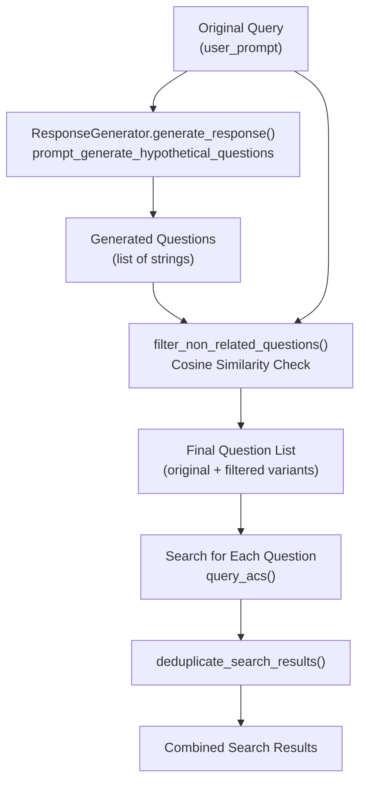
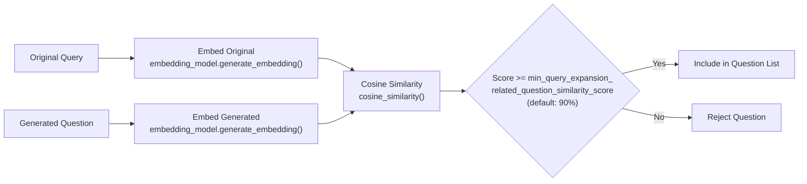
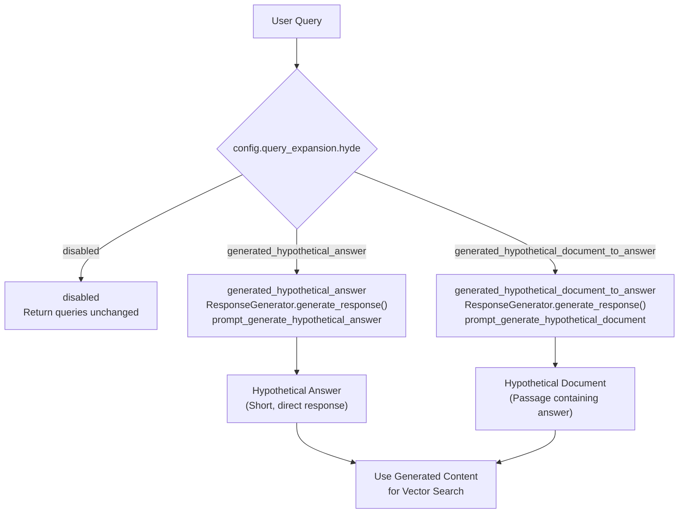
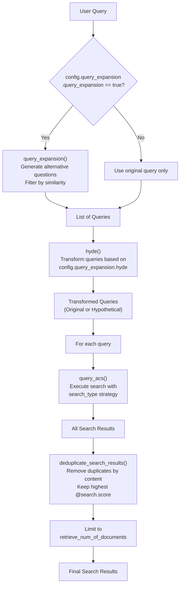
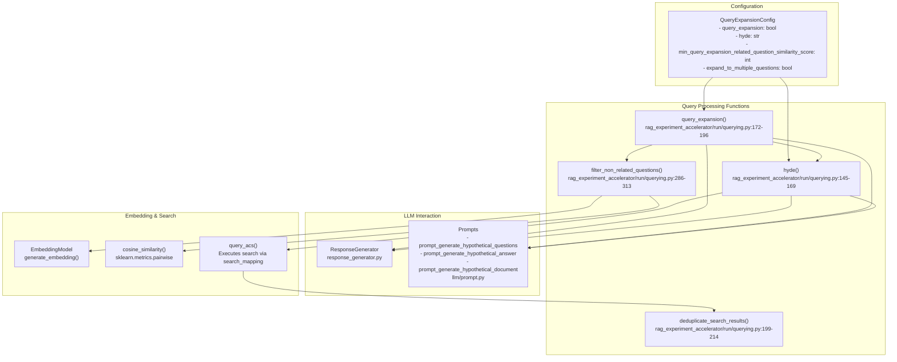
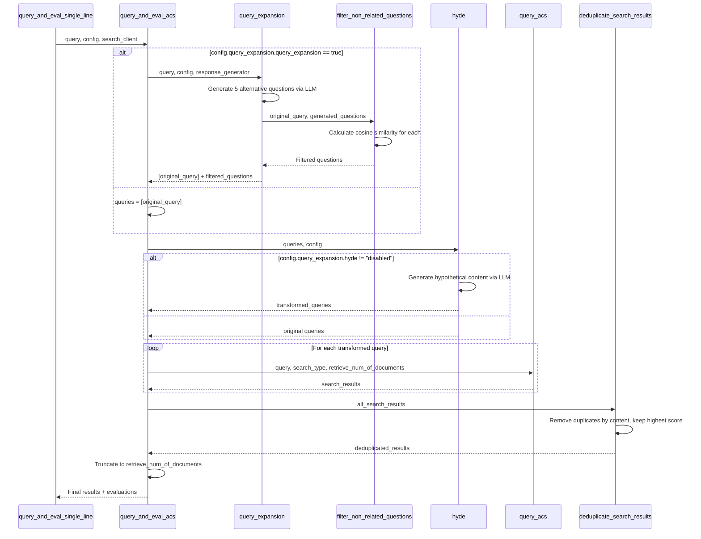

<!-- source: DeepWiki mcp.deepwiki.com · repo microsoft/rag-experiment-accelerator · page 7.2 Query Expansion and HyDE · fetched 2026-10-26 -->

# Query Expansion and HyDE

<details>
<summary>Relevant source files</summary>

The following files were used as context for generating this wiki page:

- [README.md](README.md)
- [config.sample.json](config.sample.json)
- [rag_experiment_accelerator/doc_loader/pdfLoader.py](rag_experiment_accelerator/doc_loader/pdfLoader.py)
- [rag_experiment_accelerator/ingest_data/acs_ingest.py](rag_experiment_accelerator/ingest_data/acs_ingest.py)
- [rag_experiment_accelerator/ingest_data/tests/test_acs_ingest.py](rag_experiment_accelerator/ingest_data/tests/test_acs_ingest.py)
- [rag_experiment_accelerator/run/querying.py](rag_experiment_accelerator/run/querying.py)
- [rag_experiment_accelerator/run/tests/test_querying.py](rag_experiment_accelerator/run/tests/test_querying.py)
- [rag_experiment_accelerator/search_type/acs_search_methods.py](rag_experiment_accelerator/search_type/acs_search_methods.py)
- [rag_experiment_accelerator/search_type/tests/test_acs_search_methods.py](rag_experiment_accelerator/search_type/tests/test_acs_search_methods.py)

</details>


## Purpose and Scope

This page documents the query expansion and HyDE (Hypothetical Document Embeddings) features in the RAG Experiment Accelerator. These techniques augment user queries before retrieval to improve search quality and contextual relevance. Query expansion generates alternative formulations of a question, while HyDE generates hypothetical documents or answers that may better match relevant content in the search index.

For information about the overall querying pipeline, see [Stage 3: Querying and Retrieval](#3.3). For details on search strategies themselves, see [Search Types and Strategies](#7.1). For reranking retrieved results, see [Reranking](#7.3).

## Overview

Query expansion and HyDE are pre-retrieval augmentation techniques that transform the original user query before it is used to search the index. Both approaches aim to address the vocabulary mismatch problem: the user's query may use different terminology than the relevant documents in the corpus.

**Query Expansion** generates multiple related questions from a single user question, then searches for each variant and deduplicates results. This increases the likelihood of finding relevant content by exploring different phrasings of the same information need.

**HyDE (Hypothetical Document Embeddings)** uses an LLM to generate hypothetical content (either a direct answer or a document passage) that would answer the user's question. The embedding of this hypothetical content is then used for vector search, rather than embedding the question itself. This leverages the LLM's knowledge to bridge the gap between query language and document language.

Sources: [README.md:411-445](), [rag_experiment_accelerator/run/querying.py:145-196]()

## Query Expansion

### Mechanism

Query expansion follows this process:



**Query Expansion Flow**

The system generates up to five alternative related questions using an LLM prompt [rag_experiment_accelerator/llm/prompt.py]. These questions are then filtered based on semantic similarity to the original query to ensure they remain relevant.

Sources: [rag_experiment_accelerator/run/querying.py:172-196]()

### Filtering Non-Related Questions

The `filter_non_related_questions()` function [rag_experiment_accelerator/run/querying.py:286-313]() ensures that generated questions remain semantically similar to the original:



**Question Filtering Based on Similarity Threshold**

The default similarity threshold is 90%, configurable via `config.query_expansion.min_query_expansion_related_question_similarity_score`.

Sources: [rag_experiment_accelerator/run/querying.py:286-313](), [config.sample.json:66-70]()

### Configuration

Query expansion is controlled by the `query_expansion` section in `config.json`:

| Parameter | Type | Default | Description |
|-----------|------|---------|-------------|
| `query_expansion` | boolean | `false` | Enable query expansion feature |
| `min_query_expansion_related_question_similarity_score` | integer | `90` | Minimum cosine similarity percentage (0-100) between generated and original questions |
| `expand_to_multiple_questions` | boolean | `false` | Enable complex question decomposition into sub-questions (different feature) |

**Example Configuration:**

```json
{
    "query_expansion": {
        "query_expansion": true,
        "min_query_expansion_related_question_similarity_score": 90
    }
}
```

Sources: [config.sample.json:66-70](), [README.md:433-444]()

## HyDE (Hypothetical Document Embeddings)

### Concept

HyDE (Hypothetical Document Embeddings) is based on the research paper "Precise Zero-Shot Dense Retrieval without Relevance Labels" (https://arxiv.org/abs/2212.10496). Instead of embedding the user's question directly, HyDE generates hypothetical content that would answer the question, then embeds that content for vector search.

The intuition is that document embeddings are better matched by other document-like content than by questions. By generating a hypothetical answer or document, we create a better query vector for retrieval.

Sources: [README.md:411-415]()

### Implementation Modes

HyDE supports three modes, configured via the `config.query_expansion.hyde` parameter:



**HyDE Processing Modes**

1. **`disabled`** (default): HyDE is not applied; original queries are used
2. **`generated_hypothetical_answer`**: LLM generates a direct answer to the question, which is then embedded and used for vector search
3. **`generated_hypothetical_document_to_answer`**: LLM generates a hypothetical document passage that would contain the answer, which is embedded for search

Sources: [rag_experiment_accelerator/run/querying.py:145-169](), [README.md:418-430]()

### HyDE Implementation

The `hyde()` function [rag_experiment_accelerator/run/querying.py:145-169]() processes queries through the configured HyDE mode:

```python
# Simplified logic from hyde() function
if config.query_expansion.hyde == "disabled":
    return queries

hyde_prompt = {
    "generated_hypothetical_answer": prompt_generate_hypothetical_answer,
    "generated_hypothetical_document_to_answer": prompt_generate_hypothetical_document,
}

generated_queries = [
    response_generator.generate_response(hyde_prompt[config.query_expansion.hyde], text=query)
    for query in queries
]
return generated_queries
```

The function maps the configuration value to the appropriate LLM prompt defined in [rag_experiment_accelerator/llm/prompt.py].

Sources: [rag_experiment_accelerator/run/querying.py:145-169]()

## Integration in Query Pipeline

Query expansion and HyDE are applied in sequence within the main query processing flow:



**Query Expansion and HyDE in the Query Pipeline**

The integration occurs in `query_and_eval_acs()` [rag_experiment_accelerator/run/querying.py:254-276]():

1. **Query Expansion**: If enabled, generates and filters alternative questions
2. **HyDE Transformation**: Transforms all queries (original + expanded) through HyDE
3. **Multi-Query Search**: Executes searches for all transformed queries
4. **Deduplication**: Combines results, removes duplicates, keeps highest scores
5. **Truncation**: Limits to configured `retrieve_num_of_documents`

Sources: [rag_experiment_accelerator/run/querying.py:223-283]()

## Code Architecture

### Key Components



**Component Dependencies for Query Expansion and HyDE**

Sources: [rag_experiment_accelerator/run/querying.py:145-313](), [rag_experiment_accelerator/config/query_expansion.py]()

### Main Entry Point

The primary function that orchestrates query expansion and HyDE is `query_and_eval_acs()` [rag_experiment_accelerator/run/querying.py:223-283](). It is called during Stage 3 (Querying) for each question-answer pair.

**Call Flow:**



**Sequence of Query Expansion and HyDE Processing**

Sources: [rag_experiment_accelerator/run/querying.py:223-283](), [rag_experiment_accelerator/run/querying.py:398-557]()

## Configuration Reference

### Complete Configuration Options

The following table describes all configuration parameters related to query expansion and HyDE:

| Configuration Path | Type | Default | Valid Values | Description |
|-------------------|------|---------|--------------|-------------|
| `query_expansion.query_expansion` | boolean | `false` | `true`, `false` | Enable generation of alternative related questions |
| `query_expansion.hyde` | string | `"disabled"` | `"disabled"`, `"generated_hypothetical_answer"`, `"generated_hypothetical_document_to_answer"` | HyDE mode for transforming queries |
| `query_expansion.min_query_expansion_related_question_similarity_score` | integer | `90` | `0`-`100` | Minimum cosine similarity percentage for including generated questions |
| `query_expansion.expand_to_multiple_questions` | boolean | `false` | `true`, `false` | Enable complex question decomposition (separate from query expansion) |

Sources: [config.sample.json:66-70](), [README.md:342-346]()

### Configuration Examples

**Example 1: Query Expansion Only**

```json
{
    "query_expansion": {
        "query_expansion": true,
        "hyde": "disabled",
        "min_query_expansion_related_question_similarity_score": 90,
        "expand_to_multiple_questions": false
    }
}
```

This configuration generates alternative questions but uses the original question text for search.

**Example 2: HyDE with Hypothetical Answers**

```json
{
    "query_expansion": {
        "query_expansion": false,
        "hyde": "generated_hypothetical_answer",
        "min_query_expansion_related_question_similarity_score": 90,
        "expand_to_multiple_questions": false
    }
}
```

This configuration uses HyDE to generate hypothetical answers without query expansion.

**Example 3: Combined Query Expansion and HyDE**

```json
{
    "query_expansion": {
        "query_expansion": true,
        "hyde": "generated_hypothetical_document_to_answer",
        "min_query_expansion_related_question_similarity_score": 85,
        "expand_to_multiple_questions": false
    }
}
```

This configuration first generates alternative questions (with 85% similarity threshold), then transforms all questions into hypothetical documents for search.

Sources: [README.md:418-444](), [config.sample.json:66-70]()

## Implementation Details

### Deduplication Strategy

The `deduplicate_search_results()` function [rag_experiment_accelerator/run/querying.py:199-214]() handles result consolidation:

```python
def deduplicate_search_results(search_results: list[dict]) -> list[dict]:
    doc_set = set()
    score_dict = {}

    # deduplicate and sort retrieved documents by using a set
    for doc in search_results:
        doc_set.add(doc["content"])
        score_dict[doc["content"]] = doc["@search.score"]

    search_result = list(doc_set)
    search_result = [
        {"content": doc, "@search.score": score_dict[doc]} for doc in search_result
    ]
    search_result.sort(key=lambda x: x["@search.score"], reverse=True)

    return search_result
```

**Key Points:**
- Uses content as the deduplication key
- Preserves the highest `@search.score` for each unique content
- Returns results sorted by score in descending order

Sources: [rag_experiment_accelerator/run/querying.py:199-214]()

### LLM Prompts

The system uses specialized prompts for different generation tasks, defined in [rag_experiment_accelerator/llm/prompt.py]:

| Prompt Variable | Purpose | Used By |
|----------------|---------|---------|
| `prompt_generate_hypothetical_questions` | Generate 5 related alternative questions | `query_expansion()` |
| `prompt_generate_hypothetical_answer` | Generate a hypothetical direct answer | `hyde()` with `generated_hypothetical_answer` |
| `prompt_generate_hypothetical_document` | Generate a hypothetical document passage | `hyde()` with `generated_hypothetical_document_to_answer` |

These prompts are passed to `ResponseGenerator.generate_response()` along with the user's query.

Sources: [rag_experiment_accelerator/run/querying.py:50-55](), [rag_experiment_accelerator/llm/prompt.py]()

### Embedding Model Usage

The `filter_non_related_questions()` function uses the configured embedding model to calculate semantic similarity:

```python
query_vector = embedding_model.generate_embedding(query)

for generated_question in generated_questions:
    generated_question_vector = embedding_model.generate_embedding(generated_question)
    similarity_score_array = (
        cosine_similarity(
            np.array(query_vector).reshape(1, -1),
            np.array(generated_question_vector).reshape(1, -1),
        )
        * 100
    )
    similarity_score = int(sum(similarity_score_array) / len(similarity_score_array))
```

The embedding model used is determined by the index configuration (`config.get_embedding_model(index_config.embedding_model.model_name)`).

Sources: [rag_experiment_accelerator/run/querying.py:294-309]()

## Performance Considerations

### Token Usage

Both query expansion and HyDE increase LLM token consumption:

- **Query Expansion**: Generates 5 alternative questions per user query → increases search by up to 6x
- **HyDE Hypothetical Answer**: Generates a short answer text (typically 50-200 tokens)
- **HyDE Hypothetical Document**: Generates a longer document passage (typically 200-500 tokens)

When combined with checkpointing (`config.use_checkpoints = true`), these generated queries are cached based on the input query content to avoid redundant LLM calls.

Sources: [rag_experiment_accelerator/run/querying.py:145-196]()

### Search Load

Query expansion directly multiplies the number of search operations:

- **Without Query Expansion**: 1 search per user query
- **With Query Expansion**: Up to 6 searches per user query (original + 5 alternatives, filtered by similarity)

The deduplication step [rag_experiment_accelerator/run/querying.py:199-214]() and truncation to `retrieve_num_of_documents` help manage the result set size.

Sources: [rag_experiment_accelerator/run/querying.py:254-276]()

### Checkpointing

The query processing functions leverage the checkpoint system [rag_experiment_accelerator/checkpoint.py] when `config.use_checkpoints = true`. The `get_query_output()` function is decorated with `@cache_with_checkpoint` [rag_experiment_accelerator/run/querying.py:466-468]() to cache results based on:

- `user_prompt`
- `output_prompt`
- `qna_context`
- `index_config.index_name()`

This caching avoids re-executing expensive query expansion and HyDE generation for the same inputs.

Sources: [rag_experiment_accelerator/run/querying.py:466-468]()

---

