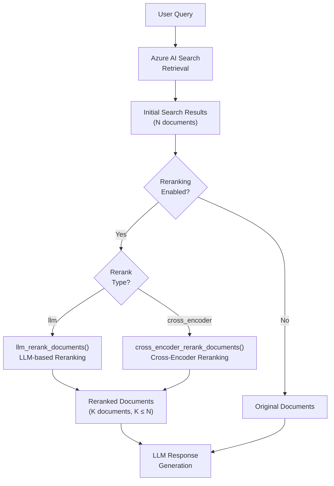
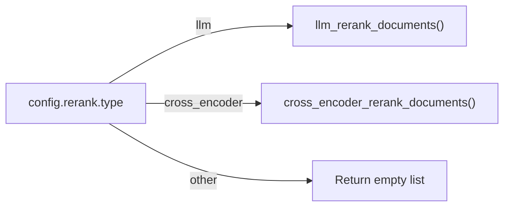
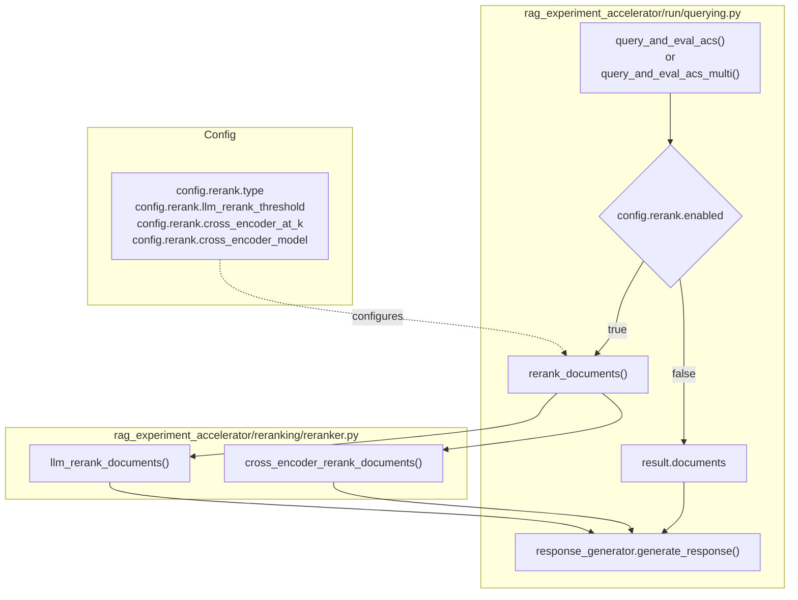

<!-- source: DeepWiki mcp.deepwiki.com · repo microsoft/rag-experiment-accelerator · page 7.3 Reranking · fetched 2026-10-26 -->

# Reranking

<details>
<summary>Relevant source files</summary>

The following files were used as context for generating this wiki page:

- [02_qa_generation.py](02_qa_generation.py)
- [03_querying.py](03_querying.py)
- [04_evaluation.py](04_evaluation.py)
- [README.md](README.md)
- [config.sample.json](config.sample.json)
- [rag_experiment_accelerator/run/querying.py](rag_experiment_accelerator/run/querying.py)
- [rag_experiment_accelerator/run/tests/test_querying.py](rag_experiment_accelerator/run/tests/test_querying.py)
- [rag_experiment_accelerator/search_type/acs_search_methods.py](rag_experiment_accelerator/search_type/acs_search_methods.py)
- [rag_experiment_accelerator/search_type/tests/test_acs_search_methods.py](rag_experiment_accelerator/search_type/tests/test_acs_search_methods.py)

</details>


## Purpose and Scope

This document describes the reranking capabilities in the RAG Experiment Accelerator, which improve retrieval precision by re-evaluating and reordering search results after initial retrieval from Azure AI Search. Reranking is an optional post-processing step in Stage 3 of the pipeline that occurs after search but before final LLM response generation.

For information about the initial search strategies that produce the candidate documents for reranking, see [Search Types and Strategies](#7.1). For the complete query processing pipeline context, see [Stage 3: Querying and Retrieval](#3.3).

## Overview

Reranking addresses a common challenge in RAG systems: initial search results from Azure AI Search may not perfectly reflect relevance to the user's query. The accelerator provides two reranking strategies that re-evaluate retrieved documents and reorder them based on their semantic relevance to the query:

1. **LLM-based reranking**: Uses a language model to assess document-query relevance and select top-k documents
2. **Cross-encoder reranking**: Uses a specialized cross-encoder model to compute relevance scores between query-document pairs

Both strategies operate on the list of documents returned by the search phase and produce a filtered, reordered subset that is more relevant to the query.

**Key Characteristics:**
- Optional: Reranking can be enabled/disabled via configuration
- Configurable: Different thresholds and models can be specified
- Post-search: Operates after initial retrieval from Azure AI Search
- Pre-generation: Occurs before the LLM generates the final response

Sources: [README.md:46](), [rag_experiment_accelerator/run/querying.py:106-143]()

## Reranking Architecture

The following diagram shows how reranking fits into the overall query processing flow:



Sources: [rag_experiment_accelerator/run/querying.py:106-143](), [rag_experiment_accelerator/run/querying.py:369-382](), [rag_experiment_accelerator/run/querying.py:523-532]()

## Reranking Strategies

### Strategy Selection

The `rerank_documents` function in [rag_experiment_accelerator/run/querying.py:106-143]() dispatches to the appropriate reranking strategy based on configuration:

| Config Value | Function Called | Model Used |
|--------------|----------------|------------|
| `"llm"` | `llm_rerank_documents()` | Azure OpenAI chat deployment |
| `"cross_encoder"` | `cross_encoder_rerank_documents()` | HuggingFace cross-encoder model |
| Other | No reranking | N/A |



Sources: [rag_experiment_accelerator/run/querying.py:106-143]()

### LLM-Based Reranking

LLM-based reranking uses the Azure OpenAI chat deployment to evaluate document relevance. The `llm_rerank_documents` function assesses each document's relevance to the query and selects documents with rank above the configured threshold.

**Function Signature:**
```python
llm_rerank_documents(
    docs: list[str],
    user_prompt: str,
    response_generator: ResponseGenerator,
    llm_rerank_threshold: int
) -> list[str]
```

**Parameters:**
- `docs`: List of document strings retrieved from search
- `user_prompt`: The user's query
- `response_generator`: Instance of `ResponseGenerator` configured with chat deployment
- `llm_rerank_threshold`: Rank threshold (1-10 scale); documents with rank ≥ threshold are selected

**Behavior:**
1. Sends each document to the LLM with the query for relevance assessment
2. LLM assigns a relevance rank (typically 1-10 scale)
3. Filters documents based on `llm_rerank_threshold`
4. Returns filtered list maintaining relative order

**Configuration Example:**
```json
{
    "rerank": {
        "enabled": true,
        "type": "llm",
        "llm_rerank_threshold": 3
    }
}
```

With `llm_rerank_threshold: 3`, only documents ranked 3 or higher by the LLM are retained.

Sources: [rag_experiment_accelerator/run/querying.py:106-143](), [config.sample.json:50-56](), [README.md:330-335]()

### Cross-Encoder Reranking

Cross-encoder reranking uses a specialized HuggingFace model to compute relevance scores for query-document pairs. The `cross_encoder_rerank_documents` function ranks all documents and selects the top-k most relevant.

**Function Signature:**
```python
cross_encoder_rerank_documents(
    docs: list[str],
    user_prompt: str,
    output_prompt: str,
    cross_encoder_model: str,
    cross_encoder_at_k: int
) -> list[str]
```

**Parameters:**
- `docs`: List of document strings retrieved from search
- `user_prompt`: The user's query
- `output_prompt`: Expected output format (used in some ranking strategies)
- `cross_encoder_model`: HuggingFace model identifier (e.g., `"cross-encoder/stsb-roberta-base"`)
- `cross_encoder_at_k`: Number of top documents to retain

**Behavior:**
1. Loads the specified cross-encoder model from HuggingFace
2. Computes relevance score for each (query, document) pair
3. Ranks documents by relevance score
4. Returns top-k documents

**Configuration Example:**
```json
{
    "rerank": {
        "enabled": true,
        "type": "cross_encoder",
        "cross_encoder_at_k": 4,
        "cross_encoder_model": "cross-encoder/stsb-roberta-base"
    }
}
```

With `cross_encoder_at_k: 4`, only the top 4 most relevant documents are retained.

**Supported Models:**
The accelerator supports any HuggingFace cross-encoder model. The default recommended model is `cross-encoder/stsb-roberta-base`, which provides a good balance of accuracy and speed.

Sources: [rag_experiment_accelerator/run/querying.py:106-143](), [config.sample.json:50-56](), [README.md:330-335]()

## Configuration Reference

Reranking is configured via the `rerank` section of `config.json`:

| Parameter | Type | Values | Description |
|-----------|------|--------|-------------|
| `enabled` | boolean | `true`, `false` | Whether to enable reranking |
| `type` | string | `"llm"`, `"cross_encoder"` | Reranking strategy to use |
| `llm_rerank_threshold` | integer | 1-10 | Minimum rank for LLM reranking (documents with rank ≥ threshold are kept) |
| `cross_encoder_at_k` | integer | > 0 | Number of top documents to retain for cross-encoder reranking |
| `cross_encoder_model` | string | HuggingFace model ID | Cross-encoder model identifier |

**Complete Configuration Example:**
```json
{
    "rerank": {
        "enabled": true,
        "type": "cross_encoder",
        "llm_rerank_threshold": 3,
        "cross_encoder_at_k": 4,
        "cross_encoder_model": "cross-encoder/stsb-roberta-base"
    }
}
```

**Configuration Validation:**
- If `enabled: false`, reranking is skipped regardless of other parameters
- If `enabled: true`, the `type` parameter determines which reranking function is called
- Unused parameters (e.g., `llm_rerank_threshold` when `type: "cross_encoder"`) are ignored

Sources: [config.sample.json:50-56](), [README.md:330-335]()

## Integration in Query Pipeline

The following diagram shows the code entities involved in reranking within the query execution flow:



### Single Query Flow

For single queries, reranking occurs in [rag_experiment_accelerator/run/querying.py:523-532]():

```python
if config.rerank.enabled and len(result.documents) > 0:
    prompt_instruction_context = rerank_documents(
        result.documents,
        user_prompt,
        output_prompt,
        config,
        response_generator,
    )
else:
    prompt_instruction_context = result.documents
```

### Multi-Question Flow

For multi-question queries (when query expansion generates multiple related questions), reranking occurs for each sub-question in [rag_experiment_accelerator/run/querying.py:369-382]():

```python
if config.rerank.enabled:
    prompt_instruction_context = rerank_documents(
        result.documents, question, output_prompt, config, response_generator
    )
else:
    prompt_instruction_context = result.documents
```

Sources: [rag_experiment_accelerator/run/querying.py:369-382](), [rag_experiment_accelerator/run/querying.py:523-532]()

## Implementation Details

### Core Reranking Function

The `rerank_documents` function serves as the main entry point for all reranking operations:

**Location:** [rag_experiment_accelerator/run/querying.py:106-143]()

**Key Logic:**
- Uses Python's `match` statement to dispatch based on `config.rerank.type`
- Returns empty list if an unsupported rerank type is configured
- Passes relevant configuration parameters to the specific reranking function

### Document Count Constraints

After reranking, the code enforces a limit on the number of documents passed to the LLM in [rag_experiment_accelerator/run/querying.py:376-381]():

```python
# TODO: Here was a bug, caused by the fact that we are not limiting the number of documents to retrieve
# Current solution is just forcefully limiting the number of documents to retrieve assuming they are sorted
if len(prompt_instruction_context) > config.search.retrieve_num_of_documents:
    prompt_instruction_context = prompt_instruction_context[
        : config.search.retrieve_num_of_documents
    ]
```

This ensures that even if reranking returns more documents than expected, only `config.search.retrieve_num_of_documents` are used for response generation.

Sources: [rag_experiment_accelerator/run/querying.py:376-381]()

### Response Generator Integration

Both reranking strategies use the `ResponseGenerator` class for LLM interactions:

- **LLM reranking**: Uses `response_generator` directly to assess document relevance
- **Cross-encoder reranking**: Does not use `response_generator` (uses HuggingFace models instead)
- **Final response generation**: Uses the same `response_generator` with reranked documents

Sources: [rag_experiment_accelerator/run/querying.py:534-538]()

## Output Tracking

Reranking parameters are tracked in the `QueryOutput` object for evaluation and MLflow logging in [rag_experiment_accelerator/run/querying.py:540-556]():

```python
output = QueryOutput(
    rerank=config.rerank.enabled,
    rerank_type=config.rerank.type,
    cross_encoder_model=config.rerank.cross_encoder_model,
    llm_rerank_threshold=config.rerank.llm_rerank_threshold,
    cross_encoder_at_k=config.rerank.cross_encoder_at_k,
    # ... other fields
)
```

This allows for systematic comparison of reranking strategies during evaluation.

Sources: [rag_experiment_accelerator/run/querying.py:540-556]()

## Performance and Cost Considerations

### LLM-Based Reranking

**Advantages:**
- Can understand nuanced semantic relationships
- Leverages powerful language understanding capabilities
- No additional model deployment required (uses existing Azure OpenAI deployment)

**Disadvantages:**
- Higher latency: Makes LLM API calls for each document
- Higher cost: Consumes Azure OpenAI tokens
- Rate limits: Subject to Azure OpenAI quota restrictions

**Best for:** Scenarios where retrieval quality is critical and cost/latency are acceptable tradeoffs.

### Cross-Encoder Reranking

**Advantages:**
- Lower latency: Local model inference
- Lower cost: No API calls (model runs locally or can be cached)
- Predictable performance: No rate limits or quota issues

**Disadvantages:**
- Requires model download and local compute resources
- May be less accurate than large LLMs for complex queries
- Limited to scoring query-document pairs (no reasoning)

**Best for:** Production scenarios requiring low latency and cost-effective reranking at scale.

Sources: [README.md:46](), [config.sample.json:50-56]()

## Testing and Validation

The reranking functionality is tested in [rag_experiment_accelerator/run/tests/test_querying.py]():

**Test Coverage:**
- Lines 98-116: Direct testing of `rerank_documents` function
- Lines 171-240: Integration testing with multi-question flow (reranking enabled)
- Lines 242-306: Integration testing with multi-question flow (reranking disabled)
- Lines 315-356: End-to-end testing without reranking

The tests mock both `llm_rerank_documents` and `cross_encoder_rerank_documents` to verify correct dispatch and parameter passing.

Sources: [rag_experiment_accelerator/run/tests/test_querying.py:98-116](), [rag_experiment_accelerator/run/tests/test_querying.py:171-306]()

## Common Configuration Patterns

### Pattern 1: Aggressive Filtering with LLM
```json
{
    "rerank": {
        "enabled": true,
        "type": "llm",
        "llm_rerank_threshold": 7
    }
}
```
Keeps only highly relevant documents (rank ≥ 7). Useful when precision is more important than recall.

### Pattern 2: Conservative Cross-Encoder
```json
{
    "rerank": {
        "enabled": true,
        "type": "cross_encoder",
        "cross_encoder_at_k": 10,
        "cross_encoder_model": "cross-encoder/stsb-roberta-base"
    }
}
```
Retains more documents (top 10) for a broader context. Useful when recall is important.

### Pattern 3: Disabled for Baseline
```json
{
    "rerank": {
        "enabled": false
    }
}
```
Useful for establishing baseline metrics to compare against reranked results.

Sources: [config.sample.json:50-56](), [README.md:330-335]()

## Troubleshooting

### No Documents After Reranking

**Symptom:** Warning message "No documents found for question" in logs

**Possible Causes:**
1. `llm_rerank_threshold` set too high (e.g., threshold of 8+ may filter out all documents)
2. `cross_encoder_at_k` set to 0 or negative value
3. Initial search returned no documents

**Solution:** Lower the threshold or increase `cross_encoder_at_k`. Check initial search results first.

### Index Out of Range Errors

**Symptom:** Array index errors during reranking

**Root Cause:** Documented in code comment at [rag_experiment_accelerator/run/querying.py:376]()

**Solution:** The code now includes a safety check to limit document count to `config.search.retrieve_num_of_documents`.

### Azure OpenAI Rate Limits with LLM Reranking

**Symptom:** Rate limit errors when using `type: "llm"`

**Solution:** 
- Use separate eval deployment: Configure `azure_oai_eval_deployment_name` different from `azure_oai_chat_deployment_name`
- Switch to cross-encoder: Use `type: "cross_encoder"` to avoid API calls
- Reduce document count: Lower `search.retrieve_num_of_documents` to reduce LLM calls

Sources: [README.md:494-500](), [rag_experiment_accelerator/run/querying.py:376-381]()

---

