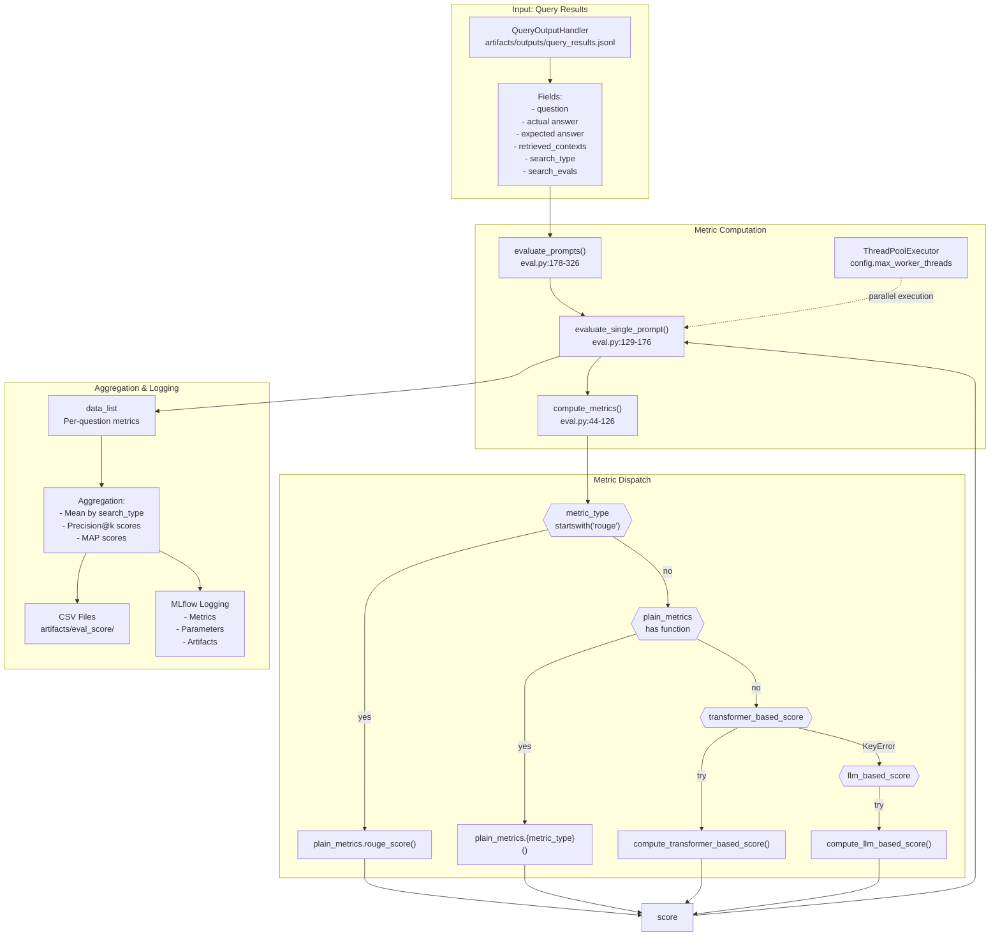
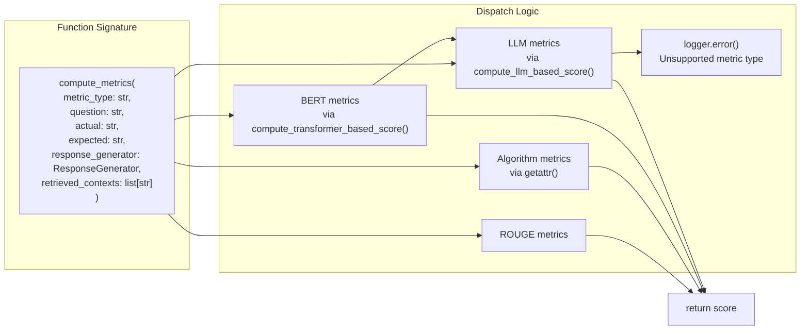
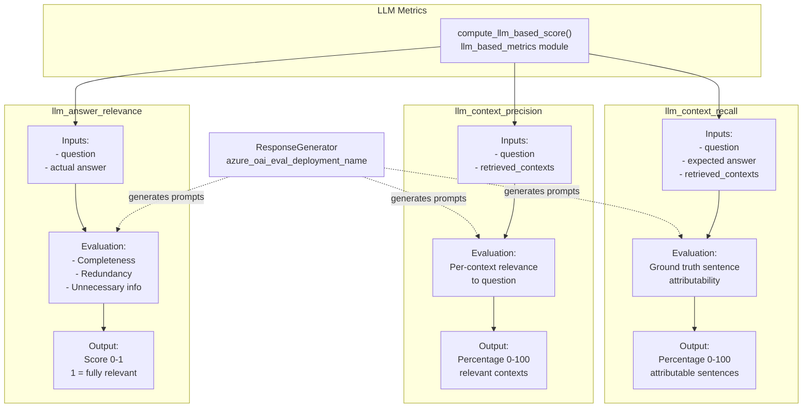
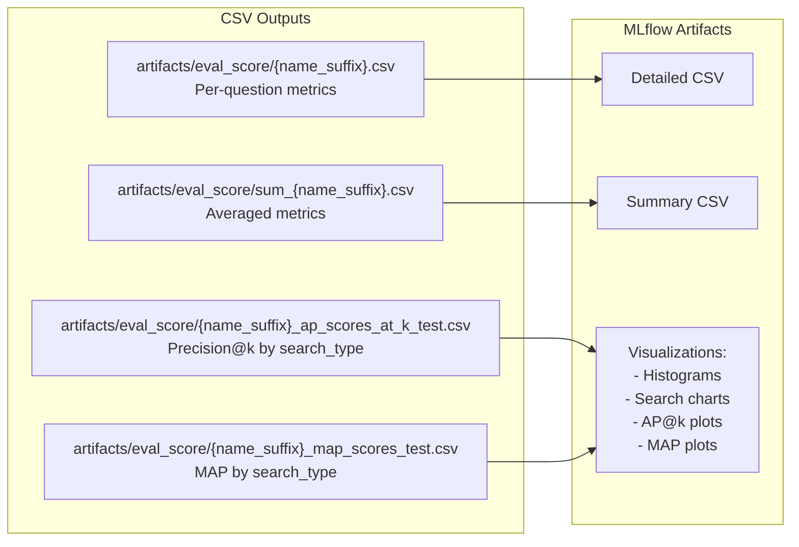
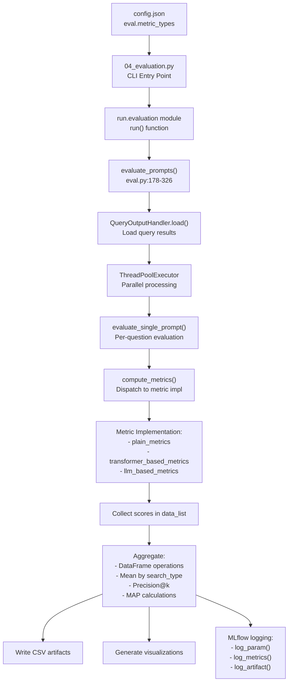

<!-- source: DeepWiki mcp.deepwiki.com · repo microsoft/rag-experiment-accelerator · page 8 Evaluation Metrics · fetched 2026-10-26 -->

# Evaluation Metrics

<details>
<summary>Relevant source files</summary>

The following files were used as context for generating this wiki page:

- [.github/workflows/config.json](.github/workflows/config.json)
- [02_qa_generation.py](02_qa_generation.py)
- [03_querying.py](03_querying.py)
- [04_evaluation.py](04_evaluation.py)
- [config.schema.json](config.schema.json)
- [docs/evaluation-metrics.md](docs/evaluation-metrics.md)
- [promptflow/rag-experiment-accelerator/README.md](promptflow/rag-experiment-accelerator/README.md)
- [rag_experiment_accelerator/config/eval_config.py](rag_experiment_accelerator/config/eval_config.py)
- [rag_experiment_accelerator/evaluation/LICENSE.txt](rag_experiment_accelerator/evaluation/LICENSE.txt)
- [rag_experiment_accelerator/evaluation/eval.py](rag_experiment_accelerator/evaluation/eval.py)
- [rag_experiment_accelerator/evaluation/plain_metrics.py](rag_experiment_accelerator/evaluation/plain_metrics.py)
- [rag_experiment_accelerator/evaluation/tests/test_plain_metrics.py](rag_experiment_accelerator/evaluation/tests/test_plain_metrics.py)

</details>


## Purpose and Scope

This page documents the evaluation metrics system used in Stage 4 of the RAG Experiment Accelerator pipeline. The evaluation system provides a comprehensive suite of metrics for measuring the quality of RAG system outputs by comparing generated answers against ground truth expectations.

The metrics are organized into three tiers with increasing computational cost and semantic understanding: **algorithm-based** (fast, deterministic string comparisons), **BERT-based** (semantic similarity using transformer embeddings), and **LLM-based** (contextual evaluation using language models as judges).

For information about the broader Stage 4 evaluation pipeline including MLflow integration and visualization, see [Stage 4: Evaluation and Metrics](#3.4). For detailed documentation of individual metrics within each tier, see [Algorithm-Based Metrics](#8.1), [BERT-Based Semantic Similarity](#8.2), and [LLM-Based Evaluation](#8.3).

## Metric Taxonomy

The evaluation system provides 23+ metrics across three computational tiers, each with distinct characteristics and use cases:

```mermaid
graph TB
    subgraph "Evaluation System"
        COMPUTE["compute_metrics()<br/>rag_experiment_accelerator/evaluation/eval.py:44-126"]
    end
    
    subgraph "Algorithm-Based Metrics"
        ALG_MODULE["plain_metrics module"]
        
        STRING["String Distance<br/>lcsstr, lcsseq, levenshtein<br/>hamming, jaro_winkler"]
        SET["Set Similarity<br/>jaccard, cosine_ochiai"]
        TOKEN["Token Matching<br/>fuzzy_score"]
        ROUGE["ROUGE Scores<br/>rouge1/2/L precision/recall/fmeasure"]
        
        ALG_MODULE --> STRING
        ALG_MODULE --> SET
        ALG_MODULE --> TOKEN
        ALG_MODULE --> ROUGE
    end
    
    subgraph "BERT-Based Metrics"
        BERT_MODULE["transformer_based_metrics module<br/>compute_transformer_based_score()"]
        
        MINI["bert_all_MiniLM_L6_v2<br/>384-dim Fast"]
        BASE["bert_base_nli_mean_tokens<br/>768-dim NLI-trained"]
        LARGE["bert_large_nli_mean_tokens<br/>1024-dim High Quality"]
        STS["bert_large_nli_stsb_mean_tokens<br/>1024-dim STS-B optimized"]
        DISTIL["bert_distilbert_base_nli_stsb_mean_tokens<br/>768-dim Efficient"]
        MULTI["bert_paraphrase_multilingual_MiniLM_L12_v2<br/>384-dim 50+ languages"]
        
        BERT_MODULE --> MINI
        BERT_MODULE --> BASE
        BERT_MODULE --> LARGE
        BERT_MODULE --> STS
        BERT_MODULE --> DISTIL
        BERT_MODULE --> MULTI
    end
    
    subgraph "LLM-Based Metrics"
        LLM_MODULE["llm_based_metrics module<br/>compute_llm_based_score()"]
        
        ANS_REL["llm_answer_relevance<br/>Completeness & Redundancy"]
        CTX_PREC["llm_context_precision<br/>Retrieval Quality"]
        CTX_REC["llm_context_recall<br/>Ground Truth Coverage"]
        
        LLM_MODULE --> ANS_REL
        LLM_MODULE --> CTX_PREC
        LLM_MODULE --> CTX_REC
    end
    
    COMPUTE --> ALG_MODULE
    COMPUTE --> BERT_MODULE
    COMPUTE --> LLM_MODULE
    
    INPUT["Query Results<br/>actual, expected, question, retrieved_contexts"]
    INPUT --> COMPUTE
    
    COMPUTE --> OUTPUT["Metric Scores<br/>Logged to MLflow"]
```



**Sources:** [rag_experiment_accelerator/evaluation/eval.py:44-126](), [config.schema.json:549-588]()

### Metric Selection Strategy

| Tier | Speed | Cost | Use Case | When to Use |
|------|-------|------|----------|-------------|
| **Algorithm-Based** | Fast (ms) | Free | Quick iteration, debugging | Initial experimentation, development |
| **BERT-Based** | Moderate (100-500ms) | Compute only | Semantic validation | Validation, semantic quality checks |
| **LLM-Based** | Slow (1-5s) | API calls | Nuanced assessment | Final evaluation, production quality |

**Sources:** [docs/evaluation-metrics.md:46-191]()

## Metric Computation Pipeline

The evaluation pipeline processes query results through multiple stages, computing metrics and aggregating scores for MLflow logging:



**Sources:** [rag_experiment_accelerator/evaluation/eval.py:44-326](), [04_evaluation.py:1-43]()

## Configuration

Metrics are configured via the `eval.metric_types` array in `config.json`. The system validates metric names against the schema and dispatches to appropriate implementations at runtime.

### Configuration Structure

```json
{
  "eval": {
    "metric_types": [
      "fuzzy_score",
      "cosine_ochiai",
      "rouge2_recall",
      "bert_all_MiniLM_L6_v2",
      "bert_distilbert_base_nli_stsb_mean_tokens",
      "llm_answer_relevance",
      "llm_context_precision"
    ]
  }
}
```

### Valid Metric Types

The complete list of valid metric identifiers is defined in the JSON schema:

| Category | Metric Types |
|----------|-------------|
| **String Distance** | `lcsstr`, `lcsseq`, `levenshtein`, `hamming`, `jaro_winkler` |
| **Set Similarity** | `jaccard`, `cosine_ochiai` |
| **Token Matching** | `fuzzy_score` |
| **ROUGE** | `rouge1_precision`, `rouge1_recall`, `rouge1_fmeasure`, `rouge2_precision`, `rouge2_recall`, `rouge2_fmeasure`, `rougeL_precision`, `rougeL_recall`, `rougeL_fmeasure` |
| **BERT Semantic** | `bert_all_MiniLM_L6_v2`, `bert_base_nli_mean_tokens`, `bert_large_nli_mean_tokens`, `bert_large_nli_stsb_mean_tokens`, `bert_distilbert_base_nli_stsb_mean_tokens`, `bert_paraphrase_multilingual_MiniLM_L12_v2` |
| **LLM-Based** | `llm_answer_relevance`, `llm_context_precision`, `llm_context_recall` |

**Sources:** [config.schema.json:549-588](), [.github/workflows/config.json:76-86]()

### EvalConfig Dataclass

The configuration is parsed into an `EvalConfig` dataclass with default values:

```python
@dataclass
class EvalConfig(BaseConfig):
    metric_types: list[str] = field(
        default_factory=lambda: [
            "fuzzy_score",
            "bert_all_MiniLM_L6_v2",
            "cosine_ochiai",
            "bert_distilbert_base_nli_stsb_mean_tokens",
            "llm_answer_relevance",
            "llm_context_precision",
        ]
    )
```

**Sources:** [rag_experiment_accelerator/config/eval_config.py:1-17]()

## The compute_metrics Function

The `compute_metrics` function serves as the central dispatcher for all metric computation. It takes the following parameters and routes to appropriate implementations:



The function uses a cascading try-except pattern to attempt metric computation:

1. **ROUGE check**: If `metric_type` starts with `"rouge"`, dispatch to `plain_metrics.rouge_score()`
2. **Plain metrics check**: Use `getattr(plain_metrics, metric_type)` to look up function
3. **BERT check**: On `KeyError`, try `compute_transformer_based_score()`
4. **LLM check**: On `KeyError`, try `compute_llm_based_score()`
5. **Error**: Log unsupported metric type

**Sources:** [rag_experiment_accelerator/evaluation/eval.py:44-126]()

## Algorithm-Based Metrics

Algorithm-based metrics provide fast, deterministic string similarity measurements. These metrics are implemented in the `plain_metrics` module and require no external API calls or model loading.

### Metric Categories

**String Distance Metrics:**
- `lcsstr` - Longest common substring
- `lcsseq` - Longest common subsequence  
- `levenshtein` - Edit distance normalized to 0-100
- `hamming` - Bit-wise or character difference
- `jaro_winkler` - Prefix-weighted string similarity

**Set Similarity Metrics:**
- `jaccard` - Intersection over union of token sets
- `cosine_ochiai` - Cosine similarity using term-frequency vectors

**Token Matching:**
- `fuzzy_score` - RapidFuzz token set ratio (default: `token_set_ratio`)

**ROUGE Scores:**
- `rouge1_precision/recall/fmeasure` - Unigram overlap
- `rouge2_precision/recall/fmeasure` - Bigram overlap
- `rougeL_precision/recall/fmeasure` - Longest common subsequence overlap

All algorithm-based metrics compare `actual` (generated answer) against `expected` (ground truth) and return a percentage score from 0-100.

For detailed implementation and examples, see [Algorithm-Based Metrics](#8.1).

**Sources:** [rag_experiment_accelerator/evaluation/plain_metrics.py:1-213](), [docs/evaluation-metrics.md:46-139]()

## BERT-Based Metrics

BERT-based metrics compute semantic similarity using sentence transformer embeddings. These metrics provide semantic understanding beyond surface-level string matching.

### Available Models

The system supports six BERT models via the `sentence-transformers` library:

| Metric Identifier | Model | Dimension | Characteristics |
|------------------|-------|-----------|----------------|
| `bert_all_MiniLM_L6_v2` | all-MiniLM-L6-v2 | 384 | Fastest, good quality |
| `bert_base_nli_mean_tokens` | bert-base-nli-mean-tokens | 768 | NLI-trained baseline |
| `bert_large_nli_mean_tokens` | bert-large-nli-mean-tokens | 1024 | High quality, slower |
| `bert_large_nli_stsb_mean_tokens` | bert-large-nli-stsb-mean-tokens | 1024 | STS-B optimized |
| `bert_distilbert_base_nli_stsb_mean_tokens` | distilbert-base-nli-stsb-mean-tokens | 768 | Efficient, STS-B |
| `bert_paraphrase_multilingual_MiniLM_L12_v2` | paraphrase-multilingual-MiniLM-L12-v2 | 384 | Multilingual (50+ languages) |

### Computation

BERT metrics compute cosine similarity between embeddings:

1. Load or retrieve cached model via `compute_transformer_based_score()`
2. Generate embeddings for `actual` and `expected` strings
3. Calculate cosine similarity between embedding vectors
4. Return similarity as percentage (0-100)

For detailed model characteristics and selection guidance, see [BERT-Based Semantic Similarity](#8.2).

**Sources:** [rag_experiment_accelerator/evaluation/transformer_based_metrics.py](), [docs/evaluation-metrics.md:140-158]()

## LLM-Based Metrics

LLM-based metrics use language models as evaluators to assess answer quality, retrieval precision, and ground truth coverage. These metrics provide nuanced evaluation but incur API costs and latency.

### Available Metrics



### Metric Descriptions

**`llm_answer_relevance`**: Evaluates whether the generated answer fully addresses the question without incomplete, redundant, or unnecessary information. Uses only the question and actual answer as inputs.

**`llm_context_precision`**: Measures the proportion of retrieved contexts that are relevant to answering the question. Helps evaluate retrieval quality independently of answer generation.

**`llm_context_recall`**: Estimates how well the retrieved contexts cover the ground truth answer by checking if each sentence in the expected answer can be attributed to the retrieved contexts.

### Deployment Configuration

LLM metrics use a separate OpenAI deployment specified in `config.openai.azure_oai_eval_deployment_name`. This separation prevents quota conflicts with the chat deployment used for answer generation.

```python
response_generator = ResponseGenerator(
    environment, config, config.openai.azure_oai_eval_deployment_name
)
```

For detailed implementation and prompts, see [LLM-Based Evaluation](#8.3).

**Sources:** [rag_experiment_accelerator/evaluation/llm_based_metrics.py](), [rag_experiment_accelerator/evaluation/eval.py:210-212](), [docs/evaluation-metrics.md:159-191]()

## Parallel Execution

The evaluation system uses `ThreadPoolExecutor` to compute metrics in parallel, significantly reducing evaluation time when processing multiple questions:

```python
with ExitStack() as stack:
    executor = stack.enter_context(ThreadPoolExecutor(config.max_worker_threads))
    futures = {
        executor.submit(
            evaluate_single_prompt,
            data,
            response_generator,
            metric_types,
            data_list,
            total_precision_scores_by_search_type,
            map_scores_by_search_type,
            average_precision_for_search_type,
        ): data
        for data in query_data_load
    }
    
    for future in as_completed(futures):
        try:
            future.result()
        except Exception as exc:
            logger.error(f"Evaluate query line generated an exception: {exc}")
```

The parallelism level is controlled by `config.max_worker_threads`. Each worker processes one question-answer pair through all configured metrics.

**Sources:** [rag_experiment_accelerator/evaluation/eval.py:219-240]()

## Output and Logging

The evaluation system produces multiple output artifacts and logs comprehensive results to MLflow:

### CSV Artifacts



### MLflow Parameters

The system logs experiment configuration as MLflow parameters:

- `question_count` - Number of questions evaluated
- `retrieve_num_of_documents` - Retrieved chunks per query
- `cross_encoder_at_k` - Reranking threshold
- `chunk_overlap` - Chunk overlap size
- `embedding_dimension` - Embedding vector dimension
- `embedding_model_name` - Embedding model identifier
- `ef_construction` - HNSW index construction parameter
- `ef_search` - HNSW index search parameter

### MLflow Metrics

Averaged metric scores are logged as MLflow metrics, enabling comparison across experiments:

```python
sum_dict = {}
for col_name in sum_df.columns:
    sum_dict[col_name] = float(sum_df[col_name].values)

mlflow.log_metrics(sum_dict)
```

This allows filtering and sorting experiments by metric performance in the Azure ML workspace UI.

**Sources:** [rag_experiment_accelerator/evaluation/eval.py:241-326](), [rag_experiment_accelerator/evaluation/plot_metrics.py]()

## Metric Computation Flow

The complete flow from configuration to MLflow logging:



**Sources:** [04_evaluation.py:1-43](), [rag_experiment_accelerator/run/evaluation.py](), [rag_experiment_accelerator/evaluation/eval.py:178-326]()

---

