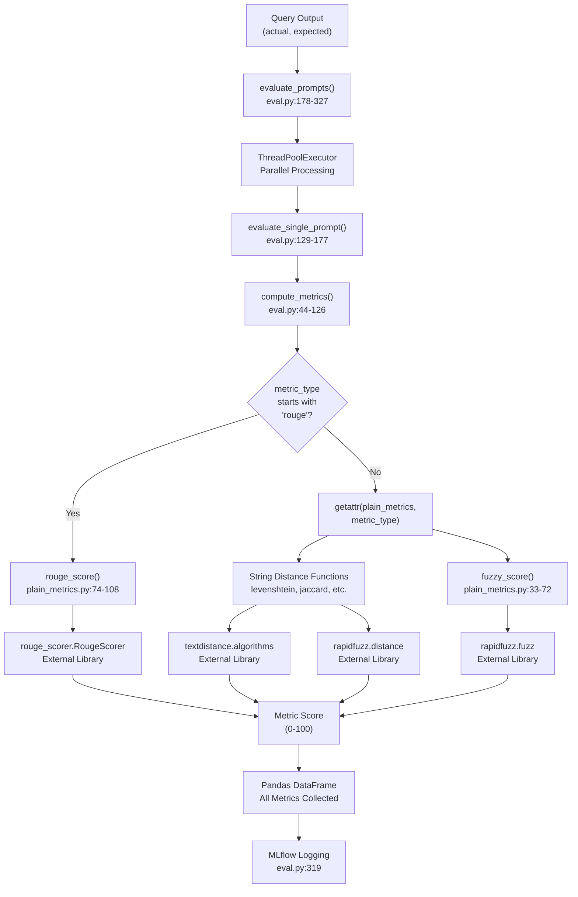
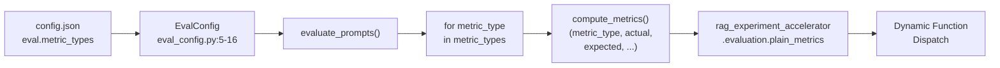
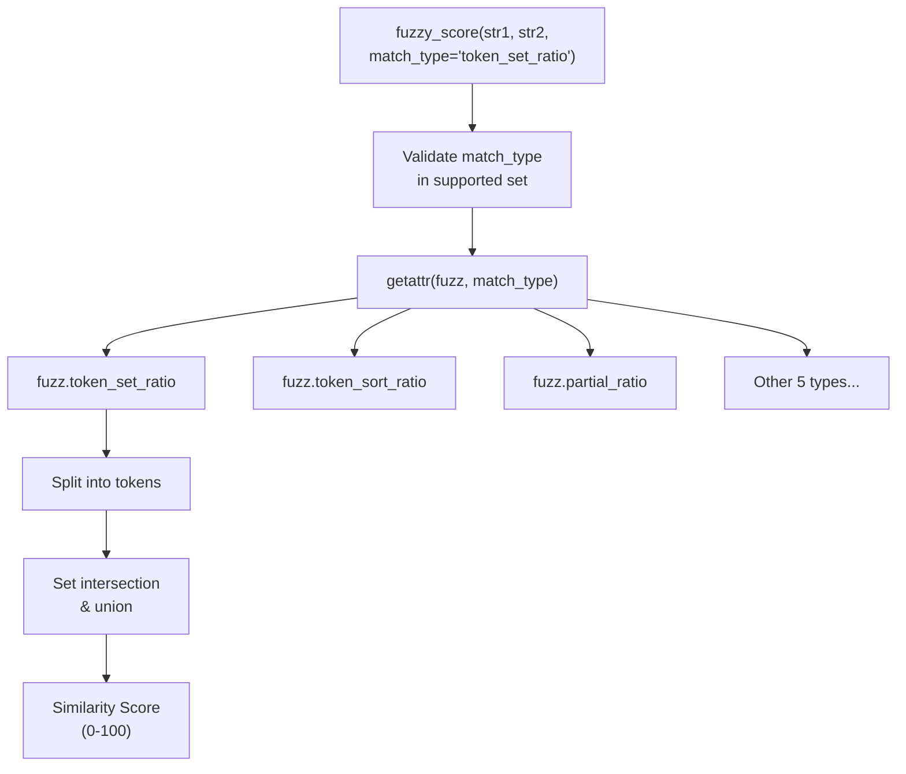
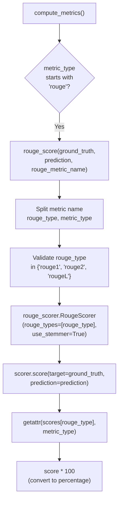
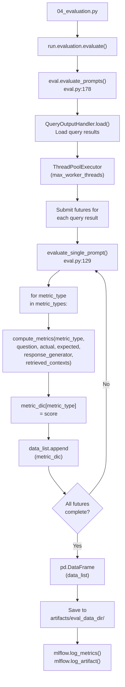
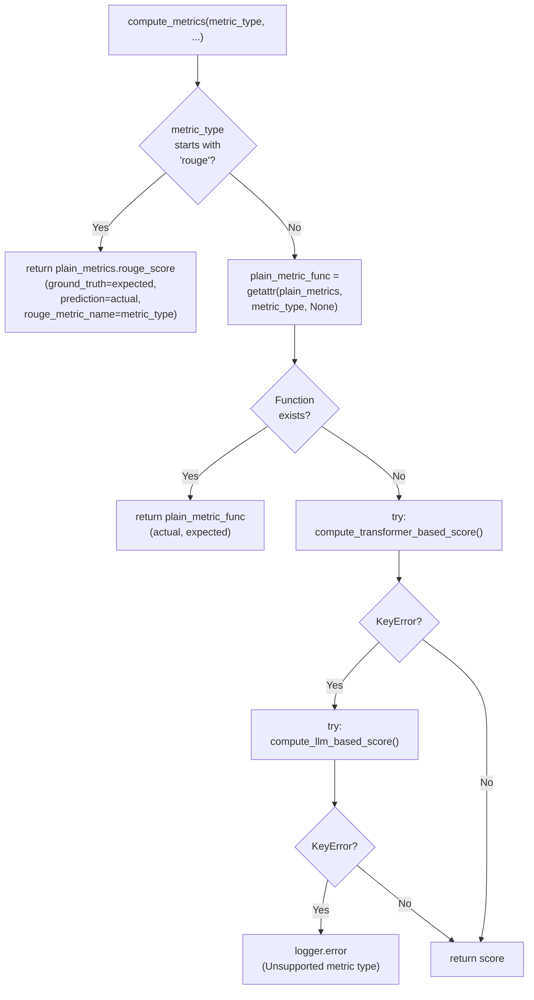
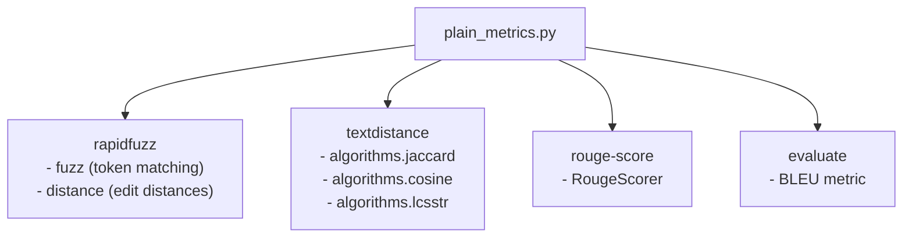
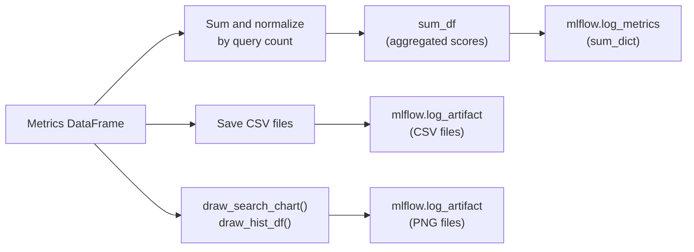

<!-- source: DeepWiki mcp.deepwiki.com · repo microsoft/rag-experiment-accelerator · page 8.1 Algorithm-Based Metrics · fetched 2026-10-26 -->

# Algorithm-Based Metrics

<details>
<summary>Relevant source files</summary>

The following files were used as context for generating this wiki page:

- [.github/workflows/config.json](.github/workflows/config.json)
- [config.schema.json](config.schema.json)
- [docs/evaluation-metrics.md](docs/evaluation-metrics.md)
- [promptflow/rag-experiment-accelerator/README.md](promptflow/rag-experiment-accelerator/README.md)
- [rag_experiment_accelerator/config/eval_config.py](rag_experiment_accelerator/config/eval_config.py)
- [rag_experiment_accelerator/evaluation/LICENSE.txt](rag_experiment_accelerator/evaluation/LICENSE.txt)
- [rag_experiment_accelerator/evaluation/eval.py](rag_experiment_accelerator/evaluation/eval.py)
- [rag_experiment_accelerator/evaluation/plain_metrics.py](rag_experiment_accelerator/evaluation/plain_metrics.py)
- [rag_experiment_accelerator/evaluation/tests/test_plain_metrics.py](rag_experiment_accelerator/evaluation/tests/test_plain_metrics.py)

</details>


## Purpose and Scope

This document describes the algorithm-based evaluation metrics available in the RAG Experiment Accelerator. These metrics provide fast, deterministic measurements of similarity between generated answers (`actual`) and ground truth answers (`expected`) using string distance algorithms, token-based matching, and ROUGE scores.

Algorithm-based metrics are the fastest and least expensive evaluation option, making them ideal for:
- Quick iteration during experiment development
- Large-scale evaluations with budget constraints
- Establishing baseline performance before applying more sophisticated metrics

For semantic similarity metrics using BERT embeddings, see [BERT-Based Semantic Similarity](#8.2). For contextual evaluation using LLMs, see [LLM-Based Evaluation](#8.3).

Sources: [docs/evaluation-metrics.md:1-45](), [rag_experiment_accelerator/evaluation/eval.py:44-127]()

## Metric Categories

Algorithm-based metrics are organized into three categories based on their underlying approach:

| Category | Metrics | Backed By | Typical Use Case |
|----------|---------|-----------|------------------|
| **String Distance** | `lcsstr`, `lcsseq`, `levenshtein`, `jaccard`, `hamming`, `jaro_winkler`, `cosine_ochiai` | TextDistance, RapidFuzz | Character/word-level similarity |
| **Token Matching** | `fuzzy_score` | RapidFuzz | Flexible string matching with various strategies |
| **ROUGE Scores** | `rouge1_*`, `rouge2_*`, `rougeL_*` (9 variants) | rouge-score | Summarization quality, n-gram overlap |

All metrics return scores between 0-100 (percentage scale) for consistency across the evaluation framework.

Sources: [docs/evaluation-metrics.md:46-139](), [rag_experiment_accelerator/evaluation/plain_metrics.py:1-213]()

## Evaluation Flow Architecture

### Metric Computation Pipeline



Sources: [rag_experiment_accelerator/evaluation/eval.py:44-127](), [rag_experiment_accelerator/evaluation/eval.py:178-327]()

### Configuration to Execution Flow



Sources: [rag_experiment_accelerator/config/eval_config.py:1-17](), [rag_experiment_accelerator/evaluation/eval.py:143-152]()

## String Distance Metrics

String distance metrics measure similarity at the character or word level using edit distance, set operations, and longest common subsequence algorithms.

### Metric Reference Table

| Configuration Key | Algorithm | Return Type | Best For |
|-------------------|-----------|-------------|----------|
| `lcsstr` | Longest Common Substring | Percentage (0-100) | Contiguous text matches |
| `lcsseq` | Longest Common Subsequence | Percentage (0-100) | Non-contiguous sequence similarity |
| `levenshtein` | Edit Distance (Insertions/Deletions/Substitutions) | Percentage (0-100) | General string similarity |
| `jaccard` | Set Intersection / Union | Percentage (0-100) | Word-level uniqueness |
| `hamming` | Positional Character Differences | Percentage (0-100) | Fixed-length string comparison |
| `jaro_winkler` | Jaro Distance with Prefix Weighting | Percentage (0-100) | Short strings with typos |
| `cosine_ochiai` | Cosine Similarity (Token Frequency Vectors) | Percentage (0-100) | Document similarity |

Sources: [docs/evaluation-metrics.md:51-102](), [rag_experiment_accelerator/evaluation/plain_metrics.py:110-213]()

### Implementation Details

#### Levenshtein Distance

Calculates normalized edit distance using RapidFuzz's optimized implementation:

```python
# rag_experiment_accelerator/evaluation/plain_metrics.py:110-123
def levenshtein(str1: str, str2: str) -> int:
    score = distance.Levenshtein.normalized_similarity(str1, str2) * 100
    return score
```

**Normalization Formula**: `score = (1 - edit_distance / max(len(str1), len(str2))) * 100`

Example:
- Input: `"party"` vs `"park"` → Edit distance: 2 → Normalized: 60%

Sources: [rag_experiment_accelerator/evaluation/plain_metrics.py:110-123](), [rag_experiment_accelerator/evaluation/tests/test_plain_metrics.py:26-30]()

#### Longest Common Substring (lcsstr)

Finds the longest contiguous substring present in both strings:

```python
# rag_experiment_accelerator/evaluation/plain_metrics.py:200-213
def lcsstr(str1: str, str2: str) -> int:
    score = int(algorithms.lcsstr.normalized_similarity(str1, str2) * 100)
    return score
```

**Normalization Formula**: `score = (lcs_length / max(len(str1), len(str2))) * 100`

Example:
- Input: `"The fox jumped over the high fence"` vs `"The quick brown fox jumped over the fence."`
- Longest common substring: `" jumped over the "` (17 chars)
- Score: 50%

Sources: [rag_experiment_accelerator/evaluation/plain_metrics.py:200-213](), [rag_experiment_accelerator/evaluation/tests/test_plain_metrics.py:88-92]()

#### Jaccard Similarity

Measures set-based similarity using token sets:

```python
# rag_experiment_accelerator/evaluation/plain_metrics.py:125-138
def jaccard(str1: str, str2: str) -> int:
    score = int(algorithms.jaccard.normalized_similarity(str1, str2) * 100)
    return score
```

**Formula**: `score = (|A ∩ B| / |A ∪ B|) * 100` where A and B are token sets

Example:
- Input: `["cat", "dog", "hippo", "monkey"]` vs `["monkey", "rhino", "ostrich", "salmon"]`
- Intersection: `{"monkey"}` (1 element)
- Union: 7 elements
- Score: 14%

Sources: [rag_experiment_accelerator/evaluation/plain_metrics.py:125-138](), [rag_experiment_accelerator/evaluation/tests/test_plain_metrics.py:33-37]()

#### Cosine Similarity (Ochiai Coefficient)

Computes cosine similarity using term-frequency vectors:

```python
# rag_experiment_accelerator/evaluation/plain_metrics.py:170-183
def cosine_ochiai(str1: str, str2: str) -> float:
    score = int(algorithms.cosine.normalized_similarity(str1, str2) * 100)
    return score
```

**Formula**: `score = (A · B / (||A|| * ||B||)) * 100` where A and B are TF vectors

The Ochiai coefficient is particularly effective for document-level similarity as it accounts for term frequencies rather than just presence/absence.

Sources: [rag_experiment_accelerator/evaluation/plain_metrics.py:170-183](), [docs/evaluation-metrics.md:67-73]()

## Token-Based Metrics

### RapidFuzz Similarity (fuzzy_score)

The `fuzzy_score` metric uses RapidFuzz's token-based matching algorithms, which are optimized for speed compared to FuzzyWuzzy.

| Configuration Key | Default Match Type | Possible Values |
|-------------------|-------------------|-----------------|
| `fuzzy_score` | `token_set_ratio` | Percentage (0-100) |

**Supported Match Types**:
- `ratio`: Basic character-level similarity
- `token_set_ratio`: Set-based token comparison (default, ignores word order)
- `token_sort_ratio`: Sorts tokens before comparison
- `partial_ratio`: Best matching substring
- `partial_token_sort_ratio`: Combines partial and sort
- `partial_token_set_ratio`: Combines partial and set
- `WRatio`: Weighted ratio (automatic best strategy)
- `QRatio`: Quick ratio (optimized for speed)



**Implementation**:

```python
# rag_experiment_accelerator/evaluation/plain_metrics.py:33-72
def fuzzy_score(str1: str, str2: str, match_type: str = "token_set_ratio") -> float:
    # validate match_type to be one of the supported fuzzy matching functions
    supported_match_types = {"ratio", "token_set_ratio", "token_sort_ratio", 
                             "partial_ratio", "partial_token_sort_ratio",
                             "partial_token_set_ratio", "WRatio", "QRatio"}
    if match_type not in supported_match_types:
        raise ValueError(f"Match type '{match_type}' is not recognized.")
    
    # get the fuzzy matching function based on the match_type
    fuzzy_match_fn = getattr(fuzz, match_type)
    similarity_score = fuzzy_match_fn(str1, str2)
    return similarity_score
```

**Example**:

```python
# Test case from rag_experiment_accelerator/evaluation/tests/test_plain_metrics.py:18-23
value1 = "Room, 2 Double Beds (19th to 25th Floors)"
value2 = "Two Double Beds - Location Room (19th to 25th Floors)"

# Default token_set_ratio
assert fuzzy_score(str1=value1, str2=value2) == 89

# With partial_token_set_ratio
assert fuzzy_score(str1=value1, str2=value2, match_type="partial_token_set_ratio") == 100
```

Sources: [rag_experiment_accelerator/evaluation/plain_metrics.py:33-72](), [rag_experiment_accelerator/evaluation/tests/test_plain_metrics.py:18-23]()

## ROUGE Metrics

ROUGE (Recall-Oriented Understudy for Gisting Evaluation) metrics measure n-gram overlap between generated and reference text, originally designed for summarization evaluation.

### Available ROUGE Variants

The system supports 9 ROUGE metric variants across three n-gram types:

| Configuration Key | N-gram Type | Metric Type | Description |
|-------------------|-------------|-------------|-------------|
| `rouge1_precision` | Unigram | Precision | Overlapping unigrams / unigrams in ground truth |
| `rouge1_recall` | Unigram | Recall | Overlapping unigrams / unigrams in prediction |
| `rouge1_fmeasure` | Unigram | F-measure | Harmonic mean of precision & recall |
| `rouge2_precision` | Bigram | Precision | Overlapping bigrams / bigrams in ground truth |
| `rouge2_recall` | Bigram | Recall | Overlapping bigrams / bigrams in prediction |
| `rouge2_fmeasure` | Bigram | F-measure | Harmonic mean of precision & recall |
| `rougeL_precision` | LCS | Precision | LCS length / unigrams in prediction |
| `rougeL_recall` | LCS | Recall | LCS length / unigrams in ground truth |
| `rougeL_fmeasure` | LCS | F-measure | Harmonic mean of precision & recall |

Sources: [docs/evaluation-metrics.md:122-138](), [config.schema.json:565-573]()

### Implementation Architecture



**Implementation**:

```python
# rag_experiment_accelerator/evaluation/plain_metrics.py:74-108
def rouge_score(ground_truth: str, prediction: str, rouge_metric_name: str) -> float:
    # validate rouge_types to be one of the supported rouge metrics
    supported_rouge_types = {"rouge1", "rouge2", "rougeL"}
    rouge_type, metric_type = rouge_metric_name.split("_")
    if rouge_type not in supported_rouge_types:
        raise ValueError(f"Rouge type '{rouge_type}' is not recognized.")
    
    if metric_type not in {"precision", "recall", "fmeasure"}:
        raise ValueError(f"Rouge metric type '{metric_type}' is not recognized.")
    
    scorer = rouge_scorer.RougeScorer(rouge_types=[rouge_type], use_stemmer=True)
    scores = scorer.score(target=ground_truth, prediction=prediction)
    return getattr(scores[rouge_type], metric_type) * 100
```

Sources: [rag_experiment_accelerator/evaluation/plain_metrics.py:74-108]()

### Example Results

```python
# From rag_experiment_accelerator/evaluation/tests/test_plain_metrics.py:61-78
str1 = "The fox jumped over the high fence"
str2 = "The quick brown fox jumped over the fence"

metrics_to_test = {
    "rouge1_precision": 75,   # 6/8 unigrams in str2 are in str1
    "rouge1_recall": 86,       # 6/7 unigrams in str1 are in str2
    "rouge1_fmeasure": 80,     # Harmonic mean
    "rouge2_precision": 43,    # 3/7 bigrams in str2 are in str1
    "rouge2_recall": 50,       # 3/6 bigrams in str1 are in str2
    "rouge2_fmeasure": 46,     # Harmonic mean
    "rougeL_precision": 75,    # LCS length 6 / 8 unigrams in str2
    "rougeL_recall": 86,       # LCS length 6 / 7 unigrams in str1
    "rougeL_fmeasure": 80,     # Harmonic mean
}
```

**Interpretation**:
- **Precision** measures how much of the generated answer is relevant (fewer false positives)
- **Recall** measures how much of the ground truth is captured (fewer false negatives)
- **F-measure** balances both, useful when you care equally about precision and recall

Sources: [rag_experiment_accelerator/evaluation/tests/test_plain_metrics.py:61-78]()

## Configuration

### Specifying Metrics in config.json

Algorithm-based metrics are configured in the `eval.metric_types` array:

```json
{
  "eval": {
    "metric_types": [
      "lcsstr",
      "levenshtein",
      "fuzzy_score",
      "cosine_ochiai",
      "rouge1_recall",
      "rouge2_fmeasure",
      "rougeL_fmeasure"
    ]
  }
}
```

**Example from CI Configuration**:

```json
{
  "eval": {
    "metric_types": [
      "fuzzy_score",
      "cosine_ochiai",
      "rouge2_recall",
      "bert_all_MiniLM_L6_v2",
      "bert_distilbert_base_nli_stsb_mean_tokens",
      "llm_answer_relevance",
      "llm_context_precision"
    ]
  }
}
```

This configuration mixes algorithm-based metrics (`fuzzy_score`, `cosine_ochiai`, `rouge2_recall`) with BERT-based and LLM-based metrics for comprehensive evaluation.

Sources: [.github/workflows/config.json:76-86](), [config.schema.json:549-587]()

### Schema Validation

All valid algorithm-based metric keys are defined in the schema:

```json
{
  "eval": {
    "type": "object",
    "properties": {
      "metric_types": {
        "type": "array",
        "items": {
          "type": "string",
          "enum": [
            "lcsstr", "lcsseq", "jaro_winkler", "hamming",
            "jaccard", "levenshtein", "fuzzy_score", "cosine_ochiai",
            "rouge1_precision", "rouge1_recall", "rouge1_fmeasure",
            "rouge2_precision", "rouge2_recall", "rouge2_fmeasure",
            "rougeL_precision", "rougeL_recall", "rougeL_fmeasure",
            "bert_all_MiniLM_L6_v2", "...",
            "llm_answer_relevance", "llm_context_precision", "llm_context_recall"
          ]
        }
      }
    }
  }
}
```

Sources: [config.schema.json:549-587]()

### Default Metrics

The `EvalConfig` class provides sensible defaults that include algorithm-based metrics:

```python
# rag_experiment_accelerator/config/eval_config.py:5-16
@dataclass
class EvalConfig(BaseConfig):
    metric_types: list[str] = field(
        default_factory=lambda: [
            "fuzzy_score",
            "bert_all_MiniLM_L6_v2",
            "cosine_ochiai",
            "bert_distilbert_base_nli_stsb_mean_tokens",
            "llm_answer_relevance",
            "llm_context_precision",
        ]
    )
```

This default configuration includes 3 algorithm-based metrics (`fuzzy_score`, `cosine_ochiai`) alongside BERT and LLM metrics for balanced evaluation.

Sources: [rag_experiment_accelerator/config/eval_config.py:5-16]()

## Execution Flow

### Metric Computation in Evaluation Pipeline



Sources: [rag_experiment_accelerator/evaluation/eval.py:178-327]()

### Parallel Processing

The evaluation system uses `ThreadPoolExecutor` to parallelize metric computation across all query results:

```python
# rag_experiment_accelerator/evaluation/eval.py:219-240
with ExitStack() as stack:
    executor = stack.enter_context(ThreadPoolExecutor(config.max_worker_threads))
    futures = {
        executor.submit(
            evaluate_single_prompt,
            data,
            response_generator,
            metric_types,
            data_list,
            total_precision_scores_by_search_type,
            map_scores_by_search_type,
            average_precision_for_search_type,
        ): data
        for data in query_data_load
    }
    
    for future in as_completed(futures):
        try:
            future.result()
        except Exception as exc:
            logger.error(f"Evaluate query line generated an exception: {exc}")
```

**Key Configuration**:
- `config.max_worker_threads` controls parallelism level
- Algorithm-based metrics are CPU-bound, so parallelization improves throughput
- Errors in individual metric computations are logged but don't fail the entire evaluation

Sources: [rag_experiment_accelerator/evaluation/eval.py:219-240]()

### Metric Dispatch Logic



**Code Implementation**:

```python
# rag_experiment_accelerator/evaluation/eval.py:104-126
if metric_type.startswith("rouge"):
    return plain_metrics.rouge_score(ground_truth=expected, prediction=actual, rouge_metric_name=metric_type)
else:
    plain_metric_func = getattr(plain_metrics, metric_type, None)
    if plain_metric_func:
        return plain_metric_func(actual, expected)

try:
    score = compute_transformer_based_score(actual, expected, metric_type)
except KeyError:
    try:
        score = compute_llm_based_score(
            metric_type,
            question,
            actual,
            expected,
            response_generator,
            retrieved_contexts,
        )
    except KeyError:
        logger.error(f"Unsupported metric type: {metric_type}")

return score
```

This cascading dispatch ensures:
1. ROUGE metrics are handled first (special case due to naming convention)
2. Plain algorithm-based metrics are attempted via dynamic function lookup
3. If not found, try BERT-based metrics (may raise KeyError)
4. If still not found, try LLM-based metrics (may raise KeyError)
5. If no handler found, log error

Sources: [rag_experiment_accelerator/evaluation/eval.py:104-126]()

## Dependencies

### External Libraries

Algorithm-based metrics rely on three primary external libraries:



**Library Responsibilities**:

| Library | Metrics | Reason for Choice |
|---------|---------|-------------------|
| `rapidfuzz` | `levenshtein`, `fuzzy_score`, `hamming`, `jaro_winkler`, `lcsseq` | High-performance C++ implementation, faster than FuzzyWuzzy |
| `textdistance` | `jaccard`, `cosine_ochiai`, `lcsstr` | Comprehensive set of distance algorithms with unified API |
| `rouge-score` | All ROUGE variants | Official Google implementation used in research |
| `evaluate` | `bleu` (optional) | HuggingFace library for standardized evaluation |

Sources: [rag_experiment_accelerator/evaluation/plain_metrics.py:1-6]()

## Performance Considerations

### Speed Comparison

Algorithm-based metrics are significantly faster than BERT or LLM-based metrics:

| Metric Type | Approximate Time per Query | Cost |
|-------------|---------------------------|------|
| Algorithm-based | 1-10 ms | None (local computation) |
| BERT-based | 50-200 ms | None (local model inference) |
| LLM-based | 1-5 seconds | API costs ($) |

**Recommendation**: Use algorithm-based metrics for:
- Initial experimentation and debugging
- Large evaluation sets (>1000 queries)
- Budget-constrained scenarios
- Real-time evaluation needs

Then selectively apply BERT/LLM metrics to a subset of results for deeper analysis.

### Parallel Processing Impact

With `max_worker_threads=10` and 100 queries:
- Sequential algorithm-based metrics: ~1 second
- Parallel algorithm-based metrics: ~0.2 seconds
- Additional BERT metrics: ~5-10 seconds
- Additional LLM metrics: ~100-500 seconds

Sources: [rag_experiment_accelerator/evaluation/eval.py:219-240]()

## Output and MLflow Logging

### CSV Output Structure

Evaluation results are saved to CSV files in `artifacts/eval_data_dir/`:

```
artifacts/eval_data_dir/
├── {name_suffix}.csv              # Full results with all metrics per query
├── sum_{name_suffix}.csv          # Aggregated metrics across all queries
├── {name_suffix}_ap_scores_at_k_test.csv    # Average precision at k
└── {name_suffix}_map_scores_test.csv        # Mean average precision
```

**Columns in Full Results CSV**:
- `question`: Original query
- `actual`: LLM-generated answer
- `expected`: Ground truth answer
- `search_type`: Search strategy used
- `retrieved_contexts`: Retrieved document chunks
- One column per metric (e.g., `fuzzy_score`, `rouge2_fmeasure`, etc.)

Sources: [rag_experiment_accelerator/evaluation/eval.py:263-268]()

### MLflow Integration



**MLflow Logged Data**:

```python
# rag_experiment_accelerator/evaluation/eval.py:278-319
sum_dict = {}
for col_name in sum_df.columns:
    sum_dict[col_name] = float(sum_df[col_name].values)

mlflow.log_metrics(sum_dict)
mlflow.log_artifact(os.path.join(config.path.eval_data_dir, f"{name_suffix}.csv"))
mlflow.log_artifact(os.path.join(config.path.eval_data_dir, f"sum_{name_suffix}.csv"))
```

This enables:
- Comparing algorithm-based metrics across experiments in MLflow UI
- Tracking which metrics correlate with improved RAG performance
- Filtering experiments by minimum threshold values (e.g., `rouge2_fmeasure > 0.7`)

Sources: [rag_experiment_accelerator/evaluation/eval.py:278-326]()

## Testing

### Unit Tests

All algorithm-based metrics have comprehensive unit tests:

```python
# rag_experiment_accelerator/evaluation/tests/test_plain_metrics.py
def test_fuzzy_score():
    value1 = "Room, 2 Double Beds (19th to 25th Floors)"
    value2 = "Two Double Beds - Location Room (19th to 25th Floors)"
    assert fuzzy_score(str1=value1, str2=value2) == approx(89, rel=0.5)

def test_levenshtein():
    assert levenshtein("party", "park") == 60

def test_rouge_score():
    str1 = "The fox jumped over the high fence"
    str2 = "The quick brown fox jumped over the fence"
    assert round(rouge_score(str1, str2, "rouge1_precision")) == 75
```

**Test Coverage**:
- Each metric function has dedicated test
- Tests use realistic examples with known expected values
- Approximate comparisons (`approx()`) account for floating-point precision

Sources: [rag_experiment_accelerator/evaluation/tests/test_plain_metrics.py:1-116]()

## Troubleshooting

### Common Issues

**Issue**: `ValueError: Rouge type 'rouge3' is not recognized`
- **Cause**: Invalid ROUGE type in configuration
- **Solution**: Use only `rouge1`, `rouge2`, or `rougeL` as prefixes

**Issue**: `AttributeError: module 'plain_metrics' has no attribute 'levenshtien'`
- **Cause**: Typo in metric name
- **Solution**: Check spelling against [config.schema.json:557-573]() for valid names

**Issue**: Low metric scores across all algorithm-based metrics
- **Cause**: Generated answers may be semantically correct but lexically different
- **Solution**: Add BERT-based metrics to capture semantic similarity beyond string matching

**Issue**: Different scores between local and CI runs
- **Cause**: External library version differences
- **Solution**: Ensure consistent package versions via `requirements.txt`

Sources: [rag_experiment_accelerator/evaluation/plain_metrics.py:94-108](), [rag_experiment_accelerator/evaluation/eval.py:124]()

---

