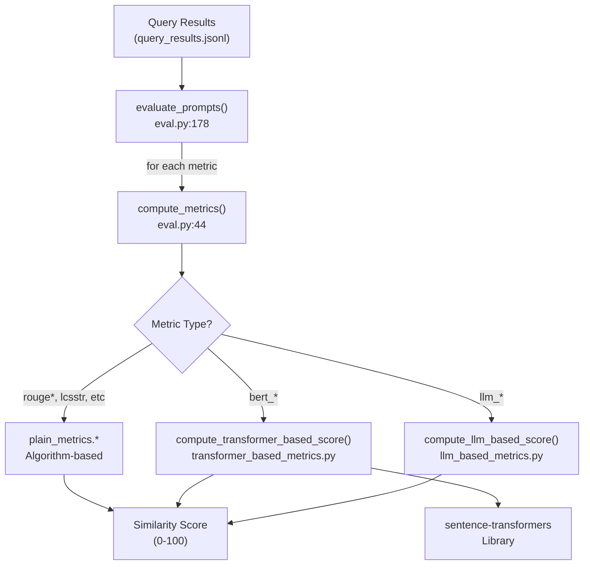
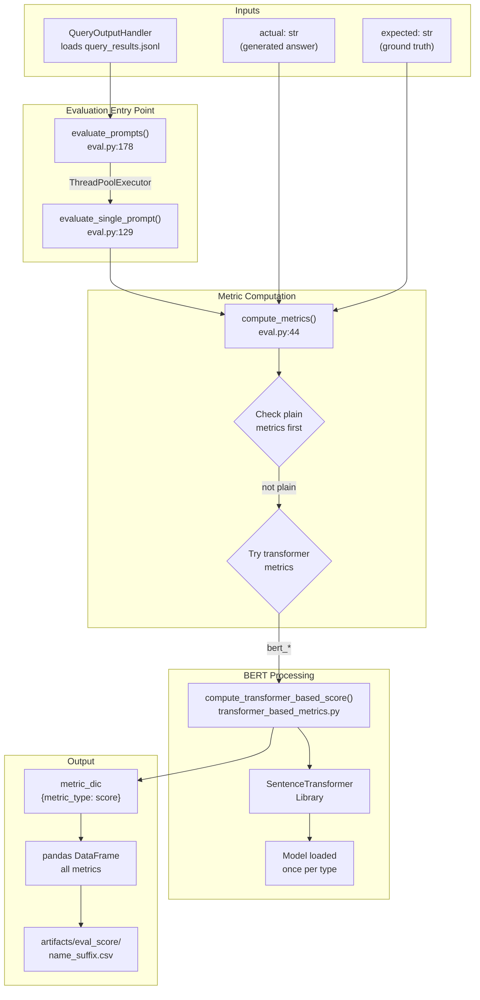
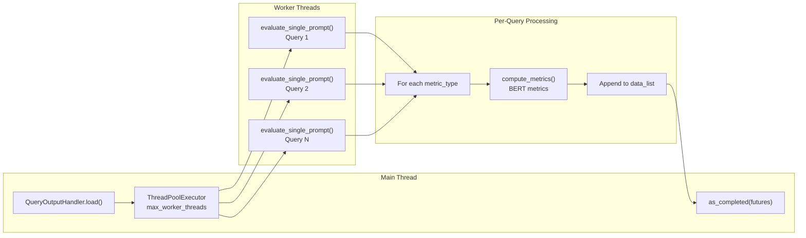
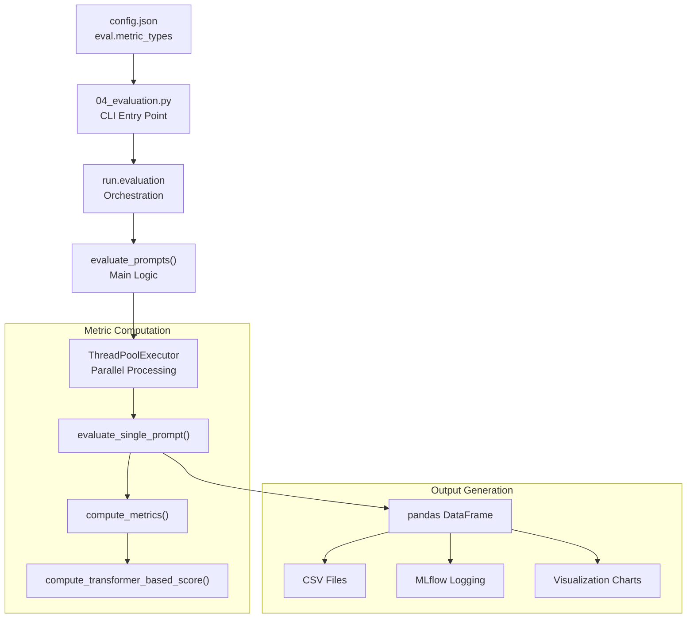

<!-- source: DeepWiki mcp.deepwiki.com · repo microsoft/rag-experiment-accelerator · page 8.2 BERT-Based Semantic Similarity · fetched 2026-10-26 -->

# BERT-Based Semantic Similarity

<details>
<summary>Relevant source files</summary>

The following files were used as context for generating this wiki page:

- [.github/workflows/config.json](.github/workflows/config.json)
- [config.schema.json](config.schema.json)
- [docs/evaluation-metrics.md](docs/evaluation-metrics.md)
- [promptflow/rag-experiment-accelerator/README.md](promptflow/rag-experiment-accelerator/README.md)
- [rag_experiment_accelerator/config/eval_config.py](rag_experiment_accelerator/config/eval_config.py)
- [rag_experiment_accelerator/evaluation/LICENSE.txt](rag_experiment_accelerator/evaluation/LICENSE.txt)
- [rag_experiment_accelerator/evaluation/eval.py](rag_experiment_accelerator/evaluation/eval.py)
- [rag_experiment_accelerator/evaluation/plain_metrics.py](rag_experiment_accelerator/evaluation/plain_metrics.py)
- [rag_experiment_accelerator/evaluation/tests/test_plain_metrics.py](rag_experiment_accelerator/evaluation/tests/test_plain_metrics.py)

</details>


## Purpose and Scope

This document describes the BERT-based semantic similarity metrics available in the RAG Experiment Accelerator for evaluating the quality of generated answers. These metrics use pre-trained transformer models to compute semantic similarity scores between actual and expected answers, providing a more sophisticated evaluation approach than algorithm-based string matching. For simpler string-based metrics, see [Algorithm-Based Metrics](#8.1). For LLM-powered evaluation, see [LLM-Based Evaluation](#8.3).

**Sources:** [rag_experiment_accelerator/evaluation/eval.py:84-89](), [docs/evaluation-metrics.md:140-158]()

## Overview

BERT-based semantic similarity metrics evaluate the quality of RAG system responses by computing the semantic distance between the generated answer (`actual`) and the ground truth answer (`expected`). Unlike algorithm-based metrics that rely on character or token overlap, these metrics use sentence embeddings from pre-trained BERT models to capture semantic meaning, making them more robust to paraphrasing and semantic equivalence.

These metrics:
- Return similarity scores as percentages (0-100), where 100 indicates perfect semantic similarity
- Are backed by the `sentence-transformers` Python package
- Operate on the `actual` and `expected` fields from query results
- Provide a middle ground between fast algorithm-based metrics and expensive LLM-based evaluation

**Sources:** [docs/evaluation-metrics.md:140-158](), [rag_experiment_accelerator/evaluation/eval.py:104-126]()

## Evaluation Flow

The following diagram shows how BERT-based metrics fit into the overall evaluation pipeline:



**Sources:** [rag_experiment_accelerator/evaluation/eval.py:44-126](), [rag_experiment_accelerator/evaluation/eval.py:178-240]()

## Available Models

The system provides six BERT-based models, each with different characteristics optimized for specific use cases:

| Configuration Key | Model Name | Dimension | Training | Use Case |
|------------------|------------|-----------|----------|----------|
| `bert_all_MiniLM_L6_v2` | MiniLM L6 v2 | 384 | General | Fast, lightweight, good for quick iterations |
| `bert_base_nli_mean_tokens` | Base NLI | 768 | Natural Language Inference | General-purpose semantic similarity |
| `bert_large_nli_mean_tokens` | Large NLI | 1024 | Natural Language Inference | Higher quality, slower |
| `bert_large_nli_stsb_mean_tokens` | Large NLI + STS-B | 1024 | NLI + Semantic Textual Similarity | Optimized for similarity tasks |
| `bert_distilbert_base_nli_stsb_mean_tokens` | DistilBERT + STS-B | 768 | NLI + STS-B, Distilled | Balanced speed/quality |
| `bert_paraphrase_multilingual_MiniLM_L12_v2` | Multilingual MiniLM L12 | 384 | Paraphrase, 50+ languages | Cross-lingual or multilingual content |

**Sources:** [rag_experiment_accelerator/evaluation/eval.py:84-89](), [docs/evaluation-metrics.md:150-157](), [config.schema.json:574-579]()

## Configuration

### Enabling BERT Metrics

BERT-based metrics are configured in the `config.json` file under the `eval.metric_types` array. You can select one or more models based on your evaluation needs:

```json
{
  "eval": {
    "metric_types": [
      "bert_all_MiniLM_L6_v2",
      "bert_distilbert_base_nli_stsb_mean_tokens",
      "fuzzy_score",
      "rouge2_recall"
    ]
  }
}
```

### Example Configuration

The CI workflow demonstrates a typical configuration combining BERT metrics with other evaluation approaches:

| Metric | Type | Purpose |
|--------|------|---------|
| `fuzzy_score` | Algorithm | Fast baseline |
| `cosine_ochiai` | Algorithm | Token-level similarity |
| `rouge2_recall` | Algorithm | Bigram overlap |
| `bert_all_MiniLM_L6_v2` | BERT | Semantic similarity (fast) |
| `bert_distilbert_base_nli_stsb_mean_tokens` | BERT | Semantic similarity (balanced) |
| `llm_answer_relevance` | LLM | Deep contextual evaluation |

**Sources:** [.github/workflows/config.json:76-86](), [config.schema.json:552-587]()

## Implementation Architecture



**Sources:** [rag_experiment_accelerator/evaluation/eval.py:44-126](), [rag_experiment_accelerator/evaluation/eval.py:129-176](), [rag_experiment_accelerator/evaluation/eval.py:178-240]()

## Metric Computation Process

The `compute_metrics()` function in [rag_experiment_accelerator/evaluation/eval.py:44-126]() implements a fallback strategy for metric computation:

1. **Check ROUGE metrics**: If metric starts with "rouge", compute using `plain_metrics.rouge_score()`
2. **Check plain metrics**: Try to find function in `plain_metrics` module (e.g., `levenshtein`, `jaccard`)
3. **Try transformer metrics**: Call `compute_transformer_based_score(actual, expected, metric_type)`
4. **Fallback to LLM metrics**: If KeyError, try `compute_llm_based_score()`
5. **Log error**: If still KeyError, log unsupported metric type

The function signature:

```
compute_metrics(
    metric_type: str,
    question: str,
    actual: str,
    expected: str,
    response_generator: ResponseGenerator,
    retrieved_contexts: list[str]
) -> float
```

For BERT metrics, only `metric_type`, `actual`, and `expected` are used. The other parameters are for LLM-based metrics.

**Sources:** [rag_experiment_accelerator/evaluation/eval.py:44-126]()

## Parallel Evaluation

The evaluation system processes multiple queries in parallel using `ThreadPoolExecutor`:



**Sources:** [rag_experiment_accelerator/evaluation/eval.py:219-240]()

The parallel execution is configured via `config.max_worker_threads` and uses `ExitStack` for proper resource management at [rag_experiment_accelerator/evaluation/eval.py:219-220]().

## Model Selection Guide

### By Speed Requirements

| Priority | Recommended Model | Dimension | Relative Speed |
|----------|------------------|-----------|----------------|
| Fastest | `bert_all_MiniLM_L6_v2` | 384 | 1x (baseline) |
| Balanced | `bert_distilbert_base_nli_stsb_mean_tokens` | 768 | 2-3x slower |
| Highest Quality | `bert_large_nli_stsb_mean_tokens` | 1024 | 4-5x slower |

### By Use Case

| Use Case | Recommended Model | Reason |
|----------|------------------|--------|
| Quick iteration during development | `bert_all_MiniLM_L6_v2` | Fastest, sufficient for most cases |
| Production evaluation | `bert_distilbert_base_nli_stsb_mean_tokens` | Good balance of speed/quality |
| High-stakes evaluation | `bert_large_nli_stsb_mean_tokens` | Optimized for semantic similarity |
| Multilingual content | `bert_paraphrase_multilingual_MiniLM_L12_v2` | Supports 50+ languages |
| Paraphrase detection | `bert_paraphrase_multilingual_MiniLM_L12_v2` | Trained specifically for paraphrases |

### By Training Data

- **NLI-trained models** (`bert_*_nli_*`): Better for semantic entailment and inference tasks
- **STS-B models** (`bert_*_stsb_*`): Optimized for semantic textual similarity scoring
- **Paraphrase models** (`bert_paraphrase_*`): Best for detecting equivalent meanings with different wording

**Sources:** [docs/evaluation-metrics.md:150-157]()

## Performance Considerations

### Computational Cost

BERT-based metrics have moderate computational cost compared to other metric types:

| Metric Type | Relative Cost | Latency per Query | Parallelization |
|-------------|---------------|-------------------|-----------------|
| Algorithm | 1x (baseline) | <1ms | Not needed |
| BERT | 50-200x | 10-50ms | Parallel via ThreadPoolExecutor |
| LLM | 1000-5000x | 500-2000ms | Parallel via ThreadPoolExecutor |

### Optimization Strategies

1. **Model Caching**: The `sentence-transformers` library automatically caches model weights after first load
2. **Batch Processing**: Process multiple queries in parallel using `config.max_worker_threads`
3. **Selective Metrics**: Choose only necessary BERT models to reduce evaluation time
4. **Checkpointing**: Enable `config.use_checkpoints` to cache evaluation results

### Memory Requirements

| Model | Dimension | Approx. Memory | GPU Acceleration |
|-------|-----------|----------------|------------------|
| MiniLM L6 | 384 | ~80 MB | Optional |
| DistilBERT Base | 768 | ~250 MB | Optional |
| Large NLI | 1024 | ~1.3 GB | Recommended |

**Sources:** [rag_experiment_accelerator/evaluation/eval.py:219-220]()

## Output Format

BERT metric scores are included in the evaluation output CSV file alongside other metrics:

```csv
question,actual,expected,search_type,fuzzy_score,bert_all_MiniLM_L6_v2,bert_distilbert_base_nli_stsb_mean_tokens
"What is RAG?","RAG is Retrieval...","RAG stands for...","search_for_manual_hybrid",85.2,89.3,91.7
```

The output files are saved to:
- Detailed results: `artifacts/eval_score/{name_suffix}.csv`
- Aggregated scores: `artifacts/eval_score/sum_{name_suffix}.csv`

Scores are also logged to MLflow at [rag_experiment_accelerator/evaluation/eval.py:318-319]() for experiment tracking and comparison.

**Sources:** [rag_experiment_accelerator/evaluation/eval.py:266-287](), [rag_experiment_accelerator/evaluation/eval.py:318-326]()

## Integration with Evaluation Pipeline



**Sources:** [rag_experiment_accelerator/evaluation/eval.py:178-326]()

## Error Handling

The metric computation implements graceful error handling with fallback logic:

1. If a metric is not found in `plain_metrics`, a `KeyError` is caught at [rag_experiment_accelerator/evaluation/eval.py:111-114]()
2. The system then attempts `compute_transformer_based_score()` for BERT metrics
3. If that raises `KeyError`, it falls back to `compute_llm_based_score()` at [rag_experiment_accelerator/evaluation/eval.py:115-122]()
4. If all attempts fail, an error is logged at [rag_experiment_accelerator/evaluation/eval.py:124]()

This allows mixing different metric types in `config.eval.metric_types` without explicit type checking.

**Sources:** [rag_experiment_accelerator/evaluation/eval.py:104-126]()

## Valid Metric Names

The following are the exact configuration keys that must be used in `config.json`:

- `bert_all_MiniLM_L6_v2`
- `bert_base_nli_mean_tokens`
- `bert_large_nli_mean_tokens`
- `bert_large_nli_stsb_mean_tokens`
- `bert_distilbert_base_nli_stsb_mean_tokens`
- `bert_paraphrase_multilingual_MiniLM_L12_v2`

These values are validated against the schema at [config.schema.json:574-579](). Any other values will cause a validation error.

**Sources:** [config.schema.json:574-579](), [rag_experiment_accelerator/evaluation/eval.py:84-89]()

---

