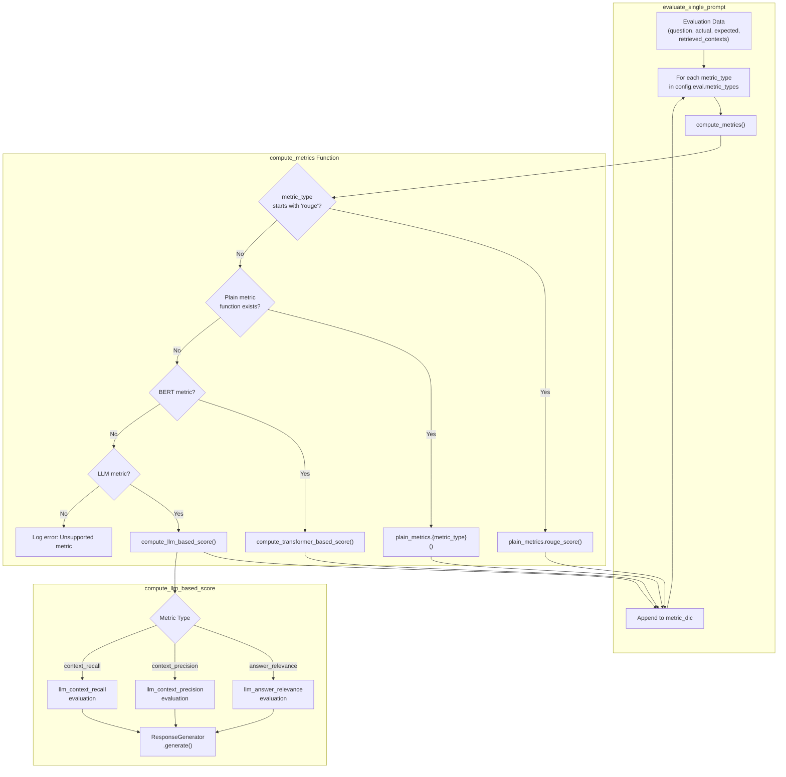
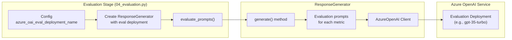
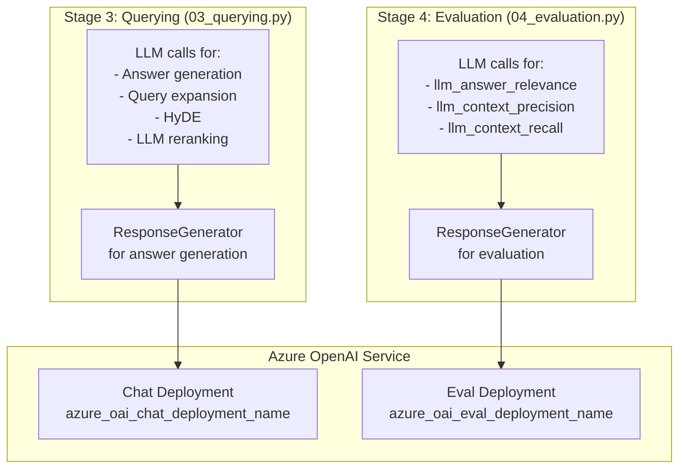
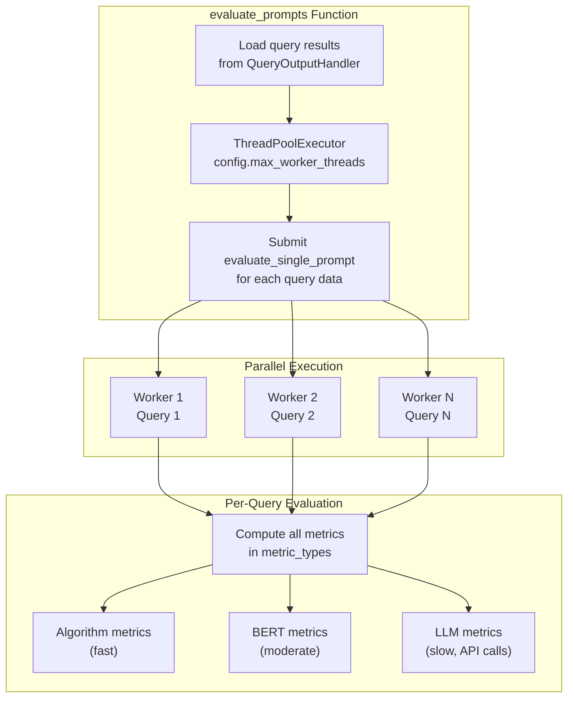
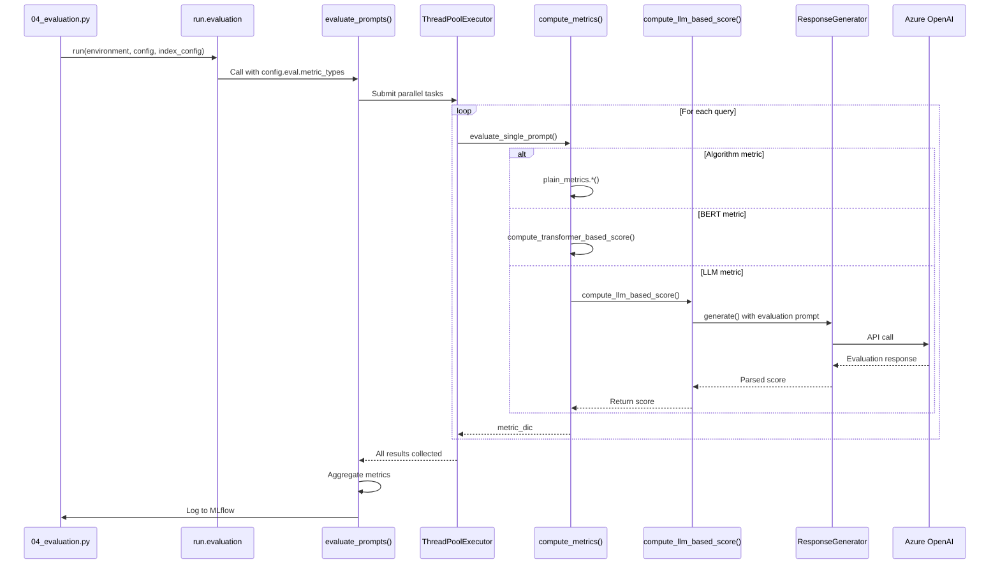

<!-- source: DeepWiki mcp.deepwiki.com · repo microsoft/rag-experiment-accelerator · page 8.3 LLM-Based Evaluation · fetched 2026-10-26 -->

# LLM-Based Evaluation

<details>
<summary>Relevant source files</summary>

The following files were used as context for generating this wiki page:

- [.github/workflows/config.json](.github/workflows/config.json)
- [02_qa_generation.py](02_qa_generation.py)
- [03_querying.py](03_querying.py)
- [04_evaluation.py](04_evaluation.py)
- [config.schema.json](config.schema.json)
- [docs/evaluation-metrics.md](docs/evaluation-metrics.md)
- [promptflow/rag-experiment-accelerator/README.md](promptflow/rag-experiment-accelerator/README.md)
- [rag_experiment_accelerator/config/eval_config.py](rag_experiment_accelerator/config/eval_config.py)
- [rag_experiment_accelerator/evaluation/LICENSE.txt](rag_experiment_accelerator/evaluation/LICENSE.txt)
- [rag_experiment_accelerator/evaluation/eval.py](rag_experiment_accelerator/evaluation/eval.py)
- [rag_experiment_accelerator/evaluation/plain_metrics.py](rag_experiment_accelerator/evaluation/plain_metrics.py)
- [rag_experiment_accelerator/evaluation/tests/test_plain_metrics.py](rag_experiment_accelerator/evaluation/tests/test_plain_metrics.py)

</details>


## Purpose and Scope

This document describes the LLM-based evaluation metrics used in the RAG Experiment Accelerator for assessing answer quality and retrieval performance. These metrics use Large Language Models as judges to provide nuanced, contextual evaluation beyond simple string matching or semantic similarity.

For information about other evaluation approaches, see:
- Algorithm-based metrics (string similarity, ROUGE): [8.1](#8.1)
- BERT-based semantic similarity metrics: [8.2](#8.2)
- Overall evaluation system architecture: [3.4](#3.4)

## Overview

LLM-based evaluation metrics leverage the reasoning capabilities of language models to assess RAG system outputs. Unlike algorithm-based metrics that rely on exact string matching or BERT metrics that compute embedding similarity, LLM metrics can evaluate semantic correctness, relevance, completeness, and contextual appropriateness by interpreting the meaning of questions, answers, and retrieved contexts.

The system implements three distinct LLM-based metrics, each targeting a specific aspect of RAG quality:

| Metric | Purpose | Inputs | Output Range |
|--------|---------|--------|--------------|
| `llm_answer_relevance` | Evaluates answer quality, completeness, and redundancy | question, actual answer, expected answer | 0-1 (1 = best) |
| `llm_context_precision` | Assesses retrieval relevance | question, retrieved contexts | 0-100% |
| `llm_context_recall` | Measures coverage of ground truth in retrieved contexts | question, expected answer, retrieved contexts | 0-100% |

Sources: [rag_experiment_accelerator/evaluation/eval.py:44-126](), [docs/evaluation-metrics.md:159-191](), [config.schema.json:556-583]()

## The Three LLM Metrics

### llm_answer_relevance

**Purpose**: Scores the relevancy of the generated answer according to the given question. This metric penalizes answers with incomplete, redundant, or unnecessary information.

**Evaluation Criteria**:
- Does the answer directly address the question?
- Is the answer complete without being redundant?
- Does it contain unnecessary information that doesn't contribute to answering the question?

**Input Parameters**:
- `question`: The user's question
- `actual`: The generated answer from the RAG system
- `expected`: The ground truth answer from the QA dataset

**Output**: Float value from 0 to 1, where 1 indicates perfect relevance.

**Use Case**: Evaluate the quality of LLM-generated responses in [Stage 3: Querying](#3.3) to ensure answers are focused and complete.

Sources: [rag_experiment_accelerator/evaluation/eval.py:91-92](), [docs/evaluation-metrics.md:167-174]()

### llm_context_precision

**Purpose**: Verifies whether the retrieved contexts are useful for answering the question. Evaluates the proportion of retrieved contexts that are actually relevant to the query.

**Evaluation Criteria**:
- How many of the retrieved context chunks contain information relevant to answering the question?
- Are irrelevant documents being retrieved that would confuse or mislead the answer generation?

**Input Parameters**:
- `question`: The user's question
- `retrieved_contexts`: List of context strings retrieved from Azure AI Search

**Output**: Percentage (0-100) representing the proportion of relevant retrieved contexts.

**Use Case**: Assess the quality of the search and retrieval strategy (vector search, hybrid search, semantic search) configured in [Stage 3: Querying](#3.3).

Sources: [rag_experiment_accelerator/evaluation/eval.py:90-91](), [docs/evaluation-metrics.md:176-182]()

### llm_context_recall

**Purpose**: Estimates context recall by measuring whether the retrieved contexts contain all the information needed to answer the question based on the ground truth answer.

**Evaluation Criteria**:
- Can all sentences in the ground truth answer be attributed to the retrieved contexts?
- What proportion of the expected answer's content is covered by the retrieved documents?

**Input Parameters**:
- `question`: The user's question
- `expected`: The ground truth answer
- `retrieved_contexts`: List of context strings retrieved from Azure AI Search

**Output**: Percentage (0-100) representing coverage of ground truth content in retrieved contexts.

**Use Case**: Evaluate whether the chunking strategy ([5.3](#5.3)) and retrieval settings ([7.1](#7.1)) are successfully retrieving all relevant information.

Sources: [rag_experiment_accelerator/evaluation/eval.py:92-93](), [docs/evaluation-metrics.md:184-190]()

## Implementation Architecture

### Metric Computation Flow



Sources: [rag_experiment_accelerator/evaluation/eval.py:44-126](), [rag_experiment_accelerator/evaluation/eval.py:129-176]()

### ResponseGenerator Integration

LLM-based metrics rely on the `ResponseGenerator` class to interact with Azure OpenAI. The evaluation system uses a dedicated deployment to avoid quota conflicts with the main chat deployment used during querying.



Sources: [rag_experiment_accelerator/evaluation/eval.py:210-212](), [04_evaluation.py:1-43]()

## Configuration

### Config Schema

LLM-based metrics require specific configuration in `config.json`:

```json
{
  "openai": {
    "azure_oai_eval_deployment_name": "gpt-35-turbo",
    "temperature": 0
  },
  "eval": {
    "metric_types": [
      "llm_answer_relevance",
      "llm_context_precision",
      "llm_context_recall"
    ]
  }
}
```

**Key Configuration Properties**:

| Property | Type | Purpose | Example |
|----------|------|---------|---------|
| `azure_oai_eval_deployment_name` | string | Azure OpenAI deployment for evaluation LLM calls | `"gpt-35-turbo"` |
| `temperature` | number (0-1) | Controls randomness in LLM responses (0 = deterministic) | `0` |
| `metric_types` | array[string] | List of metrics to compute (can mix algorithm, BERT, and LLM) | `["fuzzy_score", "llm_answer_relevance"]` |

Sources: [config.schema.json:523-548](), [config.schema.json:549-588](), [.github/workflows/config.json:72-86]()

### Separate Deployment for Evaluation

The system uses a dedicated Azure OpenAI deployment (`azure_oai_eval_deployment_name`) separate from the chat deployment (`azure_oai_chat_deployment_name`) for two reasons:

1. **Quota Management**: Prevents evaluation LLM calls from consuming quota needed for answer generation during querying
2. **Model Selection**: Allows using different models for generation vs. evaluation (e.g., GPT-4 for generation, GPT-3.5 for evaluation to reduce costs)



Sources: [rag_experiment_accelerator/evaluation/eval.py:210-212](), [config.schema.json:526-534]()

## Usage in Evaluation Pipeline

### Parallel Processing

LLM-based metrics are computed in parallel with other metrics using `ThreadPoolExecutor` to improve performance:



Sources: [rag_experiment_accelerator/evaluation/eval.py:219-239]()

### Evaluation Workflow

The complete evaluation workflow integrates LLM metrics with other metric types:



Sources: [04_evaluation.py:34-42](), [rag_experiment_accelerator/evaluation/eval.py:178-326]()

## Performance and Cost Considerations

### Computational Cost Comparison

LLM-based metrics have significantly different performance characteristics compared to other metric types:

| Metric Type | Speed | Cost | API Dependency | Best Use Case |
|-------------|-------|------|----------------|---------------|
| Algorithm-based | Very Fast (ms) | Free | None | Quick iteration, baseline comparison |
| BERT-based | Fast (100ms) | Low (local compute) | None | Semantic similarity at scale |
| LLM-based | Slow (1-5s) | High (OpenAI API) | Required | Final evaluation, nuanced assessment |

### Optimization Strategies

1. **Selective Metric Usage**: Include LLM metrics only for final evaluation runs, not during rapid experimentation
   ```json
   {
     "eval": {
       "metric_types": [
         "fuzzy_score",           // Fast baseline
         "bert_all_MiniLM_L6_v2", // Semantic similarity
         "llm_answer_relevance"   // Only one LLM metric for cost control
       ]
     }
   }
   ```

2. **Parallel Processing**: The system automatically parallelizes evaluation across queries using `config.max_worker_threads`

3. **Temperature = 0**: Configuration sets `temperature: 0` for deterministic, consistent evaluation results

4. **Separate Deployment**: Using `azure_oai_eval_deployment_name` prevents quota exhaustion during experiments

Sources: [rag_experiment_accelerator/evaluation/eval.py:219-239](), [config.schema.json:536-541]()

## Best Practices

### When to Use LLM Metrics

**Use LLM-based metrics when**:
- Evaluating final system performance for production readiness
- Comparing high-performing configurations where subtle differences matter
- Assessing answer quality dimensions (relevance, completeness) that string matching cannot capture
- Validating retrieval quality (precision/recall) for different search strategies

**Avoid LLM-based metrics when**:
- Rapidly iterating on chunking parameters or embedding models (use algorithm/BERT metrics)
- Working with limited Azure OpenAI quota
- Evaluation budget is constrained
- Quick comparative analysis is sufficient

### Combining Metric Types

Effective evaluation strategies use a mix of metric types:

```json
{
  "eval": {
    "metric_types": [
      "fuzzy_score",                                    // Fast string matching baseline
      "rouge2_recall",                                  // Token overlap
      "bert_distilbert_base_nli_stsb_mean_tokens",     // Semantic similarity
      "llm_answer_relevance",                          // Answer quality
      "llm_context_precision"                          // Retrieval quality
    ]
  }
}
```

This configuration provides:
1. Quick baseline metrics (fuzzy_score, rouge2_recall)
2. Semantic understanding (BERT)
3. Nuanced quality assessment (LLM)

### Monitoring and Debugging

The evaluation system logs all metric scores to MLflow, enabling:
- Comparison across experiments with different configurations
- Visualization of metric distributions
- Identification of queries where LLM metrics diverge from algorithm metrics (indicating nuanced issues)

Access results in Azure ML workspace:
1. Navigate to Jobs → Experiments → Select experiment name
2. View metrics tab for aggregate scores
3. Download artifacts for per-query detailed results

Sources: [rag_experiment_accelerator/evaluation/eval.py:262-326](), [04_evaluation.py:35-42]()

### Error Handling

The system gracefully handles LLM metric failures:

```python
# From eval.py:235-239
for future in as_completed(futures):
    try:
        future.result()
    except Exception as exc:
        logger.error(f"Evaluate query line generated an exception: {exc}")
```

Failed metric computations are logged but don't halt the entire evaluation pipeline, ensuring partial results are still collected and logged to MLflow.

Sources: [rag_experiment_accelerator/evaluation/eval.py:235-239]()

---

