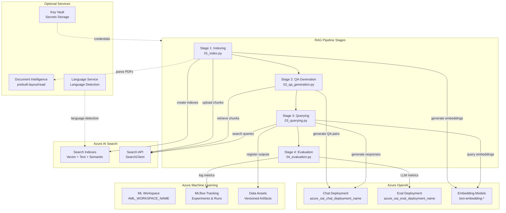
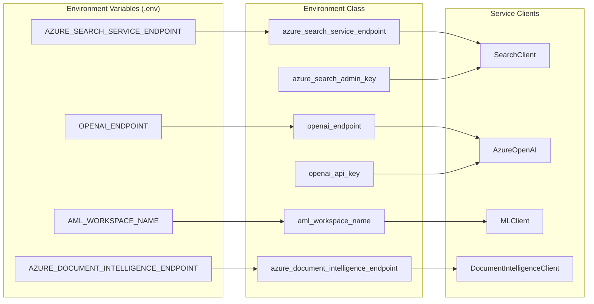
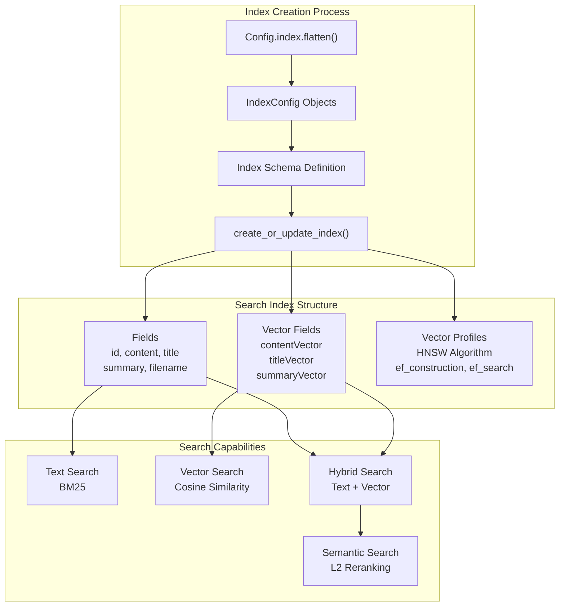
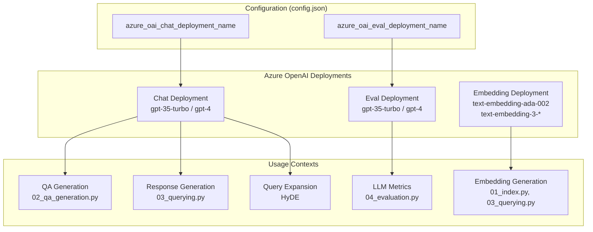
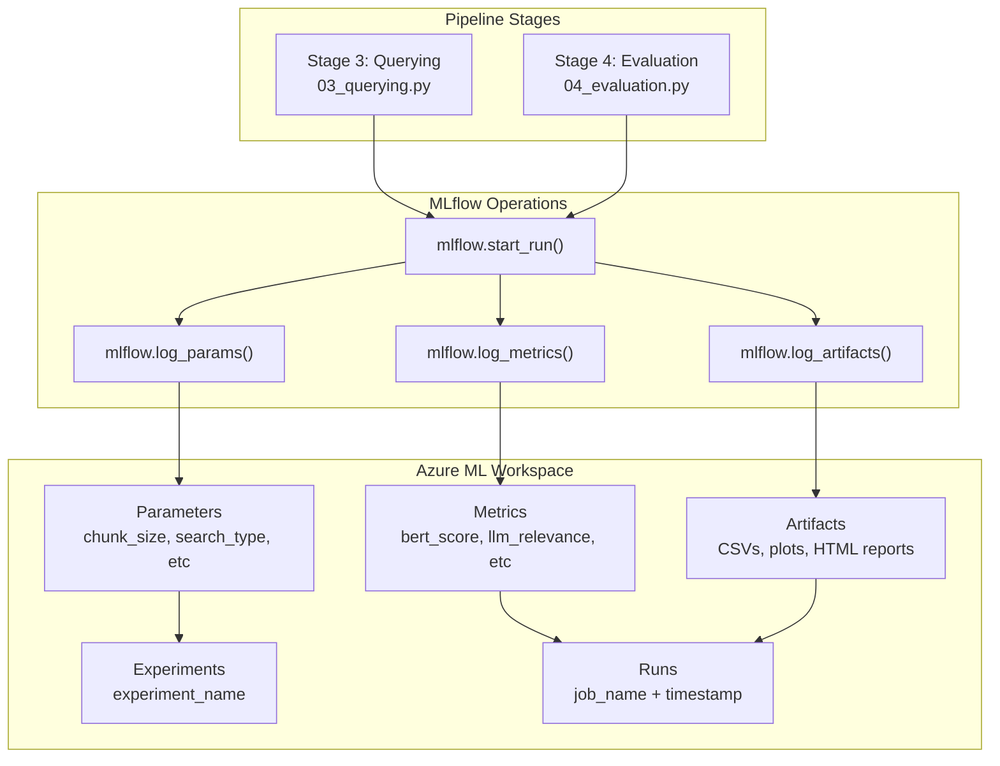
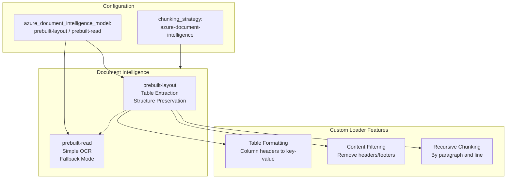
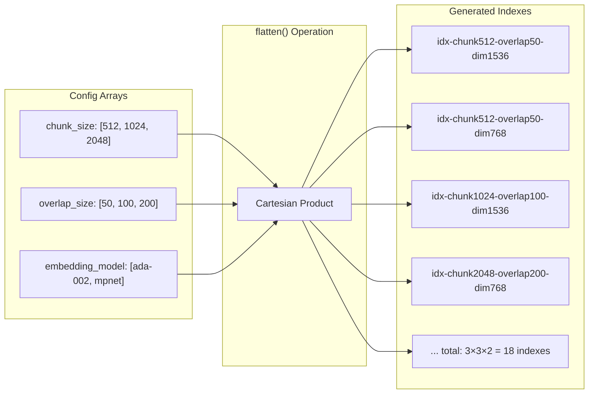

<!-- source: DeepWiki mcp.deepwiki.com · repo microsoft/rag-experiment-accelerator · page 9 Azure Service Integration · fetched 2026-10-26 -->

# Azure Service Integration

<details>
<summary>Relevant source files</summary>

The following files were used as context for generating this wiki page:

- [.env.template](.env.template)
- [.github/workflows/build_validation_workflow.yml](.github/workflows/build_validation_workflow.yml)
- [.github/workflows/rag_exp_acc_ci.yml](.github/workflows/rag_exp_acc_ci.yml)
- [Makefile](Makefile)
- [README.md](README.md)
- [config.sample.json](config.sample.json)
- [docs/environment-variables.md](docs/environment-variables.md)
- [rag_experiment_accelerator/doc_loader/pdfLoader.py](rag_experiment_accelerator/doc_loader/pdfLoader.py)
- [rag_experiment_accelerator/ingest_data/acs_ingest.py](rag_experiment_accelerator/ingest_data/acs_ingest.py)
- [rag_experiment_accelerator/ingest_data/tests/test_acs_ingest.py](rag_experiment_accelerator/ingest_data/tests/test_acs_ingest.py)

</details>


## Purpose and Scope

This page provides an overview of how the RAG Experiment Accelerator integrates with Azure services. The accelerator relies on several Azure services for document indexing, embedding generation, language model operations, and experiment tracking. This page covers the integration patterns, configuration requirements, and authentication mechanisms for all Azure services used by the system.

For detailed configuration of specific services, see:
- [Azure AI Search Configuration](#9.1) - Index creation, vector settings, and search capabilities
- [Azure OpenAI Integration](#9.2) - Deployment configuration and usage patterns
- [Azure ML and MLflow](#9.3) - Experiment tracking and data assets

For information about local development setup and environment configuration, see [Installation and Dependencies](#2.1).

---

## Azure Services Architecture

The RAG Experiment Accelerator integrates with multiple Azure services, each serving a specific role in the pipeline. The following diagram shows the relationships between these services and the four-stage pipeline.



**Sources:** [README.md:1-571](), [.env.template:1-49](), [config.sample.json:1-88]()

---

## Service Dependencies and Configuration

### Required Services

The accelerator requires three core Azure services to function. Each service must be properly configured before running the pipeline.

| Service | Purpose | Configuration Location | Required Environment Variables |
|---------|---------|----------------------|-------------------------------|
| **Azure AI Search** | Document indexing and retrieval | `.env`, `config.json` | `AZURE_SEARCH_SERVICE_ENDPOINT`<br/>`AZURE_SEARCH_ADMIN_KEY` |
| **Azure OpenAI** | Embeddings and LLM operations | `.env`, `config.json` | `OPENAI_ENDPOINT`<br/>`OPENAI_API_KEY`<br/>`OPENAI_API_VERSION` |
| **Azure ML Workspace** | Experiment tracking and data assets | `.env` | `AML_SUBSCRIPTION_ID`<br/>`AML_WORKSPACE_NAME`<br/>`AML_RESOURCE_GROUP_NAME` |

### Optional Services

| Service | Purpose | Configuration Location | Environment Variables |
|---------|---------|----------------------|----------------------|
| **Document Intelligence** | Advanced PDF parsing with table extraction | `.env` | `AZURE_DOCUMENT_INTELLIGENCE_ENDPOINT`<br/>`AZURE_DOCUMENT_INTELLIGENCE_ADMIN_KEY` |
| **Key Vault** | Centralized secrets management | `.env` | `AZURE_KEY_VAULT_ENDPOINT` |
| **Language Service** | Language detection for search indexes | `.env` | `AZURE_LANGUAGE_SERVICE_ENDPOINT`<br/>`AZURE_LANGUAGE_SERVICE_KEY` |

**Sources:** [.env.template:1-49](), [docs/environment-variables.md:1-36]()

---

## Environment Variable Configuration

### Environment Class

The `Environment` class in [rag_experiment_accelerator/config/environment.py]() loads and validates all Azure service credentials. It reads from environment variables and provides a centralized configuration object.



### Required Environment Variables

The following environment variables must be set in the `.env` file:

**Azure AI Search:**
```bash
AZURE_SEARCH_SERVICE_ENDPOINT=https://your-search-service.search.windows.net
AZURE_SEARCH_ADMIN_KEY=your-admin-key
AZURE_SEARCH_USE_SEMANTIC_SEARCH=True
```

**Azure OpenAI:**
```bash
OPENAI_API_TYPE=azure
OPENAI_ENDPOINT=https://your-openai-service.openai.azure.com/
OPENAI_API_KEY=your-api-key
OPENAI_API_VERSION=2023-03-15-preview
```

**Azure Machine Learning:**
```bash
AML_SUBSCRIPTION_ID=your-subscription-id
AML_WORKSPACE_NAME=your-workspace-name
AML_RESOURCE_GROUP_NAME=your-resource-group
```

**Sources:** [.env.template:1-49](), [docs/environment-variables.md:1-36]()

---

## Azure AI Search Integration

### Index Creation and Management

Azure AI Search serves as the document store and retrieval engine. The accelerator creates multiple search indexes with varying configurations for experimentation.



### Index Naming Convention

Indexes are created with names following the pattern:
```
{index_name_prefix}-{chunk_size}-{overlap_size}-{embedding_dim}
```

For example: `idx-chunk1000-overlap200-dim768`

### SearchClient Usage

The `SearchClient` from the Azure SDK is used throughout the codebase for interacting with Azure AI Search:

[rag_experiment_accelerator/ingest_data/acs_ingest.py:59-64]()
```python
credential = AzureKeyCredential(environment.azure_search_admin_key)
search_client = SearchClient(
    endpoint=environment.azure_search_service_endpoint,
    index_name=index_name,
    credential=credential,
)
```

### Document Upload

Documents are uploaded to Azure AI Search using parallel processing with `ThreadPoolExecutor`:

[rag_experiment_accelerator/ingest_data/acs_ingest.py:69-86]()

The upload process:
1. Converts chunks to index documents using `chunks_to_index_documents()`
2. Hashes content for unique IDs using `my_hash()`
3. Uploads in parallel using configured worker threads
4. Logs upload progress and errors

**Sources:** [rag_experiment_accelerator/ingest_data/acs_ingest.py:36-90](), [config.sample.json:10-38]()

---

## Azure OpenAI Integration

### Dual Deployment Strategy

The accelerator uses separate Azure OpenAI deployments for different purposes to prevent quota conflicts and enable independent scaling.



### Configuration in config.json

```json
{
  "openai": {
    "azure_oai_chat_deployment_name": "gpt-35-turbo",
    "azure_oai_eval_deployment_name": "gpt-35-turbo",
    "temperature": 0
  }
}
```

### Embedding Model Configuration

The accelerator supports both Azure OpenAI and sentence-transformer embeddings. Azure OpenAI embeddings are configured as:

```json
{
  "index": {
    "embedding_model": [
      {
        "type": "azure",
        "model_name": "text-embedding-ada-002",
        "dimension": 1536
      }
    ]
  }
}
```

For newer embedding models with dimension shortening:

```json
{
  "type": "azure",
  "model_name": "text-embedding-3-large",
  "dimension": 256,
  "shorten_dimensions": true
}
```

### ResponseGenerator Class

The `ResponseGenerator` class in [rag_experiment_accelerator/llm/response_generator.py]() handles all Azure OpenAI API calls. It is instantiated with the deployment name and uses the environment configuration for credentials.

[rag_experiment_accelerator/ingest_data/acs_ingest.py:106-108]()
```python
response_generator = ResponseGenerator(
    environment, config, azure_oai_deployment_name
)
```

**Sources:** [config.sample.json:72-76](), [README.md:368-410](), [rag_experiment_accelerator/ingest_data/acs_ingest.py:92-136]()

---

## Azure Machine Learning Integration

### MLflow Experiment Tracking

Azure ML provides MLflow tracking for experiments, enabling comparison of different configurations and runs.



### Experiment Naming

Experiments are organized using the `experiment_name` configuration:

```json
{
  "experiment_name": "exp-name",
  "job_name": "job-name"
}
```

- If `experiment_name` is provided, all runs are grouped under that experiment
- If empty, `index_name_prefix` is used as the experiment name
- Individual runs are named as `{job_name}-{timestamp}`

### Data Assets Registration

Stage 3 registers query results as versioned data assets in Azure ML, enabling reproducibility and artifact tracking.

**Sources:** [README.md:449-480](), [config.sample.json:3-5]()

---

## Optional Services

### Azure Document Intelligence

Azure Document Intelligence provides advanced PDF parsing with table extraction and OCR capabilities.



**Configuration:**
```json
{
  "index": {
    "chunking": {
      "chunking_strategy": "azure-document-intelligence",
      "azure_document_intelligence_model": "prebuilt-layout"
    }
  }
}
```

The custom Document Intelligence loader at [rag_experiment_accelerator/doc_loader/documentIntelligenceLoader.py]() provides:
- Table cell formatting with column headers as key-value pairs
- Removal of page numbers, headers, and footers
- Regex-based pattern removal for recurring content
- Recursive chunking by paragraph and line to preserve table rows
- Automatic fallback to `prebuilt-read` when `prebuilt-layout` fails

**Sources:** [README.md:35-38](), [config.sample.json:21-22]()

### Azure Key Vault

Azure Key Vault can be used for centralized secrets management as an alternative to local `.env` files. When configured, credentials are retrieved from Key Vault at runtime.

**Configuration:**
```bash
AZURE_KEY_VAULT_ENDPOINT=https://your-keyvault.vault.azure.net/
```

### Azure Language Service

Azure Language Service provides language detection capabilities for search indexes, enabling language-specific analyzers and tokenization.

**Configuration:**
```bash
AZURE_LANGUAGE_SERVICE_ENDPOINT=https://your-language-service.cognitiveservices.azure.com/
AZURE_LANGUAGE_SERVICE_KEY=your-key
```

**Usage in config.json:**
```json
{
  "language": {
    "analyzer": {
      "analyzer_name": "en.microsoft",
      "query_language": "en-us"
    }
  }
}
```

**Sources:** [.env.template:27-34](), [config.sample.json:39-49]()

---

## Authentication and Authorization

### Azure CLI Authentication

The accelerator uses Azure CLI authentication for accessing Azure services. Users must authenticate before running the pipeline:

```bash
az login
az account set --subscription="your-subscription-guid"
az account show
```

### Credential Types

Different Azure services use different credential patterns:

| Service | Credential Type | Usage Location |
|---------|----------------|----------------|
| **Azure AI Search** | API Key (`AzureKeyCredential`) | `SearchClient` initialization |
| **Azure OpenAI** | API Key (via `openai` SDK) | `ResponseGenerator` class |
| **Azure ML** | Azure CLI credentials | MLflow tracking, `MLClient` |
| **Document Intelligence** | API Key | `DocumentIntelligenceClient` |
| **Key Vault** | Azure CLI credentials | Secrets retrieval |

### Service Principal Authentication

For CI/CD scenarios, service principal authentication is used via GitHub Actions secrets:

[.github/workflows/rag_exp_acc_ci.yml:45-48]()
```yaml
- name: Azure login
  uses: azure/login@v2
  with:
    creds: ${{ secrets.azure_credentials }}
```

**Sources:** [README.md:118-123](), [.github/workflows/rag_exp_acc_ci.yml:23-66]()

---

## Configuration Validation

### Missing Credentials

The system validates that required environment variables are set before execution. Common authentication errors include:

1. **Azure Authentication Not Configured**: User must run `az login` before executing pipeline
2. **Missing Environment Variables**: Required variables not set in `.env` file
3. **Insufficient Permissions**: User lacks contributor access to Azure resources
4. **Expired Credentials**: Azure CLI session has expired

### Testing Configuration

To verify Azure service connectivity, run the CI/CD validation workflow locally:

```bash
make test
```

Or execute individual stages:
```bash
make index
make qnagen
make query
make eval
```

Each stage will fail early if required Azure services are not accessible.

**Sources:** [README.md:485-490](), [Makefile:1-76]()

---

## Multi-Index Experimentation

### Configuration-Driven Index Creation

The accelerator's power comes from its ability to create and compare multiple Azure AI Search indexes simultaneously. The `Config.index.flatten()` method generates all index configuration permutations.



### Search Strategy Comparison

Each index can be queried using multiple search strategies, all configured in Azure AI Search:

```json
{
  "search": {
    "search_type": [
      "search_for_match_text",
      "search_for_match_pure_vector",
      "search_for_manual_hybrid",
      "search_for_match_semantic"
    ]
  }
}
```

This enables systematic comparison of:
- Pure text search (BM25)
- Pure vector search (cosine similarity)
- Hybrid search (text + vector)
- Semantic search (L2 reranking)

**Sources:** [config.sample.json:57-64](), [README.md:283-357]()

---

## Deployment and Provisioning

### Infrastructure as Code

The accelerator provides three deployment options for Azure infrastructure:

**1. Azure Developer CLI (azd):**
```bash
azd provision
```

**2. Azure Portal Deployment:**
Click the "Deploy to Azure" button in README.md

**3. Azure CLI with Bicep:**
```bash
az deployment sub create --subscription <id> --location <location> \
  --template-file infra/main.bicep
```

### Isolated Network Deployment

For secure deployments, the accelerator supports isolated network configuration with VNet integration:

```bash
az deployment sub create --location uksouth --template-file infra/main.bicep \
  --parameters vnetAddressSpace='10.0.0.0/16' \
  --parameters proxySubnetAddressSpace='10.0.1.0/24' \
  --parameters subnetAddressSpace='10.0.2.0/24'
```

**Sources:** [README.md:125-180]()

---

## Performance and Scaling

### Parallel Processing Configuration

Azure service calls are parallelized using `ThreadPoolExecutor` with configurable worker threads:

```bash
# .env
MAX_WORKER_THREADS=4
```

This affects:
- Document upload to Azure AI Search
- Embedding generation via Azure OpenAI
- Parallel query execution
- Metric calculation

### Rate Limiting and Quotas

Azure OpenAI has rate limits that can cause throttling. The dual deployment strategy (chat vs. eval) helps distribute load:

- **Chat Deployment**: Used for QA generation, query responses, and query expansion
- **Eval Deployment**: Used exclusively for evaluation metrics (LLM-as-judge)

This prevents evaluation metrics from consuming quota needed for core pipeline operations.

### Semantic Search Availability

Semantic search is only available in Azure AI Search at Basic tier or higher, and not in all regions. Configure accordingly:

```bash
AZURE_SEARCH_USE_SEMANTIC_SEARCH="True"
```

**Sources:** [.env.template:35-38](), [README.md:58-59]()

---

