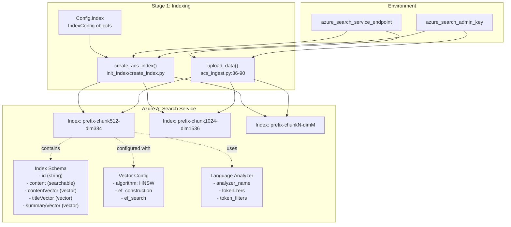
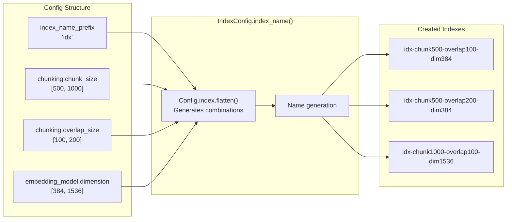
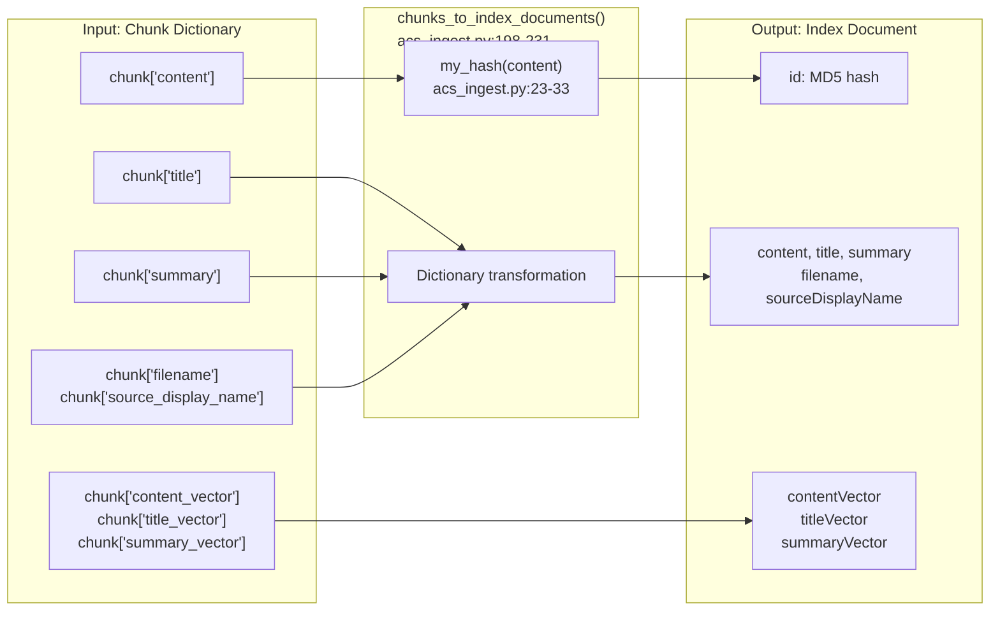
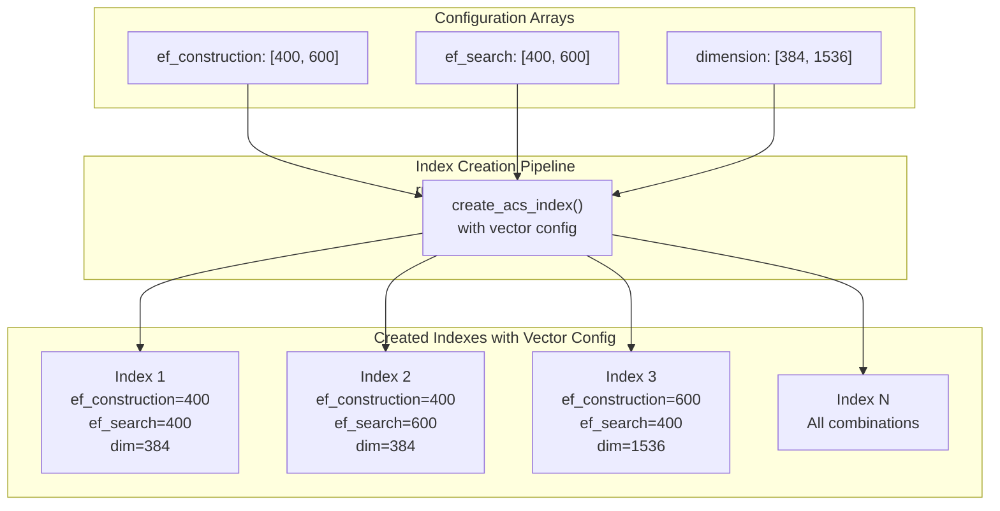
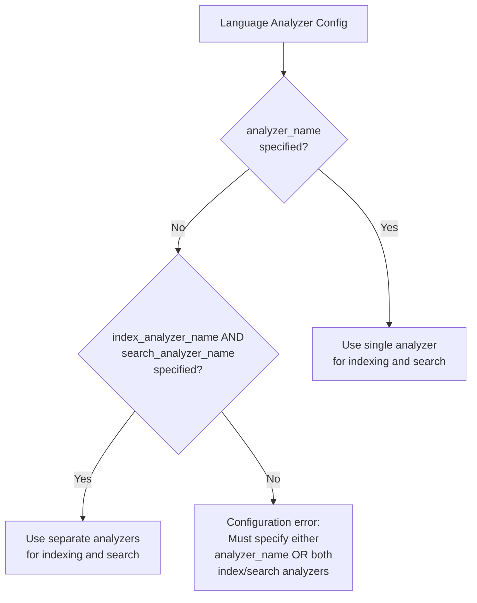
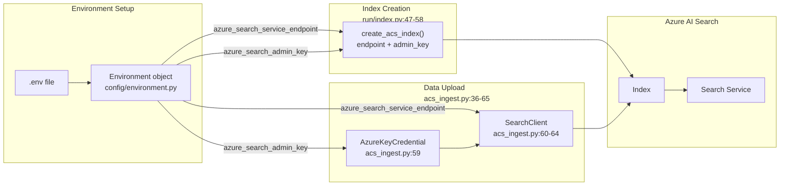
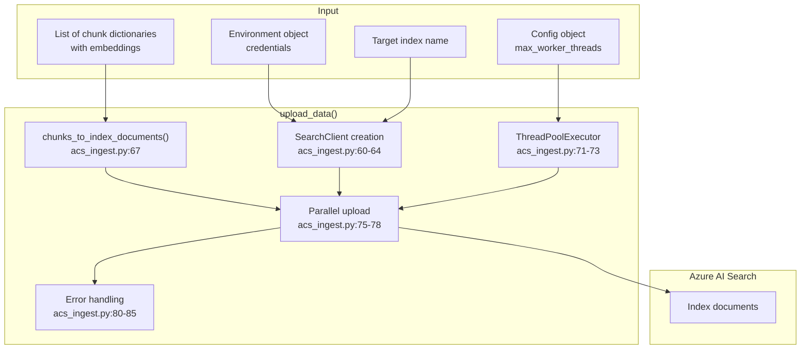
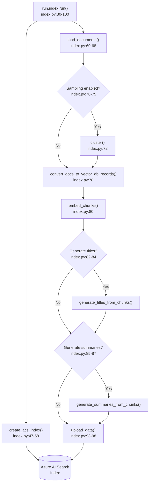

<!-- source: DeepWiki mcp.deepwiki.com · repo microsoft/rag-experiment-accelerator · page 9.1 Azure AI Search Configuration · fetched 2026-10-26 -->

# Azure AI Search Configuration

<details>
<summary>Relevant source files</summary>

The following files were used as context for generating this wiki page:

- [README.md](README.md)
- [config.sample.json](config.sample.json)
- [rag_experiment_accelerator/config/tests/data/config.json](rag_experiment_accelerator/config/tests/data/config.json)
- [rag_experiment_accelerator/doc_loader/pdfLoader.py](rag_experiment_accelerator/doc_loader/pdfLoader.py)
- [rag_experiment_accelerator/ingest_data/acs_ingest.py](rag_experiment_accelerator/ingest_data/acs_ingest.py)
- [rag_experiment_accelerator/ingest_data/tests/test_acs_ingest.py](rag_experiment_accelerator/ingest_data/tests/test_acs_ingest.py)
- [rag_experiment_accelerator/run/index.py](rag_experiment_accelerator/run/index.py)

</details>


## Purpose and Scope

This page documents the configuration and setup of Azure AI Search indexes within the RAG Experiment Accelerator. It covers index creation parameters, vector search settings (HNSW algorithm configuration), index schema design, language analyzers, and the data upload process.

For information about the broader document indexing pipeline, see [Stage 1: Document Indexing](#3.1). For query-time search strategies and execution, see [Search Types and Strategies](#7.1). For Azure OpenAI integration, see [Azure OpenAI Integration](#9.2).

---

## Overview: Azure AI Search in the Pipeline

Azure AI Search serves as the vector database and search engine for the RAG system. The accelerator creates multiple search indexes with varying configurations to enable systematic experimentation with different chunking strategies, embedding models, and vector search parameters.



**Sources:** [rag_experiment_accelerator/run/index.py:30-100](), [rag_experiment_accelerator/ingest_data/acs_ingest.py:36-90](), [config.sample.json:10-48]()

---

## Index Creation and Naming

### Index Name Generation

The system generates unique index names based on configuration parameters to enable easy identification and comparison of experiments. The naming pattern is:

```
{index_name_prefix}-chunk{chunk_size}-overlap{overlap_size}-dim{embedding_dimension}
```

The index name is generated by the `IndexConfig.index_name()` method and incorporates key configuration parameters that affect retrieval quality.



**Configuration Example:**

```json
{
    "index": {
        "index_name_prefix": "idx",
        "chunking": {
            "chunk_size": [500, 1000],
            "overlap_size": [100, 200]
        },
        "embedding_model": [
            {
                "type": "sentence-transformer",
                "model_name": "all-MiniLM-L6-v2",
                "dimension": 384
            }
        ]
    }
}
```

The `create_acs_index()` function is called in [rag_experiment_accelerator/run/index.py:47-58]() with the generated index name.

**Sources:** [rag_experiment_accelerator/run/index.py:46-58](), [config.sample.json:11-29](), [README.md:296-309]()

---

## Index Schema and Field Structure

Azure AI Search indexes created by the accelerator follow a standardized schema designed to support multiple search modalities: text search, vector search, and hybrid search.

### Field Definitions

| Field Name | Type | Purpose | Searchable | Retrievable | Filterable |
|------------|------|---------|-----------|-------------|-----------|
| `id` | Edm.String | Unique document identifier (MD5 hash of content) | No | Yes | Yes |
| `content` | Edm.String | Main chunk content | Yes | Yes | No |
| `title` | Edm.String | LLM-generated title (if enabled) | Yes | Yes | No |
| `summary` | Edm.String | LLM-generated summary (if enabled) | Yes | Yes | No |
| `filename` | Edm.String | Source document filename | No | Yes | Yes |
| `sourceDisplayName` | Edm.String | Display name with page info | No | Yes | No |
| `contentVector` | Collection(Edm.Single) | Embedding of content | No | No | No |
| `titleVector` | Collection(Edm.Single) | Embedding of title | No | No | No |
| `summaryVector` | Collection(Edm.Single) | Embedding of summary | No | No | No |

### Document Transformation

The `chunks_to_index_documents()` function in [rag_experiment_accelerator/ingest_data/acs_ingest.py:198-231]() transforms processed chunks into Azure AI Search documents:



The `my_hash()` function generates deterministic MD5 hashes for chunk IDs, enabling idempotent uploads and avoiding duplicate documents when re-running indexing.

**Sources:** [rag_experiment_accelerator/ingest_data/acs_ingest.py:23-33](), [rag_experiment_accelerator/ingest_data/acs_ingest.py:198-231]()

---

## Vector Search Configuration

Azure AI Search uses the Hierarchical Navigable Small World (HNSW) algorithm for vector search. The accelerator exposes two critical HNSW parameters for experimentation:

### HNSW Parameters

| Parameter | Config Key | Purpose | Typical Range | Impact |
|-----------|-----------|---------|---------------|--------|
| **ef_construction** | `index.ef_construction` | Number of candidates evaluated during index build | 100-1000 | Higher = better recall, slower indexing |
| **ef_search** | `index.ef_search` | Number of candidates evaluated during search | 100-1000 | Higher = better recall, slower queries |

### Configuration Example

```json
{
    "index": {
        "ef_construction": [400, 600],
        "ef_search": [400, 600]
    }
}
```

Both parameters accept arrays to enable grid search across multiple values. The system will create separate indexes for each combination of `ef_construction` and `ef_search` values.



### Tuning Recommendations

- **For development/testing**: Use lower values (e.g., `ef_construction=100`, `ef_search=100`) for faster indexing
- **For production**: Use higher values (e.g., `ef_construction=400-800`, `ef_search=400-800`) for better recall
- **Trade-off**: Higher values improve search quality at the cost of indexing time and query latency

The vector configuration is passed to `create_acs_index()` in [rag_experiment_accelerator/run/index.py:47-58]() along with the embedding dimension from the selected embedding model.

**Sources:** [config.sample.json:12-13](), [rag_experiment_accelerator/run/index.py:47-58](), [README.md:298-299]()

---

## Language Analyzers

Azure AI Search analyzers control how text is tokenized and processed for full-text search. The accelerator supports both built-in Microsoft language analyzers and custom analyzer configurations.

### Analyzer Configuration Structure

```json
{
    "language": {
        "analyzer": {
            "analyzer_name": "en.microsoft",
            "index_analyzer_name": "",
            "search_analyzer_name": "",
            "char_filters": [],
            "tokenizers": [],
            "token_filters": []
        },
        "query_language": "en-us"
    }
}
```

### Analyzer Types

| Configuration | Purpose | Example Values |
|---------------|---------|----------------|
| `analyzer_name` | Single analyzer for both indexing and search | `"en.microsoft"`, `"fr.microsoft"`, `"standard.lucene"` |
| `index_analyzer_name` | Analyzer used only during indexing | Custom analyzer name |
| `search_analyzer_name` | Analyzer used only during search | Custom analyzer name |
| `char_filters` | Character-level preprocessing | Remove patterns, mappings |
| `tokenizers` | Split text into tokens | Standard, whitespace, pattern |
| `token_filters` | Token-level processing | Lowercase, stopwords, stemming |
| `query_language` | Language for semantic search | `"en-us"`, `"fr-fr"`, `"de-de"` |

### Analyzer Selection Logic



### Multi-Language Support

The system supports [Azure AI Search language analyzers](https://learn.microsoft.com/en-us/azure/search/search-analyzers#types-of-analyzers) for 50+ languages. Common analyzers:

- English: `"en.microsoft"` or `"en.lucene"`
- French: `"fr.microsoft"`
- German: `"de.microsoft"`
- Spanish: `"es.microsoft"`
- Multi-language: `"standard.lucene"` (language-agnostic)

The analyzer configuration is passed to the index creation function and applied to all searchable text fields (`content`, `title`, `summary`).

**Sources:** [config.sample.json:39-48](), [README.md:52](), [README.md:320-328]()

---

## Connection Configuration

### Environment Variables

Azure AI Search connection requires two environment variables defined in the `.env` file:

| Variable | Purpose | Format |
|----------|---------|--------|
| `AZURE_SEARCH_SERVICE_ENDPOINT` | Search service URL | `https://<service-name>.search.windows.net` |
| `AZURE_SEARCH_ADMIN_KEY` | Admin API key for index creation and data upload | Admin key from Azure Portal |

These are loaded into the `Environment` object and accessed throughout the indexing pipeline.

### Authentication Flow



**Sources:** [rag_experiment_accelerator/ingest_data/acs_ingest.py:59-64](), [rag_experiment_accelerator/run/index.py:49-50](), [README.md:185-189]()

---

## Data Upload Process

### Upload Pipeline

The `upload_data()` function in [rag_experiment_accelerator/ingest_data/acs_ingest.py:36-90]() handles uploading processed chunks to Azure AI Search indexes. It uses parallel processing with `ThreadPoolExecutor` for efficient bulk uploads.



### Threading Configuration

The upload process respects the `max_worker_threads` configuration parameter:

```json
{
    "max_worker_threads": 10
}
```

If not specified or set to `None`, the system defaults to the ThreadPoolExecutor's default behavior (number of processors × 5).

### Upload Process Details

1. **Document Preparation** [acs_ingest.py:66-67]()
   - Converts chunks to index documents using `chunks_to_index_documents()`
   - Generates MD5 hash for each document ID

2. **Client Initialization** [acs_ingest.py:59-64]()
   - Creates `AzureKeyCredential` from admin key
   - Initializes `SearchClient` with endpoint, index name, and credentials

3. **Parallel Upload** [acs_ingest.py:69-86]()
   - Creates `ThreadPoolExecutor` with configured worker threads
   - Submits upload tasks for individual documents
   - Each task calls `search_client.upload_documents([document])`

4. **Error Handling** [acs_ingest.py:80-85]()
   - Catches exceptions for individual document uploads
   - Logs errors without stopping the entire upload process
   - Continues uploading remaining documents

### Upload Statistics

The function logs:
- Number of documents prepared for upload [acs_ingest.py:66]()
- Time taken for upload operation (via `TimeTook` context manager) [acs_ingest.py:70]()
- Number of successfully uploaded documents [acs_ingest.py:87-89]()

**Sources:** [rag_experiment_accelerator/ingest_data/acs_ingest.py:36-90](), [rag_experiment_accelerator/run/index.py:93-98]()

---

## Integration with the Indexing Pipeline

The Azure AI Search configuration is integrated into the broader indexing pipeline orchestrated by [rag_experiment_accelerator/run/index.py:30-100]().

### Complete Flow



### Key Integration Points

1. **Index Creation** [index.py:47-58]()
   - Called first to create empty index with schema
   - Receives: endpoint, index name, admin key, dimension, ef_construction, ef_search, analyzer config
   - Returns: void (index created in Azure)

2. **Data Upload** [index.py:93-98]()
   - Called after all document processing completes
   - Receives: environment, config, processed chunks, index name
   - Uses `TimeTook` for performance monitoring

3. **MLflow Logging** [index.py:77-79]()
   - Logs `"Number of documents"` (pre-chunking)
   - Logs `"Number of document chunks"` (post-chunking)
   - Enables tracking of index size across experiments

**Sources:** [rag_experiment_accelerator/run/index.py:30-100](), [rag_experiment_accelerator/run/index.py:47-98]()

---

## Common Configuration Patterns

### Pattern 1: Single Index for Development

```json
{
    "index": {
        "index_name_prefix": "dev",
        "ef_construction": [100],
        "ef_search": [100],
        "chunking": {
            "chunk_size": [1000],
            "overlap_size": [200]
        },
        "embedding_model": [
            {
                "type": "sentence-transformer",
                "model_name": "all-MiniLM-L6-v2"
            }
        ]
    }
}
```

Creates: 1 index (`dev-chunk1000-overlap200-dim384`)

### Pattern 2: Grid Search for Chunking

```json
{
    "index": {
        "index_name_prefix": "exp",
        "ef_construction": [400],
        "ef_search": [400],
        "chunking": {
            "chunk_size": [500, 1000, 2000],
            "overlap_size": [100, 200]
        },
        "embedding_model": [
            {
                "type": "sentence-transformer",
                "model_name": "all-mpnet-base-v2"
            }
        ]
    }
}
```

Creates: 6 indexes (3 chunk sizes × 2 overlap sizes)

### Pattern 3: Multi-Model Comparison

```json
{
    "index": {
        "index_name_prefix": "models",
        "ef_construction": [400],
        "ef_search": [400],
        "chunking": {
            "chunk_size": [1000],
            "overlap_size": [200]
        },
        "embedding_model": [
            {
                "type": "sentence-transformer",
                "model_name": "all-MiniLM-L6-v2"
            },
            {
                "type": "azure",
                "model_name": "text-embedding-ada-002",
                "dimension": 1536
            },
            {
                "type": "azure",
                "model_name": "text-embedding-3-large",
                "dimension": 3072
            }
        ]
    }
}
```

Creates: 3 indexes (one per embedding model)

**Sources:** [config.sample.json:10-37](), [README.md:285-357]()

---

