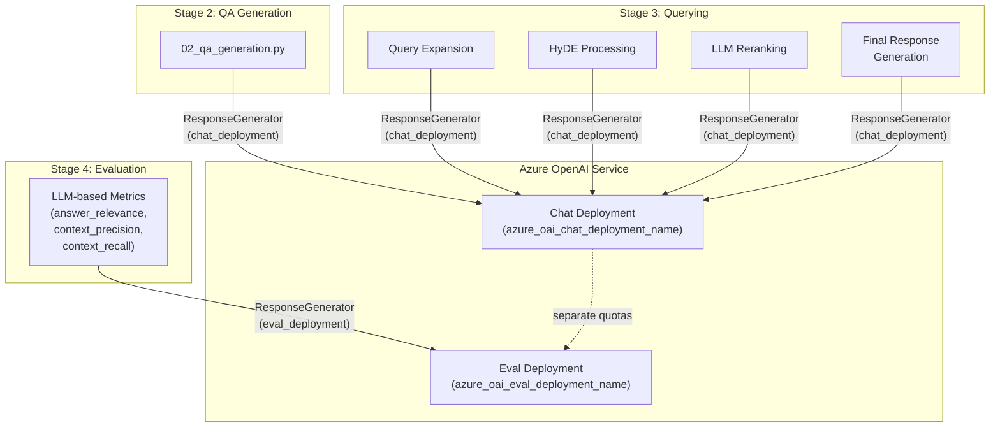
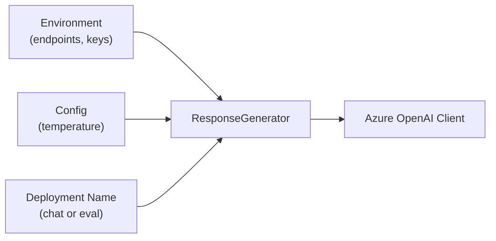
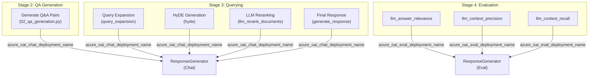
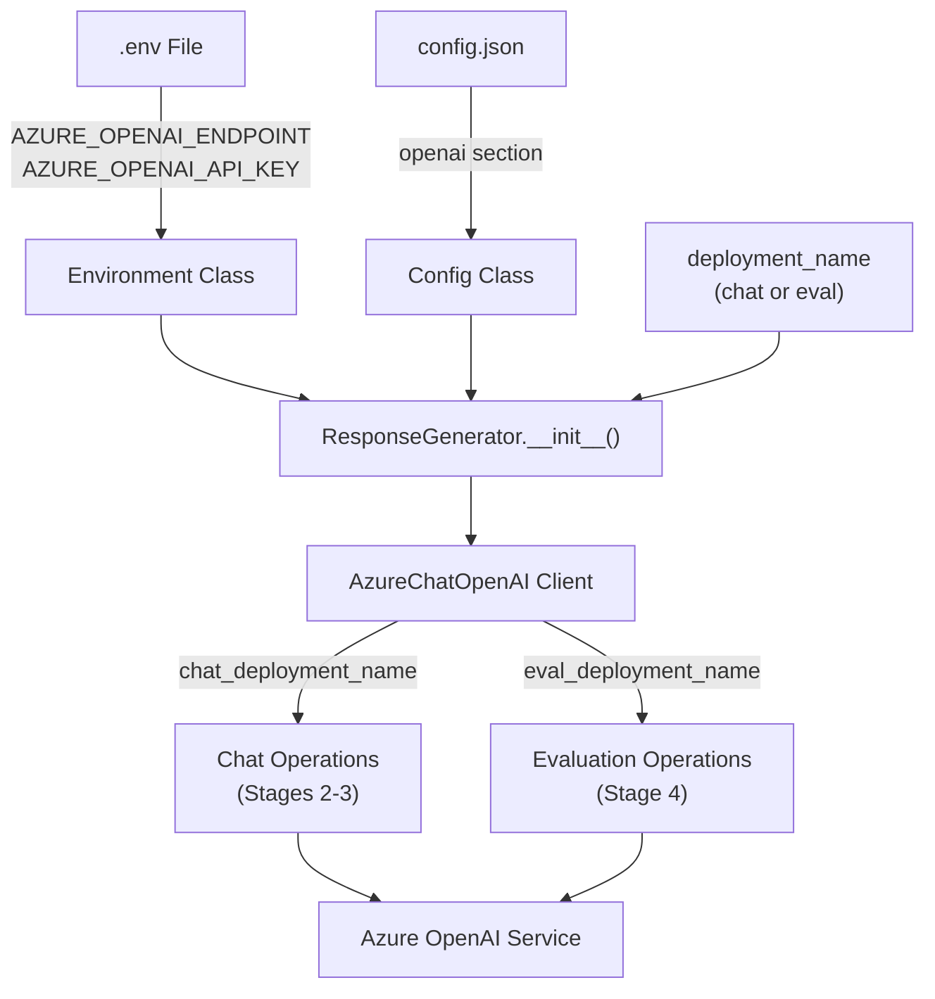

<!-- source: DeepWiki mcp.deepwiki.com · repo microsoft/rag-experiment-accelerator · page 9.2 Azure OpenAI Integration · fetched 2026-10-26 -->

# Azure OpenAI Integration

<details>
<summary>Relevant source files</summary>

The following files were used as context for generating this wiki page:

- [README.md](README.md)
- [config.sample.json](config.sample.json)
- [rag_experiment_accelerator/evaluation/LICENSE.txt](rag_experiment_accelerator/evaluation/LICENSE.txt)
- [rag_experiment_accelerator/evaluation/eval.py](rag_experiment_accelerator/evaluation/eval.py)
- [rag_experiment_accelerator/run/querying.py](rag_experiment_accelerator/run/querying.py)
- [rag_experiment_accelerator/run/tests/test_querying.py](rag_experiment_accelerator/run/tests/test_querying.py)
- [rag_experiment_accelerator/search_type/acs_search_methods.py](rag_experiment_accelerator/search_type/acs_search_methods.py)
- [rag_experiment_accelerator/search_type/tests/test_acs_search_methods.py](rag_experiment_accelerator/search_type/tests/test_acs_search_methods.py)

</details>


## Purpose and Scope

This document describes the integration of Azure OpenAI services within the RAG Experiment Accelerator. It covers the configuration of OpenAI deployments, the dual-deployment architecture for chat and evaluation tasks, and how the system interacts with Azure OpenAI APIs throughout the four-stage pipeline.

For information about Azure OpenAI embedding models specifically, see [Azure OpenAI Embeddings](#6.2). For general Azure service infrastructure setup, see [Azure Service Integration](#9).

---

## Overview

The RAG Experiment Accelerator uses Azure OpenAI in three primary capacities:

1. **Chat Completions**: Generating responses to user queries using retrieved context
2. **Evaluation**: LLM-as-judge metrics for assessing response quality
3. **Query Processing**: Query expansion, HyDE (Hypothetical Document Embeddings), and reranking

The system employs a **dual-deployment strategy** with separate Azure OpenAI deployments for chat and evaluation operations to prevent quota conflicts and enable independent scaling.

**Sources**: [README.md:348-351](), [config.sample.json:72-76]()

---

## Configuration Structure

Azure OpenAI integration is configured through the `openai` section of `config.json`:

```json
{
  "openai": {
    "azure_oai_chat_deployment_name": "gpt-35-turbo",
    "azure_oai_eval_deployment_name": "gpt-35-turbo", 
    "temperature": 0
  }
}
```

### Configuration Parameters

| Parameter | Description | Typical Values | Usage Stage |
|-----------|-------------|----------------|-------------|
| `azure_oai_chat_deployment_name` | Deployment name for chat completions | `gpt-35-turbo`, `gpt-4`, `gpt-4-turbo` | Stages 2, 3 |
| `azure_oai_eval_deployment_name` | Deployment name for evaluation metrics | `gpt-35-turbo`, `gpt-4` | Stage 4 |
| `temperature` | Sampling temperature (0-1) | `0` for deterministic, `0.7` for creative | All stages |

**Sources**: [config.sample.json:72-76](), [README.md:348-351]()

---

## Dual Deployment Architecture



**Deployment Separation Benefits:**

1. **Quota Isolation**: Chat operations don't compete with evaluation for rate limits
2. **Model Selection**: Different models can be used for generation vs evaluation
3. **Cost Management**: Evaluation can use less expensive models
4. **Performance**: Parallel processing without throttling conflicts

**Sources**: [README.md:348-351](), [rag_experiment_accelerator/run/querying.py:485-490](), [rag_experiment_accelerator/evaluation/eval.py:210-212]()

---

## ResponseGenerator Class

The `ResponseGenerator` class is the primary interface for Azure OpenAI interactions. It handles authentication, prompt construction, and API calls.

### Initialization Pattern



### Usage in Stage 3 (Querying)

The chat deployment is instantiated multiple times throughout the querying process:

```python
# Line 485-490 in querying.py
response_generator = ResponseGenerator(
    environment, 
    config, 
    config.openai.azure_oai_chat_deployment_name  # Chat deployment
)
```

### Usage in Stage 4 (Evaluation)

The eval deployment is used specifically for LLM-based metrics:

```python
# Line 210-212 in eval.py
response_generator = ResponseGenerator(
    environment, 
    config, 
    config.openai.azure_oai_eval_deployment_name  # Eval deployment
)
```

**Sources**: [rag_experiment_accelerator/run/querying.py:485-490](), [rag_experiment_accelerator/evaluation/eval.py:210-212]()

---

## Integration Points Across Pipeline Stages



### Stage 2: QA Generation

Azure OpenAI generates question-answer pairs from indexed document chunks. The system uses the chat deployment to create ground truth data for evaluation.

**Sources**: [README.md:204-210]()

### Stage 3: Querying

Azure OpenAI is invoked multiple times per query:

1. **Query Expansion** ([rag_experiment_accelerator/run/querying.py:172-197]()): Generates related questions to improve retrieval
2. **HyDE** ([rag_experiment_accelerator/run/querying.py:145-169]()): Creates hypothetical answers or documents for embedding
3. **LLM Reranking** ([rag_experiment_accelerator/run/querying.py:106-143]()): Scores and filters retrieved documents
4. **Final Response** ([rag_experiment_accelerator/run/querying.py:534-538]()): Generates the answer using retrieved context

### Stage 4: Evaluation

Azure OpenAI serves as an LLM judge for three component-wise metrics:

- `llm_answer_relevance`: Assesses answer completeness and redundancy
- `llm_context_precision`: Evaluates retrieval quality
- `llm_context_recall`: Measures context coverage

**Sources**: [rag_experiment_accelerator/evaluation/eval.py:44-127](), [README.md:518-520]()

---

## Temperature Configuration

The `temperature` parameter controls the randomness of model outputs (range 0-1):

| Temperature | Behavior | Use Cases |
|-------------|----------|-----------|
| `0` | Deterministic, consistent outputs | Evaluation metrics, reproducible experiments |
| `0.1-0.3` | Slightly varied, focused | Q&A generation, reranking |
| `0.7-1.0` | Creative, diverse | Exploratory querying, varied responses |

**Default Configuration**: The sample configuration uses `temperature: 0` for maximum reproducibility across experimental runs.

**Sources**: [config.sample.json:75](), [README.md:351]()

---

## Query Processing Operations

### Query Expansion

Generates multiple related questions to broaden search coverage:

```python
# Configured via config.query_expansion.query_expansion
if config.query_expansion.query_expansion:
    generated_queries = query_expansion(
        config, response_generator, embedding_model, query
    )
```

The system generates five related questions, filters them by similarity (default 90% threshold), and searches for each variant.

**Sources**: [rag_experiment_accelerator/run/querying.py:255-260](), [README.md:433-445]()

### HyDE (Hypothetical Document Embeddings)

Creates hypothetical content for improved retrieval:

| HyDE Mode | Description | Configuration Value |
|-----------|-------------|---------------------|
| Disabled | No HyDE processing | `"hyde": "disabled"` |
| Hypothetical Answer | Generate potential answer | `"hyde": "generated_hypothetical_answer"` |
| Hypothetical Document | Generate document containing answer | `"hyde": "generated_hypothetical_document_to_answer"` |

```python
# Configuration in config.json
{
  "query_expansion": {
    "hyde": "generated_hypothetical_answer"
  }
}
```

**Sources**: [rag_experiment_accelerator/run/querying.py:145-169](), [README.md:411-431]()

### LLM-Based Reranking

When `config.rerank.type` is set to `"llm"`, the system uses Azure OpenAI to score and rerank retrieved documents:

```python
# Reranking configuration
{
  "rerank": {
    "enabled": true,
    "type": "llm",
    "llm_rerank_threshold": 3
  }
}
```

Documents scoring above `llm_rerank_threshold` (scale 1-10) are retained for context assembly.

**Sources**: [rag_experiment_accelerator/run/querying.py:126-132](), [README.md:333]()

---

## Error Handling

The system includes error handling for Azure OpenAI API failures:

```python
# From querying.py line 459-463
except BadRequestError as e:
    logger.error(
        "Invalid request. Skipping question: {user_prompt}",
        exc_info=e,
    )
```

Common error scenarios:

1. **Content Filtering**: Azure OpenAI content filters may reject inappropriate input/output
2. **Token Limits**: Requests exceeding model context window are rejected
3. **Rate Limiting**: Quota exhaustion results in 429 errors
4. **Malformed JSON**: QA generation may produce invalid JSON (handled with retries)

**Sources**: [rag_experiment_accelerator/run/querying.py:459-463](), [README.md:505-513]()

---

## Connection Flow



### Environment Variables

The system requires these environment variables in `.env`:

```bash
AZURE_OPENAI_ENDPOINT=https://your-resource.openai.azure.com/
AZURE_OPENAI_API_KEY=your-api-key-here
```

**Sources**: [README.md:185-189]()

---

## Model Selection Guidance

### Chat Deployment Models

| Model | Context Window | Speed | Cost | Best For |
|-------|----------------|-------|------|----------|
| `gpt-35-turbo` | 4,096 tokens | Fast | Low | Development, testing, basic Q&A |
| `gpt-35-turbo-16k` | 16,384 tokens | Fast | Medium | Larger contexts, complex queries |
| `gpt-4` | 8,192 tokens | Moderate | High | High-quality responses, complex reasoning |
| `gpt-4-turbo` | 128,000 tokens | Moderate | High | Very large contexts, comprehensive answers |

### Evaluation Deployment Models

For LLM-based evaluation metrics, consider:

- **Development**: `gpt-35-turbo` (cost-effective, adequate for most metrics)
- **Production**: `gpt-4` (higher quality judgments, better consistency)

**Note**: The system has been primarily tested with GPT-3.5 Turbo. Other models may require prompt adjustments.

**Sources**: [README.md:502-503]()

---

## Performance Considerations

### Parallel Processing

The system uses `ThreadPoolExecutor` to parallelize OpenAI calls:

```python
# Max worker threads configuration
{
  "max_worker_threads": 10  # Default value
}
```

This enables concurrent processing of:
- Multiple questions in Stage 3
- Multiple evaluation metrics in Stage 4

**Warning**: High parallelism may trigger rate limits. Monitor Azure OpenAI quota utilization.

**Sources**: [rag_experiment_accelerator/run/querying.py:602-621](), [rag_experiment_accelerator/evaluation/eval.py:219-240]()

### Quota Management

With dual deployments:
- Chat deployment handles: QA generation, query processing, response generation
- Eval deployment handles: LLM-based evaluation metrics only

This separation prevents evaluation jobs from blocking interactive query processing.

**Sources**: [README.md:348-351]()

---

## Testing and Validation

### Test Coverage

The test suite mocks Azure OpenAI interactions to verify integration logic:

```python
# From test_querying.py
@patch("rag_experiment_accelerator.run.querying.ResponseGenerator")
def test_query_and_eval_acs(mock_response_generator, ...):
    # Validates ResponseGenerator usage patterns
```

Key test scenarios:
1. ResponseGenerator initialization with correct deployment names
2. Prompt construction for different operations
3. Error handling for API failures
4. Reranking logic with LLM scores

**Sources**: [rag_experiment_accelerator/run/tests/test_querying.py:98-167]()

---

## Common Issues and Solutions

### Problem: "Invalid Request" Errors

**Cause**: Input exceeds model context window or triggers content filters

**Solution**:
- Reduce `retrieve_num_of_documents` in config
- Lower `llm_rerank_threshold` to pass fewer documents to LLM
- Check for inappropriate content in source documents

**Sources**: [README.md:494-500]()

### Problem: Rate Limiting (429 Errors)

**Cause**: Exceeding Azure OpenAI quota

**Solution**:
- Reduce `max_worker_threads` for lower parallelism
- Use separate deployments for chat and eval
- Implement exponential backoff (future enhancement)
- Increase quota in Azure Portal

### Problem: Inconsistent Evaluation Scores

**Cause**: Non-zero temperature in eval deployment

**Solution**: Set `temperature: 0` for deterministic evaluation results

**Sources**: [README.md:518-520]()

---

## Related Configuration

For complete configuration options, including embedding model selection and search strategies that complement Azure OpenAI usage, see:
- [Configuration Guide](#2.2) - Full config.json structure
- [Azure OpenAI Embeddings](#6.2) - Embedding model configuration
- [LLM-Based Evaluation](#8.3) - Evaluation metric details

---

