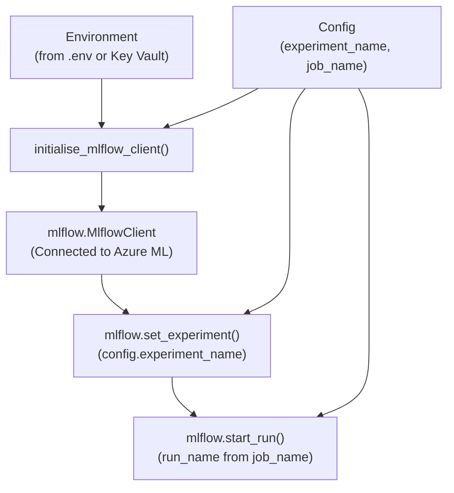
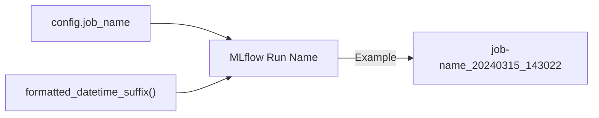
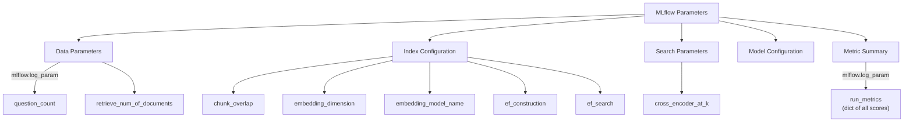
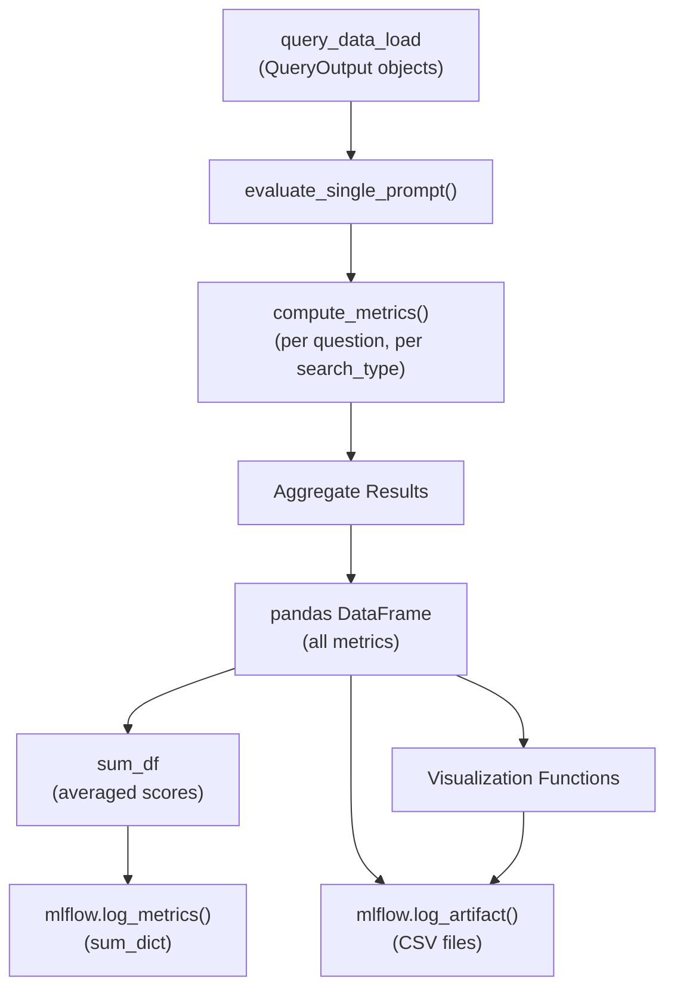
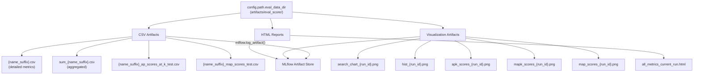
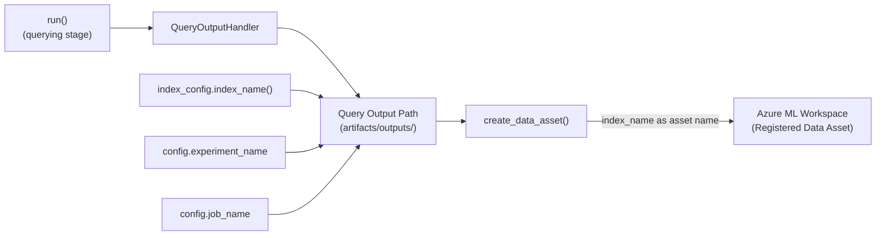
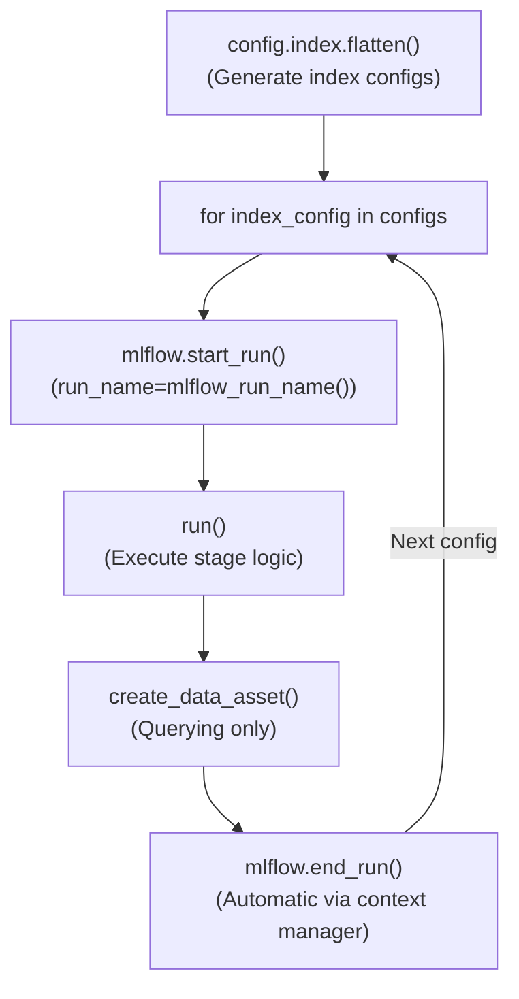
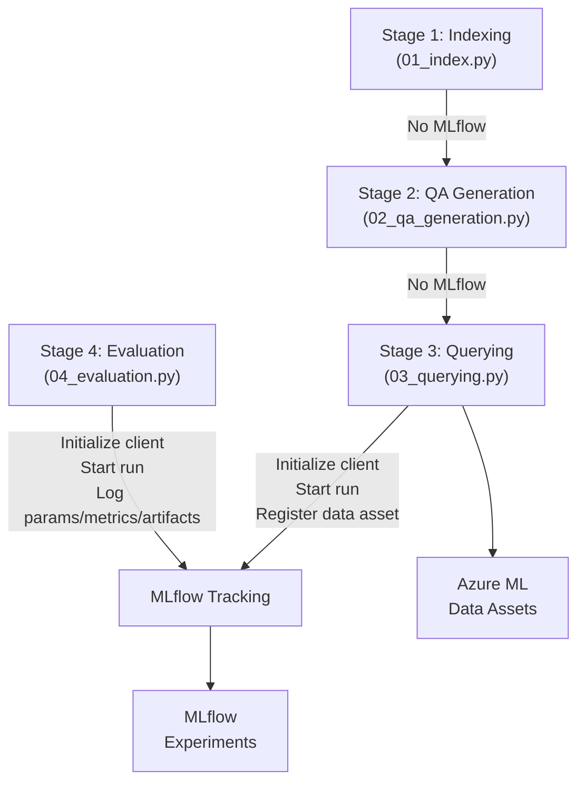

<!-- source: DeepWiki mcp.deepwiki.com · repo microsoft/rag-experiment-accelerator · page 9.3 Azure ML and MLflow · fetched 2026-10-26 -->

# Azure ML and MLflow

<details>
<summary>Relevant source files</summary>

The following files were used as context for generating this wiki page:

- [02_qa_generation.py](02_qa_generation.py)
- [03_querying.py](03_querying.py)
- [04_evaluation.py](04_evaluation.py)
- [README.md](README.md)
- [config.sample.json](config.sample.json)
- [rag_experiment_accelerator/evaluation/LICENSE.txt](rag_experiment_accelerator/evaluation/LICENSE.txt)
- [rag_experiment_accelerator/evaluation/eval.py](rag_experiment_accelerator/evaluation/eval.py)

</details>


## Purpose and Scope

This document describes the integration of Azure Machine Learning (Azure ML) and MLflow in the RAG Experiment Accelerator. Azure ML provides the cloud infrastructure and workspace for managing machine learning experiments, while MLflow serves as the experiment tracking and management framework. Together, they enable systematic comparison of RAG configurations, tracking of evaluation metrics, and versioning of experiment artifacts.

For information about Azure AI Search configuration, see [Azure AI Search Configuration](#9.1). For Azure OpenAI integration details, see [Azure OpenAI Integration](#9.2). For checkpoint and artifact management, see [Checkpointing System](#10.1).

---

## MLflow Client Initialization

The MLflow client is initialized at the start of the querying and evaluation stages to establish connection with the Azure ML workspace and configure experiment tracking.



The initialization sequence occurs in both querying and evaluation stages:

**Querying Stage:**
- [03_querying.py:29-35]() loads environment and config, then initializes the MLflow client
- [03_querying.py:41]() starts an MLflow run with a generated run name before executing the query pipeline

**Evaluation Stage:**
- [04_evaluation.py:28-32]() follows the same initialization pattern
- [04_evaluation.py:35]() starts the MLflow run with a timestamped suffix

Sources: [03_querying.py:1-52](), [04_evaluation.py:1-43]()

---

## Experiment and Run Organization

The system organizes MLflow tracking using a two-level hierarchy: experiments and runs. Each experiment groups related runs, while individual runs represent specific configuration executions.

### Experiment Structure

| Configuration Field | Purpose | Default Behavior |
|---------------------|---------|------------------|
| `experiment_name` | Groups all job runs under a single experiment | If empty, uses `index_name_prefix` |
| `job_name` | Names individual runs with timestamp suffix | If empty, uses timestamp only |
| `job_description` | Provides human-readable context for the run | Optional metadata |

**Configuration Example:**
```json
{
    "experiment_name": "exp-name",
    "job_name": "job-name",
    "job_description": "Testing chunk size variations"
}
```

### Run Naming Pattern



The run naming logic is implemented in:
- [rag_experiment_accelerator/config/paths.py]() contains the `mlflow_run_name()` and `formatted_datetime_suffix()` functions
- [03_querying.py:41]() uses `mlflow_run_name(config.job_name)` for querying runs
- [04_evaluation.py:35]() uses `mlflow_run_name(config.job_name, name_suffix)` for evaluation runs

Sources: [03_querying.py:29-41](), [04_evaluation.py:28-35](), [config.sample.json:3-5]()

---

## Parameter Logging

MLflow tracks all hyperparameters used in each experiment run, enabling systematic comparison across configurations. Parameters are logged during the evaluation stage after metrics are computed.

### Logged Parameters

The following parameters are automatically logged for each run:



**Implementation:**
[rag_experiment_accelerator/evaluation/eval.py:307-319]() logs all parameters:

```python
mlflow.log_param("question_count", common_data.question_count)
mlflow.log_param("retrieve_num_of_documents", common_data.retrieve_num_of_documents)
mlflow.log_param("cross_encoder_at_k", common_data.cross_encoder_at_k)
mlflow.log_param("chunk_overlap", index_config.chunking.overlap_size)
mlflow.log_param("embedding_dimension", ...)
mlflow.log_param("embedding_model_name", index_config.embedding_model.model_name)
mlflow.log_param("ef_construction", index_config.ef_construction)
mlflow.log_param("ef_search", index_config.ef_search)
mlflow.log_param("run_metrics", sum_dict)
```

Sources: [rag_experiment_accelerator/evaluation/eval.py:307-319]()

---

## Metric Logging

Evaluation metrics are computed and logged to MLflow, enabling comparison across different RAG configurations and search strategies. The system supports three categories of metrics: algorithm-based, BERT-based, and LLM-based.

### Metric Computation and Logging Flow



### Metric Aggregation

The system computes metrics for each question and search type, then aggregates them:

**Per-Question Metrics:**
- [rag_experiment_accelerator/evaluation/eval.py:129-159]() computes metrics for individual questions
- Results stored in `data_list` with fields: question, retrieved_contexts, actual, expected, search_type, and all metric scores

**Aggregated Metrics:**
- [rag_experiment_accelerator/evaluation/eval.py:276-283]() calculates average scores across all questions and search types
- Formula: `sum_all_columns = temp_df.sum() / (question_count * len(num_search_type))`
- [rag_experiment_accelerator/evaluation/eval.py:319]() logs aggregated metrics with `mlflow.log_metrics(sum_dict)`

### Retrieval Metrics

The system also tracks retrieval quality using precision and MAP (Mean Average Precision) scores:

| Metric | Computation | Purpose |
|--------|-------------|---------|
| Precision@k | Per-query precision at rank k | Measures retrieval accuracy at specific ranks |
| Average Precision | Mean of precision scores per query | Overall retrieval quality per query |
| MAP (Mean Average Precision) | Mean of average precision across queries | Global retrieval performance |

**Implementation:**
- [rag_experiment_accelerator/evaluation/eval.py:161-176]() collects precision scores by search type
- [rag_experiment_accelerator/evaluation/eval.py:241-260]() computes MAP@k scores
- [rag_experiment_accelerator/evaluation/eval.py:289-304]() saves and plots precision and MAP metrics

Sources: [rag_experiment_accelerator/evaluation/eval.py:44-127](), [rag_experiment_accelerator/evaluation/eval.py:178-327]()

---

## Artifact Management

MLflow logs various artifacts including CSV files, visualizations, and HTML reports. These artifacts provide detailed insights into experiment results and enable post-hoc analysis.

### Artifact Types and Locations



### Artifact Logging Implementation

**CSV Files:**
- [rag_experiment_accelerator/evaluation/eval.py:266-268]() saves detailed metric results
- [rag_experiment_accelerator/evaluation/eval.py:285-287]() saves aggregated summary
- [rag_experiment_accelerator/evaluation/eval.py:289-303]() saves retrieval metrics
- [rag_experiment_accelerator/evaluation/eval.py:320-323]() logs CSV artifacts to MLflow

**Visualizations:**
The system generates several chart types for visual analysis:

| Visualization Function | Purpose | Output |
|------------------------|---------|--------|
| `draw_search_chart()` | Compare metrics across search types | `search_chart_{run_id}.png` |
| `draw_hist_df()` | Show distribution of metric scores | `hist_{run_id}.png` |
| `plot_apk_scores()` | Plot precision at k | `apk_scores_{run_id}.png` |
| `plot_mapk_scores()` | Plot MAP at k | `mapk_scores_{run_id}.png` |
| `plot_map_scores()` | Compare MAP across search types | `map_scores_{run_id}.png` |
| `generate_metrics()` | Generate HTML comparison report | `all_metrics_current_run.html` |

**Implementation:**
- [rag_experiment_accelerator/evaluation/eval.py:272]() generates search comparison chart
- [rag_experiment_accelerator/evaluation/eval.py:296-304]() generates retrieval metric plots
- [rag_experiment_accelerator/evaluation/eval.py:324-325]() generates metric comparison and histogram

Sources: [rag_experiment_accelerator/evaluation/eval.py:266-325](), [README.md:447-479]()

---

## Data Asset Registration

After querying completes, the system registers query results as versioned data assets in Azure ML. This enables reproducibility and provides a clear lineage from input documents to evaluation results.

### Data Asset Creation Flow



### Implementation Details

**Query Output Storage:**
- [03_querying.py:37]() initializes `QueryOutputHandler` with the query data directory
- [03_querying.py:44]() retrieves the index name from the current configuration
- [03_querying.py:45-48]() constructs the output path using index name, experiment name, and job name

**Data Asset Creation:**
[03_querying.py:45-51]() registers the query output as a data asset:
```python
create_data_asset(
    data_path=handler.get_output_path(
        index_name, config.experiment_name, config.job_name
    ),
    data_asset_name=index_name,
    environment=environment,
)
```

The `create_data_asset()` function (implemented in [rag_experiment_accelerator/data_assets/data_asset.py]()) performs the following:
1. Validates the data path exists
2. Connects to the Azure ML workspace using credentials from `environment`
3. Registers the data as a versioned asset with the specified name
4. Creates a new version if an asset with that name already exists

### Data Asset Benefits

| Benefit | Description |
|---------|-------------|
| **Versioning** | Each experiment run creates a new version of the data asset |
| **Lineage** | Tracks the relationship between configuration, queries, and results |
| **Reproducibility** | Enables re-running evaluation on the same query results |
| **Collaboration** | Makes experiment results accessible to team members via Azure ML |
| **Integration** | Can be used as input to downstream ML pipelines |

Sources: [03_querying.py:37-51](), [README.md:224]()

---

## MLflow Usage Patterns

The system follows consistent patterns for MLflow usage across the querying and evaluation stages, ensuring proper experiment tracking and resource cleanup.

### Context Manager Pattern

Both stages use MLflow's context manager pattern to ensure runs are properly started and ended:



**Querying Stage:**
```python
for index_config in config.index.flatten():
    with mlflow.start_run(run_name=mlflow_run_name(config.job_name)):
        run(environment, config, index_config, mlflow_client)
        create_data_asset(...)
        # mlflow.end_run() called automatically
```

**Evaluation Stage:**
```python
for index_config in config.index.flatten():
    with mlflow.start_run(run_name=mlflow_run_name(config.job_name, name_suffix)):
        run(environment, config, index_config, mlflow_client, name_suffix)
        # mlflow.end_run() called automatically
```

### Run Lifecycle

[rag_experiment_accelerator/evaluation/eval.py:262]() retrieves the active run ID for artifact naming:
```python
run_id = mlflow.active_run().info.run_id
```

[rag_experiment_accelerator/evaluation/eval.py:326]() explicitly ends the run after all logging is complete:
```python
mlflow.end_run()
```

Sources: [03_querying.py:40-51](), [04_evaluation.py:34-42](), [rag_experiment_accelerator/evaluation/eval.py:262-326]()

---

## Environment Configuration

MLflow integration requires specific environment variables to connect to the Azure ML workspace. These are loaded from the `.env` file or Azure Key Vault.

### Required Environment Variables

| Variable | Purpose | Example |
|----------|---------|---------|
| `AZURE_SUBSCRIPTION_ID` | Azure subscription containing the workspace | `xxxxxxxx-xxxx-xxxx-xxxx-xxxxxxxxxxxx` |
| `AZURE_ML_RESOURCE_GROUP_NAME` | Resource group containing the workspace | `rg-rag-experiment` |
| `AZURE_ML_WORKSPACE_NAME` | Name of the Azure ML workspace | `mlw-rag-experiment` |

**Loading Pattern:**
[03_querying.py:29]() and [04_evaluation.py:28]() load environment variables:
```python
environment = Environment.from_env_or_keyvault()
```

The `Environment` class (implemented in [rag_experiment_accelerator/config/environment.py]()) attempts to:
1. Load variables from `.env` file first
2. Fall back to Azure Key Vault if configured
3. Validate all required variables are present

### MLflow Client Initialization

The `initialise_mlflow_client()` function uses these environment variables to:
1. Authenticate with Azure using the current credentials (from `az login`)
2. Connect to the specified Azure ML workspace
3. Configure MLflow tracking URI to point to the workspace
4. Return an initialized `mlflow.MlflowClient` instance

Sources: [03_querying.py:29-34](), [04_evaluation.py:28-31](), [README.md:185-189]()

---

## Integration with Pipeline Stages

MLflow integration is active during Stages 3 (Querying) and 4 (Evaluation), while Stages 1 (Indexing) and 2 (QA Generation) do not require MLflow logging.

### Stage Integration Overview



### Stage-Specific Behavior

**Stage 1 & 2 (No MLflow):**
- [01_index.py]() and [02_qa_generation.py]() do not import or use MLflow
- Focus on data preparation and ground truth generation
- Output artifacts saved to local filesystem only

**Stage 3 (Querying):**
- [03_querying.py:34]() initializes MLflow client
- [03_querying.py:35]() sets experiment name
- [03_querying.py:41]() starts run for each index configuration
- [03_querying.py:45-51]() registers query results as data assets
- No metrics or parameters logged (only data asset registration)

**Stage 4 (Evaluation):**
- [04_evaluation.py:31]() initializes MLflow client
- [04_evaluation.py:32]() sets experiment name
- [04_evaluation.py:35]() starts run with timestamped suffix
- [rag_experiment_accelerator/evaluation/eval.py:307-326]() logs comprehensive experiment metadata:
  - Parameters (hyperparameters, index configuration)
  - Metrics (evaluation scores, retrieval metrics)
  - Artifacts (CSV files, visualizations, HTML reports)

Sources: [03_querying.py:1-52](), [04_evaluation.py:1-43](), [02_qa_generation.py:1-23](), [README.md:197-222]()

---

## Experiment Comparison and Visualization

MLflow provides a web-based UI for comparing experiments, analyzing metrics, and visualizing results across multiple runs. The system generates several visualization types to facilitate analysis.

### Available Visualizations

| Visualization | Description | Generated By |
|---------------|-------------|--------------|
| **Metric Comparison** | Average scores across metrics and search types | `all_metrics_current_run.html` |
| **Hyper Parameters** | Side-by-side parameter comparison | MLflow UI tables |
| **Sample Metrics** | Metric trends across runs | MLflow metric plots |
| **Search Evaluation** | Performance comparison across search strategies | `search_chart_{run_id}.png` |
| **Retrieval Evaluation** | MAP@k and precision plots | `apk_scores_{run_id}.png`, `map_scores_{run_id}.png` |

### Accessing MLflow UI

The MLflow UI is accessed through the Azure ML workspace:

1. Navigate to Azure ML workspace in Azure Portal
2. Select "Experiments" from the left menu
3. Click on the experiment name (from `config.experiment_name`)
4. View individual runs and compare multiple runs side-by-side

### Comparing Runs

The MLflow UI enables:
- **Parameter Comparison**: Side-by-side view of all hyperparameters
- **Metric Comparison**: Plot metric trends across runs
- **Artifact Comparison**: Download and compare CSV files
- **Visualization Comparison**: View generated charts for each run

Sources: [README.md:447-479](), [rag_experiment_accelerator/evaluation/eval.py:262-326]()

---

