# Page: Overview

# Overview

<details>
<summary>Relevant source files</summary>

The following files were used as context for generating this wiki page:

- [.github/workflows/config.json](.github/workflows/config.json)
- [02_qa_generation.py](02_qa_generation.py)
- [03_querying.py](03_querying.py)
- [04_evaluation.py](04_evaluation.py)
- [README.md](README.md)
- [config.sample.json](config.sample.json)
- [config.schema.json](config.schema.json)
- [docs/evaluation-metrics.md](docs/evaluation-metrics.md)
- [promptflow/rag-experiment-accelerator/README.md](promptflow/rag-experiment-accelerator/README.md)
- [rag_experiment_accelerator/config/eval_config.py](rag_experiment_accelerator/config/eval_config.py)
- [rag_experiment_accelerator/evaluation/plain_metrics.py](rag_experiment_accelerator/evaluation/plain_metrics.py)
- [rag_experiment_accelerator/evaluation/tests/test_plain_metrics.py](rag_experiment_accelerator/evaluation/tests/test_plain_metrics.py)

</details>


## Purpose and Scope

This document provides a high-level introduction to the **RAG Experiment Accelerator**, a configuration-driven system for systematic experimentation and evaluation of Retrieval-Augmented Generation (RAG) pipelines. It covers the system's purpose, 4-stage architecture, execution models, and core capabilities.

For installation instructions and environment setup, see [Installation and Dependencies](#2.1). For detailed configuration parameters, see [Configuration Guide](#2.2). For in-depth documentation of each pipeline stage, see [Pipeline Architecture](#3).

Sources: [README.md:1-27]()

## System Purpose

The RAG Experiment Accelerator enables data scientists and researchers to systematically evaluate RAG system performance by:

- **Testing hyperparameter combinations**: Experiment with different chunk sizes, embedding models, search strategies, and reranking approaches
- **Comparing search strategies**: Evaluate 8 different search types including text, vector, hybrid, and semantic search
- **Measuring retrieval quality**: Calculate end-to-end metrics (algorithm-based, BERT-based, LLM-based) and retrieval-specific metrics (MAP@k)
- **Tracking experiments**: Log all parameters and metrics to MLflow for comparison across runs
- **Generating reports**: Automatically produce visualizations and comparison charts

The system is **configuration-driven**, meaning all experimental parameters are specified in `config.json`, enabling reproducible experiments and systematic grid searches across parameter spaces.

Sources: [README.md:8-16](), [README.md:27-50]()

## Four-Stage Pipeline Architecture

The accelerator implements a sequential pipeline where each stage produces artifacts consumed by the next stage. All stages can be run via CLI scripts numbered `01` through `04`.

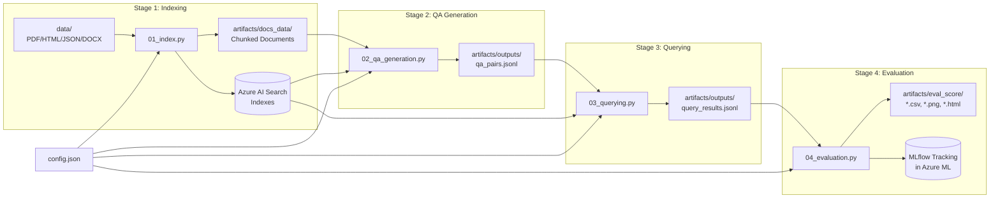

**Stage 1: Document Indexing** ([01_index.py:1-52]())
- Loads documents from the `data/` directory using format-specific loaders
- Chunks documents according to `config.index.chunking` parameters
- Optionally samples data via K-means clustering
- Generates embeddings using sentence-transformers or Azure OpenAI models
- Creates multiple Azure AI Search indexes based on `config.index.flatten()` combinations
- Outputs to `artifacts/docs_data/` and `artifacts/index_data/`

**Stage 2: QA Generation** ([02_qa_generation.py:1-23]())
- Reads chunked documents from Stage 1
- Uses LLM (via Azure OpenAI) to generate question-answer pairs for each chunk
- Produces ground truth dataset in `artifacts/outputs/qa_pairs.jsonl`
- Each line contains: `user_prompt` (question), `output_prompt` (answer), `context` (source chunk)

**Stage 3: Querying and Retrieval** ([03_querying.py:1-52]())
- Loads QA pairs from Stage 2
- For each question and search type combination:
  - Optionally expands queries or generates hypothetical documents (HyDE)
  - Searches Azure AI Search using configured search strategies
  - Optionally reranks results using LLM or cross-encoder models
  - Generates LLM responses with retrieved context
- Outputs results to `artifacts/outputs/query_results.jsonl`
- Registers output as Azure ML data asset

**Stage 4: Evaluation and Reporting** ([04_evaluation.py:1-43]())
- Loads query results from Stage 3
- Calculates configured metrics: algorithm-based (levenshtein, jaccard), BERT-based (semantic similarity), LLM-based (answer relevance, context precision/recall)
- Generates visualizations (comparison charts, scatter plots, metric tables)
- Logs all metrics and parameters to MLflow
- Outputs to `artifacts/eval_score/` directory

Sources: [README.md:197-223](), [01_index.py:1-52](), [02_qa_generation.py:1-23](), [03_querying.py:1-52](), [04_evaluation.py:1-43]()

## Execution Models

The system supports three execution modes that converge on the same CLI scripts but differ in orchestration:

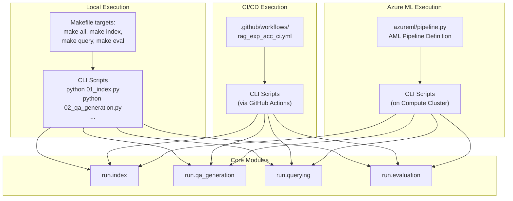

**Local Execution**: Developer runs scripts directly via `python 01_index.py` or using Makefile targets. Suitable for rapid iteration and debugging.

**CI/CD Execution**: GitHub Actions workflow (`.github/workflows/rag_exp_acc_ci.yml`) executes the pipeline on each commit using smaller test dataset (`data-ci/`). Validates code changes automatically.

**Azure ML Execution**: Pipeline submitted to Azure ML compute cluster for distributed execution. Enables processing large datasets and running multiple experiments in parallel. See [Azure ML and MLflow](#9.3) for details.

All three modes use the same configuration system (`Config` object from `config.json` and `Environment` object from `.env`).

Sources: [README.md:64-68](), [README.md:224](), [promptflow/rag-experiment-accelerator/README.md:52-93]()

## Configuration System

The system is driven by a hierarchical configuration loaded from `config.json`:

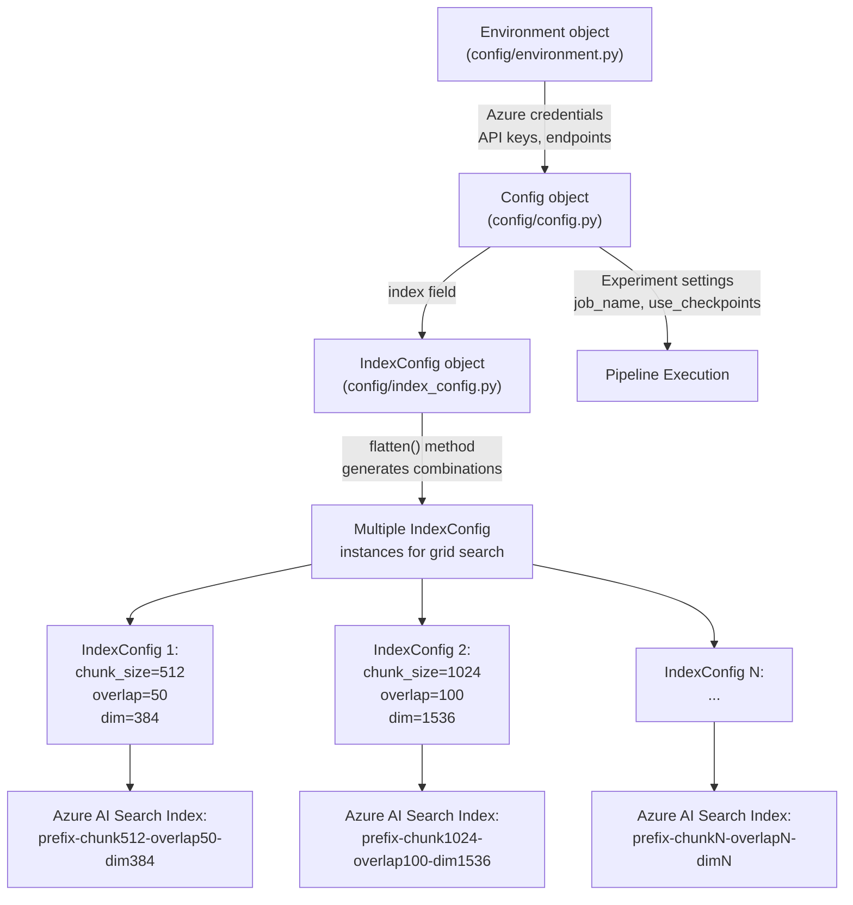

**Environment Object** ([config/environment.py]()): Loads Azure credentials from `.env` file or Azure Key Vault. Contains:
- `azure_search_service_endpoint`, `azure_search_admin_key`
- `azure_openai_endpoint`, `azure_openai_api_key`
- `azure_ml_workspace_name`, `azure_ml_subscription_id`
- `azure_document_intelligence_endpoint`, `azure_document_intelligence_key`

**Config Object** ([config/config.py]()): Loaded from `config.json`. Contains:
- `experiment_name`: Groups runs in MLflow
- `job_name`: Identifies specific run
- `use_checkpoints`: Enable/disable caching
- `index`: IndexConfig or list of IndexConfig parameters
- `search`: Search configuration (types, num_documents, threshold)
- `rerank`: Reranking configuration (enabled, type, threshold)
- `query_expansion`: HyDE and query expansion settings
- `openai`: Azure OpenAI deployment names and temperature
- `eval`: Metric types to calculate

**IndexConfig Object** ([config/index_config.py]()): Defines index creation parameters:
- `index_name_prefix`: Base name for indexes
- `chunking`: `chunk_size`, `overlap_size`, `chunking_strategy`
- `embedding_model`: Model type and configuration
- `ef_construction`, `ef_search`: HNSW algorithm parameters
- `sampling`: Data sampling configuration

**Configuration Flattening**: When config parameters contain lists (e.g., `chunk_size: [500, 1000, 2000]`), calling `config.index.flatten()` generates all combinations, enabling grid search experiments. Each combination creates a separate Azure AI Search index.

Sources: [README.md:283-357](), [config.sample.json:1-88](), [config.schema.json:1-605]()

## Key Capabilities

### Multi-Strategy Search

The system supports 8 search strategies configurable via `config.search.search_type`:

| Search Type | Description | Uses Text Search | Uses Vector Search | Uses Semantic Ranking |
|-------------|-------------|------------------|--------------------|-----------------------|
| `search_for_match_text` | BM25 text search only | ✓ | | |
| `search_for_match_pure_vector` | Single vector field search | | ✓ | |
| `search_for_match_pure_vector_multi` | Multi-field vector search (content, title, summary) | | ✓ | |
| `search_for_match_pure_vector_cross` | Cross-field vector search | | ✓ | |
| `search_for_manual_hybrid` | Manual RRF hybrid | ✓ | ✓ | |
| `search_for_match_Hybrid_multi` | Hybrid with multi-vector | ✓ | ✓ | |
| `search_for_match_Hybrid_cross` | Hybrid with cross-vector | ✓ | ✓ | |
| `search_for_match_semantic` | Semantic search with L2 reranking | ✓ | | ✓ |

Each search type is implemented in [search_type/acs_search_methods.py]().

Sources: [README.md:42](), [config.schema.json:460-471]()

### Reranking Strategies

After initial retrieval, results can be reranked using:

**LLM Reranking** (`config.rerank.type = "llm"`):
- Uses Azure OpenAI to score chunk relevance
- Selects top-k chunks above `llm_rerank_threshold` (1-10 scale)
- Implemented in [llm/llm_rerank.py]()

**Cross-Encoder Reranking** (`config.rerank.type = "cross_encoder"`):
- Uses sentence-transformers cross-encoder model (`cross-encoder/stsb-roberta-base`)
- Selects top-k chunks based on `cross_encoder_at_k`
- Implemented in [llm/cross_encoder_rerank.py]()

Sources: [README.md:46](), [config.sample.json:50-56]()

### Query Expansion

Enhance retrieval quality through query manipulation:

**HyDE (Hypothetical Document Embeddings)** ([config.query_expansion.hyde]()):
- `"generated_hypothetical_answer"`: Generate hypothetical answer, embed and search
- `"generated_hypothetical_document_to_answer"`: Generate hypothetical document containing answer
- Based on [arXiv:2212.10496](https://arxiv.org/abs/2212.10496)

**Multi-Question Expansion** ([config.query_expansion.query_expansion]()):
- Generate 5 related questions using LLM
- Filter questions with similarity score > `min_query_expansion_related_question_similarity_score`
- Search with all questions, deduplicate results
- Improves recall for complex queries

Sources: [README.md:44](), [README.md:411-445]()

### Comprehensive Evaluation Metrics

The system supports three tiers of metrics:

**Algorithm-Based Metrics** (fast, deterministic):
- String distance: `levenshtein`, `hamming`, `jaro_winkler`
- Set similarity: `jaccard`, `cosine_ochiai`
- Token-based: `fuzzy_score`, ROUGE scores (`rouge1_precision`, `rouge2_recall`, `rougeL_fmeasure`)

**BERT-Based Metrics** (semantic similarity via embeddings):
- `bert_all_MiniLM_L6_v2` (384-dim, fast)
- `bert_base_nli_mean_tokens` (768-dim, NLI-trained)
- `bert_large_nli_stsb_mean_tokens` (1024-dim, STS-B optimized)
- `bert_distilbert_base_nli_stsb_mean_tokens` (768-dim, efficient)
- `bert_paraphrase_multilingual_MiniLM_L12_v2` (384-dim, multilingual)

**LLM-Based Metrics** (contextual understanding):
- `llm_answer_relevance`: Measures completeness and redundancy
- `llm_context_precision`: Evaluates retrieval quality (relevant chunks retrieved)
- `llm_context_recall`: Measures coverage (ground truth covered by retrieved chunks)

Metrics are calculated in [evaluation/eval.py]() using implementations from [evaluation/plain_metrics.py](), [evaluation/evaluator.py](), and [evaluation/llm_evaluators.py]().

Sources: [README.md:48](), [docs/evaluation-metrics.md:1-191](), [rag_experiment_accelerator/config/eval_config.py:1-17](), [rag_experiment_accelerator/evaluation/plain_metrics.py:1-213]()

## Fault Tolerance and Caching

The system implements a checkpoint mechanism for expensive operations:

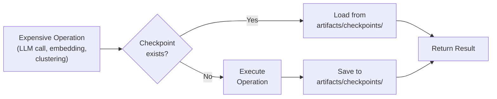

**Checkpoint Decorator** ([checkpoint/cache_with_checkpoint.py]()): 
- Applied to functions via `@cache_with_checkpoint` decorator
- Computes hash of function inputs (deterministic)
- Checks if cached result exists in `artifacts/checkpoints/`
- Returns cached result if available, otherwise executes function and caches result
- Enabled/disabled via `config.use_checkpoints`

**Checkpointed Operations**:
- Document chunking and embedding generation
- QA pair generation via LLM
- Query expansion and HyDE generation
- Data sampling and clustering
- Search result retrieval

This prevents redundant expensive operations when re-running experiments with modified configurations.

Sources: [README.md:8](), [README.md:291]()

## Azure Service Integration

The accelerator integrates with multiple Azure services:

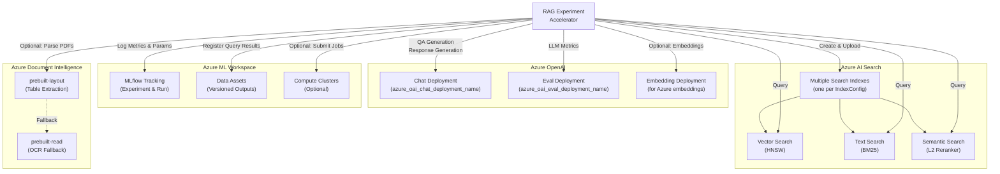

**Azure AI Search**: Stores document chunks with embeddings in multiple indexes. Configuration includes `ef_construction` and `ef_search` for HNSW algorithm tuning.

**Azure OpenAI**: 
- **Separate deployments** for chat and evaluation prevent quota conflicts
- Chat deployment used for QA generation and response generation
- Eval deployment used for LLM-based metrics
- Optional embedding deployment for Azure OpenAI embeddings (vs. sentence-transformers)

**Azure ML Workspace**:
- MLflow tracks experiments, runs, metrics, and parameters
- Data assets store versioned query results
- Optional compute clusters for distributed execution

**Azure Document Intelligence**: 
- Optional PDF parsing with table extraction
- `prebuilt-layout` model provides advanced table formatting
- Automatic fallback to `prebuilt-read` for simpler OCR

Sources: [README.md:56-61](), [README.md:349-352]()

## Data Sampling

For large datasets, the system supports representative sampling via K-means clustering:

**Sampling Process**:
1. Embed all documents using configured embedding model
2. Apply K-means clustering to group similar documents
3. Sample specified percentage from each cluster
4. Generate visualizations: cluster scatter plot, elbow graph (if `optimum_k = "auto"`)
5. Output sampled files to `artifacts/sampling/config.[job_name]/`

**Configuration** ([config.index.sampling]()):
- `sample_data`: Enable sampling
- `percentage`: Percentage to sample (e.g., 10 for 10%)
- `optimum_k`: "auto" or specific cluster count
- `min_cluster`, `max_cluster`: Range for automatic K selection
- `only_sample`: Only run sampling, skip indexing

**Outputs**:
- Sampled document files in dedicated directory
- `all_cluster_predictions_cluster_number_K.csv`: Full dataset with cluster labels
- `sampled_cluster_predictions_cluster_number_K.csv`: Sampled data with labels
- 2D scatter plot visualization
- Elbow graph (if auto-selecting K)

Sampling enables rapid experimentation on representative subsets before running full experiments.

Sources: [README.md:18-23](), [README.md:54](), [README.md:226-282]()

## Artifact Organization

All pipeline outputs are organized under the `artifacts/` directory:

| Directory | Contents | Producer Stage |
|-----------|----------|----------------|
| `artifacts/docs_data/` | Chunked documents with metadata | Stage 1 (Indexing) |
| `artifacts/index_data/` | Index creation metadata, embeddings | Stage 1 (Indexing) |
| `artifacts/sampling/` | Sampled datasets, cluster visualizations | Stage 1 (Indexing, optional) |
| `artifacts/outputs/` | `qa_pairs.jsonl`, `query_results.jsonl` | Stages 2 & 3 |
| `artifacts/eval_score/` | Metric CSVs, HTML reports, PNG charts | Stage 4 (Evaluation) |
| `artifacts/checkpoints/` | Cached expensive operations | All stages (if enabled) |

The `QueryOutputHandler` class ([artifact/handlers/query_output_handler.py]()) manages query result file paths and provides methods to load/save results in JSONL format.

Sources: [03_querying.py:11-13]()

---

This overview establishes the foundational concepts of the RAG Experiment Accelerator. For detailed information on specific components:

- Setup and first experiment: [Getting Started](#2)
- Configuration parameters: [Configuration System](#4)
- Pipeline stages: [Pipeline Architecture](#3)
- Search strategies: [Search and Retrieval](#7)
- Evaluation metrics: [Evaluation Metrics](#8)
- Azure services: [Azure Service Integration](#9)

---

# Page: Getting Started

# Getting Started

<details>
<summary>Relevant source files</summary>

The following files were used as context for generating this wiki page:

- [.env.template](.env.template)
- [.github/workflows/build_validation_workflow.yml](.github/workflows/build_validation_workflow.yml)
- [.github/workflows/rag_exp_acc_ci.yml](.github/workflows/rag_exp_acc_ci.yml)
- [Makefile](Makefile)
- [README.md](README.md)
- [config.sample.json](config.sample.json)
- [dev-requirements.txt](dev-requirements.txt)
- [docs/environment-variables.md](docs/environment-variables.md)
- [rag_experiment_accelerator/embedding/st_embedding_model.py](rag_experiment_accelerator/embedding/st_embedding_model.py)
- [rag_experiment_accelerator/embedding/tests/test_st_embedding_model.py](rag_experiment_accelerator/embedding/tests/test_st_embedding_model.py)
- [requirements.txt](requirements.txt)

</details>


This page provides a quick-start guide for setting up and running the RAG Experiment Accelerator for the first time. It covers the prerequisite resources, initial configuration, and execution of your first experiment. For detailed information about installation procedures, see [Installation and Dependencies](#2.1). For comprehensive configuration parameter documentation, see [Configuration Guide](#2.2). For a step-by-step tutorial, see [Running Your First Experiment](#2.3).

## Prerequisites

Before using the RAG Experiment Accelerator, you must provision the required Azure resources and set up your compute environment.

### Required Azure Resources

The accelerator requires the following Azure services:

| Service | Purpose | Configuration Notes |
|---------|---------|---------------------|
| Azure AI Search | Stores document indexes and performs retrieval operations | Semantic Ranking is optional but recommended |
| Azure OpenAI | Provides embedding models, chat models for Q&A generation and response generation, and evaluation models | Requires deployments for chat (e.g., `gpt-35-turbo`) and embeddings (e.g., `text-embedding-ada-002`) |
| Azure ML Workspace | Tracks experiments via MLflow and provides optional distributed compute | Required for Stages 3-4 experiment tracking |
| Azure Document Intelligence | Optional: Advanced document parsing with table extraction | Uses `prebuilt-layout` or `prebuilt-read` models |
| Azure AI Language Service | Optional: Language detection for multi-lingual support | Used for custom analyzers in search indexes |

**Infrastructure Deployment Workflow**

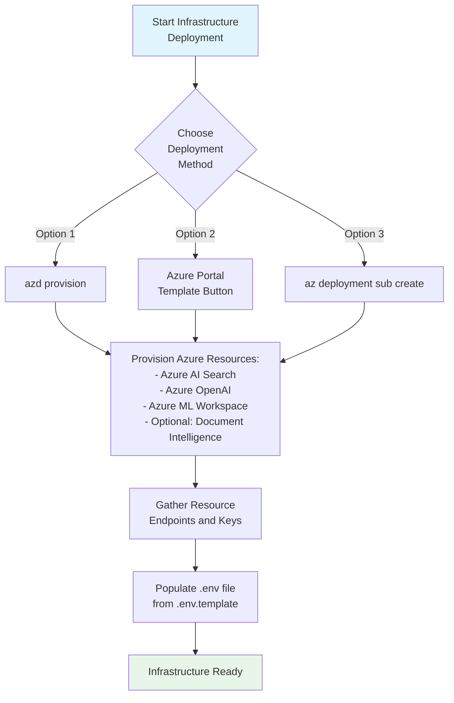

The repository provides three infrastructure deployment options:

1. **Azure Developer CLI (azd)**: Run `azd provision` from the repository root [README.md:131-139]()
2. **Azure Portal UI**: Click the "Deploy to Azure" button [README.md:146-147]()
3. **Azure CLI**: Execute `az deployment sub create` with template file [README.md:154-179]()

Sources: [README.md:125-180](), [.env.template:1-49](), [docs/environment-variables.md:1-36]()

### Compute Environment Setup

The accelerator supports two compute environment options:

**Option 1: Development Container (Recommended)**

Uses a pre-configured container with all dependencies installed. Requires WSL on Windows.

- Prerequisites: Ubuntu 22.04 LTS (Windows Store), Docker Desktop, VS Code, Remote-Containers extension
- Clone repository and open in VS Code, which prompts to reopen in dev container
- All dependencies automatically available

**Option 2: Local Installation**

Install dependencies directly on your host machine (Windows/Mac/Linux).

```bash
# Clone repository
git clone https://github.com/microsoft/rag-experiment-accelerator.git
cd rag-experiment-accelerator

# Create conda environment
conda create -n rag-experiment python=3.11
conda activate rag-experiment

# Install dependencies
pip install .

# Install and configure Azure CLI
az login
az account set --subscription="<your_subscription_guid>"
```

The `pip install .` command installs all dependencies defined in [requirements.txt:1-41](), including:
- Azure SDKs: `azure-ai-ml`, `azure-search-documents`, `azure.ai.documentintelligence`
- LLM libraries: `openai`, `langchain`, `langchain-community`
- Embedding models: `sentence-transformers`
- Evaluation: `evaluate`, `rouge-score`, `textdistance`, `levenshtein`
- ML tracking: `mlflow`, `azureml-mlflow`

Sources: [README.md:69-124](), [requirements.txt:1-41]()

## Configuration Overview

The accelerator is **configuration-driven**, requiring two primary configuration files:

### Environment Variables (.env)

Create `.env` from `.env.template` and populate with Azure resource credentials:

```bash
cp .env.template .env
```

**Required Environment Variables**

| Variable | Description | Example |
|----------|-------------|---------|
| `AZURE_SEARCH_SERVICE_ENDPOINT` | Azure AI Search service endpoint | `https://<name>.search.windows.net` |
| `AZURE_SEARCH_ADMIN_KEY` | Azure AI Search admin key | `<32-character-key>` |
| `AZURE_SEARCH_USE_SEMANTIC_SEARCH` | Enable semantic ranking (if available) | `True` |
| `OPENAI_API_KEY` | Azure OpenAI API key | `<api-key>` |
| `OPENAI_API_TYPE` | Must be `azure` or `open_ai` | `azure` |
| `OPENAI_ENDPOINT` | Azure OpenAI service endpoint | `https://<name>.openai.azure.com/` |
| `OPENAI_API_VERSION` | Azure OpenAI API version | `2023-03-15-preview` |
| `AML_SUBSCRIPTION_ID` | Azure subscription GUID | `<guid>` |
| `AML_WORKSPACE_NAME` | Azure ML workspace name | `<workspace-name>` |
| `AML_RESOURCE_GROUP_NAME` | Azure resource group name | `<rg-name>` |

**Optional Variables**: `AZURE_DOCUMENT_INTELLIGENCE_ENDPOINT`, `AZURE_DOCUMENT_INTELLIGENCE_ADMIN_KEY`, `AZURE_LANGUAGE_SERVICE_ENDPOINT`, `AZURE_LANGUAGE_SERVICE_KEY`, `MAX_WORKER_THREADS`, `LOGGING_LEVEL`

Sources: [.env.template:1-49](), [docs/environment-variables.md:15-36]()

### Experiment Configuration (config.json)

Create `config.json` from `config.sample.json` and customize experiment hyperparameters:

```bash
cp config.sample.json config.json
```

The configuration file defines all experiment parameters using a hierarchical structure. The `Config` object supports **multi-configuration experiments** via array notation - any parameter can be a list to test multiple values:

```json
{
    "experiment_name": "my-first-experiment",
    "job_name": "baseline-run",
    "use_checkpoints": true,
    "index": {
        "index_name_prefix": "idx",
        "chunking": {
            "chunk_size": [500, 1000],
            "overlap_size": [100, 200]
        },
        "embedding_model": [
            {
                "type": "sentence-transformer",
                "model_name": "all-mpnet-base-v2"
            }
        ]
    },
    "search": {
        "search_type": ["search_for_manual_hybrid", "search_for_match_semantic"],
        "retrieve_num_of_documents": 5
    }
}
```

The `Config.index.flatten()` method generates all combinations of configurations (e.g., 2 chunk sizes × 2 overlaps × 2 search types = 8 index configurations) for systematic experimentation. See [Configuration Guide](#2.2) for complete parameter reference.

Sources: [config.sample.json:1-88](), [README.md:283-357]()

## Execution Modes

The accelerator supports three execution modes that all invoke the same four pipeline stages via CLI scripts `01_index.py`, `02_qa_generation.py`, `03_querying.py`, `04_evaluation.py`.

**Pipeline Execution Modes**

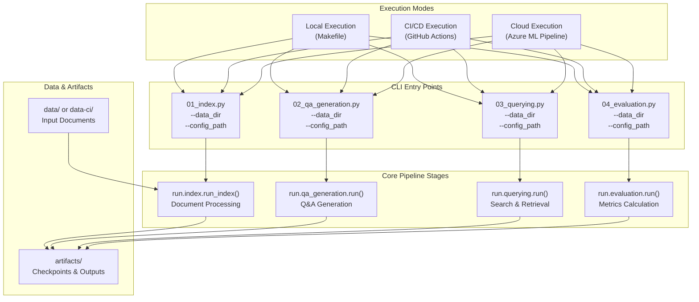

### Local Execution with Makefile

The [Makefile:1-76]() provides convenient targets for local execution:

```bash
# Run all stages sequentially
make all

# Run individual stages
make index      # Stage 1: Indexing
make qnagen     # Stage 2: Q&A Generation
make query      # Stage 3: Querying
make eval       # Stage 4: Evaluation

# Run query and evaluation only (skip indexing and Q&A)
make query_eval

# Cleanup operations
make clear_docs         # Remove data/ directory
make clear_artifacts    # Remove artifacts/ outputs
make clear_checkpoints  # Remove checkpoint cache
```

Makefile targets accept optional arguments:
- `dd`: Data directory path (default: `./data`)
- `cp`: Config file path (default: `./config.json`)

Example: `make index dd=./my-data cp=./my-config.json`

Sources: [Makefile:1-76](), [README.md:182-223]()

### CI/CD Execution with GitHub Actions

The [.github/workflows/rag_exp_acc_ci.yml:1-67]() workflow runs the complete pipeline on every pull request and push to main branches:

```yaml
- name: execute index creation step
  run: python 01_index.py --data_dir='data-ci' --config_path=${{ github.workspace }}/.github/workflows/config.json

- name: execute qna step
  run: python 02_qa_generation.py --data_dir='data-ci' --config_path=${{ github.workspace }}/.github/workflows/config.json

- name: execute querying step
  run: python 03_querying.py --data_dir='data-ci' --config_path=${{ github.workspace }}/.github/workflows/config.json

- name: execute evaluation step
  run: python 04_evaluation.py --data_dir='data-ci' --config_path=${{ github.workspace }}/.github/workflows/config.json
```

Uses smaller test dataset in `data-ci/` directory for faster validation.

Sources: [.github/workflows/rag_exp_acc_ci.yml:51-66]()

### Azure ML Pipeline Execution

For distributed compute with experiment tracking:

```bash
make azureml
# or
python azureml/pipeline.py --data_dir ./data --config_path ./config.json
```

Requires `AML_COMPUTE_NAME` and `AML_COMPUTE_INSTANCES_NUMBER` in `.env`. See Azure ML Pipeline documentation for details.

Sources: [Makefile:45-47](), [README.md:224]()

## Quick Start Workflow

**End-to-End Setup and Execution**

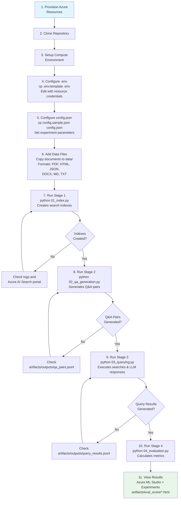

### Step-by-Step Instructions

1. **Provision Azure Resources**: Use `azd provision`, Azure Portal template, or Azure CLI deployment
2. **Clone Repository**: `git clone https://github.com/microsoft/rag-experiment-accelerator.git`
3. **Setup Environment**: Choose dev container or local installation with `pip install .`
4. **Configure .env**: Copy template and add Azure resource endpoints/keys
5. **Configure config.json**: Copy sample and customize experiment parameters
6. **Add Data**: Place documents in `data/` directory (PDF, HTML, MD, JSON, DOCX, TXT)
7. **Run Stage 1 - Indexing**: `python 01_index.py` or `make index`
   - Creates Azure AI Search indexes
   - Chunks documents according to `config.index.chunking` parameters
   - Generates embeddings using `config.index.embedding_model`
   - Outputs: `artifacts/docs_data/`, `artifacts/index_data/`, Azure AI Search indexes
8. **Run Stage 2 - Q&A Generation**: `python 02_qa_generation.py` or `make qnagen`
   - Generates question-answer pairs using Azure OpenAI
   - Outputs: `artifacts/outputs/qa_pairs.jsonl`
9. **Run Stage 3 - Querying**: `python 03_querying.py` or `make query`
   - Executes searches against indexes for each Q&A pair
   - Applies optional reranking
   - Generates LLM responses
   - Outputs: `artifacts/outputs/query_results.jsonl`, Azure ML data assets
10. **Run Stage 4 - Evaluation**: `python 04_evaluation.py` or `make eval`
    - Calculates configured metrics (algorithm/BERT/LLM-based)
    - Generates visualizations
    - Logs to MLflow/Azure ML
    - Outputs: `artifacts/eval_score/*.csv`, `*.html`, `*.png`
11. **View Results**: Access Azure ML Studio > Experiments to compare runs and view reports

Sources: [README.md:182-223](), [01_index.py:1-100]() (inferred), [02_qa_generation.py:1-100]() (inferred), [03_querying.py:1-100]() (inferred), [04_evaluation.py:1-100]() (inferred)

## Data Directory Structure

The accelerator expects input documents in a configurable data directory:

```
data/                          # Default input directory
├── document1.pdf
├── document2.html
├── document3.json
└── document4.docx

data-ci/                       # CI test data (smaller subset)
├── test_doc1.pdf
└── test_doc2.json

artifacts/                     # Generated outputs
├── checkpoints/               # Cached results for expensive operations
├── docs_data/                 # Chunked documents from Stage 1
├── index_data/                # Index metadata from Stage 1
├── sampling/                  # Sampling visualizations (if enabled)
└── outputs/
    ├── qa_pairs.jsonl         # Stage 2 output
    └── query_results.jsonl    # Stage 3 output
```

The data directory can be specified via:
- CLI argument: `--data_dir ./my-data`
- Makefile parameter: `make index dd=./my-data`
- Default: `./data`

Supported formats specified in `config.data_formats`: `["*"]` (all) or specific list like `["pdf", "json", "html"]`

Sources: [README.md:195-223](), [config.sample.json:6]()

## Checkpoint System

The accelerator includes an optional **checkpoint system** to cache expensive operations (LLM calls, embeddings, clustering) and enable resumption from failures:

**Enabling Checkpoints**

Set `"use_checkpoints": true` in `config.json` [config.sample.json:8]()

**Checkpoint Behavior**

- Caches results keyed by content hash in `artifacts/checkpoints/`
- Automatically skips re-computation of identical inputs
- Survives across runs and different configurations
- Can be cleared with `make clear_checkpoints`

**When to Use Checkpoints**

✅ Use checkpoints when:
- Iterating on configuration with same data
- Recovering from mid-pipeline failures
- Testing evaluation metrics without re-running queries

❌ Disable checkpoints when:
- Data or code logic has changed
- Starting completely fresh experiment
- Troubleshooting unexpected results

Sources: [config.sample.json:8](), [README.md:283-357](), [Makefile:61-63]()

## Common Issues and Troubleshooting

### Authentication Errors

**Symptom**: "Authentication failed" or "Forbidden" errors when accessing Azure resources

**Solution**: 
1. Run `az login` to authenticate
2. Set subscription: `az account set --subscription="<guid>"`
3. Verify user has Contributor access to Azure resources
4. For persistent issues, start fresh terminal and re-authenticate

### Configuration Errors

**Symptom**: "Index out of range" or unexpected errors during reranking

**Root Causes**:
- `retrieve_num_of_documents` too high/low for reranking thresholds
- `cross_encoder_at_k` > number of retrieved documents
- `llm_rerank_threshold` creates oversized LLM context

**Solution**: Ensure configuration parameter relationships are valid:
- `llm_rerank_threshold` ≤ `retrieve_num_of_documents`
- `cross_encoder_at_k` ≤ `retrieve_num_of_documents`

### Azure OpenAI Errors

**Symptom**: JSON parsing errors during Q&A generation or rate limit errors

**Root Causes**:
- Content filtering blocking inappropriate content
- Token/rate limits exceeded
- Invalid deployment name configuration

**Solution**:
1. Verify `azure_oai_chat_deployment_name` matches Azure OpenAI deployment
2. Check separate `azure_oai_eval_deployment_name` for evaluation to avoid quota conflicts
3. Review content filtering settings in Azure OpenAI Studio
4. Consider using separate deployments for chat vs evaluation

Sources: [README.md:481-522]()

## Next Steps

- **[Installation and Dependencies](#2.1)**: Detailed dependency information and advanced installation scenarios
- **[Configuration Guide](#2.2)**: Complete reference for all configuration parameters, including embedding models, search types, evaluation metrics, and query expansion options
- **[Running Your First Experiment](#2.3)**: Step-by-step tutorial with detailed explanations of each stage and how to interpret results
- **[Pipeline Architecture](#3)**: Understanding the 4-stage pipeline architecture and data flow
- **[Document Processing](#5)**: Deep dive into document loaders, chunking strategies, and sampling
- **[Evaluation Metrics](#8)**: Comprehensive guide to algorithm-based, BERT-based, and LLM-based evaluation metrics

Sources: [README.md:1-571](), Table of Contents structure

---

# Page: Installation and Dependencies

# Installation and Dependencies

<details>
<summary>Relevant source files</summary>

The following files were used as context for generating this wiki page:

- [.env.template](.env.template)
- [.github/workflows/build_validation_workflow.yml](.github/workflows/build_validation_workflow.yml)
- [.github/workflows/rag_exp_acc_ci.yml](.github/workflows/rag_exp_acc_ci.yml)
- [Makefile](Makefile)
- [dev-requirements.txt](dev-requirements.txt)
- [docs/environment-variables.md](docs/environment-variables.md)
- [rag_experiment_accelerator/embedding/st_embedding_model.py](rag_experiment_accelerator/embedding/st_embedding_model.py)
- [rag_experiment_accelerator/embedding/tests/test_st_embedding_model.py](rag_experiment_accelerator/embedding/tests/test_st_embedding_model.py)
- [requirements.txt](requirements.txt)

</details>


This page details the complete installation process for the RAG Experiment Accelerator, including Python dependencies, Azure service prerequisites, and environment configuration. 

**Scope**: This page covers local development environment setup and package installation. For running experiments on Azure ML compute clusters, see [Azure ML and MLflow](#9.3). For development dependencies and testing setup, see [Development Environment Setup](#11.1).

---

## Prerequisites

### System Requirements

The RAG Experiment Accelerator requires:

| Component | Requirement | Notes |
|-----------|-------------|-------|
| **Python Version** | 3.11 | As specified in [.github/workflows/build_validation_workflow.yml:31]() |
| **Operating System** | Linux, macOS, Windows | Primary testing on Ubuntu (CI/CD) |
| **Network Access** | Internet connectivity | Required for Azure services and HuggingFace model downloads |
| **Memory** | 8GB+ RAM recommended | For embedding generation and document processing |

### Azure Service Prerequisites

The following Azure resources must be provisioned before installation:

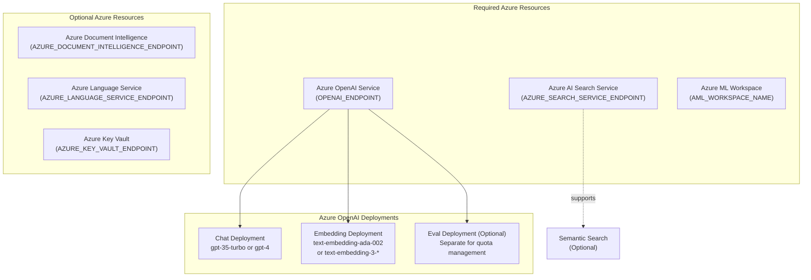

**Sources**: [docs/environment-variables.md:1-36](), [.env.template:1-49]()

#### Required Azure Resources

1. **Azure AI Search Service**
   - Used for vector and text indexing
   - Semantic Search capability is optional but recommended
   - Required environment variables: `AZURE_SEARCH_SERVICE_ENDPOINT`, `AZURE_SEARCH_ADMIN_KEY`

2. **Azure OpenAI Service**
   - Minimum deployments required:
     - **Chat model**: `gpt-35-turbo` or `gpt-4` for QA generation and response generation
     - **Embedding model**: `text-embedding-ada-002` or `text-embedding-3-small/large` for document embeddings
   - Required environment variables: `OPENAI_API_KEY`, `OPENAI_ENDPOINT`, `OPENAI_API_VERSION`

3. **Azure ML Workspace**
   - Used for experiment tracking via MLflow
   - Required for Stages 3-4 (querying and evaluation)
   - Required environment variables: `AML_SUBSCRIPTION_ID`, `AML_WORKSPACE_NAME`, `AML_RESOURCE_GROUP_NAME`

#### Optional Azure Resources

1. **Azure Document Intelligence** - Advanced PDF parsing with table extraction (see [Azure Document Intelligence Integration](#5.2))
2. **Azure Language Service** - For skillset-based language detection
3. **Azure Key Vault** - For centralized secret management

**Sources**: [docs/environment-variables.md:4-11](), [.env.template:27-48]()

---

## Python Package Installation

### Installation Process Flow

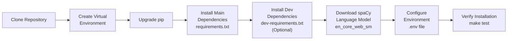

**Sources**: [.github/workflows/build_validation_workflow.yml:32-42](), [Makefile:65-67]()

### Step 1: Clone Repository and Create Virtual Environment

```bash
git clone https://github.com/microsoft/rag-experiment-accelerator
cd rag-experiment-accelerator
python3.11 -m venv venv
source venv/bin/activate  # On Windows: venv\Scripts\activate
```

### Step 2: Install Main Dependencies

```bash
python -m pip install --upgrade pip
pip install -e . -r requirements.txt
```

#### Core Dependency Categories

The [requirements.txt:1-41]() file specifies 40+ dependencies organized by function:

| Category | Key Packages | Purpose |
|----------|--------------|---------|
| **Azure SDKs** | `azure-ai-ml==1.25.0`<br/>`azure-search-documents==11.4.b11`<br/>`azure-identity==1.18.0`<br/>`azure.ai.documentintelligence==1.0.0b4` | Azure service integration for Search, OpenAI, ML, Document Intelligence |
| **Document Processing** | `langchain==0.3.0`<br/>`langchain-community==0.3.0`<br/>`pypdf==4.3.1`<br/>`PyMuPDF==1.24.10`<br/>`beautifulsoup4==4.12.3`<br/>`unstructured==0.15.13` | Document loading, parsing, and chunking via `doc_loader/` modules |
| **Embeddings** | `sentence-transformers==3.1.1`<br/>`openai==1.64.0` | `STEmbeddingModel` and Azure OpenAI embeddings |
| **ML/NLP** | `spacy==3.7.6`<br/>`scikit-learn==1.5.2`<br/>`hnswlib==0.8.0` | Text preprocessing, clustering (K-means), and vector indexing |
| **Evaluation** | `rouge-score==0.1.2`<br/>`levenshtein==0.26.0`<br/>`rapidfuzz==3.9.7`<br/>`textdistance==4.6.3` | Algorithm-based metrics in `evaluation/metrics/` |
| **Experiment Tracking** | `mlflow==2.16.1`<br/>`azureml-mlflow==1.57.0.post1` | MLflow integration for experiment logging |
| **Visualization** | `matplotlib==3.9.2`<br/>`plotly==5.24.1`<br/>`kaleido==0.2.1` | Evaluation result visualizations |
| **Utilities** | `python-dotenv==1.0.1`<br/>`tqdm==4.66.5`<br/>`tiktoken==0.7.0` | Environment loading, progress bars, token counting |

**Sources**: [requirements.txt:1-41]()

#### Version-Specific Dependencies

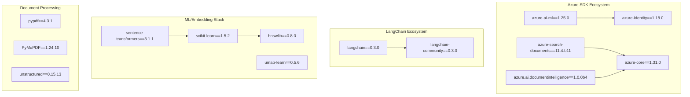

**Critical Version Notes**:
- `azure-search-documents==11.4.b11` is a **beta version** required for vector search features
- `azure.ai.documentintelligence==1.0.0b4` is a **beta version** for Document Intelligence integration
- `langchain==0.3.0` and `langchain-community==0.3.0` must match versions for compatibility

**Sources**: [requirements.txt:1-41]()

### Step 3: Install Development Dependencies (Optional)

For running tests, linting, and prompt flow development:

```bash
pip install -r dev-requirements.txt
```

Development dependencies from [dev-requirements.txt:1-8]():

| Package | Version | Purpose |
|---------|---------|---------|
| `pytest` | 8.3.3 | Unit test framework |
| `pytest-cov` | 5.0.0 | Coverage reporting |
| `flake8` | 7.1.1 | Code linting |
| `black` | 24.8.0 | Code formatting |
| `pre-commit` | 3.8.0 | Git hook management |
| `promptflow` | 1.15.0 | Low-code prompt flow variant (see [Prompt Flow Integration](#10.3)) |
| `promptflow-tools` | 1.4.0 | Prompt flow tooling |

**Sources**: [dev-requirements.txt:1-8]()

### Step 4: Download spaCy Language Model

The `nlp/Preprocess` class requires the spaCy English model:

```bash
python -m spacy download en_core_web_sm
```

This model is used for:
- Text preprocessing in [rag_experiment_accelerator/nlp/]()
- Query term extraction
- Data sampling via K-means clustering

**Sources**: [.github/workflows/build_validation_workflow.yml:39-42](), [requirements.txt:35]()

---

## Environment Configuration

### Environment Variable Architecture

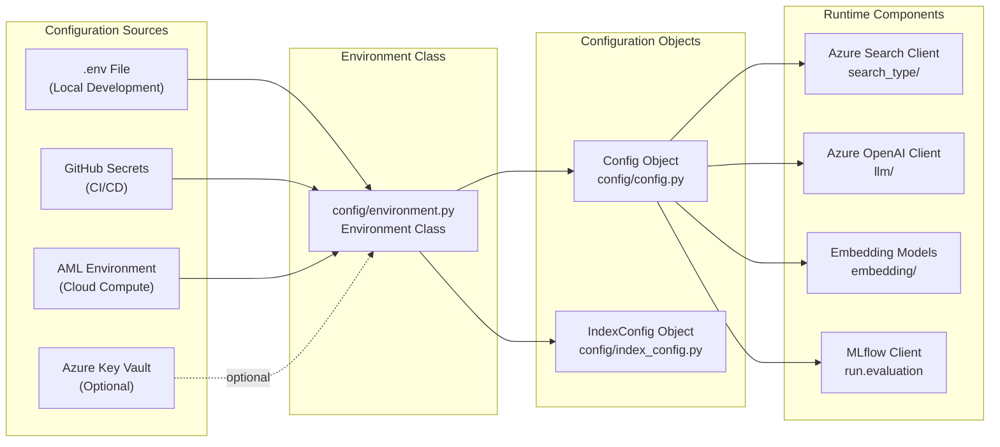

**Sources**: [.env.template:1-49](), [.github/workflows/rag_exp_acc_ci.yml:25-39]()

### Step 5: Create .env File

Copy the template and configure required variables:

```bash
cp .env.template .env
```

Edit `.env` with your Azure resource values.

#### Required Environment Variables

From [.env.template:3-22]():

```bash
# Azure AI Search
AZURE_SEARCH_SERVICE_ENDPOINT=https://your-search-service.search.windows.net
AZURE_SEARCH_ADMIN_KEY=your-search-admin-key
AZURE_SEARCH_USE_SEMANTIC_SEARCH=True

# Azure OpenAI
OPENAI_API_KEY=your-openai-api-key
OPENAI_API_TYPE=azure  # Must be 'azure' or 'open_ai'
OPENAI_ENDPOINT=https://your-openai-resource.openai.azure.com/
OPENAI_API_VERSION=2023-03-15-preview

# Azure Machine Learning
AML_SUBSCRIPTION_ID=your-subscription-id
AML_WORKSPACE_NAME=your-workspace-name
AML_RESOURCE_GROUP_NAME=your-resource-group-name
```

**Variable Details**:

| Variable | Type | Description | Used By |
|----------|------|-------------|---------|
| `AZURE_SEARCH_SERVICE_ENDPOINT` | URL | Azure AI Search endpoint | `search_type/acs_search_methods.py` |
| `AZURE_SEARCH_ADMIN_KEY` | Secret | Admin key for index management | `ingest_data/acs_ingest.py`, `search_type/acs_search_methods.py` |
| `AZURE_SEARCH_USE_SEMANTIC_SEARCH` | Boolean | Enable semantic search (L2 reranking) | `config/environment.py` |
| `OPENAI_API_KEY` | Secret | Azure OpenAI API key | `llm/` modules |
| `OPENAI_API_TYPE` | Enum | Must be `azure` or `open_ai` | `llm/response_generator.py` |
| `OPENAI_ENDPOINT` | URL | Azure OpenAI endpoint | `llm/`, `embedding/` modules |
| `OPENAI_API_VERSION` | String | API version (e.g., `2023-03-15-preview`) | Azure OpenAI SDK initialization |
| `AML_SUBSCRIPTION_ID` | GUID | Azure subscription ID | `run.querying`, `run.evaluation` for MLflow tracking |
| `AML_WORKSPACE_NAME` | String | Azure ML workspace name | MLflow backend configuration |
| `AML_RESOURCE_GROUP_NAME` | String | Resource group containing workspace | MLflow backend configuration |

**Sources**: [.env.template:3-22](), [docs/environment-variables.md:18-30]()

#### Optional Environment Variables

From [.env.template:23-49]():

```bash
# Azure Document Intelligence (Optional)
AZURE_DOCUMENT_INTELLIGENCE_ENDPOINT=https://your-doc-intel.cognitiveservices.azure.com/
AZURE_DOCUMENT_INTELLIGENCE_ADMIN_KEY=your-doc-intel-key

# Azure Language Service (Optional)
AZURE_LANGUAGE_SERVICE_ENDPOINT=https://your-language-service.cognitiveservices.azure.com/
AZURE_LANGUAGE_SERVICE_KEY=your-language-key

# Performance Tuning
MAX_WORKER_THREADS=4  # Default: optimized by CPU cores

# Logging
LOGGING_LEVEL=INFO  # One of: NOTSET, DEBUG, INFO, WARN, ERROR, CRITICAL

# Azure ML Compute (for azureml/pipeline.py)
AML_COMPUTE_NAME=your-compute-cluster
AML_COMPUTE_INSTANCES_NUMBER=4

# Azure Key Vault
AZURE_KEY_VAULT_ENDPOINT=https://your-keyvault.vault.azure.net/
```

**Optional Variable Details**:

| Variable | Default | Description | Impact |
|----------|---------|-------------|--------|
| `AZURE_DOCUMENT_INTELLIGENCE_ENDPOINT` | None | Document Intelligence endpoint | Enables advanced PDF parsing with table extraction via `doc_loader/documentIntelligenceLoader.py` |
| `AZURE_LANGUAGE_SERVICE_ENDPOINT` | None | Language service endpoint | Used for language detection skillsets |
| `MAX_WORKER_THREADS` | CPU cores | Thread pool size | Controls parallelism in `ThreadPoolExecutor` for embedding generation and QA processing |
| `LOGGING_LEVEL` | INFO | Log verbosity | Affects `utils/logging.py` output |
| `AML_COMPUTE_NAME` | None | Compute cluster name | Required for `azureml/pipeline.py` (cloud execution) |
| `AZURE_KEY_VAULT_ENDPOINT` | None | Key Vault endpoint | Enables centralized secret management via `env_to_keyvault.py` |

**Sources**: [.env.template:27-49](), [docs/environment-variables.md:33-36]()

### Environment Variable Loading Mechanisms

The system supports multiple environment loading strategies:

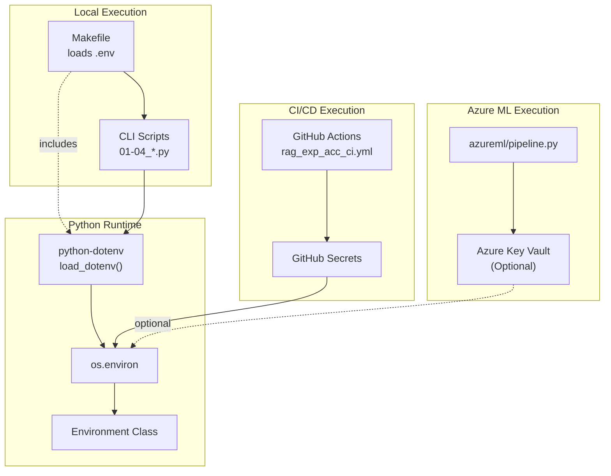

**Sources**: [Makefile:4-13](), [.github/workflows/rag_exp_acc_ci.yml:25-39]()

---

## Verification and Testing

### Verify Installation

After completing installation and environment configuration:

```bash
# Verify Python dependencies
python -c "import azure.search.documents; import sentence_transformers; import mlflow; print('Dependencies OK')"

# Verify spaCy model
python -c "import spacy; nlp = spacy.load('en_core_web_sm'); print('spaCy model OK')"

# Run unit tests
make test
# Or directly:
pytest . --cov=. --cov-report=html --cov-config=.coveragerc
```

**Expected Test Output**: From [.github/workflows/build_validation_workflow.yml:49-58](), the test suite should:
- Execute all unit tests in the repository
- Generate coverage report in `htmlcov/`
- Pass with no failures

### Verify Azure Connectivity

```bash
# Test Azure Search connectivity (requires valid .env)
python -c "from azure.search.documents import SearchClient; from azure.core.credentials import AzureKeyCredential; import os; client = SearchClient(os.getenv('AZURE_SEARCH_SERVICE_ENDPOINT'), 'test-index', AzureKeyCredential(os.getenv('AZURE_SEARCH_ADMIN_KEY'))); print('Azure Search connectivity OK')"

# Test Azure OpenAI connectivity
python -c "from openai import AzureOpenAI; import os; client = AzureOpenAI(api_key=os.getenv('OPENAI_API_KEY'), api_version=os.getenv('OPENAI_API_VERSION'), azure_endpoint=os.getenv('OPENAI_ENDPOINT')); print('Azure OpenAI connectivity OK')"
```

**Sources**: [.github/workflows/build_validation_workflow.yml:49-58](), [Makefile:65-67]()

### Code Quality Validation

```bash
# Run linting
make flake
# Or directly:
flake8 --extend-ignore=E501
```

The CI/CD pipeline enforces code quality via [.github/workflows/build_validation_workflow.yml:44-47]().

---

## Dependency Management Best Practices

### Version Pinning Strategy

The project uses **exact version pinning** for reproducibility:
- All versions in [requirements.txt:1-41]() use `==` (exact match)
- Exception: `PyPDF2~=3.0` uses compatible release clause
- **Reason**: Ensures consistent behavior across environments and experiments

### Updating Dependencies

When updating dependencies:

1. **Test in isolation**: Create a separate virtual environment
2. **Run full test suite**: `make test`
3. **Test integration**: Run a complete experiment with `make all`
4. **Update both files**: Modify both `requirements.txt` and `dev-requirements.txt` if needed
5. **Document breaking changes**: Update this page if new Azure resources or configuration is required

### Handling Beta Dependencies

Two core dependencies are beta versions:
- `azure-search-documents==11.4.b11` - Required for vector search
- `azure.ai.documentintelligence==1.0.0b4` - Required for Document Intelligence

**Mitigation**:
- Pin to specific beta versions for stability
- Monitor Azure SDK release notes for GA versions
- Document Intelligence integration has graceful fallback to `prebuilt-read`

**Sources**: [requirements.txt:7-8]()

---

## Troubleshooting Installation Issues

### Common Issues

| Issue | Symptom | Solution |
|-------|---------|----------|
| **spaCy model missing** | `OSError: [E050] Can't find model 'en_core_web_sm'` | Run `python -m spacy download en_core_web_sm` |
| **Azure SDK authentication** | `DefaultAzureCredential failed` | Run `az login` or set `AZURE_TENANT_ID` |
| **Sentence Transformer download failure** | `OSError` from `STEmbeddingModel` | Check internet connectivity; HuggingFace models downloaded on first use (see [rag_experiment_accelerator/embedding/st_embedding_model.py:58-64]()) |
| **MLflow connection failure** | `MlflowException` during Stage 3/4 | Verify `AML_*` environment variables and Azure ML workspace access |
| **Import errors after installation** | `ModuleNotFoundError` | Ensure virtual environment is activated and `pip install -e .` was run |

### Dependency Conflict Resolution

If `pip` reports dependency conflicts:

```bash
# Check for conflicts
pip check

# Create fresh environment
deactivate
rm -rf venv
python3.11 -m venv venv
source venv/bin/activate
pip install --upgrade pip
pip install -e . -r requirements.txt
```

**Sources**: [rag_experiment_accelerator/embedding/st_embedding_model.py:58-64](), [.github/workflows/build_validation_workflow.yml:32-42]()

---

## Next Steps

After completing installation:

1. **Configure Experiments**: Review [Configuration Guide](#2.2) for `config.json` structure
2. **Prepare Data**: Place documents in `data/` directory (see [Running Your First Experiment](#2.3))
3. **Run Pipeline**: Execute `make all` or individual stages (`make index`, `make qnagen`, etc.)
4. **Advanced Setup**: For Azure ML execution, see [Azure ML and MLflow](#9.3)

**Sources**: [Makefile:21-43](), [.github/workflows/rag_exp_acc_ci.yml:51-66]()

---

# Page: Configuration Guide

# Configuration Guide

<details>
<summary>Relevant source files</summary>

The following files were used as context for generating this wiki page:

- [.github/workflows/config.json](.github/workflows/config.json)
- [README.md](README.md)
- [config.sample.json](config.sample.json)
- [config.schema.json](config.schema.json)
- [docs/evaluation-metrics.md](docs/evaluation-metrics.md)
- [promptflow/rag-experiment-accelerator/README.md](promptflow/rag-experiment-accelerator/README.md)
- [rag_experiment_accelerator/config/config.py](rag_experiment_accelerator/config/config.py)
- [rag_experiment_accelerator/config/eval_config.py](rag_experiment_accelerator/config/eval_config.py)
- [rag_experiment_accelerator/config/tests/test_config.py](rag_experiment_accelerator/config/tests/test_config.py)
- [rag_experiment_accelerator/evaluation/plain_metrics.py](rag_experiment_accelerator/evaluation/plain_metrics.py)
- [rag_experiment_accelerator/evaluation/tests/test_plain_metrics.py](rag_experiment_accelerator/evaluation/tests/test_plain_metrics.py)

</details>


This guide provides comprehensive documentation for configuring the RAG Experiment Accelerator through the `config.json` file. It explains the hierarchical configuration structure, parameter options, and how to set up multi-configuration experiments for systematic hyperparameter exploration.

For information about environment variables and Azure service credentials, see [Installation and Dependencies](#2.1). For guidance on running your first experiment with an example configuration, see [Running Your First Experiment](#2.3).

---

## Configuration System Overview

The RAG Experiment Accelerator uses a hierarchical, configuration-driven architecture where all experiment parameters are specified in a single `config.json` file. This configuration is validated against a JSON schema, loaded into typed Python dataclasses, and used to control all four pipeline stages.

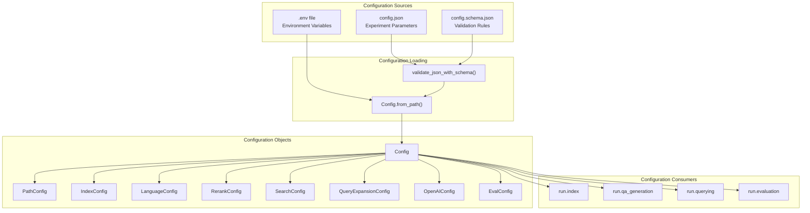

**Configuration Hierarchy**: `config.json` is parsed into a `Config` object containing nested configuration objects for each pipeline concern.

Sources: [rag_experiment_accelerator/config/config.py:34-51](), [README.md:283-356]()

---

## Config.json File Structure

The configuration file follows this structure:

```json
{
    "experiment_name": "string",
    "job_name": "string",
    "job_description": "string",
    "data_formats": ["*"],
    "use_checkpoints": true,
    "path": {},
    "index": {
        "index_name_prefix": "string",
        "ef_construction": [400],
        "ef_search": [400],
        "chunking": {},
        "embedding_model": [],
        "sampling": {}
    },
    "language": {},
    "rerank": {},
    "search": {},
    "query_expansion": {},
    "openai": {},
    "eval": {}
}
```

A complete example is provided in [config.sample.json:1-87]().

Sources: [config.sample.json:1-87](), [config.schema.json:1-605]()

---

## Configuration Validation

All configurations are validated against [config.schema.json:1-605]() before use. The validation occurs in [rag_experiment_accelerator/config/config.py:61-65]():

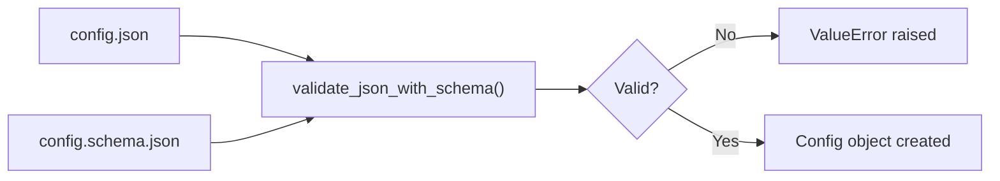

**Validation Process**: The JSON schema enforces type constraints, required fields, enum values, and value ranges.

The schema validation includes:
- Type checking (string, integer, boolean, array, object)
- Required field validation
- Enum constraint checking for search types, metric types, etc.
- Range validation (e.g., `ef_construction` between 100-1000)
- Conditional validation (e.g., analyzer configuration mutual exclusivity)

Sources: [rag_experiment_accelerator/config/config.py:61-65](), [rag_experiment_accelerator/config/config_validator.py]()

---

## Top-Level Configuration Parameters

### Experiment Identification

| Parameter | Type | Description | Code Reference |
|-----------|------|-------------|----------------|
| `experiment_name` | string | Azure ML experiment name for grouping job runs | [Config.experiment_name:37]() |
| `job_name` | string | Job name prefix (timestamp appended automatically) | [Config.job_name:38]() |
| `job_description` | string | Human-readable description of the experiment | [Config.job_description:39]() |

**MLflow Integration**: If `experiment_name` is provided, all runs are grouped under this experiment in Azure ML. Otherwise, `index_name_prefix` is used.

Sources: [rag_experiment_accelerator/config/config.py:37-39](), [config.schema.json:5-17]()

---

### Global Processing Parameters

| Parameter | Type | Default | Description |
|-----------|------|---------|-------------|
| `data_formats` | array | `["*"]` | File formats to process: `"*"`, `"pdf"`, `"html"`, `"markdown"`, `"json"`, `"text"`, `"docx"` |
| `use_checkpoints` | boolean | `true` | Enable checkpoint system to cache expensive operations |
| `max_worker_threads` | integer | env var | Maximum parallel threads for concurrent operations |

**Data Formats**: Set to `["*"]` to process all supported formats, or specify a subset like `["pdf", "docx"]`.

**Checkpointing**: When enabled, expensive operations (embeddings, LLM calls, clustering) are cached in `artifacts/checkpoints/` with content-based hashing. See [Checkpointing System](#10.1) for details.

Sources: [rag_experiment_accelerator/config/config.py:40-43](), [config.schema.json:19-42]()

---

## Index Configuration

The `index` section controls document processing, chunking, embedding, and Azure AI Search index creation.

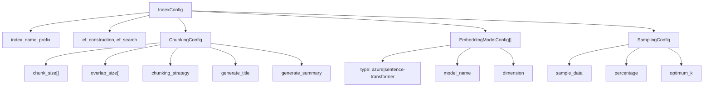

**IndexConfig Structure**: Nested configuration controlling all aspects of document indexing.

Sources: [rag_experiment_accelerator/config/index_config.py](), [README.md:296-318]()

---

### Index Naming and Vector Search Parameters

| Parameter | Type | Example | Description |
|-----------|------|---------|-------------|
| `index_name_prefix` | string | `"idx"` | Prefix for generated index names |
| `ef_construction` | array | `[400]` | HNSW ef_construction values (100-1000) |
| `ef_search` | array | `[400]` | HNSW ef_search values (100-1000) |

**Index Naming Convention**: Generated index names follow the pattern:
```
{prefix}-chunk{size}-overlap{size}-dim{dimension}-efc{ef_construction}-efs{ef_search}
```

Example: `idx-chunk1000-overlap200-dim384-efc400-efs400`

**HNSW Parameters**:
- `ef_construction`: Controls index build time and quality (higher = better quality, slower build)
- `ef_search`: Controls query time and recall (higher = better recall, slower queries)

Sources: [rag_experiment_accelerator/config/index_config.py:11-13](), [README.md:298-299]()

---

### Chunking Configuration

| Parameter | Type | Default | Description |
|-----------|------|---------|-------------|
| `preprocess` | boolean | `false` | Enable NLP preprocessing (tokenization, lemmatization) |
| `chunk_size` | array | `[1000]` | Character count per chunk (supports multiple values) |
| `overlap_size` | array | `[200]` | Character overlap between chunks (must be < chunk_size) |
| `generate_title` | boolean | `false` | Use LLM to generate titles for chunks |
| `generate_summary` | boolean | `false` | Use LLM to generate summaries for chunks |
| `override_content_with_summary` | boolean | `false` | Replace chunk content with generated summary |
| `chunking_strategy` | enum | `"basic"` | `"basic"` or `"azure-document-intelligence"` |
| `azure_document_intelligence_model` | string | `"prebuilt-read"` | Model for Document Intelligence: `"prebuilt-layout"` or `"prebuilt-read"` |

**Chunking Strategies**:

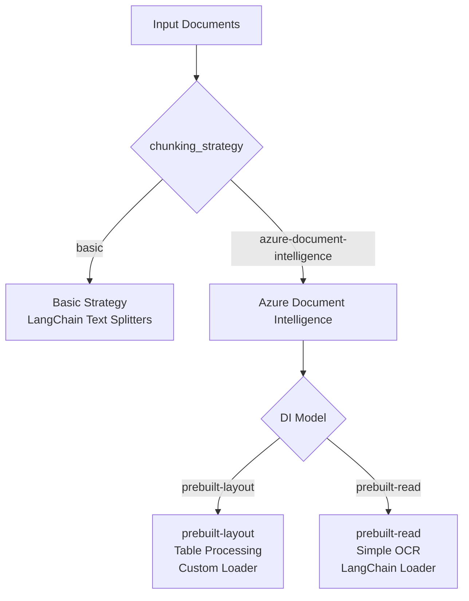

**Document Intelligence Features**: When using `"prebuilt-layout"`, the custom loader:
- Formats tables with column headers into key-value pairs
- Removes page numbers, footers, and recurring patterns (regex-based)
- Chunks recursively by paragraph and line to preserve table rows
- Falls back to `"prebuilt-read"` on errors

Sources: [rag_experiment_accelerator/config/index_config.py:18-39](), [README.md:300-309](), [README.md:37-38]()

---

### Embedding Model Configuration

The `embedding_model` parameter is an array supporting multiple embedding models for experimentation:

```json
"embedding_model": [
    {
        "type": "sentence-transformer",
        "model_name": "all-mpnet-base-v2"
    },
    {
        "type": "azure",
        "model_name": "text-embedding-ada-002",
        "dimension": 1536
    },
    {
        "type": "azure",
        "model_name": "text-embedding-3-large",
        "dimension": 256,
        "shorten_dimensions": true
    }
]
```

**Embedding Model Types**:

| Type | Description | Dimension Handling |
|------|-------------|-------------------|
| `sentence-transformer` | HuggingFace models | Auto-detected for common models |
| `azure` | Azure OpenAI embeddings | Must specify `dimension` |

**Azure OpenAI Embedding Models**:

| Model | Native Dimension | Supports Shortening |
|-------|-----------------|-------------------|
| `text-embedding-ada-002` | 1536 | No |
| `text-embedding-3-small` | 1536 | Yes |
| `text-embedding-3-large` | 3072 | Yes |

**Dimension Shortening**: For v3 models, set `shorten_dimensions: true` to use a custom dimension value less than the native dimension. This leverages the model's built-in dimension reduction capability.

Sources: [README.md:364-409](), [rag_experiment_accelerator/config/embedding_model_config.py](), [rag_experiment_accelerator/embedding/factory.py]()

---

### Sampling Configuration

The sampling feature creates a representative subset of documents using K-means clustering:

| Parameter | Type | Example | Description |
|-----------|------|---------|-------------|
| `sample_data` | boolean | `false` | Enable sampling |
| `percentage` | number | `5` | Percentage of corpus to sample (0-100) |
| `optimum_k` | string/int | `"auto"` | Cluster count: `"auto"` or specific integer |
| `min_cluster` | integer | `2` | Minimum clusters for auto mode |
| `max_cluster` | integer | `30` | Maximum clusters for auto mode |
| `only_sample` | boolean | `false` | Only run sampling, skip indexing |

**Sampling Process**:

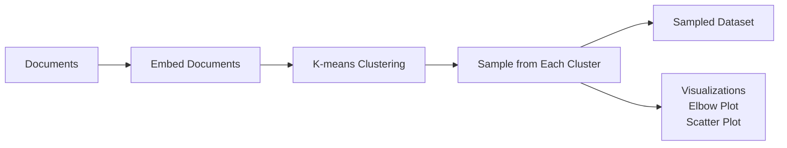

**Sampling Artifacts**:
- `artifacts/sampling/{job_name}/` - Sampled document files
- `all_cluster_predictions_cluster_number_{k}.csv` - Full dataset with cluster assignments
- `sampled_cluster_predictions_cluster_number_{k}.csv` - Sampled dataset
- `all_cluster_predictions_cluster_number_{k}.jpg` - Cluster visualization
- `elbow_{k}.png` - Elbow plot for optimal k (if `optimum_k: "auto"`)

Sources: [README.md:226-282](), [rag_experiment_accelerator/config/sampling_config.py](), [rag_experiment_accelerator/sampling/]()

---

## Language Configuration

The `language` section controls linguistic analysis for Azure AI Search indexes:

```json
"language": {
    "analyzer": {
        "analyzer_name": "en.microsoft",
        "index_analyzer_name": "",
        "search_analyzer_name": "",
        "char_filters": [],
        "tokenizers": [],
        "token_filters": []
    },
    "query_language": "en-us"
}
```

**Analyzer Configuration Rules**:
1. Either set `analyzer_name` alone (same analyzer for indexing and search)
2. Or set both `index_analyzer_name` and `search_analyzer_name` (different analyzers)
3. Cannot mix both patterns - enforced by [config.schema.json:291-332]()

**Supported Analyzers**: Built-in language analyzers (e.g., `"en.microsoft"`, `"fr.lucene"`) or custom analyzers defined via `char_filters`, `tokenizers`, and `token_filters`.

**Query Languages**: Supports 50+ language codes including `"en-us"`, `"fr-fr"`, `"de-de"`, `"ja-jp"`, `"zh-cn"`. Set to `"none"` to disable language-specific features.

Sources: [rag_experiment_accelerator/config/language_config.py](), [config.schema.json:224-416](), [README.md:319-329]()

---

## Search Configuration

The `search` section controls retrieval behavior:

```json
"search": {
    "retrieve_num_of_documents": 5,
    "search_type": [
        "search_for_manual_hybrid",
        "search_for_match_Hybrid_multi",
        "search_for_match_semantic"
    ],
    "search_relevancy_threshold": 0.8
}
```

### Search Type Taxonomy

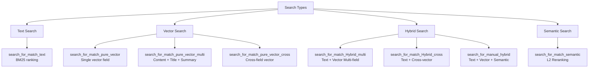

**Search Type Descriptions**:

| Search Type | Algorithm | Fields Used | Requirements |
|------------|-----------|-------------|--------------|
| `search_for_match_text` | BM25 | `content` | None |
| `search_for_match_pure_vector` | Vector similarity | `contentVector` | Embedding model |
| `search_for_match_pure_vector_multi` | Vector similarity | `contentVector`, `titleVector`, `summaryVector` | Multi-vector embeddings |
| `search_for_match_pure_vector_cross` | Cross-field vector | Multiple vector fields | Multi-vector embeddings |
| `search_for_match_Hybrid_multi` | BM25 + Vector | Text + Vector fields | Embedding model |
| `search_for_match_Hybrid_cross` | BM25 + Cross-vector | Text + Vector fields | Embedding model |
| `search_for_manual_hybrid` | BM25 + Vector + Semantic | All fields | Semantic search enabled |
| `search_for_match_semantic` | Semantic L2 reranking | `content` | Semantic search enabled |

**Semantic Search Requirement**: The search types `search_for_match_semantic` and `search_for_manual_hybrid` require Azure AI Search semantic search to be enabled (Basic tier or higher). This is validated in [rag_experiment_accelerator/config/config.py:94-106]().

Sources: [rag_experiment_accelerator/config/search_config.py](), [rag_experiment_accelerator/search_type/acs_search_methods.py](), [README.md:337-341]()

---

## Reranking Configuration

The `rerank` section controls post-retrieval reranking:

```json
"rerank": {
    "enabled": true,
    "type": "cross_encoder",
    "llm_rerank_threshold": 3,
    "cross_encoder_at_k": 4,
    "cross_encoder_model": "cross-encoder/stsb-roberta-base"
}
```

### Reranking Strategy Comparison

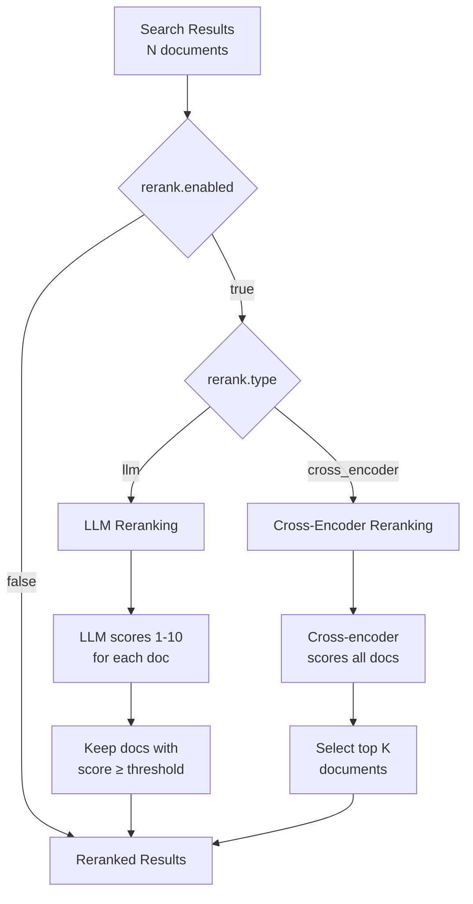

**Reranking Parameters**:

| Parameter | Type | Description | Used By |
|-----------|------|-------------|---------|
| `enabled` | boolean | Enable/disable reranking | Both |
| `type` | enum | `"llm"` or `"cross_encoder"` | Both |
| `llm_rerank_threshold` | integer | Score threshold (1-10) | LLM only |
| `cross_encoder_at_k` | integer | Number of docs to keep | Cross-encoder only |
| `cross_encoder_model` | string | Model name | Cross-encoder only |

**LLM Reranking**: Uses Azure OpenAI to score each document's relevance on a 1-10 scale. Only documents scoring at or above `llm_rerank_threshold` are retained.

**Cross-Encoder Reranking**: Uses a sentence-transformers cross-encoder model to score query-document pairs. Keeps the top `cross_encoder_at_k` documents.

**Model Support**: Currently only `"cross-encoder/stsb-roberta-base"` is supported for cross-encoder reranking.

Sources: [rag_experiment_accelerator/config/rerank_config.py](), [rag_experiment_accelerator/llm/llm_rerank.py](), [rag_experiment_accelerator/llm/cross_encoder_rerank.py](), [README.md:330-336]()

---

## Query Expansion Configuration

The `query_expansion` section controls query preprocessing and expansion strategies:

```json
"query_expansion": {
    "hyde": "disabled",
    "query_expansion": false,
    "min_query_expansion_related_question_similarity_score": 90,
    "expand_to_multiple_questions": false
}
```

### Query Expansion Strategies

```mermaid
graph TB
    QUERY["Original Query"]
    
    HYDE{"hyde setting"}
    QE{"query_expansion"}
    MULTI{"expand_to_multiple_questions"}
    
    DISABLED["No expansion"]
    HA["Generate Hypothetical<br/>Answer"]
    HD["Generate Hypothetical<br/>Document"]
    
    REL["Generate 5 Related<br/>Questions"]
    FILTER["Filter by Similarity<br/>≥ threshold"]
    SEARCH_MULTI["Search for each<br/>question + original"]
    
    COMPLEX{"Query Complex?"}
    SUB["Break into<br/>Sub-queries"]
    
    FINAL["Final Query/Queries"]
    
    QUERY --> HYDE
    QUERY --> QE
    QUERY --> MULTI
    
    HYDE -->|"disabled"| DISABLED
    HYDE -->|"generated_hypothetical_answer"| HA
    HYDE -->|"generated_hypothetical_document_to_answer"| HD
    
    QE -->|false| DISABLED
    QE -->|true| REL
    REL --> FILTER
    FILTER --> SEARCH_MULTI
    
    MULTI -->|false| DISABLED
    MULTI -->|true| COMPLEX
    COMPLEX -->|Yes| SUB
    COMPLEX -->|No| DISABLED
    
    DISABLED --> FINAL
    HA --> FINAL
    HD --> FINAL
    SEARCH_MULTI --> FINAL
    SUB --> FINAL
```

**Query Expansion Parameters**:

| Parameter | Type | Values | Description |
|-----------|------|--------|-------------|
| `hyde` | enum | `"disabled"`, `"generated_hypothetical_answer"`, `"generated_hypothetical_document_to_answer"` | HyDE strategy |
| `query_expansion` | boolean | | Generate related questions |
| `min_query_expansion_related_question_similarity_score` | integer | 0-100 | Similarity threshold (%) |
| `expand_to_multiple_questions` | boolean | | Break complex queries into sub-queries |

**HyDE (Hypothetical Document Embeddings)**: Based on [Precise Zero-Shot Dense Retrieval without Relevance Labels](https://arxiv.org/abs/2212.10496):
- `generated_hypothetical_answer`: LLM generates a hypothetical answer, which is embedded and used for search
- `generated_hypothetical_document_to_answer`: LLM generates a hypothetical document containing an answer, which is embedded and used for search

**Related Question Expansion**: Generates 5 related questions using LLM, filters those with similarity ≥ threshold using cosine similarity, and searches for each question. Results are deduplicated before reranking.

**Sub-Query Decomposition**: For complex queries, LLM breaks them into simpler sub-queries that are each searched independently.

Sources: [rag_experiment_accelerator/config/query_expansion.py](), [README.md:342-446](), [rag_experiment_accelerator/llm/prompt/prompts.py]()

---

## OpenAI Configuration

The `openai` section specifies Azure OpenAI deployment settings:

```json
"openai": {
    "azure_oai_chat_deployment_name": "gpt-35-turbo",
    "azure_oai_eval_deployment_name": "gpt-35-turbo",
    "temperature": 0
}
```

**Dual Deployment Strategy**:

```mermaid
graph LR
    CONFIG["OpenAI Config"]
    
    CHAT["azure_oai_chat_deployment_name"]
    EVAL["azure_oai_eval_deployment_name"]
    
    CHAT_USE["QA Generation<br/>Response Generation<br/>Query Expansion<br/>Reranking"]
    
    EVAL_USE["LLM Metrics<br/>llm_answer_relevance<br/>llm_context_precision<br/>llm_context_recall"]
    
    CONFIG --> CHAT
    CONFIG --> EVAL
    
    CHAT --> CHAT_USE
    EVAL --> EVAL_USE
```

**Deployment Separation Rationale**: Using separate deployments prevents quota conflicts and allows different model selection:
- **Chat deployment**: Higher rate limits for bulk operations (QA generation, querying)
- **Eval deployment**: Can use more powerful model for evaluation without impacting main pipeline

**Temperature**: Controls randomness (0-1):
- `0`: Deterministic, reproducible outputs (recommended for evaluation)
- Higher values: More creative but less consistent outputs

Sources: [rag_experiment_accelerator/config/openai_config.py](), [rag_experiment_accelerator/llm/response_generator.py](), [README.md:348-352]()

---

## Evaluation Configuration

The `eval` section specifies metrics for evaluation:

```json
"eval": {
    "metric_types": [
        "fuzzy_score",
        "bert_all_MiniLM_L6_v2",
        "cosine_ochiai",
        "bert_distilbert_base_nli_stsb_mean_tokens",
        "llm_answer_relevance",
        "llm_context_precision"
    ]
}
```

### Evaluation Metrics Taxonomy

| Metric Category | Metrics | Cost | Use Case |
|----------------|---------|------|----------|
| **Algorithm-Based** | `lcsstr`, `lcsseq`, `hamming`, `jaro_winkler`, `jaccard`, `levenshtein`, `fuzzy_score`, `cosine_ochiai` | Free | Quick iteration, string similarity |
| **ROUGE** | `rouge{1\|2\|L}_{precision\|recall\|fmeasure}` | Free | Token overlap, summarization |
| **BERT-Based** | `bert_all_MiniLM_L6_v2`, `bert_base_nli_mean_tokens`, `bert_large_nli_mean_tokens`, `bert_large_nli_stsb_mean_tokens`, `bert_distilbert_base_nli_stsb_mean_tokens`, `bert_paraphrase_multilingual_MiniLM_L12_v2` | Low | Semantic similarity |
| **LLM-Based** | `llm_answer_relevance`, `llm_context_precision`, `llm_context_recall` | High | Deep semantic understanding |

**Metric Selection Strategy**:

```mermaid
graph TD
    START["Select Metrics"]
    
    ITER["Quick Iteration?"]
    SEM["Need Semantic<br/>Understanding?"]
    COST["Budget for<br/>LLM Calls?"]
    
    ALG["Algorithm-Based<br/>fuzzy_score, cosine_ochiai"]
    ROUGE["Add ROUGE<br/>rouge2_recall"]
    BERT["BERT-Based<br/>bert_all_MiniLM_L6_v2"]
    LLM["LLM-Based<br/>llm_answer_relevance"]
    
    START --> ITER
    ITER -->|Yes| ALG
    ITER -->|No| SEM
    
    ALG --> ROUGE
    
    SEM -->|Yes| COST
    COST -->|No| BERT
    COST -->|Yes| LLM
```

**Algorithm-Based Metrics**: Fast, deterministic, good for initial experimentation. Best for string matching but miss semantic nuances.

**ROUGE Metrics**: Token-based overlap, commonly used for summarization tasks. Middle ground between string distance and semantic similarity.

**BERT-Based Metrics**: Capture semantic similarity via embeddings. Six models available with different speed/quality/language tradeoffs:
- `bert_all_MiniLM_L6_v2`: Fastest, 384-dim
- `bert_paraphrase_multilingual_MiniLM_L12_v2`: Multilingual support (50+ languages)
- `bert_large_nli_stsb_mean_tokens`: Highest quality, 1024-dim

**LLM-Based Metrics**: Most expensive but capture nuanced semantic understanding:
- `llm_answer_relevance`: Scores completeness and redundancy
- `llm_context_precision`: Evaluates retrieval quality
- `llm_context_recall`: Measures coverage

For complete metric descriptions, see [Evaluation Metrics](#8).

Sources: [rag_experiment_accelerator/config/eval_config.py:6-16](), [rag_experiment_accelerator/evaluation/plain_metrics.py](), [docs/evaluation-metrics.md:1-191](), [README.md:353-356]()

---

## Multi-Configuration Experiments

The configuration system supports **array values** for most parameters, enabling grid search experimentation:

### Flatten Mechanism

```mermaid
graph TB
    CONFIG["Config Object<br/>Arrays for multiple params"]
    
    FLATTEN["config.index.flatten()"]
    
    CONFIGS["List of IndexConfig Objects<br/>Cartesian Product"]
    
    EX1["IndexConfig 1:<br/>chunk_size=500<br/>overlap=100<br/>ef_construction=400<br/>dim=384"]
    
    EX2["IndexConfig 2:<br/>chunk_size=500<br/>overlap=100<br/>ef_construction=400<br/>dim=1536"]
    
    EX3["IndexConfig 3:<br/>chunk_size=1000<br/>overlap=200<br/>ef_construction=400<br/>dim=384"]
    
    EX4["IndexConfig 4:<br/>chunk_size=1000<br/>overlap=200<br/>ef_construction=400<br/>dim=1536"]
    
    CONFIG --> FLATTEN
    FLATTEN --> CONFIGS
    CONFIGS --> EX1
    CONFIGS --> EX2
    CONFIGS --> EX3
    CONFIGS --> EX4
```

**Flatten Process**: The `flatten()` method generates all combinations of array parameters.

### Example Multi-Configuration

```json
{
    "index": {
        "index_name_prefix": "exp",
        "ef_construction": [400, 800],
        "ef_search": [400],
        "chunking": {
            "chunk_size": [500, 1000],
            "overlap_size": [100, 200]
        },
        "embedding_model": [
            {
                "type": "sentence-transformer",
                "model_name": "all-MiniLM-L6-v2"
            },
            {
                "type": "azure",
                "model_name": "text-embedding-ada-002",
                "dimension": 1536
            }
        ]
    },
    "search": {
        "search_type": [
            "search_for_match_text",
            "search_for_match_pure_vector",
            "search_for_match_Hybrid_multi"
        ]
    }
}
```

**Generated Configurations**: This produces 2 (ef_construction) × 2 (chunk_size) × 2 (overlap_size) × 2 (embedding_model) = **16 index configurations** × 3 (search_type) = **48 total experiment variants**.

**Index Creation**: Each unique index configuration creates a separate Azure AI Search index with a unique name.

**Querying**: Each index is queried with each search type, creating a full matrix of experiments.

Sources: [rag_experiment_accelerator/config/base_config.py](), [rag_experiment_accelerator/config/index_config.py](), [README.md:283-287]()

---

## Path Configuration

The `path` section is typically left empty (`{}`) as paths are auto-configured:

```mermaid
graph TD
    CWD["Current Working Directory"]
    DATA_DIR["--data_dir argument"]
    
    INIT["PathConfig.initialize_paths()"]
    
    PATHS["Computed Paths"]
    
    DATA["data_dir:<br/>./data or ./data-ci"]
    ARTIFACTS["artifacts_dir:<br/>./artifacts"]
    DOCS["docs_data:<br/>./artifacts/docs_data"]
    INDEX["index_data:<br/>./artifacts/index_data"]
    OUTPUTS["outputs:<br/>./artifacts/outputs"]
    EVAL["eval_score:<br/>./artifacts/eval_score"]
    SAMPLE["sampling:<br/>./artifacts/sampling"]
    CKPT["checkpoints:<br/>./artifacts/checkpoints"]
    
    CWD --> INIT
    DATA_DIR --> INIT
    
    INIT --> PATHS
    
    PATHS --> DATA
    PATHS --> ARTIFACTS
    PATHS --> DOCS
    PATHS --> INDEX
    PATHS --> OUTPUTS
    PATHS --> EVAL
    PATHS --> SAMPLE
    PATHS --> CKPT
```

**Path Initialization**: Paths are computed in [rag_experiment_accelerator/config/path_config.py]() based on the config file location and optional `--data_dir` argument.

**Default Paths**:
- `data_dir`: `./data` (or specified via CLI)
- `artifacts_dir`: `./artifacts`
- `docs_data`: `./artifacts/docs_data` (chunked documents)
- `index_data`: `./artifacts/index_data` (index metadata)
- `outputs`: `./artifacts/outputs` (QA pairs, query results)
- `eval_score`: `./artifacts/eval_score` (evaluation metrics, visualizations)
- `sampling`: `./artifacts/sampling` (sampling artifacts)
- `checkpoints`: `./artifacts/checkpoints` (cached results)

Sources: [rag_experiment_accelerator/config/path_config.py](), [rag_experiment_accelerator/config/config.py:69]()

---

## Configuration Validation and Error Handling

The configuration system performs multiple levels of validation:

### Schema Validation

Performed during `Config.from_path()`:
1. JSON structure matches schema
2. All required fields present
3. Field types correct
4. Enum values valid
5. Numeric ranges satisfied

### Business Logic Validation

Performed in `Config.validate_inputs()`:

```python
def validate_inputs(self, use_semantic_search: bool = False):
    # Overlap must be smaller than chunk size
    if max(self.index.chunking.overlap_size) > min(self.index.chunking.chunk_size):
        raise ValueError(
            "Config param validation error: overlap_size must be less than chunk_size"
        )
    
    # Semantic search types require semantic search to be enabled
    if (
        "search_for_match_semantic" in self.search.search_type
        or "search_for_manual_hybrid" in self.search.search_type
    ) and not use_semantic_search:
        raise ValueError(
            "Semantic search is required for search types 'search_for_match_semantic' "
            "or 'search_for_manual_hybrid', but it's not enabled."
        )
```

Sources: [rag_experiment_accelerator/config/config.py:94-106](), [rag_experiment_accelerator/config/tests/test_config.py:192-238]()

---

## Configuration Best Practices

### 1. Start Small, Then Scale

```json
{
    "index": {
        "chunking": {
            "chunk_size": [1000],
            "overlap_size": [200]
        },
        "embedding_model": [
            {
                "type": "sentence-transformer",
                "model_name": "all-MiniLM-L6-v2"
            }
        ]
    },
    "search": {
        "search_type": ["search_for_match_Hybrid_multi"]
    },
    "eval": {
        "metric_types": ["fuzzy_score", "bert_all_MiniLM_L6_v2"]
    }
}
```

Once validated, expand to grid search:

```json
{
    "index": {
        "chunking": {
            "chunk_size": [500, 1000, 2000],
            "overlap_size": [100, 200, 300]
        }
    }
}
```

### 2. Use Checkpointing

Always enable `use_checkpoints: true` to avoid redundant expensive operations when re-running experiments.

### 3. Separate Chat and Eval Deployments

Use different deployments to prevent quota exhaustion during evaluation:

```json
{
    "openai": {
        "azure_oai_chat_deployment_name": "gpt-35-turbo-high-capacity",
        "azure_oai_eval_deployment_name": "gpt-4-32k"
    }
}
```

### 4. Sampling for Large Datasets

Enable sampling for initial experiments with large corpora:

```json
{
    "index": {
        "sampling": {
            "sample_data": true,
            "percentage": 10,
            "optimum_k": "auto"
        }
    }
}
```

### 5. Metric Selection by Cost

Start with algorithm-based metrics, add BERT for semantic understanding, and only add LLM metrics for final evaluation:

```json
{
    "eval": {
        "metric_types": [
            "fuzzy_score",
            "rouge2_recall",
            "bert_all_MiniLM_L6_v2"
        ]
    }
}
```

### 6. Consistent Naming

Use descriptive `experiment_name` and `job_name` values for MLflow tracking:

```json
{
    "experiment_name": "chunk-size-optimization",
    "job_name": "chunk-500-1000-2000",
    "job_description": "Comparing chunk sizes 500, 1000, 2000 with 20% overlap"
}
```

Sources: [README.md:283-356](), [config.sample.json:1-87]()

---

## Related Configuration Files

When modifying configurations, remember to update all three configuration files:

1. **`config.sample.json`**: Example configuration for users to copy
2. **`.github/workflows/config.json`**: Configuration used by CI/CD tests
3. **`run/tests/data/config.json`**: Configuration used by unit tests

This ensures consistency across development, testing, and documentation.

Sources: [README.md:359-362]()

---

# Page: Running Your First Experiment

# Running Your First Experiment

<details>
<summary>Relevant source files</summary>

The following files were used as context for generating this wiki page:

- [.env.template](.env.template)
- [.github/workflows/build_validation_workflow.yml](.github/workflows/build_validation_workflow.yml)
- [.github/workflows/rag_exp_acc_ci.yml](.github/workflows/rag_exp_acc_ci.yml)
- [02_qa_generation.py](02_qa_generation.py)
- [03_querying.py](03_querying.py)
- [04_evaluation.py](04_evaluation.py)
- [Makefile](Makefile)
- [README.md](README.md)
- [config.sample.json](config.sample.json)
- [docs/environment-variables.md](docs/environment-variables.md)

</details>


## Purpose and Scope

This page provides a step-by-step tutorial for executing your first complete RAG experiment using the RAG Experiment Accelerator. By the end of this guide, you will have indexed documents, generated question-answer pairs, executed queries, and evaluated the results using multiple metrics.

**Prerequisites**: This guide assumes you have completed [Installation and Dependencies](#2.1) and understand the basic [Configuration Guide](#2.2). For detailed information about each pipeline stage, see [Pipeline Architecture](#3).

## Quick Start Overview

A complete RAG experiment consists of four sequential stages, each executed by a dedicated Python script:

```mermaid
graph LR
    DATA["Documents<br/>(data/)"] --> INDEX["01_index.py<br/>Stage 1"]
    INDEX --> QA["02_qa_generation.py<br/>Stage 2"]
    QA --> QUERY["03_querying.py<br/>Stage 3"]
    QUERY --> EVAL["04_evaluation.py<br/>Stage 4"]
    EVAL --> RESULTS["MLflow Results<br/>(artifacts/)"]
    
    CONFIG["config.json +<br/>.env"] -.configures.-> INDEX
    CONFIG -.configures.-> QA
    CONFIG -.configures.-> QUERY
    CONFIG -.configures.-> EVAL
```

**Execution time**: A minimal experiment with 5-10 documents typically completes in 15-30 minutes, depending on document size and configuration.

Sources: [README.md:182-223](), [Diagram 1 from high-level architecture]()

## Prerequisites Checklist

Before running your first experiment, verify:

- [ ] Azure resources provisioned (AI Search, OpenAI, ML Workspace)
- [ ] `.env` file created and populated with credentials
- [ ] `config.json` file created from `config.sample.json`
- [ ] Python environment activated with dependencies installed
- [ ] Azure CLI authenticated (`az login` completed)

Sources: [README.md:125-189](), [docs/environment-variables.md:1-36]()

## Step-by-Step Guide

### Step 1: Prepare Your Environment Files

Create your environment configuration from the template:

```bash
cp .env.template .env
```

Edit `.env` and populate the required variables:

| Variable | Purpose | Example |
|----------|---------|---------|
| `AZURE_SEARCH_SERVICE_ENDPOINT` | AI Search endpoint | `https://myservice.search.windows.net` |
| `AZURE_SEARCH_ADMIN_KEY` | AI Search admin key | `abc123...` |
| `OPENAI_API_KEY` | Azure OpenAI key | `def456...` |
| `OPENAI_ENDPOINT` | Azure OpenAI endpoint | `https://myopenai.openai.azure.com/` |
| `OPENAI_API_TYPE` | Must be `azure` | `azure` |
| `OPENAI_API_VERSION` | API version | `2023-03-15-preview` |
| `AML_SUBSCRIPTION_ID` | Azure subscription ID | `00000000-0000-0000-0000-000000000000` |
| `AML_WORKSPACE_NAME` | ML workspace name | `my-ml-workspace` |
| `AML_RESOURCE_GROUP_NAME` | Resource group name | `my-resource-group` |

Sources: [.env.template:1-49](), [docs/environment-variables.md:15-36]()

### Step 2: Configure Your Experiment

Create your experiment configuration:

```bash
cp config.sample.json config.json
```

For your first experiment, modify the minimal required fields in `config.json`:

```json
{
    "experiment_name": "my-first-experiment",
    "job_name": "baseline-run",
    "job_description": "Initial baseline evaluation with default parameters",
    "data_formats": ["*"],
    "use_checkpoints": true,
    "index": {
        "index_name_prefix": "idx-baseline",
        "chunking": {
            "preprocess": false,
            "chunk_size": [1000],
            "overlap_size": [200]
        },
        "embedding_model": [
            {
                "type": "sentence-transformer",
                "model_name": "all-mpnet-base-v2"
            }
        ]
    },
    "openai": {
        "azure_oai_chat_deployment_name": "gpt-35-turbo",
        "azure_oai_eval_deployment_name": "gpt-35-turbo"
    }
}
```

**Key configuration notes**:
- `experiment_name`: Groups all related runs in Azure ML
- `job_name`: Identifies this specific run (timestamp will be appended)
- `use_checkpoints`: Enable to cache expensive operations
- `index_name_prefix`: Prefix for Azure AI Search index names

Sources: [config.sample.json:1-87](), [README.md:190-195]()

### Step 3: Prepare Your Documents

Place your documents in the `data/` directory:

```bash
mkdir -p data
# Copy your PDF, HTML, MD, TXT, JSON, or DOCX files here
cp /path/to/your/documents/*.pdf data/
```

**Supported formats**: PDF, HTML, Markdown, Plain Text, JSON, DOCX

**Recommended for first run**: Start with 5-10 small documents (< 10 pages each) to validate the pipeline quickly.

Sources: [README.md:195-196](), [README.md:289]()

### Step 4: Run Stage 1 - Document Indexing

Execute the indexing stage to process documents and create Azure AI Search indexes:

```bash
python 01_index.py --data_dir data --config_path config.json
```

**What happens in this stage**:

```mermaid
graph TD
    START["01_index.py"] --> LOAD["doc_loader/<br/>Load Documents"]
    LOAD --> CHUNK["LangChain<br/>Split into Chunks"]
    CHUNK --> EMBED["embedding/<br/>Generate Embeddings"]
    EMBED --> CREATE["ingest_data/acs_ingest<br/>Create Search Index"]
    CREATE --> UPLOAD["Upload to<br/>Azure AI Search"]
    UPLOAD --> ARTIFACTS["Save to<br/>artifacts/docs_data/"]
    
    CONFIG["config.json<br/>index.*"] -.controls.-> LOAD
    CONFIG -.controls.-> CHUNK
    CONFIG -.controls.-> EMBED
```

**Command-line arguments**:
- `--data_dir`: Directory containing input documents (default: `data`)
- `--config_path`: Path to configuration file (default: `config.json`)
- `-d`: Working directory (default: current directory)

**Output artifacts** (in `artifacts/`):
- `docs_data/<index_name>/`: Chunked documents in JSONL format
- `index_data/<index_name>/`: Index metadata and statistics
- `checkpoints/`: Cached embeddings and processing results

**Verification**: Check that the index was created in Azure AI Search portal at `{AZURE_SEARCH_SERVICE_ENDPOINT}`.

Sources: [01_index.py:1-44](), [README.md:197-203](), [Diagram 1 from high-level architecture]()

### Step 5: Run Stage 2 - QA Generation

Generate question-answer pairs from indexed documents:

```bash
python 02_qa_generation.py --data_dir data --config_path config.json
```

**What happens in this stage**:

```mermaid
graph TD
    START["02_qa_generation.py"] --> LOAD["Load Chunked<br/>Documents"]
    LOAD --> QUERY["search_type/acs_search<br/>Retrieve Chunks"]
    QUERY --> GENERATE["llm/ResponseGenerator<br/>Generate QA Pairs"]
    GENERATE --> VALIDATE["Validate<br/>JSON Format"]
    VALIDATE --> SAVE["Save to<br/>artifacts/outputs/"]
    
    ENV[".env<br/>OPENAI_*"] -.credentials.-> GENERATE
    CONFIG["config.json<br/>openai.*"] -.controls.-> GENERATE
```

**What it does**:
1. Retrieves document chunks from Azure AI Search
2. Uses Azure OpenAI to generate question-answer pairs for each chunk
3. Creates ground truth dataset for evaluation
4. Saves results to `artifacts/outputs/qa_pairs.jsonl`

**Output format** (`qa_pairs.jsonl`):
```json
{
  "question": "What is the purpose of...",
  "answer": "The purpose is...",
  "context": "Original document chunk text...",
  "chunk_id": "doc_001_chunk_005",
  "source": "document_name.pdf"
}
```

**Typical generation rate**: 1-2 QA pairs per chunk, ~5-10 seconds per pair

Sources: [02_qa_generation.py:1-23](), [README.md:204-210](), [Diagram 1 from high-level architecture]()

### Step 6: Run Stage 3 - Querying

Execute queries against the search index and generate responses:

```bash
python 03_querying.py --config_path config.json
```

**What happens in this stage**:

```mermaid
graph TD
    START["03_querying.py"] --> MLFLOW["initialise_mlflow_client"]
    MLFLOW --> LOOP["For each index_config<br/>in config.index.flatten()"]
    LOOP --> RUN["run.querying.run"]
    RUN --> EXPAND["Query Expansion<br/>query_expansion.*"]
    EXPAND --> SEARCH["search_type/acs_search<br/>Execute Search"]
    SEARCH --> RERANK["llm/rerank<br/>Optional Reranking"]
    RERANK --> LLM["llm/ResponseGenerator<br/>Generate Response"]
    LLM --> SAVE["QueryOutputHandler<br/>Save Results"]
    SAVE --> ASSET["create_data_asset<br/>Register in Azure ML"]
    
    QA["artifacts/outputs/<br/>qa_pairs.jsonl"] --> RUN
    CONFIG["config.json"] -.controls.-> EXPAND
    CONFIG -.controls.-> SEARCH
    CONFIG -.controls.-> RERANK
```

**Key processes**:
1. **Query expansion**: Optionally expands queries using HyDE or multi-question generation
2. **Search execution**: Tests multiple search types (text, vector, hybrid, semantic)
3. **Reranking**: Applies LLM or cross-encoder reranking if enabled
4. **Response generation**: Uses Azure OpenAI to generate final answers

**Configuration impact**:
- `config.search.search_type`: Determines which search strategies to test
- `config.rerank.enabled`: Enables/disables reranking
- `config.query_expansion.*`: Controls query expansion behavior

**Output artifacts**:
- `artifacts/outputs/<index_name>_<search_type>.jsonl`: Query results for each search type
- Registered as Azure ML data assets for tracking

Sources: [03_querying.py:1-52](), [README.md:211-216](), [Diagram 1 from high-level architecture]()

### Step 7: Run Stage 4 - Evaluation

Calculate metrics and generate evaluation reports:

```bash
python 04_evaluation.py --config_path config.json
```

**What happens in this stage**:

```mermaid
graph TD
    START["04_evaluation.py"] --> MLFLOW["initialise_mlflow_client<br/>Set Experiment"]
    MLFLOW --> LOOP["For each index_config"]
    LOOP --> RUN["run.evaluation.run"]
    RUN --> LOAD["Load Query Results<br/>from artifacts/outputs/"]
    LOAD --> ALG["evaluation/metrics<br/>Algorithm Metrics"]
    LOAD --> BERT["evaluation/metrics<br/>BERT Metrics"]
    LOAD --> LLM_EVAL["evaluation/eval<br/>LLM-based Metrics"]
    ALG --> AGGREGATE["Aggregate Scores"]
    BERT --> AGGREGATE
    LLM_EVAL --> AGGREGATE
    AGGREGATE --> VIZ["Generate<br/>Visualizations"]
    VIZ --> SAVE["Save to<br/>artifacts/eval_score/"]
    SAVE --> MLFLOW_LOG["MLflow Log<br/>Metrics & Artifacts"]
```

**Evaluation metrics computed** (configurable via `config.eval.metric_types`):

| Metric Type | Examples | Cost |
|-------------|----------|------|
| Algorithm-based | `levenshtein`, `jaccard`, `fuzzy_score` | Free |
| BERT-based | `bert_all_MiniLM_L6_v2`, `bert_large_nli_mean_tokens` | Low |
| LLM-based | `llm_answer_relevance`, `llm_context_precision` | High |

**Output artifacts** (in `artifacts/eval_score/`):
- `<index_name>_<search_type>_metrics.csv`: Detailed metric scores per question
- `all_metrics_current_run.html`: Interactive comparison dashboard
- `*.png`, `*.jpg`: Metric comparison charts
- `map_at_k_*.csv`: Retrieval precision metrics

**MLflow tracking**: All metrics, parameters, and visualizations are logged to Azure ML for comparison across runs.

Sources: [04_evaluation.py:1-43](), [README.md:217-222](), [Diagram 6 from high-level architecture]()

### Step 8: View Results

#### Option 1: Local Artifacts

Navigate to the `artifacts/eval_score/` directory to view:

```bash
cd artifacts/eval_score
# Open HTML report in browser
open all_metrics_current_run.html
```

#### Option 2: Azure ML Studio

1. Navigate to Azure ML Studio: `https://ml.azure.com`
2. Select your workspace
3. Go to "Experiments" and find your experiment name
4. Click on the latest run to view:
   - Metrics comparison charts
   - Hyperparameters
   - Output artifacts
   - Run history for comparison

**Key reports to examine**:
- **Metric Comparison**: Average scores across search types
- **Search Evaluation**: Performance by search strategy
- **MAP Scores**: Retrieval quality metrics

Sources: [README.md:447-480]()

## Complete Execution Flow with Code Entities

This diagram shows the complete execution flow with actual code entities:

```mermaid
graph TB
    subgraph "Entry Points"
        CLI1["01_index.py<br/>main()"]
        CLI2["02_qa_generation.py<br/>main()"]
        CLI3["03_querying.py<br/>main()"]
        CLI4["04_evaluation.py<br/>main()"]
    end
    
    subgraph "Configuration"
        ENV["Environment<br/>.from_env_or_keyvault()"]
        CFG["Config<br/>.from_path()"]
        IDX_CFG["IndexConfig<br/>.flatten()"]
    end
    
    subgraph "Execution Modules"
        RUN_IDX["run.index.run()"]
        RUN_QA["run.qa_generation.run()"]
        RUN_QUERY["run.querying.run()"]
        RUN_EVAL["run.evaluation.run()"]
    end
    
    subgraph "Core Components"
        DOC["doc_loader/<br/>documentLoader"]
        EMB["embedding/<br/>STEmbeddingModel"]
        ACS["ingest_data/<br/>acs_ingest"]
        SEARCH["search_type/<br/>acs_search_methods"]
        RESPGEN["llm/<br/>ResponseGenerator"]
        METRICS["evaluation/<br/>metrics"]
    end
    
    subgraph "Infrastructure"
        CKPT["checkpoint/<br/>cache_with_checkpoint"]
        MLFLOW_CLIENT["MLflow Client<br/>initialise_mlflow_client()"]
        HANDLER["QueryOutputHandler<br/>.get_output_path()"]
    end
    
    CLI1 --> ENV
    CLI2 --> ENV
    CLI3 --> ENV
    CLI4 --> ENV
    
    ENV --> CFG
    CFG --> IDX_CFG
    
    CLI1 --> RUN_IDX
    CLI2 --> RUN_QA
    CLI3 --> RUN_QUERY
    CLI4 --> RUN_EVAL
    
    RUN_IDX --> DOC
    RUN_IDX --> EMB
    RUN_IDX --> ACS
    
    RUN_QA --> SEARCH
    RUN_QA --> RESPGEN
    
    RUN_QUERY --> SEARCH
    RUN_QUERY --> RESPGEN
    RUN_QUERY --> HANDLER
    
    RUN_EVAL --> METRICS
    
    CLI1 -.uses.-> CKPT
    CLI2 -.uses.-> CKPT
    CLI3 -.uses.-> CKPT
    
    CLI3 --> MLFLOW_CLIENT
    CLI4 --> MLFLOW_CLIENT
```

Sources: [01_index.py:16-44](), [02_qa_generation.py:10-23](), [03_querying.py:16-52](), [04_evaluation.py:15-43](), [Diagram 5 from high-level architecture]()

## Artifact Organization

Understanding where each stage writes its outputs:

```mermaid
graph LR
    subgraph "Input"
        DATA["data/<br/>*.pdf, *.html, etc"]
        CONFIG["config.json"]
        ENV[".env"]
    end
    
    subgraph "Stage 1 Outputs"
        DOCS["artifacts/docs_data/<br/>{index_name}/<br/>chunks.jsonl"]
        IDX_META["artifacts/index_data/<br/>{index_name}/<br/>metadata.json"]
    end
    
    subgraph "Stage 2 Outputs"
        QA["artifacts/outputs/<br/>qa_pairs.jsonl"]
    end
    
    subgraph "Stage 3 Outputs"
        QUERY_OUT["artifacts/outputs/<br/>{index_name}_{search_type}.jsonl"]
    end
    
    subgraph "Stage 4 Outputs"
        METRICS["artifacts/eval_score/<br/>{index_name}_metrics.csv"]
        REPORTS["artifacts/eval_score/<br/>all_metrics_current_run.html"]
        CHARTS["artifacts/eval_score/<br/>*.png, *.jpg"]
    end
    
    subgraph "Checkpoint Cache"
        CKPT["artifacts/checkpoints/<br/>{content_hash}/"]
    end
    
    DATA --> DOCS
    CONFIG --> DOCS
    DOCS --> QA
    QA --> QUERY_OUT
    QUERY_OUT --> METRICS
    METRICS --> REPORTS
    METRICS --> CHARTS
    
    DOCS -.cached.-> CKPT
    QA -.cached.-> CKPT
```

**Artifact paths**:
- `artifacts/docs_data/{index_name}/`: Chunked documents from Stage 1
- `artifacts/outputs/qa_pairs.jsonl`: QA pairs from Stage 2
- `artifacts/outputs/{index_name}_{search_type}.jsonl`: Query results from Stage 3
- `artifacts/eval_score/`: All evaluation outputs from Stage 4
- `artifacts/checkpoints/`: Cached intermediate results

Sources: [Diagram 4 from high-level architecture](), [README.md:182-223]()

## Alternative Execution Methods

### Using Makefile

The Makefile provides convenient targets for running the entire pipeline:

```bash
# Run all stages sequentially
make all

# Run individual stages
make index      # Stage 1
make qnagen     # Stage 2
make query      # Stage 3
make eval       # Stage 4

# Run only query and evaluation
make query_eval

# With custom config or data directory
make all cp=my_config.json dd=my_data_dir
```

**Makefile targets**:

| Target | Description | Equivalent Command |
|--------|-------------|-------------------|
| `make index` | Run Stage 1 | `python 01_index.py --data_dir ./data` |
| `make qnagen` | Run Stage 2 | `python 02_qa_generation.py --data_dir ./data` |
| `make query` | Run Stage 3 | `python 03_querying.py` |
| `make eval` | Run Stage 4 | `python 04_evaluation.py` |
| `make all` | Run all stages | Executes index, qnagen, query, eval |
| `make clear_artifacts` | Clean output directories | `rm -rf artifacts/{docs_data,eval_score,...}` |
| `make clear_checkpoints` | Clear checkpoint cache | `rm -rf artifacts/checkpoints` |

Sources: [Makefile:1-76]()

### Using CI/CD (GitHub Actions)

For automated testing, the repository includes a GitHub Actions workflow:

**Workflow file**: [.github/workflows/rag_exp_acc_ci.yml:1-67]()

**What it does**:
1. Sets up Azure authentication using service principal
2. Loads environment variables from GitHub secrets
3. Executes all four stages sequentially using the CI data directory

**To run manually**:
1. Go to "Actions" tab in GitHub
2. Select "RAG Experiment Accelerator CI"
3. Click "Run workflow"

Sources: [.github/workflows/rag_exp_acc_ci.yml:23-67]()

## Understanding Checkpoints

The checkpoint system caches expensive operations to avoid redundant computation:

**How it works**:
1. Content-based hashing generates unique identifiers
2. Results cached in `artifacts/checkpoints/{content_hash}/`
3. On subsequent runs, cached results are loaded instead of recomputing

**What gets cached**:
- Document embeddings (Stage 1)
- LLM-generated QA pairs (Stage 2)
- Query expansion results (Stage 3)

**Configuration**:
```json
{
    "use_checkpoints": true  // Enable/disable in config.json
}
```

**When to clear checkpoints**:
```bash
make clear_checkpoints
```

Clear checkpoints when:
- Changing embedding models
- Modifying LLM prompts
- Debugging incorrect cached results

Sources: [README.md:290](), [config.sample.json:8]()

## Troubleshooting Common Issues

### Issue: "Azure Search index not found"

**Cause**: Stage 1 (indexing) did not complete successfully.

**Solution**:
1. Verify Azure AI Search credentials in `.env`
2. Check Azure portal to confirm index creation
3. Review Stage 1 logs for errors
4. Ensure `AZURE_SEARCH_ADMIN_KEY` has write permissions

### Issue: "QA generation producing invalid JSON"

**Cause**: Azure OpenAI content filtering or incorrect prompt formatting.

**Solution**:
1. Check that `azure_oai_chat_deployment_name` matches your deployment
2. Verify API version compatibility in `.env`
3. Review content filters in Azure OpenAI portal
4. Check chunk size isn't exceeding token limits

Sources: [README.md:481-522]()

### Issue: "Out of range error during reranking"

**Cause**: Mismatch between `retrieve_num_of_documents` and reranking thresholds.

**Solution**:
```json
{
    "search": {
        "retrieve_num_of_documents": 10  // Increase this
    },
    "rerank": {
        "cross_encoder_at_k": 5,  // Ensure < retrieve_num_of_documents
        "llm_rerank_threshold": 3  // Ensure < retrieve_num_of_documents
    }
}
```

Sources: [README.md:495-500]()

### Issue: "MLflow authentication failed"

**Cause**: Azure ML credentials not configured or expired.

**Solution**:
1. Re-authenticate with Azure CLI: `az login`
2. Verify `AML_*` variables in `.env` are correct
3. Check Azure ML workspace access permissions
4. Ensure workspace exists in specified subscription

Sources: [README.md:486-490]()

## Next Steps

After successfully running your first experiment:

1. **Experiment with configurations**: See [IndexConfig and Multi-Configuration Experiments](#4.2) to run grid search experiments
2. **Optimize chunking**: Review [Chunking Strategies](#5.3) to improve retrieval quality
3. **Try different search types**: Explore [Search Types and Strategies](#7.1) for optimal search configuration
4. **Add more metrics**: See [Evaluation Metrics](#8) for comprehensive evaluation options
5. **Scale to production**: Review [Azure ML and MLflow](#9.3) for distributed execution
6. **Enable sampling**: See [Data Sampling and Clustering](#5.4) for large datasets

**Typical experimentation workflow**:
1. Run baseline with default parameters (this guide)
2. Analyze results to identify bottlenecks
3. Create config variants with `config.index.flatten()` 
4. Execute batch experiments
5. Compare results in MLflow
6. Select best configuration for production

Sources: [README.md:226-282]()

---

# Page: Pipeline Architecture

# Pipeline Architecture

<details>
<summary>Relevant source files</summary>

The following files were used as context for generating this wiki page:

- [.env.template](.env.template)
- [.github/workflows/build_validation_workflow.yml](.github/workflows/build_validation_workflow.yml)
- [.github/workflows/rag_exp_acc_ci.yml](.github/workflows/rag_exp_acc_ci.yml)
- [02_qa_generation.py](02_qa_generation.py)
- [03_querying.py](03_querying.py)
- [04_evaluation.py](04_evaluation.py)
- [Makefile](Makefile)
- [README.md](README.md)
- [config.sample.json](config.sample.json)
- [docs/environment-variables.md](docs/environment-variables.md)

</details>


## Purpose and Scope

This document describes the overall architecture of the RAG Experiment Accelerator's 4-stage pipeline, including how stages execute sequentially, how data flows between them, and how configuration drives experimentation. For detailed information about individual stages, see:
- Stage 1 (Indexing): [Stage 1: Document Indexing](#3.1)
- Stage 2 (QA Generation): [Stage 2: QA Generation](#3.2)
- Stage 3 (Querying): [Stage 3: Querying and Retrieval](#3.3)
- Stage 4 (Evaluation): [Stage 4: Evaluation and Metrics](#3.4)

For configuration details, see [Configuration System](#4).

---

## Sequential Four-Stage Architecture

The RAG Experiment Accelerator implements a linear pipeline consisting of four mandatory stages that must execute in order. Each stage produces artifacts consumed by subsequent stages.

### Pipeline Stages Overview

```mermaid
graph LR
    S1["Stage 1<br/>01_index.py<br/>run.index"]
    S2["Stage 2<br/>02_qa_generation.py<br/>run.qa_generation"]
    S3["Stage 3<br/>03_querying.py<br/>run.querying"]
    S4["Stage 4<br/>04_evaluation.py<br/>run.evaluation"]
    
    S1 -->|"Azure AI Search indexes<br/>artifacts/docs_data/"| S2
    S2 -->|"qa_pairs.jsonl<br/>artifacts/outputs/"| S3
    S3 -->|"query_results.jsonl<br/>artifacts/outputs/"| S4
    S4 -->|"CSV/HTML/PNG reports<br/>artifacts/eval_score/"| END["MLflow<br/>Experiment Tracking"]
```

| Stage | Entry Point | Core Module | Primary Output | Purpose |
|-------|-------------|-------------|----------------|---------|
| 1 | `01_index.py` | `run.index` | Azure AI Search indexes | Document loading, chunking, embedding, index creation |
| 2 | `02_qa_generation.py` | `run.qa_generation` | `qa_pairs.jsonl` | Ground truth Q&A pair generation using LLM |
| 3 | `03_querying.py` | `run.querying` | `query_results.jsonl` | Query execution, retrieval, reranking, LLM response generation |
| 4 | `04_evaluation.py` | `run.evaluation` | Metrics CSV/HTML/PNG | Metric calculation and visualization generation |

**Sources:** [README.md:197-222](), [01_index.py](), [02_qa_generation.py](), [03_querying.py](), [04_evaluation.py]()

---

## CLI Entry Points and Run Modules

Each stage is orchestrated by a CLI script that delegates to a corresponding `run` module. This separation enables testing, reusability, and multiple execution modes.

### CLI Script Structure

```mermaid
graph TB
    subgraph "CLI Layer"
        CLI1["01_index.py"]
        CLI2["02_qa_generation.py"]
        CLI3["03_querying.py"]
        CLI4["04_evaluation.py"]
    end
    
    subgraph "Orchestration Layer"
        RUN1["run.index.run()"]
        RUN2["run.qa_generation.run()"]
        RUN3["run.querying.run()"]
        RUN4["run.evaluation.run()"]
    end
    
    subgraph "Configuration"
        ENV["Environment.from_env_or_keyvault()"]
        CFG["Config.from_path()"]
    end
    
    subgraph "External Services"
        MLFLOW["mlflow.start_run()"]
        CKPT["init_checkpoint()"]
    end
    
    CLI1 --> ENV
    CLI2 --> ENV
    CLI3 --> ENV
    CLI4 --> ENV
    
    CLI1 --> CFG
    CLI2 --> CFG
    CLI3 --> CFG
    CLI4 --> CFG
    
    CLI1 --> RUN1
    CLI2 --> RUN2
    CLI3 --> RUN3
    CLI4 --> RUN4
    
    CLI3 --> MLFLOW
    CLI4 --> MLFLOW
    
    CLI1 --> CKPT
    CLI2 --> CKPT
    CLI3 --> CKPT
```

All CLI scripts follow a consistent pattern:

1. **Parse arguments**: `argparse` extracts `--config_path` and `--data_dir`
2. **Load environment**: `Environment.from_env_or_keyvault()` loads secrets
3. **Load configuration**: `Config.from_path()` parses `config.json`
4. **Initialize systems**: Checkpoint and MLflow (Stages 3-4 only)
5. **Execute run module**: Delegate to `run.<stage>.run()`

**Sources:** [01_index.py:16-52](), [02_qa_generation.py:10-22](), [03_querying.py:16-52](), [04_evaluation.py:15-43]()

---

## Configuration-Driven Experimentation

The pipeline supports systematic experimentation through configuration arrays that generate multiple index configurations via `Config.index.flatten()`.

### Index Configuration Expansion

```mermaid
graph TD
    CONFIG["config.json<br/>Arrays in nested structure"]
    FLATTEN["IndexConfig.flatten()"]
    CONFIGS["List of IndexConfig instances<br/>Cartesian product"]
    
    LOOP["for index_config in<br/>config.index.flatten()"]
    EXEC["Execute stage with<br/>specific index_config"]
    
    CONFIG --> FLATTEN
    FLATTEN --> CONFIGS
    CONFIGS --> LOOP
    LOOP --> EXEC
    EXEC -->|"Multiple iterations"| LOOP
```

When configuration parameters are specified as arrays, `flatten()` generates all combinations:

```json
{
  "index": {
    "chunk_size": [500, 1000],
    "overlap_size": [100, 200],
    "embedding_model": [
      {"type": "sentence-transformer", "model_name": "all-MiniLM-L6-v2"},
      {"type": "azure", "model_name": "text-embedding-ada-002"}
    ]
  }
}
```

This generates 2 × 2 × 2 = 8 index configurations, each creating a separate Azure AI Search index with a unique name like: `idx-chunk500-overlap100-dim384-ef_construction400-ef_search400`

**Sources:** [README.md:283-357](), [config.sample.json:10-37](), [03_querying.py:40-52](), [04_evaluation.py:34-42]()

---

## Execution Orchestration Modes

The pipeline supports three execution modes that all invoke the same CLI scripts, ensuring consistent behavior across environments.

### Orchestration Modes Comparison

```mermaid
graph TB
    subgraph "Local Execution"
        MAKE["Makefile targets<br/>make all, make index,<br/>make query, make eval"]
        DIRECT["python 01_index.py<br/>python 02_qa_generation.py<br/>..."]
    end
    
    subgraph "CI/CD Execution"
        GHA["GitHub Actions<br/>rag_exp_acc_ci.yml<br/>workflow steps"]
    end
    
    subgraph "Cloud Execution"
        AML["Azure ML Pipeline<br/>azureml/pipeline.py<br/>PipelineJob"]
    end
    
    CLI["CLI Scripts<br/>01-04_*.py"]
    
    MAKE --> CLI
    DIRECT --> CLI
    GHA --> CLI
    AML --> CLI
    
    CLI --> RUN["run.* modules<br/>Core business logic"]
```

| Mode | Entry Point | Use Case | Compute |
|------|-------------|----------|---------|
| **Direct** | `python 01_index.py` | Development, debugging | Local machine |
| **Makefile** | `make all`, `make query_eval` | Simplified local workflows | Local machine |
| **GitHub Actions** | `.github/workflows/rag_exp_acc_ci.yml` | Automated testing on PR | GitHub runners |
| **Azure ML** | `azureml/pipeline.py` | Production experiments | Azure ML compute clusters |

### Makefile Targets

The `Makefile` provides convenient aliases for common workflows:

- `make index` → `python3 01_index.py`
- `make qnagen` → `python3 02_qa_generation.py`
- `make query` → `python3 03_querying.py`
- `make eval` → `python3 04_evaluation.py`
- `make all` → Runs all four stages sequentially
- `make query_eval` → Runs only querying and evaluation stages

**Sources:** [Makefile:21-47](), [README.md:181-224](), [.github/workflows/rag_exp_acc_ci.yml:51-66]()

---

## Data Flow and Artifact Management

Each stage produces artifacts stored in the `artifacts/` directory. These artifacts serve as inputs to subsequent stages and enable inspection and debugging.

### Artifact Directory Structure

```mermaid
graph TB
    subgraph "artifacts/ Directory"
        DOCS["docs_data/<br/>Chunked documents<br/>JSON format"]
        INDEX["index_data/<br/>Index metadata<br/>Embedding stats"]
        SAMPLE["sampling/<br/>Cluster visualizations<br/>CSV predictions"]
        OUTPUTS["outputs/<br/>qa_pairs.jsonl<br/>query_results.jsonl"]
        EVAL["eval_score/<br/>metrics CSV<br/>HTML reports<br/>PNG charts"]
        CKPT["checkpoints/<br/>Cached results<br/>Content-hashed keys"]
    end
    
    S1["Stage 1<br/>01_index.py"] --> DOCS
    S1 --> INDEX
    S1 --> SAMPLE
    
    S2["Stage 2<br/>02_qa_generation.py"] --> OUTPUTS
    DOCS -.reads.-> S2
    
    S3["Stage 3<br/>03_querying.py"] --> OUTPUTS
    OUTPUTS -.reads.-> S3
    
    S4["Stage 4<br/>04_evaluation.py"] --> EVAL
    OUTPUTS -.reads.-> S4
    
    S1 -.caches to.-> CKPT
    S2 -.caches to.-> CKPT
    S3 -.caches to.-> CKPT
```

### Artifact Lifecycle

| Directory | Created By | Contains | Consumed By | Persistence |
|-----------|------------|----------|-------------|-------------|
| `artifacts/docs_data/` | Stage 1 | Chunked document JSON files | Stage 2 | Local filesystem |
| `artifacts/index_data/` | Stage 1 | Index metadata, embedding statistics | Inspection only | Local filesystem |
| `artifacts/sampling/` | Stage 1 (optional) | Cluster plots, prediction CSVs | Inspection only | Local filesystem |
| `artifacts/outputs/` | Stages 2-3 | `qa_pairs.jsonl`, `query_results.jsonl` | Subsequent stages | Local + Azure ML Data Assets |
| `artifacts/eval_score/` | Stage 4 | Metrics CSV, HTML reports, PNG charts | MLflow logging | Local + MLflow |
| `artifacts/checkpoints/` | All stages | Content-hashed cached results | Same stage on re-run | Local filesystem |

**Sources:** [README.md:247-256](), Diagram 4 from context

---

## Checkpointing System

The checkpoint system enables fault tolerance and avoids redundant expensive operations (LLM calls, embeddings, clustering) by caching results keyed by content hash.

### Checkpoint Behavior

```mermaid
graph LR
    CALL["Function call<br/>with inputs"]
    CHECK{"Checkpoint<br/>exists?"}
    CACHE["Load from<br/>artifacts/checkpoints/"]
    EXEC["Execute<br/>function"]
    SAVE["Save to<br/>artifacts/checkpoints/"]
    RETURN["Return result"]
    
    CALL --> CHECK
    CHECK -->|"Yes + use_checkpoints=true"| CACHE
    CHECK -->|"No or use_checkpoints=false"| EXEC
    CACHE --> RETURN
    EXEC --> SAVE
    SAVE --> RETURN
```

The `use_checkpoints` configuration parameter controls checkpoint behavior globally. When enabled, the `init_checkpoint()` function configures the checkpoint decorator to cache expensive operations.

### Checkpoint Configuration

```json
{
  "use_checkpoints": true
}
```

Operations commonly checkpointed include:
- Document embedding generation
- LLM-based title/summary generation
- K-means clustering for sampling
- Q&A pair generation
- Query expansion (HyDE, related questions)
- LLM-based evaluation metrics

Checkpoint files are stored with content-based hashes to ensure cache invalidation when inputs change. The `make clear_checkpoints` command removes all cached data.

**Sources:** [README.md:295](), [config.sample.json:8](), [01_index.py:52](), [02_qa_generation.py:20](), [03_querying.py:38](), [Makefile:61-63]()

---

## Stage Interaction Patterns

Stages interact through three primary mechanisms: artifact files, Azure services, and MLflow tracking.

### Inter-Stage Dependencies

```mermaid
graph TB
    subgraph "Stage 1: Indexing"
        S1_DOC["Document Loading<br/>& Chunking"]
        S1_EMB["Embedding<br/>Generation"]
        S1_IDX["Index Creation<br/>in Azure AI Search"]
    end
    
    subgraph "Stage 2: QA Generation"
        S2_SEARCH["Search Index<br/>for Chunks"]
        S2_LLM["LLM Q&A<br/>Generation"]
        S2_FILE["Write<br/>qa_pairs.jsonl"]
    end
    
    subgraph "Stage 3: Querying"
        S3_READ["Read<br/>qa_pairs.jsonl"]
        S3_QUERY["Query<br/>Execution"]
        S3_LLM["LLM Response<br/>Generation"]
        S3_FILE["Write<br/>query_results.jsonl"]
        S3_ASSET["Register Azure ML<br/>Data Asset"]
    end
    
    subgraph "Stage 4: Evaluation"
        S4_READ["Read<br/>query_results.jsonl"]
        S4_CALC["Metric<br/>Calculation"]
        S4_VIZ["Visualization<br/>Generation"]
        S4_MLFLOW["MLflow<br/>Logging"]
    end
    
    S1_DOC --> S1_EMB
    S1_EMB --> S1_IDX
    S1_IDX -.Azure AI Search.-> S2_SEARCH
    
    S2_SEARCH --> S2_LLM
    S2_LLM --> S2_FILE
    S2_FILE -.File I/O.-> S3_READ
    
    S3_READ --> S3_QUERY
    S3_QUERY --> S3_LLM
    S3_LLM --> S3_FILE
    S3_FILE --> S3_ASSET
    S3_FILE -.File I/O.-> S4_READ
    
    S4_READ --> S4_CALC
    S4_CALC --> S4_VIZ
    S4_VIZ --> S4_MLFLOW
```

### Interaction Mechanisms

**1. File-Based Artifact Passing**
- Stage 2 reads chunked documents from `artifacts/docs_data/`
- Stage 3 reads Q&A pairs from `artifacts/outputs/qa_pairs.jsonl`
- Stage 4 reads query results from `artifacts/outputs/query_results.jsonl`

**2. Azure Service Integration**
- Stage 1 creates indexes in Azure AI Search
- Stages 2-3 query Azure AI Search indexes
- Stages 2-4 invoke Azure OpenAI for LLM operations
- Stage 3 registers Azure ML Data Assets
- Stage 4 logs to MLflow (via Azure ML)

**3. MLflow Experiment Tracking**
- Stage 3 initiates MLflow runs with `mlflow.start_run()`
- Stage 4 logs metrics, parameters, and artifacts to the same experiment
- Both stages use `mlflow_run_name()` to generate consistent run identifiers

**Sources:** [03_querying.py:29-52](), [04_evaluation.py:28-42](), [rag_experiment_accelerator/artifact/handlers/query_output_handler.py]()

---

## Multi-Index Experimentation

When configuration arrays generate multiple index configurations, each stage processes all configurations in sequence.

### Multi-Configuration Execution Flow

```mermaid
graph TB
    START["Start Stage"]
    FLATTEN["config.index.flatten()"]
    LOOP{"More<br/>configs?"}
    RUN["Execute run() with<br/>index_config"]
    MLFLOW_START["mlflow.start_run()"]
    MLFLOW_END["End MLflow run"]
    END["End Stage"]
    
    START --> FLATTEN
    FLATTEN --> LOOP
    LOOP -->|"Yes"| MLFLOW_START
    MLFLOW_START --> RUN
    RUN --> MLFLOW_END
    MLFLOW_END --> LOOP
    LOOP -->|"No"| END
```

Each index configuration produces:
- **Stage 1**: A separate Azure AI Search index with unique name
- **Stage 2**: A separate `qa_pairs.jsonl` file in `artifacts/outputs/<index_name>/`
- **Stage 3**: A separate `query_results.jsonl` and Azure ML Data Asset
- **Stage 4**: Separate metric CSV/HTML/PNG files and MLflow run

This enables parallel experimentation across different chunking strategies, embedding models, and index configurations within a single pipeline execution.

**Sources:** [03_querying.py:40-52](), [04_evaluation.py:34-42](), [README.md:283-357]()

---

## Pipeline Execution Example

A typical complete pipeline execution follows this sequence:

```bash
# 1. Configure environment and experiment
cp .env.template .env
cp config.sample.json config.json
# Edit .env and config.json

# 2. Place documents in data/
# Copy PDFs, HTML, MD, JSON, or DOCX files

# 3. Run Stage 1: Indexing
python 01_index.py --config_path config.json --data_dir data
# Creates indexes in Azure AI Search
# Outputs: artifacts/docs_data/, artifacts/index_data/

# 4. Run Stage 2: QA Generation
python 02_qa_generation.py --config_path config.json --data_dir data
# Generates Q&A pairs from indexed chunks
# Outputs: artifacts/outputs/qa_pairs.jsonl

# 5. Run Stage 3: Querying
python 03_querying.py --config_path config.json
# Executes queries, retrieves context, generates responses
# Outputs: artifacts/outputs/query_results.jsonl
# Registers: Azure ML Data Asset

# 6. Run Stage 4: Evaluation
python 04_evaluation.py --config_path config.json
# Calculates metrics, generates visualizations
# Outputs: artifacts/eval_score/*.csv, *.html, *.png
# Logs: MLflow experiment tracking
```

Or use the Makefile shorthand:

```bash
make all  # Runs all stages sequentially
```

**Sources:** [README.md:181-224](), [Makefile:21-47]()

---

## Command-Line Arguments

All CLI scripts accept consistent arguments for configuration and data location.

| Argument | Type | Default | Description |
|----------|------|---------|-------------|
| `--config_path` | `str` | `config.json` | Path to JSON configuration file |
| `--data_dir` | `str` | `data` (Stages 1-2)<br/>`None` (Stages 3-4) | Directory containing input documents |

The `--data_dir` argument is only used by Stages 1-2 because they require document input. Stages 3-4 read from artifact files produced by earlier stages.

**Example usage:**

```bash
# Use custom config location
python 01_index.py --config_path experiments/exp1/config.json

# Use custom data directory (useful for sampling)
python 01_index.py --data_dir artifacts/sampling/job-name-sample

# Combine both arguments
python 02_qa_generation.py \
  --config_path experiments/exp1/config.json \
  --data_dir data-custom
```

**Sources:** [01_index.py:41-51](), [02_qa_generation.py:11-16](), [03_querying.py:17-27](), [04_evaluation.py:16-26]()

---

## Environment and Configuration Loading

The pipeline initializes environment secrets and configuration at the start of each stage using a two-step process.

### Initialization Sequence

```mermaid
graph TB
    CLI["CLI Script Starts"]
    PARSE["argparse.parse_known_args()"]
    ENV["Environment.from_env_or_keyvault()"]
    CFG["Config.from_path(environment, args.config_path)"]
    INIT["init_checkpoint(config)"]
    MLFLOW["initialise_mlflow_client(environment, config)"]
    RUN["Execute run module"]
    
    CLI --> PARSE
    PARSE --> ENV
    ENV --> CFG
    CFG --> INIT
    INIT --> MLFLOW
    MLFLOW --> RUN
```

**Step 1: Environment Loading**
- `Environment.from_env_or_keyvault()` loads secrets from:
  - `.env` file (local development)
  - Azure Key Vault (optional, specified in `.env`)
- Contains Azure service endpoints, API keys, subscription IDs

**Step 2: Configuration Loading**
- `Config.from_path()` parses JSON configuration file
- Validates configuration structure against schema
- Initializes path objects for artifact directories
- Loads experiment and job metadata

**Step 3: System Initialization**
- `init_checkpoint(config)` enables checkpoint system if `use_checkpoints=true`
- `initialise_mlflow_client()` connects to Azure ML workspace (Stages 3-4 only)
- `mlflow.set_experiment()` creates or reuses experiment by name

**Sources:** [01_index.py:27-52](), [02_qa_generation.py:17-22](), [03_querying.py:29-42](), [04_evaluation.py:28-35](), [.env.template:1-49]()

---

## MLflow Integration

Stages 3 and 4 use MLflow for experiment tracking, logging parameters, metrics, and artifacts to Azure ML.

### MLflow Context Management

```mermaid
graph TB
    SET_EXP["mlflow.set_experiment(config.experiment_name)"]
    FLATTEN["for index_config in config.index.flatten()"]
    START["mlflow.start_run(run_name=mlflow_run_name())"]
    LOG_PARAMS["Log parameters<br/>chunk_size, overlap_size, etc."]
    RUN["run(environment, config, index_config)"]
    LOG_METRICS["Log metrics<br/>bert_score, rouge, etc."]
    LOG_ARTIFACTS["Log artifacts<br/>CSV, HTML, PNG"]
    END["End run context"]
    
    SET_EXP --> FLATTEN
    FLATTEN --> START
    START --> LOG_PARAMS
    LOG_PARAMS --> RUN
    RUN --> LOG_METRICS
    LOG_METRICS --> LOG_ARTIFACTS
    LOG_ARTIFACTS --> END
    END --> FLATTEN
```

Each index configuration generates a separate MLflow run with:
- **Run name**: `mlflow_run_name(config.job_name)` generates timestamp-suffixed identifier
- **Experiment name**: `config.experiment_name` groups related runs
- **Parameters**: Index configuration (chunk size, overlap, embedding model)
- **Metrics**: Evaluation scores (BERT, ROUGE, LLM-based metrics)
- **Artifacts**: CSV files, HTML reports, PNG visualizations

This enables comparison of different configurations in the Azure ML UI.

**Sources:** [03_querying.py:34-52](), [04_evaluation.py:30-42]()

---

## Error Handling and Fault Tolerance

The pipeline implements several fault tolerance mechanisms:

### Checkpoint-Based Recovery

If a stage fails mid-execution, enabling `use_checkpoints: true` allows the pipeline to resume from the last successful checkpoint rather than starting from scratch. Expensive operations (embeddings, LLM calls) are cached.

### Stage Isolation

Each stage is independent and can be re-run individually. If Stage 4 fails, you can fix the issue and re-run only `04_evaluation.py` without re-executing Stages 1-3.

### Configuration Validation

The `Config` class validates configuration structure on load, catching errors before expensive computation begins. The JSON schema at `config.schema.json` provides IDE validation support.

### Artifact Cleanup

The Makefile provides cleanup targets:
- `make clear_artifacts` - Remove all intermediate artifacts
- `make clear_checkpoints` - Clear checkpoint cache
- `make clear_docs` - Remove downloaded documents

**Sources:** [README.md:295](), [Makefile:50-63](), [config.sample.json:8]()

---

## Summary

The RAG Experiment Accelerator implements a linear 4-stage pipeline where:

1. **Stage 1** loads documents, chunks them, generates embeddings, and creates Azure AI Search indexes
2. **Stage 2** generates Q&A pairs from indexed chunks using LLM
3. **Stage 3** executes queries, retrieves context, reranks, and generates LLM responses
4. **Stage 4** calculates metrics, generates visualizations, and logs to MLflow

The pipeline supports:
- **Multiple execution modes**: Local (CLI/Makefile), CI/CD (GitHub Actions), Cloud (Azure ML)
- **Configuration-driven experimentation**: Array-based config generates multiple index configurations
- **Fault tolerance**: Checkpoint system caches expensive operations
- **Experiment tracking**: MLflow integration for parameter/metric comparison

Each stage produces artifacts consumed by subsequent stages, enabling inspection, debugging, and resumption from failure points.

**Sources:** [README.md:1-224](), [01_index.py](), [02_qa_generation.py](), [03_querying.py](), [04_evaluation.py](), [Makefile:21-47]()

---

# Page: Stage 1: Document Indexing

# Stage 1: Document Indexing

<details>
<summary>Relevant source files</summary>

The following files were used as context for generating this wiki page:

- [rag_experiment_accelerator/config/tests/data/config.json](rag_experiment_accelerator/config/tests/data/config.json)
- [rag_experiment_accelerator/doc_loader/pdfLoader.py](rag_experiment_accelerator/doc_loader/pdfLoader.py)
- [rag_experiment_accelerator/ingest_data/acs_ingest.py](rag_experiment_accelerator/ingest_data/acs_ingest.py)
- [rag_experiment_accelerator/ingest_data/tests/test_acs_ingest.py](rag_experiment_accelerator/ingest_data/tests/test_acs_ingest.py)
- [rag_experiment_accelerator/nlp/preprocess.py](rag_experiment_accelerator/nlp/preprocess.py)
- [rag_experiment_accelerator/nlp/tests/test_preprocessor.py](rag_experiment_accelerator/nlp/tests/test_preprocessor.py)
- [rag_experiment_accelerator/run/index.py](rag_experiment_accelerator/run/index.py)
- [rag_experiment_accelerator/run/tests/test_index.py](rag_experiment_accelerator/run/tests/test_index.py)

</details>


## Purpose and Scope

This document details Stage 1 of the RAG Experiment Accelerator pipeline, which transforms raw documents into searchable, embedded content stored in Azure AI Search indexes. This stage encompasses document loading, chunking, optional sampling, embedding generation, optional title/summary generation, and index population.

For document loader implementations, see [Document Loaders](#5.1). For chunking strategy details, see [Chunking Strategies](#5.3). For sampling mechanics, see [Data Sampling and Clustering](#5.4). For embedding model configuration, see [Embedding Models](#6). For Azure AI Search setup, see [Azure AI Search Configuration](#9.1).

**Sources:** High-level diagrams, [rag_experiment_accelerator/run/index.py](rag_experiment_accelerator/run/index.py)

---

## Stage 1 Workflow Overview

```mermaid
graph TB
    START["run() entry point"] --> PREPROCESS["Initialize Preprocess"]
    PREPROCESS --> CREATE_INDEX["create_acs_index()"]
    CREATE_INDEX --> LOAD["load_documents()"]
    LOAD --> SAMPLE_CHECK{"sampling.sample_data?"}
    SAMPLE_CHECK -->|Yes| CLUSTER["cluster()"]
    SAMPLE_CHECK -->|No| CONVERT
    CLUSTER --> SAMPLE_ONLY{"sampling.only_sample?"}
    SAMPLE_ONLY -->|Yes| END
    SAMPLE_ONLY -->|No| CONVERT
    CONVERT["convert_docs_to_vector_db_records()"] --> EMBED["embed_chunks()"]
    EMBED --> TITLE["generate_titles_from_chunks()"]
    TITLE --> SUMMARY["generate_summaries_from_chunks()"]
    SUMMARY --> UPLOAD["upload_data()"]
    UPLOAD --> END["Return index_name"]
    
    CREATE_INDEX -.creates.-> ACS[("Azure AI Search<br/>Index")]
    UPLOAD -.populates.-> ACS
```

**Diagram: Stage 1 Execution Flow**

The orchestration function `run()` in [rag_experiment_accelerator/run/index.py:30-100]() executes the complete indexing pipeline. It accepts an `Environment` object, `Config` object, `IndexConfig` object, file paths list, and MLflow client.

**Sources:** [rag_experiment_accelerator/run/index.py:30-100]()

---

## Key Components and Execution Flow

### Index Creation

```mermaid
graph LR
    INDEX_CONFIG["IndexConfig"] --> INDEX_NAME["index_name()"]
    INDEX_NAME --> CREATE["create_acs_index()"]
    EMBEDDING["embedding_model.dimension"] --> CREATE
    EF_CONST["ef_construction"] --> CREATE
    EF_SEARCH["ef_search"] --> CREATE
    ANALYZER["language.analyzer"] --> CREATE
    CREATE --> ACS[("Azure AI Search<br/>Index")]
```

**Diagram: Azure AI Search Index Creation**

Before document processing begins, an Azure AI Search index is created using `create_acs_index()` with parameters derived from `IndexConfig`:

| Parameter | Source | Purpose |
|-----------|--------|---------|
| `index_name` | `index_config.index_name()` | Unique identifier combining prefix, chunk size, overlap, and embedding dimension |
| `dimension` | `config.get_embedding_model().dimension` | Vector dimension for HNSW index |
| `ef_construction` | `index_config.ef_construction` | HNSW index construction parameter |
| `ef_search` | `index_config.ef_search` | HNSW index search parameter |
| `analyzer` | `config.language.analyzer` | Text analyzer for BM25 search |

**Sources:** [rag_experiment_accelerator/run/index.py:46-58]()

---

### Document Loading and Chunking

```mermaid
graph TB
    FILE_PATHS["file_paths[]"] --> LOAD_DOCS["load_documents()"]
    ENV["Environment"] --> LOAD_DOCS
    CHUNK_STRAT["chunking.chunking_strategy"] --> LOAD_DOCS
    DATA_FMT["config.data_formats"] --> LOAD_DOCS
    CHUNK_SIZE["chunking.chunk_size"] --> LOAD_DOCS
    OVERLAP["chunking.overlap_size"] --> LOAD_DOCS
    DI_MODEL["azure_document_intelligence_model"] --> LOAD_DOCS
    
    LOAD_DOCS --> DOC_LIST["List[Dict]<br/>doc_id -> {content, metadata}"]
    DOC_LIST --> LOG["MLflow: log_metric('Number of documents')"]
```

**Diagram: Document Loading Pipeline**

The `load_documents()` function (from the `doc_loader` module) processes documents according to the configured strategy:

- **Chunking Strategy:** Controls how documents are split (e.g., `basic`, `advanced`)
- **Chunk Size:** Target size in characters for each chunk
- **Overlap Size:** Character overlap between consecutive chunks
- **Data Formats:** File extensions to process (e.g., `pdf`, `html`, `json`, `docx`)
- **Azure Document Intelligence Model:** For PDF processing (e.g., `prebuilt-read`, `prebuilt-layout`)

Each document is returned as a dictionary mapping a UUID to content and metadata:

```python
{
    "uuid-string": {
        "content": "document text...",
        "metadata": {
            "source": "path/to/file.pdf",
            "page": 1
        }
    }
}
```

**Sources:** [rag_experiment_accelerator/run/index.py:60-68](), [rag_experiment_accelerator/doc_loader/pdfLoader.py:40-91]()

---

### Optional Data Sampling

```mermaid
graph TB
    DOCS["Loaded Documents"] --> SAMPLE_CHECK{"index_config.sampling.sample_data<br/>&&<br/>is_local"}
    SAMPLE_CHECK -->|False| SKIP["Skip sampling"]
    SAMPLE_CHECK -->|True| LOAD_PARSER["load_parser()"]
    LOAD_PARSER --> CLUSTER["cluster()"]
    CLUSTER --> CLUSTERED["Sampled Documents<br/>(representative subset)"]
    CLUSTER --> VIZ["Visualization Artifacts<br/>artifacts/sampling/"]
    
    CLUSTERED --> ONLY_CHECK{"index_config.sampling.only_sample"}
    ONLY_CHECK -->|True| RETURN["Return index_name<br/>(early exit)"]
    ONLY_CHECK -->|False| CONTINUE["Continue to embedding"]
```

**Diagram: Optional Sampling Flow**

When `index_config.sampling.sample_data` is `True` and execution is local, the system uses K-means clustering to select a representative subset of documents. This is useful for rapid prototyping with large corpora.

The `cluster()` function from [rag_experiment_accelerator/sampling/clustering.py]() generates:
- A sampled subset of documents
- Visualization artifacts saved to `artifacts/sampling/`
- Cluster statistics logged to MLflow

If `sampling.only_sample` is `True`, the pipeline exits after sampling without creating embeddings or uploading to Azure AI Search.

**Sources:** [rag_experiment_accelerator/run/index.py:70-75]()

---

### Document to Vector DB Record Conversion

```mermaid
graph LR
    DOCS["List[Dict]<br/>UUID -> {content, metadata}"] --> CONVERT["convert_docs_to_vector_db_records()"]
    CONVERT --> RECORDS["List[Dict]<br/>{id, content, filename, source_display_name}"]
    RECORDS --> LOG["MLflow: log_metric('Number of document chunks')"]
```

**Diagram: Vector DB Record Conversion**

The `convert_docs_to_vector_db_records()` function transforms document dictionaries into a format suitable for Azure AI Search:

| Field | Source | Example |
|-------|--------|---------|
| `id` | Document UUID key | `"abc-123-def-456"` |
| `content` | `doc_dict["content"]` | `"Document text content..."` |
| `filename` | `basename(metadata["source"])` | `"document.pdf"` |
| `source_display_name` | `filename#page=N` or `filename` | `"document.pdf#page=5"` |

**Sources:** [rag_experiment_accelerator/run/index.py:103-131]()

---

## Chunk Enrichment Pipeline

### Embedding Generation

```mermaid
graph TB
    CHUNKS["Chunks[]"] --> EMBED_CHUNKS["embed_chunks()"]
    EMBED_CHUNKS --> THREAD_POOL["ThreadPoolExecutor"]
    THREAD_POOL --> TASK1["embed_chunk(chunk1)"]
    THREAD_POOL --> TASK2["embed_chunk(chunk2)"]
    THREAD_POOL --> TASKN["embed_chunk(chunkN)"]
    
    TASK1 --> CACHE1["@cache_with_checkpoint"]
    TASK2 --> CACHE2["@cache_with_checkpoint"]
    TASKN --> CACHEN["@cache_with_checkpoint"]
    
    CACHE1 --> PREPROC1["preprocess.preprocess()"]
    CACHE2 --> PREPROC2["preprocess.preprocess()"]
    CACHEN --> PREPROCN["preprocess.preprocess()"]
    
    PREPROC1 --> EMB1["embedding_model.generate_embedding()"]
    PREPROC2 --> EMB2["embedding_model.generate_embedding()"]
    PREPROCN --> EMBN["embedding_model.generate_embedding()"]
    
    EMB1 --> RESULT["chunk['content_vector'] = embedding"]
    EMB2 --> RESULT
    EMBN --> RESULT
```

**Diagram: Parallel Embedding Generation**

The `embed_chunks()` function uses a `ThreadPoolExecutor` to parallelize embedding generation. Each chunk is processed by the `embed_chunk()` function, which:

1. Applies the checkpoint decorator `@cache_with_checkpoint` keyed by `chunk['content']+embedding_model.name`
2. Preprocesses the content using `Preprocess.preprocess()` (if enabled)
3. Generates embeddings via the configured embedding model
4. Adds the `content_vector` field to the chunk dictionary

**Preprocessing:** When `index_config.chunking.preprocess` is `True`, the `Preprocess` class applies:
- Lowercasing
- Punctuation removal
- HTML tag removal
- Stop word removal
- Tokenization

**Sources:** [rag_experiment_accelerator/run/index.py:134-184](), [rag_experiment_accelerator/run/index.py:187-209](), [rag_experiment_accelerator/nlp/preprocess.py:25-48]()

---

### Title Generation

```mermaid
graph TB
    CHUNKS["Chunks[]"] --> GEN_TITLES["generate_titles_from_chunks()"]
    GEN_TITLES --> THREAD_POOL["ThreadPoolExecutor<br/>(max_worker_threads)"]
    THREAD_POOL --> PROC1["process_title(chunk1)"]
    THREAD_POOL --> PROC2["process_title(chunk2)"]
    THREAD_POOL --> PROCN["process_title(chunkN)"]
    
    PROC1 --> CACHE1["@cache_with_checkpoint"]
    PROC2 --> CACHE2["@cache_with_checkpoint"]
    PROCN --> CACHEN["@cache_with_checkpoint"]
    
    CACHE1 --> CHECK{"generate_title?"}
    CHECK -->|True| LLM["generate_title()"]
    CHECK -->|False| EMPTY["title = ''<br/>title_vector = []"]
    
    LLM --> RESP_GEN["ResponseGenerator.generate_response()"]
    RESP_GEN --> PROMPT["prompt_instruction_title"]
    PROMPT --> AOAI["Azure OpenAI<br/>(chat deployment)"]
    AOAI --> TITLE_TEXT["title text"]
    TITLE_TEXT --> EMBED["embedding_model.generate_embedding()"]
    EMBED --> TITLE_VEC["chunk['title_vector']"]
```

**Diagram: Title Generation Pipeline**

When `index_config.chunking.generate_title` is `True`, the system generates titles for each chunk using an LLM:

1. **Parallel Processing:** Uses `ThreadPoolExecutor` with `config.max_worker_threads`
2. **Checkpoint Decorator:** `@cache_with_checkpoint` keyed by `chunk['content']+str(config.index.chunking.generate_title)`
3. **LLM Call:** `ResponseGenerator` invokes Azure OpenAI with `prompt_instruction_title`
4. **Embedding:** Generated title is embedded using the same embedding model as content
5. **Fields Added:** `chunk['title']` and `chunk['title_vector']`

**Sources:** [rag_experiment_accelerator/run/index.py:212-251](), [rag_experiment_accelerator/run/index.py:292-327](), [rag_experiment_accelerator/run/index.py:373-390]()

---

### Summary Generation

```mermaid
graph TB
    CHUNKS["Chunks[]"] --> GEN_SUMM["generate_summaries_from_chunks()"]
    GEN_SUMM --> THREAD_POOL["ThreadPoolExecutor<br/>(max_worker_threads)"]
    THREAD_POOL --> PROC1["process_summary(chunk1)"]
    THREAD_POOL --> PROC2["process_summary(chunk2)"]
    THREAD_POOL --> PROCN["process_summary(chunkN)"]
    
    PROC1 --> CACHE1["@cache_with_checkpoint"]
    CACHE1 --> CHECK{"generate_summary?"}
    CHECK -->|True| LLM["generate_summary()"]
    CHECK -->|False| EMPTY["summary = ''<br/>summary_vector = []"]
    
    LLM --> RESP_GEN["ResponseGenerator.generate_response()"]
    RESP_GEN --> PROMPT["prompt_instruction_summary"]
    PROMPT --> AOAI["Azure OpenAI<br/>(chat deployment)"]
    AOAI --> SUMM_TEXT["summary text"]
    SUMM_TEXT --> EMBED["embedding_model.generate_embedding()"]
    EMBED --> SUMM_VEC["chunk['summary_vector']"]
    
    SUMM_VEC --> OVERRIDE_CHECK{"override_content_with_summary?"}
    OVERRIDE_CHECK -->|True| REPLACE["chunk['content'] = chunk['summary']<br/>chunk['content_vector'] = chunk['summary_vector']"]
    OVERRIDE_CHECK -->|False| KEEP["Keep both content and summary"]
```

**Diagram: Summary Generation and Override Pipeline**

Summary generation follows the same pattern as title generation but with an additional step:

When `index_config.chunking.override_content_with_summary` is `True`, the system replaces the chunk's content with its summary. This enables experimentation with summary-based retrieval.

**Sources:** [rag_experiment_accelerator/run/index.py:253-290](), [rag_experiment_accelerator/run/index.py:330-370](), [rag_experiment_accelerator/run/index.py:393-412](), [rag_experiment_accelerator/run/index.py:174-183]()

---

## Index Upload

```mermaid
graph TB
    CHUNKS["Enriched Chunks[]<br/>{content, content_vector,<br/>title, title_vector,<br/>summary, summary_vector}"] --> UPLOAD["upload_data()"]
    
    UPLOAD --> CONVERT["chunks_to_index_documents()"]
    CONVERT --> HASH["my_hash(chunk['content'])"]
    HASH --> DOCS["Index Documents[]<br/>{id, title, summary, content,<br/>filename, sourceDisplayName,<br/>contentVector, summaryVector, titleVector}"]
    
    DOCS --> THREAD_POOL["ThreadPoolExecutor<br/>(max_worker_threads)"]
    THREAD_POOL --> CLIENT1["search_client.upload_documents([doc1])"]
    THREAD_POOL --> CLIENT2["search_client.upload_documents([doc2])"]
    THREAD_POOL --> CLIENTN["search_client.upload_documents([docN])"]
    
    CLIENT1 --> ACS[("Azure AI Search<br/>Index")]
    CLIENT2 --> ACS
    CLIENTN --> ACS
```

**Diagram: Document Upload to Azure AI Search**

The `upload_data()` function performs the final step of Stage 1:

### Index Document Structure

The `chunks_to_index_documents()` function transforms enriched chunks into Azure AI Search documents:

```python
{
    "id": "md5_hash_of_content",
    "title": "Generated or empty title",
    "summary": "Generated or empty summary", 
    "content": "Chunk text content",
    "filename": "source_file.pdf",
    "sourceDisplayName": "source_file.pdf#page=5",
    "contentVector": [0.1, 0.2, ...],  # Embedding vector
    "summaryVector": [0.3, 0.4, ...],  # Summary embedding or empty
    "titleVector": [0.5, 0.6, ...]     # Title embedding or empty
}
```

### Parallel Upload

Documents are uploaded in parallel using `ThreadPoolExecutor` with `config.max_worker_threads`. Each document is uploaded individually to handle failures gracefully. Failed uploads are logged but don't halt the pipeline.

**Sources:** [rag_experiment_accelerator/ingest_data/acs_ingest.py:36-90](), [rag_experiment_accelerator/ingest_data/acs_ingest.py:198-230](), [rag_experiment_accelerator/ingest_data/acs_ingest.py:23-33]()

---

## Configuration Parameters

### IndexConfig Fields

The `IndexConfig` object controls Stage 1 behavior through multiple nested configurations:

```mermaid
graph TB
    INDEX_CFG["IndexConfig"] --> NAME["index_name_prefix"]
    INDEX_CFG --> EF_CONST["ef_construction[]"]
    INDEX_CFG --> EF_SEARCH["ef_search[]"]
    INDEX_CFG --> CHUNK_CFG["ChunkingConfig"]
    INDEX_CFG --> EMB_CFG["EmbeddingModelConfig[]"]
    INDEX_CFG --> SAMP_CFG["SamplingConfig"]
    
    CHUNK_CFG --> PREPROC["preprocess: bool"]
    CHUNK_CFG --> CHUNK_SIZE["chunk_size[]"]
    CHUNK_CFG --> OVERLAP["overlap_size[]"]
    CHUNK_CFG --> STRATEGY["chunking_strategy"]
    CHUNK_CFG --> GEN_TITLE["generate_title: bool"]
    CHUNK_CFG --> GEN_SUMM["generate_summary: bool"]
    CHUNK_CFG --> OVERRIDE["override_content_with_summary: bool"]
    CHUNK_CFG --> DI_MODEL["azure_document_intelligence_model"]
    
    EMB_CFG --> EMB_TYPE["type: 'sentence-transformer' | 'azure'"]
    EMB_CFG --> MODEL_NAME["model_name"]
    EMB_CFG --> DIMENSION["dimension (optional)"]
    EMB_CFG --> SHORTEN["shorten_dimensions (optional)"]
    
    SAMP_CFG --> SAMPLE_DATA["sample_data: bool"]
    SAMP_CFG --> PERCENTAGE["percentage: int"]
    SAMP_CFG --> OPTIMUM_K["optimum_k: 'auto' | int"]
    SAMP_CFG --> MIN_CLUST["min_cluster: int"]
    SAMP_CFG --> MAX_CLUST["max_cluster: int"]
    SAMP_CFG --> ONLY_SAMPLE["only_sample: bool"]
```

**Diagram: IndexConfig Hierarchy**

### Key Configuration Parameters

| Parameter | Type | Purpose | Example |
|-----------|------|---------|---------|
| `index_name_prefix` | `str` | Prefix for generated index names | `"experiment1"` |
| `ef_construction` | `list[int]` | HNSW construction parameter (quality vs build time) | `[300, 400]` |
| `ef_search` | `list[int]` | HNSW search parameter (recall vs latency) | `[300, 400]` |
| `chunking.preprocess` | `bool` | Enable spaCy preprocessing | `false` |
| `chunking.chunk_size` | `list[int]` | Target chunk sizes in characters | `[512, 1024]` |
| `chunking.overlap_size` | `list[int]` | Overlap between chunks | `[50, 100]` |
| `chunking.chunking_strategy` | `str` | Chunking algorithm | `"basic"` |
| `chunking.generate_title` | `bool` | Generate LLM titles | `false` |
| `chunking.generate_summary` | `bool` | Generate LLM summaries | `false` |
| `chunking.override_content_with_summary` | `bool` | Replace content with summary | `false` |
| `embedding_model[].type` | `str` | `"sentence-transformer"` or `"azure"` | `"sentence-transformer"` |
| `embedding_model[].model_name` | `str` | Model identifier | `"all-MiniLM-L6-v2"` |
| `sampling.sample_data` | `bool` | Enable clustering-based sampling | `false` |
| `sampling.percentage` | `int` | Percentage of data to sample | `5` |
| `sampling.only_sample` | `bool` | Exit after sampling without indexing | `false` |

**Sources:** [rag_experiment_accelerator/config/tests/data/config.json:9-51](), [rag_experiment_accelerator/run/tests/test_index.py:55-74]()

---

## Multi-Configuration Experiments

```mermaid
graph TB
    INDEX_CFG["IndexConfig<br/>chunk_size=[512, 1024]<br/>overlap_size=[50, 100]<br/>embedding_model=[model1, model2]"] --> FLATTEN["index_config.flatten()"]
    
    FLATTEN --> CFG1["IndexConfig<br/>chunk_size=512<br/>overlap_size=50<br/>embedding_model=model1"]
    FLATTEN --> CFG2["IndexConfig<br/>chunk_size=512<br/>overlap_size=50<br/>embedding_model=model2"]
    FLATTEN --> CFG3["IndexConfig<br/>chunk_size=512<br/>overlap_size=100<br/>embedding_model=model1"]
    FLATTEN --> CFG4["IndexConfig<br/>chunk_size=512<br/>overlap_size=100<br/>embedding_model=model2"]
    FLATTEN --> CFGN["... (8 total configs)"]
    
    CFG1 --> RUN1["run(config1)"]
    CFG2 --> RUN2["run(config2)"]
    CFG3 --> RUN3["run(config3)"]
    CFG4 --> RUN4["run(config4)"]
    CFGN --> RUNN["run(configN)"]
    
    RUN1 --> IDX1["Index: prefix-chunk512-overlap50-model1-dim384"]
    RUN2 --> IDX2["Index: prefix-chunk512-overlap50-model2-dim1536"]
    RUN3 --> IDX3["Index: prefix-chunk512-overlap100-model1-dim384"]
    RUN4 --> IDX4["Index: prefix-chunk512-overlap100-model2-dim1536"]
    RUNN --> IDXN["Index: prefix-chunk1024-overlap100-model2-dim1536"]
```

**Diagram: Configuration Grid Search via flatten()**

The `IndexConfig.flatten()` method generates the Cartesian product of all list-valued configuration parameters, enabling systematic experimentation. For example, if:
- `chunk_size = [512, 1024]`
- `overlap_size = [50, 100]`
- `embedding_model = [model1, model2]`

Then `flatten()` produces 2 × 2 × 2 = 8 distinct `IndexConfig` objects, each resulting in a separate Azure AI Search index.

The CLI script iterates over these configurations:

```python
for index_config in config.index.flatten():
    run(environment, config, index_config, file_paths, mlflow_client)
```

**Sources:** [rag_experiment_accelerator/run/tests/test_index.py:110-118]()

---

## Artifact Generation

Stage 1 produces several artifact types:

### Checkpoint Artifacts

Location: `artifacts/checkpoints/`

Expensive operations are cached using the `@cache_with_checkpoint` decorator:

| Function | Cache Key | Purpose |
|----------|-----------|---------|
| `embed_chunk` | `chunk['content']+embedding_model.name` | Cache embedding generation |
| `process_title` | `chunk['content']+str(config.index.chunking.generate_title)` | Cache title generation |
| `process_summary` | `chunk['content']+str(config.index.chunking.generate_summary)` | Cache summary generation |

These caches enable pipeline resumption and avoid redundant LLM/embedding API calls across runs.

### Sampling Artifacts

Location: `artifacts/sampling/<index_name>/`

When `sampling.sample_data` is `True`, the clustering process generates visualization artifacts showing cluster distributions and sample selection.

### Azure AI Search Indexes

The primary output is one or more populated Azure AI Search indexes. Index names follow the pattern:

```
{index_name_prefix}-chunk{chunk_size}-overlap{overlap_size}-{model_name}-dim{dimension}
```

Example: `experiment1-chunk512-overlap50-minilm-dim384`

### MLflow Metrics

Stage 1 logs metrics to MLflow (when available):

- `Number of documents`: Count of loaded documents before chunking
- `Number of document chunks`: Count of chunks after splitting

**Sources:** [rag_experiment_accelerator/run/index.py:7](), [rag_experiment_accelerator/run/index.py:77-79](), [rag_experiment_accelerator/run/index.py:187](), [rag_experiment_accelerator/run/index.py:292](), [rag_experiment_accelerator/run/index.py:330]()

---

## Execution Entry Points

### CLI Script

The primary entry point is `01_index.py`, which:
1. Loads environment variables and configuration
2. Initializes checkpoint system
3. Calls `run()` for each flattened `IndexConfig`
4. Returns created index names

### Makefile Target

```bash
make index
```

Executes `01_index.py` with the default configuration.

### GitHub Actions

The CI/CD workflow `.github/workflows/rag_exp_acc_ci.yml` executes indexing as part of the automated pipeline using test data from `data-ci/`.

### Azure ML Pipeline

The Azure ML pipeline in `azureml/pipeline.py` can submit Stage 1 as a distributed job on Azure ML compute clusters.

**Sources:** High-level Diagram 2 (Configuration & Orchestration Layer)

---

## Code Entity Reference

### Primary Classes and Functions

| Entity | Location | Role |
|--------|----------|------|
| `run()` | [rag_experiment_accelerator/run/index.py:30-100]() | Main orchestration function for Stage 1 |
| `Preprocess` | [rag_experiment_accelerator/nlp/preprocess.py:10-129]() | Text preprocessing with spaCy |
| `create_acs_index()` | [rag_experiment_accelerator/init_Index/create_index.py]() | Creates Azure AI Search index schema |
| `load_documents()` | [rag_experiment_accelerator/doc_loader/documentLoader.py]() | Loads and chunks documents |
| `cluster()` | [rag_experiment_accelerator/sampling/clustering.py]() | K-means sampling |
| `convert_docs_to_vector_db_records()` | [rag_experiment_accelerator/run/index.py:103-131]() | Transforms docs to vector DB format |
| `embed_chunks()` | [rag_experiment_accelerator/run/index.py:134-184]() | Parallel embedding generation |
| `embed_chunk()` | [rag_experiment_accelerator/run/index.py:187-209]() | Single chunk embedding (cached) |
| `generate_titles_from_chunks()` | [rag_experiment_accelerator/run/index.py:212-251]() | Parallel title generation |
| `process_title()` | [rag_experiment_accelerator/run/index.py:292-327]() | Single chunk title (cached) |
| `generate_summaries_from_chunks()` | [rag_experiment_accelerator/run/index.py:253-290]() | Parallel summary generation |
| `process_summary()` | [rag_experiment_accelerator/run/index.py:330-370]() | Single chunk summary (cached) |
| `upload_data()` | [rag_experiment_accelerator/ingest_data/acs_ingest.py:36-90]() | Uploads to Azure AI Search |
| `chunks_to_index_documents()` | [rag_experiment_accelerator/ingest_data/acs_ingest.py:198-230]() | Formats chunks for upload |
| `ResponseGenerator` | [rag_experiment_accelerator/llm/response_generator.py]() | LLM interaction wrapper |

### Configuration Classes

| Class | Location | Purpose |
|-------|----------|---------|
| `Config` | [rag_experiment_accelerator/config/config.py]() | Global experiment configuration |
| `IndexConfig` | [rag_experiment_accelerator/config/index_config.py]() | Per-index configuration |
| `ChunkingConfig` | [rag_experiment_accelerator/config/chunking_config.py]() | Chunking parameters |
| `EmbeddingModelConfig` | [rag_experiment_accelerator/config/embedding_model_config.py]() | Embedding model settings |
| `SamplingConfig` | [rag_experiment_accelerator/config/sampling_config.py]() | Sampling parameters |
| `Environment` | [rag_experiment_accelerator/config/environment.py]() | Azure service credentials |

**Sources:** [rag_experiment_accelerator/run/index.py](), [rag_experiment_accelerator/ingest_data/acs_ingest.py](), [rag_experiment_accelerator/nlp/preprocess.py]()

---

# Page: Stage 2: QA Generation

# Stage 2: QA Generation

<details>
<summary>Relevant source files</summary>

The following files were used as context for generating this wiki page:

- [02_qa_generation.py](02_qa_generation.py)
- [03_querying.py](03_querying.py)
- [04_evaluation.py](04_evaluation.py)
- [README.md](README.md)
- [config.sample.json](config.sample.json)
- [rag_experiment_accelerator/doc_loader/pdfLoader.py](rag_experiment_accelerator/doc_loader/pdfLoader.py)
- [rag_experiment_accelerator/ingest_data/acs_ingest.py](rag_experiment_accelerator/ingest_data/acs_ingest.py)
- [rag_experiment_accelerator/ingest_data/tests/test_acs_ingest.py](rag_experiment_accelerator/ingest_data/tests/test_acs_ingest.py)

</details>


## Overview

Stage 2 of the RAG Experiment Accelerator pipeline generates question-answer (QA) pairs from the indexed documents created in Stage 1. These QA pairs serve as **ground truth evaluation data** for assessing the quality of the RAG system in subsequent stages. The system uses Azure OpenAI LLMs to automatically generate diverse, contextually-relevant questions and their corresponding answers from document chunks, creating a synthetic evaluation dataset.

This stage is executed via the `02_qa_generation.py` CLI script and produces a JSONL file containing QA pairs that will be used in Stage 3 (querying) and Stage 4 (evaluation). For information about document indexing, see [Stage 1: Document Indexing](#3.1). For information about using these QA pairs in queries, see [Stage 3: Querying and Retrieval](#3.3).

Sources: [README.md:1-231](), [02_qa_generation.py:1-23]()

## Architecture and Data Flow

```mermaid
graph TB
    subgraph "Input"
        CHUNKS["artifacts/docs_data/<br/>Chunked Documents"]
        ACS[(Azure AI Search<br/>Populated Indexes)]
        CONFIG["config.json<br/>QA Generation Settings"]
    end
    
    subgraph "Stage 2 Entry Point"
        CLI["02_qa_generation.py"]
    end
    
    subgraph "Orchestration Layer"
        RUN_QA["run.qa_generation.run()"]
    end
    
    subgraph "QA Generation Core"
        GEN_QNA["generate_qna()<br/>acs_ingest.py:92-135"]
        GEN_CHUNK["generate_qna_for_chunk()<br/>acs_ingest.py:138-155"]
    end
    
    subgraph "LLM Interaction"
        RESP_GEN["ResponseGenerator<br/>llm/response_generator.py"]
        PROMPT["qna_generation_prompt<br/>llm/prompt.py"]
        AOAI[Azure OpenAI<br/>Chat Deployment]
    end
    
    subgraph "Infrastructure"
        CHECKPOINT["Checkpoint System<br/>cache_with_checkpoint"]
    end
    
    subgraph "Output"
        QA_JSONL["artifacts/outputs/<br/>qa_pairs.jsonl"]
    end
    
    CLI --> RUN_QA
    CONFIG --> RUN_QA
    CHUNKS --> RUN_QA
    ACS --> RUN_QA
    
    RUN_QA --> GEN_QNA
    GEN_QNA --> GEN_CHUNK
    
    GEN_CHUNK --> RESP_GEN
    RESP_GEN --> PROMPT
    PROMPT --> AOAI
    AOAI --> RESP_GEN
    
    GEN_CHUNK -.cached by.-> CHECKPOINT
    
    GEN_CHUNK --> QA_JSONL
    
    style CLI fill:#e1f5ff
    style CONFIG fill:#fff4e1
    style CHECKPOINT fill:#e8f5e9
    style QA_JSONL fill:#ffe1e1
```

**Stage 2: QA Generation Pipeline**

The stage follows this flow:
1. CLI script initializes environment and configuration
2. Orchestration layer retrieves document chunks from Stage 1
3. For each chunk, the LLM generates question-answer pairs
4. Results are cached via checkpoint system to avoid redundant LLM calls
5. All QA pairs are aggregated and written to JSONL output

Sources: [02_qa_generation.py:1-23](), [rag_experiment_accelerator/ingest_data/acs_ingest.py:92-155]()

## CLI Execution and Entry Point

The `02_qa_generation.py` script serves as the entry point for Stage 2:

```mermaid
graph LR
    subgraph "Command Line Execution"
        CMD["python 02_qa_generation.py"]
    end
    
    subgraph "Argument Parsing"
        CONFIG_PATH["--config_path<br/>Path to config.json"]
        DATA_DIR["--data_dir<br/>Optional data directory"]
    end
    
    subgraph "Initialization"
        ENV["Environment.from_env_or_keyvault()"]
        CFG["Config.from_path()"]
        CKPT["init_checkpoint()"]
    end
    
    subgraph "Execution"
        RUN["run.qa_generation.run()"]
        FILES["get_all_file_paths()"]
    end
    
    CMD --> CONFIG_PATH
    CMD --> DATA_DIR
    
    CONFIG_PATH --> CFG
    DATA_DIR --> CFG
    ENV --> CFG
    
    CFG --> CKPT
    CFG --> FILES
    
    ENV --> RUN
    CFG --> RUN
    FILES --> RUN
```

**CLI Workflow**

The script performs these steps:
1. Parses command-line arguments for configuration file and data directory paths
2. Loads environment variables from `.env` or Azure Key Vault
3. Initializes configuration object from `config.json`
4. Initializes checkpoint system for caching expensive operations
5. Retrieves all file paths from the data directory
6. Executes the QA generation run

Sources: [02_qa_generation.py:10-22](), [README.md:204-210]()

## QA Generation Process

### Document Retrieval and Filtering

```mermaid
graph TB
    subgraph "Input Processing"
        DOCS["Document Chunks<br/>from Stage 1"]
        FILTER["Content Length Filter<br/>> 50 characters"]
    end
    
    subgraph "Per-Chunk Processing"
        EXTRACT["Extract chunk content<br/>list(doc.values())[0]"]
        CHECK_LEN["len(chunk['content']) > 50"]
        LLM_CALL["ResponseGenerator.generate_response()"]
        QNA_PROMPT["qna_generation_prompt"]
    end
    
    subgraph "Response Processing"
        PARSE["Parse LLM Response<br/>JSON with Q&A"]
        VALIDATE["Validate Response<br/>Check for None"]
        BUILD["Build QA Record"]
    end
    
    subgraph "Output Accumulation"
        DF["DataFrame Accumulation<br/>user_prompt, output_prompt, context"]
        EMPTY_CHECK["Check if DataFrame empty"]
        ERROR["Raise ValueError<br/>'No questions generated'"]
    end
    
    DOCS --> EXTRACT
    EXTRACT --> CHECK_LEN
    CHECK_LEN -->|Pass| LLM_CALL
    CHECK_LEN -->|Fail| FILTER
    
    LLM_CALL --> QNA_PROMPT
    QNA_PROMPT --> PARSE
    PARSE --> VALIDATE
    
    VALIDATE -->|Valid| BUILD
    VALIDATE -->|None| FILTER
    
    BUILD --> DF
    DF --> EMPTY_CHECK
    EMPTY_CHECK -->|Empty| ERROR
    EMPTY_CHECK -->|Not Empty| DF
```

**Document Processing Flow**

The `generate_qna()` function implements the core logic:
- Iterates through document chunks
- Filters out chunks with less than 50 characters
- Calls Azure OpenAI to generate QA pairs
- Accumulates valid responses in a pandas DataFrame
- Raises an error if no questions were generated

Sources: [rag_experiment_accelerator/ingest_data/acs_ingest.py:92-135]()

### Checkpoint-Cached Generation

The system uses a checkpoint decorator to cache expensive LLM calls:

| Component | Purpose | Implementation |
|-----------|---------|----------------|
| `@cache_with_checkpoint` | Decorator for caching | Applied to `generate_qna_for_chunk()` |
| Cache Key | Content-based hashing | `id="chunk['content']"` |
| Cache Storage | Filesystem persistence | `artifacts/checkpoints/` directory |
| Benefit | Avoid redundant LLM calls | Skip already-processed chunks on re-runs |

The `generate_qna_for_chunk()` function [rag_experiment_accelerator/ingest_data/acs_ingest.py:138-155]() demonstrates the checkpointing pattern:

```mermaid
sequenceDiagram
    participant Caller
    participant Decorator as @cache_with_checkpoint
    participant Cache as Checkpoint Storage
    participant Function as generate_qna_for_chunk()
    participant LLM as ResponseGenerator
    
    Caller->>Decorator: Call with chunk
    Decorator->>Cache: Check if cached (hash of content)
    
    alt Cache Hit
        Cache-->>Decorator: Return cached QA pairs
        Decorator-->>Caller: Return from cache
    else Cache Miss
        Decorator->>Function: Execute function
        Function->>LLM: generate_response(qna_generation_prompt)
        LLM-->>Function: Return QA pairs
        Function->>Decorator: Return QA pairs
        Decorator->>Cache: Store in cache
        Decorator-->>Caller: Return QA pairs
    end
```

**Checkpoint Caching Flow**

This pattern provides:
- **Idempotency**: Re-running Stage 2 skips already-processed chunks
- **Cost Reduction**: Avoids redundant Azure OpenAI API calls
- **Fault Tolerance**: Can resume from failures without losing progress

Sources: [rag_experiment_accelerator/ingest_data/acs_ingest.py:138-155](), [README.md:8-9]()

### LLM Prompt and Response Structure

The QA generation relies on the `ResponseGenerator` class and the `qna_generation_prompt`:

```mermaid
graph TB
    subgraph "Prompt Construction"
        TEMPLATE["qna_generation_prompt<br/>llm/prompt.py"]
        CONTEXT["Chunk Content<br/>Document text"]
    end
    
    subgraph "LLM Call"
        RESP_GEN["ResponseGenerator"]
        DEPLOY["azure_oai_chat_deployment_name"]
        TEMP["temperature: 0"]
    end
    
    subgraph "Expected Response Format"
        JSON["JSON Array"]
        ITEM["{'question': str, 'answer': str}"]
    end
    
    subgraph "Response Parsing"
        EXTRACT["Extract question & answer"]
        BUILD_RECORD["Build QA record:<br/>{user_prompt, output_prompt, context}"]
    end
    
    TEMPLATE --> RESP_GEN
    CONTEXT --> RESP_GEN
    DEPLOY --> RESP_GEN
    TEMP --> RESP_GEN
    
    RESP_GEN --> JSON
    JSON --> ITEM
    ITEM --> EXTRACT
    EXTRACT --> BUILD_RECORD
```

**Prompt and Response Structure**

The response generator is configured with:
- **Deployment**: Uses `config.openai.azure_oai_chat_deployment_name` from configuration
- **Temperature**: Controlled via `config.openai.temperature` (typically 0 for deterministic output)
- **Prompt**: Instructs the LLM to generate questions and answers based on the provided context

The expected response is a JSON array where each item contains:
- `question`: The generated question
- `answer`: The corresponding answer
- These are mapped to `user_prompt` and `output_prompt` in the output

Sources: [rag_experiment_accelerator/ingest_data/acs_ingest.py:106-125](), [rag_experiment_accelerator/ingest_data/acs_ingest.py:142-153]()

## Configuration

### QA Generation Configuration Parameters

Stage 2 behavior is controlled through several configuration sections:

| Configuration Path | Parameter | Purpose | Example Values |
|-------------------|-----------|---------|----------------|
| `openai.azure_oai_chat_deployment_name` | Chat deployment name | LLM to use for QA generation | `"gpt-35-turbo"`, `"gpt-4"` |
| `openai.temperature` | Temperature | Controls response randomness | `0` (deterministic), `0.7` (creative) |
| `use_checkpoints` | Enable caching | Whether to cache LLM responses | `true`, `false` |
| `path.data_dir` | Data directory | Location of input documents | `"data"`, `"data-ci"` |
| `path.query_data_dir` | Output directory | Where to write QA pairs | `"artifacts/outputs"` |

Sources: [config.sample.json:72-76](), [README.md:348-352]()

### Configuration in Practice

The configuration object is initialized at the start of `02_qa_generation.py`:

```mermaid
graph LR
    subgraph "Configuration Loading"
        ENV_FILE[".env file"]
        CONFIG_JSON["config.json"]
    end
    
    subgraph "Configuration Objects"
        ENV["Environment"]
        CONFIG["Config"]
    end
    
    subgraph "Used By"
        RESP_GEN["ResponseGenerator"]
        CHECKPOINT["Checkpoint System"]
        PATHS["File Paths"]
    end
    
    ENV_FILE --> ENV
    CONFIG_JSON --> CONFIG
    ENV --> CONFIG
    
    CONFIG --> RESP_GEN
    CONFIG --> CHECKPOINT
    CONFIG --> PATHS
```

**Configuration Flow**

The environment and configuration are loaded early and passed throughout the pipeline:
1. `Environment.from_env_or_keyvault()` loads Azure credentials
2. `Config.from_path()` loads experiment parameters
3. Both are passed to `run()` function for execution

Sources: [02_qa_generation.py:18-19](), [README.md:185-194]()

## Output Format

### QA Pairs JSONL Structure

The generated QA pairs are written to a JSONL file with the following schema:

| Field | Type | Description | Source |
|-------|------|-------------|--------|
| `user_prompt` | string | The generated question | LLM response `question` field |
| `output_prompt` | string | The generated answer | LLM response `answer` field |
| `context` | string | The document chunk used to generate the QA | Original chunk content |

Each line in the JSONL file represents one QA pair as a JSON object:

```json
{"user_prompt": "What is the purpose of...", "output_prompt": "The purpose is...", "context": "Original document text..."}
```

Sources: [rag_experiment_accelerator/ingest_data/acs_ingest.py:103-125]()

### Output File Location

```mermaid
graph TB
    subgraph "Output Artifacts"
        BASE["artifacts/outputs/"]
        QA_FILE["qa_pairs.jsonl"]
    end
    
    subgraph "Used In Stage 3"
        QUERYING["03_querying.py"]
        EVAL_INPUT["Evaluation Input"]
    end
    
    subgraph "Data Asset Registration"
        AML["Azure ML Data Assets<br/>(Optional)"]
    end
    
    BASE --> QA_FILE
    QA_FILE --> QUERYING
    QA_FILE --> EVAL_INPUT
    QA_FILE -.registered as.-> AML
```

**Output Artifact Flow**

The QA pairs file:
- Is written to `artifacts/outputs/qa_pairs.jsonl` by default
- Serves as input for Stage 3 querying
- Provides ground truth for Stage 4 evaluation
- Can be registered as an Azure ML data asset for versioning

Sources: [README.md:204-210](), [03_querying.py:37-51]()

## Implementation Details

### Core Classes and Functions

```mermaid
classDiagram
    class ResponseGenerator {
        +environment: Environment
        +config: Config
        +deployment_name: str
        +generate_response(prompt, **kwargs) dict
    }
    
    class generate_qna {
        <<function>>
        +environment: Environment
        +config: Config
        +docs: list
        +azure_oai_deployment_name: str
        +returns: DataFrame
    }
    
    class generate_qna_for_chunk {
        <<function>>
        +chunk: dict
        +response_generator: ResponseGenerator
        +@cache_with_checkpoint
        +returns: list
    }
    
    class run {
        <<function>>
        +environment: Environment
        +config: Config
        +file_paths: list
        +returns: None
    }
    
    run --> generate_qna
    generate_qna --> generate_qna_for_chunk
    generate_qna_for_chunk --> ResponseGenerator
```

**Class Relationships**

Key implementation components:
- **`run()`**: Orchestrates the entire QA generation process in `run.qa_generation` module
- **`generate_qna()`**: Iterates through documents and accumulates QA pairs
- **`generate_qna_for_chunk()`**: Handles individual chunk processing with caching
- **`ResponseGenerator`**: Encapsulates Azure OpenAI interaction logic

Sources: [rag_experiment_accelerator/ingest_data/acs_ingest.py:92-155](), [02_qa_generation.py:4-22]()

### Error Handling and Validation

The QA generation process includes several validation steps:

| Check | Location | Action on Failure |
|-------|----------|-------------------|
| Chunk length validation | `generate_qna()` [line 112] | Skip chunk, log info message |
| LLM response validation | `generate_qna()` [line 117-118] | Skip response, continue to next chunk |
| Empty DataFrame check | `generate_qna()` [line 131-133] | Raise `ValueError` with message |
| JSON parsing errors | `ResponseGenerator` | Return `None` (handled by validation) |

```mermaid
graph TD
    CHUNK["Process Chunk"]
    LEN_CHECK{"Length > 50?"}
    SKIP_SHORT["Skip: Log 'less than 50 characters'"]
    LLM["Call LLM"]
    RESPONSE{"Response != None?"}
    SKIP_INVALID["Skip: Continue to next chunk"]
    APPEND["Append to DataFrame"]
    DONE["Processing Complete"]
    EMPTY{"DataFrame empty?"}
    ERROR["Raise ValueError"]
    SUCCESS["Return DataFrame"]
    
    CHUNK --> LEN_CHECK
    LEN_CHECK -->|No| SKIP_SHORT
    LEN_CHECK -->|Yes| LLM
    LLM --> RESPONSE
    RESPONSE -->|No| SKIP_INVALID
    RESPONSE -->|Yes| APPEND
    SKIP_SHORT --> DONE
    SKIP_INVALID --> DONE
    APPEND --> DONE
    DONE --> EMPTY
    EMPTY -->|Yes| ERROR
    EMPTY -->|No| SUCCESS
```

**Error Handling Flow**

The system is designed to be resilient:
- **Graceful degradation**: Invalid chunks are skipped without halting the entire process
- **Logging**: Skipped chunks are logged for debugging
- **Final validation**: Ensures at least some QA pairs were generated before completing

Sources: [rag_experiment_accelerator/ingest_data/acs_ingest.py:112-133](), [README.md:506-513]()

## Best Practices and Considerations

### Content Filtering and Quality

The QA generation stage may encounter issues related to Azure OpenAI's content filtering:

| Issue | Cause | Mitigation |
|-------|-------|------------|
| JSON parsing errors | Malformed LLM output | Response validation returns `None`, chunk is skipped |
| Content filter triggers | Inappropriate content in source documents | Clean/filter input documents in Stage 1 |
| Rate limiting | Too many concurrent requests | Configure `max_worker_threads` appropriately |
| Token limits | Extremely long chunks | Use appropriate `chunk_size` in Stage 1 configuration |

Sources: [README.md:506-513]()

### Checkpoint Management

The checkpoint system provides several benefits and considerations:

**Benefits:**
- **Cost savings**: Avoid redundant Azure OpenAI API calls on re-runs
- **Time savings**: Skip already-processed chunks
- **Fault tolerance**: Resume from failures without losing progress

**Considerations:**
- Checkpoints are keyed by chunk content hash
- Changing chunk content invalidates the cache for that chunk
- To force regeneration, disable checkpoints (`use_checkpoints: false`) or clear checkpoint directory
- Checkpoint storage location: `artifacts/checkpoints/`

**Clearing Checkpoints:**

The Makefile provides utilities for checkpoint management:
- `make clear_checkpoints`: Remove all cached checkpoint data
- `make clear_artifacts`: Remove all artifacts including checkpoints

Sources: [README.md:295-296](), [rag_experiment_accelerator/ingest_data/acs_ingest.py:138]()

### Performance Optimization

```mermaid
graph LR
    subgraph "Optimization Strategies"
        TEMP["Lower Temperature<br/>temperature: 0"]
        CHUNK["Appropriate Chunk Size<br/>1000-2000 chars"]
        WORKERS["Parallel Processing<br/>max_worker_threads"]
        CHECKPOINT["Enable Checkpointing<br/>use_checkpoints: true"]
    end
    
    subgraph "Benefits"
        COST["Reduced<br/>API Costs"]
        TIME["Faster<br/>Execution"]
        QUALITY["Better<br/>Quality"]
    end
    
    TEMP --> QUALITY
    CHUNK --> QUALITY
    CHUNK --> COST
    WORKERS --> TIME
    CHECKPOINT --> COST
    CHECKPOINT --> TIME
```

**Optimization Recommendations**

To optimize QA generation:
1. **Use temperature 0**: Ensures deterministic, focused outputs
2. **Optimize chunk size**: Balance between context richness and processing cost
3. **Enable checkpoints**: Critical for large datasets and re-runs
4. **Configure threading**: Adjust `max_worker_threads` based on rate limits

Sources: [config.sample.json:72-76](), [README.md:8-9]()

---

# Page: Stage 3: Querying and Retrieval

# Stage 3: Querying and Retrieval

<details>
<summary>Relevant source files</summary>

The following files were used as context for generating this wiki page:

- [02_qa_generation.py](02_qa_generation.py)
- [03_querying.py](03_querying.py)
- [04_evaluation.py](04_evaluation.py)
- [README.md](README.md)
- [config.sample.json](config.sample.json)
- [rag_experiment_accelerator/run/querying.py](rag_experiment_accelerator/run/querying.py)
- [rag_experiment_accelerator/run/tests/test_querying.py](rag_experiment_accelerator/run/tests/test_querying.py)
- [rag_experiment_accelerator/search_type/acs_search_methods.py](rag_experiment_accelerator/search_type/acs_search_methods.py)
- [rag_experiment_accelerator/search_type/tests/test_acs_search_methods.py](rag_experiment_accelerator/search_type/tests/test_acs_search_methods.py)

</details>


## Purpose and Scope

Stage 3 implements the query processing and retrieval pipeline that executes questions against the indexed documents created in [Stage 1](#3.1) and uses the QA pairs generated in [Stage 2](#3.2) as ground truth for evaluation. This stage orchestrates query expansion, search execution across multiple strategies, optional reranking, and LLM response generation. The outputs from this stage are consumed by [Stage 4](#3.4) for comprehensive evaluation.

For configuration of search parameters, see [Search Configuration](#4.1). For embedding model selection, see [Embedding Models](#6). For evaluation metrics that assess retrieval quality, see [Evaluation Metrics](#8).

---

## Stage 3 Pipeline Architecture

The following diagram illustrates the complete flow through Stage 3, from question input to final response output:

```mermaid
graph TB
    QA_INPUT["QA Pairs JSONL<br/>(artifacts/outputs/qa_pairs.jsonl)"]
    ENTRY["03_querying.py<br/>Entry Point"]
    RUN_FUNC["run.querying.run()<br/>Orchestration"]
    
    subgraph "Per Question Processing"
        LOAD["Load Question<br/>query_and_eval_single_line()"]
        EXPAND["Query Expansion<br/>Optional"]
        HYDE["HyDE Transformation<br/>Optional"]
        SEARCH["Search Execution<br/>query_acs()"]
        EVAL_SEARCH["Search Evaluation<br/>evaluate_search_result()"]
        RERANK["Reranking<br/>Optional"]
        LLM_RESP["LLM Response<br/>ResponseGenerator"]
    end
    
    subgraph "Search Client Layer"
        CLIENT["SearchClient<br/>create_client()"]
        SEARCH_MAP["search_mapping dict<br/>8 search types"]
    end
    
    subgraph "Outputs"
        QUERY_OUT["QueryOutput<br/>artifact model"]
        HANDLER["QueryOutputHandler<br/>save()"]
        JSONL_OUT["Query Results JSONL<br/>artifacts/outputs/"]
        DATA_ASSET["Azure ML Data Asset<br/>create_data_asset()"]
    end
    
    QA_INPUT --> ENTRY
    ENTRY --> RUN_FUNC
    RUN_FUNC --> LOAD
    
    LOAD --> EXPAND
    EXPAND --> HYDE
    HYDE --> SEARCH
    SEARCH --> EVAL_SEARCH
    EVAL_SEARCH --> RERANK
    RERANK --> LLM_RESP
    
    CLIENT --> SEARCH
    SEARCH_MAP --> SEARCH
    
    LLM_RESP --> QUERY_OUT
    QUERY_OUT --> HANDLER
    HANDLER --> JSONL_OUT
    JSONL_OUT --> DATA_ASSET
    
    style QA_INPUT fill:#e1f5ff
    style JSONL_OUT fill:#e1f5ff
    style DATA_ASSET fill:#ffe1e1
```

**Sources:** [03_querying.py:1-52](), [rag_experiment_accelerator/run/querying.py:560-632]()

---

## Entry Point and Configuration

### CLI Entry Point

The `03_querying.py` script serves as the entry point for Stage 3. It handles MLflow initialization, checkpoint setup, and orchestrates processing across multiple index configurations.

**Key responsibilities:**
- Initialize `Environment` and `Config` from configuration files
- Set up MLflow experiment tracking
- Initialize checkpoint system for caching expensive operations
- Iterate through flattened index configurations (`config.index.flatten()`)
- Create Azure ML data assets for each index's query results

**Configuration parameters:**
| Parameter | Type | Description |
|-----------|------|-------------|
| `--config_path` | str | Path to `config.json` file |
| `--data_dir` | str | Path to data directory (optional) |

**Sources:** [03_querying.py:16-52]()

---

## Main Orchestration Flow

### run() Function

The `run()` function in `rag_experiment_accelerator/run/querying.py` orchestrates the entire querying process:

```mermaid
graph TB
    START["run(environment, config, index_config, mlflow_client)"]
    COUNT["Count Questions<br/>from eval_data_file"]
    LOG_METRIC["mlflow.log_metric('question_count')"]
    INIT["Initialize Components<br/>- SpacyEvaluator<br/>- QueryOutputHandler<br/>- ResponseGenerator"]
    
    FLATTEN["Iterate config.index.flatten()"]
    ARCHIVE["handler.handle_archive_by_index()"]
    CREATE_CLIENT["create_client()<br/>Azure Search Client"]
    
    THREAD_POOL["ThreadPoolExecutor<br/>config.max_worker_threads"]
    SUBMIT["Submit query_and_eval_single_line()<br/>for each question"]
    WAIT["as_completed(futures)"]
    CLOSE["search_client.close()"]
    
    START --> COUNT
    COUNT --> LOG_METRIC
    LOG_METRIC --> INIT
    INIT --> FLATTEN
    FLATTEN --> ARCHIVE
    ARCHIVE --> CREATE_CLIENT
    CREATE_CLIENT --> THREAD_POOL
    THREAD_POOL --> SUBMIT
    SUBMIT --> WAIT
    WAIT --> CLOSE
    
    style THREAD_POOL fill:#e8f5e9
```

**Parallel Processing:** The function uses `ThreadPoolExecutor` with `config.max_worker_threads` to process multiple questions concurrently, significantly reducing total execution time.

**Sources:** [rag_experiment_accelerator/run/querying.py:560-632]()

---

## Query Processing Pipeline

### Per-Question Processing

Each question from the QA pairs file is processed by `query_and_eval_single_line()`, which delegates to `get_query_output()` (decorated with `@cache_with_checkpoint` for caching):

```mermaid
sequenceDiagram
    participant Main as query_and_eval_single_line()
    participant Cache as @cache_with_checkpoint
    participant Core as get_query_output()
    participant Expand as Query Expansion
    participant Search as query_and_eval_acs()
    participant Rerank as rerank_documents()
    participant LLM as ResponseGenerator
    
    Main->>Cache: Check checkpoint cache
    alt Cache hit
        Cache-->>Main: Return cached QueryOutput
    else Cache miss
        Cache->>Core: Execute function
        Core->>Expand: Check expand_to_multiple_questions
        alt Multi-question mode
            Expand->>Expand: generate_multiple_questions()
            Expand->>Search: query_and_eval_acs_multi()
        else Single question
            Expand->>Search: query_and_eval_acs()
        end
        Search->>Search: Query expansion (optional)
        Search->>Search: HyDE transformation (optional)
        Search->>Search: Execute search_mapping[search_type]
        Search->>Search: evaluate_search_result()
        Search-->>Core: documents + evaluations
        Core->>Rerank: rerank_documents() (if enabled)
        Rerank-->>Core: reranked documents
        Core->>LLM: generate_response(main_instruction)
        LLM-->>Core: final answer
        Core->>Core: Create QueryOutput
        Core-->>Cache: Return result
        Cache-->>Main: Return result
    end
    Main->>Main: handler.save()
```

**Sources:** [rag_experiment_accelerator/run/querying.py:398-464](), [rag_experiment_accelerator/run/querying.py:466-558]()

---

## Query Expansion Techniques

### Multi-Question Expansion

When `config.query_expansion.expand_to_multiple_questions` is enabled, the system can decompose complex questions into simpler sub-questions:

**Process:**
1. Check if question requires decomposition using `do_we_need_multiple_questions()`
2. Generate sub-questions via `generate_multiple_questions()` using LLM
3. Execute search for each sub-question
4. Aggregate results and generate final response

**Sources:** [rag_experiment_accelerator/run/querying.py:416-432]()

### Query Expansion with Related Questions

When `config.query_expansion.query_expansion` is `true`, the system generates related questions to improve retrieval:

```mermaid
graph LR
    ORIG["Original Query"]
    GEN["generate_response()<br/>prompt_generate_hypothetical_questions"]
    FILTER["filter_non_related_questions()"]
    EMBED["Cosine Similarity<br/>vs Original Query"]
    THRESHOLD["Keep if similarity >=<br/>min_query_expansion_related_question_similarity_score"]
    SEARCH["Execute Search<br/>for Each Question"]
    DEDUP["deduplicate_search_results()"]
    
    ORIG --> GEN
    GEN --> FILTER
    FILTER --> EMBED
    EMBED --> THRESHOLD
    THRESHOLD --> SEARCH
    SEARCH --> DEDUP
```

**Configuration:**
- `query_expansion.query_expansion`: Enable feature
- `query_expansion.min_query_expansion_related_question_similarity_score`: Minimum cosine similarity threshold (default: 90%)

**Sources:** [rag_experiment_accelerator/run/querying.py:172-197](), [rag_experiment_accelerator/run/querying.py:286-314]()

### HyDE (Hypothetical Document Embeddings)

HyDE transforms the query into a hypothetical document or answer before embedding, following the paper "Precise Zero-Shot Dense Retrieval without Relevance Labels".

**Supported HyDE modes:**

| Mode | Config Value | Description |
|------|--------------|-------------|
| Disabled | `"disabled"` | No HyDE transformation |
| Hypothetical Answer | `"generated_hypothetical_answer"` | Generate expected answer, embed that |
| Hypothetical Document | `"generated_hypothetical_document_to_answer"` | Generate document that would contain answer |

**Implementation:**

```mermaid
graph TB
    CHECK{"config.query_expansion.hyde"}
    DISABLED["Return queries unchanged"]
    PROMPT_MAP["hyde_prompt mapping"]
    GEN["response_generator.generate_response()"]
    RETURN["Return generated queries"]
    
    CHECK -->|"disabled"| DISABLED
    CHECK -->|"generated_hypothetical_answer"| PROMPT_MAP
    CHECK -->|"generated_hypothetical_document_to_answer"| PROMPT_MAP
    PROMPT_MAP --> GEN
    GEN --> RETURN
```

**Prompt mapping:**
- `generated_hypothetical_answer` → `prompt_generate_hypothetical_answer`
- `generated_hypothetical_document_to_answer` → `prompt_generate_hypothetical_document`

**Sources:** [rag_experiment_accelerator/run/querying.py:145-170](), [rag_experiment_accelerator/llm/prompt.py]()

---

## Search Execution

### Search Type Mapping

The system supports 8 distinct search strategies, mapped in the `search_mapping` dictionary:

| Search Type | Function | Description |
|-------------|----------|-------------|
| `search_for_match_semantic` | `search_for_match_semantic()` | Semantic search with vector + text + L2 reranking |
| `search_for_match_Hybrid_multi` | `search_for_match_Hybrid_multi()` | Hybrid search across content, title, summary vectors separately |
| `search_for_match_Hybrid_cross` | `search_for_match_Hybrid_cross()` | Hybrid search with cross-field vectors (title+summary) |
| `search_for_match_text` | `search_for_match_text()` | Pure BM25 text search |
| `search_for_match_pure_vector` | `search_for_match_pure_vector()` | Pure vector search on content only |
| `search_for_match_pure_vector_multi` | `search_for_match_pure_vector_multi()` | Pure vector search across multiple fields |
| `search_for_match_pure_vector_cross` | `search_for_match_pure_vector_cross()` | Pure vector search on cross-field vectors |
| `search_for_manual_hybrid` | `search_for_manual_hybrid()` | Manual combination of text, vector, and semantic |

**Sources:** [rag_experiment_accelerator/run/querying.py:61-70]()

### Search Method Implementation

All search methods follow a common pattern:

```mermaid
graph TB
    INPUT["Search Parameters<br/>- client: SearchClient<br/>- embedding_model<br/>- query: str<br/>- retrieve_num_of_documents: int<br/>- preprocess: bool"]
    
    PREPROCESS{"preprocess<br/>enabled?"}
    PP_YES["Preprocess.preprocess(query)"]
    PP_NO["Use query as-is"]
    
    EMBED["embedding_model.generate_embedding()"]
    VECTOR["Create RawVectorQuery objects<br/>with fields and k"]
    SEARCH["client.search()<br/>with vectors/text"]
    FORMAT["format_results()<br/>Extract content + @search.score"]
    ERROR["Exception Handling<br/>logger.error()"]
    RETURN["Return formatted_search_results"]
    
    INPUT --> PREPROCESS
    PREPROCESS -->|Yes| PP_YES
    PREPROCESS -->|No| PP_NO
    PP_YES --> EMBED
    PP_NO --> EMBED
    EMBED --> VECTOR
    VECTOR --> SEARCH
    SEARCH --> FORMAT
    SEARCH -.Error.-> ERROR
    ERROR --> RETURN
    FORMAT --> RETURN
```

**Example: Semantic Search**

The `search_for_match_semantic()` function demonstrates the pattern:

1. **Preprocessing** (optional): Apply NLP preprocessing to query
2. **Embedding generation**: Generate vector from preprocessed query
3. **Vector query creation**: Create multiple `RawVectorQuery` objects:
   - `vector1`: Search `contentVector` field
   - `vector2`: Search `titleVector, summaryVector` fields (cross-field)
4. **Search execution**: Call `client.search()` with:
   - `search_text=query` (for text matching)
   - `vector_queries=[vector1, vector2]` (for vector matching)
   - `query_type=QueryType.SEMANTIC` (enables L2 reranking)
   - `semantic_configuration_name="my-semantic-config"`
5. **Result formatting**: Extract content and scores

**Sources:** [rag_experiment_accelerator/search_type/acs_search_methods.py:58-110]()

### Manual Hybrid Search

The `search_for_manual_hybrid()` function combines results from three search types:

```mermaid
graph LR
    INPUT["kwargs<br/>(client, embedding_model, query, etc.)"]
    
    TEXT["search_for_match_text(**kwargs)"]
    VECTOR["search_for_match_pure_vector_cross(**kwargs)"]
    SEMANTIC["search_for_match_semantic(**kwargs)"]
    
    COMBINE["context.extend() for each<br/>Concatenate all results"]
    RETURN["Return combined context"]
    
    INPUT --> TEXT
    INPUT --> VECTOR
    INPUT --> SEMANTIC
    TEXT --> COMBINE
    VECTOR --> COMBINE
    SEMANTIC --> COMBINE
    COMBINE --> RETURN
```

**Sources:** [rag_experiment_accelerator/search_type/acs_search_methods.py:396-419]()

---

## Search Result Evaluation

### Immediate Evaluation

The `evaluate_search_result()` function from `rag_experiment_accelerator.evaluation.search_eval` assesses search quality immediately after retrieval:

**Evaluation components:**
1. **SpacyEvaluator**: Computes similarity between retrieved chunks and expected context
2. **Relevance threshold**: Determines which chunks are relevant based on `config.search.search_relevancy_threshold`
3. **MAP@k calculation**: Mean Average Precision at k for retrieval quality assessment

**Sources:** [rag_experiment_accelerator/run/querying.py:278-283](), [rag_experiment_accelerator/evaluation/search_eval.py]()

### Deduplication

Search results from multiple queries (when using query expansion) are deduplicated:

```mermaid
graph TB
    RESULTS["search_results: list[dict]<br/>Multiple results with duplicates"]
    SET["doc_set = set()<br/>score_dict = {}"]
    LOOP["For each doc:<br/>- Add content to doc_set<br/>- Store @search.score in score_dict"]
    CONVERT["Convert set to list<br/>Reconstruct dicts with scores"]
    SORT["sort(key=@search.score, reverse=True)"]
    LIMIT["Slice to retrieve_num_of_documents"]
    
    RESULTS --> SET
    SET --> LOOP
    LOOP --> CONVERT
    CONVERT --> SORT
    SORT --> LIMIT
```

**Sources:** [rag_experiment_accelerator/run/querying.py:199-214](), [rag_experiment_accelerator/run/querying.py:275-277]()

---

## Reranking

### Reranking Strategy Selection

Reranking is configured via `config.rerank` and executed by `rerank_documents()`:

```mermaid
graph TB
    CHECK{"config.rerank.type"}
    LLM["llm_rerank_documents()<br/>LLM-based reranking"]
    CROSS["cross_encoder_rerank_documents()<br/>Cross-encoder reranking"]
    NONE["Return empty list"]
    
    CHECK -->|"llm"| LLM
    CHECK -->|"cross_encoder"| CROSS
    CHECK -->|other| NONE
    
    LLM_PARAMS["Parameters:<br/>- docs<br/>- user_prompt<br/>- response_generator<br/>- llm_rerank_threshold"]
    CROSS_PARAMS["Parameters:<br/>- docs<br/>- user_prompt<br/>- output_prompt<br/>- cross_encoder_model<br/>- cross_encoder_at_k"]
    
    LLM --> LLM_PARAMS
    CROSS --> CROSS_PARAMS
```

**Configuration:**
- `rerank.enabled`: Boolean to enable/disable reranking
- `rerank.type`: `"llm"` or `"cross_encoder"`
- `rerank.llm_rerank_threshold`: For LLM reranking, keep chunks with rank ≤ this value (1-10)
- `rerank.cross_encoder_at_k`: For cross-encoder, keep top k chunks
- `rerank.cross_encoder_model`: Model name (e.g., `"cross-encoder/stsb-roberta-base"`)

**Sources:** [rag_experiment_accelerator/run/querying.py:106-143]()

### LLM-Based Reranking

LLM reranking uses an LLM to score each document's relevance to the query:

1. Send documents + query to LLM
2. LLM assigns relevance scores (1-10)
3. Keep documents with score ≤ `llm_rerank_threshold`
4. Return reranked documents

**Sources:** [rag_experiment_accelerator/reranking/reranker.py](), specifically `llm_rerank_documents()`

### Cross-Encoder Reranking

Cross-encoder reranking uses a BERT-based cross-encoder model:

1. For each (query, document) pair, compute relevance score
2. Sort documents by score
3. Return top `cross_encoder_at_k` documents

**Sources:** [rag_experiment_accelerator/reranking/reranker.py](), specifically `cross_encoder_rerank_documents()`

---

## Response Generation

### Context Assembly and LLM Call

After retrieval and optional reranking, the system generates the final response:

```mermaid
graph TB
    CONTEXT["prompt_instruction_context<br/>(list of document strings)"]
    JOIN["join with newline<br/>request_context = '\\n'.join(context)"]
    PROMPT["main_instruction prompt"]
    GEN["response_generator.generate_response(<br/>  main_instruction,<br/>  context=request_context,<br/>  question=user_prompt<br/>)"]
    RESPONSE["openai_response: str"]
    
    CONTEXT --> JOIN
    JOIN --> GEN
    PROMPT --> GEN
    GEN --> RESPONSE
    
    CONFIG["config.openai.azure_oai_chat_deployment_name<br/>config.openai.temperature"]
    CONFIG -.configures.-> GEN
```

**Prompt structure:**
- **System message**: Defined in `main_instruction` prompt
- **Context**: Retrieved and reranked documents joined with newlines
- **Question**: Original user query

**Sources:** [rag_experiment_accelerator/run/querying.py:534-538](), [rag_experiment_accelerator/llm/response_generator.py](), [rag_experiment_accelerator/llm/prompt.py]()

### Multi-Question Response Generation

When using multi-question expansion, the system generates intermediate responses for each sub-question, then uses those as context for the final response:

```mermaid
graph TB
    QUESTIONS["questions: list[str]<br/>Sub-questions"]
    LOOP["For each question"]
    SEARCH["query_and_eval_acs(<br/>  question=sub_question<br/>)"]
    RERANK["rerank_documents()<br/>(if enabled)"]
    GENERATE["response_generator.generate_response(<br/>  context=sub_context,<br/>  question=sub_question<br/>)"]
    COLLECT["Collect in context list"]
    FINAL["Final context: list of answers"]
    
    QUESTIONS --> LOOP
    LOOP --> SEARCH
    SEARCH --> RERANK
    RERANK --> GENERATE
    GENERATE --> COLLECT
    COLLECT --> LOOP
    LOOP --> FINAL
```

**Sources:** [rag_experiment_accelerator/run/querying.py:316-396]()

---

## Output Handling

### QueryOutput Model

Each processed question produces a `QueryOutput` object containing:

| Field | Type | Description |
|-------|------|-------------|
| `question` | str | Original user question |
| `expected` | str | Ground truth answer from QA generation |
| `actual` | str | Generated response from LLM |
| `context` | str | Original context from QA pair |
| `retrieved_contexts` | list[str] | Documents retrieved from search |
| `search_type` | str | Search strategy used |
| `search_evals` | list[dict] | Evaluation metrics for search results |
| `question_count` | int | Total number of questions in dataset |
| `retrieve_num_of_documents` | int | Number of documents retrieved |
| `rerank` | bool | Whether reranking was enabled |
| `rerank_type` | str | Type of reranking used |
| `cross_encoder_model` | str | Cross-encoder model name (if used) |
| `cross_encoder_at_k` | int | Top-k for cross-encoder |
| `llm_rerank_threshold` | int | Threshold for LLM reranking |

**Sources:** [rag_experiment_accelerator/run/querying.py:540-556](), [rag_experiment_accelerator/artifact/models/query_output.py]()

### QueryOutputHandler

The `QueryOutputHandler` class manages saving and organizing query results:

**Key methods:**
- `save(index_name, data, experiment_name, job_name)`: Save QueryOutput to JSONL file
- `get_output_path(index_name, experiment_name, job_name)`: Get path for results
- `handle_archive_by_index(index_name, experiment_name, job_name)`: Archive existing results

**Output structure:**
```
artifacts/outputs/
  ├── {experiment_name}/
  │   └── {job_name}/
  │       └── {index_name}/
  │           └── query_results.jsonl
```

**Sources:** [rag_experiment_accelerator/artifact/handlers/query_output_handler.py](), [rag_experiment_accelerator/run/querying.py:584](), [03_querying.py:37]()

### MLflow Integration

Stage 3 integrates with MLflow for experiment tracking:

**Tracked metrics:**
- `question_count`: Total number of questions processed

**MLflow run structure:**
```mermaid
graph TB
    EXPERIMENT["MLflow Experiment<br/>config.experiment_name"]
    RUN["MLflow Run<br/>mlflow_run_name(config.job_name)"]
    INDEX["Per-Index Processing<br/>config.index.flatten()"]
    METRIC["log_metric('question_count')"]
    
    EXPERIMENT --> RUN
    RUN --> INDEX
    INDEX --> METRIC
```

**Sources:** [03_querying.py:34-42](), [rag_experiment_accelerator/run/querying.py:581]()

### Azure ML Data Assets

After processing, query results are registered as Azure ML data assets for version control and reproducibility:

**Process:**
1. Process all questions for an index
2. Save results to JSONL file
3. Call `create_data_asset()` with:
   - `data_path`: Path to query results JSONL
   - `data_asset_name`: Index name
   - `environment`: Azure credentials

**Benefits:**
- Version control for query results
- Easy reference in evaluation stage
- Reproducibility across experiments

**Sources:** [03_querying.py:45-51](), [rag_experiment_accelerator/data_assets/data_asset.py]()

---

## Configuration Reference

### Query-Related Configuration

The following configuration parameters affect Stage 3 behavior:

**Search configuration:**
```json
{
  "search": {
    "retrieve_num_of_documents": 5,
    "search_type": ["search_for_manual_hybrid", "search_for_match_semantic"],
    "search_relevancy_threshold": 0.8
  }
}
```

**Query expansion configuration:**
```json
{
  "query_expansion": {
    "hyde": "disabled",
    "query_expansion": false,
    "min_query_expansion_related_question_similarity_score": 90,
    "expand_to_multiple_questions": false
  }
}
```

**Reranking configuration:**
```json
{
  "rerank": {
    "enabled": true,
    "type": "cross_encoder",
    "llm_rerank_threshold": 3,
    "cross_encoder_at_k": 4,
    "cross_encoder_model": "cross-encoder/stsb-roberta-base"
  }
}
```

**OpenAI configuration:**
```json
{
  "openai": {
    "azure_oai_chat_deployment_name": "gpt-35-turbo",
    "temperature": 0
  }
}
```

**Parallelism:**
```json
{
  "max_worker_threads": 4
}
```

For complete configuration documentation, see [Configuration Guide](#2.2).

**Sources:** [config.sample.json:50-76](), [README.md:337-356]()

---

## Checkpoint System

Stage 3 extensively uses the checkpoint system to cache expensive operations:

**Cached function:** `get_query_output()` is decorated with `@cache_with_checkpoint` using the cache key:
```python
"user_prompt+output_prompt+qna_context+index_config.index_name()"
```

**Benefits:**
- Skip redundant search executions
- Avoid repeated LLM calls for same questions
- Enable partial re-runs after failures
- Reduce Azure OpenAI and Search costs

**Configuration:**
- `use_checkpoints`: Boolean to enable/disable checkpointing
- Checkpoints stored in: `artifacts/checkpoints/`

For details on the checkpoint mechanism, see [Checkpointing System](#10.1).

**Sources:** [rag_experiment_accelerator/run/querying.py:466-468](), [03_querying.py:38]()

---

## Testing

Stage 3 includes comprehensive unit tests covering:

- `query_acs()`: Search function dispatching
- `rerank_documents()`: Reranking strategy selection
- `query_and_eval_acs()`: Single question processing
- `query_and_eval_acs_multi()`: Multi-question processing
- Search method implementations for all 8 search types
- Exception handling and error cases

**Test location:** [rag_experiment_accelerator/run/tests/test_querying.py](), [rag_experiment_accelerator/search_type/tests/test_acs_search_methods.py]()

---

## Common Patterns and Best Practices

### Parallel Processing

Stage 3 uses `ThreadPoolExecutor` for parallel question processing:

```python
with ThreadPoolExecutor(config.max_worker_threads) as executor:
    futures = {
        executor.submit(query_and_eval_single_line, line, ...): line
        for line_number, line in enumerate(file)
    }
    for future in as_completed(futures):
        future.result()
```

**Best practices:**
- Set `max_worker_threads` based on API rate limits
- Handle exceptions within submitted tasks
- Use `as_completed()` for progress tracking

**Sources:** [rag_experiment_accelerator/run/querying.py:602-629]()

### Error Handling

Stage 3 implements multiple layers of error handling:

1. **Search method level**: Try-except blocks with `logger.error()`
2. **Question processing level**: Catches `BadRequestError` from OpenAI API
3. **Future execution level**: Exception logging for failed tasks

**Sources:** [rag_experiment_accelerator/run/querying.py:459-464](), [rag_experiment_accelerator/search_type/acs_search_methods.py:107-109]()

### Search Client Management

Search clients are properly managed to avoid resource leaks:

```python
search_client = create_client(endpoint, index_name, key)
try:
    # Process all questions
finally:
    search_client.close()
```

**Sources:** [rag_experiment_accelerator/run/querying.py:596-631]()

---

# Page: Stage 4: Evaluation and Metrics

# Stage 4: Evaluation and Metrics

<details>
<summary>Relevant source files</summary>

The following files were used as context for generating this wiki page:

- [.github/workflows/config.json](.github/workflows/config.json)
- [02_qa_generation.py](02_qa_generation.py)
- [03_querying.py](03_querying.py)
- [04_evaluation.py](04_evaluation.py)
- [config.schema.json](config.schema.json)
- [docs/evaluation-metrics.md](docs/evaluation-metrics.md)
- [promptflow/rag-experiment-accelerator/README.md](promptflow/rag-experiment-accelerator/README.md)
- [rag_experiment_accelerator/config/eval_config.py](rag_experiment_accelerator/config/eval_config.py)
- [rag_experiment_accelerator/evaluation/LICENSE.txt](rag_experiment_accelerator/evaluation/LICENSE.txt)
- [rag_experiment_accelerator/evaluation/eval.py](rag_experiment_accelerator/evaluation/eval.py)
- [rag_experiment_accelerator/evaluation/plain_metrics.py](rag_experiment_accelerator/evaluation/plain_metrics.py)
- [rag_experiment_accelerator/evaluation/tests/test_plain_metrics.py](rag_experiment_accelerator/evaluation/tests/test_plain_metrics.py)

</details>


## Purpose and Scope

Stage 4 is the final stage of the RAG Experiment Accelerator pipeline. It evaluates the quality of query responses generated in Stage 3 by computing similarity metrics between generated answers and ground truth answers. The evaluation system supports three tiers of metrics—algorithm-based, BERT-based, and LLM-based—with increasing computational cost and semantic depth. Results are logged to MLflow for experiment tracking and comparison, along with visualizations and detailed metric breakdowns.

For information about generating the query results that this stage evaluates, see [Stage 3: Querying and Retrieval](#3.3). For details on configuring which metrics to compute, see [Config Object Reference](#4.1).

---

## Overview

Stage 4 consumes the query output artifacts from Stage 3 (JSONL files containing questions, expected answers, actual answers, and retrieved contexts) and produces:

1. **Metric scores** for each question-answer pair across multiple search types
2. **Aggregated statistics** (mean scores, precision@k, MAP@k)
3. **Visualizations** (histograms, line plots, comparison charts)
4. **MLflow experiment records** with parameters, metrics, and artifacts

The evaluation process is parallelized using `ThreadPoolExecutor` to handle large question sets efficiently.

```mermaid
graph TB
    QueryResults["Query Results JSONL<br/>(from Stage 3)"]
    EvalScript["04_evaluation.py<br/>CLI Entry Point"]
    RunEval["run.evaluation.run()<br/>Orchestration"]
    EvaluatePrompts["evaluate_prompts()<br/>Main Evaluation Loop"]
    
    subgraph MetricComputation["Metric Computation (Parallel)"]
        EvalSingle["evaluate_single_prompt()<br/>Per-Question Evaluation"]
        ComputeMetrics["compute_metrics()<br/>Metric Dispatcher"]
        PlainMetrics["plain_metrics.*<br/>Algorithm-based"]
        TransformerMetrics["compute_transformer_based_score()<br/>BERT-based"]
        LLMMetrics["compute_llm_based_score()<br/>LLM-based"]
    end
    
    subgraph Outputs["Output Artifacts"]
        MetricsCSV["*.csv<br/>Detailed Scores"]
        SumCSV["sum_*.csv<br/>Aggregated Stats"]
        APCSV["*_ap_scores_at_k.csv<br/>Precision@k"]
        MAPCSV["*_map_scores.csv<br/>MAP Scores"]
        Plots["*.png, *.jpg<br/>Visualizations"]
    end
    
    MLflowLogging["MLflow Logging<br/>mlflow.log_metrics()<br/>mlflow.log_artifact()"]
    
    QueryResults --> EvalScript
    EvalScript --> RunEval
    RunEval --> EvaluatePrompts
    EvaluatePrompts --> EvalSingle
    EvalSingle --> ComputeMetrics
    ComputeMetrics --> PlainMetrics
    ComputeMetrics --> TransformerMetrics
    ComputeMetrics --> LLMMetrics
    
    EvaluatePrompts --> MetricsCSV
    EvaluatePrompts --> SumCSV
    EvaluatePrompts --> APCSV
    EvaluatePrompts --> MAPCSV
    EvaluatePrompts --> Plots
    
    MetricsCSV --> MLflowLogging
    SumCSV --> MLflowLogging
    APCSV --> MLflowLogging
    MAPCSV --> MLflowLogging
    Plots --> MLflowLogging
```

**Sources:** [04_evaluation.py:1-43](), [rag_experiment_accelerator/evaluation/eval.py:178-327]()

---

## Entry Point and Orchestration

### CLI Script: 04_evaluation.py

The evaluation stage is invoked via the `04_evaluation.py` script, which:

1. Parses command-line arguments (`--config_path`, `--data_dir`)
2. Loads environment variables and configuration
3. Initializes MLflow client and sets experiment name
4. Iterates over flattened index configurations
5. Starts an MLflow run for each configuration
6. Calls `run.evaluation.run()` to execute evaluation

The script uses a timestamped name suffix to ensure unique artifact names across runs.

**Key Code Flow:**
```
04_evaluation.py
  └─> Config.from_path() loads configuration
  └─> initialise_mlflow_client() sets up MLflow tracking
  └─> config.index.flatten() generates index configurations
  └─> mlflow.start_run() creates MLflow run
  └─> run.evaluation.run() executes evaluation logic
```

**Sources:** [04_evaluation.py:1-43](), [rag_experiment_accelerator/config/paths.py:10-12]()

### Orchestration Module: run.evaluation

The `run.evaluation.run()` function serves as the main orchestration point, calling `evaluate_prompts()` with the appropriate configuration, environment, and MLflow client.

**Sources:** [04_evaluation.py:36-42]()

---

## Metric Computation Architecture

The evaluation system implements a three-tier hierarchy of metrics, trading off computational cost for semantic understanding:

### Metric Tier Comparison

| Tier | Computation Type | Cost | Use Case | Example Metrics |
|------|-----------------|------|----------|-----------------|
| **Algorithm-Based** | String similarity algorithms | Low | Fast iteration, baseline | `levenshtein`, `jaccard`, `rouge1_fmeasure` |
| **BERT-Based** | Sentence transformer embeddings | Medium | Semantic validation | `bert_all_MiniLM_L6_v2`, `bert_distilbert_base_nli_stsb_mean_tokens` |
| **LLM-Based** | LLM reasoning (GPT-3.5/4) | High | Nuanced assessment | `llm_answer_relevance`, `llm_context_precision` |

**Sources:** [rag_experiment_accelerator/evaluation/eval.py:44-126](), [docs/evaluation-metrics.md:1-191]()

### Metric Dispatcher: compute_metrics()

The `compute_metrics()` function serves as the central dispatcher for all metric types. It:

1. Checks if the metric is a ROUGE variant (starts with `"rouge"`)
2. Attempts to find the metric in `plain_metrics` module
3. Falls back to `compute_transformer_based_score()` for BERT metrics
4. Falls back to `compute_llm_based_score()` for LLM metrics
5. Returns a numeric score

```mermaid
graph TD
    ComputeMetrics["compute_metrics()<br/>(metric_type, question, actual, expected, response_generator, retrieved_contexts)"]
    
    CheckRouge{"metric_type.startswith('rouge')?"}
    CheckPlain{"hasattr(plain_metrics, metric_type)?"}
    CheckTransformer{"Metric in BERT models?"}
    CheckLLM{"Metric in LLM types?"}
    
    RougeScore["plain_metrics.rouge_score()"]
    PlainFunc["plain_metrics.{metric_type}()"]
    TransformerScore["compute_transformer_based_score()"]
    LLMScore["compute_llm_based_score()"]
    Error["logger.error('Unsupported metric')"]
    
    ComputeMetrics --> CheckRouge
    CheckRouge -->|Yes| RougeScore
    CheckRouge -->|No| CheckPlain
    CheckPlain -->|Yes| PlainFunc
    CheckPlain -->|No| CheckTransformer
    CheckTransformer -->|Yes| TransformerScore
    CheckTransformer -->|No| CheckLLM
    CheckLLM -->|Yes| LLMScore
    CheckLLM -->|No| Error
```

**Sources:** [rag_experiment_accelerator/evaluation/eval.py:44-126]()

---

## Algorithm-Based Metrics

Algorithm-based metrics use deterministic string comparison algorithms to compute similarity scores. These metrics are fast, reproducible, and useful for establishing baselines.

### String Distance Metrics

Implemented in `plain_metrics.py`, these functions return normalized similarity scores (0-100):

| Function | Algorithm | Description |
|----------|-----------|-------------|
| `lcsstr()` | Longest Common Substring | Maximum contiguous character sequence shared between strings |
| `lcsseq()` | Longest Common Subsequence | Maximum non-contiguous character sequence (preserves order) |
| `levenshtein()` | Levenshtein Distance | Minimum edit operations (insert/delete/substitute) |
| `hamming()` | Hamming Distance | Number of position mismatches (requires equal length) |
| `jaro_winkler()` | Jaro-Winkler | Weighted by matching characters and transpositions |
| `jaccard()` | Jaccard Similarity | Set intersection divided by set union |
| `cosine_ochiai()` | Cosine Similarity (Ochiai) | Dot product of term-frequency vectors |

**Sources:** [rag_experiment_accelerator/evaluation/plain_metrics.py:110-213]()

### Fuzzy Matching

The `fuzzy_score()` function uses the RapidFuzz library (faster than FuzzyWuzzy) with configurable matching strategies:

- `token_set_ratio` (default): Ignores word order, compares token sets
- `partial_ratio`: Best substring match
- `token_sort_ratio`: Sorts tokens before comparison
- `WRatio`, `QRatio`: Weighted variants

**Sources:** [rag_experiment_accelerator/evaluation/plain_metrics.py:33-72]()

### ROUGE Metrics

ROUGE (Recall-Oriented Understudy for Gisting Evaluation) metrics evaluate token-level overlap:

| Metric | Description | Formula Component |
|--------|-------------|-------------------|
| `rouge1_precision` | Unigram precision | Overlap unigrams / Unigrams in ground truth |
| `rouge1_recall` | Unigram recall | Overlap unigrams / Unigrams in prediction |
| `rouge1_fmeasure` | Unigram F1 | Harmonic mean of precision and recall |
| `rouge2_*` | Bigram variants | Uses bigrams instead of unigrams |
| `rougeL_*` | Longest common subsequence | Uses LCS length instead of n-grams |

The `rouge_score()` function uses the `rouge-score` package with stemming enabled.

**Sources:** [rag_experiment_accelerator/evaluation/plain_metrics.py:74-108](), [docs/evaluation-metrics.md:122-139]()

---

## BERT-Based Semantic Similarity

BERT-based metrics compute semantic similarity by:

1. Encoding both `actual` and `expected` answers using a sentence transformer model
2. Computing cosine similarity between the resulting embeddings
3. Returning a normalized score (0-100)

### Supported BERT Models

The system supports six pre-trained models with different trade-offs:

| Configuration Key | Model Name | Dimensions | Characteristics |
|-------------------|------------|------------|-----------------|
| `bert_all_MiniLM_L6_v2` | `all-MiniLM-L6-v2` | 384 | Lightweight, fast inference |
| `bert_base_nli_mean_tokens` | `bert-base-nli-mean-tokens` | 768 | NLI-trained, general purpose |
| `bert_large_nli_mean_tokens` | `bert-large-nli-mean-tokens` | 1024 | Higher quality, slower |
| `bert_large_nli_stsb_mean_tokens` | `bert-large-nli-stsb-mean-tokens` | 1024 | STS-B optimized for similarity |
| `bert_distilbert_base_nli_stsb_mean_tokens` | `distilbert-base-nli-stsb-mean-tokens` | 768 | Distilled, efficient |
| `bert_paraphrase_multilingual_MiniLM_L12_v2` | `paraphrase-multilingual-MiniLM-L12-v2` | 384 | 50+ languages supported |

**Model Selection Guidelines:**
- Start with `bert_all_MiniLM_L6_v2` for fast prototyping
- Use `bert_distilbert_base_nli_stsb_mean_tokens` for production (balanced)
- Use `bert_large_nli_stsb_mean_tokens` for highest quality
- Use `bert_paraphrase_multilingual_MiniLM_L12_v2` for non-English content

**Sources:** [docs/evaluation-metrics.md:140-158](), [config.schema.json:574-579]()

### Implementation

The `compute_transformer_based_score()` function (referenced but not shown in provided files) likely:

1. Maps metric keys to model names
2. Loads the sentence transformer model (cached after first use)
3. Encodes both strings
4. Computes cosine similarity
5. Returns normalized score

**Sources:** [rag_experiment_accelerator/evaluation/eval.py:30-32]()

---

## LLM-Based Evaluation

LLM-based metrics use GPT models to evaluate answers through structured prompts. These metrics require the separate Azure OpenAI evaluation deployment (`azure_oai_eval_deployment_name`).

### LLM Metric Types

| Metric Key | Input Requirements | Output | Purpose |
|------------|-------------------|--------|---------|
| `llm_answer_relevance` | `question`, `actual` | 0.0 - 1.0 | Scores answer completeness and redundancy |
| `llm_context_precision` | `question`, `retrieved_contexts` | 0.0 - 1.0 | Proportion of relevant contexts retrieved |
| `llm_context_recall` | `question`, `expected`, `retrieved_contexts` | 0.0 - 1.0 | Coverage of ground truth in retrieved contexts |

**Sources:** [docs/evaluation-metrics.md:159-191](), [config.schema.json:580-583]()

### LLM Answer Relevance

Evaluates whether the generated answer:
- Completely addresses the question
- Contains no unnecessary information
- Is free of hallucinations

The LLM is prompted to score the answer based on these criteria.

### LLM Context Precision

Verifies whether retrieved contexts are useful for answering the question. This metric evaluates the retrieval system's precision—did it fetch relevant chunks?

### LLM Context Recall

Estimates whether the retrieved contexts contain sufficient information to generate the ground truth answer. This metric evaluates the retrieval system's coverage.

**Implementation Note:** The `compute_llm_based_score()` function uses the `ResponseGenerator` with the eval deployment to generate structured prompts and parse LLM responses.

**Sources:** [rag_experiment_accelerator/evaluation/eval.py:18-21](), [rag_experiment_accelerator/evaluation/eval.py:115-122]()

---

## Evaluation Pipeline

### Main Evaluation Loop: evaluate_prompts()

The `evaluate_prompts()` function orchestrates the entire evaluation process:

```mermaid
graph TD
    Start["evaluate_prompts()<br/>(environment, config, index_config, mlflow_client, name_suffix)"]
    Init["Initialize:<br/>- metric_types from config<br/>- QueryOutputHandler<br/>- ResponseGenerator (eval deployment)<br/>- Empty result containers"]
    LoadData["handler.load()<br/>Load query results JSONL"]
    
    subgraph Parallel["ThreadPoolExecutor (max_worker_threads)"]
        Submit["Submit evaluate_single_prompt()<br/>for each query result"]
        Execute["Execute futures in parallel"]
        Collect["Collect results into data_list"]
    end
    
    Aggregate["Aggregate Metrics:<br/>- Compute precision@k per search type<br/>- Compute MAP@k<br/>- Average across questions"]
    SaveCSV["Save CSV files:<br/>- {name_suffix}.csv (detailed)<br/>- sum_{name_suffix}.csv (aggregated)<br/>- {name_suffix}_ap_scores_at_k.csv<br/>- {name_suffix}_map_scores.csv"]
    GeneratePlots["Generate Visualizations:<br/>- draw_search_chart()<br/>- plot_apk_scores()<br/>- plot_mapk_scores()<br/>- plot_map_scores()<br/>- draw_hist_df()<br/>- generate_metrics()"]
    MLflowLog["Log to MLflow:<br/>- Parameters (chunk_overlap, embedding_dim, etc.)<br/>- Metrics (aggregated scores)<br/>- Artifacts (CSV files, plots)"]
    End["mlflow.end_run()"]
    
    Start --> Init
    Init --> LoadData
    LoadData --> Submit
    Submit --> Execute
    Execute --> Collect
    Collect --> Aggregate
    Aggregate --> SaveCSV
    SaveCSV --> GeneratePlots
    GeneratePlots --> MLflowLog
    MLflowLog --> End
```

**Key Data Structures:**

- `data_list`: List of dictionaries, each containing metrics for one question-answer pair
- `total_precision_scores_by_search_type`: Dict mapping search types to precision scores at each k
- `average_precision_for_search_type`: Dict mapping search types to mean average precision
- `map_scores_by_search_type`: Dict for MAP calculations

**Sources:** [rag_experiment_accelerator/evaluation/eval.py:178-327]()

### Per-Question Evaluation: evaluate_single_prompt()

The `evaluate_single_prompt()` function processes a single query result:

1. Normalizes actual and expected answers using `lower_and_strip()`
2. Iterates through configured metric types
3. Calls `compute_metrics()` for each metric
4. Stores results in `metric_dic` with question, contexts, answers, search type
5. Appends to shared `data_list`
6. Updates precision tracking dictionaries

This function is executed in parallel for all query results.

**Sources:** [rag_experiment_accelerator/evaluation/eval.py:129-176]()

---

## MLflow Integration

### Logged Parameters

The evaluation stage logs experiment configuration parameters to MLflow for reproducibility:

| Parameter | Source | Example Value |
|-----------|--------|---------------|
| `question_count` | Query results | 50 |
| `retrieve_num_of_documents` | Query results | 5 |
| `cross_encoder_at_k` | Query results | 4 |
| `chunk_overlap` | `index_config.chunking.overlap_size` | 200 |
| `embedding_dimension` | `config.get_embedding_model()` | 384 |
| `embedding_model_name` | `index_config.embedding_model.model_name` | "all-mpnet-base-v2" |
| `ef_construction` | `index_config.ef_construction` | 400 |
| `ef_search` | `index_config.ef_search` | 400 |
| `run_metrics` | Aggregated metric dictionary | (dict of all metrics) |

**Sources:** [rag_experiment_accelerator/evaluation/eval.py:306-319]()

### Logged Metrics

The aggregated metric scores are logged as MLflow metrics using `mlflow.log_metrics(sum_dict)`. Each metric type (e.g., `fuzzy_score`, `bert_all_MiniLM_L6_v2`) appears as a separate metric with its mean value across all questions and search types.

**Sources:** [rag_experiment_accelerator/evaluation/eval.py:278-284](), [rag_experiment_accelerator/evaluation/eval.py:319]()

### Logged Artifacts

The following artifacts are logged to MLflow runs:

1. **Detailed scores CSV** (`{name_suffix}.csv`): One row per question-search type combination with all metric scores
2. **Aggregated scores CSV** (`sum_{name_suffix}.csv`): Mean scores across all questions
3. **Precision@k CSV** (`{name_suffix}_ap_scores_at_k_test.csv`): Precision at each k value
4. **MAP CSV** (`{name_suffix}_map_scores_test.csv`): Mean average precision per search type
5. **Visualizations**: PNG/JPG plots generated by plotting functions

**Sources:** [rag_experiment_accelerator/evaluation/eval.py:266-326]()

---

## Output Artifacts

All evaluation outputs are written to `config.path.eval_data_dir` (default: `artifacts/eval_score/`):

### Detailed Metrics CSV

Contains one row per evaluated question with columns:
- `question`: The original question
- `retrieved_contexts`: List of retrieved document chunks
- `actual`: Generated answer from Stage 3
- `expected`: Ground truth answer
- `search_type`: Search strategy used (e.g., `search_for_manual_hybrid`)
- One column per metric type with the computed score

**Sources:** [rag_experiment_accelerator/evaluation/eval.py:263-269]()

### Aggregated Metrics CSV

Contains a single row with mean scores for each metric type, averaged across:
- All questions in the evaluation set
- All search types tested

Formula: `sum_all_columns = temp_df.sum() / (question_count * len(num_search_type))`

**Sources:** [rag_experiment_accelerator/evaluation/eval.py:276-287]()

### Precision and MAP CSVs

**Average Precision @ k CSV** columns:
- `search_type`: Search strategy
- `k`: Rank position (1, 2, 3, ...)
- `score`: Mean precision at rank k
- `map_at_k`: Mean average precision up to rank k

**MAP Scores CSV** columns:
- `search_type`: Search strategy
- `mean`: Overall mean average precision

**Sources:** [rag_experiment_accelerator/evaluation/eval.py:241-304]()

### Visualizations

Generated by the `plot_metrics` module (not shown in provided files):

| Function | Output | Purpose |
|----------|--------|---------|
| `draw_search_chart()` | Line/bar chart | Compare metrics across search types |
| `plot_apk_scores()` | Line plot | Precision@k curves per search type |
| `plot_mapk_scores()` | Line plot | MAP@k curves per search type |
| `plot_map_scores()` | Bar chart | Overall MAP comparison |
| `draw_hist_df()` | Histogram | Distribution of aggregated metrics |
| `generate_metrics()` | HTML report | Interactive metric comparison |

**Sources:** [rag_experiment_accelerator/evaluation/eval.py:22-29](), [rag_experiment_accelerator/evaluation/eval.py:272-325]()

---

## Configuration

### EvalConfig Class

The evaluation configuration is defined in `EvalConfig`:

```python
@dataclass
class EvalConfig(BaseConfig):
    metric_types: list[str] = field(
        default_factory=lambda: [
            "fuzzy_score",
            "bert_all_MiniLM_L6_v2",
            "cosine_ochiai",
            "bert_distilbert_base_nli_stsb_mean_tokens",
            "llm_answer_relevance",
            "llm_context_precision",
        ]
    )
```

**Sources:** [rag_experiment_accelerator/config/eval_config.py:1-17]()

### Configuration in config.json

The `eval` section of `config.json` specifies which metrics to compute:

```json
{
  "eval": {
    "metric_types": [
      "fuzzy_score",
      "cosine_ochiai",
      "rouge2_recall",
      "bert_all_MiniLM_L6_v2",
      "bert_distilbert_base_nli_stsb_mean_tokens",
      "llm_answer_relevance",
      "llm_context_precision"
    ]
  }
}
```

**Metric Selection Strategy:**
1. **Minimum set**: Include at least one algorithm-based metric (`fuzzy_score` or `rouge1_fmeasure`)
2. **Add semantic validation**: Include one BERT metric (`bert_all_MiniLM_L6_v2`)
3. **For production**: Add LLM metrics for nuanced evaluation (but consider cost)

**Sources:** [.github/workflows/config.json:76-86](), [config.schema.json:549-588]()

### OpenAI Evaluation Deployment

LLM-based metrics require a separate Azure OpenAI deployment to avoid quota conflicts with the main chat deployment:

```json
{
  "openai": {
    "azure_oai_chat_deployment_name": "gpt-35-turbo",
    "azure_oai_eval_deployment_name": "gpt-35-turbo",
    "temperature": 0
  }
}
```

The evaluation deployment is loaded separately in `evaluate_prompts()`:

**Sources:** [rag_experiment_accelerator/evaluation/eval.py:210-212](), [config.schema.json:523-548]()

---

## Parallel Processing

The evaluation stage uses `ThreadPoolExecutor` for parallel metric computation:

```python
with ExitStack() as stack:
    executor = stack.enter_context(ThreadPoolExecutor(config.max_worker_threads))
    futures = {
        executor.submit(
            evaluate_single_prompt,
            data,
            response_generator,
            metric_types,
            data_list,
            total_precision_scores_by_search_type,
            map_scores_by_search_type,
            average_precision_for_search_type,
        ): data
        for data in query_data_load
    }
    
    for future in as_completed(futures):
        try:
            future.result()
        except Exception as exc:
            logger.error(f"Evaluate query line generated an exception: {exc}")
```

**Benefits:**
- **I/O Bound Operations**: LLM API calls and BERT model inference benefit from parallelization
- **Fault Tolerance**: Individual failures are caught and logged without stopping the entire evaluation
- **Configurable Concurrency**: `config.max_worker_threads` controls parallelism

**Thread Safety:** Shared data structures (`data_list`, `total_precision_scores_by_search_type`) are thread-safe because Python lists and dictionaries support atomic append operations when accessed from different threads (GIL protection).

**Sources:** [rag_experiment_accelerator/evaluation/eval.py:219-240]()

---

## Complete Evaluation Flow Diagram

```mermaid
graph TB
    subgraph Input["Input Artifacts"]
        QueryJSONL["artifacts/outputs/<br/>query_results.jsonl<br/>(from Stage 3)"]
        Config["config.json<br/>eval.metric_types<br/>openai.azure_oai_eval_deployment_name"]
    end
    
    subgraph EntryPoint["Entry Point"]
        CLI["04_evaluation.py"]
        RunEval["run.evaluation.run()"]
    end
    
    subgraph Initialization["Initialization"]
        LoadConfig["Config.from_path()"]
        InitMLflow["initialise_mlflow_client()"]
        LoadResults["QueryOutputHandler.load()"]
        CreateRespGen["ResponseGenerator(eval_deployment)"]
    end
    
    subgraph ParallelEval["Parallel Evaluation (ThreadPoolExecutor)"]
        EvalPrompts["evaluate_prompts()<br/>Main orchestration loop"]
        EvalSingle["evaluate_single_prompt()<br/>Process one Q&A pair"]
        ComputeMetrics["compute_metrics()<br/>Dispatch to metric type"]
        
        subgraph MetricTypes["Metric Computation"]
            PlainM["plain_metrics.*<br/>(levenshtein, jaccard, rouge, etc.)"]
            TransM["compute_transformer_based_score()<br/>(BERT embeddings)"]
            LLMM["compute_llm_based_score()<br/>(LLM reasoning)"]
        end
    end
    
    subgraph Aggregation["Aggregation & Analysis"]
        CalcPrecision["Calculate precision@k<br/>per search type"]
        CalcMAP["Calculate MAP@k<br/>per search type"]
        CalcMean["Calculate mean scores<br/>across questions"]
    end
    
    subgraph OutputGen["Output Generation"]
        SaveDetailed["Save detailed CSV<br/>{name_suffix}.csv"]
        SaveAgg["Save aggregated CSV<br/>sum_{name_suffix}.csv"]
        SavePrecision["Save precision CSV<br/>{name_suffix}_ap_scores_at_k.csv"]
        SaveMAP["Save MAP CSV<br/>{name_suffix}_map_scores.csv"]
        GenPlots["Generate visualizations<br/>draw_search_chart()<br/>plot_apk_scores()<br/>plot_mapk_scores()<br/>plot_map_scores()<br/>draw_hist_df()"]
    end
    
    subgraph MLflowTracking["MLflow Tracking"]
        LogParams["mlflow.log_param()<br/>(chunk_overlap, embedding_dim, etc.)"]
        LogMetrics["mlflow.log_metrics()<br/>(aggregated scores)"]
        LogArtifacts["mlflow.log_artifact()<br/>(CSV files, plots)"]
    end
    
    QueryJSONL --> CLI
    Config --> CLI
    CLI --> RunEval
    RunEval --> LoadConfig
    RunEval --> InitMLflow
    RunEval --> EvalPrompts
    
    EvalPrompts --> LoadResults
    EvalPrompts --> CreateRespGen
    LoadResults --> EvalSingle
    CreateRespGen --> EvalSingle
    
    EvalSingle --> ComputeMetrics
    ComputeMetrics --> PlainM
    ComputeMetrics --> TransM
    ComputeMetrics --> LLMM
    
    EvalSingle --> CalcPrecision
    CalcPrecision --> CalcMAP
    CalcMAP --> CalcMean
    
    CalcMean --> SaveDetailed
    CalcMean --> SaveAgg
    CalcPrecision --> SavePrecision
    CalcMAP --> SaveMAP
    CalcMean --> GenPlots
    
    SaveDetailed --> LogArtifacts
    SaveAgg --> LogArtifacts
    SavePrecision --> LogArtifacts
    SaveMAP --> LogArtifacts
    GenPlots --> LogArtifacts
    
    CalcMean --> LogParams
    CalcMean --> LogMetrics
```

**Sources:** [04_evaluation.py:1-43](), [rag_experiment_accelerator/evaluation/eval.py:1-327]()

---

# Page: Configuration System

# Configuration System

<details>
<summary>Relevant source files</summary>

The following files were used as context for generating this wiki page:

- [README.md](README.md)
- [config.sample.json](config.sample.json)
- [rag_experiment_accelerator/config/config.py](rag_experiment_accelerator/config/config.py)
- [rag_experiment_accelerator/config/tests/test_config.py](rag_experiment_accelerator/config/tests/test_config.py)

</details>


## Purpose and Scope

The Configuration System provides a hierarchical, type-safe framework for defining and managing all experiment parameters in the RAG Experiment Accelerator. It enables:

- **Declarative experiment definition** through JSON configuration files
- **Grid search experimentation** via parameter arrays and the `flatten()` mechanism
- **Strong validation** of parameter combinations before execution
- **Type-safe access** to configuration values throughout the pipeline

This page covers the architecture and mechanics of the configuration system itself. For detailed reference of individual configuration parameters, see [Config Object Reference](#4.1). For information about running multi-configuration experiments, see [IndexConfig and Multi-Configuration Experiments](#4.2).

**Sources:** [README.md:283-357](), [rag_experiment_accelerator/config/config.py:1-118]()

---

## Architecture Overview

The configuration system follows a **three-tier hierarchy** where each tier has distinct responsibilities:

```mermaid
graph TB
    subgraph "Tier 1: Environment Layer"
        ENV["Environment<br/>(environment.py)"]
    end
    
    subgraph "Tier 2: Config Layer"
        CONFIG["Config<br/>(config.py)"]
    end
    
    subgraph "Tier 3: Domain-Specific Configs"
        INDEX["IndexConfig<br/>(index_config.py)"]
        SEARCH["SearchConfig<br/>(search_config.py)"]
        RERANK["RerankConfig<br/>(rerank_config.py)"]
        QUERY_EXP["QueryExpansionConfig<br/>(query_expansion.py)"]
        OPENAI["OpenAIConfig<br/>(openai_config.py)"]
        EVAL["EvalConfig<br/>(eval_config.py)"]
        LANG["LanguageConfig<br/>(language_config.py)"]
        PATH["PathConfig<br/>(path_config.py)"]
    end
    
    subgraph "Nested Configs"
        CHUNKING["ChunkingConfig<br/>(chunking_config.py)"]
        EMBEDDING["EmbeddingConfig<br/>(embedding_config.py)"]
        SAMPLING["SamplingConfig<br/>(sampling_config.py)"]
        ANALYZER["AnalyzerConfig<br/>(analyzer_config.py)"]
    end
    
    ENV --> CONFIG
    CONFIG --> INDEX
    CONFIG --> SEARCH
    CONFIG --> RERANK
    CONFIG --> QUERY_EXP
    CONFIG --> OPENAI
    CONFIG --> EVAL
    CONFIG --> LANG
    CONFIG --> PATH
    
    INDEX --> CHUNKING
    INDEX --> EMBEDDING
    INDEX --> SAMPLING
    LANG --> ANALYZER
    
    style ENV fill:#f9f9f9
    style CONFIG fill:#f9f9f9
```

**Tier 1: Environment Layer** - Contains secrets, Azure service endpoints, and infrastructure configuration loaded from `.env` file.

**Tier 2: Config Layer** - The root `Config` object coordinates all experiment parameters and provides methods for validation, embedding model initialization, and configuration flattening.

**Tier 3: Domain-Specific Configs** - Specialized configuration objects for each pipeline stage and cross-cutting concern.

**Sources:** [rag_experiment_accelerator/config/config.py:34-51]()

---

## Configuration Loading Flow

The configuration system follows a deterministic loading and initialization process:

```mermaid
graph TB
    START["Config.from_path()"] --> LOAD_JSON["Load config.json<br/>(json.load)"]
    LOAD_JSON --> VALIDATE["validate_json_with_schema()<br/>(config_validator.py)"]
    VALIDATE --> |"Invalid"| ERROR["Raise ValueError"]
    VALIDATE --> |"Valid"| FROM_DICT["Config.from_dict()<br/>(BaseConfig)"]
    
    FROM_DICT --> INIT_PATHS["path.initialize_paths()<br/>(PathConfig)"]
    INIT_PATHS --> SET_PROMPT["Set main_instruction<br/>(prompts.py)"]
    SET_PROMPT --> VALIDATE_INPUTS["validate_inputs()<br/>(Config)"]
    
    VALIDATE_INPUTS --> CHECK_OVERLAP["Check overlap_size < chunk_size"]
    VALIDATE_INPUTS --> CHECK_SEMANTIC["Check semantic search<br/>availability"]
    
    CHECK_OVERLAP --> |"Invalid"| ERROR
    CHECK_SEMANTIC --> |"Invalid"| ERROR
    
    CHECK_OVERLAP --> |"Valid"| INIT_EMBED["initialize_embedding_models()<br/>(Config)"]
    CHECK_SEMANTIC --> |"Valid"| INIT_EMBED
    
    INIT_EMBED --> CREATE_MODELS["create_embedding_model()<br/>for each model in config"]
    CREATE_MODELS --> STORE_DICT["Store in<br/>__embedding_models_dictionary"]
    
    STORE_DICT --> SET_ENV["Set execution_environment<br/>and max_worker_threads"]
    SET_ENV --> RETURN["Return Config instance"]
    
    style VALIDATE fill:#f9f9f9
    style VALIDATE_INPUTS fill:#f9f9f9
    style INIT_EMBED fill:#f9f9f9
```

**Key Loading Steps:**

1. **JSON Loading** - Reads `config.json` from specified path [rag_experiment_accelerator/config/config.py:59-60]()
2. **Schema Validation** - Validates against JSON schema to catch structural errors [rag_experiment_accelerator/config/config.py:61-65]()
3. **Object Construction** - Recursively constructs `Config` and nested config objects using `from_dict()` [rag_experiment_accelerator/config/config.py:67]()
4. **Path Initialization** - Resolves relative paths and creates artifact directories [rag_experiment_accelerator/config/config.py:69]()
5. **Parameter Validation** - Checks logical constraints (e.g., overlap < chunk_size, semantic search availability) [rag_experiment_accelerator/config/config.py:74-77]()
6. **Embedding Model Initialization** - Instantiates embedding models and stores in internal dictionary [rag_experiment_accelerator/config/config.py:79]()

**Sources:** [rag_experiment_accelerator/config/config.py:53-92](), [rag_experiment_accelerator/config/config.py:94-107]()

---

## Configuration Hierarchy

### Environment Class

The `Environment` class encapsulates all infrastructure and service configuration loaded from environment variables (`.env` file). It is **not** part of `config.json` but is passed to `Config.from_path()` during initialization.

**Key responsibilities:**
- Azure service endpoints (Azure AI Search, Azure OpenAI, Azure ML)
- Authentication credentials and API keys
- Service-specific settings (semantic search enablement, API versions)

The `Environment` object is used during:
- Embedding model initialization [rag_experiment_accelerator/config/config.py:108-114]()
- Search index creation
- LLM client instantiation

**Sources:** [rag_experiment_accelerator/config/config.py:7](), [rag_experiment_accelerator/config/config.py:54-55]()

### Config Class

The root `Config` class ([rag_experiment_accelerator/config/config.py:34-118]()) coordinates all experiment settings:

| Property | Type | Description |
|----------|------|-------------|
| `execution_environment` | `ExecutionEnvironment` | `LOCAL` or `AZURE_ML` execution mode |
| `experiment_name` | `str` | Groups related runs in Azure ML |
| `job_name` | `str` | Names individual job runs |
| `job_description` | `str` | Human-readable experiment description |
| `data_formats` | `list[str]` | Supported document formats (PDF, JSON, etc.) |
| `main_instruction` | `Prompt` | System prompt for LLM interactions |
| `max_worker_threads` | `int` | Parallel processing thread count |
| `use_checkpoints` | `bool` | Enable checkpoint-based caching |
| `path` | `PathConfig` | File system path configuration |
| `index` | `IndexConfig` | Document indexing parameters |
| `language` | `LanguageConfig` | Language analyzer configuration |
| `rerank` | `RerankConfig` | Reranking strategy parameters |
| `search` | `SearchConfig` | Search retrieval parameters |
| `query_expansion` | `QueryExpansionConfig` | Query expansion settings |
| `openai` | `OpenAIConfig` | Azure OpenAI deployment settings |
| `eval` | `EvalConfig` | Evaluation metric configuration |

**Key methods:**

- `from_path(environment, config_path, data_dir)` - Static factory method for loading configuration [rag_experiment_accelerator/config/config.py:53-92]()
- `validate_inputs(use_semantic_search)` - Validates configuration constraints [rag_experiment_accelerator/config/config.py:94-106]()
- `initialize_embedding_models(environment)` - Creates embedding model instances [rag_experiment_accelerator/config/config.py:108-114]()
- `get_embedding_model(model_name)` - Retrieves initialized embedding model by name [rag_experiment_accelerator/config/config.py:116-117]()

**Sources:** [rag_experiment_accelerator/config/config.py:34-118](), [README.md:288-356]()

### Sub-Configuration Objects

Each domain-specific config class inherits from `BaseConfig`, which provides serialization methods (`to_dict()`, `from_dict()`):

**IndexConfig** - Controls document processing and index creation:
- `index_name_prefix` - Search index name prefix
- `ef_construction`, `ef_search` - HNSW vector algorithm parameters
- `chunking` - Nested `ChunkingConfig` for document splitting
- `embedding_model` - List of `EmbeddingConfig` objects for multi-model experiments
- `sampling` - Nested `SamplingConfig` for data sampling

**SearchConfig** - Controls retrieval behavior:
- `retrieve_num_of_documents` - Number of chunks to retrieve
- `search_type` - List of search strategies (e.g., `["search_for_match_semantic", "search_for_manual_hybrid"]`)
- `search_relevancy_threshold` - Similarity threshold for relevance filtering

**RerankConfig** - Controls reranking strategy:
- `enabled` - Boolean flag to enable/disable reranking
- `type` - Either `"llm"` or `"cross_encoder"`
- `llm_rerank_threshold` - Top-k threshold for LLM reranking (1-10)
- `cross_encoder_at_k` - Top-k threshold for cross-encoder reranking
- `cross_encoder_model` - Model name (e.g., `"cross-encoder/stsb-roberta-base"`)

**QueryExpansionConfig** - Controls query expansion techniques:
- `query_expansion` - Enable multi-question generation
- `hyde` - HyDE mode: `"disabled"`, `"generated_hypothetical_answer"`, or `"generated_hypothetical_document_to_answer"`
- `expand_to_multiple_questions` - Generate related questions
- `min_query_expansion_related_question_similarity_score` - Similarity threshold (0-100)

**OpenAIConfig** - Azure OpenAI deployment settings:
- `azure_oai_chat_deployment_name` - Deployment for generation tasks
- `azure_oai_eval_deployment_name` - Separate deployment for evaluation (avoids quota conflicts)
- `temperature` - LLM temperature (0.0-1.0)

**EvalConfig** - Evaluation metric selection:
- `metric_types` - List of metric names (e.g., `["fuzzy_score", "bert_all_MiniLM_L6_v2", "llm_answer_relevance"]`)

**LanguageConfig** - Language analysis configuration:
- `query_language` - Query language code (e.g., `"en-us"`)
- `analyzer` - Nested `AnalyzerConfig` for custom analyzers

**PathConfig** - File system path management:
- `data_dir` - Input document directory
- `artifacts_dir` - Output artifacts directory
- `eval_data_file` - QA pairs output file path
- Multiple subdirectory paths initialized by `initialize_paths()`

**Sources:** [README.md:296-356](), [config.sample.json:1-88]()

---

## Grid Search and Configuration Flattening

### The flatten() Mechanism

The configuration system supports **grid search experimentation** by allowing any configuration parameter to be specified as an **array of values**. The `flatten()` method (inherited from `BaseConfig`) generates all possible combinations.

```mermaid
graph LR
    CONFIG_JSON["config.json<br/>Arrays for parameters"] --> LOAD["Config.from_path()"]
    LOAD --> NESTED["Config object<br/>(nested arrays)"]
    
    NESTED --> FLATTEN["config.index.flatten()"]
    FLATTEN --> COMBINATIONS["List[IndexConfig]<br/>(flattened combinations)"]
    
    COMBINATIONS --> LOOP["For each IndexConfig"]
    LOOP --> STAGE1["Run Stage 1:<br/>Create index"]
    LOOP --> STAGE2["Run Stage 2:<br/>Generate QA"]
    LOOP --> STAGE3["Run Stage 3:<br/>Query"]
    LOOP --> STAGE4["Run Stage 4:<br/>Evaluate"]
    
    style FLATTEN fill:#f9f9f9
    style COMBINATIONS fill:#f9f9f9
```

**Example Configuration with Arrays:**

```json
{
  "index": {
    "index_name_prefix": "exp",
    "ef_construction": [200, 400],
    "ef_search": [200, 400],
    "chunking": {
      "chunk_size": [500, 1000],
      "overlap_size": [100, 200]
    },
    "embedding_model": [
      {"type": "sentence-transformer", "model_name": "all-MiniLM-L6-v2"},
      {"type": "azure", "model_name": "text-embedding-ada-002", "dimension": 1536}
    ]
  },
  "search": {
    "search_type": ["search_for_match_semantic", "search_for_manual_hybrid"]
  }
}
```

**Generated Combinations:**
- 2 `ef_construction` values × 2 `ef_search` values × 2 `chunk_size` values × 2 `overlap_size` values × 2 embedding models = **32 index configurations**
- Each index configuration × 2 search types = **64 total experiment runs**

### Flattening Behavior

The `flatten()` method recursively expands nested arrays. From [BaseConfig](rag_experiment_accelerator/config/base_config.py):

1. **Leaf nodes** (non-list values) are returned as-is
2. **Array parameters** generate multiple copies of the parent config, one for each array element
3. **Nested configs** are recursively flattened
4. **Cartesian product** is computed across all array parameters at the same level

**Usage in Pipeline:**
```python
# Stage 1: Indexing
configs = config.index.flatten()  # Returns List[IndexConfig]
for index_config in configs:
    # Create separate Azure AI Search index for each configuration
    create_index(index_config)
```

**Sources:** [README.md:285-286](), [rag_experiment_accelerator/config/index_config.py]()

---

## Configuration Validation

The configuration system performs **two levels of validation**:

### Schema Validation

**JSON Schema validation** occurs during loading to catch structural errors:

- Missing required fields
- Incorrect data types
- Invalid enum values
- Array vs. scalar mismatches

Implemented in `validate_json_with_schema()` [rag_experiment_accelerator/config/config_validator.py]().

**Example validation errors:**
```json
{
  "index": {
    "chunk_size": "not-a-number"  // ERROR: Expected number or array of numbers
  }
}
```

### Semantic Validation

**Parameter constraint validation** occurs after object construction in `Config.validate_inputs()`:

**Overlap Size Constraint:**
```python
if max(self.index.chunking.overlap_size) > min(self.index.chunking.chunk_size):
    raise ValueError(
        "Config param validation error: overlap_size must be less than chunk_size"
    )
```
[rag_experiment_accelerator/config/config.py:95-98]()

**Semantic Search Availability:**
```python
if ("search_for_match_semantic" in self.search.search_type 
    or "search_for_manual_hybrid" in self.search.search_type) 
    and not use_semantic_search:
    raise ValueError(
        "Semantic search is required for search types 'search_for_match_semantic' "
        "or 'search_for_manual_hybrid', but it's not enabled."
    )
```
[rag_experiment_accelerator/config/config.py:100-106]()

**Sources:** [rag_experiment_accelerator/config/config.py:94-106](), [rag_experiment_accelerator/config/tests/test_config.py:192-238]()

---

## Configuration in Practice

### Loading Configuration

The standard pattern for loading configuration in CLI scripts:

```python
from rag_experiment_accelerator.config.config import Config
from rag_experiment_accelerator.config.environment import Environment

# Load environment from .env file
environment = Environment.from_env_or_keyvault()

# Load config from JSON
config = Config.from_path(
    environment=environment,
    config_path="./config.json",
    data_dir="./data"
)
```

Used in:
- [01_index.py]()
- [02_qa_generation.py]()
- [03_querying.py]()
- [04_evaluation.py]()

### Accessing Configuration Values

Configuration values are accessed through the object hierarchy:

```python
# Top-level settings
experiment_name = config.experiment_name
use_checkpoints = config.use_checkpoints

# Nested settings
chunk_size = config.index.chunking.chunk_size[0]
embedding_model_name = config.index.embedding_model[0].model_name
search_types = config.search.search_type
rerank_enabled = config.rerank.enabled
temperature = config.openai.temperature

# Embedding model retrieval
embedding_model = config.get_embedding_model("all-MiniLM-L6-v2")
```

### Multi-Configuration Experiments

To run experiments across multiple configurations:

```python
# Flatten index configurations
index_configs = config.index.flatten()

for idx, index_config in enumerate(index_configs):
    logger.info(f"Processing configuration {idx + 1}/{len(index_configs)}")
    
    # Generate unique index name
    index_name = generate_index_name(config, index_config)
    
    # Create search index
    create_search_index(index_name, index_config)
    
    # Process documents
    process_documents(index_name, index_config)
```

This pattern is used throughout Stage 1 (indexing) and Stage 3 (querying) to iterate over all configuration combinations.

**Sources:** [rag_experiment_accelerator/config/config.py:53-92](), [rag_experiment_accelerator/config/tests/test_config.py:10-16]()

---

## Configuration File Structure

### Minimal Configuration

A minimal `config.json` requires:

```json
{
  "experiment_name": "my-experiment",
  "index": {
    "index_name_prefix": "idx",
    "embedding_model": [
      {
        "type": "sentence-transformer",
        "model_name": "all-MiniLM-L6-v2"
      }
    ]
  },
  "openai": {
    "azure_oai_chat_deployment_name": "gpt-35-turbo"
  }
}
```

All other parameters have defaults defined in their respective config classes.

### Complete Configuration Template

For a complete configuration template with all available parameters and descriptions, see [config.sample.json:1-88]() and [README.md:288-446]().

**Sources:** [config.sample.json:1-88](), [README.md:283-357]()

---

## Integration with Pipeline Stages

The configuration system is consumed differently by each pipeline stage:

```mermaid
graph TB
    CONFIG["Config Object"]
    
    subgraph "Stage 1: Indexing"
        S1_FLATTEN["config.index.flatten()"]
        S1_LOOP["For each IndexConfig"]
        S1_CHUNK["chunking config"]
        S1_EMBED["embedding_model config"]
        S1_SAMPLE["sampling config"]
    end
    
    subgraph "Stage 2: QA Generation"
        S2_OPENAI["config.openai"]
        S2_SEARCH["config.search"]
        S2_INDEX["config.index"]
    end
    
    subgraph "Stage 3: Querying"
        S3_FLATTEN["config.index.flatten()"]
        S3_SEARCH["config.search"]
        S3_QUERY_EXP["config.query_expansion"]
        S3_RERANK["config.rerank"]
        S3_OPENAI["config.openai"]
    end
    
    subgraph "Stage 4: Evaluation"
        S4_EVAL["config.eval"]
        S4_OPENAI["config.openai"]
        S4_SEARCH["config.search"]
    end
    
    CONFIG --> S1_FLATTEN
    S1_FLATTEN --> S1_LOOP
    S1_LOOP --> S1_CHUNK
    S1_LOOP --> S1_EMBED
    S1_LOOP --> S1_SAMPLE
    
    CONFIG --> S2_OPENAI
    CONFIG --> S2_SEARCH
    CONFIG --> S2_INDEX
    
    CONFIG --> S3_FLATTEN
    S3_FLATTEN --> S3_SEARCH
    S3_FLATTEN --> S3_QUERY_EXP
    S3_FLATTEN --> S3_RERANK
    S3_FLATTEN --> S3_OPENAI
    
    CONFIG --> S4_EVAL
    CONFIG --> S4_OPENAI
    CONFIG --> S4_SEARCH
    
    style CONFIG fill:#f9f9f9
```

**Stage 1 (Indexing):** Uses `config.index.flatten()` to create multiple search indexes with different chunking, embedding, and vector algorithm configurations.

**Stage 2 (QA Generation):** Uses OpenAI configuration for LLM-based question generation and search configuration to determine retrieval parameters.

**Stage 3 (Querying):** Uses all configurations - flattens index configs to query each index with multiple search types, applies query expansion, reranking, and LLM generation.

**Stage 4 (Evaluation):** Uses eval configuration to select metrics, OpenAI configuration for LLM-based evaluation, and search configuration to understand experiment structure.

**Sources:** [README.md:182-223](), High-Level Diagram 1

---

## Key Design Patterns

### Dataclass-Based Configuration

All configuration classes use Python `@dataclass` decorator for:
- Automatic `__init__()` generation
- Type hints for IDE support
- Default value specification
- Inheritance from `BaseConfig`

[rag_experiment_accelerator/config/config.py:34-51]()

### Factory Pattern for Embedding Models

Embedding models are instantiated using a factory function rather than directly:

```python
def initialize_embedding_models(self, environment: Environment):
    self.__embedding_models_dictionary = {}
    for model_config in self.index.embedding_model:
        kwargs = {"environment": environment, **model_config.to_dict()}
        self.__embedding_models_dictionary[
            model_config.model_name
        ] = create_embedding_model(model_config.type, **kwargs)
```

This enables:
- Pluggable embedding model types (sentence-transformer vs. Azure OpenAI)
- Lazy initialization
- Configuration-driven model selection

[rag_experiment_accelerator/config/config.py:108-114]()

### Composition Over Inheritance

Configuration classes use **composition** to organize related settings:
- `Config` contains `IndexConfig`, `SearchConfig`, etc.
- `IndexConfig` contains `ChunkingConfig`, `SamplingConfig`, etc.

This creates clear ownership boundaries and enables independent testing of config subsystems.

**Sources:** [rag_experiment_accelerator/config/config.py:1-118](), [rag_experiment_accelerator/config/index_config.py]()

---

# Page: Config Object Reference

# Config Object Reference

<details>
<summary>Relevant source files</summary>

The following files were used as context for generating this wiki page:

- [.github/workflows/config.json](.github/workflows/config.json)
- [config.schema.json](config.schema.json)
- [docs/evaluation-metrics.md](docs/evaluation-metrics.md)
- [promptflow/rag-experiment-accelerator/README.md](promptflow/rag-experiment-accelerator/README.md)
- [rag_experiment_accelerator/config/config.py](rag_experiment_accelerator/config/config.py)
- [rag_experiment_accelerator/config/eval_config.py](rag_experiment_accelerator/config/eval_config.py)
- [rag_experiment_accelerator/config/tests/test_config.py](rag_experiment_accelerator/config/tests/test_config.py)
- [rag_experiment_accelerator/evaluation/plain_metrics.py](rag_experiment_accelerator/evaluation/plain_metrics.py)
- [rag_experiment_accelerator/evaluation/tests/test_plain_metrics.py](rag_experiment_accelerator/evaluation/tests/test_plain_metrics.py)

</details>


This document provides a complete reference for the `Config` object, which serves as the primary configuration container for RAG experiments. The `Config` object aggregates all experiment parameters and orchestrates initialization of dependencies like embedding models and validation of parameter combinations.

For information about the nested `IndexConfig` object and multi-configuration experiments, see [IndexConfig and Multi-Configuration Experiments](#4.2). For a comprehensive guide to creating and editing `config.json` files, see [Configuration Guide](#2.2).

## Config Object Structure

The `Config` class is defined as a dataclass in [rag_experiment_accelerator/config/config.py:34-51]() and serves as the root configuration object for all RAG experiments. It contains both top-level experiment settings and nested configuration objects for each pipeline stage.

```mermaid
graph TB
    Config["Config<br/>(Root Configuration)"]
    
    subgraph "Top-Level Properties"
        EXP["experiment_name<br/>job_name<br/>job_description"]
        EXEC["execution_environment<br/>max_worker_threads<br/>use_checkpoints"]
        DATA["data_formats<br/>main_instruction"]
    end
    
    subgraph "Nested Configuration Objects"
        PathConfig["PathConfig<br/>artifact/data paths"]
        IndexConfig["IndexConfig<br/>chunking/embedding/sampling"]
        LanguageConfig["LanguageConfig<br/>analyzers/query_language"]
        RerankConfig["RerankConfig<br/>reranking strategy"]
        SearchConfig["SearchConfig<br/>search types/thresholds"]
        QueryExpansionConfig["QueryExpansionConfig<br/>HyDE/expansion"]
        OpenAIConfig["OpenAIConfig<br/>deployments/temperature"]
        EvalConfig["EvalConfig<br/>metric_types"]
    end
    
    Config --> EXP
    Config --> EXEC
    Config --> DATA
    Config --> PathConfig
    Config --> IndexConfig
    Config --> LanguageConfig
    Config --> RerankConfig
    Config --> SearchConfig
    Config --> QueryExpansionConfig
    Config --> OpenAIConfig
    Config --> EvalConfig
    
    IndexConfig -.referenced by.-> Stage1["Stage 1: Indexing"]
    SearchConfig -.referenced by.-> Stage3["Stage 3: Querying"]
    EvalConfig -.referenced by.-> Stage4["Stage 4: Evaluation"]
    QueryExpansionConfig -.referenced by.-> Stage3
    RerankConfig -.referenced by.-> Stage3
```

**Sources:** [rag_experiment_accelerator/config/config.py:34-51]()

## Top-Level Properties

### Experiment Identification

These properties identify and describe the experiment for tracking in Azure ML and MLflow.

| Property | Type | Required | Description |
|----------|------|----------|-------------|
| `experiment_name` | `str` | Yes | Azure ML experiment name for grouping related runs |
| `job_name` | `str` | Yes | Azure ML job name prefix for individual runs |
| `job_description` | `str` | Yes | Human-readable description of the experiment's purpose |

**Example:**
```json
{
  "experiment_name": "baseline",
  "job_name": "baseline_job",
  "job_description": "Testing different chunking strategies"
}
```

**Sources:** [rag_experiment_accelerator/config/config.py:37-39](), [config.schema.json:5-18]()

### Execution Environment

Properties controlling how and where the experiment executes.

| Property | Type | Default | Description |
|----------|------|---------|-------------|
| `execution_environment` | `ExecutionEnvironment` | `LOCAL` | Runtime environment: `LOCAL` or `AZURE_ML` |
| `max_worker_threads` | `int` | `None` | Maximum concurrent threads for parallel operations; `None` uses system default |
| `use_checkpoints` | `bool` | `True` | Enable checkpoint caching for expensive operations (embeddings, LLM calls) |

The `execution_environment` is set programmatically during initialization (not read from JSON). When `None`, `max_worker_threads` allows Python's `ThreadPoolExecutor` to determine optimal concurrency. The environment variable `MAX_WORKER_THREADS` can override this value.

**Sources:** [rag_experiment_accelerator/config/config.py:36,42-43,81-85](), [config.schema.json:40-43]()

### Data Processing

Properties controlling document loading and prompt templates.

| Property | Type | Default | Description |
|----------|------|---------|-------------|
| `data_formats` | `list[str]` | `["*"]` | Document formats to process: `["*"]` for all, or specific formats like `["pdf", "html", "json"]` |
| `main_instruction` | `Prompt` | (auto-set) | Main instruction prompt template applied to all queries; not configurable via JSON |

Valid `data_formats` values include: `"*"`, `"pdf"`, `"html"`, `"markdown"`, `"json"`, `"text"`, `"docx"`. The wildcard `"*"` processes all supported formats.

The `main_instruction` property is initialized from [rag_experiment_accelerator/llm/prompt/main_instruction.py]() and cannot be overridden in `config.json`.

**Sources:** [rag_experiment_accelerator/config/config.py:40-41,71-72](), [config.schema.json:19-35]()

## Nested Configuration Objects

The `Config` object contains eight nested configuration objects, each managing settings for a specific subsystem. All nested objects inherit from `BaseConfig` which provides `to_dict()` and `from_dict()` serialization methods.

### Configuration Object Hierarchy

```mermaid
graph LR
    BaseConfig["BaseConfig<br/>(Abstract Base)"]
    
    PathConfig["PathConfig"]
    IndexConfig["IndexConfig"]
    LanguageConfig["LanguageConfig"]
    RerankConfig["RerankConfig"]
    SearchConfig["SearchConfig"]
    QueryExpansionConfig["QueryExpansionConfig"]
    OpenAIConfig["OpenAIConfig"]
    EvalConfig["EvalConfig"]
    
    BaseConfig -.inherits.-> PathConfig
    BaseConfig -.inherits.-> IndexConfig
    BaseConfig -.inherits.-> LanguageConfig
    BaseConfig -.inherits.-> RerankConfig
    BaseConfig -.inherits.-> SearchConfig
    BaseConfig -.inherits.-> QueryExpansionConfig
    BaseConfig -.inherits.-> OpenAIConfig
    BaseConfig -.inherits.-> EvalConfig
    
    PathConfig -.contains.-> Paths["data_dir<br/>artifacts_dir<br/>checkpoints_dir<br/>eval_data_file"]
    IndexConfig -.contains.-> IndexProps["index_name_prefix<br/>ef_construction<br/>ef_search<br/>ChunkingConfig<br/>SamplingConfig<br/>EmbeddingModelConfig[]"]
    LanguageConfig -.contains.-> LangProps["query_language<br/>AnalyzerConfig"]
    RerankConfig -.contains.-> RerankProps["enabled<br/>type<br/>llm_rerank_threshold<br/>cross_encoder_at_k<br/>cross_encoder_model"]
    SearchConfig -.contains.-> SearchProps["retrieve_num_of_documents<br/>search_type[]<br/>search_relevancy_threshold"]
    QueryExpansionConfig -.contains.-> QEProps["query_expansion<br/>hyde<br/>min_similarity_score<br/>expand_to_multiple_questions"]
    OpenAIConfig -.contains.-> OAIProps["azure_oai_chat_deployment_name<br/>azure_oai_eval_deployment_name<br/>temperature"]
    EvalConfig -.contains.-> EvalProps["metric_types[]"]
```

**Sources:** [rag_experiment_accelerator/config/config.py:7-16,44-51]()

### PathConfig

Manages all filesystem paths for data, artifacts, and outputs. Initialized via `initialize_paths()` method which resolves relative paths to absolute paths.

**Key Properties:**
- `data_dir`: Input document directory
- `artifacts_dir`: Root directory for all artifacts
- `checkpoints_dir`: Checkpoint cache location
- `eval_data_file`: Ground truth QA pairs file path

See the file [rag_experiment_accelerator/config/path_config.py]() for complete details.

### IndexConfig

Contains all settings related to document indexing, chunking, embedding generation, and sampling. This is the most complex nested configuration object and supports multi-configuration experiments via the `flatten()` method.

**Key Sub-Objects:**
- `ChunkingConfig`: chunk_size, overlap_size, preprocessing, title/summary generation
- `SamplingConfig`: K-means clustering parameters for representative subset selection
- `EmbeddingModelConfig[]`: Array of embedding model configurations

For detailed documentation, see [IndexConfig and Multi-Configuration Experiments](#4.2).

**Sources:** [rag_experiment_accelerator/config/config.py:45](), [rag_experiment_accelerator/config/index_config.py]()

### LanguageConfig

Configures language-specific text analysis for Azure AI Search.

**Key Properties:**
- `query_language`: Query language code (e.g., `"en-us"`, `"fr-fr"`)
- `analyzer`: Analyzer configuration including char_filters, tokenizers, token_filters

**Sources:** [rag_experiment_accelerator/config/config.py:46](), [config.schema.json:224-416]()

### RerankConfig

Controls reranking of search results to improve precision.

| Property | Type | Description |
|----------|------|-------------|
| `enabled` | `bool` | Enable/disable reranking |
| `type` | `str` | Reranking strategy: `"llm"` or `"cross_encoder"` |
| `llm_rerank_threshold` | `int` | Threshold (1-10) for LLM reranking; chunks ranked above this are selected |
| `cross_encoder_at_k` | `int` | Number of top results to rerank with cross-encoder |
| `cross_encoder_model` | `str` | HuggingFace cross-encoder model name |

**Sources:** [rag_experiment_accelerator/config/config.py:47](), [config.schema.json:418-448]()

### SearchConfig

Defines search retrieval parameters.

| Property | Type | Description |
|----------|------|-------------|
| `retrieve_num_of_documents` | `int` | Number of chunks to retrieve from search index |
| `search_type` | `list[str]` | Search strategies to test (e.g., `["search_for_match_semantic", "search_for_manual_hybrid"]`) |
| `search_relevancy_threshold` | `float` | Similarity threshold (0.0-1.0) for relevance filtering |

**Valid search_type values:**
- `search_for_match_semantic`: Semantic search using Azure AI Search
- `search_for_match_Hybrid_multi`: Hybrid (vector + text) with multi-field matching
- `search_for_match_Hybrid_cross`: Hybrid with cross-field matching
- `search_for_match_text`: Pure text search (BM25)
- `search_for_match_pure_vector`: Pure vector search
- `search_for_match_pure_vector_multi`: Vector search across multiple fields
- `search_for_match_pure_vector_cross`: Vector search with cross-field matching
- `search_for_manual_hybrid`: Manual hybrid combining vector and text scores

**Sources:** [rag_experiment_accelerator/config/config.py:48](), [config.schema.json:450-485]()

### QueryExpansionConfig

Controls query expansion techniques for improved retrieval.

| Property | Type | Default | Description |
|----------|------|---------|-------------|
| `query_expansion` | `bool` | `False` | Enable query expansion using related questions |
| `hyde` | `str` | `"disabled"` | HyDE mode: `"disabled"`, `"generated_hypothetical_answer"`, or `"generated_hypothetical_document_to_answer"` |
| `min_query_expansion_related_question_similarity_score` | `int` | `90` | Minimum similarity score (0-100) for expanded questions |
| `expand_to_multiple_questions` | `bool` | `False` | Generate multiple related questions for expansion |

**Sources:** [rag_experiment_accelerator/config/config.py:49](), [config.schema.json:487-521]()

### OpenAIConfig

Azure OpenAI deployment settings.

| Property | Type | Required | Description |
|----------|------|----------|-------------|
| `azure_oai_chat_deployment_name` | `str` | Yes | Deployment name for chat/response generation (e.g., `"gpt-35-turbo"`, `"gpt-4"`) |
| `azure_oai_eval_deployment_name` | `str` | Yes | Separate deployment for LLM-based evaluation metrics |
| `temperature` | `float` | Yes | Temperature (0.0-1.0) for LLM generation |

Using separate chat and eval deployments prevents quota conflicts and allows different model selection for generation vs. evaluation.

**Sources:** [rag_experiment_accelerator/config/config.py:50](), [config.schema.json:523-547]()

### EvalConfig

Evaluation metric configuration.

| Property | Type | Description |
|----------|------|-------------|
| `metric_types` | `list[str]` | List of metric identifiers to calculate |

**Metric Categories:**

**Algorithm-based:** `lcsstr`, `lcsseq`, `jaro_winkler`, `hamming`, `jaccard`, `levenshtein`, `fuzzy_score`, `cosine_ochiai`, `rouge1_precision`, `rouge1_recall`, `rouge1_fmeasure`, `rouge2_precision`, `rouge2_recall`, `rouge2_fmeasure`, `rougeL_precision`, `rougeL_recall`, `rougeL_fmeasure`

**BERT-based:** `bert_all_MiniLM_L6_v2`, `bert_base_nli_mean_tokens`, `bert_large_nli_mean_tokens`, `bert_large_nli_stsb_mean_tokens`, `bert_distilbert_base_nli_stsb_mean_tokens`, `bert_paraphrase_multilingual_MiniLM_L12_v2`

**LLM-based:** `llm_answer_relevance`, `llm_context_precision`, `llm_context_recall`

For detailed metric descriptions, see [Algorithm-Based Metrics](#8.1), [BERT-Based Semantic Similarity](#8.2), and [LLM-Based Evaluation](#8.3).

**Sources:** [rag_experiment_accelerator/config/config.py:51](), [rag_experiment_accelerator/config/eval_config.py:6-16](), [config.schema.json:549-587]()

## Config Loading and Initialization

### Loading from JSON

The `Config.from_path()` class method loads configuration from a JSON file and initializes all dependencies.

```mermaid
sequenceDiagram
    participant Client
    participant Config
    participant Validator
    participant Environment
    participant Factory as "EmbeddingModel<br/>Factory"
    
    Client->>Config: from_path(environment, config_path, data_dir)
    Config->>Config: Load JSON file
    Config->>Validator: validate_json_with_schema(config_json)
    Validator-->>Config: is_valid, validation_error
    
    alt Invalid config
        Config-->>Client: raise ValueError
    end
    
    Config->>Config: from_dict(config_json)
    Config->>Config: path.initialize_paths()
    Config->>Config: set main_instruction
    Config->>Config: validate_inputs(use_semantic_search)
    
    loop For each embedding_model
        Config->>Factory: create_embedding_model(type, **kwargs)
        Factory-->>Config: EmbeddingModel instance
        Config->>Config: Store in __embedding_models_dictionary
    end
    
    Config->>Config: Read MAX_WORKER_THREADS env var
    Config-->>Client: Initialized Config object
```

**Key Steps:**

1. **JSON Loading**: Reads and parses `config.json` file [rag_experiment_accelerator/config/config.py:59-60]()
2. **Schema Validation**: Validates against `config.schema.json` using JSON Schema [rag_experiment_accelerator/config/config.py:61-65]()
3. **Deserialization**: Converts JSON dict to Config object using `from_dict()` [rag_experiment_accelerator/config/config.py:67]()
4. **Path Resolution**: Calls `path.initialize_paths()` to resolve all paths [rag_experiment_accelerator/config/config.py:69]()
5. **Main Instruction**: Sets the prompt template from [rag_experiment_accelerator/llm/prompt/main_instruction.py]() [rag_experiment_accelerator/config/config.py:72]()
6. **Input Validation**: Validates parameter combinations [rag_experiment_accelerator/config/config.py:74-77]()
7. **Embedding Models**: Instantiates all embedding models via factory [rag_experiment_accelerator/config/config.py:79]()
8. **Thread Configuration**: Reads `MAX_WORKER_THREADS` environment variable if present [rag_experiment_accelerator/config/config.py:83-85]()

**Sources:** [rag_experiment_accelerator/config/config.py:53-92]()

### Environment Integration

The `Config` initialization requires an `Environment` object that provides Azure service credentials and endpoints. The `Environment` is passed to embedding model factories which need API keys and endpoints for Azure OpenAI embeddings.

**Sources:** [rag_experiment_accelerator/config/config.py:54,79](), [rag_experiment_accelerator/config/environment.py]()

## Config Validation

The `Config` class implements validation at multiple levels to ensure parameter consistency.

### Schema Validation

JSON configuration files are validated against [config.schema.json:1-605]() which enforces:
- Required properties
- Data types
- Enumerated values
- Numeric ranges
- Array constraints

**Sources:** [rag_experiment_accelerator/config/config.py:61-65](), [config.schema.json:1-605]()

### Runtime Validation

The `validate_inputs()` method performs runtime checks on parameter combinations:

```mermaid
graph TD
    Start["validate_inputs(use_semantic_search)"]
    
    CheckOverlap{"overlap_size ><br/>chunk_size?"}
    Start --> CheckOverlap
    CheckOverlap -->|Yes| Error1["raise ValueError:<br/>overlap_size must be<br/>less than chunk_size"]
    CheckOverlap -->|No| CheckSemantic
    
    CheckSemantic{"semantic search<br/>required but<br/>not enabled?"}
    CheckSemantic -->|Yes| Error2["raise ValueError:<br/>Semantic search required<br/>but not enabled"]
    CheckSemantic -->|No| Valid["Validation passed"]
    
    SemanticRequired["search_type contains<br/>search_for_match_semantic<br/>OR<br/>search_for_manual_hybrid"]
    SemanticEnabled["use_semantic_search<br/>== True"]
    
    SemanticRequired -.check.-> CheckSemantic
    SemanticEnabled -.check.-> CheckSemantic
```

**Validation Rules:**

1. **Chunk/Overlap Consistency**: `max(overlap_size)` must be less than `min(chunk_size)` [rag_experiment_accelerator/config/config.py:95-98]()

2. **Semantic Search Dependency**: If `search_type` includes `"search_for_match_semantic"` or `"search_for_manual_hybrid"`, then Azure AI Search must have semantic search enabled [rag_experiment_accelerator/config/config.py:100-106]()

**Sources:** [rag_experiment_accelerator/config/config.py:94-106]()

## Embedding Model Management

The `Config` object manages a dictionary of initialized embedding models for efficient reuse across the pipeline.

### Initialization

During `from_path()`, the `initialize_embedding_models()` method creates all configured embedding models:

```python
def initialize_embedding_models(self, environment: Environment):
    self.__embedding_models_dictionary = {}
    for model_config in self.index.embedding_model:
        kwargs = {"environment": environment, **model_config.to_dict()}
        self.__embedding_models_dictionary[
            model_config.model_name
        ] = create_embedding_model(model_config.type, **kwargs)
```

The factory function `create_embedding_model()` instantiates the appropriate class (`STEmbeddingModel` for sentence-transformers, `AzureOpenAIEmbeddingModel` for Azure OpenAI) based on the `type` field.

**Sources:** [rag_experiment_accelerator/config/config.py:108-114]()

### Retrieval

Components retrieve embedding models by name:

```python
embedding_model = config.get_embedding_model(model_name)
```

This avoids redundant initialization of expensive models (which load large neural networks into memory).

**Sources:** [rag_experiment_accelerator/config/config.py:116-117]()

## Configuration Code Map

The following diagram maps `Config` object properties to the code entities that consume them:

```mermaid
graph TB
    subgraph "Config Object"
        Config["Config"]
        
        IndexCfg["config.index<br/>(IndexConfig)"]
        SearchCfg["config.search<br/>(SearchConfig)"]
        EvalCfg["config.eval<br/>(EvalConfig)"]
        OpenAICfg["config.openai<br/>(OpenAIConfig)"]
        QueryExpCfg["config.query_expansion<br/>(QueryExpansionConfig)"]
        RerankCfg["config.rerank<br/>(RerankConfig)"]
        PathCfg["config.path<br/>(PathConfig)"]
    end
    
    subgraph "Stage 1: Indexing"
        RunIndex["run.index.main()"]
        DocLoader["documentLoader"]
        ACSIngest["acs_ingest.py"]
        Sampling["sampling.py"]
    end
    
    subgraph "Stage 2: QA Generation"
        RunQA["run.qa_generation.main()"]
        ResponseGen1["ResponseGenerator"]
    end
    
    subgraph "Stage 3: Querying"
        RunQuerying["run.querying.main()"]
        SearchMethods["acs_search_methods.py"]
        QueryExpansion["query_expansion.py"]
        Reranker["llm_rerank.py<br/>cross_encoder_rerank.py"]
        ResponseGen2["ResponseGenerator"]
    end
    
    subgraph "Stage 4: Evaluation"
        RunEval["run.evaluation.main()"]
        Eval["evaluation.eval.py"]
        Metrics["evaluation.metrics.py"]
    end
    
    Config --> IndexCfg
    Config --> SearchCfg
    Config --> EvalCfg
    Config --> OpenAICfg
    Config --> QueryExpCfg
    Config --> RerankCfg
    Config --> PathCfg
    
    IndexCfg --> RunIndex
    IndexCfg --> DocLoader
    IndexCfg --> ACSIngest
    IndexCfg --> Sampling
    
    OpenAICfg --> ResponseGen1
    IndexCfg --> RunQA
    
    SearchCfg --> RunQuerying
    SearchCfg --> SearchMethods
    QueryExpCfg --> QueryExpansion
    RerankCfg --> Reranker
    OpenAICfg --> ResponseGen2
    IndexCfg --> SearchMethods
    
    EvalCfg --> RunEval
    EvalCfg --> Eval
    EvalCfg --> Metrics
    OpenAICfg --> Metrics
    
    PathCfg -.paths.-> RunIndex
    PathCfg -.paths.-> RunQA
    PathCfg -.paths.-> RunQuerying
    PathCfg -.paths.-> RunEval
```

**Sources:** [rag_experiment_accelerator/config/config.py:1-118](), [rag_experiment_accelerator/run/]()

## Usage Examples

### Basic Config Loading

```python
from rag_experiment_accelerator.config.config import Config
from rag_experiment_accelerator.config.environment import Environment

# Initialize environment with Azure credentials
environment = Environment.from_env_or_keyvault()

# Load config from file
config = Config.from_path(
    environment=environment,
    config_path="./config.json",
    data_dir="./data"
)

# Access properties
print(f"Experiment: {config.experiment_name}")
print(f"Chunk sizes: {config.index.chunking.chunk_size}")
print(f"Search types: {config.search.search_type}")
```

### Accessing Nested Configuration

```python
# Access chunking parameters
chunk_sizes = config.index.chunking.chunk_size  # [512, 1024]
overlap_sizes = config.index.chunking.overlap_size  # [100, 200]
generate_summary = config.index.chunking.generate_summary  # True/False

# Access search configuration
num_results = config.search.retrieve_num_of_documents  # 5
search_types = config.search.search_type  # ["search_for_match_semantic", ...]

# Access evaluation metrics
metrics = config.eval.metric_types  # ["fuzzy_score", "bert_all_MiniLM_L6_v2", ...]
```

### Retrieving Embedding Models

```python
# Get embedding model by name
model_name = config.index.embedding_model[0].model_name
embedding_model = config.get_embedding_model(model_name)

# Generate embeddings
text = "Sample document chunk"
embedding_vector = embedding_model.embed([text])[0]
print(f"Dimension: {len(embedding_vector)}")
```

### Conditional Logic Based on Config

```python
# Check if checkpointing is enabled
if config.use_checkpoints:
    # Use cached results if available
    result = get_from_checkpoint_or_compute(...)
else:
    # Always compute fresh
    result = compute(...)

# Check reranking configuration
if config.rerank.enabled:
    if config.rerank.type == "llm":
        reranked = llm_rerank(results, config.rerank.llm_rerank_threshold)
    elif config.rerank.type == "cross_encoder":
        reranked = cross_encoder_rerank(results, config.rerank.cross_encoder_at_k)
```

**Sources:** [rag_experiment_accelerator/config/config.py:53-117](), [rag_experiment_accelerator/config/tests/test_config.py:10-176]()

## Complete Property Reference Table

The following table provides a comprehensive reference of all `Config` properties:

| Property Path | Type | Default | Required | Validation |
|--------------|------|---------|----------|------------|
| `experiment_name` | `str` | - | Yes | minLength: 1 |
| `job_name` | `str` | - | Yes | minLength: 1 |
| `job_description` | `str` | - | Yes | - |
| `execution_environment` | `ExecutionEnvironment` | `LOCAL` | No | `LOCAL` or `AZURE_ML` |
| `data_formats` | `list[str]` | `["*"]` | Yes | Valid formats or `"*"` |
| `main_instruction` | `Prompt` | (auto) | No | Set programmatically |
| `max_worker_threads` | `int` | `None` | No | - |
| `use_checkpoints` | `bool` | `True` | Yes | - |
| `path.*` | `PathConfig` | - | Yes | See PathConfig docs |
| `index.*` | `IndexConfig` | - | Yes | See section 4.2 |
| `language.query_language` | `str` | - | Yes | Language code enum |
| `language.analyzer.*` | `AnalyzerConfig` | - | Yes | Analyzer properties |
| `rerank.enabled` | `bool` | - | No | - |
| `rerank.type` | `str` | - | No | `"llm"` or `"cross_encoder"` |
| `rerank.llm_rerank_threshold` | `int` | - | No | 1-10 |
| `rerank.cross_encoder_at_k` | `int` | - | No | - |
| `rerank.cross_encoder_model` | `str` | - | No | Valid model name |
| `search.retrieve_num_of_documents` | `int` | - | Yes | - |
| `search.search_type` | `list[str]` | - | Yes | Valid search types |
| `search.search_relevancy_threshold` | `float` | `0.8` | No | 0.0-1.0 |
| `query_expansion.query_expansion` | `bool` | `False` | Yes | - |
| `query_expansion.hyde` | `str` | `"disabled"` | Yes | Valid HyDE mode |
| `query_expansion.min_query_expansion_related_question_similarity_score` | `int` | `90` | Yes | 0-100 |
| `query_expansion.expand_to_multiple_questions` | `bool` | `False` | Yes | - |
| `openai.azure_oai_chat_deployment_name` | `str` | - | Yes | minLength: 1 |
| `openai.azure_oai_eval_deployment_name` | `str` | - | Yes | minLength: 1 |
| `openai.temperature` | `float` | - | Yes | 0.0-1.0 |
| `eval.metric_types` | `list[str]` | - | No | Valid metric names |

**Sources:** [rag_experiment_accelerator/config/config.py:34-51](), [config.schema.json:1-605]()

---

# Page: IndexConfig and Multi-Configuration Experiments

# IndexConfig and Multi-Configuration Experiments

<details>
<summary>Relevant source files</summary>

The following files were used as context for generating this wiki page:

- [rag_experiment_accelerator/config/config.py](rag_experiment_accelerator/config/config.py)
- [rag_experiment_accelerator/config/tests/data/config.json](rag_experiment_accelerator/config/tests/data/config.json)
- [rag_experiment_accelerator/config/tests/test_config.py](rag_experiment_accelerator/config/tests/test_config.py)
- [rag_experiment_accelerator/nlp/preprocess.py](rag_experiment_accelerator/nlp/preprocess.py)
- [rag_experiment_accelerator/nlp/tests/test_preprocessor.py](rag_experiment_accelerator/nlp/tests/test_preprocessor.py)
- [rag_experiment_accelerator/run/index.py](rag_experiment_accelerator/run/index.py)
- [rag_experiment_accelerator/run/tests/test_index.py](rag_experiment_accelerator/run/tests/test_index.py)

</details>


## Purpose and Scope

This document explains the `IndexConfig` class and the multi-configuration experiment system that enables systematic testing of different indexing parameters. `IndexConfig` holds all parameters specific to a single Azure AI Search index configuration, while the `flatten()` mechanism generates multiple configurations for grid search experiments.

For general configuration settings that apply across all indexes, see [Config Object Reference](#4.1). For details on document chunking strategies specifically, see [Chunking Strategies](#5.3). For embedding model configuration, see [Embedding Models](#6).

---

## IndexConfig Structure

`IndexConfig` is a nested configuration object within the main `Config` class that defines parameters for document indexing and Azure AI Search index creation. Unlike most configuration parameters which are scalar values, `IndexConfig` supports **list-based parameters** that enable automated grid search experimentation.

### Core Parameters

| Parameter | Type | Description |
|-----------|------|-------------|
| `index_name_prefix` | `str` | Prefix for all generated index names |
| `ef_construction` | `list[int]` | HNSW graph construction parameters (higher = better recall, slower indexing) |
| `ef_search` | `list[int]` | HNSW search parameters (higher = better recall, slower queries) |
| `chunking` | `ChunkingConfig` | Document chunking configuration with list-based parameters |
| `embedding_model` | `list[EmbeddingModelConfig]` | Embedding models to use for vector generation |
| `sampling` | `SamplingConfig` | Optional data sampling configuration |

### ChunkingConfig Sub-Parameters

The `chunking` field contains parameters for document processing:

| Parameter | Type | Description |
|-----------|------|-------------|
| `chunk_size` | `list[int]` | Size of each document chunk in characters/tokens |
| `overlap_size` | `list[int]` | Overlap between consecutive chunks |
| `preprocess` | `bool` | Whether to apply NLP preprocessing (lemmatization, stopword removal) |
| `chunking_strategy` | `str` | Chunking algorithm (e.g., "basic", "semantic") |
| `generate_title` | `bool` | Whether to generate LLM titles for chunks |
| `generate_summary` | `bool` | Whether to generate LLM summaries for chunks |
| `override_content_with_summary` | `bool` | Replace chunk content with summary for indexing |
| `azure_document_intelligence_model` | `str` | Document Intelligence model for PDF processing |

**Sources:** [rag_experiment_accelerator/config/config.py:45](), [rag_experiment_accelerator/config/tests/data/config.json:9-51](), [rag_experiment_accelerator/run/tests/test_index.py:55-74]()

---

## The flatten() Mechanism

The `flatten()` method is the core of the multi-configuration experiment system. It generates a **cartesian product** of all list-based parameters, creating individual `IndexConfig` instances for each combination.

```mermaid
graph TB
    subgraph "Config JSON"
        JSON["config.index"]
    end
    
    subgraph "IndexConfig Lists"
        EF_CONS["ef_construction: [300, 400]"]
        EF_SRCH["ef_search: [300, 400]"]
        CHUNK["chunk_size: [512, 1024]"]
        OVERLAP["overlap_size: [50, 100]"]
        EMBED["embedding_model: [model1, model2]"]
    end
    
    subgraph "flatten() Method"
        CARTESIAN["Cartesian Product Generator"]
    end
    
    subgraph "Generated IndexConfigs"
        IC1["IndexConfig 1:<br/>ef_construction=300<br/>ef_search=300<br/>chunk_size=512<br/>overlap_size=50<br/>embedding=model1"]
        IC2["IndexConfig 2:<br/>ef_construction=300<br/>ef_search=300<br/>chunk_size=512<br/>overlap_size=50<br/>embedding=model2"]
        IC3["IndexConfig 3:<br/>ef_construction=300<br/>ef_search=300<br/>chunk_size=512<br/>overlap_size=100<br/>embedding=model1"]
        ICNOTE["... (32 total combinations)"]
    end
    
    JSON --> EF_CONS
    JSON --> EF_SRCH
    JSON --> CHUNK
    JSON --> OVERLAP
    JSON --> EMBED
    
    EF_CONS --> CARTESIAN
    EF_SRCH --> CARTESIAN
    CHUNK --> CARTESIAN
    OVERLAP --> CARTESIAN
    EMBED --> CARTESIAN
    
    CARTESIAN --> IC1
    CARTESIAN --> IC2
    CARTESIAN --> IC3
    CARTESIAN --> ICNOTE
```

**How flatten() Works:**

The `flatten()` method iterates through all possible combinations of list-based parameters. For example, with the configuration:

```json
{
  "index": {
    "ef_construction": [300, 400],
    "ef_search": [300, 400],
    "chunking": {
      "chunk_size": [512, 1024],
      "overlap_size": [50, 100]
    },
    "embedding_model": [
      {"model_name": "all-MiniLM-L6-v2"},
      {"model_name": "text-embedding-ada-002"}
    ]
  }
}
```

The `flatten()` method generates: **2 × 2 × 2 × 2 × 2 = 32 different configurations**

Each generated `IndexConfig` has all list parameters converted to scalar values, representing one specific experiment configuration.

**Sources:** [rag_experiment_accelerator/run/tests/test_index.py:110-127](), [rag_experiment_accelerator/config/config.py:45]()

---

## Multi-Configuration Experiment Execution

The experiment pipeline iterates through all flattened configurations, creating a separate Azure AI Search index for each combination and tracking results independently.

```mermaid
graph TB
    subgraph "Entry Point"
        SCRIPT["01_index.py"]
    end
    
    subgraph "Configuration Loading"
        CONFIG["Config.from_path()"]
        FLATTEN["config.index.flatten()"]
    end
    
    subgraph "Iteration Loop"
        LOOP["for index_config in flatten()"]
    end
    
    subgraph "Per-Configuration Execution"
        INIT_CKPT["init_checkpoint(config)"]
        RUN["run(environment, config,<br/>index_config, file_paths)"]
    end
    
    subgraph "Index Creation"
        INDEX_NAME["index_config.index_name()"]
        CREATE_IDX["create_acs_index()"]
        LOAD_DOCS["load_documents()"]
        EMBED["embed_chunks()"]
        UPLOAD["upload_data()"]
    end
    
    subgraph "Azure AI Search"
        IDX1["prefix-chunk512-overlap50-<br/>ef300-300-all-MiniLM-L6-v2"]
        IDX2["prefix-chunk512-overlap50-<br/>ef300-300-text-embedding-ada-002"]
        IDX3["prefix-chunk1024-overlap100-<br/>ef400-400-all-MiniLM-L6-v2"]
        IDXN["... (32 indexes total)"]
    end
    
    SCRIPT --> CONFIG
    CONFIG --> FLATTEN
    FLATTEN --> LOOP
    LOOP --> INIT_CKPT
    INIT_CKPT --> RUN
    RUN --> INDEX_NAME
    INDEX_NAME --> CREATE_IDX
    CREATE_IDX --> LOAD_DOCS
    LOAD_DOCS --> EMBED
    EMBED --> UPLOAD
    
    UPLOAD --> IDX1
    UPLOAD --> IDX2
    UPLOAD --> IDX3
    UPLOAD --> IDXN
    
    LOOP -.next config.-> INIT_CKPT
```

**Sources:** [rag_experiment_accelerator/run/tests/test_index.py:110-112](), [rag_experiment_accelerator/run/index.py:30-100]()

---

## Index Naming Convention

Each `IndexConfig` generates a unique index name that encodes its configuration parameters using the `index_name()` method. This naming scheme enables identification of which parameters were used for a given index.

### Naming Pattern

```
{index_name_prefix}-chunk{chunk_size}-overlap{overlap_size}-ef{ef_construction}-{ef_search}-{embedding_model_name}
```

### Example Index Names

```
baseline-chunk512-overlap50-ef300-300-all-MiniLM-L6-v2
baseline-chunk1024-overlap100-ef400-400-text-embedding-ada-002
experiment1-chunk256-overlap25-ef200-200-text-embedding-3-small
```

The index name serves as a unique identifier in Azure AI Search and is used throughout the pipeline for:
- Creating the index in Stage 1 (Indexing)
- Querying the index in Stage 3 (Querying)
- Tracking metrics in Stage 4 (Evaluation)
- MLflow experiment organization

**Sources:** [rag_experiment_accelerator/run/index.py:46]()

---

## Configuring Multi-Configuration Experiments

### Basic Single-Configuration Example

To run a single configuration, use scalar values or single-element lists:

```json
{
  "index": {
    "index_name_prefix": "baseline",
    "ef_construction": [400],
    "ef_search": [400],
    "chunking": {
      "chunk_size": [1024],
      "overlap_size": [100]
    },
    "embedding_model": [
      {
        "type": "sentence-transformer",
        "model_name": "all-MiniLM-L6-v2"
      }
    ]
  }
}
```

This generates **1 configuration** and creates **1 index**.

### Multi-Configuration Grid Search Example

To test multiple chunk sizes and embedding models:

```json
{
  "index": {
    "index_name_prefix": "chunking-experiment",
    "ef_construction": [400],
    "ef_search": [400],
    "chunking": {
      "chunk_size": [256, 512, 1024, 2048],
      "overlap_size": [50, 100]
    },
    "embedding_model": [
      {
        "type": "sentence-transformer",
        "model_name": "all-MiniLM-L6-v2"
      },
      {
        "type": "azure",
        "model_name": "text-embedding-ada-002"
      }
    ]
  }
}
```

This generates **4 × 2 × 2 = 16 configurations** and creates **16 indexes**.

### HNSW Parameter Tuning Example

To optimize HNSW vector search parameters:

```json
{
  "index": {
    "index_name_prefix": "hnsw-tuning",
    "ef_construction": [200, 400, 800],
    "ef_search": [200, 400, 800],
    "chunking": {
      "chunk_size": [1024],
      "overlap_size": [100]
    },
    "embedding_model": [
      {
        "type": "azure",
        "model_name": "text-embedding-3-large",
        "dimension": 3072
      }
    ]
  }
}
```

This generates **3 × 3 = 9 configurations** for testing different HNSW parameters.

**Sources:** [rag_experiment_accelerator/config/tests/data/config.json:9-51](), [rag_experiment_accelerator/run/tests/test_index.py:55-74]()

---

## Integration with Other Configuration Layers

`IndexConfig` is part of a hierarchical configuration system:

```mermaid
graph TD
    subgraph "Configuration Hierarchy"
        ENV["Environment<br/>(Azure endpoints & secrets)"]
        CONFIG["Config<br/>(Global experiment settings)"]
        INDEX_CFG["IndexConfig<br/>(Per-index parameters)"]
        CHUNK_CFG["ChunkingConfig<br/>(Document processing)"]
        EMBED_CFG["EmbeddingModelConfig<br/>(Embedding settings)"]
        SAMPLE_CFG["SamplingConfig<br/>(Optional sampling)"]
    end
    
    subgraph "Usage in Pipeline"
        FLATTEN["config.index.flatten()"]
        LOOP["for index_config in flatten()"]
        RUN_INDEX["run.index.run(config, index_config)"]
        CREATE_INDEX["create_acs_index(index_config)"]
        GET_EMBED["config.get_embedding_model(<br/>index_config.embedding_model.model_name)"]
    end
    
    ENV --> CONFIG
    CONFIG --> INDEX_CFG
    INDEX_CFG --> CHUNK_CFG
    INDEX_CFG --> EMBED_CFG
    INDEX_CFG --> SAMPLE_CFG
    
    CONFIG --> FLATTEN
    INDEX_CFG --> FLATTEN
    FLATTEN --> LOOP
    LOOP --> RUN_INDEX
    RUN_INDEX --> CREATE_INDEX
    RUN_INDEX --> GET_EMBED
    
    CREATE_INDEX -.uses.-> INDEX_CFG
    GET_EMBED -.uses.-> EMBED_CFG
```

Key interactions:

1. **Environment**: Provides Azure credentials and endpoints used during index creation
2. **Config**: Contains the `IndexConfig` and provides `get_embedding_model()` method
3. **IndexConfig**: Flattened to generate multiple configurations
4. **Individual runs**: Each flattened `IndexConfig` is passed to `run.index.run()`

The `Config` class initializes embedding model instances based on `IndexConfig.embedding_model` entries and stores them in a dictionary accessible via `config.get_embedding_model(model_name)`.

**Sources:** [rag_experiment_accelerator/config/config.py:108-117](), [rag_experiment_accelerator/run/index.py:52-54]()

---

## Checkpointing and Multi-Configuration Experiments

The checkpoint system ([Checkpointing System](#10.1)) is configuration-aware, caching expensive operations per configuration. This is critical for multi-configuration experiments because:

1. **Embeddings are cached per chunk content and model name**: [rag_experiment_accelerator/run/index.py:187]()
   ```python
   @cache_with_checkpoint(id="chunk['content']+embedding_model.name")
   def embed_chunk(pre_process, embedding_model, chunk):
   ```

2. **Title generation is cached per chunk and generate_title setting**: [rag_experiment_accelerator/run/index.py:292]()
   ```python
   @cache_with_checkpoint(id="chunk['content']+str(config.index.chunking.generate_title)")
   def process_title(config: Config, index_config: IndexConfig, pre_process, chunk, environment):
   ```

3. **Summary generation is cached per chunk and generate_summary setting**: [rag_experiment_accelerator/run/index.py:330-331]()

This means:
- If two configurations use the same embedding model and chunk size, embeddings are reused
- If two configurations differ only in HNSW parameters, chunking and embedding are skipped
- When `use_checkpoints: true`, subsequent runs skip expensive LLM and embedding operations

**Sources:** [rag_experiment_accelerator/run/index.py:187-209](), [rag_experiment_accelerator/run/index.py:292-327](), [rag_experiment_accelerator/run/index.py:330-370]()

---

## Preprocessing and Index Configuration

The `Preprocess` class is instantiated per `IndexConfig` based on the `chunking.preprocess` flag:

[rag_experiment_accelerator/run/index.py:44]()
```python
pre_process = Preprocess(index_config.chunking.preprocess)
```

When `preprocess: true`, the `Preprocess` class performs NLP operations:
- Lowercasing
- Punctuation removal
- Stopword removal
- Tokenization

This preprocessing is applied before:
1. **Embedding generation**: [rag_experiment_accelerator/run/index.py:205-207]()
2. **Title embedding**: [rag_experiment_accelerator/run/index.py:317-319]()
3. **Summary embedding**: [rag_experiment_accelerator/run/index.py:360-362]()

Preprocessing can significantly impact retrieval quality and should be tested as part of multi-configuration experiments.

**Sources:** [rag_experiment_accelerator/nlp/preprocess.py:10-48](), [rag_experiment_accelerator/run/index.py:44]()

---

## Best Practices for Multi-Configuration Experiments

### Start Small, Then Expand

Begin with a small parameter space to validate the pipeline:

```json
{
  "index": {
    "ef_construction": [400],
    "ef_search": [400],
    "chunking": {
      "chunk_size": [512, 1024],
      "overlap_size": [50]
    },
    "embedding_model": [
      {"model_name": "all-MiniLM-L6-v2"}
    ]
  }
}
```

Once validated, expand to full grid search.

### Consider Resource Constraints

| Configuration Count | Approximate Time (100 docs) | Azure AI Search Indexes | Storage Impact |
|---------------------|------------------------------|-------------------------|----------------|
| 1-5 configs | Minutes to hours | 1-5 indexes | Low |
| 5-20 configs | Hours to day | 5-20 indexes | Moderate |
| 20-50 configs | Days | 20-50 indexes | High |
| 50+ configs | Days to weeks | 50+ indexes | Very High |

Each index in Azure AI Search:
- Consumes storage quota
- Has associated costs
- Requires cleanup after experiments

Use the `clear_indexes` Makefile target to remove old indexes.

### Parameter Selection Strategy

1. **Chunk Size & Overlap**: Primary drivers of retrieval quality
   - Test: `[256, 512, 1024, 2048]`
   - Overlap: Typically 10-20% of chunk size

2. **Embedding Models**: Different dimensions and capabilities
   - Test sentence-transformers vs Azure OpenAI
   - Consider cost vs quality tradeoffs

3. **HNSW Parameters**: Fine-tuning for performance
   - Start with defaults: `ef_construction: [400]`, `ef_search: [400]`
   - Only optimize if retrieval performance is critical

4. **Preprocessing**: Binary decision with large impact
   - Test both `true` and `false`
   - Consider language-specific requirements

### Validation Strategy

The test suite validates that multi-configuration iteration works correctly:

[rag_experiment_accelerator/run/tests/test_index.py:109-127]()
```python
for index_config in mock_config.index.flatten():
    init_checkpoint(mock_config)
    run(mock_environment, mock_config, index_config, file_paths, mock_mlflow_client)

# Assert correct number of calls for 32 configurations
assert mock_preprocess.call_count == 32
assert mock_create_acs_index.call_count == 32
assert mock_load_documents.call_count == 32
assert mock_upload_data.call_count == 32
```

This validates that each configuration is processed independently.

**Sources:** [rag_experiment_accelerator/run/tests/test_index.py:110-127]()

---

## Integration with Later Pipeline Stages

The `IndexConfig` impacts all four pipeline stages:

### Stage 2: QA Generation
QA pairs are generated from documents retrieved from **all indexes** created in Stage 1. The system queries each index to ensure comprehensive question coverage.

### Stage 3: Querying
Each `IndexConfig` corresponds to a distinct index name. During querying, the pipeline:
1. Iterates through search strategies (from `config.search.search_type`)
2. For each strategy, queries all available indexes
3. Records which index was queried for each result

### Stage 4: Evaluation
Evaluation metrics are computed per `(search_type, index_name)` combination, enabling comparison of:
- Different chunk sizes
- Different embedding models
- Different HNSW parameters
- Different preprocessing strategies

MLflow logs metrics with index names as parameters, enabling filtering and comparison in the MLflow UI.

**Sources:** [rag_experiment_accelerator/run/index.py:30-100]()

---

## Configuration Validation

The `Config` class validates `IndexConfig` parameters:

[rag_experiment_accelerator/config/config.py:94-98]()
```python
def validate_inputs(self, use_semantic_search: bool = False):
    if max(self.index.chunking.overlap_size) > min(self.index.chunking.chunk_size):
        raise ValueError(
            "Config param validation error: overlap_size must be less than chunk_size"
        )
```

This validation ensures that **all combinations** generated by `flatten()` satisfy the constraint: `overlap_size < chunk_size`.

Example that would fail validation:
```json
{
  "chunking": {
    "chunk_size": [256, 512],
    "overlap_size": [100, 300]
  }
}
```

The maximum `overlap_size` (300) exceeds the minimum `chunk_size` (256), causing validation to fail during `Config.from_path()`.

**Sources:** [rag_experiment_accelerator/config/config.py:94-106](), [rag_experiment_accelerator/config/tests/test_config.py:192-203]()

---

# Page: Document Processing

# Document Processing

<details>
<summary>Relevant source files</summary>

The following files were used as context for generating this wiki page:

- [rag_experiment_accelerator/config/tests/data/config.json](rag_experiment_accelerator/config/tests/data/config.json)
- [rag_experiment_accelerator/doc_loader/documentIntelligenceLoader.py](rag_experiment_accelerator/doc_loader/documentIntelligenceLoader.py)
- [rag_experiment_accelerator/doc_loader/documentLoader.py](rag_experiment_accelerator/doc_loader/documentLoader.py)
- [rag_experiment_accelerator/doc_loader/jsonLoader.py](rag_experiment_accelerator/doc_loader/jsonLoader.py)
- [rag_experiment_accelerator/doc_loader/structuredLoader.py](rag_experiment_accelerator/doc_loader/structuredLoader.py)
- [rag_experiment_accelerator/doc_loader/tests/test_data/document_intelligence_response/multiple_pages.json](rag_experiment_accelerator/doc_loader/tests/test_data/document_intelligence_response/multiple_pages.json)
- [rag_experiment_accelerator/doc_loader/tests/test_data/document_intelligence_response/simple_response.json](rag_experiment_accelerator/doc_loader/tests/test_data/document_intelligence_response/simple_response.json)
- [rag_experiment_accelerator/doc_loader/tests/test_data/document_intelligence_response/table_without_headers.json](rag_experiment_accelerator/doc_loader/tests/test_data/document_intelligence_response/table_without_headers.json)
- [rag_experiment_accelerator/doc_loader/tests/test_document_intelligence_loader.py](rag_experiment_accelerator/doc_loader/tests/test_document_intelligence_loader.py)
- [rag_experiment_accelerator/run/index.py](rag_experiment_accelerator/run/index.py)

</details>


## Purpose and Scope

This document describes the **Document Processing** subsystem in Stage 1 (Indexing) of the RAG Experiment Accelerator pipeline. Document processing encompasses loading raw documents from various formats, splitting them into chunks, optionally generating metadata (titles and summaries), and preparing them for embedding and indexing in Azure AI Search.

For details on specific document loaders, see [Document Loaders](#5.1). For Azure Document Intelligence integration, see [Azure Document Intelligence Integration](#5.2). For chunking configuration and strategies, see [Chunking Strategies](#5.3). For data sampling techniques, see [Data Sampling and Clustering](#5.4).

---

## Overview

Document processing is orchestrated by the `run.index.run()` function and consists of several sequential stages:

```mermaid
graph TD
    INPUT["Raw Documents<br/>(PDF, HTML, JSON, DOCX, etc)"]
    LOAD["load_documents()<br/>Format Detection & Loading"]
    CHUNK["Text Splitting<br/>RecursiveCharacterTextSplitter"]
    SAMPLE["Optional: cluster()<br/>K-means Sampling"]
    CONVERT["convert_docs_to_vector_db_records()<br/>Normalize to Dict Format"]
    EMBED["embed_chunks()<br/>Parallel Embedding Generation"]
    TITLE["generate_titles_from_chunks()<br/>Optional LLM-based Titles"]
    SUMMARY["generate_summaries_from_chunks()<br/>Optional LLM-based Summaries"]
    UPLOAD["upload_data()<br/>Batch Upload to Azure Search"]
    
    INPUT --> LOAD
    LOAD --> CHUNK
    CHUNK --> SAMPLE
    SAMPLE --> CONVERT
    CONVERT --> EMBED
    EMBED --> TITLE
    TITLE --> SUMMARY
    SUMMARY --> UPLOAD
    
    style INPUT fill:#e1f5ff
    style SAMPLE fill:#fff4e1
    style TITLE fill:#e8f5e9
    style SUMMARY fill:#e8f5e9
```

**Key Processing Stages:**
1. **Loading**: Documents are loaded using format-specific loaders
2. **Chunking**: Text is split into overlapping chunks
3. **Sampling** (optional): Representative subset selection via clustering
4. **Normalization**: Chunks converted to standard dictionary format
5. **Embedding**: Vector embeddings generated for each chunk
6. **Metadata Generation** (optional): LLM generates titles and/or summaries
7. **Upload**: Processed chunks uploaded to Azure AI Search

**Sources:** [rag_experiment_accelerator/run/index.py:30-100]()

---

## Document Loading Architecture

### Format Support and Processor Selection

The system supports multiple document formats through a pluggable loader architecture:

```mermaid
graph TB
    LOAD["load_documents()<br/>documentLoader.py"]
    DETERMINE["determine_processor()<br/>Strategy + Format → Loader"]
    
    subgraph "Chunking Strategies"
        BASIC["ChunkingStrategy.BASIC"]
        DI_STRAT["ChunkingStrategy.AZURE_DOCUMENT_INTELLIGENCE"]
    end
    
    subgraph "Format Processors"
        PDF["load_pdf_files"]
        HTML["load_html_files"]
        JSON["load_json_files"]
        MD["load_markdown_files"]
        DOCX["load_docx_files"]
        TXT["load_text_files"]
        DI["load_with_azure_document_intelligence"]
    end
    
    LOAD --> DETERMINE
    DETERMINE --> BASIC
    DETERMINE --> DI_STRAT
    
    BASIC --> PDF
    BASIC --> HTML
    BASIC --> JSON
    BASIC --> MD
    BASIC --> DOCX
    BASIC --> TXT
    
    DI_STRAT --> DI
    DI_STRAT -.fallback.-> PDF
    DI_STRAT -.fallback.-> HTML
```

**Format Version Mappings** (defined in `_FORMAT_VERSIONS`):

| Format | File Extensions |
|--------|----------------|
| `pdf` | pdf, pdfa, pdfa-1, pdfl |
| `html` | html, htm, xhtml, html5 |
| `markdown` | md, markdown |
| `json` | json |
| `text` | txt, rtf |
| `docx` | docx |

**Sources:** [rag_experiment_accelerator/doc_loader/documentLoader.py:19-48]()

### Processor Selection Logic

The `determine_processor()` function selects the appropriate loader based on:

1. **Chunking Strategy**: `basic` or `azure-document-intelligence`
2. **File Format**: Determined from file extension
3. **Format Compatibility**: Azure Document Intelligence only supports specific formats

```python
# From documentLoader.py:37-47
def determine_processor(chunking_strategy: ChunkingStrategy, format: str) -> callable:
    if (
        chunking_strategy == ChunkingStrategy.AZURE_DOCUMENT_INTELLIGENCE
        and is_supported_by_document_intelligence(format)
    ):
        return load_with_azure_document_intelligence
    else:
        return _FORMAT_PROCESSORS[format]
```

**Azure Document Intelligence Supported Formats:**
- PDF, JPEG, JPG, PNG, BMP, HEIF, TIFF
- DOCX, XLSX, PPTX, HTML

**Sources:** [rag_experiment_accelerator/doc_loader/documentLoader.py:37-48](), [rag_experiment_accelerator/doc_loader/documentIntelligenceLoader.py:22-42]()

---

## Document Data Structure

### Raw Document Format

Documents are loaded and converted to a standardized dictionary format:

```mermaid
graph LR
    subgraph "Loaded Document"
        UUID["UUID Key<br/>(str)"]
        CONTENT["content<br/>(str)"]
        META["metadata<br/>(dict)"]
        SOURCE["source: file_path"]
        PAGE["page: page_number"]
    end
    
    UUID --> CONTENT
    UUID --> META
    META --> SOURCE
    META --> PAGE
```

**Structure:**
```python
{
    "uuid-string": {
        "content": "chunk text content",
        "metadata": {
            "source": "/path/to/file.pdf",
            "page": 0  # or None for non-paginated formats
        }
    }
}
```

**Sources:** [rag_experiment_accelerator/doc_loader/structuredLoader.py:66-70](), [rag_experiment_accelerator/doc_loader/documentIntelligenceLoader.py:102]()

### Vector DB Record Format

After processing, documents are converted to Azure Search-compatible records:

```mermaid
graph TD
    DOC["Original Document Dict"]
    CONVERT["convert_docs_to_vector_db_records()"]
    RECORD["Search Record Dict"]
    
    DOC --> CONVERT
    CONVERT --> RECORD
    
    subgraph "Record Fields"
        ID["id: uuid"]
        CONT["content: chunk_text"]
        FILE["filename: basename"]
        DISPLAY["source_display_name"]
        VEC["content_vector: embedding"]
        TITLE["title: generated_title"]
        TITLE_VEC["title_vector: embedding"]
        SUM["summary: generated_summary"]
        SUM_VEC["summary_vector: embedding"]
    end
    
    RECORD --> ID
    RECORD --> CONT
    RECORD --> FILE
    RECORD --> DISPLAY
    RECORD --> VEC
    RECORD --> TITLE
    RECORD --> TITLE_VEC
    RECORD --> SUM
    RECORD --> SUM_VEC
    
    style VEC fill:#e8f5e9
    style TITLE_VEC fill:#e8f5e9
    style SUM_VEC fill:#e8f5e9
```

**Key Fields:**
- `id`: Unique identifier (preserved from UUID)
- `content`: The text chunk
- `filename`: Extracted from source path
- `source_display_name`: User-friendly display (includes page number if available)
- `content_vector`: Embedding of the content
- `title` / `title_vector`: Optional LLM-generated title and its embedding
- `summary` / `summary_vector`: Optional LLM-generated summary and its embedding

**Sources:** [rag_experiment_accelerator/run/index.py:103-131]()

---

## Chunking and Text Splitting

### Chunking Process

Documents are split into chunks using LangChain's `RecursiveCharacterTextSplitter`:

```mermaid
graph LR
    RAW["Raw Document<br/>Full Text"]
    SPLITTER["RecursiveCharacterTextSplitter<br/>chunk_size, overlap_size"]
    CHUNKS["Document Chunks<br/>with Metadata"]
    
    RAW --> SPLITTER
    SPLITTER --> CHUNKS
    
    subgraph "Split Parameters"
        SIZE["chunk_size<br/>(config.index.chunking.chunk_size)"]
        OVERLAP["chunk_overlap<br/>(config.index.chunking.overlap_size)"]
        SEPS["separators<br/>['\\n\\n', '\\n']"]
    end
    
    SPLITTER --> SIZE
    SPLITTER --> OVERLAP
    SPLITTER --> SEPS
```

**Configuration Parameters:**
- `chunk_size`: Number of characters per chunk
- `overlap_size`: Number of overlapping characters between consecutive chunks
- `separators`: Hierarchical list of split points (double newline, then single newline)

**Sources:** [rag_experiment_accelerator/doc_loader/documentIntelligenceLoader.py:90-100](), [rag_experiment_accelerator/doc_loader/structuredLoader.py:49-63]()

### Chunking Strategies

Two chunking strategies are available:

| Strategy | Description | Use Case |
|----------|-------------|----------|
| `basic` | Uses format-specific loaders with RecursiveCharacterTextSplitter | Simple text extraction, fast processing |
| `azure-document-intelligence` | Uses Azure Document Intelligence API for layout-aware parsing | Complex PDFs with tables, forms, better OCR |

**Sources:** [rag_experiment_accelerator/doc_loader/documentLoader.py:37-47]()

---

## Azure Document Intelligence Integration

### DocumentIntelligenceLoader Architecture

The `DocumentIntelligenceLoader` class provides advanced document processing with table extraction and layout preservation:

```mermaid
graph TD
    LOADER["DocumentIntelligenceLoader"]
    CLIENT["DocumentIntelligenceClient<br/>Azure SDK"]
    ANALYZE["begin_analyze_document()<br/>prebuilt-layout model"]
    RESULT["Analysis Result"]
    
    LOADER --> CLIENT
    CLIENT --> ANALYZE
    ANALYZE --> RESULT
    
    subgraph "Processing Steps"
        TABLES["_substitute_table_paragraphs()<br/>Format tables in text"]
        FILTER["Filter by excluded_paragraph_roles"]
        SPLIT_PAGE["_split_paragraphs_by_page()<br/>Optional page splitting"]
        CONVERT["_convert_to_langchain_document()"]
    end
    
    RESULT --> TABLES
    TABLES --> FILTER
    FILTER --> SPLIT_PAGE
    SPLIT_PAGE --> CONVERT
    
    subgraph "Fallback Mechanism"
        ERROR["Exception during<br/>prebuilt-layout"]
        LANGCHAIN["_load_with_langchain()<br/>prebuilt-read model"]
    end
    
    RESULT -.error.-> ERROR
    ERROR --> LANGCHAIN
```

**Key Features:**
1. **Table Detection**: Extracts tables and formats them as structured text
2. **Paragraph Role Filtering**: Excludes headers, footers, footnotes, page numbers
3. **Page-based Splitting**: Optional split into separate documents per page
4. **Fallback Handling**: Gracefully degrades to simpler `prebuilt-read` model on failure
5. **Parallel Processing**: Uses ThreadPoolExecutor for multiple files

**Sources:** [rag_experiment_accelerator/doc_loader/documentIntelligenceLoader.py:105-226]()

### Table Formatting

Azure Document Intelligence tables are formatted into a structured text representation:

**Format:**
```
<Table Caption>
<Header1>: <ValueRow1>, <Header2>: <ValueRow1>, <Header3>: <ValueRow1>
<Header1>: <ValueRow2>, <Header2>: <ValueRow2>, <Header3>: <ValueRow2>
...
```

**Implementation:**
- `_assign_tables_to_paragraphs()`: Maps paragraphs to their containing tables using bounding regions
- `_format_table()`: Converts table cells to structured text format
- `_substitute_table_paragraphs()`: Replaces table paragraphs with formatted text

**Sources:** [rag_experiment_accelerator/doc_loader/documentIntelligenceLoader.py:293-381]()

---

## Embedding Generation

### Parallel Embedding Process

Embeddings are generated in parallel using `ThreadPoolExecutor`:

```mermaid
graph TB
    CHUNKS["Document Chunks"]
    POOL["ThreadPoolExecutor<br/>Parallel Processing"]
    
    subgraph "Per-Chunk Processing"
        PREPROCESS["Preprocess.preprocess()<br/>Text normalization"]
        EMBED["EmbeddingModel.generate_embedding()<br/>Vector generation"]
        CACHE["@cache_with_checkpoint<br/>Persistent caching"]
    end
    
    RESULT["Chunks with content_vector"]
    
    CHUNKS --> POOL
    POOL --> PREPROCESS
    PREPROCESS --> EMBED
    EMBED --> CACHE
    CACHE --> RESULT
```

**Key Function: `embed_chunk()`**
```python
@cache_with_checkpoint(id="chunk['content']+embedding_model.name")
def embed_chunk(pre_process, embedding_model, chunk):
    chunk["content_vector"] = embedding_model.generate_embedding(
        pre_process.preprocess(chunk["content"])
    )
    return chunk
```

**Caching:** 
- Each chunk embedding is cached based on content hash + model name
- Prevents redundant API calls on re-runs
- Uses `@cache_with_checkpoint` decorator

**Sources:** [rag_experiment_accelerator/run/index.py:134-184](), [rag_experiment_accelerator/run/index.py:187-209]()

---

## Optional Metadata Generation

### Title and Summary Generation

LLM-based title and summary generation enhances retrieval quality:

```mermaid
graph TB
    CHUNK["Document Chunk"]
    
    subgraph "Title Generation"
        TITLE_CHECK{"generate_title<br/>enabled?"}
        TITLE_GEN["ResponseGenerator.generate_response()<br/>prompt_instruction_title"]
        TITLE_EMBED["generate_embedding()<br/>title_vector"]
        TITLE_CACHE["@cache_with_checkpoint"]
    end
    
    subgraph "Summary Generation"
        SUMMARY_CHECK{"generate_summary<br/>enabled?"}
        SUMMARY_GEN["ResponseGenerator.generate_response()<br/>prompt_instruction_summary"]
        SUMMARY_EMBED["generate_embedding()<br/>summary_vector"]
        SUMMARY_CACHE["@cache_with_checkpoint"]
    end
    
    CHUNK --> TITLE_CHECK
    TITLE_CHECK -->|Yes| TITLE_GEN
    TITLE_GEN --> TITLE_EMBED
    TITLE_EMBED --> TITLE_CACHE
    
    CHUNK --> SUMMARY_CHECK
    SUMMARY_CHECK -->|Yes| SUMMARY_GEN
    SUMMARY_GEN --> SUMMARY_EMBED
    SUMMARY_EMBED --> SUMMARY_CACHE
```

**Configuration:**
- `config.index.chunking.generate_title`: Enable/disable title generation
- `config.index.chunking.generate_summary`: Enable/disable summary generation
- `config.index.chunking.override_content_with_summary`: Replace content with summary for retrieval

**Processing:**
1. Prompts sent to Azure OpenAI via `ResponseGenerator`
2. Generated text embedded using same embedding model as content
3. Results cached to avoid redundant LLM calls
4. Parallel processing via `ThreadPoolExecutor` (configured by `config.max_worker_threads`)

**Sources:** [rag_experiment_accelerator/run/index.py:212-290](), [rag_experiment_accelerator/run/index.py:292-412]()

---

## Data Sampling

### Clustering-Based Sampling

Optional K-means clustering selects a representative subset of documents:

```mermaid
graph LR
    ALL_DOCS["All Document Chunks"]
    PARSER["load_parser()<br/>spaCy NLP Pipeline"]
    CLUSTER["cluster()<br/>K-means Clustering"]
    SAMPLE["Representative Sample<br/>percentage % of data"]
    
    ALL_DOCS --> PARSER
    PARSER --> CLUSTER
    CLUSTER --> SAMPLE
    
    subgraph "Configuration"
        ENABLE["sample_data: true/false"]
        PCT["percentage: 1-100"]
        K["optimum_k: 'auto' or int"]
        MIN["min_cluster: int"]
        MAX["max_cluster: int"]
    end
    
    CLUSTER --> ENABLE
    CLUSTER --> PCT
    CLUSTER --> K
    CLUSTER --> MIN
    CLUSTER --> MAX
```

**Configuration Parameters:**
- `config.index.sampling.sample_data`: Enable sampling
- `config.index.sampling.percentage`: Percentage of data to retain
- `config.index.sampling.optimum_k`: Number of clusters ('auto' or specific number)
- `config.index.sampling.min_cluster`: Minimum clusters for auto mode
- `config.index.sampling.max_cluster`: Maximum clusters for auto mode
- `config.index.sampling.only_sample`: If true, skip indexing (only create sample visualization)

**Use Case:** When working with large document corpora, sampling reduces the dataset size while maintaining diversity, useful for faster experimentation.

**Sources:** [rag_experiment_accelerator/run/index.py:70-75](), [rag_experiment_accelerator/sampling/clustering.py]()

---

## Processing Flow Integration

### Complete Stage 1 Flow

The complete document processing flow in `run.index.run()`:

```mermaid
graph TD
    START["run()<br/>Entry Point"]
    INDEX["create_acs_index()<br/>Create Azure Search Index"]
    LOAD["load_documents()<br/>Load and chunk documents"]
    SAMPLE{"is_local &&<br/>sample_data?"}
    CLUSTER["cluster()<br/>K-means sampling"]
    ONLY{"only_sample?"}
    CONVERT["convert_docs_to_vector_db_records()"]
    EMBED["embed_chunks()<br/>Parallel embedding"]
    TITLE["generate_titles_from_chunks()"]
    SUMMARY["generate_summaries_from_chunks()"]
    UPLOAD["upload_data()<br/>Upload to Azure Search"]
    RETURN["Return index_name"]
    
    START --> INDEX
    INDEX --> LOAD
    LOAD --> SAMPLE
    SAMPLE -->|Yes| CLUSTER
    SAMPLE -->|No| ONLY
    CLUSTER --> ONLY
    ONLY -->|Yes| RETURN
    ONLY -->|No| CONVERT
    CONVERT --> EMBED
    EMBED --> TITLE
    TITLE --> SUMMARY
    SUMMARY --> UPLOAD
    UPLOAD --> RETURN
```

**Function Parameters:**
- `environment`: Azure service endpoints and credentials
- `config`: Global experiment configuration
- `index_config`: Index-specific configuration (chunking, embedding model, etc.)
- `file_paths`: List of document file paths to process
- `mlflow_client`: MLflow client for experiment tracking
- `is_local`: Whether running locally (affects sampling behavior)

**Logged Metrics:**
- Number of documents loaded
- Number of document chunks created

**Sources:** [rag_experiment_accelerator/run/index.py:30-100]()

---

## Error Handling and Resilience

### Fallback Mechanisms

The document processing system includes multiple fallback strategies:

| Scenario | Primary Approach | Fallback | Implementation |
|----------|-----------------|----------|----------------|
| Azure Document Intelligence failure | `prebuilt-layout` model | `prebuilt-read` model | [documentIntelligenceLoader.py:182-225]() |
| Document load failure | Format-specific loader | Log warning, continue | [documentIntelligenceLoader.py:84-86]() |
| Parallel processing exception | Process chunk | Log error, continue | [index.py:166-172]() |
| Title/summary generation failure | LLM generation | Empty string, empty vector | [index.py:310-327, 353-370]() |

**Checkpoint System:**
- All expensive operations (embeddings, LLM calls) are decorated with `@cache_with_checkpoint`
- Cache key derived from content + model name
- Enables resumption from failures without reprocessing
- Configurable via `config.use_checkpoints`

**Sources:** [rag_experiment_accelerator/run/index.py:187-209](), [rag_experiment_accelerator/doc_loader/documentIntelligenceLoader.py:182-225]()

---

## Configuration Reference

### Key Configuration Parameters

The document processing behavior is controlled by `config.index.chunking` and related sections:

| Parameter | Type | Description | Default |
|-----------|------|-------------|---------|
| `chunking_strategy` | str | `"basic"` or `"azure-document-intelligence"` | `"basic"` |
| `chunk_size` | int | Characters per chunk | 512 |
| `overlap_size` | int | Overlapping characters | 128 |
| `preprocess` | bool | Enable text preprocessing | false |
| `generate_title` | bool | Generate LLM titles | false |
| `generate_summary` | bool | Generate LLM summaries | false |
| `override_content_with_summary` | bool | Replace content with summary | false |
| `azure_document_intelligence_model` | str | Model name: `"prebuilt-layout"` or `"prebuilt-read"` | `"prebuilt-read"` |

**Example Configuration:**
```json
{
    "index": {
        "chunking": {
            "chunking_strategy": "azure-document-intelligence",
            "chunk_size": 1024,
            "overlap_size": 200,
            "preprocess": true,
            "generate_title": true,
            "generate_summary": false,
            "azure_document_intelligence_model": "prebuilt-layout"
        }
    }
}
```

**Sources:** [rag_experiment_accelerator/config/tests/data/config.json:13-22]()

---

# Page: Document Loaders

# Document Loaders

<details>
<summary>Relevant source files</summary>

The following files were used as context for generating this wiki page:

- [rag_experiment_accelerator/doc_loader/documentLoader.py](rag_experiment_accelerator/doc_loader/documentLoader.py)
- [rag_experiment_accelerator/doc_loader/jsonLoader.py](rag_experiment_accelerator/doc_loader/jsonLoader.py)
- [rag_experiment_accelerator/doc_loader/pdfLoader.py](rag_experiment_accelerator/doc_loader/pdfLoader.py)
- [rag_experiment_accelerator/doc_loader/structuredLoader.py](rag_experiment_accelerator/doc_loader/structuredLoader.py)
- [rag_experiment_accelerator/ingest_data/acs_ingest.py](rag_experiment_accelerator/ingest_data/acs_ingest.py)
- [rag_experiment_accelerator/ingest_data/tests/test_acs_ingest.py](rag_experiment_accelerator/ingest_data/tests/test_acs_ingest.py)

</details>


## Purpose and Scope

Document Loaders are responsible for reading raw documents from various file formats, extracting their content, and chunking them into processable segments for indexing into Azure AI Search. This module handles format detection, content extraction, preprocessing, and text splitting. Document loading occurs in Stage 1 (Indexing) of the pipeline before embeddings are generated.

For information about:
- How chunks are embedded after loading, see [Embedding Models](#6)
- Chunking strategy configuration and parameters, see [Chunking Strategies](#5.3)
- Azure Document Intelligence integration, see [Azure Document Intelligence Integration](#5.2)
- Data sampling after loading, see [Data Sampling and Clustering](#5.4)

## Architecture Overview

The document loading system uses a factory pattern to select appropriate loaders based on file format and chunking strategy. The main entry point is the `load_documents` function which coordinates format detection, loader selection, and chunking.

```mermaid
graph TB
    subgraph "Stage 1: Indexing Pipeline"
        INPUT["Raw Documents<br/>(data/ or data-ci/)"]
        LOAD_DOCS["load_documents()<br/>documentLoader.py"]
        OUTPUT["Chunked Documents<br/>(artifacts/docs_data/)"]
    end
    
    subgraph "Loader Selection Layer"
        DETERMINE["determine_processor()<br/>Returns loader function"]
        STRATEGY_CHECK{"chunking_strategy ==<br/>AZURE_DOCUMENT_INTELLIGENCE?"}
        FORMAT_CHECK{"is_supported_by_document_intelligence()?"}
    end
    
    subgraph "Format-Specific Loaders"
        PDF["load_pdf_files()<br/>pdfLoader.py"]
        JSON["load_json_files()<br/>jsonLoader.py"]
        HTML["load_html_files()<br/>htmlLoader.py"]
        MD["load_markdown_files()<br/>markdownLoader.py"]
        DOCX["load_docx_files()<br/>docxLoader.py"]
        TXT["load_text_files()<br/>textLoader.py"]
        DI["load_with_azure_document_intelligence()<br/>documentIntelligenceLoader.py"]
    end
    
    subgraph "Processing Layer"
        LANGCHAIN["LangChain Loaders<br/>(PyPDFLoader, etc.)"]
        SPLITTER["RecursiveCharacterTextSplitter<br/>chunk_size + overlap_size"]
        PREPROCESS["Format-Specific<br/>Preprocessing"]
    end
    
    INPUT --> LOAD_DOCS
    LOAD_DOCS --> DETERMINE
    DETERMINE --> STRATEGY_CHECK
    STRATEGY_CHECK -->|"Yes"| FORMAT_CHECK
    STRATEGY_CHECK -->|"No"| PDF
    FORMAT_CHECK -->|"Supported"| DI
    FORMAT_CHECK -->|"Not Supported"| PDF
    
    DETERMINE --> JSON
    DETERMINE --> HTML
    DETERMINE --> MD
    DETERMINE --> DOCX
    DETERMINE --> TXT
    
    PDF --> LANGCHAIN
    JSON --> LANGCHAIN
    HTML --> LANGCHAIN
    MD --> LANGCHAIN
    DOCX --> LANGCHAIN
    TXT --> LANGCHAIN
    
    LANGCHAIN --> PREPROCESS
    PREPROCESS --> SPLITTER
    SPLITTER --> OUTPUT
    
    DI --> OUTPUT
```

**Sources:** [rag_experiment_accelerator/doc_loader/documentLoader.py:1-113]()

## Supported Document Formats

The system supports six document format categories, with multiple file extensions mapped to each format. The `_FORMAT_VERSIONS` dictionary defines the mapping, and `_FORMAT_PROCESSORS` associates each format with its loader function.

| Format Category | File Extensions | Loader Function | Module |
|----------------|-----------------|-----------------|---------|
| PDF | `.pdf`, `.pdfa`, `.pdfa-1`, `.pdfl` | `load_pdf_files()` | `pdfLoader.py` |
| HTML | `.html`, `.htm`, `.xhtml`, `.html5` | `load_html_files()` | `htmlLoader.py` |
| Markdown | `.md`, `.markdown` | `load_markdown_files()` | `markdownLoader.py` |
| JSON | `.json` | `load_json_files()` | `jsonLoader.py` |
| Text | `.txt`, `.rtf` | `load_text_files()` | `textLoader.py` |
| DOCX | `.docx` | `load_docx_files()` | `docxLoader.py` |

Configuration allows filtering by format using the `allowed_formats` parameter. Setting `allowed_formats = ["*"]` enables all supported formats.

**Sources:** [rag_experiment_accelerator/doc_loader/documentLoader.py:19-34]()

## Loader Selection Mechanism

The `determine_processor` function implements the loader selection logic based on chunking strategy and document format.

```mermaid
graph LR
    START["determine_processor(chunking_strategy, format)"] --> CHECK_STRATEGY{"chunking_strategy ==<br/>AZURE_DOCUMENT_INTELLIGENCE"}
    
    CHECK_STRATEGY -->|"True"| CHECK_SUPPORT{"is_supported_by_document_intelligence(format)"}
    CHECK_STRATEGY -->|"False"| FORMAT_PROC["Return _FORMAT_PROCESSORS[format]"]
    
    CHECK_SUPPORT -->|"True"| DI_PROC["Return load_with_azure_document_intelligence"]
    CHECK_SUPPORT -->|"False"| FORMAT_PROC
    
    DI_PROC --> END["Loader Function"]
    FORMAT_PROC --> END
```

This two-tier selection prioritizes Azure Document Intelligence for supported formats when that chunking strategy is configured, falling back to format-specific loaders otherwise.

**Sources:** [rag_experiment_accelerator/doc_loader/documentLoader.py:37-48]()

## Main Loading Function

The `load_documents` function is the primary interface for document loading, called from the indexing pipeline.

### Function Signature

```python
def load_documents(
    environment: Environment,
    chunking_strategy: ChunkingStrategy,
    allowed_formats: list[str],
    file_paths: list[str],
    chunk_size: int,
    overlap_size: int,
    azure_document_intelligence_model: str = None,
) -> list
```

### Processing Flow

```mermaid
graph TD
    START["load_documents()"] --> EXPAND{"allowed_formats<br/>contains '*'?"}
    EXPAND -->|"Yes"| ALL["allowed_formats = all format keys"]
    EXPAND -->|"No"| VALIDATE
    ALL --> VALIDATE
    
    VALIDATE["Validate each format in _FORMAT_VERSIONS"] --> ITER["For each format in allowed_formats"]
    
    ITER --> MATCH["Filter file_paths matching format extensions"]
    MATCH --> GET_PROC["processor = determine_processor(chunking_strategy, format)"]
    GET_PROC --> CALL["documents[format] = processor(...)"]
    
    CALL --> MORE{"More formats?"}
    MORE -->|"Yes"| ITER
    MORE -->|"No"| FLATTEN["Flatten documents dict into all_documents list"]
    
    FLATTEN --> RETURN["Return all_documents"]
```

The function aggregates documents from all format-specific loaders into a single flat list for downstream processing.

**Sources:** [rag_experiment_accelerator/doc_loader/documentLoader.py:50-113]()

## Format-Specific Loader Implementations

### PDF Loader

The PDF loader uses LangChain's `PyPDFLoader` and includes preprocessing to normalize PDF content.

**Key Functions:**

- `load_pdf_files()`: Main entry point [rag_experiment_accelerator/doc_loader/pdfLoader.py:40-91]()
- `preprocess_pdf_content()`: Content normalization [rag_experiment_accelerator/doc_loader/pdfLoader.py:13-38]()

**Preprocessing Steps:**

1. Collapse multiple consecutive newlines into single newlines
2. Remove all remaining newlines
3. Remove Unicode escape sequences (`\uXXXX`)
4. Convert content to lowercase

```mermaid
graph LR
    PDF_FILE["PDF File"] --> PYPDF["PyPDFLoader.load()"]
    PYPDF --> PAGES["Document objects (per page)"]
    PAGES --> PREPROCESS["preprocess_pdf_content()"]
    PREPROCESS --> SPLIT["RecursiveCharacterTextSplitter"]
    SPLIT --> UUID["Assign UUID keys"]
    UUID --> CHUNKS["Chunk dictionaries"]
```

**Output Structure:**

Each chunk is a dictionary with a UUID key and nested content/metadata:

```python
{
    "<uuid>": {
        "content": "<preprocessed_text>",
        "metadata": {"source": "<file_path>", "page": <page_num>}
    }
}
```

**Sources:** [rag_experiment_accelerator/doc_loader/pdfLoader.py:1-91]()

### JSON Loader

The JSON loader handles structured JSON documents by extracting specific keys.

**Key Configuration:**

- Default keys extracted: `["content", "title"]` [rag_experiment_accelerator/doc_loader/jsonLoader.py:36]()
- Uses `CustomJSONLoader` under the hood
- Delegates to `load_structured_files()` for common processing

**Processing Flow:**

```mermaid
graph LR
    JSON_FILE["JSON File"] --> CUSTOM["CustomJSONLoader(keys_to_load)"]
    CUSTOM --> EXTRACT["Extract 'content' and 'title' keys"]
    EXTRACT --> STRUCT["load_structured_files()"]
    STRUCT --> SPLIT["RecursiveCharacterTextSplitter<br/>(no language-specific splitting)"]
    SPLIT --> UUID["Assign UUID keys"]
    UUID --> CHUNKS["Chunk dictionaries"]
```

**Sources:** [rag_experiment_accelerator/doc_loader/jsonLoader.py:1-48]()

### Structured File Loader

The `load_structured_files` function provides a common processing pipeline for structured formats (JSON, HTML, Markdown, DOCX, Text).

**Function Signature:**

```python
def load_structured_files(
    file_format: str,
    language: str,
    loader: BaseLoader,
    file_paths: list[str],
    chunk_size: str,
    overlap_size: str,
    loader_kwargs: dict[any] = None,
) -> list[Document]
```

**Language-Aware Splitting:**

The function supports language-specific text splitting:

```python
if language is None:
    text_splitter = RecursiveCharacterTextSplitter(
        chunk_size=chunk_size,
        chunk_overlap=overlap_size,
        length_function=len,
    )
else:
    text_splitter = RecursiveCharacterTextSplitter().from_language(
        language=language,
        chunk_size=chunk_size,
        chunk_overlap=overlap_size,
    )
```

This allows format-specific loaders to request language-aware splitting for code files or language-specific documents.

**Sources:** [rag_experiment_accelerator/doc_loader/structuredLoader.py:1-75]()

## Document Structure and Metadata

### Chunk Dictionary Format

All loaders produce chunks in a consistent structure:

```mermaid
graph TD
    CHUNK["Chunk Dictionary"] --> UUID["Key: UUID string (uuid.uuid4())"]
    CHUNK --> VALUE["Value: Nested dictionary"]
    
    VALUE --> CONTENT["'content': Extracted text"]
    VALUE --> METADATA["'metadata': Source information"]
    
    METADATA --> SOURCE["'source': File path"]
    METADATA --> PAGE["'page': Page number (PDF)"]
    METADATA --> CUSTOM["Format-specific fields"]
```

### Transformation to Index Documents

After loading, chunks are transformed into Azure AI Search index documents by `chunks_to_index_documents()`:

```python
def chunks_to_index_documents(chunks):
    return [
        {
            "id": str(my_hash(chunk["content"])),
            "title": chunk["title"] if "title" in chunk else "",
            "summary": chunk["summary"] if "summary" in chunk else "",
            "content": str(chunk["content"]),
            "filename": chunk["filename"],
            "sourceDisplayName": chunk["source_display_name"],
            "contentVector": chunk.get("content_vector", []),
            "summaryVector": chunk.get("summary_vector", []),
            "titleVector": chunk.get("title_vector", []),
        }
        for chunk in chunks
    ]
```

The `id` field uses MD5 hashing of content for deduplication. Vector fields are populated later during embedding generation.

**Sources:** [rag_experiment_accelerator/ingest_data/acs_ingest.py:198-231]()

## Integration with Pipeline

Document loaders are invoked early in Stage 1 (Indexing) before any LLM or embedding operations.

```mermaid
graph LR
    CONFIG["Config Object<br/>(chunk_size, overlap_size)"] --> LOAD["load_documents()"]
    FILES["File Paths<br/>(from data/ directory)"] --> LOAD
    ENV["Environment<br/>(Document Intelligence credentials)"] --> LOAD
    
    LOAD --> CHUNKS["Chunked Documents<br/>(list of dicts)"]
    
    CHUNKS --> SAMPLE["Optional: Sampling<br/>(clustering)"]
    CHUNKS --> EMBED["Embedding Generation<br/>(title, summary, content)"]
    
    SAMPLE --> EMBED
    EMBED --> UPLOAD["upload_data()<br/>(to Azure AI Search)"]
```

The loaded chunks flow through optional sampling, embedding generation, and finally upload to Azure AI Search indexes.

**Sources:** [rag_experiment_accelerator/doc_loader/documentLoader.py:50-113](), [rag_experiment_accelerator/ingest_data/acs_ingest.py:36-90]()

## Error Handling and Logging

The loader system includes comprehensive logging at multiple levels:

- **Format validation:** Logs errors for unsupported formats [rag_experiment_accelerator/doc_loader/documentLoader.py:86-88]()
- **Progress tracking:** Logs document count after loading [rag_experiment_accelerator/doc_loader/documentLoader.py:111]()
- **Per-format logging:** Each loader logs file count and chunk count

Example logging output:

```
DEBUG: Loading documents with allowed formats pdf, json
INFO: Loading PDF files
DEBUG: Loaded 45 pages from PDF files
DEBUG: Splitting PDF pages into chunks of 512 characters with an overlap of 50 characters
INFO: Split 45 PDF pages into 128 chunks
INFO: Loaded 128 chunks
```

**Sources:** [rag_experiment_accelerator/doc_loader/documentLoader.py:81-112](), [rag_experiment_accelerator/doc_loader/pdfLoader.py:61-88]()

## Usage Example

Document loading is typically invoked from the indexing pipeline with configuration parameters:

```python
from rag_experiment_accelerator.doc_loader.documentLoader import load_documents
from rag_experiment_accelerator.config.chunking_config import ChunkingStrategy

chunks = load_documents(
    environment=environment,
    chunking_strategy=ChunkingStrategy.BASIC,
    allowed_formats=["pdf", "json", "html"],
    file_paths=["/path/to/doc1.pdf", "/path/to/doc2.json"],
    chunk_size=512,
    overlap_size=50,
    azure_document_intelligence_model=None,
)
```

For Azure Document Intelligence chunking:

```python
chunks = load_documents(
    environment=environment,
    chunking_strategy=ChunkingStrategy.AZURE_DOCUMENT_INTELLIGENCE,
    allowed_formats=["*"],
    file_paths=file_paths,
    chunk_size=512,
    overlap_size=50,
    azure_document_intelligence_model="prebuilt-layout",
)
```

**Sources:** [rag_experiment_accelerator/doc_loader/documentLoader.py:50-113]()

## Testing

The loader system includes unit tests covering:

- Hash function consistency [rag_experiment_accelerator/ingest_data/tests/test_acs_ingest.py:19-58]()
- Document upload functionality [rag_experiment_accelerator/ingest_data/tests/test_acs_ingest.py:105-147]()
- Chunk-to-index transformation [rag_experiment_accelerator/ingest_data/tests/test_acs_ingest.py:105-147]()

Tests mock Azure services and LangChain loaders to enable fast, isolated testing.

**Sources:** [rag_experiment_accelerator/ingest_data/tests/test_acs_ingest.py:1-207]()

---

# Page: Azure Document Intelligence Integration

# Azure Document Intelligence Integration

<details>
<summary>Relevant source files</summary>

The following files were used as context for generating this wiki page:

- [rag_experiment_accelerator/doc_loader/documentIntelligenceLoader.py](rag_experiment_accelerator/doc_loader/documentIntelligenceLoader.py)
- [rag_experiment_accelerator/doc_loader/documentLoader.py](rag_experiment_accelerator/doc_loader/documentLoader.py)
- [rag_experiment_accelerator/doc_loader/jsonLoader.py](rag_experiment_accelerator/doc_loader/jsonLoader.py)
- [rag_experiment_accelerator/doc_loader/structuredLoader.py](rag_experiment_accelerator/doc_loader/structuredLoader.py)
- [rag_experiment_accelerator/doc_loader/tests/test_data/document_intelligence_response/multiple_pages.json](rag_experiment_accelerator/doc_loader/tests/test_data/document_intelligence_response/multiple_pages.json)
- [rag_experiment_accelerator/doc_loader/tests/test_data/document_intelligence_response/simple_response.json](rag_experiment_accelerator/doc_loader/tests/test_data/document_intelligence_response/simple_response.json)
- [rag_experiment_accelerator/doc_loader/tests/test_data/document_intelligence_response/table_without_headers.json](rag_experiment_accelerator/doc_loader/tests/test_data/document_intelligence_response/table_without_headers.json)
- [rag_experiment_accelerator/doc_loader/tests/test_document_intelligence_loader.py](rag_experiment_accelerator/doc_loader/tests/test_document_intelligence_loader.py)

</details>


## Purpose and Scope

This document describes the Azure Document Intelligence integration in the RAG Experiment Accelerator, which provides advanced document processing capabilities including table extraction, layout analysis, and OCR. For general document loading concepts, see [Document Loaders](#5.1). For chunking strategies that follow document loading, see [Chunking Strategies](#5.3).

## Overview

The Azure Document Intelligence integration enables sophisticated document parsing beyond basic text extraction. It uses Azure's AI-powered document analysis service to extract structured content from documents, with particular emphasis on table processing and layout preservation.

The system implements a **two-tier model strategy**:
1. **Primary**: `prebuilt-layout` model for advanced table extraction and structural analysis
2. **Fallback**: `prebuilt-read` model for simple OCR when the primary fails

```mermaid
graph LR
    subgraph "Document Processing Flow"
        INPUT["Document Files<br/>(PDF, DOCX, Images)"]
        CHECK{"Format<br/>Supported?"}
        LOADER["DocumentIntelligenceLoader"]
        PRIMARY["prebuilt-layout<br/>Model"]
        FALLBACK["prebuilt-read<br/>Model"]
        PROCESS["Table Processing<br/>& Formatting"]
        FILTER["Paragraph Role<br/>Filtering"]
        CHUNK["Text Chunking<br/>(RecursiveCharacterTextSplitter)"]
        OUTPUT["LangChain Documents"]
    end
    
    INPUT --> CHECK
    CHECK -->|"Yes"| LOADER
    CHECK -->|"No"| OTHER["Other Loaders"]
    LOADER --> PRIMARY
    PRIMARY -->|"Success"| PROCESS
    PRIMARY -->|"Error"| FALLBACK
    FALLBACK --> OUTPUT
    PROCESS --> FILTER
    FILTER --> CHUNK
    CHUNK --> OUTPUT
```

**Sources**: [rag_experiment_accelerator/doc_loader/documentIntelligenceLoader.py:1-422]()

## Supported Formats

Azure Document Intelligence supports a wide range of document and image formats determined by the `is_supported_by_document_intelligence()` function.

| Format Category | Extensions | Use Case |
|----------------|------------|----------|
| **Documents** | PDF, DOCX, XLSX, PPTX, HTML | Structured business documents |
| **Images** | JPEG, JPG, PNG, BMP, TIFF, HEIF | Scanned documents, photos of documents |

```python
def is_supported_by_document_intelligence(format: str) -> bool
```

**Sources**: [rag_experiment_accelerator/doc_loader/documentIntelligenceLoader.py:22-42]()

## Integration Architecture

The Document Intelligence loader integrates into the broader document processing pipeline through the `determine_processor()` routing function.

```mermaid
graph TB
    subgraph "DocumentLoader Module"
        LOAD_DOCS["load_documents()"]
        DETERMINE["determine_processor()"]
        FORMAT_PROCS["Format-Specific Processors"]
    end
    
    subgraph "Configuration"
        CHUNK_STRAT["ChunkingStrategy"]
        DI_STRAT["AZURE_DOCUMENT_INTELLIGENCE"]
        BASIC_STRAT["BASIC"]
    end
    
    subgraph "Azure DI Integration"
        DI_FUNC["load_with_azure_document_intelligence()"]
        DI_LOADER["DocumentIntelligenceLoader"]
        DI_CLIENT["DocumentIntelligenceClient"]
    end
    
    subgraph "Standard Loaders"
        PDF_LOADER["load_pdf_files()"]
        HTML_LOADER["load_html_files()"]
        JSON_LOADER["load_json_files()"]
    end
    
    LOAD_DOCS --> DETERMINE
    CHUNK_STRAT --> DETERMINE
    
    DETERMINE --> DI_STRAT
    DETERMINE --> BASIC_STRAT
    
    DI_STRAT --> DI_FUNC
    BASIC_STRAT --> FORMAT_PROCS
    
    FORMAT_PROCS --> PDF_LOADER
    FORMAT_PROCS --> HTML_LOADER
    FORMAT_PROCS --> JSON_LOADER
    
    DI_FUNC --> DI_LOADER
    DI_LOADER --> DI_CLIENT
```

The routing logic in `determine_processor()`:

```python
if (
    chunking_strategy == ChunkingStrategy.AZURE_DOCUMENT_INTELLIGENCE
    and is_supported_by_document_intelligence(format)
):
    return load_with_azure_document_intelligence
else:
    return _FORMAT_PROCESSORS[format]
```

**Sources**: [rag_experiment_accelerator/doc_loader/documentLoader.py:37-48](), [rag_experiment_accelerator/doc_loader/documentLoader.py:50-112]()

## DocumentIntelligenceLoader Class

The `DocumentIntelligenceLoader` class is the core implementation that manages document analysis and loading.

### Class Structure

```mermaid
classDiagram
    class DocumentIntelligenceLoader {
        -client: DocumentIntelligenceClient
        -path: str
        -endpoint: str
        -key: str
        -api_model: str
        -glob_patterns: List[str]
        -split_documents_by_page: bool
        -excluded_paragraph_roles: List[str]
        -patterns_to_remove: List[str]
        
        +__init__()
        +load() List[Document]
        +lazy_load() Iterator[Document]
        -_get_file_paths() List[str]
        -_analyze_document() List[Document]
        -_call_document_intelligence() AnalyzeResult
        -_substitute_table_paragraphs() List[DocumentParagraph]
        -_format_table() str
        -_clean_content() str
        -_convert_to_langchain_document() Document
        -_split_paragraphs_by_page() Dict
        -_load_with_langchain() List[Document]
    }
    
    class BaseLoader {
        <<interface>>
        +load()
        +lazy_load()
    }
    
    class DocumentIntelligenceClient {
        +begin_analyze_document()
    }
    
    DocumentIntelligenceLoader --|> BaseLoader
    DocumentIntelligenceLoader --> DocumentIntelligenceClient
```

### Key Parameters

| Parameter | Type | Default | Description |
|-----------|------|---------|-------------|
| `path` | str | Required | File or directory path to load |
| `endpoint` | str | Required | Azure DI endpoint URL |
| `key` | str | Required | Azure DI API key |
| `api_model` | str | Required | Model name: `prebuilt-layout` or `prebuilt-read` |
| `glob_patterns` | List[str] | None | File patterns for directory loading |
| `split_documents_by_page` | bool | False | Whether to create separate documents per page |
| `excluded_paragraph_roles` | List[str] | [] | Paragraph roles to exclude (e.g., `pageHeader`, `pageFooter`) |
| `patterns_to_remove` | List[str] | [] | Regex patterns to remove from content |

**Sources**: [rag_experiment_accelerator/doc_loader/documentIntelligenceLoader.py:105-144]()

### Loading Methods

The loader supports both eager and lazy loading:

```python
def load(self) -> List[Document]:
    """Eager loading with parallel processing using ThreadPoolExecutor"""
    
def lazy_load(self) -> Iterator[Document]:
    """Lazy loading one document at a time"""
```

Parallel loading implementation uses `ThreadPoolExecutor` for concurrent document analysis:

**Sources**: [rag_experiment_accelerator/doc_loader/documentIntelligenceLoader.py:146-169]()

## Two-Tier Model Strategy

The system implements graceful degradation between Azure DI models to ensure reliable document processing.

```mermaid
graph TD
    START["_analyze_document(file_path)"]
    CHECK_MODEL{"api_model ==<br/>prebuilt-layout?"}
    LANGCHAIN_SIMPLE["_load_with_langchain()<br/>with api_model"]
    
    subgraph "Advanced Processing"
        CALL_DI["_call_document_intelligence()"]
        CHECK_TABLES{"Has<br/>tables?"}
        SUBSTITUTE["_substitute_table_paragraphs()"]
        NO_SUB["Use paragraphs as-is"]
        FILTER["Filter excluded_paragraph_roles"]
        SPLIT_CHECK{"split_documents_by_page?"}
        SPLIT_PAGES["_split_paragraphs_by_page()"]
        CONVERT_MULTI["Convert to LangChain Documents<br/>(one per page)"]
        CONVERT_SINGLE["Convert to LangChain Document<br/>(single document)"]
    end
    
    FALLBACK_BLOCK["Try-Catch Block"]
    FALLBACK["_load_with_langchain()<br/>with prebuilt-read"]
    SUCCESS["Return documents"]
    
    START --> CHECK_MODEL
    CHECK_MODEL -->|"No"| LANGCHAIN_SIMPLE
    CHECK_MODEL -->|"Yes"| FALLBACK_BLOCK
    
    FALLBACK_BLOCK --> CALL_DI
    CALL_DI --> CHECK_TABLES
    CHECK_TABLES -->|"Yes"| SUBSTITUTE
    CHECK_TABLES -->|"No"| NO_SUB
    SUBSTITUTE --> FILTER
    NO_SUB --> FILTER
    FILTER --> SPLIT_CHECK
    SPLIT_CHECK -->|"Yes"| SPLIT_PAGES
    SPLIT_CHECK -->|"No"| CONVERT_SINGLE
    SPLIT_PAGES --> CONVERT_MULTI
    CONVERT_MULTI --> SUCCESS
    CONVERT_SINGLE --> SUCCESS
    
    FALLBACK_BLOCK -->|"Exception"| FALLBACK
    FALLBACK --> SUCCESS
    LANGCHAIN_SIMPLE --> SUCCESS
```

### Model Comparison

| Feature | prebuilt-layout | prebuilt-read |
|---------|-----------------|---------------|
| **Table Extraction** | ✓ Advanced with structure | ✗ Raw text only |
| **Paragraph Roles** | ✓ Identifies headers, footers, titles | ✗ Basic text extraction |
| **Layout Analysis** | ✓ Preserves document structure | ✗ Sequential text |
| **Bounding Regions** | ✓ Spatial information preserved | ✗ Not available |
| **Performance** | Slower, more resource-intensive | Faster, simpler |
| **Reliability** | May fail on complex layouts | High reliability |
| **Use Case** | Documents with tables, complex layouts | Fallback for simple extraction |

### Fallback Implementation

The fallback logic is implemented in `_analyze_document()`:

```python
try:
    result = self._call_document_intelligence(file_path)
    # ... advanced processing with prebuilt-layout
    return documents
except Exception as exc:
    logger.warning(
        f"Failed to load {file_path} with Azure Document Intelligence using "
        f"the 'prebuilt-layout' model: {exc}. "
        f"Attempting to load using the simpler 'prebuilt-read' model..."
    )
    return self._load_with_langchain(file_path, "prebuilt-read")
```

**Sources**: [rag_experiment_accelerator/doc_loader/documentIntelligenceLoader.py:182-225](), [rag_experiment_accelerator/doc_loader/documentIntelligenceLoader.py:393-421]()

## Table Processing

Table extraction and formatting is a key feature of the Document Intelligence integration. Tables are detected, extracted, and formatted into a structured text representation.

### Table Detection and Substitution

The system identifies paragraphs that intersect with table bounding regions and replaces them with formatted table content.

```mermaid
graph TD
    PARA["Paragraphs List"]
    TABLES["Tables List"]
    ASSIGN["_assign_tables_to_paragraphs()"]
    MAPPING["Paragraph-to-Table Mapping<br/>[-1, 0, 0, 1, -1, ...]"]
    
    subgraph "Substitution Process"
        ITERATE["Iterate through mapping"]
        CHECK{"Table<br/>Index?"}
        KEEP["Keep original paragraph"]
        NEW_TABLE{"New<br/>Table?"}
        FORMAT["_format_table()"]
        CONVERT["_convert_to_paragraph()"]
        ADD["Add formatted table"]
        SKIP["Skip (table already added)"]
    end
    
    RESULT["Modified Paragraphs<br/>(with formatted tables)"]
    
    PARA --> ASSIGN
    TABLES --> ASSIGN
    ASSIGN --> MAPPING
    MAPPING --> ITERATE
    
    ITERATE --> CHECK
    CHECK -->|"-1 (not a table)"| KEEP
    CHECK -->|"table_index"| NEW_TABLE
    NEW_TABLE -->|"Yes"| FORMAT
    NEW_TABLE -->|"No"| SKIP
    FORMAT --> CONVERT
    CONVERT --> ADD
    
    KEEP --> RESULT
    ADD --> RESULT
    SKIP --> RESULT
```

### Table Intersection Logic

Tables are matched to paragraphs by comparing bounding regions using polygon intersection detection:

```python
def _is_intersecting_regions(self, bounding_region1, bounding_region2):
    """Returns whether two bounding regions intersect or not"""
    for region1 in bounding_region1:
        for region2 in bounding_region2:
            if region1["pageNumber"] == region2["pageNumber"] and \
               self._is_intersecting_polygons(region1.polygon, region2.polygon):
                return True
    return False

def _is_intersecting_polygons(self, polygon1, polygon2):
    """Returns whether two polygons intersect or not"""
    # Check for overlap along x-axis and y-axis
```

**Sources**: [rag_experiment_accelerator/doc_loader/documentIntelligenceLoader.py:259-291](), [rag_experiment_accelerator/doc_loader/documentIntelligenceLoader.py:293-316]()

### Table Formatting

Tables are converted from Azure DI's cell-based structure into a human-readable text format:

**Format Pattern:**
```
<Table Caption>
<Header1>: <ValueRow1>, <Header2>: <ValueRow1>, <Header3>: <ValueRow1>, ...
<Header1>: <ValueRow2>, <Header2>: <ValueRow2>, <Header3>: <ValueRow2>, ...
```

**Example Input (Azure DI Response):**
```json
{
  "tables": [{
    "caption": {"content": "Employee Data"},
    "cells": [
      {"kind": "columnHeader", "columnIndex": 0, "content": "Name"},
      {"kind": "columnHeader", "columnIndex": 1, "content": "Age"},
      {"rowIndex": 1, "columnIndex": 0, "content": "Alice"},
      {"rowIndex": 1, "columnIndex": 1, "content": "25"}
    ]
  }]
}
```

**Example Output (Formatted Text):**
```
Employee Data
Name: Alice, Age: 25
```

The formatting logic:

```python
def _format_table(self, table):
    table_headers = []
    for cell in table["cells"]:
        if cell.get("kind") == "columnHeader":
            table_headers.append(cell["content"])
    
    content = table.get("caption", {}).get("content", "")
    
    previous_row_index = -1
    for cell in table.cells:
        if cell.get("kind") == "columnHeader":
            continue
        
        header = f"{table_headers[cell['columnIndex']]}: " \
                 if cell["columnIndex"] < len(table_headers) else ""
        
        is_new_row = previous_row_index != cell["rowIndex"]
        if is_new_row:
            content += "\n" if content else ""
            previous_row_index = cell["rowIndex"]
        
        content += f"{header}{cell.content}"
        content += ", " if cell["columnIndex"] < len(table_headers) - 1 else " "
    return content
```

**Sources**: [rag_experiment_accelerator/doc_loader/documentIntelligenceLoader.py:324-358](), [rag_experiment_accelerator/doc_loader/documentIntelligenceLoader.py:360-381]()

### Test Examples

The test data shows the expected formatting for different table scenarios:

| Test Case | Input | Expected Output | Test File |
|-----------|-------|-----------------|-----------|
| **Simple Table** | 3x3 table with headers | `Col 1: Row 1 Col 1, Col 2: Row 1 Col 2, Col 3: Row 1 Col 3 \n...` | [simple_response.json:972-1263]() |
| **Table Without Headers** | 4x2 table, no header row | `A B \nC D \nE F \nG H \n` | [table_without_headers.json:629-889]() |
| **Multi-page Table** | Table spanning pages | Headers and content preserved across pages | [multiple_pages.json:1132-1336]() |

**Sources**: [rag_experiment_accelerator/doc_loader/tests/test_document_intelligence_loader.py:37-58](), [rag_experiment_accelerator/doc_loader/tests/test_document_intelligence_loader.py:123-142]()

## Paragraph Role Filtering

Azure Document Intelligence assigns semantic roles to paragraphs (e.g., `pageHeader`, `pageFooter`, `title`, `sectionHeading`). The loader can filter these to exclude non-content elements.

### Common Paragraph Roles

| Role | Description | Typical Use Case |
|------|-------------|------------------|
| `pageHeader` | Page header text | Exclude (repetitive) |
| `pageFooter` | Page footer text | Exclude (repetitive) |
| `pageNumber` | Page numbers | Exclude (non-content) |
| `footnote` | Footnote references | Exclude or include based on needs |
| `title` | Document titles | Usually include |
| `sectionHeading` | Section headers | Usually include |

### Filtering Implementation

```python
relevant_paragraphs = []
for paragraph in paragraphs:
    if "role" in paragraph.keys():
        if paragraph["role"] not in self.excluded_paragraph_roles:
            relevant_paragraphs.append(paragraph)
    else:
        relevant_paragraphs.append(paragraph)
```

### Default Exclusions

The entry point function `load_with_azure_document_intelligence()` applies default exclusions:

```python
loader = DocumentIntelligenceLoader(
    file_path,
    environment.azure_document_intelligence_endpoint,
    environment.azure_document_intelligence_admin_key,
    azure_document_intelligence_model,
    glob_patterns=["*"],
    excluded_paragraph_roles=[
        "pageHeader",
        "pageFooter",
        "footnote",
        "pageNumber",
    ],
)
```

**Sources**: [rag_experiment_accelerator/doc_loader/documentIntelligenceLoader.py:197-203](), [rag_experiment_accelerator/doc_loader/documentIntelligenceLoader.py:71-83](), [rag_experiment_accelerator/doc_loader/tests/test_document_intelligence_loader.py:223-242]()

## Content Cleaning

The system applies multiple content cleaning operations to remove artifacts and unwanted patterns.

### Automatic Cleaning

**Azure DI Artifacts**: Removes Document Intelligence-specific markers:
```python
pattern = re.compile(r":selected:|:unselected:")
content = pattern.sub("", content)
```

### Custom Pattern Removal

Users can specify custom regex patterns to remove via the `patterns_to_remove` parameter:

```python
for regex_pattern in self.patterns_to_remove:
    pattern = re.compile(regex_pattern)
    content = pattern.sub("", content)
```

**Example Usage:**
```python
loader = DocumentIntelligenceLoader(
    path="documents/",
    endpoint=endpoint,
    key=key,
    api_model="prebuilt-layout",
    patterns_to_remove=[r"CONFIDENTIAL", r"Page \d+ of \d+"]
)
```

**Sources**: [rag_experiment_accelerator/doc_loader/documentIntelligenceLoader.py:240-249](), [rag_experiment_accelerator/doc_loader/tests/test_document_intelligence_loader.py:94-113]()

## Document Splitting Options

The loader supports two document splitting strategies controlled by the `split_documents_by_page` parameter.

```mermaid
graph LR
    subgraph "split_documents_by_page = False"
        INPUT1["Multi-page PDF"]
        PROCESS1["Combine all pages"]
        OUTPUT1["Single LangChain Document"]
        
        INPUT1 --> PROCESS1
        PROCESS1 --> OUTPUT1
    end
    
    subgraph "split_documents_by_page = True"
        INPUT2["Multi-page PDF"]
        SPLIT["_split_paragraphs_by_page()"]
        GROUP["Group by page number"]
        OUTPUT2_1["Document (page 1)"]
        OUTPUT2_2["Document (page 2)"]
        OUTPUT2_N["Document (page N)"]
        
        INPUT2 --> SPLIT
        SPLIT --> GROUP
        GROUP --> OUTPUT2_1
        GROUP --> OUTPUT2_2
        GROUP --> OUTPUT2_N
    end
```

### Single Document Mode (Default)

All pages are combined into one LangChain `Document`:

```python
documents.append(
    self._convert_to_langchain_document(
        relevant_paragraphs, file_path, 1
    )
)
```

**Metadata:**
- `source`: File path
- `page`: Always 0 (indicates combined content)

### Per-Page Mode

Each page becomes a separate `Document`:

```python
if self.split_documents_by_page:
    paragraphs_by_page = self._split_paragraphs_by_page(relevant_paragraphs)
    for page_number, page_paragraphs in paragraphs_by_page.items():
        documents.append(
            self._convert_to_langchain_document(
                page_paragraphs, file_path, page_number
            )
        )
```

**Metadata:**
- `source`: File path
- `page`: Actual page number (0-indexed)

### Page Splitting Logic

```python
def _split_paragraphs_by_page(self, paragraphs):
    paragraphs_by_page = {}
    for paragraph in paragraphs:
        page_number = paragraph.bounding_regions[0]["pageNumber"]
        is_new_page = page_number not in paragraphs_by_page
        if is_new_page:
            paragraphs_by_page[page_number] = []
        paragraphs_by_page[page_number].append(paragraph)
    return paragraphs_by_page
```

**Sources**: [rag_experiment_accelerator/doc_loader/documentIntelligenceLoader.py:205-218](), [rag_experiment_accelerator/doc_loader/documentIntelligenceLoader.py:383-391](), [rag_experiment_accelerator/doc_loader/tests/test_document_intelligence_loader.py:151-214]()

## Configuration and Usage

### Environment Configuration

The loader requires Azure Document Intelligence credentials from the `Environment` object:

| Environment Variable | Purpose |
|---------------------|---------|
| `AZURE_DOCUMENT_INTELLIGENCE_ENDPOINT` | Service endpoint URL |
| `AZURE_DOCUMENT_INTELLIGENCE_ADMIN_KEY` | API key for authentication |

### Usage in Pipeline

The Document Intelligence loader is invoked through the main document loading pipeline:

```python
def load_with_azure_document_intelligence(
    environment: Environment,
    file_paths: list[str],
    chunk_size: int,
    overlap_size: int,
    azure_document_intelligence_model: str,
    **kwargs: dict,
) -> list[Document]:
```

**Process Flow:**
1. Iterate through `file_paths`
2. Create `DocumentIntelligenceLoader` instance for each file
3. Load and process documents with Azure DI
4. Apply `RecursiveCharacterTextSplitter` with specified `chunk_size` and `overlap_size`
5. Return UUID-keyed document dictionaries

### Chunking Integration

After document intelligence processing, documents are chunked using LangChain's text splitter:

```python
text_splitter = RecursiveCharacterTextSplitter(
    chunk_size=chunk_size,
    chunk_overlap=overlap_size,
    separators=["\n\n", "\n"],
)

docs = text_splitter.split_documents(documents)

return [{str(uuid.uuid4()): doc.__dict__} for doc in docs]
```

**Sources**: [rag_experiment_accelerator/doc_loader/documentIntelligenceLoader.py:45-102]()

## Parallel Processing

The loader implements concurrent document processing using Python's `ThreadPoolExecutor` with context management.

```mermaid
graph TB
    LOAD["load() method"]
    PATHS["_get_file_paths()"]
    EXECUTOR["ThreadPoolExecutor"]
    
    subgraph "Concurrent Execution"
        SUBMIT1["submit(_analyze_document, path1)"]
        SUBMIT2["submit(_analyze_document, path2)"]
        SUBMITN["submit(_analyze_document, pathN)"]
        
        FUTURE1["Future 1"]
        FUTURE2["Future 2"]
        FUTUREN["Future N"]
    end
    
    COMPLETE["as_completed(futures)"]
    COLLECT["Collect results"]
    RETURN["Return all documents"]
    
    LOAD --> PATHS
    PATHS --> EXECUTOR
    EXECUTOR --> SUBMIT1
    EXECUTOR --> SUBMIT2
    EXECUTOR --> SUBMITN
    
    SUBMIT1 --> FUTURE1
    SUBMIT2 --> FUTURE2
    SUBMITN --> FUTUREN
    
    FUTURE1 --> COMPLETE
    FUTURE2 --> COMPLETE
    FUTUREN --> COMPLETE
    
    COMPLETE --> COLLECT
    COLLECT --> RETURN
```

### Implementation

```python
def load(self) -> List[Document]:
    documents = []
    file_paths = self._get_file_paths()

    with ExitStack() as stack:
        executor = stack.enter_context(ThreadPoolExecutor())

        futures = {
            executor.submit(self._analyze_document, file_path)
            for file_path in file_paths
        }

        for future in as_completed(futures):
            try:
                documents += future.result()
            except Exception as exc:
                logger.error(f"Processing document generated an exception: {exc}")

        return documents
```

**Benefits:**
- **Concurrent API Calls**: Multiple documents analyzed simultaneously
- **Resource Management**: `ExitStack` ensures proper executor cleanup
- **Error Isolation**: Failures in individual documents don't stop the entire batch
- **Progress Tracking**: `as_completed()` allows processing results as they finish

**Sources**: [rag_experiment_accelerator/doc_loader/documentIntelligenceLoader.py:146-164]()

## File Discovery

The loader supports both single-file and directory loading with glob pattern matching.

### Single File Mode

```python
if not os.path.isdir(self.path):
    return [self.path]
```

### Directory Mode with Glob Patterns

```python
directory = Path(self.path)
file_paths = []
for pattern in self.glob_patterns:
    file_paths += list(directory.rglob(f"*.{pattern}"))

return [str(path) for path in file_paths]
```

**Example:**
```python
loader = DocumentIntelligenceLoader(
    path="documents/",
    endpoint=endpoint,
    key=key,
    api_model="prebuilt-layout",
    glob_patterns=["pdf", "docx", "png"]
)
# Recursively finds all PDF, DOCX, and PNG files in documents/
```

**Sources**: [rag_experiment_accelerator/doc_loader/documentIntelligenceLoader.py:171-180](), [rag_experiment_accelerator/doc_loader/tests/test_document_intelligence_loader.py:245-285]()

## Error Handling and Resilience

The system implements multiple layers of error handling to ensure robust document processing.

### Fallback Hierarchy

```mermaid
graph TD
    START["Process Document"]
    
    subgraph "Primary Attempt"
        LAYOUT["Try prebuilt-layout"]
        LAYOUT_SUCCESS["Advanced Processing"]
    end
    
    subgraph "Fallback Level 1"
        CATCH1["Catch Exception"]
        WARN1["Log Warning"]
        READ["Try prebuilt-read"]
        READ_SUCCESS["Simple Processing"]
    end
    
    subgraph "Fallback Level 2"
        CATCH2["Catch Exception"]
        ERROR["Log Error"]
        RAISE["Raise Exception"]
    end
    
    START --> LAYOUT
    LAYOUT -->|"Success"| LAYOUT_SUCCESS
    LAYOUT -->|"Exception"| CATCH1
    
    CATCH1 --> WARN1
    WARN1 --> READ
    READ -->|"Success"| READ_SUCCESS
    READ -->|"Exception"| CATCH2
    
    CATCH2 --> ERROR
    ERROR --> RAISE
```

### Error Handling Code

**Primary Fallback (prebuilt-layout → prebuilt-read):**

```python
try:
    result = self._call_document_intelligence(file_path)
    # ... process with prebuilt-layout
    return documents
except Exception as exc:
    logger.warning(
        f"Failed to load {file_path} with Azure Document Intelligence using "
        f"the 'prebuilt-layout' model: {exc}. "
        f"Attempting to load using the simpler 'prebuilt-read' model..."
    )
    return self._load_with_langchain(file_path, "prebuilt-read")
```

**Secondary Error (prebuilt-read failure):**

```python
try:
    loader = AzureAIDocumentIntelligenceLoader(
        file_path=file_path,
        api_key=self.key,
        api_endpoint=self.endpoint,
        api_model=api_model,
    )
    doc = loader.load()[0]
    # ... process
    return documents
except Exception as e:
    logger.error(
        f"Failed to load {file_path} with Azure Document Intelligence using "
        f"the 'prebuilt-read' model: {e}"
    )
    raise e
```

### Parallel Processing Error Handling

Individual document failures don't stop batch processing:

```python
for future in as_completed(futures):
    try:
        documents += future.result()
    except Exception as exc:
        logger.error(f"Processing document generated an exception: {exc}")
```

**Sources**: [rag_experiment_accelerator/doc_loader/documentIntelligenceLoader.py:221-225](), [rag_experiment_accelerator/doc_loader/documentIntelligenceLoader.py:412-416](), [rag_experiment_accelerator/doc_loader/documentIntelligenceLoader.py:158-162](), [rag_experiment_accelerator/doc_loader/tests/test_document_intelligence_loader.py:72-84]()

## Integration with Environment

The Document Intelligence loader integrates with the `Environment` class for credential management:

```python
loader = DocumentIntelligenceLoader(
    file_path,
    environment.azure_document_intelligence_endpoint,
    environment.azure_document_intelligence_admin_key,
    azure_document_intelligence_model,
    # ...
)
```

The `Environment` object provides centralized configuration for:
- **Endpoint**: `azure_document_intelligence_endpoint` property
- **Authentication**: `azure_document_intelligence_admin_key` property

**Sources**: [rag_experiment_accelerator/doc_loader/documentIntelligenceLoader.py:71-84]()

## Testing

The system includes comprehensive unit tests covering all major functionality.

### Test Coverage Areas

| Test Category | Test Cases | Purpose |
|---------------|------------|---------|
| **Basic Loading** | `test__load` | Verifies document loading and table formatting |
| **Fallback Mechanism** | `test_load_with_langchain_is_used_as_fallback` | Ensures prebuilt-read fallback works |
| **Content Cleaning** | `test_content_cleaning` | Tests custom regex pattern removal |
| **Table Handling** | `test_table_without_headers` | Tests tables without column headers |
| **Multi-page Documents** | `test_document_with_multiple_pages_*` | Tests page splitting options |
| **Paragraph Filtering** | `test_excluding_paragraphs` | Tests role-based paragraph exclusion |
| **File Discovery** | `test_get_file_paths*` | Tests glob pattern matching |

### Mock Test Data

Tests use mocked Azure DI responses stored as JSON files:
- [simple_response.json]() - Basic document with table
- [table_without_headers.json]() - Table without header row
- [multiple_pages.json]() - Multi-page document with table

**Sources**: [rag_experiment_accelerator/doc_loader/tests/test_document_intelligence_loader.py:1-286]()

---

# Page: Chunking Strategies

# Chunking Strategies

<details>
<summary>Relevant source files</summary>

The following files were used as context for generating this wiki page:

- [README.md](README.md)
- [config.sample.json](config.sample.json)
- [rag_experiment_accelerator/config/tests/data/config.json](rag_experiment_accelerator/config/tests/data/config.json)
- [rag_experiment_accelerator/doc_loader/documentLoader.py](rag_experiment_accelerator/doc_loader/documentLoader.py)
- [rag_experiment_accelerator/doc_loader/jsonLoader.py](rag_experiment_accelerator/doc_loader/jsonLoader.py)
- [rag_experiment_accelerator/doc_loader/structuredLoader.py](rag_experiment_accelerator/doc_loader/structuredLoader.py)
- [rag_experiment_accelerator/run/index.py](rag_experiment_accelerator/run/index.py)

</details>


## Purpose and Scope

This page describes the document chunking strategies available in the RAG Experiment Accelerator, including configuration parameters, implementation details, and their impact on retrieval performance. Chunking is the process of breaking down documents into smaller, overlapping segments that can be efficiently embedded and retrieved.

For information about document loading and format support, see [Document Loaders](#5.1). For details on Azure Document Intelligence integration, see [Azure Document Intelligence Integration](#5.2). For optional data sampling after chunking, see [Data Sampling and Clustering](#5.4).

---

## Overview of Chunking in the Pipeline

Chunking occurs in Stage 1 (Indexing) of the pipeline, immediately after document loading and before embedding generation. The strategy and parameters used for chunking directly affect retrieval quality, context size, and downstream performance.

```mermaid
graph TB
    subgraph "Stage 1: Document Indexing"
        LOAD["load_documents()"]
        CHUNK["Text Splitting<br/>RecursiveCharacterTextSplitter"]
        CONVERT["convert_docs_to_vector_db_records()"]
        EMBED["embed_chunks()"]
        UPLOAD["upload_data()"]
    end
    
    CONFIG["IndexConfig.chunking<br/>chunk_size, overlap_size<br/>chunking_strategy"]
    
    LOAD --> CHUNK
    CONFIG -.configures.-> CHUNK
    CHUNK --> CONVERT
    CONVERT --> EMBED
    EMBED --> UPLOAD
    
    style CONFIG fill:#fff4e1
```

**Sources:** [rag_experiment_accelerator/run/index.py:60-68](), [rag_experiment_accelerator/doc_loader/documentLoader.py:50-112]()

---

## Chunking Strategy Types

The system supports two primary chunking strategies, configured via `config.index.chunking.chunking_strategy`:

### Basic Strategy

The `basic` strategy uses LangChain's text splitters to chunk documents based on character count. This is the default and most commonly used strategy.

**When to Use:**
- Standard text documents (markdown, HTML, JSON, plain text)
- When table structure preservation is not critical
- When processing speed is important

**Configuration:**
```json
{
    "chunking_strategy": "basic"
}
```

### Azure Document Intelligence Strategy

The `azure-document-intelligence` strategy uses Azure's Document Intelligence service for more sophisticated document parsing, particularly beneficial for PDFs with complex layouts and tables.

**When to Use:**
- PDFs with complex table structures
- Documents requiring OCR
- When table column headers need to be preserved as key-value pairs

**Configuration:**
```json
{
    "chunking_strategy": "azure-document-intelligence",
    "azure_document_intelligence_model": "prebuilt-layout"
}
```

**Supported Models:**
- `prebuilt-layout`: Advanced parsing with table formatting
- `prebuilt-read`: Simple OCR fallback

```mermaid
graph LR
    DOC["Document"]
    STRATEGY{"chunking_strategy"}
    BASIC["Basic Strategy<br/>RecursiveCharacterTextSplitter"]
    DI["Azure DI Strategy<br/>documentIntelligenceLoader"]
    CHUNKS["Chunked Documents"]
    
    DOC --> STRATEGY
    STRATEGY -->|"basic"| BASIC
    STRATEGY -->|"azure-document-intelligence"| DI
    BASIC --> CHUNKS
    DI --> CHUNKS
    
    SUPPORTED["is_supported_by_document_intelligence()"]
    DI -.checks format.-> SUPPORTED
```

**Sources:** [rag_experiment_accelerator/doc_loader/documentLoader.py:37-47](), [rag_experiment_accelerator/config/chunking_config.py](), [README.md:307-308]()

---

## Core Chunking Parameters

### chunk_size

The `chunk_size` parameter determines the maximum number of characters in each chunk. This is the primary control for balancing context granularity versus completeness.

**Common Values:**
- **512**: Fine-grained chunks for precise retrieval
- **1000**: Balanced approach (default in sample config)
- **2000**: Larger context per chunk

**Configuration:**
```json
{
    "chunk_size": [512, 1000, 2000]
}
```

Note: `chunk_size` is an array, allowing experimentation with multiple sizes in a single run.

### overlap_size

The `overlap_size` parameter specifies how many characters adjacent chunks share. Overlap ensures that relevant information near chunk boundaries is not split awkwardly.

**Common Values:**
- **50-100**: Minimal overlap (10% of chunk_size=512)
- **100-200**: Standard overlap (10-20% of chunk_size=1000)
- **200-300**: High overlap (10-15% of chunk_size=2000)

**Rule of Thumb:** Overlap should typically be 10-20% of chunk_size.

**Configuration:**
```json
{
    "chunk_size": [1000],
    "overlap_size": [200]
}
```

### Parameter Relationship Table

| chunk_size | Recommended overlap_size | Chunks per Document | Context Granularity | Use Case |
|------------|-------------------------|---------------------|---------------------|----------|
| 512        | 50-100                  | High                | Fine                | Precise fact retrieval |
| 1000       | 100-200                 | Medium              | Balanced            | General purpose |
| 2000       | 200-400                 | Low                 | Coarse              | Broad context needed |

**Sources:** [config.sample.json:14-17](), [README.md:301-303]()

---

## Text Splitting Implementation

The system uses LangChain's `RecursiveCharacterTextSplitter` for basic chunking strategy. This splitter recursively attempts to split text using different separators until achieving the target chunk size.

### RecursiveCharacterTextSplitter Behavior

```mermaid
graph TD
    INPUT["Document Content"]
    SPLITTER["RecursiveCharacterTextSplitter"]
    PARAMS["Parameters:<br/>chunk_size<br/>chunk_overlap<br/>length_function=len"]
    
    SEP1{"Try Split by<br/>paragraph"}
    SEP2{"Try Split by<br/>sentence"}
    SEP3{"Try Split by<br/>word"}
    CHUNK["Chunks"]
    
    INPUT --> SPLITTER
    PARAMS -.configures.-> SPLITTER
    SPLITTER --> SEP1
    SEP1 -->|"size ok"| CHUNK
    SEP1 -->|"too large"| SEP2
    SEP2 -->|"size ok"| CHUNK
    SEP2 -->|"too large"| SEP3
    SEP3 --> CHUNK
```

**Implementation Code Path:**

For structured files (JSON, HTML, Markdown, etc.):
[rag_experiment_accelerator/doc_loader/structuredLoader.py:49-59]()

```python
# Language-agnostic splitting
text_splitter = RecursiveCharacterTextSplitter(
    chunk_size=chunk_size,
    chunk_overlap=overlap_size,
    length_function=len,
)
```

For language-specific splitting:
```python
# Language-specific splitting (preserves code syntax)
text_splitter = RecursiveCharacterTextSplitter().from_language(
    language=language,
    chunk_size=chunk_size,
    chunk_overlap=overlap_size,
)
```

**Sources:** [rag_experiment_accelerator/doc_loader/structuredLoader.py:11-74]()

---

## Document Processing Flow with Chunking

```mermaid
graph TB
    subgraph "documentLoader.load_documents()"
        DETERMINE["determine_processor()<br/>based on format & strategy"]
        PROCESS["Format-specific processor<br/>load_pdf_files, load_json_files, etc."]
    end
    
    subgraph "structuredLoader.load_structured_files()"
        LOAD["BaseLoader.load()"]
        SPLIT["RecursiveCharacterTextSplitter.split_documents()"]
        UUID["Assign UUID to each chunk"]
    end
    
    subgraph "run/index.py"
        CONVERT["convert_docs_to_vector_db_records()"]
        EMBED["embed_chunks()"]
    end
    
    FILES["file_paths"]
    CONFIG["chunk_size, overlap_size"]
    OUTPUT["List[Dict[uuid, content, metadata]]"]
    
    FILES --> DETERMINE
    CONFIG -.configures.-> DETERMINE
    DETERMINE --> PROCESS
    PROCESS --> LOAD
    LOAD --> SPLIT
    CONFIG -.configures.-> SPLIT
    SPLIT --> UUID
    UUID --> CONVERT
    CONVERT --> EMBED
    EMBED --> OUTPUT
```

**Key Functions:**

1. **determine_processor**: Selects appropriate loader based on chunking strategy
   - [rag_experiment_accelerator/doc_loader/documentLoader.py:37-47]()

2. **load_structured_files**: Performs text splitting for structured formats
   - [rag_experiment_accelerator/doc_loader/structuredLoader.py:11-74]()

3. **convert_docs_to_vector_db_records**: Transforms chunks into indexable records
   - [rag_experiment_accelerator/run/index.py:103-131]()

**Sources:** [rag_experiment_accelerator/doc_loader/documentLoader.py:50-112](), [rag_experiment_accelerator/run/index.py:60-100]()

---

## Advanced Chunking Features

### Title Generation

When `generate_title` is enabled, the system uses an LLM to generate a descriptive title for each chunk. The title is embedded separately and stored in the `title_vector` field.

**Configuration:**
```json
{
    "generate_title": true
}
```

**Implementation:**
- [rag_experiment_accelerator/run/index.py:212-250]()
- [rag_experiment_accelerator/run/index.py:292-327]()

The `process_title()` function generates titles using the `prompt_instruction_title` prompt and embeds them separately.

### Summary Generation

When `generate_summary` is enabled, the system generates a summary of each chunk using an LLM. The summary is embedded separately and stored in the `summary_vector` field.

**Configuration:**
```json
{
    "generate_summary": true
}
```

**Implementation:**
- [rag_experiment_accelerator/run/index.py:253-289]()
- [rag_experiment_accelerator/run/index.py:330-370]()

### Content Override with Summary

When `override_content_with_summary` is enabled, the chunk's content is replaced with its summary, and the `content_vector` is replaced with the `summary_vector`. This reduces storage size and can improve retrieval for high-level queries.

**Configuration:**
```json
{
    "generate_summary": true,
    "override_content_with_summary": true
}
```

**Implementation:**
[rag_experiment_accelerator/run/index.py:174-182]()

### Preprocessing

The `preprocess` flag enables text preprocessing before embedding. This includes operations like lowercasing, punctuation removal, and stopword filtering.

**Configuration:**
```json
{
    "preprocess": false
}
```

**Sources:** [config.sample.json:14-22](), [README.md:300-308]()

---

## Chunk Data Structure

After processing, each chunk becomes a dictionary with the following structure:

```mermaid
graph LR
    CHUNK["Chunk Dictionary"]
    
    CORE["Core Fields:<br/>id<br/>content<br/>filename<br/>source_display_name"]
    
    VECTORS["Vector Fields:<br/>content_vector<br/>title_vector (optional)<br/>summary_vector (optional)"]
    
    ENHANCED["Enhanced Fields:<br/>title (optional)<br/>summary (optional)"]
    
    CHUNK --> CORE
    CHUNK --> VECTORS
    CHUNK --> ENHANCED
    
    style CHUNK fill:#e1f5ff
```

**Field Descriptions:**

| Field | Type | Source | Purpose |
|-------|------|--------|---------|
| `id` | string | UUID | Unique identifier for Azure AI Search |
| `content` | string | Original chunk text | Main searchable content |
| `filename` | string | Document metadata | Source file reference |
| `source_display_name` | string | Filename + page | User-friendly source identifier |
| `content_vector` | float[] | Embedding model | Vector for semantic search |
| `title` | string | LLM generation (optional) | Chunk title |
| `title_vector` | float[] | Embedding model (optional) | Title vector for search |
| `summary` | string | LLM generation (optional) | Chunk summary |
| `summary_vector` | float[] | Embedding model (optional) | Summary vector for search |

**Sources:** [rag_experiment_accelerator/run/index.py:103-131](), [rag_experiment_accelerator/doc_loader/structuredLoader.py:65-70]()

---

## Configuration Examples

### Minimal Configuration (Fast Indexing)

```json
{
    "chunking": {
        "preprocess": false,
        "chunk_size": [1000],
        "overlap_size": [200],
        "generate_title": false,
        "generate_summary": false,
        "override_content_with_summary": false,
        "chunking_strategy": "basic"
    }
}
```

**Use Case:** Quick experimentation, minimal LLM costs

### Enhanced Configuration (Better Retrieval)

```json
{
    "chunking": {
        "preprocess": false,
        "chunk_size": [512, 1000],
        "overlap_size": [100, 200],
        "generate_title": true,
        "generate_summary": true,
        "override_content_with_summary": false,
        "chunking_strategy": "basic"
    }
}
```

**Use Case:** Multi-vector search with titles and summaries

### Document Intelligence Configuration (PDF-Optimized)

```json
{
    "chunking": {
        "preprocess": false,
        "chunk_size": [1000],
        "overlap_size": [200],
        "generate_title": false,
        "generate_summary": false,
        "override_content_with_summary": false,
        "chunking_strategy": "azure-document-intelligence",
        "azure_document_intelligence_model": "prebuilt-layout"
    }
}
```

**Use Case:** PDFs with tables requiring structure preservation

### Grid Search Configuration

```json
{
    "chunking": {
        "preprocess": false,
        "chunk_size": [512, 1000, 2000],
        "overlap_size": [50, 100, 200],
        "generate_title": false,
        "generate_summary": false,
        "override_content_with_summary": false,
        "chunking_strategy": "basic"
    }
}
```

**Use Case:** Systematic experimentation to find optimal parameters

This configuration produces 9 index combinations (3 chunk sizes × 3 overlap sizes) via `config.index.flatten()`.

**Sources:** [config.sample.json:14-22](), [rag_experiment_accelerator/config/tests/data/config.json:13-22]()

---

## Impact on Retrieval Performance

Chunking parameters significantly affect retrieval metrics and downstream performance:

### Chunk Size Effects

```mermaid
graph LR
    subgraph "Small Chunks (512)"
        S1["+ Precise retrieval"]
        S2["+ Lower token costs"]
        S3["- May miss context"]
        S4["- More chunks to process"]
    end
    
    subgraph "Medium Chunks (1000)"
        M1["+ Balanced approach"]
        M2["+ Good context"]
        M3["+ Manageable count"]
    end
    
    subgraph "Large Chunks (2000)"
        L1["+ Rich context"]
        L2["+ Fewer chunks"]
        L3["- Less precise"]
        L4["- Higher token costs"]
    end
```

### Overlap Size Effects

**Too Little Overlap (< 5%):**
- Information at chunk boundaries may be lost
- Decreased retrieval recall
- Context fragmentation

**Optimal Overlap (10-20%):**
- Ensures boundary information is captured
- Improves retrieval consistency
- Minimal redundancy

**Too Much Overlap (> 30%):**
- Excessive redundancy
- Increased storage and processing costs
- Marginal retrieval improvement

### Retrieval Metric Impact

| Metric | Affected By | Optimal Strategy |
|--------|-------------|------------------|
| Precision@k | chunk_size | Smaller chunks for focused results |
| Recall@k | overlap_size | Adequate overlap (10-20%) |
| MAP@k | Both | Medium chunks with standard overlap |
| Context Quality | chunk_size | Larger chunks for complete context |
| Response Latency | Both | Fewer, larger chunks reduce search calls |

**Sources:** [README.md:300-308](), [README.md:492-498]()

---

## Checkpointing and Caching

Chunking operations are not explicitly checkpointed, but the results flow into checkpointed operations:

- **embed_chunks**: Cached per chunk content and embedding model
  - [rag_experiment_accelerator/run/index.py:187-209]()
  
- **process_title**: Cached per chunk content and title generation setting
  - [rag_experiment_accelerator/run/index.py:292]()
  
- **process_summary**: Cached per chunk content and summary generation setting
  - [rag_experiment_accelerator/run/index.py:330]()

This means re-running with the same chunking parameters reuses cached embeddings, titles, and summaries.

**Sources:** [rag_experiment_accelerator/run/index.py:187-209]()

---

## Integration with Multi-Index Experiments

The `chunk_size` and `overlap_size` parameters support arrays, enabling multi-configuration experiments via `config.index.flatten()`:

```mermaid
graph TD
    CONFIG["IndexConfig<br/>chunk_size: [512, 1000]<br/>overlap_size: [100, 200]"]
    
    FLATTEN["config.index.flatten()"]
    
    CONFIG --> FLATTEN
    
    FLATTEN --> IDX1["Index 1:<br/>chunk_size=512<br/>overlap_size=100"]
    FLATTEN --> IDX2["Index 2:<br/>chunk_size=512<br/>overlap_size=200"]
    FLATTEN --> IDX3["Index 3:<br/>chunk_size=1000<br/>overlap_size=100"]
    FLATTEN --> IDX4["Index 4:<br/>chunk_size=1000<br/>overlap_size=200"]
    
    IDX1 --> SEARCH["Azure AI Search<br/>Multiple Indexes"]
    IDX2 --> SEARCH
    IDX3 --> SEARCH
    IDX4 --> SEARCH
```

Each flattened configuration creates a separate Azure AI Search index with a name reflecting the parameters:

Format: `{index_name_prefix}-chunk{chunk_size}-overlap{overlap_size}-dim{dimension}`

**Example:** `idx-chunk512-overlap100-dim384`

**Sources:** [README.md:283-357](), [rag_experiment_accelerator/config/index_config.py]()

---

## Best Practices

### 1. Start with Defaults

Begin with the sample configuration values:
- `chunk_size`: 1000
- `overlap_size`: 200
- `chunking_strategy`: basic

### 2. Iterate Based on Data Type

- **Technical documentation:** Smaller chunks (512) for precise code/API references
- **Legal documents:** Larger chunks (2000) for complete clauses
- **General knowledge:** Medium chunks (1000) for balanced retrieval

### 3. Maintain Overlap Ratio

Keep `overlap_size` at 10-20% of `chunk_size`:
- chunk_size=512 → overlap_size=50-100
- chunk_size=1000 → overlap_size=100-200
- chunk_size=2000 → overlap_size=200-400

### 4. Use Document Intelligence for PDFs

Enable `chunking_strategy: "azure-document-intelligence"` when:
- Documents contain complex tables
- Table structure is important for understanding
- OCR is needed for scanned documents

### 5. Enable Title/Summary Generation Selectively

- **Titles:** Useful for multi-vector search strategies
- **Summaries:** Useful when `override_content_with_summary` can reduce noise
- **Cost:** Both require LLM calls per chunk, increasing indexing time and cost

### 6. Experiment Systematically

Use array notation to test multiple configurations:
```json
{
    "chunk_size": [512, 1000, 2000],
    "overlap_size": [100, 200, 300]
}
```

Evaluate using Stage 4 metrics to determine optimal settings.

**Sources:** [README.md:492-498](), [config.sample.json:14-22]()

---

# Page: Data Sampling and Clustering

# Data Sampling and Clustering

<details>
<summary>Relevant source files</summary>

The following files were used as context for generating this wiki page:

- [01_index.py](01_index.py)
- [images/all_cluster_predictions_cluster_number_5.jpg](images/all_cluster_predictions_cluster_number_5.jpg)
- [images/elbow_5.png](images/elbow_5.png)
- [rag_experiment_accelerator/config/tests/data/config.json](rag_experiment_accelerator/config/tests/data/config.json)
- [rag_experiment_accelerator/run/index.py](rag_experiment_accelerator/run/index.py)
- [rag_experiment_accelerator/sampling/clustering.py](rag_experiment_accelerator/sampling/clustering.py)
- [rag_experiment_accelerator/sampling/tests/data/test1.txt](rag_experiment_accelerator/sampling/tests/data/test1.txt)
- [rag_experiment_accelerator/sampling/tests/test_clustering.py](rag_experiment_accelerator/sampling/tests/test_clustering.py)

</details>


## Purpose and Scope

This document covers the optional data sampling and clustering system that enables representative subset selection from large document corpora during the indexing stage. The sampling system uses K-means clustering on TF-IDF vectorized document chunks to ensure that sampled subsets maintain the diversity and representative characteristics of the full dataset.

For information about document loading and chunking strategies, see [Chunking Strategies](#5.3). For details about the overall indexing pipeline, see [Stage 1: Document Indexing](#3.1).

---

## Overview

The sampling system is designed for development, testing, and experimentation scenarios where working with a full document corpus is impractical. Rather than random sampling, it employs clustering algorithms to identify representative samples that preserve the semantic diversity of the complete dataset.

**Key characteristics:**
- **Local execution only**: Sampling runs only when `is_local=True` to avoid resource constraints on distributed compute
- **Checkpoint-enabled**: Results are cached to avoid re-computation
- **Visualization-driven**: Generates plots for cluster analysis and optimal K determination
- **Configuration-controlled**: All parameters are configurable via `config.index.sampling`

Sources: [rag_experiment_accelerator/sampling/clustering.py:1-360](), [rag_experiment_accelerator/run/index.py:70-75]()

---

## Architecture and Data Flow

```mermaid
graph TB
    subgraph "Input"
        DOCS["Chunked Documents<br/>(from DocumentLoader)"]
        CONFIG["config.index.sampling"]
    end
    
    subgraph "Preprocessing"
        PARSER["spacy_parser<br/>en_core_web_lg"]
        TOKENIZE["spacy_tokenizer()<br/>Lemmatization & Stop Words"]
        TFIDF["vectorize_tfidf()<br/>max_features=4096"]
    end
    
    subgraph "Dimensionality Reduction"
        UMAP_RED["UMAP Reducer<br/>n_components=2"]
        EMBEDDINGS["2D Embeddings"]
    end
    
    subgraph "Cluster Determination"
        AUTO{"optimum_k == 'auto'?"}
        ELBOW["determine_optimum_k_elbow()<br/>Elbow Method"]
        MANUAL["Use config.index.sampling.optimum_k"]
        OPTIMUM_K["Optimal K"]
    end
    
    subgraph "Clustering & Sampling"
        KMEANS["cluster_kmeans()<br/>KMeans Clustering"]
        SAMPLE["Proportional Sampling<br/>per Cluster"]
        REBUILD["dataframe_to_chunk_dict()"]
    end
    
    subgraph "Output Artifacts"
        CSV_ALL["all_cluster_predictions_*.csv"]
        CSV_SAMPLE["sampled_cluster_predictions_*.csv"]
        PLOT_CLUSTER["*_cluster_number_*.jpg"]
        PLOT_ELBOW["elbow_*.png"]
        FILES["Copied Files<br/>sampling_output_dir/job_name/"]
    end
    
    subgraph "Return"
        SAMPLED_DOCS["Sampled Document Chunks"]
    end
    
    DOCS --> PARSER
    CONFIG --> AUTO
    PARSER --> TOKENIZE
    TOKENIZE --> TFIDF
    TFIDF --> UMAP_RED
    UMAP_RED --> EMBEDDINGS
    
    EMBEDDINGS --> AUTO
    AUTO -->|Yes| ELBOW
    AUTO -->|No| MANUAL
    ELBOW --> OPTIMUM_K
    MANUAL --> OPTIMUM_K
    
    OPTIMUM_K --> KMEANS
    EMBEDDINGS --> KMEANS
    KMEANS --> SAMPLE
    CONFIG --> SAMPLE
    SAMPLE --> REBUILD
    
    KMEANS --> CSV_ALL
    KMEANS --> PLOT_CLUSTER
    ELBOW --> PLOT_ELBOW
    SAMPLE --> CSV_SAMPLE
    SAMPLE --> FILES
    
    REBUILD --> SAMPLED_DOCS
```

**Diagram: Sampling Pipeline Architecture**

Sources: [rag_experiment_accelerator/sampling/clustering.py:249-359](), [rag_experiment_accelerator/run/index.py:70-72]()

---

## Core Components

### Entry Point: `cluster()` Function

The main entry point for the sampling system is the `cluster()` function, which orchestrates the entire pipeline.

**Function Signature:**
```python
@cache_with_checkpoint(id="index_name")
def cluster(index_name, all_chunks, config: Config, parser)
```

**Parameters:**

| Parameter | Type | Description |
|-----------|------|-------------|
| `index_name` | `str` | Index identifier used for checkpoint caching key |
| `all_chunks` | `list[dict]` | List of document chunks from DocumentLoader |
| `config` | `Config` | Configuration object containing sampling parameters |
| `parser` | `spacy.Language` | Pre-loaded spaCy parser for text processing |

**Returns:** `list[dict]` - Sampled subset of document chunks

Sources: [rag_experiment_accelerator/sampling/clustering.py:248-359]()

---

### Text Preprocessing Pipeline

#### spaCy Parser Loading

```python
def load_parser()
```

Loads the `en_core_web_lg` spaCy model with Named Entity Recognition (NER) disabled for performance. The function automatically downloads the model if not present and sets `max_length` to 7,000,000 characters to handle large documents.

**Key characteristics:**
- Lazy downloads model on first run
- Disables NER for better performance: `disable=["ner"]`
- High character limit for processing large chunks

Sources: [rag_experiment_accelerator/sampling/clustering.py:24-38]()

#### Text Tokenization and Lemmatization

```python
def spacy_tokenizer(sentence, parser)
```

Processes text through lemmatization and removes stop words and punctuation.

**Processing steps:**
1. Parse text with spaCy
2. Lemmatize tokens (convert to base form)
3. Filter out stop words (`word.is_stop`)
4. Filter out punctuation (`word.is_punct`)
5. Convert to lowercase
6. Join tokens into processed string

**Example transformation:**
- Input: `"Pigeons have been domesticated for thousands of years"`
- Output: `"pigeon domesticate thousand year"`

Sources: [rag_experiment_accelerator/sampling/clustering.py:41-62]()

---

### Feature Extraction and Vectorization

#### TF-IDF Vectorization

```python
def vectorize_tfidf(text, max_features)
```

Converts processed text to TF-IDF (Term Frequency-Inverse Document Frequency) matrix representation using scikit-learn's `TfidfVectorizer`.

**Configuration:**
- **max_features**: 4096 (2^12) features
- **Output**: Sparse CSR matrix of shape `(n_documents, 4096)`

TF-IDF scoring emphasizes:
- Terms frequent in a document but rare across the corpus
- Discriminative features for clustering

Sources: [rag_experiment_accelerator/sampling/clustering.py:140-153](), [rag_experiment_accelerator/sampling/clustering.py:274-275]()

#### UMAP Dimensionality Reduction

After TF-IDF vectorization, UMAP (Uniform Manifold Approximation and Projection) reduces the 4096-dimensional vectors to 2D for visualization and efficient clustering.

**Implementation:**
```python
from umap import UMAP
reducer = UMAP()
embeddings_2d = reducer.fit_transform(X)
```

**Benefits:**
- Preserves local and global structure better than PCA
- Enables visualization of cluster separation
- Reduces computational cost of K-means

Sources: [rag_experiment_accelerator/sampling/clustering.py:277-279]()

---

## Optimal K Determination: Elbow Method

### Algorithm Overview

When `config.index.sampling.optimum_k = "auto"`, the system automatically determines the optimal number of clusters using the elbow method.

```mermaid
graph LR
    subgraph "K Range Iteration"
        RANGE["K ∈ [min_cluster, max_cluster)"]
        KMEANS_K["KMeans(n_clusters=K)"]
        DISTORTION["Calculate Distortion<br/>Σ min(distances) / n_samples"]
    end
    
    subgraph "Elbow Detection"
        DIFFS["Compute Differences<br/>distortions[i] - distortions[i+1]"]
        MAX_DIFF["Find Maximum Difference"]
        OPTIMUM["Optimal K = K at max_diff + 3"]
    end
    
    subgraph "Visualization"
        PLOT["Generate Elbow Plot<br/>elbow_{optimum_k}.png"]
    end
    
    RANGE --> KMEANS_K
    KMEANS_K --> DISTORTION
    DISTORTION --> DIFFS
    DIFFS --> MAX_DIFF
    MAX_DIFF --> OPTIMUM
    OPTIMUM --> PLOT
```

**Diagram: Elbow Method for K Selection**

### Implementation Details

The function iterates through K values from `min_cluster` to `max_cluster` (default: 2 to 30):

```python
def determine_optimum_k_elbow(embeddings_2d, X, min_cluster, max_cluster, result_dir)
```

**Key steps:**

1. **Fit K-means for each K**: Compute cluster assignments and centroids
2. **Calculate distortion**: Average minimum distance from points to their cluster centers
3. **Find largest drop**: Identify the K where distortion decreases most significantly
4. **Apply offset**: Return `K + 3` as the optimal value (empirical heuristic)
5. **Generate plot**: Save elbow curve visualization showing distortion vs. K

**Distortion formula:**
```
distortion = Σ min(euclidean_distance(point, centroids)) / n_samples
```

The "elbow" represents the point where adding more clusters provides diminishing returns in reducing distortion.

Sources: [rag_experiment_accelerator/sampling/clustering.py:65-137]()

---

## K-means Clustering and Sampling

### Clustering Execution

```python
def cluster_kmeans(embeddings_2d, optimum_k, df, result_dir)
```

Performs K-means clustering on the 2D UMAP embeddings and generates visualizations.

**Returns:** Tuple containing:
- `x`, `y`: 2D coordinates of embeddings
- `text`: Original chunk text
- `processed_text`: Tokenized/lemmatized text
- `chunk`: Chunk identifiers
- `prediction`: Cluster labels (0 to K-1)
- `prediction_values`: Unique cluster labels
- `filenames`: Source file paths

**Visualization:**
- Generates scatter plot colored by cluster assignment
- Saves as `.jpg` in format: `all_cluster_predictions_cluster_number_{optimum_k}.jpg`

Sources: [rag_experiment_accelerator/sampling/clustering.py:200-245]()

### Proportional Sampling Strategy

After clustering, the system samples from each cluster proportionally to ensure representativeness.

**Sampling logic:**

```python
samples_per_cluster = round(
    (total_documents * percentage / 100) / num_clusters
)

for each cluster:
    if cluster_size > samples_per_cluster:
        sample = cluster.sample(n=samples_per_cluster, random_state=42)
    else:
        sample = entire_cluster  # Keep all if cluster is small
```

**Example calculation:**
- Total documents: 1000
- Sampling percentage: 5%
- Number of clusters: 10
- Samples per cluster: `round((1000 * 5 / 100) / 10)` = 5 samples per cluster
- Total sampled: ~50 documents (5% of 1000)

Sources: [rag_experiment_accelerator/sampling/clustering.py:313-329]()

---

## Configuration Parameters

### Sampling Configuration Schema

```json
{
  "index": {
    "sampling": {
      "sample_data": false,
      "percentage": 5,
      "optimum_k": "auto",
      "min_cluster": 2,
      "max_cluster": 30,
      "only_sample": false
    }
  }
}
```

**Parameter descriptions:**

| Parameter | Type | Default | Description |
|-----------|------|---------|-------------|
| `sample_data` | `bool` | `false` | Enable/disable sampling. Must be `true` to activate. |
| `percentage` | `int` | `5` | Percentage of documents to sample (1-100). |
| `optimum_k` | `str` or `int` | `"auto"` | Number of clusters. Use `"auto"` for elbow method or specify integer. |
| `min_cluster` | `int` | `2` | Minimum K to test when `optimum_k="auto"`. |
| `max_cluster` | `int` | `30` | Maximum K to test when `optimum_k="auto"`. |
| `only_sample` | `bool` | `false` | If `true`, stop after sampling without indexing. Used for sampling experiments. |

Sources: [rag_experiment_accelerator/config/tests/data/config.json:44-51]()

---

## Integration with Indexing Pipeline

### Execution Flow in `run.index.run()`

```mermaid
graph TD
    START["run.index.run()"]
    LOAD["load_documents()"]
    CHECK_SAMPLING{"is_local AND<br/>sample_data?"}
    LOAD_PARSER["parser = load_parser()"]
    CLUSTER["docs = cluster(...)"]
    CHECK_ONLY{"only_sample?"}
    RETURN_EARLY["return index_name"]
    CONVERT["convert_docs_to_vector_db_records()"]
    EMBED["embed_chunks()"]
    GENERATE_TITLES["generate_titles_from_chunks()"]
    GENERATE_SUMMARIES["generate_summaries_from_chunks()"]
    UPLOAD["upload_data() to Azure AI Search"]
    RETURN["return index_name"]
    
    START --> LOAD
    LOAD --> CHECK_SAMPLING
    CHECK_SAMPLING -->|Yes| LOAD_PARSER
    CHECK_SAMPLING -->|No| CONVERT
    LOAD_PARSER --> CLUSTER
    CLUSTER --> CHECK_ONLY
    CHECK_ONLY -->|True| RETURN_EARLY
    CHECK_ONLY -->|False| CONVERT
    CONVERT --> EMBED
    EMBED --> GENERATE_TITLES
    GENERATE_TITLES --> GENERATE_SUMMARIES
    GENERATE_SUMMARIES --> UPLOAD
    UPLOAD --> RETURN
```

**Diagram: Sampling Integration in Index Pipeline**

### Code Integration Points

The sampling system integrates at lines 70-75 of `run/index.py`:

```python
if is_local and index_config.sampling.sample_data:
    parser = load_parser()
    docs = cluster(index_config.index_name(), docs, config, parser)

if index_config.sampling.only_sample:
    return index_name
```

**Key constraints:**
- **Local-only execution**: `is_local` must be `True` (sampling disabled on Azure ML distributed compute)
- **Optional early return**: When `only_sample=True`, the pipeline terminates after sampling without indexing
- **Replaces document set**: Sampled chunks replace the original `docs` list for subsequent processing

Sources: [rag_experiment_accelerator/run/index.py:70-75](), [01_index.py:34]()

---

## Output Artifacts

### CSV Files

The clustering process generates two primary CSV files:

#### 1. All Cluster Predictions
**Filename:** `all_cluster_predictions_cluster_number_{optimum_k}.csv`

Contains all documents with cluster assignments:

| Column | Description |
|--------|-------------|
| `x` | X-coordinate in 2D UMAP space |
| `y` | Y-coordinate in 2D UMAP space |
| `text` | Original chunk content |
| `prediction` | Cluster label (0 to K-1) |
| `chunk` | Chunk identifier |

#### 2. Sampled Cluster Predictions
**Filename:** `sampled_cluster_predictions_cluster_number_{optimum_k}.csv`

Contains only the sampled subset with the same schema as above.

**Path resolution:**
```python
config.path.sampled_cluster_predictions_path(config.index.sampling.optimum_k)
```

Sources: [rag_experiment_accelerator/sampling/clustering.py:308-337]()

### Visualization Files

#### Cluster Scatter Plot
- **Filename:** `all_cluster_predictions_cluster_number_{optimum_k}.jpg`
- **Content:** Scatter plot of 2D embeddings colored by cluster assignment
- **Library:** plotly (exported as static image)

#### Elbow Plot
- **Filename:** `elbow_{optimum_k}.png`
- **Content:** Line plot showing distortion vs. number of clusters
- **Includes:** Red line showing the ideal linear decrease from K=min to K=max

Sources: [rag_experiment_accelerator/sampling/clustering.py:227-229](), [rag_experiment_accelerator/sampling/clustering.py:135]()

### File Preservation

Sampled documents are copied to preserve the subset for later reference:

**Destination:** `{sampling_output_dir}/{job_name}/{filename}`

The system copies the original source files (PDFs, HTMLs, etc.) corresponding to sampled chunks using `shutil.copy2()` to preserve metadata.

**Error handling:** Continues on `OSError` (e.g., if source file no longer exists) and logs the error.

Sources: [rag_experiment_accelerator/sampling/clustering.py:343-357]()

---

## Checkpointing and Caching

### Checkpoint Decorator

The `cluster()` function is decorated with `@cache_with_checkpoint`:

```python
@cache_with_checkpoint(id="index_name")
def cluster(index_name, all_chunks, config: Config, parser):
    ...
```

**Behavior:**
- **Cache key**: Uses `index_name` as the identifier
- **Cache location**: `artifacts/checkpoints/` directory
- **Invalidation**: Automatically invalidated if input data changes (content-based hashing)
- **Benefit**: Avoids re-running expensive TF-IDF, UMAP, and K-means operations during iterative development

**Control:**
- Enabled/disabled via `config.use_checkpoints`
- Must call `init_checkpoint(config)` before running pipeline

Sources: [rag_experiment_accelerator/sampling/clustering.py:248](), [rag_experiment_accelerator/checkpoint.py:1-100](), [01_index.py:29]()

---

## Performance Considerations

### Computational Complexity

| Operation | Time Complexity | Notes |
|-----------|----------------|-------|
| spaCy Tokenization | O(n × m) | n=documents, m=avg tokens per doc |
| TF-IDF Vectorization | O(n × v) | v=vocabulary size (4096) |
| UMAP Reduction | O(n × log(n)) | Approximate nearest neighbors |
| K-means (single K) | O(n × k × i × d) | k=clusters, i=iterations, d=dimensions (2) |
| Elbow Method | O(K × n × k × i × d) | K=range of k values tested |

### Memory Requirements

**Peak memory usage:**
- TF-IDF sparse matrix: ~4096 features × n documents × 8 bytes ≈ 32KB per document
- UMAP embeddings: n documents × 2 dimensions × 8 bytes = 16 bytes per document
- DataFrames: n documents × (text content + metadata)

**Mitigation:**
- TF-IDF uses sparse matrices (scipy.sparse.csr_matrix)
- UMAP reduces dimensionality early in pipeline
- Only 2D embeddings retained for clustering

### Scalability Limits

**Recommended limits:**
- **Documents**: < 100,000 chunks (based on memory and computation time)
- **Elbow method**: Testing 2-30 clusters is reasonable for < 10,000 chunks
- **UMAP**: Handles up to ~100K points efficiently

**For larger datasets:**
- Disable elbow method: Set `optimum_k` to explicit value
- Reduce max_cluster range: e.g., `min_cluster=2, max_cluster=10`
- Consider mini-batch K-means for very large datasets

Sources: [rag_experiment_accelerator/sampling/clustering.py:265-279]()

---

## Use Cases and Best Practices

### When to Use Sampling

**Recommended scenarios:**

1. **Development and testing**: Rapidly iterate on pipeline configurations with 5-10% samples
2. **Proof-of-concept**: Validate approach on representative subset before full indexing
3. **Resource-constrained environments**: Reduce Azure OpenAI API costs during experimentation
4. **Dataset exploration**: Visualize document diversity through cluster analysis

**Not recommended:**

1. **Production deployments**: Sampling introduces selection bias
2. **Final evaluation**: Always evaluate on full dataset for production metrics
3. **Distributed compute**: Sampling disabled on Azure ML for resource management

### Configuration Best Practices

**For quick testing (5% sample):**
```json
{
  "sampling": {
    "sample_data": true,
    "percentage": 5,
    "optimum_k": 5,
    "only_sample": false
  }
}
```

**For cluster analysis only:**
```json
{
  "sampling": {
    "sample_data": true,
    "percentage": 100,
    "optimum_k": "auto",
    "min_cluster": 2,
    "max_cluster": 20,
    "only_sample": true
  }
}
```

**For balanced sampling (10 clusters):**
```json
{
  "sampling": {
    "sample_data": true,
    "percentage": 10,
    "optimum_k": 10,
    "only_sample": false
  }
}
```

### Interpreting Visualizations

**Elbow plot interpretation:**
- **Sharp elbow**: Clear optimal K (good cluster separation)
- **Gradual curve**: No obvious optimal K (consider domain knowledge)
- **Early plateau**: Few distinct clusters in data
- **No plateau**: Data may not have natural clusters

**Cluster scatter plot interpretation:**
- **Well-separated clusters**: Clear semantic groupings
- **Overlapping clusters**: Topics may be related or K too high
- **Unbalanced sizes**: Some topics more prevalent than others
- **Outliers**: Documents with unique characteristics

Sources: [rag_experiment_accelerator/sampling/clustering.py:65-137](), [rag_experiment_accelerator/sampling/clustering.py:227-229]()

---

## Command-Line Usage

### Running with Sampling Enabled

```bash
# Enable sampling in config.json first
python 01_index.py \
    --config_path config.json \
    --data_dir ./data \
    --sampling
```

The `--sampling` (or `-s`) flag sets `is_local=True` and triggers the sampling logic.

**Without the flag:**
```bash
# Sampling disabled even if config.sample_data=true
python 01_index.py \
    --config_path config.json \
    --data_dir ./data
```

### Makefile Targets

The Makefile does not expose a specific sampling target, but you can modify the `index` target:

```makefile
index:
    python 01_index.py \
        --config_path $(CONFIG_PATH) \
        --data_dir $(DATA_DIR) \
        --sampling
```

Sources: [01_index.py:13-24](), [01_index.py:34]()

---

## Testing

### Unit Test Structure

The sampling system includes comprehensive unit tests in `rag_experiment_accelerator/sampling/tests/test_clustering.py`.

**Test approach:**
- Mock external dependencies (spaCy, UMAP, K-means)
- Verify file output generation
- Check sampling logic correctness
- Validate logging messages

**Key test:** `test_cluster()`

**Mocked components:**
```python
@patch("rag_experiment_accelerator.sampling.clustering.logger")
@patch("rag_experiment_accelerator.sampling.clustering.chunk_dict_to_dataframe")
@patch("rag_experiment_accelerator.sampling.clustering.vectorize_tfidf")
@patch("rag_experiment_accelerator.sampling.clustering.UMAP")
@patch("rag_experiment_accelerator.sampling.clustering.determine_optimum_k_elbow")
@patch("rag_experiment_accelerator.sampling.clustering.cluster_kmeans")
```

**Assertions:**
- Output CSV files exist in correct paths
- Logging messages confirm expected execution flow
- Sampled document count matches expected percentage

Sources: [rag_experiment_accelerator/sampling/tests/test_clustering.py:74-165]()

### Running Tests

```bash
# Run all sampling tests
pytest rag_experiment_accelerator/sampling/tests/

# Run with coverage
pytest rag_experiment_accelerator/sampling/tests/ --cov=rag_experiment_accelerator.sampling
```

---

## Limitations and Known Issues

### Current Limitations

1. **English-only**: spaCy parser (`en_core_web_lg`) only processes English text
2. **Local execution only**: Disabled on Azure ML distributed compute to avoid resource contention
3. **Memory-intensive**: Holds entire document set in memory during processing
4. **Fixed UMAP parameters**: No configuration exposed for UMAP hyperparameters
5. **TF-IDF only**: No support for alternative vectorization methods (e.g., embeddings)

### Known Issues

1. **Large document handling**: Documents exceeding spaCy's `max_length=7000000` may fail
2. **File copy errors**: Silent failures when source files cannot be copied (logs error but continues)
3. **K+3 heuristic**: The elbow method adds 3 to the detected elbow point, which may not be optimal for all datasets
4. **No stratified sampling**: Sampling is proportional by cluster but doesn't consider other metadata (e.g., document source)

Sources: [rag_experiment_accelerator/sampling/clustering.py:24-38](), [rag_experiment_accelerator/sampling/clustering.py:343-357](), [rag_experiment_accelerator/sampling/clustering.py:120-127]()

---

## Related Systems

- **[Document Loaders](#5.1)**: Provides input documents and chunks to the sampling system
- **[Chunking Strategies](#5.3)**: Determines chunk size and overlap before sampling
- **[Checkpointing System](#10.1)**: Provides caching mechanism for expensive clustering operations
- **[Stage 1: Document Indexing](#3.1)**: Overall indexing pipeline that integrates sampling

---

## Summary

The data sampling and clustering system provides a scientifically grounded approach to selecting representative subsets from large document corpora. By using K-means clustering on TF-IDF vectors with UMAP dimensionality reduction, it ensures that sampled documents maintain the semantic diversity of the full dataset. The system is particularly valuable during development and testing phases, reducing computational costs while preserving the characteristics needed for meaningful experimentation.

Key takeaways:
- Clustering-based sampling preserves document diversity better than random sampling
- Automatic K selection via elbow method eliminates manual tuning
- Checkpointing makes iterative development efficient
- Visualization outputs enable data exploration and validation
- Local-only execution prevents resource conflicts in production environments

---

# Page: Embedding Models

# Embedding Models

<details>
<summary>Relevant source files</summary>

The following files were used as context for generating this wiki page:

- [dev-requirements.txt](dev-requirements.txt)
- [rag_experiment_accelerator/config/config.py](rag_experiment_accelerator/config/config.py)
- [rag_experiment_accelerator/config/tests/data/config.json](rag_experiment_accelerator/config/tests/data/config.json)
- [rag_experiment_accelerator/config/tests/test_config.py](rag_experiment_accelerator/config/tests/test_config.py)
- [rag_experiment_accelerator/embedding/st_embedding_model.py](rag_experiment_accelerator/embedding/st_embedding_model.py)
- [rag_experiment_accelerator/embedding/tests/test_st_embedding_model.py](rag_experiment_accelerator/embedding/tests/test_st_embedding_model.py)
- [rag_experiment_accelerator/run/index.py](rag_experiment_accelerator/run/index.py)
- [requirements.txt](requirements.txt)

</details>


## Purpose and Scope

This document covers the embedding model system in the RAG Experiment Accelerator, which provides a unified interface for generating vector embeddings from text. Embedding models are critical components used throughout the pipeline to convert text into dense vector representations for semantic search and retrieval.

The system supports two types of embedding models:
- **Sentence Transformer models** from HuggingFace (local execution)
- **Azure OpenAI embedding models** (API-based)

For information about how embeddings are used during document indexing, see [Stage 1: Document Indexing](#3.1). For search and retrieval using embeddings, see [Search and Retrieval](#7).

---

## Architecture Overview

The embedding system uses a factory pattern to create and manage multiple embedding models simultaneously, allowing experiments to compare different embedding strategies.

```mermaid
graph TB
    subgraph "Configuration Layer"
        CONFIG["Config"]
        INDEX_CONFIG["IndexConfig"]
        EMBED_CONFIGS["embedding_model[]<br/>Array of EmbeddingModelConfig"]
    end
    
    subgraph "Factory & Initialization"
        FACTORY["create_embedding_model()<br/>embedding/factory.py"]
        INIT["initialize_embedding_models()<br/>config/config.py:108-114"]
        DICT["__embedding_models_dictionary<br/>Internal Model Cache"]
    end
    
    subgraph "Embedding Model Types"
        ST_MODEL["STEmbeddingModel<br/>embedding/st_embedding_model.py"]
        AZURE_MODEL["AzureOpenAIEmbeddingModel<br/>embedding/azure_openai_embedding_model.py"]
        BASE["EmbeddingModel<br/>Abstract Base Class"]
    end
    
    subgraph "Usage Contexts"
        INDEX_CREATE["Index Creation<br/>Dimension Configuration"]
        EMBED_CHUNKS["Chunk Embedding<br/>run/index.py:187-209"]
        EMBED_TITLES["Title Embedding<br/>run/index.py:317-319"]
        EMBED_SUMMARIES["Summary Embedding<br/>run/index.py:360-362"]
        QUERY_EMBED["Query Embedding<br/>run/querying.py"]
    end
    
    CONFIG --> EMBED_CONFIGS
    INDEX_CONFIG --> EMBED_CONFIGS
    EMBED_CONFIGS --> INIT
    INIT --> FACTORY
    FACTORY --> ST_MODEL
    FACTORY --> AZURE_MODEL
    ST_MODEL --> BASE
    AZURE_MODEL --> BASE
    FACTORY --> DICT
    
    DICT --> INDEX_CREATE
    DICT --> EMBED_CHUNKS
    DICT --> EMBED_TITLES
    DICT --> EMBED_SUMMARIES
    DICT --> QUERY_EMBED
```

**Sources:** [rag_experiment_accelerator/config/config.py:108-117](), [rag_experiment_accelerator/embedding/st_embedding_model.py](), [rag_experiment_accelerator/run/index.py:134-209]()

---

## Embedding Model Types

### Sentence Transformer Models

Sentence Transformer models are HuggingFace models that run locally using the `sentence-transformers` library. These models provide fast, cost-free embeddings suitable for experimentation and development.

**Class:** `STEmbeddingModel` at [rag_experiment_accelerator/embedding/st_embedding_model.py:10-78]()

**Key Characteristics:**
- Local execution (no API costs)
- Fixed dimensions based on model architecture
- Requires model download on first use
- Suitable for environments with GPU acceleration

**Supported Models:**

| Model Name | Dimension | Description |
|------------|-----------|-------------|
| `all-MiniLM-L6-v2` | 384 | Fast, lightweight model suitable for quick experimentation |
| `all-mpnet-base-v2` | 768 | Balanced performance and quality |
| `bert-large-nli-mean-tokens` | 1024 | Larger model with higher quality embeddings |

The model dimension mapping is defined at [rag_experiment_accelerator/embedding/st_embedding_model.py:30-34]():

```python
_size_model_mapping = {
    "all-MiniLM-L6-v2": 384,
    "all-mpnet-base-v2": 768,
    "bert-large-nli-mean-tokens": 1024,
}
```

**Configuration Example:**
```json
{
    "type": "sentence-transformer",
    "model_name": "all-MiniLM-L6-v2"
}
```

**Sources:** [rag_experiment_accelerator/embedding/st_embedding_model.py:10-78](), [rag_experiment_accelerator/config/tests/data/config.json:23-27]()

### Azure OpenAI Embedding Models

Azure OpenAI embedding models provide API-based embeddings with support for the latest OpenAI embedding models, including dimension shortening capabilities.

**Key Characteristics:**
- API-based (requires Azure OpenAI deployment)
- Supports dimension shortening for `text-embedding-3-*` models
- Higher quality embeddings for production use
- Incurs API costs per token

**Supported Models:**

| Model Name | Default Dimension | Max Dimension | Shortening Supported |
|------------|-------------------|---------------|----------------------|
| `text-embedding-ada-002` | 1536 | 1536 | No |
| `text-embedding-3-small` | 1536 | 1536 | Yes |
| `text-embedding-3-large` | 3072 | 3072 | Yes |

**Dimension Shortening:**

The `text-embedding-3-small` and `text-embedding-3-large` models support dimension shortening, allowing you to trade off quality for storage and compute efficiency. When `shorten_dimensions: true` is set, the API returns embeddings with the specified dimension.

**Configuration Examples:**

Standard configuration (full dimension):
```json
{
    "type": "azure",
    "model_name": "text-embedding-3-large",
    "dimension": 3072
}
```

With dimension shortening:
```json
{
    "type": "azure",
    "model_name": "text-embedding-3-small",
    "dimension": 256,
    "shorten_dimensions": true
}
```

**Sources:** [rag_experiment_accelerator/config/tests/data/config.json:28-42](), [requirements.txt:24]()

---

## Configuration Structure

Embedding models are configured as an array within the `index` section of `config.json`, allowing multiple models to be defined for experimentation.

**Configuration Schema:**

```json
{
    "index": {
        "embedding_model": [
            {
                "type": "sentence-transformer | azure",
                "model_name": "string",
                "dimension": "number (optional for sentence-transformer, required for azure)",
                "shorten_dimensions": "boolean (optional, only for azure text-embedding-3-*)"
            }
        ]
    }
}
```

**Multi-Model Configuration Example:**

```json
{
    "index": {
        "embedding_model": [
            {
                "type": "sentence-transformer",
                "model_name": "all-MiniLM-L6-v2"
            },
            {
                "type": "azure",
                "model_name": "text-embedding-ada-002"
            },
            {
                "type": "azure",
                "model_name": "text-embedding-3-large",
                "dimension": 3072
            }
        ]
    }
}
```

When combined with `IndexConfig.flatten()`, this configuration generates separate Azure AI Search indexes for each embedding model configuration, enabling systematic comparison of embedding quality and search performance.

**Sources:** [rag_experiment_accelerator/config/tests/data/config.json:23-42](), [rag_experiment_accelerator/config/tests/test_config.py:94-108]()

---

## Model Initialization and Factory Pattern

### Initialization Flow

```mermaid
sequenceDiagram
    participant ConfigJSON as "config.json"
    participant ConfigClass as "Config.from_path()"
    participant InitModels as "initialize_embedding_models()"
    participant Factory as "create_embedding_model()"
    participant STModel as "STEmbeddingModel"
    participant AzureModel as "AzureOpenAIEmbeddingModel"
    participant Cache as "__embedding_models_dictionary"
    
    ConfigJSON->>ConfigClass: Load configuration
    ConfigClass->>InitModels: Call with Environment
    loop For each embedding_model config
        InitModels->>Factory: create_embedding_model(type, **kwargs)
        alt type == "sentence-transformer"
            Factory->>STModel: Initialize
            STModel-->>Factory: Return instance
        else type == "azure"
            Factory->>AzureModel: Initialize
            AzureModel-->>Factory: Return instance
        end
        Factory-->>InitModels: Return model instance
        InitModels->>Cache: Store by model_name
    end
    Cache-->>ConfigClass: Models ready for use
```

**Sources:** [rag_experiment_accelerator/config/config.py:79-117]()

### Model Retrieval

The `Config` class provides a `get_embedding_model(model_name)` method to retrieve initialized models by name:

```python
def get_embedding_model(self, model_name) -> EmbeddingModel:
    return self.__embedding_models_dictionary.get(model_name)
```

This method is used throughout the pipeline at [rag_experiment_accelerator/run/index.py:52-54](), [rag_experiment_accelerator/run/index.py:157](), [rag_experiment_accelerator/run/index.py:317-319](), and [rag_experiment_accelerator/run/index.py:360-362]().

**Sources:** [rag_experiment_accelerator/config/config.py:116-117]()

---

## EmbeddingModel Interface

All embedding models implement the `EmbeddingModel` abstract base class, providing a consistent interface:

**Key Methods:**

| Method | Purpose | Returns |
|--------|---------|---------|
| `generate_embedding(chunk: str)` | Generate embedding vector for text | `list[float]` |
| `dimension` | Get embedding dimension | `int` (property) |
| `name` | Get model name | `str` (property) |

**Example Usage:**

```python
# Get embedding model from config
embedding_model = config.get_embedding_model("all-MiniLM-L6-v2")

# Generate embedding
text = "This is a sample document chunk"
embedding_vector = embedding_model.generate_embedding(text)

# Get model properties
dimension = embedding_model.dimension  # e.g., 384
model_name = embedding_model.name      # "all-MiniLM-L6-v2"
```

**Sources:** [rag_experiment_accelerator/embedding/embedding_model.py](), [rag_experiment_accelerator/run/index.py:205-208]()

---

## Usage in the Pipeline

### Stage 1: Document Indexing

Embedding models are used extensively during document indexing to create vector representations of content, titles, and summaries.

```mermaid
graph LR
    CHUNK["Document Chunk<br/>{content, metadata}"]
    PREPROCESS["Preprocess.preprocess()<br/>nlp/preprocess.py"]
    EMBED_FUNC["embed_chunk()<br/>run/index.py:187-209"]
    EMBED_MODEL["embedding_model.generate_embedding()"]
    VECTOR_CHUNK["Chunk with Vector<br/>{content, content_vector}"]
    
    CHUNK --> PREPROCESS
    PREPROCESS --> EMBED_MODEL
    EMBED_MODEL --> EMBED_FUNC
    EMBED_FUNC --> VECTOR_CHUNK
    
    TITLE_GEN["generate_title()<br/>LLM Call"]
    TITLE_EMBED["Title Embedding<br/>run/index.py:317-319"]
    
    SUMMARY_GEN["generate_summary()<br/>LLM Call"]
    SUMMARY_EMBED["Summary Embedding<br/>run/index.py:360-362"]
    
    CHUNK --> TITLE_GEN
    TITLE_GEN --> TITLE_EMBED
    TITLE_EMBED --> EMBED_MODEL
    
    CHUNK --> SUMMARY_GEN
    SUMMARY_GEN --> SUMMARY_EMBED
    SUMMARY_EMBED --> EMBED_MODEL
```

**Key Functions:**

1. **Chunk Embedding** at [rag_experiment_accelerator/run/index.py:187-209]():
```python
@cache_with_checkpoint(id="chunk['content']+embedding_model.name")
def embed_chunk(pre_process, embedding_model, chunk):
    chunk["content_vector"] = embedding_model.generate_embedding(
        pre_process.preprocess(chunk["content"])
    )
    return chunk
```

2. **Title Embedding** at [rag_experiment_accelerator/run/index.py:317-319]():
```python
title_vector = config.get_embedding_model(
    index_config.embedding_model.model_name
).generate_embedding(pre_process.preprocess(title))
```

3. **Summary Embedding** at [rag_experiment_accelerator/run/index.py:360-362]():
```python
summaryVector = config.get_embedding_model(
    index_config.embedding_model.model_name
).generate_embedding(pre_process.preprocess(summary))
```

**Parallel Processing:**

The `embed_chunks()` function uses `ThreadPoolExecutor` to generate embeddings in parallel at [rag_experiment_accelerator/run/index.py:134-184](), significantly improving throughput for large document sets.

**Sources:** [rag_experiment_accelerator/run/index.py:134-184](), [rag_experiment_accelerator/run/index.py:187-209](), [rag_experiment_accelerator/run/index.py:292-327](), [rag_experiment_accelerator/run/index.py:330-370]()

### Index Dimension Configuration

When creating Azure AI Search indexes, the embedding model's dimension is used to configure the vector field at [rag_experiment_accelerator/run/index.py:48-58]():

```python
create_acs_index(
    environment.azure_search_service_endpoint,
    index_name,
    environment.azure_search_admin_key,
    config.get_embedding_model(
        index_config.embedding_model.model_name
    ).dimension,  # Vector field dimension
    index_config.ef_construction,
    index_config.ef_search,
    config.language.analyzer,
)
```

**Sources:** [rag_experiment_accelerator/run/index.py:46-58]()

### Stage 3: Query Embedding

During query processing, the same embedding model used for indexing is used to embed queries for vector search:

```python
# Query embedding for vector search
query_vector = config.get_embedding_model(
    index_config.embedding_model.model_name
).generate_embedding(preprocessed_query)
```

This ensures semantic consistency between document and query embeddings, which is critical for accurate retrieval.

**Sources:** [rag_experiment_accelerator/run/querying.py]()

---

## Checkpoint Caching

Embedding generation is an expensive operation. The system uses the `@cache_with_checkpoint` decorator to cache embeddings at [rag_experiment_accelerator/run/index.py:187]():

```python
@cache_with_checkpoint(id="chunk['content']+embedding_model.name")
def embed_chunk(pre_process, embedding_model, chunk):
    # Embedding generation cached by content + model name
```

**Cache Key:** The cache key combines the chunk content and embedding model name, ensuring that:
- Embeddings are reused across runs for identical content
- Different models generate separate cached embeddings
- Changes to content invalidate the cache appropriately

To enable/disable checkpointing, set `use_checkpoints` in `config.json`. See [Checkpointing System](#10.1) for more details.

**Sources:** [rag_experiment_accelerator/run/index.py:187](), [rag_experiment_accelerator/checkpoint/cache_with_checkpoint.py]()

---

## Model Selection Guide

### Choosing Between Model Types

| Consideration | Sentence Transformers | Azure OpenAI |
|--------------|----------------------|--------------|
| **Cost** | Free (compute only) | Pay per API call |
| **Latency** | Low (local inference) | Higher (network + API) |
| **Quality** | Good for most use cases | State-of-the-art |
| **Scale** | Limited by local resources | Unlimited (cloud) |
| **Offline** | Fully offline capable | Requires internet |
| **GPU** | Benefits significantly | Not applicable |

### Choosing a Specific Model

**For Experimentation and Development:**
- `all-MiniLM-L6-v2` (384 dim) - Fast iteration, low resource usage
- Good for CI/CD pipelines and quick validation

**For Production with Cost Constraints:**
- `text-embedding-3-small` with dimension shortening (256 dim)
- Balance between quality and cost/storage

**For Maximum Quality:**
- `text-embedding-3-large` (3072 dim) - Best retrieval performance
- `all-mpnet-base-v2` (768 dim) - Best open-source option

**For Multi-Language:**
- Sentence Transformers offers specialized multilingual models
- Azure OpenAI models support 100+ languages natively

### Dimension Considerations

Higher dimensions generally provide better semantic representation but come with tradeoffs:

| Aspect | Lower Dimensions (256-384) | Higher Dimensions (1536-3072) |
|--------|---------------------------|------------------------------|
| Storage | ~4x less storage | More storage required |
| Search Speed | Faster vector search | Slower vector search |
| Quality | Good for most cases | Better fine-grained semantics |
| Memory | Lower RAM requirements | Higher RAM requirements |

**Sources:** [rag_experiment_accelerator/embedding/st_embedding_model.py:30-34](), [rag_experiment_accelerator/config/tests/data/config.json:23-42]()

---

## Integration with IndexConfig

Embedding model configuration is tightly integrated with `IndexConfig` to enable systematic experimentation. When `IndexConfig.flatten()` is called, it generates multiple index configurations—one for each combination of parameters including embedding models.

**Example:**

```json
{
    "index": {
        "index_name_prefix": "exp1",
        "chunk_size": [512, 1024],
        "embedding_model": [
            {"type": "sentence-transformer", "model_name": "all-MiniLM-L6-v2"},
            {"type": "azure", "model_name": "text-embedding-ada-002"}
        ]
    }
}
```

This configuration generates 4 indexes:
- `exp1-chunk512-all-MiniLM-L6-v2-dim384`
- `exp1-chunk512-text-embedding-ada-002-dim1536`
- `exp1-chunk1024-all-MiniLM-L6-v2-dim384`
- `exp1-chunk1024-text-embedding-ada-002-dim1536`

Each index uses its configured embedding model for all embedding operations, enabling direct comparison of embedding model performance.

For details on multi-configuration experiments, see [IndexConfig and Multi-Configuration Experiments](#4.2).

**Sources:** [rag_experiment_accelerator/config/index_config.py](), [rag_experiment_accelerator/config/tests/test_config.py:94-108]()

---

## Testing

The embedding system includes comprehensive unit tests:

**Test Coverage:**
- Model initialization and validation at [rag_experiment_accelerator/embedding/tests/test_st_embedding_model.py]()
- Embedding generation correctness at [rag_experiment_accelerator/embedding/tests/test_st_embedding_model.py:8-16]()
- Error handling for non-existent models at [rag_experiment_accelerator/embedding/tests/test_st_embedding_model.py:19-26]()
- Configuration parsing at [rag_experiment_accelerator/config/tests/test_config.py:94-117]()

**Running Tests:**
```bash
pytest rag_experiment_accelerator/embedding/tests/
```

**Sources:** [rag_experiment_accelerator/embedding/tests/test_st_embedding_model.py](), [rag_experiment_accelerator/config/tests/test_config.py:94-117]()

---

## Common Issues and Troubleshooting

### Model Download Failures

**Symptom:** `OSError` when initializing `STEmbeddingModel`

**Cause:** Model not found or network issues during download

**Solution:**
- Verify internet connection
- Check model name spelling
- Pre-download models: `python -c "from sentence_transformers import SentenceTransformer; SentenceTransformer('all-MiniLM-L6-v2')"`

### Dimension Mismatch

**Symptom:** Azure AI Search indexing fails with dimension error

**Cause:** Embedding dimension doesn't match index vector field configuration

**Solution:**
- Ensure `dimension` in config matches model's actual output dimension
- Recreate index if dimension changed
- Verify `shorten_dimensions` is correctly set for text-embedding-3-* models

### Memory Issues with Large Models

**Symptom:** Out-of-memory errors during embedding generation

**Solution:**
- Use smaller models (all-MiniLM-L6-v2 instead of bert-large)
- Reduce `max_worker_threads` to limit parallel processing
- Process documents in batches
- Consider using Azure OpenAI models instead of local models

**Sources:** [rag_experiment_accelerator/embedding/st_embedding_model.py:58-64](), [rag_experiment_accelerator/run/index.py:134-184]()

---

# Page: Sentence Transformer Embeddings

# Sentence Transformer Embeddings

<details>
<summary>Relevant source files</summary>

The following files were used as context for generating this wiki page:

- [dev-requirements.txt](dev-requirements.txt)
- [rag_experiment_accelerator/config/config.py](rag_experiment_accelerator/config/config.py)
- [rag_experiment_accelerator/config/tests/test_config.py](rag_experiment_accelerator/config/tests/test_config.py)
- [rag_experiment_accelerator/embedding/st_embedding_model.py](rag_experiment_accelerator/embedding/st_embedding_model.py)
- [rag_experiment_accelerator/embedding/tests/test_st_embedding_model.py](rag_experiment_accelerator/embedding/tests/test_st_embedding_model.py)
- [requirements.txt](requirements.txt)

</details>


## Purpose and Scope

This page documents the `STEmbeddingModel` class, which provides integration with HuggingFace sentence-transformers models for generating document and query embeddings in the RAG Experiment Accelerator. Sentence transformers enable the use of open-source, locally-executable embedding models as an alternative to Azure OpenAI embeddings.

For information about Azure OpenAI embeddings, see [Azure OpenAI Embeddings](#6.2). For the overall embedding model abstraction and factory pattern, see [Embedding Models](#6).

**Sources:** [rag_experiment_accelerator/embedding/st_embedding_model.py:1-78]()

---

## Overview

The `STEmbeddingModel` class wraps HuggingFace `sentence-transformers` models to provide consistent embedding generation within the RAG pipeline. Sentence transformers are pre-trained models optimized for semantic similarity tasks, making them well-suited for retrieval applications. The system uses the `sentence-transformers` library (version 3.1.1) to download and execute these models locally.

```mermaid
graph TB
    subgraph "Configuration Layer"
        IndexConfig["IndexConfig"]
        EmbeddingModelConfig["EmbeddingModelConfig<br/>type='sentence-transformer'"]
    end
    
    subgraph "Factory Layer"
        Factory["create_embedding_model()"]
    end
    
    subgraph "Implementation Layer"
        STEmbeddingModel["STEmbeddingModel"]
        HFModel["SentenceTransformer<br/>(HuggingFace)"]
    end
    
    subgraph "Consumers"
        Indexing["Stage 1: Indexing<br/>Chunk Embedding"]
        Querying["Stage 3: Querying<br/>Query Embedding"]
        Sampling["Optional: Sampling<br/>Clustering"]
    end
    
    IndexConfig --> EmbeddingModelConfig
    EmbeddingModelConfig --> Factory
    Factory -->|"type='sentence-transformer'"| STEmbeddingModel
    STEmbeddingModel --> HFModel
    
    STEmbeddingModel --> Indexing
    STEmbeddingModel --> Querying
    STEmbeddingModel --> Sampling
```

**Diagram:** Sentence Transformer Integration Architecture

**Sources:** [rag_experiment_accelerator/embedding/st_embedding_model.py:1-78](), [rag_experiment_accelerator/config/config.py:108-117]()

---

## STEmbeddingModel Class

### Class Structure

The `STEmbeddingModel` class inherits from the abstract `EmbeddingModel` base class and implements the sentence-transformers backend. It maintains a static mapping of supported model names to their output dimensions and instantiates the underlying HuggingFace model.

```mermaid
classDiagram
    class EmbeddingModel {
        <<abstract>>
        +name: str
        +dimension: int
        +generate_embedding(chunk: str) list~float~
    }
    
    class STEmbeddingModel {
        -_size_model_mapping: dict
        -_model: SentenceTransformer
        +__init__(model_name, dimension, **kwargs)
        +generate_embedding(chunk: str) list~float~
    }
    
    class SentenceTransformer {
        <<external>>
        +encode(texts) ndarray
    }
    
    EmbeddingModel <|-- STEmbeddingModel
    STEmbeddingModel --> SentenceTransformer : uses
```

**Diagram:** STEmbeddingModel Class Hierarchy

**Sources:** [rag_experiment_accelerator/embedding/st_embedding_model.py:10-78]()

### Supported Models

The class maintains a hardcoded mapping of commonly used sentence-transformer models to their dimensions. If a model name is not in this mapping, the dimension must be explicitly provided in the configuration.

| Model Name | Dimension | Use Case |
|------------|-----------|----------|
| `all-MiniLM-L6-v2` | 384 | Fast, lightweight embeddings for quick experiments |
| `all-mpnet-base-v2` | 768 | Balanced quality and performance |
| `bert-large-nli-mean-tokens` | 1024 | Higher quality embeddings for production use |

**Sources:** [rag_experiment_accelerator/embedding/st_embedding_model.py:30-34]()

### Initialization Process

The initialization flow validates the model configuration and downloads the model from HuggingFace if not already cached locally.

```mermaid
sequenceDiagram
    participant Config as "Config.from_path()"
    participant Factory as "create_embedding_model()"
    participant STModel as "STEmbeddingModel"
    participant HF as "HuggingFace Hub"
    
    Config->>Factory: type='sentence-transformer'<br/>model_name='all-MiniLM-L6-v2'
    Factory->>STModel: __init__(model_name, dimension)
    
    alt dimension provided
        STModel->>STModel: Use provided dimension
    else dimension not provided
        STModel->>STModel: Lookup in _size_model_mapping
        alt model found in mapping
            STModel->>STModel: Use mapped dimension
        else model not in mapping
            STModel-->>Config: ValueError: Dimension not provided
        end
    end
    
    STModel->>HF: SentenceTransformer(model_name)
    alt model exists
        HF-->>STModel: Model loaded
    else model not found
        HF-->>STModel: OSError
    end
    
    STModel-->>Config: Initialized model
```

**Diagram:** STEmbeddingModel Initialization Sequence

The constructor performs the following steps:

1. **Dimension Resolution**: If `dimension` is `None`, attempts to look up the dimension in `_size_model_mapping`. Raises `ValueError` if the model is not found and no dimension is provided [rag_experiment_accelerator/embedding/st_embedding_model.py:51-56]().

2. **Base Class Initialization**: Calls `super().__init__()` with the model name and dimension [rag_experiment_accelerator/embedding/st_embedding_model.py:57]().

3. **Model Loading**: Instantiates a `SentenceTransformer` object with the model name. This triggers download from HuggingFace Hub if the model is not cached locally. Catches `OSError` and re-raises with additional context [rag_experiment_accelerator/embedding/st_embedding_model.py:58-64]().

**Sources:** [rag_experiment_accelerator/embedding/st_embedding_model.py:36-64]()

### Embedding Generation

The `generate_embedding()` method converts input text to a fixed-dimensional vector representation.

```python
def generate_embedding(self, chunk: str) -> list[float]:
    return self._model.encode([str(chunk)]).tolist()[0]
```

**Implementation Details:**
- Converts input to string to handle non-string types [rag_experiment_accelerator/embedding/st_embedding_model.py:77]()
- Wraps input in a list for batch processing (single item batch) [rag_experiment_accelerator/embedding/st_embedding_model.py:77]()
- Returns a Python list of floats suitable for Azure AI Search index upload [rag_experiment_accelerator/embedding/st_embedding_model.py:77]()

**Sources:** [rag_experiment_accelerator/embedding/st_embedding_model.py:66-77]()

---

## Configuration

Sentence transformer models are configured in the `config.json` file under `index.embedding_model` with `type` set to `"sentence-transformer"`.

### Basic Configuration

```json
{
  "index": {
    "embedding_model": [
      {
        "type": "sentence-transformer",
        "model_name": "all-MiniLM-L6-v2"
      }
    ]
  }
}
```

For models in the `_size_model_mapping`, the dimension is automatically inferred.

### Custom Model Configuration

For models not in the predefined mapping, explicitly specify the dimension:

```json
{
  "index": {
    "embedding_model": [
      {
        "type": "sentence-transformer",
        "model_name": "custom-model-name",
        "dimension": 512
      }
    ]
  }
}
```

**Sources:** [rag_experiment_accelerator/embedding/st_embedding_model.py:30-56](), [rag_experiment_accelerator/config/tests/test_config.py:95-96]()

### Multi-Model Configuration

The system supports multiple embedding models simultaneously for experimentation. Each model configuration creates a separate Azure AI Search index:

```json
{
  "index": {
    "embedding_model": [
      {
        "type": "sentence-transformer",
        "model_name": "all-MiniLM-L6-v2"
      },
      {
        "type": "sentence-transformer",
        "model_name": "all-mpnet-base-v2"
      }
    ]
  }
}
```

The configuration system initializes all models during `Config.from_path()` and stores them in a dictionary accessible via `config.get_embedding_model(model_name)` [rag_experiment_accelerator/config/config.py:108-117]().

**Sources:** [rag_experiment_accelerator/config/config.py:108-117](), [rag_experiment_accelerator/config/tests/test_config.py:94-112]()

---

## Usage in the Pipeline

### Stage 1: Indexing

During document indexing, the `STEmbeddingModel` generates embeddings for each document chunk. These embeddings are uploaded to Azure AI Search as vector fields.

```mermaid
graph LR
    subgraph "Document Processing"
        Doc["Document"]
        Chunks["Chunked Text"]
    end
    
    subgraph "Embedding Generation"
        STModel["STEmbeddingModel.generate_embedding()"]
        Vectors["Vector Embeddings<br/>[0.1, 0.2, ...]"]
    end
    
    subgraph "Azure AI Search"
        Index["Search Index<br/>Vector Field"]
    end
    
    Doc --> Chunks
    Chunks --> STModel
    STModel --> Vectors
    Vectors --> Index
```

**Diagram:** Sentence Transformer Usage in Indexing Pipeline

**Sources:** [rag_experiment_accelerator/embedding/st_embedding_model.py:66-77]()

### Stage 3: Querying

During query processing, the same embedding model generates vectors for user queries. These query embeddings are used for vector similarity search against the indexed document embeddings.

```mermaid
sequenceDiagram
    participant User as "User Query"
    participant Config as "Config"
    participant STModel as "STEmbeddingModel"
    participant Search as "Azure AI Search"
    
    User->>Config: "What is RAG?"
    Config->>STModel: generate_embedding(query)
    STModel->>STModel: self._model.encode([query])
    STModel-->>Config: [0.23, 0.45, ...]
    Config->>Search: Vector Search with<br/>query embedding
    Search-->>Config: Top K similar chunks
```

**Diagram:** Query Embedding Generation Flow

The system ensures the same embedding model used during indexing is used during querying to maintain embedding space consistency.

**Sources:** [rag_experiment_accelerator/embedding/st_embedding_model.py:66-77](), [rag_experiment_accelerator/config/config.py:116-117]()

---

## Model Selection Considerations

### Performance vs. Quality Trade-offs

| Model | Dimension | Speed | Quality | Typical Use Case |
|-------|-----------|-------|---------|------------------|
| `all-MiniLM-L6-v2` | 384 | Fast | Good | Development, CI/CD, large-scale indexing |
| `all-mpnet-base-v2` | 768 | Medium | Better | General production use |
| `bert-large-nli-mean-tokens` | 1024 | Slow | Best | High-precision retrieval requirements |

### Dependency Requirements

The sentence-transformers library is specified in `requirements.txt`:

```
sentence-transformers==3.1.1
```

This library has significant transitive dependencies including PyTorch/TensorFlow, which may impact deployment size and startup time.

**Sources:** [requirements.txt:34]()

### Error Handling

The implementation includes error handling for common failure scenarios:

1. **Missing Dimension**: Raises `ValueError` with a descriptive message listing supported models [rag_experiment_accelerator/embedding/st_embedding_model.py:54-56]()

2. **Network Errors**: Catches `OSError` from HuggingFace downloads and logs helpful context about connectivity [rag_experiment_accelerator/embedding/st_embedding_model.py:60-64]()

3. **Invalid Model Names**: HuggingFace library raises `OSError` for non-existent models, which is caught and re-raised with context [rag_experiment_accelerator/embedding/st_embedding_model.py:58-64]()

**Sources:** [rag_experiment_accelerator/embedding/st_embedding_model.py:36-64](), [rag_experiment_accelerator/embedding/tests/test_st_embedding_model.py:19-26]()

---

## Integration with Configuration System

The embedding model initialization is orchestrated by the `Config` class during application startup:

```mermaid
graph TB
    subgraph "Config Loading"
        ConfigFile["config.json"]
        ConfigObj["Config.from_path()"]
    end
    
    subgraph "Embedding Initialization"
        InitMethod["Config.initialize_embedding_models()"]
        Factory["create_embedding_model()"]
        Dictionary["_Config.__embedding_models_dictionary"]
    end
    
    subgraph "Access Pattern"
        GetMethod["Config.get_embedding_model(name)"]
        Consumer["Pipeline Stages"]
    end
    
    ConfigFile --> ConfigObj
    ConfigObj --> InitMethod
    InitMethod -->|"For each embedding_model config"| Factory
    Factory -->|"STEmbeddingModel instance"| Dictionary
    Dictionary --> GetMethod
    GetMethod --> Consumer
```

**Diagram:** Configuration System Integration

The `Config.initialize_embedding_models()` method:
1. Iterates over all embedding model configurations [rag_experiment_accelerator/config/config.py:110]()
2. Calls the factory with model type and configuration [rag_experiment_accelerator/config/config.py:111-114]()
3. Stores initialized models in a dictionary keyed by model name [rag_experiment_accelerator/config/config.py:112-114]()

Pipeline stages retrieve embedding models via `Config.get_embedding_model(model_name)` [rag_experiment_accelerator/config/config.py:116-117]().

**Sources:** [rag_experiment_accelerator/config/config.py:108-117](), [rag_experiment_accelerator/config/tests/test_config.py:110-112]()

---

# Page: Azure OpenAI Embeddings

# Azure OpenAI Embeddings

<details>
<summary>Relevant source files</summary>

The following files were used as context for generating this wiki page:

- [README.md](README.md)
- [config.sample.json](config.sample.json)
- [rag_experiment_accelerator/config/config.py](rag_experiment_accelerator/config/config.py)
- [rag_experiment_accelerator/config/tests/data/config.json](rag_experiment_accelerator/config/tests/data/config.json)
- [rag_experiment_accelerator/config/tests/test_config.py](rag_experiment_accelerator/config/tests/test_config.py)
- [rag_experiment_accelerator/run/index.py](rag_experiment_accelerator/run/index.py)

</details>


## Purpose and Scope

This document describes the Azure OpenAI embedding models supported by the RAG Experiment Accelerator, including their configuration, capabilities, and integration within the pipeline. Azure OpenAI embeddings are one of two embedding model types supported by the system; for information about sentence-transformer models from HuggingFace, see [Sentence Transformer Embeddings](#6.1).

Azure OpenAI embedding models are used to generate vector representations of document chunks, titles, summaries, and queries. These embeddings enable semantic search capabilities in Azure AI Search indexes.

**Sources:** [README.md:364-399](), [config.sample.json:24-29]()

## Configuration Structure

Azure OpenAI embedding models are configured in the `config.json` file within the `index.embedding_model` array. Each embedding model configuration requires the following fields:

| Field | Required | Description |
|-------|----------|-------------|
| `type` | Yes | Must be `"azure"` for Azure OpenAI models |
| `model_name` | Yes | The deployment name of the Azure OpenAI embedding model |
| `dimension` | Conditional | The embedding vector dimension. Required for all models except `text-embedding-ada-002` |
| `shorten_dimensions` | No | Boolean flag to enable dimension shortening for v3 models. Default: `false` |

### Basic Configuration Example

```json
{
    "type": "azure",
    "model_name": "text-embedding-ada-002"
}
```

For v3 models, the dimension must be explicitly specified:

```json
{
    "type": "azure",
    "model_name": "text-embedding-3-large",
    "dimension": 3072
}
```

**Sources:** [README.md:364-388](), [rag_experiment_accelerator/config/tests/data/config.json:28-42]()

## Supported Models

The RAG Experiment Accelerator supports the following Azure OpenAI embedding models:

### text-embedding-ada-002

The original Azure OpenAI embedding model with a fixed dimension of 1536. This model does not require the `dimension` field in configuration as its dimension is predetermined.

```json
{
    "type": "azure",
    "model_name": "text-embedding-ada-002"
}
```

### text-embedding-3-small

A newer generation model that produces 1536-dimensional embeddings by default. This model supports dimension shortening (see below).

```json
{
    "type": "azure",
    "model_name": "text-embedding-3-small",
    "dimension": 1536
}
```

### text-embedding-3-large

A high-quality model that produces 3072-dimensional embeddings by default. This model also supports dimension shortening.

```json
{
    "type": "azure",
    "model_name": "text-embedding-3-large",
    "dimension": 3072
}
```

**Sources:** [README.md:378-388](), [rag_experiment_accelerator/config/tests/data/config.json:32-42]()

## Dimension Shortening

Azure OpenAI's v3 embedding models (`text-embedding-3-small` and `text-embedding-3-large`) support dimension shortening, allowing you to reduce the embedding vector size while retaining most of the semantic information. This capability enables trade-offs between index size, query performance, and accuracy.

To enable dimension shortening, set the `shorten_dimensions` flag to `true` and specify the desired dimension count:

```json
{
    "type": "azure",
    "model_name": "text-embedding-3-large",
    "dimension": 256,
    "shorten_dimensions": true
}
```

In this example, the model generates 3072-dimensional embeddings but returns only the first 256 dimensions. According to OpenAI's research, shortened embeddings maintain significant semantic similarity despite the dimensionality reduction.

### Benefits of Dimension Shortening

- **Reduced storage costs**: Smaller vectors require less disk space in Azure AI Search
- **Faster search performance**: Lower-dimensional vectors improve query latency
- **Lower memory footprint**: Reduced RAM requirements for in-memory operations
- **Maintained accuracy**: Research shows minimal quality degradation with moderate dimension reduction

**Sources:** [README.md:390-399](), [rag_experiment_accelerator/config/tests/data/config.json:38-42]()

## Configuration to Code Entity Mapping

```mermaid
graph TB
    subgraph "config.json"
        CONFIG["index.embedding_model[]"]
        TYPE["type: 'azure'"]
        MODEL["model_name"]
        DIM["dimension"]
        SHORTEN["shorten_dimensions"]
    end
    
    subgraph "Config Class Layer"
        CONFIG_CLASS["Config"]
        INDEX_CONFIG["IndexConfig"]
        EMBED_CONFIG["EmbeddingConfig"]
    end
    
    subgraph "Factory Pattern"
        FACTORY["create_embedding_model()"]
        KWARGS["kwargs dict"]
    end
    
    subgraph "Runtime Instance"
        EMBED_MODEL["EmbeddingModel instance"]
        EMBED_DICT["__embedding_models_dictionary"]
    end
    
    CONFIG --> CONFIG_CLASS
    CONFIG --> INDEX_CONFIG
    CONFIG --> EMBED_CONFIG
    
    TYPE --> FACTORY
    MODEL --> FACTORY
    DIM --> FACTORY
    SHORTEN --> FACTORY
    
    CONFIG_CLASS --> |"from_path()"| CONFIG_CLASS
    CONFIG_CLASS --> |"initialize_embedding_models()"| FACTORY
    
    EMBED_CONFIG --> |"to_dict()"| KWARGS
    KWARGS --> FACTORY
    
    FACTORY --> EMBED_MODEL
    EMBED_MODEL --> |"stored by model_name"| EMBED_DICT
    
    CONFIG_CLASS --> |"get_embedding_model()"| EMBED_DICT
```

**Diagram: Configuration Loading and Embedding Model Instantiation**

**Sources:** [rag_experiment_accelerator/config/config.py:108-117](), [rag_experiment_accelerator/embedding/factory.py]()

## Initialization Process

Azure OpenAI embedding models are instantiated during configuration loading through the following sequence:

1. **Configuration Parsing**: The `Config.from_path()` method loads the `config.json` file
2. **Validation**: Configuration schema validation ensures all required fields are present
3. **Model Initialization**: The `initialize_embedding_models()` method iterates over each embedding model configuration
4. **Factory Creation**: The `create_embedding_model()` factory function creates instances based on the `type` field
5. **Dictionary Storage**: Created instances are stored in `__embedding_models_dictionary` keyed by `model_name`

```mermaid
sequenceDiagram
    participant CFG as config.json
    participant CP as Config.from_path()
    participant VAL as validate_json_with_schema()
    participant INIT as initialize_embedding_models()
    participant FACT as create_embedding_model()
    participant ENV as Environment
    participant DICT as __embedding_models_dictionary
    
    CFG->>CP: Load JSON
    CP->>VAL: Validate schema
    VAL-->>CP: Validation result
    CP->>CP: Config.from_dict()
    CP->>INIT: Initialize models
    
    loop For each embedding_model config
        INIT->>FACT: type="azure", kwargs
        FACT->>ENV: Get Azure endpoints & keys
        FACT-->>INIT: EmbeddingModel instance
        INIT->>DICT: Store by model_name
    end
    
    INIT-->>CP: Initialization complete
```

**Diagram: Embedding Model Initialization Sequence**

**Sources:** [rag_experiment_accelerator/config/config.py:54-92](), [rag_experiment_accelerator/config/config.py:108-117]()

## Usage in the Indexing Pipeline

Azure OpenAI embedding models are retrieved and used throughout the indexing stage (Stage 1) of the RAG pipeline. The `Config.get_embedding_model()` method provides access to instantiated models by their `model_name`.

### Key Usage Points

| Usage Point | File Location | Purpose |
|-------------|---------------|---------|
| Index Dimension | [rag_experiment_accelerator/run/index.py:52-54]() | Retrieves embedding dimension for Azure AI Search index creation |
| Chunk Embedding | [rag_experiment_accelerator/run/index.py:157]() | Embeds document chunks for vector search |
| Title Embedding | [rag_experiment_accelerator/run/index.py:317-319]() | Embeds generated titles (if enabled) |
| Summary Embedding | [rag_experiment_accelerator/run/index.py:360-362]() | Embeds generated summaries (if enabled) |

### Embedding Generation Flow

```mermaid
graph LR
    subgraph "Index Configuration"
        IDX_CFG["IndexConfig"]
        EMBED_CFG["embedding_model.model_name"]
    end
    
    subgraph "Config Retrieval"
        GET_MODEL["config.get_embedding_model()"]
        MODEL_DICT["__embedding_models_dictionary"]
    end
    
    subgraph "Embedding Operations"
        GET_DIM["model.dimension"]
        EMBED_CHUNK["embed_chunk()"]
        PROC_TITLE["process_title()"]
        PROC_SUMM["process_summary()"]
    end
    
    subgraph "Index Creation"
        CREATE_IDX["create_acs_index()"]
        ACS["Azure AI Search Index"]
    end
    
    subgraph "Document Processing"
        CHUNKS["Document Chunks"]
        TITLES["Generated Titles"]
        SUMM["Generated Summaries"]
    end
    
    EMBED_CFG --> GET_MODEL
    GET_MODEL --> MODEL_DICT
    MODEL_DICT --> GET_DIM
    MODEL_DICT --> EMBED_CHUNK
    MODEL_DICT --> PROC_TITLE
    MODEL_DICT --> PROC_SUMM
    
    GET_DIM --> CREATE_IDX
    CREATE_IDX --> ACS
    
    CHUNKS --> EMBED_CHUNK
    TITLES --> PROC_TITLE
    SUMM --> PROC_SUMM
    
    EMBED_CHUNK --> |"content_vector"| ACS
    PROC_TITLE --> |"title_vector"| ACS
    PROC_SUMM --> |"summary_vector"| ACS
```

**Diagram: Azure OpenAI Embeddings in the Indexing Pipeline**

**Sources:** [rag_experiment_accelerator/run/index.py:30-413]()

## Embedding Generation Implementation

The actual embedding generation occurs in the `embed_chunk()` function, which is decorated with `@cache_with_checkpoint` to avoid redundant API calls for identical content:

```python
@cache_with_checkpoint(id="chunk['content']+embedding_model.name")
def embed_chunk(pre_process, embedding_model, chunk):
    chunk["content_vector"] = embedding_model.generate_embedding(
        pre_process.preprocess(chunk["content"])
    )
    return chunk
```

The process follows these steps:

1. **Preprocessing**: Text is preprocessed using the `Preprocess` class
2. **Embedding Generation**: The `generate_embedding()` method is called on the embedding model instance
3. **Checkpoint Caching**: Results are cached based on content hash to avoid duplicate API calls
4. **Vector Assignment**: Generated embeddings are stored in the chunk dictionary under `content_vector`, `title_vector`, or `summary_vector` keys

### Parallel Processing

Embedding generation is parallelized using `ThreadPoolExecutor` to improve performance:

```python
with ThreadPoolExecutor() as executor:
    futures = {
        executor.submit(embed_chunk, pre_process, embedding_model, doc): doc
        for doc in chunks
    }
    
    for future in as_completed(futures):
        try:
            chunk_dict = future.result()
            embedded_chunks.append(chunk_dict)
        except Exception as exc:
            logger.error(f"Exception: {exc}")
```

**Sources:** [rag_experiment_accelerator/run/index.py:134-184](), [rag_experiment_accelerator/run/index.py:187-209]()

## Multi-Model Experimentation

The RAG Experiment Accelerator supports configuring multiple embedding models simultaneously in the same `config.json`. When the `Config.index.flatten()` method is called, it generates separate index configurations for each embedding model, enabling systematic comparison of different models:

```json
{
    "index": {
        "embedding_model": [
            {
                "type": "azure",
                "model_name": "text-embedding-ada-002"
            },
            {
                "type": "azure",
                "model_name": "text-embedding-3-large",
                "dimension": 3072
            },
            {
                "type": "azure",
                "model_name": "text-embedding-3-large",
                "dimension": 256,
                "shorten_dimensions": true
            }
        ]
    }
}
```

This configuration generates three separate Azure AI Search indexes, each using a different embedding model, allowing direct comparison of retrieval quality and performance characteristics.

**Sources:** [rag_experiment_accelerator/config/tests/data/config.json:23-42](), [README.md:285-287]()

## Environment Variables

Azure OpenAI embedding models require the following environment variables to be configured in the `.env` file:

| Variable | Description |
|----------|-------------|
| `AZURE_OPENAI_API_KEY` | Authentication key for Azure OpenAI service |
| `AZURE_OPENAI_ENDPOINT` | The endpoint URL for Azure OpenAI service |
| `AZURE_OPENAI_API_VERSION` | API version to use (e.g., `2023-05-15`) |

These environment variables are loaded into the `Environment` class and passed to the embedding model factory during initialization.

**Sources:** [README.md:185](), [rag_experiment_accelerator/config/environment.py]()

## Dimension Configuration Requirements

The table below summarizes dimension configuration requirements for each Azure OpenAI model:

| Model | Default Dimension | `dimension` Field | `shorten_dimensions` Support |
|-------|-------------------|-------------------|------------------------------|
| `text-embedding-ada-002` | 1536 | Optional (inferred) | No |
| `text-embedding-3-small` | 1536 | Required | Yes |
| `text-embedding-3-large` | 3072 | Required | Yes |

When using v3 models, you must explicitly specify the `dimension` field in the configuration, even if using the default dimension. Omitting this field will result in a configuration validation error.

**Sources:** [README.md:378-388](), [README.md:364-376]()

## Integration with Azure AI Search

The embedding model dimension directly impacts the Azure AI Search index schema. When `create_acs_index()` is called, it retrieves the dimension from the embedding model instance:

```python
create_acs_index(
    environment.azure_search_service_endpoint,
    index_name,
    environment.azure_search_admin_key,
    config.get_embedding_model(
        index_config.embedding_model.model_name
    ).dimension,
    index_config.ef_construction,
    index_config.ef_search,
    config.language.analyzer,
)
```

The dimension value determines the vector field dimensions in the search index, which must match the embeddings generated during indexing and querying. Mismatched dimensions will cause index creation or upload failures.

**Sources:** [rag_experiment_accelerator/run/index.py:47-58]()

## Best Practices

### Model Selection

- **text-embedding-ada-002**: Use for baseline experiments and compatibility with existing indexes
- **text-embedding-3-small**: Use for cost-effective semantic search with modern improvements
- **text-embedding-3-large**: Use for highest quality semantic search when accuracy is paramount

### Dimension Shortening Guidelines

When using dimension shortening with v3 models:

- Start with full dimensions to establish a quality baseline
- Experiment with progressively smaller dimensions (e.g., 3072 → 1536 → 768 → 256)
- Monitor retrieval metrics (MAP@k, precision, recall) to assess quality degradation
- Consider storage and performance gains versus accuracy trade-offs
- Dimensions below 256 may show significant quality degradation for most use cases

### Configuration Validation

Always validate that:
- The `model_name` matches your Azure OpenAI deployment name
- The `dimension` field is specified for v3 models
- The dimension value is appropriate for the chosen model
- Environment variables are correctly configured in `.env`

**Sources:** [README.md:390-399](), [README.md:48-49]()

---

# Page: Search and Retrieval

# Search and Retrieval

<details>
<summary>Relevant source files</summary>

The following files were used as context for generating this wiki page:

- [README.md](README.md)
- [config.sample.json](config.sample.json)
- [rag_experiment_accelerator/doc_loader/pdfLoader.py](rag_experiment_accelerator/doc_loader/pdfLoader.py)
- [rag_experiment_accelerator/ingest_data/acs_ingest.py](rag_experiment_accelerator/ingest_data/acs_ingest.py)
- [rag_experiment_accelerator/ingest_data/tests/test_acs_ingest.py](rag_experiment_accelerator/ingest_data/tests/test_acs_ingest.py)
- [rag_experiment_accelerator/run/querying.py](rag_experiment_accelerator/run/querying.py)
- [rag_experiment_accelerator/run/tests/test_querying.py](rag_experiment_accelerator/run/tests/test_querying.py)
- [rag_experiment_accelerator/search_type/acs_search_methods.py](rag_experiment_accelerator/search_type/acs_search_methods.py)
- [rag_experiment_accelerator/search_type/tests/test_acs_search_methods.py](rag_experiment_accelerator/search_type/tests/test_acs_search_methods.py)

</details>


## Purpose and Scope

This page documents the search and retrieval system in Stage 3 of the RAG pipeline, which queries Azure AI Search indexes to retrieve relevant document chunks for a given question and generates LLM responses. This covers the query processing flow, Azure AI Search integration, and the orchestration of search strategies. For detailed information on specific search types (text, vector, hybrid, semantic), see [Search Types and Strategies](#7.1). For query expansion techniques including HyDE, see [Query Expansion and HyDE](#7.2). For reranking strategies, see [Reranking](#7.3).

The search and retrieval system is implemented primarily in [rag_experiment_accelerator/run/querying.py]() and [rag_experiment_accelerator/search_type/acs_search_methods.py]().

Sources: [rag_experiment_accelerator/run/querying.py:1-632](), [README.md:211-222]()

## System Architecture Overview

The search and retrieval system operates as the third stage of the four-stage pipeline, taking question-answer pairs generated in Stage 2 as input and producing LLM-generated responses with retrieved context.

**High-Level Pipeline Flow**

```mermaid
graph TD
    QA_DATA["qa_pairs.jsonl<br/>(Stage 2 Output)"] --> QUERYING["run.querying.run()"]
    CONFIG["Config Object"] --> QUERYING
    ENV["Environment"] --> QUERYING
    
    QUERYING --> QUERY_PROC["Query Processing"]
    QUERY_PROC --> EXPAND["Optional Query Expansion<br/>query_expansion()"]
    QUERY_PROC --> HYDE["Optional HyDE<br/>hyde()"]
    
    EXPAND --> SEARCH["Search Execution<br/>query_acs()"]
    HYDE --> SEARCH
    
    SEARCH --> ACS["Azure AI Search<br/>SearchClient"]
    ACS --> RESULTS["Search Results"]
    
    RESULTS --> RERANK["Optional Reranking<br/>rerank_documents()"]
    RERANK --> LLM["LLM Response<br/>ResponseGenerator"]
    
    LLM --> OUTPUT["query_results.jsonl<br/>QueryOutput"]
    OUTPUT --> EVAL["Stage 4: Evaluation"]
    
    style QA_DATA fill:#e1f5ff
    style CONFIG fill:#fff4e1
    style ACS fill:#d4e7ff
    style OUTPUT fill:#e1f5ff
```

Sources: [rag_experiment_accelerator/run/querying.py:560-632](), [README.md:211-222]()

## Core Components and Code Entity Mapping

The search and retrieval system consists of several interconnected components that handle different aspects of query processing.

**Component Architecture with Code Entities**

```mermaid
graph TB
    subgraph "Orchestration Layer"
        RUN["run.querying.run()"]
        SINGLE_LINE["query_and_eval_single_line()"]
        GET_OUTPUT["get_query_output()"]
    end
    
    subgraph "Search Execution Layer"
        QUERY_ACS["query_acs()<br/>Line 73-103"]
        QUERY_EVAL["query_and_eval_acs()<br/>Line 223-283"]
        QUERY_MULTI["query_and_eval_acs_multi()<br/>Line 316-395"]
    end
    
    subgraph "Azure AI Search Methods"
        SEARCH_MAP["search_mapping<br/>Dictionary (Line 61-70)"]
        SEMANTIC["search_for_match_semantic()"]
        HYBRID_MULTI["search_for_match_Hybrid_multi()"]
        HYBRID_CROSS["search_for_match_Hybrid_cross()"]
        TEXT["search_for_match_text()"]
        PURE_VEC["search_for_match_pure_vector()"]
        PURE_VEC_MULTI["search_for_match_pure_vector_multi()"]
        PURE_VEC_CROSS["search_for_match_pure_vector_cross()"]
        MANUAL_HYB["search_for_manual_hybrid()"]
    end
    
    subgraph "Query Enhancement"
        EXPANSION["query_expansion()<br/>Line 172-196"]
        HYDE_FUNC["hyde()<br/>Line 145-169"]
        FILTER["filter_non_related_questions()"]
    end
    
    subgraph "Azure Services"
        SEARCH_CLIENT["SearchClient<br/>(Azure SDK)"]
        EMBEDDING["EmbeddingModel"]
    end
    
    RUN --> SINGLE_LINE
    SINGLE_LINE --> GET_OUTPUT
    GET_OUTPUT --> QUERY_EVAL
    GET_OUTPUT --> QUERY_MULTI
    
    QUERY_EVAL --> EXPANSION
    QUERY_EVAL --> HYDE_FUNC
    EXPANSION --> FILTER
    
    QUERY_EVAL --> QUERY_ACS
    QUERY_MULTI --> QUERY_ACS
    
    QUERY_ACS --> SEARCH_MAP
    SEARCH_MAP --> SEMANTIC
    SEARCH_MAP --> HYBRID_MULTI
    SEARCH_MAP --> HYBRID_CROSS
    SEARCH_MAP --> TEXT
    SEARCH_MAP --> PURE_VEC
    SEARCH_MAP --> PURE_VEC_MULTI
    SEARCH_MAP --> PURE_VEC_CROSS
    SEARCH_MAP --> MANUAL_HYB
    
    SEMANTIC --> SEARCH_CLIENT
    HYBRID_MULTI --> SEARCH_CLIENT
    TEXT --> SEARCH_CLIENT
    PURE_VEC --> SEARCH_CLIENT
    
    SEARCH_CLIENT --> EMBEDDING
```

Sources: [rag_experiment_accelerator/run/querying.py:61-70](), [rag_experiment_accelerator/run/querying.py:73-103](), [rag_experiment_accelerator/run/querying.py:223-283](), [rag_experiment_accelerator/search_type/acs_search_methods.py:1-419]()

## Query Processing Flow

The system processes each question through a multi-step pipeline that can optionally expand queries, apply HyDE, execute searches, rerank results, and generate final responses.

### Search Strategy Mapping

The `search_mapping` dictionary [rag_experiment_accelerator/run/querying.py:61-70]() maps configuration string values to actual search function implementations:

| Config Value | Function | Description |
|-------------|----------|-------------|
| `search_for_match_semantic` | `search_for_match_semantic()` | Semantic search with vector + BM25 |
| `search_for_match_Hybrid_multi` | `search_for_match_Hybrid_multi()` | Hybrid search across content, title, summary vectors |
| `search_for_match_Hybrid_cross` | `search_for_match_Hybrid_cross()` | Hybrid search with cross-field vectors |
| `search_for_match_text` | `search_for_match_text()` | Pure BM25 text search |
| `search_for_match_pure_vector` | `search_for_match_pure_vector()` | Pure vector search on content |
| `search_for_match_pure_vector_multi` | `search_for_match_pure_vector_multi()` | Pure vector search across multiple fields |
| `search_for_match_pure_vector_cross` | `search_for_match_pure_vector_cross()` | Pure vector cross-field search |
| `search_for_manual_hybrid` | `search_for_manual_hybrid()` | Manual combination of text, vector, and semantic |

Sources: [rag_experiment_accelerator/run/querying.py:61-70](), [rag_experiment_accelerator/search_type/acs_search_methods.py:58-419]()

### Detailed Query Execution Flow

```mermaid
graph TD
    START["User Question from QA Pair"] --> MULTI_CHECK{"expand_to_multiple_questions<br/>enabled?"}
    
    MULTI_CHECK -->|Yes| NEED_MULTI["do_we_need_multiple_questions()<br/>LLM judges complexity"]
    MULTI_CHECK -->|No| SINGLE_PATH["Single Question Path"]
    
    NEED_MULTI -->|Complex| GEN_MULTI["generate_multiple_questions()<br/>LLM generates sub-questions"]
    NEED_MULTI -->|Simple| SINGLE_PATH
    
    GEN_MULTI --> MULTI_PATH["query_and_eval_acs_multi()<br/>Process each sub-question"]
    SINGLE_PATH --> SINGLE_QUERY["query_and_eval_acs()<br/>Process single question"]
    
    SINGLE_QUERY --> EXPAND_CHECK{"query_expansion<br/>enabled?"}
    MULTI_PATH --> EXPAND_CHECK
    
    EXPAND_CHECK -->|Yes| EXPAND["query_expansion()<br/>Generate related questions"]
    EXPAND_CHECK -->|No| QUERIES["queries: list[str]"]
    
    EXPAND --> FILTER["filter_non_related_questions()<br/>Cosine similarity filtering"]
    FILTER --> QUERIES
    
    QUERIES --> HYDE_CHECK{"hyde != 'disabled'?"}
    HYDE_CHECK -->|Yes| HYDE["hyde()<br/>Generate hypothetical docs/answers"]
    HYDE_CHECK -->|No| SEARCH_LOOP
    
    HYDE --> SEARCH_LOOP["For each query"]
    SEARCH_LOOP --> QUERY_ACS["query_acs()<br/>Execute search"]
    
    QUERY_ACS --> SEARCH_FUNC["search_mapping[search_type]<br/>Call specific search function"]
    SEARCH_FUNC --> ACS_CALL["SearchClient.search()<br/>Azure AI Search API"]
    
    ACS_CALL --> RESULTS["Search Results"]
    RESULTS --> DEDUP["deduplicate_search_results()<br/>Remove duplicates"]
    
    DEDUP --> EVAL["evaluate_search_result()<br/>SpacyEvaluator scoring"]
    
    EVAL --> RERANK_CHECK{"rerank.enabled?"}
    RERANK_CHECK -->|Yes| RERANK["rerank_documents()<br/>LLM or CrossEncoder"]
    RERANK_CHECK -->|No| CONTEXT["Retrieved Context"]
    
    RERANK --> CONTEXT
    CONTEXT --> LLM_GEN["ResponseGenerator.generate_response()<br/>main_instruction prompt"]
    
    LLM_GEN --> OUTPUT["QueryOutput object<br/>Saved to JSONL"]
    
    style START fill:#e1f5ff
    style OUTPUT fill:#e1f5ff
    style ACS_CALL fill:#d4e7ff
```

Sources: [rag_experiment_accelerator/run/querying.py:398-558](), [rag_experiment_accelerator/run/querying.py:223-283](), [rag_experiment_accelerator/run/querying.py:316-395]()

## Azure AI Search Integration

The system interfaces with Azure AI Search through the `SearchClient` from the Azure SDK, which is created and managed by the `create_client()` function.

### SearchClient Initialization

The `create_client()` function [rag_experiment_accelerator/search_type/acs_search_methods.py:18-35]() creates a `SearchClient` instance:

```python
# From acs_search_methods.py:18-35
def create_client(service_endpoint, index_name, key):
    credential = AzureKeyCredential(key)
    client = SearchClient(
        endpoint=service_endpoint, 
        index_name=index_name, 
        credential=credential
    )
    return client
```

This client is instantiated once per index in the main execution loop [rag_experiment_accelerator/run/querying.py:596-600]() and reused for all queries against that index.

### Search Execution Parameters

Each search function receives a `SearchClient`, `EmbeddingModel`, query string, and `retrieve_num_of_documents` parameter. The search functions construct `RawVectorQuery` objects and call `client.search()` with appropriate parameters:

**Example: Semantic Search** [rag_experiment_accelerator/search_type/acs_search_methods.py:58-109]()

```python
vector1 = RawVectorQuery(
    k=retrieve_num_of_documents,
    fields="contentVector",
    vector=embedding,
)
vector2 = RawVectorQuery(
    k=retrieve_num_of_documents,
    fields="titleVector, summaryVector",
    vector=embedding,
)

results = client.search(
    search_text=query,
    vector_queries=[vector1, vector2],
    top=retrieve_num_of_documents,
    select=["title", "content", "summary"],
    query_type=QueryType.SEMANTIC,
    query_language=QueryLanguage.EN_US,
    semantic_configuration_name="my-semantic-config",
    query_caption=QueryCaptionType.EXTRACTIVE,
    query_answer=QueryAnswerType.EXTRACTIVE,
)
```

### Result Formatting

All search functions return results in a standardized format using `format_results()` [rag_experiment_accelerator/search_type/acs_search_methods.py:38-55]():

```python
[
    {
        "@search.score": 0.95,
        "content": "Document content text..."
    },
    ...
]
```

Sources: [rag_experiment_accelerator/search_type/acs_search_methods.py:18-55](), [rag_experiment_accelerator/search_type/acs_search_methods.py:58-109]()

## Multi-Question Processing

When a user question is deemed complex, the system can decompose it into multiple sub-questions and process each independently before synthesizing a final answer.

**Sub-Question Processing Flow**

```mermaid
graph LR
    ORIGINAL["Original Complex Question"] --> JUDGE["do_we_need_multiple_questions()<br/>LLM classifies as 'complex'"]
    
    JUDGE --> GEN["generate_multiple_questions()<br/>Uses multiple_prompt_instruction"]
    
    GEN --> SUB["Sub-Questions List<br/>[Q1, Q2, Q3, ...]"]
    
    SUB --> LOOP["For each sub-question"]
    
    LOOP --> SEARCH["query_and_eval_acs()<br/>Execute full search pipeline"]
    SEARCH --> DOCS["Retrieved Documents"]
    
    DOCS --> RERANK["Optional Reranking<br/>Per sub-question"]
    RERANK --> CONTEXT["Context from Documents"]
    
    CONTEXT --> LLM["ResponseGenerator<br/>main_instruction prompt"]
    LLM --> PARTIAL["Partial Answer"]
    
    PARTIAL --> COLLECT["Collect All Partial Answers"]
    COLLECT --> RESULT["Combined Context<br/>QueryAndEvalACSResult"]
    
    style ORIGINAL fill:#e1f5ff
    style RESULT fill:#e1f5ff
```

The `query_and_eval_acs_multi()` function [rag_experiment_accelerator/run/querying.py:316-395]() implements this multi-question processing. It iterates through each sub-question, executes the search pipeline, optionally reranks results, generates an LLM response for that sub-question, and collects all partial answers.

Sources: [rag_experiment_accelerator/run/querying.py:316-395](), [rag_experiment_accelerator/ingest_data/acs_ingest.py:176-196](), [rag_experiment_accelerator/ingest_data/acs_ingest.py:158-173]()

## Parallel Execution

The system processes multiple questions concurrently using `ThreadPoolExecutor` to improve throughput.

**Parallel Processing Architecture**

```mermaid
graph TD
    FILE["qa_pairs.jsonl"] --> READ["Read all lines<br/>Count questions"]
    READ --> COUNT["question_count"]
    
    COUNT --> EXECUTOR["ThreadPoolExecutor<br/>config.max_worker_threads"]
    
    EXECUTOR --> SUBMIT["Submit Tasks<br/>For each line in file"]
    
    SUBMIT --> FUTURE1["Future: query_and_eval_single_line()<br/>Question 1"]
    SUBMIT --> FUTURE2["Future: query_and_eval_single_line()<br/>Question 2"]
    SUBMIT --> FUTURE3["Future: query_and_eval_single_line()<br/>Question 3"]
    SUBMIT --> FUTUREN["Future: query_and_eval_single_line()<br/>Question N"]
    
    FUTURE1 --> COMPLETE["as_completed()<br/>Wait for completion"]
    FUTURE2 --> COMPLETE
    FUTURE3 --> COMPLETE
    FUTUREN --> COMPLETE
    
    COMPLETE --> HANDLER["QueryOutputHandler.save()<br/>Write results to JSONL"]
    
    style FILE fill:#e1f5ff
    style EXECUTOR fill:#fff4e1
```

The main execution loop [rag_experiment_accelerator/run/querying.py:602-630]() uses `ThreadPoolExecutor` with the `max_worker_threads` configuration parameter to control concurrency. Each question is processed independently by `query_and_eval_single_line()`, and results are collected as futures complete.

Sources: [rag_experiment_accelerator/run/querying.py:602-630](), [rag_experiment_accelerator/run/querying.py:398-464]()

## Query Result Output

The `QueryOutput` data model [rag_experiment_accelerator/artifact/models/query_output.py]() captures all information about a query execution, including configuration parameters, search evaluations, and the generated response.

**QueryOutput Structure**

| Field | Type | Description |
|-------|------|-------------|
| `question` | str | Original user question |
| `expected` | str | Ground truth answer from QA generation |
| `actual` | str | LLM-generated response |
| `context` | str | Original context chunk used for QA generation |
| `retrieved_contexts` | list[str] | Chunks retrieved by search |
| `search_type` | str | Search strategy used |
| `search_evals` | list[dict] | Search evaluation metrics (MAP@k, etc.) |
| `rerank` | bool | Whether reranking was enabled |
| `rerank_type` | str | Type of reranking (llm/cross_encoder) |
| `retrieve_num_of_documents` | int | Number of documents requested |
| Additional fields | - | Reranking thresholds, model names, etc. |

Results are saved to `artifacts/outputs/query_results.jsonl` by the `QueryOutputHandler` [rag_experiment_accelerator/artifact/handlers/query_output_handler.py](), with one JSON object per line.

Sources: [rag_experiment_accelerator/run/querying.py:540-557](), [rag_experiment_accelerator/artifact/handlers/query_output_handler.py]()

## Configuration Parameters

The search and retrieval system is configured through several sections of `config.json`.

**Key Configuration Parameters**

| Parameter | Location | Type | Description |
|-----------|----------|------|-------------|
| `search.retrieve_num_of_documents` | config.search | int | Number of chunks to retrieve from search |
| `search.search_type` | config.search | list[str] | Search strategies to execute |
| `search.search_relevancy_threshold` | config.search | float | Similarity threshold (0.0-1.0) for relevance |
| `query_expansion.query_expansion` | config.query_expansion | bool | Enable query expansion |
| `query_expansion.hyde` | config.query_expansion | str | HyDE mode: disabled/generated_hypothetical_answer/generated_hypothetical_document_to_answer |
| `query_expansion.expand_to_multiple_questions` | config.query_expansion | bool | Enable sub-question generation |
| `query_expansion.min_query_expansion_related_question_similarity_score` | config.query_expansion | int | Minimum similarity % for related questions (default: 90) |
| `rerank.enabled` | config.rerank | bool | Enable reranking |
| `rerank.type` | config.rerank | str | Reranker type: llm/cross_encoder |
| `max_worker_threads` | config | int | Number of parallel worker threads |

**Example Configuration** [config.sample.json:50-71]()

```json
{
    "search": {
        "retrieve_num_of_documents": 5,
        "search_type": [
            "search_for_manual_hybrid",
            "search_for_match_Hybrid_multi",
            "search_for_match_semantic"
        ],
        "search_relevancy_threshold": 0.8
    },
    "query_expansion": {
        "hyde": "disabled",
        "query_expansion": false,
        "min_query_expansion_related_question_similarity_score": 90,
        "expand_to_multiple_questions": false
    }
}
```

Sources: [config.sample.json:50-71](), [README.md:337-356]()

## Checkpointing and Caching

The `get_query_output()` function [rag_experiment_accelerator/run/querying.py:466-557]() is decorated with `@cache_with_checkpoint()` to cache expensive query operations. The cache key is based on the user prompt, output prompt, context, and index name [rag_experiment_accelerator/run/querying.py:466-468]().

When `config.use_checkpoints` is enabled, previously computed query results are loaded from `artifacts/checkpoints/` rather than re-executing the full search and LLM generation pipeline. This is particularly useful when experimenting with evaluation metrics (Stage 4) without re-running the expensive querying stage.

Sources: [rag_experiment_accelerator/run/querying.py:466-557](), [rag_experiment_accelerator/checkpoint/__init__.py]()

## Error Handling

The system includes error handling at multiple levels:

1. **Search Function Level**: Each search function wraps `client.search()` in try-except blocks [rag_experiment_accelerator/search_type/acs_search_methods.py:92-109](), logging errors and returning empty results on failure.

2. **Question Processing Level**: `query_and_eval_single_line()` catches `BadRequestError` exceptions [rag_experiment_accelerator/run/querying.py:459-463]() from Azure OpenAI and skips problematic questions while continuing with others.

3. **Future Processing Level**: The main execution loop catches exceptions from completed futures [rag_experiment_accelerator/run/querying.py:623-629]() and logs errors without stopping the entire run.

This multi-layered approach ensures that individual failures don't crash the entire experiment, allowing maximum data collection even when some queries fail.

Sources: [rag_experiment_accelerator/run/querying.py:459-463](), [rag_experiment_accelerator/run/querying.py:623-629](), [rag_experiment_accelerator/search_type/acs_search_methods.py:92-109]()

## Integration with Other Pipeline Stages

The search and retrieval system acts as a bridge between QA generation (Stage 2) and evaluation (Stage 4):

**Input**: `artifacts/outputs/qa_pairs.jsonl` from Stage 2 containing:
- `user_prompt`: Generated question
- `output_prompt`: Ground truth answer
- `context`: Original document chunk

**Output**: `artifacts/outputs/query_results.jsonl` for Stage 4 containing:
- `question`: User question
- `expected`: Ground truth answer
- `actual`: LLM-generated response
- `retrieved_contexts`: Retrieved chunks
- `search_evals`: Search quality metrics

The `QueryOutput` objects are registered as Azure ML data assets [rag_experiment_accelerator/run/querying.py]() for reproducibility and tracked in MLflow experiments for comparison across configurations.

For details on how these outputs are evaluated, see [Stage 4: Evaluation and Metrics](#3.4). For information on how the indexes used for search are created, see [Stage 1: Document Indexing](#3.1).

Sources: [rag_experiment_accelerator/run/querying.py:560-632](), [rag_experiment_accelerator/artifact/handlers/query_output_handler.py]()

---

# Page: Search Types and Strategies

# Search Types and Strategies

<details>
<summary>Relevant source files</summary>

The following files were used as context for generating this wiki page:

- [.github/workflows/config.json](.github/workflows/config.json)
- [README.md](README.md)
- [config.sample.json](config.sample.json)
- [config.schema.json](config.schema.json)
- [docs/evaluation-metrics.md](docs/evaluation-metrics.md)
- [promptflow/rag-experiment-accelerator/README.md](promptflow/rag-experiment-accelerator/README.md)
- [rag_experiment_accelerator/config/eval_config.py](rag_experiment_accelerator/config/eval_config.py)
- [rag_experiment_accelerator/evaluation/plain_metrics.py](rag_experiment_accelerator/evaluation/plain_metrics.py)
- [rag_experiment_accelerator/evaluation/tests/test_plain_metrics.py](rag_experiment_accelerator/evaluation/tests/test_plain_metrics.py)
- [rag_experiment_accelerator/run/querying.py](rag_experiment_accelerator/run/querying.py)
- [rag_experiment_accelerator/run/tests/test_querying.py](rag_experiment_accelerator/run/tests/test_querying.py)
- [rag_experiment_accelerator/search_type/acs_search_methods.py](rag_experiment_accelerator/search_type/acs_search_methods.py)
- [rag_experiment_accelerator/search_type/tests/test_acs_search_methods.py](rag_experiment_accelerator/search_type/tests/test_acs_search_methods.py)

</details>


## Purpose and Scope

This document details the eight search strategies available in the RAG Experiment Accelerator and explains when to use each approach. The search types represent different combinations of text-based (BM25) and vector-based (HNSW) retrieval methods supported by Azure AI Search.

For information about query expansion techniques (HyDE, related questions), see [Query Expansion and HyDE](#7.2). For reranking strategies applied after search, see [Reranking](#7.3). For Azure AI Search index configuration, see [Azure AI Search Configuration](#9.1).

---

## Overview

The RAG Experiment Accelerator supports eight distinct search strategies, each implemented as a separate function in the `acs_search_methods` module. These strategies can be mixed and compared within a single experiment to determine optimal retrieval performance for a given corpus and query set.

All search types operate on Azure AI Search indexes containing document chunks with the following vector fields:
- `contentVector`: Embedding of the chunk's text content
- `titleVector`: Embedding of the LLM-generated or extracted title
- `summaryVector`: Embedding of the LLM-generated summary (if enabled)

### Search Type Taxonomy

```mermaid
graph TD
    ROOT["Search Strategies<br/>(8 types)"]
    
    TEXT["Text-Only<br/>BM25"]
    VECTOR["Vector-Only<br/>Semantic Similarity"]
    HYBRID["Hybrid<br/>Text + Vector"]
    SEMANTIC["Semantic Search<br/>Azure L2 Reranking"]
    MANUAL["Manual Hybrid<br/>Combined Results"]
    
    ROOT --> TEXT
    ROOT --> VECTOR
    ROOT --> HYBRID
    ROOT --> SEMANTIC
    ROOT --> MANUAL
    
    TEXT --> TEXT_IMPL["search_for_match_text"]
    
    VECTOR --> PV["search_for_match_pure_vector<br/>(content only)"]
    VECTOR --> PVM["search_for_match_pure_vector_multi<br/>(3 separate queries)"]
    VECTOR --> PVC["search_for_match_pure_vector_cross<br/>(1 cross-field query)"]
    
    HYBRID --> HM["search_for_match_Hybrid_multi<br/>(3 vector fields)"]
    HYBRID --> HC["search_for_match_Hybrid_cross<br/>(2 vector queries)"]
    
    SEMANTIC --> SEM_IMPL["search_for_match_semantic<br/>(QueryType.SEMANTIC)"]
    
    MANUAL --> MH["search_for_manual_hybrid<br/>(extends 3 result sets)"]
```

**Sources:** [rag_experiment_accelerator/search_type/acs_search_methods.py:61-70](), [rag_experiment_accelerator/run/querying.py:61-70]()

---

## Search Type Implementations

### Code Entity Mapping

The following table maps configuration values to implementation functions:

| Configuration Value | Function Name | Vector Fields Used | Text Search | Azure Semantic |
|---------------------|---------------|-------------------|-------------|----------------|
| `search_for_match_text` | `search_for_match_text` | None | ✓ | ✗ |
| `search_for_match_pure_vector` | `search_for_match_pure_vector` | `contentVector` | ✗ | ✗ |
| `search_for_match_pure_vector_multi` | `search_for_match_pure_vector_multi` | `contentVector`, `titleVector`, `summaryVector` | ✗ | ✗ |
| `search_for_match_pure_vector_cross` | `search_for_match_pure_vector_cross` | `contentVector, titleVector, summaryVector` | ✗ | ✗ |
| `search_for_match_Hybrid_multi` | `search_for_match_Hybrid_multi` | `contentVector`, `titleVector`, `summaryVector` | ✓ | ✗ |
| `search_for_match_Hybrid_cross` | `search_for_match_Hybrid_cross` | `contentVector`, `titleVector+summaryVector` | ✓ | ✗ |
| `search_for_match_semantic` | `search_for_match_semantic` | `contentVector`, `titleVector+summaryVector` | ✓ | ✓ |
| `search_for_manual_hybrid` | `search_for_manual_hybrid` | All (composite) | ✓ | ✓ |

**Sources:** [rag_experiment_accelerator/search_type/acs_search_methods.py:61-70](), [config.sample.json:57-64]()

---

## Detailed Search Type Descriptions

### 1. Text-Only Search (`search_for_match_text`)

Pure keyword-based search using Azure AI Search's BM25 algorithm. Does not use embeddings or vector similarity.

**Implementation Details:**
- Function: `search_for_match_text(client, query, retrieve_num_of_documents, **kwargs)`
- Uses `client.search()` with only `search_text` parameter
- Returns documents ranked by BM25 relevance score

**When to Use:**
- Testing baseline text retrieval performance
- Queries with precise terminology or exact phrases
- Comparing against vector-based approaches
- Scenarios where embedding models are not available

**Limitations:**
- Cannot capture semantic similarity
- Sensitive to vocabulary mismatch between query and documents
- No understanding of synonyms or paraphrases

**Sources:** [rag_experiment_accelerator/search_type/acs_search_methods.py:222-252]()

---

### 2. Pure Vector Search - Content Only (`search_for_match_pure_vector`)

Vector similarity search using only the `contentVector` field. Embeds the query and retrieves documents with highest cosine similarity.

**Implementation Details:**
- Function: `search_for_match_pure_vector(client, embedding_model, query, retrieve_num_of_documents, preprocess)`
- Creates single `RawVectorQuery` for `contentVector` field
- Sets `search_text=None` to disable BM25
- Optionally preprocesses query via `Preprocess` class if `preprocess=True`

**Vector Query Construction:**
```python
vector1 = RawVectorQuery(
    k=retrieve_num_of_documents,
    fields="contentVector",
    vector=embedding,
)
```

**When to Use:**
- Semantic similarity is more important than keyword matching
- Testing pure vector retrieval performance
- Queries that are conceptual rather than terminology-specific
- Baseline for comparing multi-field vector strategies

**Sources:** [rag_experiment_accelerator/search_type/acs_search_methods.py:255-295]()

---

### 3. Pure Vector Search - Multi-Field (`search_for_match_pure_vector_multi`)

Vector similarity search across content, title, and summary fields using three separate vector queries.

**Implementation Details:**
- Creates three `RawVectorQuery` objects, one per field
- Each query searches independently with `k=retrieve_num_of_documents`
- Azure AI Search merges results from all three queries

**Vector Query Construction:**
```python
vector1 = RawVectorQuery(k=retrieve_num_of_documents, fields="contentVector", vector=embedding)
vector2 = RawVectorQuery(k=retrieve_num_of_documents, fields="titleVector", vector=embedding)
vector3 = RawVectorQuery(k=retrieve_num_of_documents, fields="summaryVector", vector=embedding)
```

**When to Use:**
- Titles and summaries may contain query-relevant information
- Want to leverage all enriched fields from indexing stage (see [Stage 1: Document Indexing](#3.1))
- Testing whether multi-field search improves recall

**Sources:** [rag_experiment_accelerator/search_type/acs_search_methods.py:298-349]()

---

### 4. Pure Vector Search - Cross-Field (`search_for_match_pure_vector_cross`)

Vector similarity search across content, title, and summary fields using a single cross-field query.

**Implementation Details:**
- Creates single `RawVectorQuery` spanning multiple fields
- Azure AI Search computes similarity across all specified fields simultaneously
- Different from `pure_vector_multi` in how Azure Search combines field scores

**Vector Query Construction:**
```python
vector1 = RawVectorQuery(
    k=retrieve_num_of_documents,
    fields="contentVector, titleVector, summaryVector",
    vector=embedding,
)
```

**When to Use:**
- Similar to `pure_vector_multi` but with different scoring behavior
- Experimenting with cross-field vector search performance
- May perform differently than multi-field approach depending on corpus

**Sources:** [rag_experiment_accelerator/search_type/acs_search_methods.py:352-393]()

---

### 5. Hybrid Search - Multi-Field (`search_for_match_Hybrid_multi`)

Combines BM25 text search with three separate vector queries (content, title, summary). Azure AI Search uses RRF (Reciprocal Rank Fusion) to merge results.

**Implementation Details:**
- Combines `search_text=query` with three `RawVectorQuery` objects
- RRF merges text and vector results into unified ranking
- Each vector field searched independently

**When to Use:**
- Best of both worlds: keyword precision + semantic similarity
- Queries that benefit from both exact term matching and conceptual understanding
- Default choice for many RAG applications
- Recommended starting point for experimentation

**Advantages:**
- Captures exact keyword matches that vectors might miss
- Leverages semantic understanding for paraphrases and synonyms
- RRF provides balanced combination of ranking signals

**Sources:** [rag_experiment_accelerator/search_type/acs_search_methods.py:117-170]()

---

### 6. Hybrid Search - Cross-Field (`search_for_match_Hybrid_cross`)

Combines BM25 text search with two vector queries: one for content, one combining title and summary.

**Implementation Details:**
- Uses `search_text=query` for BM25
- Two `RawVectorQuery` objects:
  - `contentVector` alone
  - `titleVector, summaryVector` as cross-field query
- May have different scoring behavior than `Hybrid_multi`

**Vector Query Construction:**
```python
vector1 = RawVectorQuery(k=retrieve_num_of_documents, fields="contentVector", vector=embedding)
vector2 = RawVectorQuery(k=retrieve_num_of_documents, fields="titleVector, summaryVector", vector=embedding)
```

**When to Use:**
- Experimenting with different hybrid configurations
- Hypothesis that title+summary should be scored together
- Comparing against `Hybrid_multi` to find optimal strategy

**Sources:** [rag_experiment_accelerator/search_type/acs_search_methods.py:173-219]()

---

### 7. Semantic Search (`search_for_match_semantic`)

Azure AI Search's semantic ranking capability, which applies L2 reranking using Microsoft's semantic models on top of hybrid search results.

**Implementation Details:**
- Combines text search with two vector queries
- Specifies `query_type=QueryType.SEMANTIC`
- Uses `semantic_configuration_name="my-semantic-config"`
- Enables extractive captions and answers via `QueryCaptionType.EXTRACTIVE` and `QueryAnswerType.EXTRACTIVE`
- Requires Azure AI Search Basic tier or higher

**Search Configuration:**
```python
results = client.search(
    search_text=query,
    vector_queries=[vector1, vector2],
    top=retrieve_num_of_documents,
    query_type=QueryType.SEMANTIC,
    query_language=QueryLanguage.EN_US,
    semantic_configuration_name="my-semantic-config",
    query_caption=QueryCaptionType.EXTRACTIVE,
    query_answer=QueryAnswerType.EXTRACTIVE,
)
```

**When to Use:**
- Highest quality retrieval when cost/latency acceptable
- Queries requiring deep semantic understanding
- Want Azure's L2 reranking on top of initial results
- Comparing against non-semantic hybrid approaches

**Requirements:**
- Azure AI Search Basic tier minimum (see [README.md:58]())
- Semantic configuration defined in index

**Sources:** [rag_experiment_accelerator/search_type/acs_search_methods.py:58-109]()

---

### 8. Manual Hybrid (`search_for_manual_hybrid`)

Custom hybrid strategy that executes three separate searches and concatenates results: text-only, pure vector cross-field, and semantic search.

**Implementation Details:**
- Calls three search functions sequentially:
  - `search_for_match_text()`
  - `search_for_match_pure_vector_cross()`
  - `search_for_match_semantic()`
- Extends context list with all results (deduplication happens in querying logic)
- Returns combined result set

**Implementation:**
```python
def search_for_manual_hybrid(**kwargs):
    context = []
    text_context = search_for_match_text(**kwargs)
    vector_context = search_for_match_pure_vector_cross(**kwargs)
    semantic_context = search_for_match_semantic(**kwargs)
    
    context.extend(text_context)
    context.extend(vector_context)
    context.extend(semantic_context)
    
    return context
```

**When to Use:**
- Maximum recall: retrieve documents matching any of the three strategies
- Testing whether broader retrieval improves downstream LLM response quality
- Combining different ranking signals for reranker input (see [Reranking](#7.3))

**Considerations:**
- Returns more documents than other strategies (up to 3× `retrieve_num_of_documents`)
- Deduplication occurs in `deduplicate_search_results()` function
- May require more aggressive reranking to filter results

**Sources:** [rag_experiment_accelerator/search_type/acs_search_methods.py:396-418](), [rag_experiment_accelerator/run/querying.py:199-214]()

---

## Search Execution Flow

### Query Processing Pipeline

```mermaid
graph TB
    USER_QUERY["User Query<br/>(from QA generation)"]
    
    PREPROCESS["Optional Preprocessing<br/>nlp.Preprocess"]
    
    EMBEDDING["Query Embedding<br/>embedding_model.generate_embedding()"]
    
    SEARCH_MAPPING["search_mapping dict<br/>querying.py:61-70"]
    
    SEARCH_TYPE{"Search Type<br/>from config.search.search_type"}
    
    TEXT["search_for_match_text()<br/>BM25 only"]
    PV["search_for_match_pure_vector()<br/>contentVector"]
    PVM["search_for_match_pure_vector_multi()<br/>3 vectors"]
    PVC["search_for_match_pure_vector_cross()<br/>cross-field"]
    HM["search_for_match_Hybrid_multi()<br/>text + 3 vectors"]
    HC["search_for_match_Hybrid_cross()<br/>text + 2 vectors"]
    SEM["search_for_match_semantic()<br/>QueryType.SEMANTIC"]
    MH["search_for_manual_hybrid()<br/>3 searches combined"]
    
    SEARCH_CLIENT["SearchClient<br/>Azure AI Search"]
    
    RESULTS["Search Results<br/>List[Dict]"]
    
    FORMAT["format_results()<br/>@search.score + content"]
    
    DEDUP["deduplicate_search_results()<br/>querying.py:199-214"]
    
    EVAL["evaluate_search_result()<br/>SpacyEvaluator"]
    
    OUTPUT["QueryAndEvalACSResult<br/>documents + evaluations"]
    
    USER_QUERY --> PREPROCESS
    PREPROCESS --> EMBEDDING
    EMBEDDING --> SEARCH_MAPPING
    SEARCH_MAPPING --> SEARCH_TYPE
    
    SEARCH_TYPE -->|"search_for_match_text"| TEXT
    SEARCH_TYPE -->|"search_for_match_pure_vector"| PV
    SEARCH_TYPE -->|"search_for_match_pure_vector_multi"| PVM
    SEARCH_TYPE -->|"search_for_match_pure_vector_cross"| PVC
    SEARCH_TYPE -->|"search_for_match_Hybrid_multi"| HM
    SEARCH_TYPE -->|"search_for_match_Hybrid_cross"| HC
    SEARCH_TYPE -->|"search_for_match_semantic"| SEM
    SEARCH_TYPE -->|"search_for_manual_hybrid"| MH
    
    TEXT --> SEARCH_CLIENT
    PV --> SEARCH_CLIENT
    PVM --> SEARCH_CLIENT
    PVC --> SEARCH_CLIENT
    HM --> SEARCH_CLIENT
    HC --> SEARCH_CLIENT
    SEM --> SEARCH_CLIENT
    MH --> SEARCH_CLIENT
    
    SEARCH_CLIENT --> RESULTS
    RESULTS --> FORMAT
    FORMAT --> DEDUP
    DEDUP --> EVAL
    EVAL --> OUTPUT
```

**Sources:** [rag_experiment_accelerator/run/querying.py:73-103](), [rag_experiment_accelerator/run/querying.py:223-283]()

---

## Configuration

### Specifying Search Types

Search types are configured in `config.json` under the `search` section:

```json
{
    "search": {
        "retrieve_num_of_documents": 5,
        "search_type": [
            "search_for_manual_hybrid",
            "search_for_match_Hybrid_multi",
            "search_for_match_semantic"
        ],
        "search_relevancy_threshold": 0.8
    }
}
```

**Configuration Parameters:**
- `search_type`: Array of search strategy names to execute (all will run for each question)
- `retrieve_num_of_documents`: Number of documents to retrieve per search
- `search_relevancy_threshold`: Minimum similarity score for evaluation (used by SpacyEvaluator)

**Multiple Search Types:**
When multiple search types are specified, the querying stage executes all strategies for each question, enabling systematic comparison. Each search type produces separate results logged to MLflow.

**Sources:** [config.sample.json:57-64](), [rag_experiment_accelerator/run/querying.py:436-452]()

### Valid Search Type Values

The schema defines valid search type values:

```json
"search_type": {
    "type": "array",
    "items": {
        "type": "string",
        "enum": [
            "search_for_match_semantic",
            "search_for_match_Hybrid_multi",
            "search_for_match_Hybrid_cross",
            "search_for_match_text",
            "search_for_match_pure_vector",
            "search_for_match_pure_vector_multi",
            "search_for_match_pure_vector_cross",
            "search_for_manual_hybrid"
        ]
    },
    "description": "Search types used for experimentation"
}
```

**Sources:** [config.schema.json:457-473]()

---

## Search Strategy Selection Guide

### Decision Tree

```mermaid
graph TD
    START["Choose Search Strategy"]
    
    Q1{"Need exact<br/>keyword matching?"}
    Q2{"Vector embeddings<br/>available?"}
    Q3{"Azure Semantic<br/>Search available?"}
    Q4{"Need maximum<br/>recall?"}
    Q5{"Want to test<br/>baseline?"}
    Q6{"Multiple vector<br/>fields useful?"}
    
    TEXT["Use: search_for_match_text<br/>Pure BM25 keyword search"]
    PV["Use: search_for_match_pure_vector<br/>Pure vector on content"]
    HM["Use: search_for_match_Hybrid_multi<br/>Hybrid with 3 vector fields"]
    SEM["Use: search_for_match_semantic<br/>Azure Semantic Search"]
    MH["Use: search_for_manual_hybrid<br/>Combined text + vector + semantic"]
    
    START --> Q1
    Q1 -->|"Yes, primarily"| Q5
    Q1 -->|"No"| Q2
    
    Q5 -->|"Yes"| TEXT
    Q5 -->|"No"| Q2
    
    Q2 -->|"No"| TEXT
    Q2 -->|"Yes"| Q3
    
    Q3 -->|"Yes"| Q4
    Q3 -->|"No"| Q6
    
    Q4 -->|"Yes"| MH
    Q4 -->|"No"| SEM
    
    Q6 -->|"Yes"| HM
    Q6 -->|"No"| PV
```

**Sources:** [README.md:42](), [rag_experiment_accelerator/run/querying.py:61-70]()

### Recommendation Matrix

| Scenario | Recommended Search Type | Rationale |
|----------|------------------------|-----------|
| Starting a new experiment | `search_for_match_Hybrid_multi` | Balanced approach combining text and vector |
| Maximum retrieval quality | `search_for_match_semantic` | Azure's L2 reranking provides highest accuracy |
| Cost-sensitive deployment | `search_for_match_Hybrid_cross` | Good quality without semantic search pricing |
| Precise technical queries | `search_for_match_text` | Exact terminology matching |
| Conceptual/paraphrased queries | `search_for_match_pure_vector` | Semantic similarity without keyword constraint |
| Testing all approaches | Multiple types in config | Run all 8 strategies for comparison |
| Maximizing recall for reranking | `search_for_manual_hybrid` | Broadest retrieval for downstream filtering |
| Titles/summaries provide value | `search_for_match_Hybrid_multi` or `pure_vector_multi` | Leverage enriched fields from Stage 1 |

**Sources:** [README.md:9-15](), [docs/evaluation-metrics.md:1-8]()

---

## Integration with Query Pipeline

### Query Execution Context

The search type selection integrates with other query processing features:

```mermaid
graph LR
    QUESTION["User Question"]
    
    MULTI_Q{"expand_to_multiple_questions?"}
    GEN_Q["generate_multiple_questions()"]
    
    QE{"query_expansion?"}
    EXPAND["query_expansion()<br/>Generate related questions"]
    
    HYDE{"hyde setting?"}
    HYDE_GEN["hyde()<br/>Generate hypothetical doc/answer"]
    
    SEARCH["query_acs()<br/>Execute search_type"]
    
    RERANK{"rerank.enabled?"}
    RERANK_PROC["rerank_documents()"]
    
    LLM["ResponseGenerator<br/>Generate answer"]
    
    QUESTION --> MULTI_Q
    MULTI_Q -->|"Yes"| GEN_Q
    MULTI_Q -->|"No"| QE
    GEN_Q --> QE
    
    QE -->|"Yes"| EXPAND
    QE -->|"No"| HYDE
    EXPAND --> HYDE
    
    HYDE -->|"not disabled"| HYDE_GEN
    HYDE -->|"disabled"| SEARCH
    HYDE_GEN --> SEARCH
    
    SEARCH --> RERANK
    RERANK -->|"Yes"| RERANK_PROC
    RERANK -->|"No"| LLM
    RERANK_PROC --> LLM
```

**Key Integration Points:**

1. **Query Expansion** (see [Query Expansion and HyDE](#7.2)): May generate multiple queries that all execute the same search type
2. **HyDE**: Transforms query before embedding (affects all vector-based search types)
3. **Search Type Execution**: `query_acs()` maps to appropriate search function
4. **Deduplication**: `deduplicate_search_results()` removes duplicate chunks from multi-query results
5. **Reranking** (see [Reranking](#7.3)): Applied after search to refine results
6. **LLM Response**: Final context passed to `ResponseGenerator` for answer generation

**Sources:** [rag_experiment_accelerator/run/querying.py:223-283](), [rag_experiment_accelerator/run/querying.py:316-395]()

---

## Search Result Format and Evaluation

### Result Structure

All search functions return results in a consistent format:

```python
[
    {
        "content": "The actual text content of the chunk",
        "@search.score": 0.85  # Relevance score from Azure AI Search
    },
    {
        "content": "Another chunk of text...",
        "@search.score": 0.72
    }
]
```

The `format_results()` function extracts these two fields from the raw Azure AI Search response:

**Sources:** [rag_experiment_accelerator/search_type/acs_search_methods.py:38-55]()

### Search Evaluation

Search results are evaluated using the `SpacyEvaluator` class to compute retrieval metrics:

```python
docs, evaluation = evaluate_search_result(
    search_results, evaluation_content, evaluator
)
```

**Evaluation Metrics Computed:**
- Mean Average Precision (MAP) scores
- Precision at K
- Relevance determination using spaCy similarity

The `evaluation` dictionary contains:
- `query`: The original query text
- MAP scores and precision metrics
- Retrieved document relevance flags

These metrics are logged to MLflow for comparison across search types (see [Stage 4: Evaluation and Metrics](#3.4)).

**Sources:** [rag_experiment_accelerator/run/querying.py:278-282](), [rag_experiment_accelerator/evaluation/search_eval.py]()

---

## Testing and Validation

The search type implementations include comprehensive unit tests:

**Test Coverage:**
- `test_create_client`: Validates SearchClient creation
- `test_format_results`: Verifies result formatting
- `test_search_for_match_semantic`: Tests semantic search with vector queries
- `test_search_for_match_Hybrid_multi`: Tests multi-field hybrid search
- `test_search_for_match_Hybrid_cross`: Tests cross-field hybrid search
- `test_search_for_match_text`: Tests pure text search
- `test_search_for_match_pure_vector`: Tests pure vector search (content only)
- `test_search_for_match_pure_vector_multi`: Tests multi-field pure vector search
- `test_search_for_match_pure_vector_cross`: Tests cross-field pure vector search
- Exception handling tests for each search type

**Sources:** [rag_experiment_accelerator/search_type/tests/test_acs_search_methods.py:1-715]()

---

## Performance Considerations

### Latency Characteristics

| Search Type | Relative Latency | Notes |
|-------------|------------------|-------|
| `search_for_match_text` | Fastest | BM25 only, no embedding computation |
| `search_for_match_pure_vector` | Fast | Single vector query |
| `search_for_match_Hybrid_cross` | Moderate | Text + 2 vector queries |
| `search_for_match_Hybrid_multi` | Moderate | Text + 3 vector queries |
| `search_for_match_semantic` | Slower | Additional L2 reranking layer |
| `search_for_manual_hybrid` | Slowest | 3 separate search requests |

### Cost Optimization

- **Text-only search** incurs no embedding API costs
- **Pure vector searches** require one embedding generation per query
- **Hybrid searches** incur same embedding cost as pure vector (query embedded once)
- **Semantic search** requires Azure AI Search Basic tier minimum (additional cost)
- **Manual hybrid** makes 3× search requests to Azure AI Search

### Throughput Optimization

The querying stage uses `ThreadPoolExecutor` for parallel question processing:

```python
with ThreadPoolExecutor(config.max_worker_threads) as executor:
    futures = {
        executor.submit(query_and_eval_single_line, ...): line
        for line_number, line in enumerate(file)
    }
```

Each thread executes all configured search types sequentially for its assigned question.

**Sources:** [rag_experiment_accelerator/run/querying.py:602-630](), [rag_experiment_accelerator/config/config.py]()

---

## Best Practices

### Experimentation Strategy

1. **Start with a baseline:** Run `search_for_match_text` to establish keyword-based performance
2. **Add semantic understanding:** Compare against `search_for_match_Hybrid_multi`
3. **Test semantic search:** If Azure tier allows, evaluate `search_for_match_semantic`
4. **Optimize configuration:** Try variations (`Hybrid_cross`, `pure_vector_*`) based on results
5. **Systematic comparison:** Use multiple search types in single experiment run

### Configuration Tips

```json
{
    "search": {
        "retrieve_num_of_documents": 5,
        "search_type": [
            "search_for_match_text",
            "search_for_match_Hybrid_multi",
            "search_for_match_semantic"
        ],
        "search_relevancy_threshold": 0.8
    },
    "rerank": {
        "enabled": true,
        "type": "cross_encoder",
        "cross_encoder_at_k": 4
    }
}
```

**Recommendations:**
- Start with `retrieve_num_of_documents=5` and adjust based on reranking behavior
- Enable reranking when using `manual_hybrid` to filter broad results
- Use `search_relevancy_threshold=0.8` for evaluation metrics (adjust per corpus)
- Test 2-3 search types simultaneously for efficient comparison

**Sources:** [config.sample.json:57-64](), [README.md:336-341]()

---

## Common Pitfalls

### 1. Index Configuration Mismatch

**Problem:** Search type expects vector fields that don't exist in index (e.g., `titleVector` not created because `generate_title=false`).

**Solution:** Ensure index configuration matches search requirements:
- If using multi-field searches, set `generate_title=true` and `generate_summary=true` in chunking config
- Verify fields exist in index before selecting search type

### 2. Semantic Search Tier Requirement

**Problem:** `search_for_match_semantic` fails with tier-related error.

**Solution:** Azure AI Search Basic tier minimum required for semantic search (see [README.md:58]()).

### 3. Manual Hybrid Result Count

**Problem:** `search_for_manual_hybrid` returns too many documents, overwhelming reranker or LLM.

**Solution:** 
- Ensure `retrieve_num_of_documents` is conservative (e.g., 3-5)
- Enable aggressive reranking with lower `cross_encoder_at_k` or `llm_rerank_threshold`
- Results are deduplicated but may still be numerous

### 4. Embedding Model Consistency

**Problem:** Different embedding models used for indexing vs. querying leads to poor vector search results.

**Solution:** Verify `config.index.embedding_model` matches the model used during query embedding. The system retrieves the correct model via `config.get_embedding_model(index_config.embedding_model.model_name)`.

**Sources:** [rag_experiment_accelerator/run/querying.py:491-493](), [config.sample.json:24-29]()

---

## Related Documentation

- **[Query Expansion and HyDE](#7.2):** Query transformation strategies applied before search
- **[Reranking](#7.3):** Post-search result refinement
- **[Azure AI Search Configuration](#9.1):** Index setup, vector configuration, HNSW parameters
- **[Stage 3: Querying and Retrieval](#3.3):** Overall query processing pipeline
- **[Evaluation Metrics](#8):** How search performance is measured
- **[Stage 1: Document Indexing](#3.1):** How documents are chunked and vectorized

---

# Page: Query Expansion and HyDE

# Query Expansion and HyDE

<details>
<summary>Relevant source files</summary>

The following files were used as context for generating this wiki page:

- [README.md](README.md)
- [config.sample.json](config.sample.json)
- [rag_experiment_accelerator/doc_loader/pdfLoader.py](rag_experiment_accelerator/doc_loader/pdfLoader.py)
- [rag_experiment_accelerator/ingest_data/acs_ingest.py](rag_experiment_accelerator/ingest_data/acs_ingest.py)
- [rag_experiment_accelerator/ingest_data/tests/test_acs_ingest.py](rag_experiment_accelerator/ingest_data/tests/test_acs_ingest.py)
- [rag_experiment_accelerator/run/querying.py](rag_experiment_accelerator/run/querying.py)
- [rag_experiment_accelerator/run/tests/test_querying.py](rag_experiment_accelerator/run/tests/test_querying.py)
- [rag_experiment_accelerator/search_type/acs_search_methods.py](rag_experiment_accelerator/search_type/acs_search_methods.py)
- [rag_experiment_accelerator/search_type/tests/test_acs_search_methods.py](rag_experiment_accelerator/search_type/tests/test_acs_search_methods.py)

</details>


## Purpose and Scope

This page documents the query expansion and HyDE (Hypothetical Document Embeddings) features in the RAG Experiment Accelerator. These techniques augment user queries before retrieval to improve search quality and contextual relevance. Query expansion generates alternative formulations of a question, while HyDE generates hypothetical documents or answers that may better match relevant content in the search index.

For information about the overall querying pipeline, see [Stage 3: Querying and Retrieval](#3.3). For details on search strategies themselves, see [Search Types and Strategies](#7.1). For reranking retrieved results, see [Reranking](#7.3).

## Overview

Query expansion and HyDE are pre-retrieval augmentation techniques that transform the original user query before it is used to search the index. Both approaches aim to address the vocabulary mismatch problem: the user's query may use different terminology than the relevant documents in the corpus.

**Query Expansion** generates multiple related questions from a single user question, then searches for each variant and deduplicates results. This increases the likelihood of finding relevant content by exploring different phrasings of the same information need.

**HyDE (Hypothetical Document Embeddings)** uses an LLM to generate hypothetical content (either a direct answer or a document passage) that would answer the user's question. The embedding of this hypothetical content is then used for vector search, rather than embedding the question itself. This leverages the LLM's knowledge to bridge the gap between query language and document language.

Sources: [README.md:411-445](), [rag_experiment_accelerator/run/querying.py:145-196]()

## Query Expansion

### Mechanism

Query expansion follows this process:

```mermaid
graph TD
    OriginalQuery["Original Query<br/>(user_prompt)"]
    LLM["ResponseGenerator.generate_response()<br/>prompt_generate_hypothetical_questions"]
    GeneratedQuestions["Generated Questions<br/>(list of strings)"]
    FilterStep["filter_non_related_questions()<br/>Cosine Similarity Check"]
    FinalQuestions["Final Question List<br/>(original + filtered variants)"]
    SearchEach["Search for Each Question<br/>query_acs()"]
    Deduplicate["deduplicate_search_results()"]
    Results["Combined Search Results"]
    
    OriginalQuery --> LLM
    LLM --> GeneratedQuestions
    GeneratedQuestions --> FilterStep
    OriginalQuery --> FilterStep
    FilterStep --> FinalQuestions
    FinalQuestions --> SearchEach
    SearchEach --> Deduplicate
    Deduplicate --> Results
```

**Query Expansion Flow**

The system generates up to five alternative related questions using an LLM prompt [rag_experiment_accelerator/llm/prompt.py]. These questions are then filtered based on semantic similarity to the original query to ensure they remain relevant.

Sources: [rag_experiment_accelerator/run/querying.py:172-196]()

### Filtering Non-Related Questions

The `filter_non_related_questions()` function [rag_experiment_accelerator/run/querying.py:286-313]() ensures that generated questions remain semantically similar to the original:

```mermaid
graph LR
    Original["Original Query"]
    Generated["Generated Question"]
    EmbedOriginal["Embed Original<br/>embedding_model.generate_embedding()"]
    EmbedGenerated["Embed Generated<br/>embedding_model.generate_embedding()"]
    CosineSim["Cosine Similarity<br/>cosine_similarity()"]
    Threshold{"Score >= min_query_expansion_<br/>related_question_similarity_score<br/>(default: 90%)"}
    Include["Include in Question List"]
    Reject["Reject Question"]
    
    Original --> EmbedOriginal
    Generated --> EmbedGenerated
    EmbedOriginal --> CosineSim
    EmbedGenerated --> CosineSim
    CosineSim --> Threshold
    Threshold -->|Yes| Include
    Threshold -->|No| Reject
```

**Question Filtering Based on Similarity Threshold**

The default similarity threshold is 90%, configurable via `config.query_expansion.min_query_expansion_related_question_similarity_score`.

Sources: [rag_experiment_accelerator/run/querying.py:286-313](), [config.sample.json:66-70]()

### Configuration

Query expansion is controlled by the `query_expansion` section in `config.json`:

| Parameter | Type | Default | Description |
|-----------|------|---------|-------------|
| `query_expansion` | boolean | `false` | Enable query expansion feature |
| `min_query_expansion_related_question_similarity_score` | integer | `90` | Minimum cosine similarity percentage (0-100) between generated and original questions |
| `expand_to_multiple_questions` | boolean | `false` | Enable complex question decomposition into sub-questions (different feature) |

**Example Configuration:**

```json
{
    "query_expansion": {
        "query_expansion": true,
        "min_query_expansion_related_question_similarity_score": 90
    }
}
```

Sources: [config.sample.json:66-70](), [README.md:433-444]()

## HyDE (Hypothetical Document Embeddings)

### Concept

HyDE (Hypothetical Document Embeddings) is based on the research paper "Precise Zero-Shot Dense Retrieval without Relevance Labels" (https://arxiv.org/abs/2212.10496). Instead of embedding the user's question directly, HyDE generates hypothetical content that would answer the question, then embeds that content for vector search.

The intuition is that document embeddings are better matched by other document-like content than by questions. By generating a hypothetical answer or document, we create a better query vector for retrieval.

Sources: [README.md:411-415]()

### Implementation Modes

HyDE supports three modes, configured via the `config.query_expansion.hyde` parameter:

```mermaid
graph TD
    Query["User Query"]
    HydeCheck{"config.query_expansion.hyde"}
    Disabled["disabled<br/>Return queries unchanged"]
    GenAnswer["generated_hypothetical_answer<br/>ResponseGenerator.generate_response()<br/>prompt_generate_hypothetical_answer"]
    GenDoc["generated_hypothetical_document_to_answer<br/>ResponseGenerator.generate_response()<br/>prompt_generate_hypothetical_document"]
    HypotheticalAnswer["Hypothetical Answer<br/>(Short, direct response)"]
    HypotheticalDoc["Hypothetical Document<br/>(Passage containing answer)"]
    Search["Use Generated Content<br/>for Vector Search"]
    
    Query --> HydeCheck
    HydeCheck -->|"disabled"| Disabled
    HydeCheck -->|"generated_hypothetical_answer"| GenAnswer
    HydeCheck -->|"generated_hypothetical_document_to_answer"| GenDoc
    GenAnswer --> HypotheticalAnswer
    GenDoc --> HypotheticalDoc
    HypotheticalAnswer --> Search
    HypotheticalDoc --> Search
```

**HyDE Processing Modes**

1. **`disabled`** (default): HyDE is not applied; original queries are used
2. **`generated_hypothetical_answer`**: LLM generates a direct answer to the question, which is then embedded and used for vector search
3. **`generated_hypothetical_document_to_answer`**: LLM generates a hypothetical document passage that would contain the answer, which is embedded for search

Sources: [rag_experiment_accelerator/run/querying.py:145-169](), [README.md:418-430]()

### HyDE Implementation

The `hyde()` function [rag_experiment_accelerator/run/querying.py:145-169]() processes queries through the configured HyDE mode:

```python
# Simplified logic from hyde() function
if config.query_expansion.hyde == "disabled":
    return queries

hyde_prompt = {
    "generated_hypothetical_answer": prompt_generate_hypothetical_answer,
    "generated_hypothetical_document_to_answer": prompt_generate_hypothetical_document,
}

generated_queries = [
    response_generator.generate_response(hyde_prompt[config.query_expansion.hyde], text=query)
    for query in queries
]
return generated_queries
```

The function maps the configuration value to the appropriate LLM prompt defined in [rag_experiment_accelerator/llm/prompt.py].

Sources: [rag_experiment_accelerator/run/querying.py:145-169]()

## Integration in Query Pipeline

Query expansion and HyDE are applied in sequence within the main query processing flow:

```mermaid
graph TB
    UserPrompt["User Query"]
    QECheck{"config.query_expansion<br/>.query_expansion == true?"}
    QEFunc["query_expansion()<br/>Generate alternative questions<br/>Filter by similarity"]
    QESkip["Use original query only"]
    QueriesList["List of Queries"]
    HydeFunc["hyde()<br/>Transform queries based on<br/>config.query_expansion.hyde"]
    TransformedQueries["Transformed Queries<br/>(Original or Hypothetical)"]
    LoopQueries["For each query"]
    QueryACS["query_acs()<br/>Execute search with<br/>search_type strategy"]
    AllResults["All Search Results"]
    Dedup["deduplicate_search_results()<br/>Remove duplicates by content<br/>Keep highest @search.score"]
    Truncate["Limit to<br/>retrieve_num_of_documents"]
    FinalResults["Final Search Results"]
    
    UserPrompt --> QECheck
    QECheck -->|Yes| QEFunc
    QECheck -->|No| QESkip
    QEFunc --> QueriesList
    QESkip --> QueriesList
    QueriesList --> HydeFunc
    HydeFunc --> TransformedQueries
    TransformedQueries --> LoopQueries
    LoopQueries --> QueryACS
    QueryACS --> AllResults
    AllResults --> Dedup
    Dedup --> Truncate
    Truncate --> FinalResults
```

**Query Expansion and HyDE in the Query Pipeline**

The integration occurs in `query_and_eval_acs()` [rag_experiment_accelerator/run/querying.py:254-276]():

1. **Query Expansion**: If enabled, generates and filters alternative questions
2. **HyDE Transformation**: Transforms all queries (original + expanded) through HyDE
3. **Multi-Query Search**: Executes searches for all transformed queries
4. **Deduplication**: Combines results, removes duplicates, keeps highest scores
5. **Truncation**: Limits to configured `retrieve_num_of_documents`

Sources: [rag_experiment_accelerator/run/querying.py:223-283]()

## Code Architecture

### Key Components

```mermaid
graph TB
    subgraph "Configuration"
        QueryExpansionConfig["QueryExpansionConfig<br/>- query_expansion: bool<br/>- hyde: str<br/>- min_query_expansion_related_question_similarity_score: int<br/>- expand_to_multiple_questions: bool"]
    end
    
    subgraph "Query Processing Functions"
        query_expansion_func["query_expansion()<br/>rag_experiment_accelerator/run/querying.py:172-196"]
        filter_func["filter_non_related_questions()<br/>rag_experiment_accelerator/run/querying.py:286-313"]
        hyde_func["hyde()<br/>rag_experiment_accelerator/run/querying.py:145-169"]
        deduplicate_func["deduplicate_search_results()<br/>rag_experiment_accelerator/run/querying.py:199-214"]
    end
    
    subgraph "LLM Interaction"
        ResponseGenerator["ResponseGenerator<br/>response_generator.py"]
        Prompts["Prompts<br/>- prompt_generate_hypothetical_questions<br/>- prompt_generate_hypothetical_answer<br/>- prompt_generate_hypothetical_document<br/>llm/prompt.py"]
    end
    
    subgraph "Embedding & Search"
        EmbeddingModel["EmbeddingModel<br/>generate_embedding()"]
        CosineSim["cosine_similarity()<br/>sklearn.metrics.pairwise"]
        query_acs_func["query_acs()<br/>Executes search via search_mapping"]
    end
    
    QueryExpansionConfig --> query_expansion_func
    QueryExpansionConfig --> hyde_func
    
    query_expansion_func --> ResponseGenerator
    query_expansion_func --> Prompts
    query_expansion_func --> filter_func
    
    filter_func --> EmbeddingModel
    filter_func --> CosineSim
    
    hyde_func --> ResponseGenerator
    hyde_func --> Prompts
    
    query_expansion_func --> hyde_func
    hyde_func --> query_acs_func
    query_acs_func --> deduplicate_func
```

**Component Dependencies for Query Expansion and HyDE**

Sources: [rag_experiment_accelerator/run/querying.py:145-313](), [rag_experiment_accelerator/config/query_expansion.py]()

### Main Entry Point

The primary function that orchestrates query expansion and HyDE is `query_and_eval_acs()` [rag_experiment_accelerator/run/querying.py:223-283](). It is called during Stage 3 (Querying) for each question-answer pair.

**Call Flow:**

```mermaid
sequenceDiagram
    participant Main as query_and_eval_single_line
    participant QEACS as query_and_eval_acs
    participant QE as query_expansion
    participant Filter as filter_non_related_questions
    participant Hyde as hyde
    participant Search as query_acs
    participant Dedup as deduplicate_search_results
    
    Main->>QEACS: query, config, search_client
    
    alt config.query_expansion.query_expansion == true
        QEACS->>QE: query, config, response_generator
        QE->>QE: Generate 5 alternative questions via LLM
        QE->>Filter: original_query, generated_questions
        Filter->>Filter: Calculate cosine similarity for each
        Filter-->>QE: Filtered questions
        QE-->>QEACS: [original_query] + filtered_questions
    else
        QEACS->>QEACS: queries = [original_query]
    end
    
    QEACS->>Hyde: queries, config
    
    alt config.query_expansion.hyde != "disabled"
        Hyde->>Hyde: Generate hypothetical content via LLM
        Hyde-->>QEACS: transformed_queries
    else
        Hyde-->>QEACS: original queries
    end
    
    loop For each transformed query
        QEACS->>Search: query, search_type, retrieve_num_of_documents
        Search-->>QEACS: search_results
    end
    
    QEACS->>Dedup: all_search_results
    Dedup->>Dedup: Remove duplicates by content, keep highest score
    Dedup-->>QEACS: deduplicated_results
    
    QEACS->>QEACS: Truncate to retrieve_num_of_documents
    QEACS-->>Main: Final results + evaluations
```

**Sequence of Query Expansion and HyDE Processing**

Sources: [rag_experiment_accelerator/run/querying.py:223-283](), [rag_experiment_accelerator/run/querying.py:398-557]()

## Configuration Reference

### Complete Configuration Options

The following table describes all configuration parameters related to query expansion and HyDE:

| Configuration Path | Type | Default | Valid Values | Description |
|-------------------|------|---------|--------------|-------------|
| `query_expansion.query_expansion` | boolean | `false` | `true`, `false` | Enable generation of alternative related questions |
| `query_expansion.hyde` | string | `"disabled"` | `"disabled"`, `"generated_hypothetical_answer"`, `"generated_hypothetical_document_to_answer"` | HyDE mode for transforming queries |
| `query_expansion.min_query_expansion_related_question_similarity_score` | integer | `90` | `0`-`100` | Minimum cosine similarity percentage for including generated questions |
| `query_expansion.expand_to_multiple_questions` | boolean | `false` | `true`, `false` | Enable complex question decomposition (separate from query expansion) |

Sources: [config.sample.json:66-70](), [README.md:342-346]()

### Configuration Examples

**Example 1: Query Expansion Only**

```json
{
    "query_expansion": {
        "query_expansion": true,
        "hyde": "disabled",
        "min_query_expansion_related_question_similarity_score": 90,
        "expand_to_multiple_questions": false
    }
}
```

This configuration generates alternative questions but uses the original question text for search.

**Example 2: HyDE with Hypothetical Answers**

```json
{
    "query_expansion": {
        "query_expansion": false,
        "hyde": "generated_hypothetical_answer",
        "min_query_expansion_related_question_similarity_score": 90,
        "expand_to_multiple_questions": false
    }
}
```

This configuration uses HyDE to generate hypothetical answers without query expansion.

**Example 3: Combined Query Expansion and HyDE**

```json
{
    "query_expansion": {
        "query_expansion": true,
        "hyde": "generated_hypothetical_document_to_answer",
        "min_query_expansion_related_question_similarity_score": 85,
        "expand_to_multiple_questions": false
    }
}
```

This configuration first generates alternative questions (with 85% similarity threshold), then transforms all questions into hypothetical documents for search.

Sources: [README.md:418-444](), [config.sample.json:66-70]()

## Implementation Details

### Deduplication Strategy

The `deduplicate_search_results()` function [rag_experiment_accelerator/run/querying.py:199-214]() handles result consolidation:

```python
def deduplicate_search_results(search_results: list[dict]) -> list[dict]:
    doc_set = set()
    score_dict = {}

    # deduplicate and sort retrieved documents by using a set
    for doc in search_results:
        doc_set.add(doc["content"])
        score_dict[doc["content"]] = doc["@search.score"]

    search_result = list(doc_set)
    search_result = [
        {"content": doc, "@search.score": score_dict[doc]} for doc in search_result
    ]
    search_result.sort(key=lambda x: x["@search.score"], reverse=True)

    return search_result
```

**Key Points:**
- Uses content as the deduplication key
- Preserves the highest `@search.score` for each unique content
- Returns results sorted by score in descending order

Sources: [rag_experiment_accelerator/run/querying.py:199-214]()

### LLM Prompts

The system uses specialized prompts for different generation tasks, defined in [rag_experiment_accelerator/llm/prompt.py]:

| Prompt Variable | Purpose | Used By |
|----------------|---------|---------|
| `prompt_generate_hypothetical_questions` | Generate 5 related alternative questions | `query_expansion()` |
| `prompt_generate_hypothetical_answer` | Generate a hypothetical direct answer | `hyde()` with `generated_hypothetical_answer` |
| `prompt_generate_hypothetical_document` | Generate a hypothetical document passage | `hyde()` with `generated_hypothetical_document_to_answer` |

These prompts are passed to `ResponseGenerator.generate_response()` along with the user's query.

Sources: [rag_experiment_accelerator/run/querying.py:50-55](), [rag_experiment_accelerator/llm/prompt.py]()

### Embedding Model Usage

The `filter_non_related_questions()` function uses the configured embedding model to calculate semantic similarity:

```python
query_vector = embedding_model.generate_embedding(query)

for generated_question in generated_questions:
    generated_question_vector = embedding_model.generate_embedding(generated_question)
    similarity_score_array = (
        cosine_similarity(
            np.array(query_vector).reshape(1, -1),
            np.array(generated_question_vector).reshape(1, -1),
        )
        * 100
    )
    similarity_score = int(sum(similarity_score_array) / len(similarity_score_array))
```

The embedding model used is determined by the index configuration (`config.get_embedding_model(index_config.embedding_model.model_name)`).

Sources: [rag_experiment_accelerator/run/querying.py:294-309]()

## Performance Considerations

### Token Usage

Both query expansion and HyDE increase LLM token consumption:

- **Query Expansion**: Generates 5 alternative questions per user query → increases search by up to 6x
- **HyDE Hypothetical Answer**: Generates a short answer text (typically 50-200 tokens)
- **HyDE Hypothetical Document**: Generates a longer document passage (typically 200-500 tokens)

When combined with checkpointing (`config.use_checkpoints = true`), these generated queries are cached based on the input query content to avoid redundant LLM calls.

Sources: [rag_experiment_accelerator/run/querying.py:145-196]()

### Search Load

Query expansion directly multiplies the number of search operations:

- **Without Query Expansion**: 1 search per user query
- **With Query Expansion**: Up to 6 searches per user query (original + 5 alternatives, filtered by similarity)

The deduplication step [rag_experiment_accelerator/run/querying.py:199-214]() and truncation to `retrieve_num_of_documents` help manage the result set size.

Sources: [rag_experiment_accelerator/run/querying.py:254-276]()

### Checkpointing

The query processing functions leverage the checkpoint system [rag_experiment_accelerator/checkpoint.py] when `config.use_checkpoints = true`. The `get_query_output()` function is decorated with `@cache_with_checkpoint` [rag_experiment_accelerator/run/querying.py:466-468]() to cache results based on:

- `user_prompt`
- `output_prompt`
- `qna_context`
- `index_config.index_name()`

This caching avoids re-executing expensive query expansion and HyDE generation for the same inputs.

Sources: [rag_experiment_accelerator/run/querying.py:466-468]()

---

# Page: Reranking

# Reranking

<details>
<summary>Relevant source files</summary>

The following files were used as context for generating this wiki page:

- [02_qa_generation.py](02_qa_generation.py)
- [03_querying.py](03_querying.py)
- [04_evaluation.py](04_evaluation.py)
- [README.md](README.md)
- [config.sample.json](config.sample.json)
- [rag_experiment_accelerator/run/querying.py](rag_experiment_accelerator/run/querying.py)
- [rag_experiment_accelerator/run/tests/test_querying.py](rag_experiment_accelerator/run/tests/test_querying.py)
- [rag_experiment_accelerator/search_type/acs_search_methods.py](rag_experiment_accelerator/search_type/acs_search_methods.py)
- [rag_experiment_accelerator/search_type/tests/test_acs_search_methods.py](rag_experiment_accelerator/search_type/tests/test_acs_search_methods.py)

</details>


## Purpose and Scope

This document describes the reranking capabilities in the RAG Experiment Accelerator, which improve retrieval precision by re-evaluating and reordering search results after initial retrieval from Azure AI Search. Reranking is an optional post-processing step in Stage 3 of the pipeline that occurs after search but before final LLM response generation.

For information about the initial search strategies that produce the candidate documents for reranking, see [Search Types and Strategies](#7.1). For the complete query processing pipeline context, see [Stage 3: Querying and Retrieval](#3.3).

## Overview

Reranking addresses a common challenge in RAG systems: initial search results from Azure AI Search may not perfectly reflect relevance to the user's query. The accelerator provides two reranking strategies that re-evaluate retrieved documents and reorder them based on their semantic relevance to the query:

1. **LLM-based reranking**: Uses a language model to assess document-query relevance and select top-k documents
2. **Cross-encoder reranking**: Uses a specialized cross-encoder model to compute relevance scores between query-document pairs

Both strategies operate on the list of documents returned by the search phase and produce a filtered, reordered subset that is more relevant to the query.

**Key Characteristics:**
- Optional: Reranking can be enabled/disabled via configuration
- Configurable: Different thresholds and models can be specified
- Post-search: Operates after initial retrieval from Azure AI Search
- Pre-generation: Occurs before the LLM generates the final response

Sources: [README.md:46](), [rag_experiment_accelerator/run/querying.py:106-143]()

## Reranking Architecture

The following diagram shows how reranking fits into the overall query processing flow:

```mermaid
graph TB
    Query["User Query"]
    Search["Azure AI Search<br/>Retrieval"]
    SearchResults["Initial Search Results<br/>(N documents)"]
    RerankCheck{"Reranking<br/>Enabled?"}
    RerankType{"Rerank<br/>Type?"}
    LLMRerank["llm_rerank_documents()<br/>LLM-based Reranking"]
    CrossRerank["cross_encoder_rerank_documents()<br/>Cross-Encoder Reranking"]
    RerankedDocs["Reranked Documents<br/>(K documents, K ≤ N)"]
    NoRerank["Original Documents"]
    LLMResponse["LLM Response<br/>Generation"]
    
    Query --> Search
    Search --> SearchResults
    SearchResults --> RerankCheck
    RerankCheck -->|Yes| RerankType
    RerankCheck -->|No| NoRerank
    RerankType -->|"llm"| LLMRerank
    RerankType -->|"cross_encoder"| CrossRerank
    LLMRerank --> RerankedDocs
    CrossRerank --> RerankedDocs
    RerankedDocs --> LLMResponse
    NoRerank --> LLMResponse
```

Sources: [rag_experiment_accelerator/run/querying.py:106-143](), [rag_experiment_accelerator/run/querying.py:369-382](), [rag_experiment_accelerator/run/querying.py:523-532]()

## Reranking Strategies

### Strategy Selection

The `rerank_documents` function in [rag_experiment_accelerator/run/querying.py:106-143]() dispatches to the appropriate reranking strategy based on configuration:

| Config Value | Function Called | Model Used |
|--------------|----------------|------------|
| `"llm"` | `llm_rerank_documents()` | Azure OpenAI chat deployment |
| `"cross_encoder"` | `cross_encoder_rerank_documents()` | HuggingFace cross-encoder model |
| Other | No reranking | N/A |

```mermaid
graph LR
    Config["config.rerank.type"]
    LLM["llm_rerank_documents()"]
    Cross["cross_encoder_rerank_documents()"]
    None["Return empty list"]
    
    Config -->|"llm"| LLM
    Config -->|"cross_encoder"| Cross
    Config -->|other| None
```

Sources: [rag_experiment_accelerator/run/querying.py:106-143]()

### LLM-Based Reranking

LLM-based reranking uses the Azure OpenAI chat deployment to evaluate document relevance. The `llm_rerank_documents` function assesses each document's relevance to the query and selects documents with rank above the configured threshold.

**Function Signature:**
```python
llm_rerank_documents(
    docs: list[str],
    user_prompt: str,
    response_generator: ResponseGenerator,
    llm_rerank_threshold: int
) -> list[str]
```

**Parameters:**
- `docs`: List of document strings retrieved from search
- `user_prompt`: The user's query
- `response_generator`: Instance of `ResponseGenerator` configured with chat deployment
- `llm_rerank_threshold`: Rank threshold (1-10 scale); documents with rank ≥ threshold are selected

**Behavior:**
1. Sends each document to the LLM with the query for relevance assessment
2. LLM assigns a relevance rank (typically 1-10 scale)
3. Filters documents based on `llm_rerank_threshold`
4. Returns filtered list maintaining relative order

**Configuration Example:**
```json
{
    "rerank": {
        "enabled": true,
        "type": "llm",
        "llm_rerank_threshold": 3
    }
}
```

With `llm_rerank_threshold: 3`, only documents ranked 3 or higher by the LLM are retained.

Sources: [rag_experiment_accelerator/run/querying.py:106-143](), [config.sample.json:50-56](), [README.md:330-335]()

### Cross-Encoder Reranking

Cross-encoder reranking uses a specialized HuggingFace model to compute relevance scores for query-document pairs. The `cross_encoder_rerank_documents` function ranks all documents and selects the top-k most relevant.

**Function Signature:**
```python
cross_encoder_rerank_documents(
    docs: list[str],
    user_prompt: str,
    output_prompt: str,
    cross_encoder_model: str,
    cross_encoder_at_k: int
) -> list[str]
```

**Parameters:**
- `docs`: List of document strings retrieved from search
- `user_prompt`: The user's query
- `output_prompt`: Expected output format (used in some ranking strategies)
- `cross_encoder_model`: HuggingFace model identifier (e.g., `"cross-encoder/stsb-roberta-base"`)
- `cross_encoder_at_k`: Number of top documents to retain

**Behavior:**
1. Loads the specified cross-encoder model from HuggingFace
2. Computes relevance score for each (query, document) pair
3. Ranks documents by relevance score
4. Returns top-k documents

**Configuration Example:**
```json
{
    "rerank": {
        "enabled": true,
        "type": "cross_encoder",
        "cross_encoder_at_k": 4,
        "cross_encoder_model": "cross-encoder/stsb-roberta-base"
    }
}
```

With `cross_encoder_at_k: 4`, only the top 4 most relevant documents are retained.

**Supported Models:**
The accelerator supports any HuggingFace cross-encoder model. The default recommended model is `cross-encoder/stsb-roberta-base`, which provides a good balance of accuracy and speed.

Sources: [rag_experiment_accelerator/run/querying.py:106-143](), [config.sample.json:50-56](), [README.md:330-335]()

## Configuration Reference

Reranking is configured via the `rerank` section of `config.json`:

| Parameter | Type | Values | Description |
|-----------|------|--------|-------------|
| `enabled` | boolean | `true`, `false` | Whether to enable reranking |
| `type` | string | `"llm"`, `"cross_encoder"` | Reranking strategy to use |
| `llm_rerank_threshold` | integer | 1-10 | Minimum rank for LLM reranking (documents with rank ≥ threshold are kept) |
| `cross_encoder_at_k` | integer | > 0 | Number of top documents to retain for cross-encoder reranking |
| `cross_encoder_model` | string | HuggingFace model ID | Cross-encoder model identifier |

**Complete Configuration Example:**
```json
{
    "rerank": {
        "enabled": true,
        "type": "cross_encoder",
        "llm_rerank_threshold": 3,
        "cross_encoder_at_k": 4,
        "cross_encoder_model": "cross-encoder/stsb-roberta-base"
    }
}
```

**Configuration Validation:**
- If `enabled: false`, reranking is skipped regardless of other parameters
- If `enabled: true`, the `type` parameter determines which reranking function is called
- Unused parameters (e.g., `llm_rerank_threshold` when `type: "cross_encoder"`) are ignored

Sources: [config.sample.json:50-56](), [README.md:330-335]()

## Integration in Query Pipeline

The following diagram shows the code entities involved in reranking within the query execution flow:

```mermaid
graph TB
    subgraph "rag_experiment_accelerator/run/querying.py"
        QueryACS["query_and_eval_acs()<br/>or<br/>query_and_eval_acs_multi()"]
        RerankCheck{"config.rerank.enabled"}
        RerankFunc["rerank_documents()"]
        OrigDocs["result.documents"]
        ResponseGen["response_generator.generate_response()"]
    end
    
    subgraph "rag_experiment_accelerator/reranking/reranker.py"
        LLMRerank["llm_rerank_documents()"]
        CrossRerank["cross_encoder_rerank_documents()"]
    end
    
    subgraph "Config"
        RerankConfig["config.rerank.type<br/>config.rerank.llm_rerank_threshold<br/>config.rerank.cross_encoder_at_k<br/>config.rerank.cross_encoder_model"]
    end
    
    QueryACS --> RerankCheck
    RerankCheck -->|true| RerankFunc
    RerankCheck -->|false| OrigDocs
    RerankFunc --> LLMRerank
    RerankFunc --> CrossRerank
    RerankConfig -.configures.-> RerankFunc
    LLMRerank --> ResponseGen
    CrossRerank --> ResponseGen
    OrigDocs --> ResponseGen
```

### Single Query Flow

For single queries, reranking occurs in [rag_experiment_accelerator/run/querying.py:523-532]():

```python
if config.rerank.enabled and len(result.documents) > 0:
    prompt_instruction_context = rerank_documents(
        result.documents,
        user_prompt,
        output_prompt,
        config,
        response_generator,
    )
else:
    prompt_instruction_context = result.documents
```

### Multi-Question Flow

For multi-question queries (when query expansion generates multiple related questions), reranking occurs for each sub-question in [rag_experiment_accelerator/run/querying.py:369-382]():

```python
if config.rerank.enabled:
    prompt_instruction_context = rerank_documents(
        result.documents, question, output_prompt, config, response_generator
    )
else:
    prompt_instruction_context = result.documents
```

Sources: [rag_experiment_accelerator/run/querying.py:369-382](), [rag_experiment_accelerator/run/querying.py:523-532]()

## Implementation Details

### Core Reranking Function

The `rerank_documents` function serves as the main entry point for all reranking operations:

**Location:** [rag_experiment_accelerator/run/querying.py:106-143]()

**Key Logic:**
- Uses Python's `match` statement to dispatch based on `config.rerank.type`
- Returns empty list if an unsupported rerank type is configured
- Passes relevant configuration parameters to the specific reranking function

### Document Count Constraints

After reranking, the code enforces a limit on the number of documents passed to the LLM in [rag_experiment_accelerator/run/querying.py:376-381]():

```python
# TODO: Here was a bug, caused by the fact that we are not limiting the number of documents to retrieve
# Current solution is just forcefully limiting the number of documents to retrieve assuming they are sorted
if len(prompt_instruction_context) > config.search.retrieve_num_of_documents:
    prompt_instruction_context = prompt_instruction_context[
        : config.search.retrieve_num_of_documents
    ]
```

This ensures that even if reranking returns more documents than expected, only `config.search.retrieve_num_of_documents` are used for response generation.

Sources: [rag_experiment_accelerator/run/querying.py:376-381]()

### Response Generator Integration

Both reranking strategies use the `ResponseGenerator` class for LLM interactions:

- **LLM reranking**: Uses `response_generator` directly to assess document relevance
- **Cross-encoder reranking**: Does not use `response_generator` (uses HuggingFace models instead)
- **Final response generation**: Uses the same `response_generator` with reranked documents

Sources: [rag_experiment_accelerator/run/querying.py:534-538]()

## Output Tracking

Reranking parameters are tracked in the `QueryOutput` object for evaluation and MLflow logging in [rag_experiment_accelerator/run/querying.py:540-556]():

```python
output = QueryOutput(
    rerank=config.rerank.enabled,
    rerank_type=config.rerank.type,
    cross_encoder_model=config.rerank.cross_encoder_model,
    llm_rerank_threshold=config.rerank.llm_rerank_threshold,
    cross_encoder_at_k=config.rerank.cross_encoder_at_k,
    # ... other fields
)
```

This allows for systematic comparison of reranking strategies during evaluation.

Sources: [rag_experiment_accelerator/run/querying.py:540-556]()

## Performance and Cost Considerations

### LLM-Based Reranking

**Advantages:**
- Can understand nuanced semantic relationships
- Leverages powerful language understanding capabilities
- No additional model deployment required (uses existing Azure OpenAI deployment)

**Disadvantages:**
- Higher latency: Makes LLM API calls for each document
- Higher cost: Consumes Azure OpenAI tokens
- Rate limits: Subject to Azure OpenAI quota restrictions

**Best for:** Scenarios where retrieval quality is critical and cost/latency are acceptable tradeoffs.

### Cross-Encoder Reranking

**Advantages:**
- Lower latency: Local model inference
- Lower cost: No API calls (model runs locally or can be cached)
- Predictable performance: No rate limits or quota issues

**Disadvantages:**
- Requires model download and local compute resources
- May be less accurate than large LLMs for complex queries
- Limited to scoring query-document pairs (no reasoning)

**Best for:** Production scenarios requiring low latency and cost-effective reranking at scale.

Sources: [README.md:46](), [config.sample.json:50-56]()

## Testing and Validation

The reranking functionality is tested in [rag_experiment_accelerator/run/tests/test_querying.py]():

**Test Coverage:**
- Lines 98-116: Direct testing of `rerank_documents` function
- Lines 171-240: Integration testing with multi-question flow (reranking enabled)
- Lines 242-306: Integration testing with multi-question flow (reranking disabled)
- Lines 315-356: End-to-end testing without reranking

The tests mock both `llm_rerank_documents` and `cross_encoder_rerank_documents` to verify correct dispatch and parameter passing.

Sources: [rag_experiment_accelerator/run/tests/test_querying.py:98-116](), [rag_experiment_accelerator/run/tests/test_querying.py:171-306]()

## Common Configuration Patterns

### Pattern 1: Aggressive Filtering with LLM
```json
{
    "rerank": {
        "enabled": true,
        "type": "llm",
        "llm_rerank_threshold": 7
    }
}
```
Keeps only highly relevant documents (rank ≥ 7). Useful when precision is more important than recall.

### Pattern 2: Conservative Cross-Encoder
```json
{
    "rerank": {
        "enabled": true,
        "type": "cross_encoder",
        "cross_encoder_at_k": 10,
        "cross_encoder_model": "cross-encoder/stsb-roberta-base"
    }
}
```
Retains more documents (top 10) for a broader context. Useful when recall is important.

### Pattern 3: Disabled for Baseline
```json
{
    "rerank": {
        "enabled": false
    }
}
```
Useful for establishing baseline metrics to compare against reranked results.

Sources: [config.sample.json:50-56](), [README.md:330-335]()

## Troubleshooting

### No Documents After Reranking

**Symptom:** Warning message "No documents found for question" in logs

**Possible Causes:**
1. `llm_rerank_threshold` set too high (e.g., threshold of 8+ may filter out all documents)
2. `cross_encoder_at_k` set to 0 or negative value
3. Initial search returned no documents

**Solution:** Lower the threshold or increase `cross_encoder_at_k`. Check initial search results first.

### Index Out of Range Errors

**Symptom:** Array index errors during reranking

**Root Cause:** Documented in code comment at [rag_experiment_accelerator/run/querying.py:376]()

**Solution:** The code now includes a safety check to limit document count to `config.search.retrieve_num_of_documents`.

### Azure OpenAI Rate Limits with LLM Reranking

**Symptom:** Rate limit errors when using `type: "llm"`

**Solution:** 
- Use separate eval deployment: Configure `azure_oai_eval_deployment_name` different from `azure_oai_chat_deployment_name`
- Switch to cross-encoder: Use `type: "cross_encoder"` to avoid API calls
- Reduce document count: Lower `search.retrieve_num_of_documents` to reduce LLM calls

Sources: [README.md:494-500](), [rag_experiment_accelerator/run/querying.py:376-381]()

---

# Page: Evaluation Metrics

# Evaluation Metrics

<details>
<summary>Relevant source files</summary>

The following files were used as context for generating this wiki page:

- [.github/workflows/config.json](.github/workflows/config.json)
- [02_qa_generation.py](02_qa_generation.py)
- [03_querying.py](03_querying.py)
- [04_evaluation.py](04_evaluation.py)
- [config.schema.json](config.schema.json)
- [docs/evaluation-metrics.md](docs/evaluation-metrics.md)
- [promptflow/rag-experiment-accelerator/README.md](promptflow/rag-experiment-accelerator/README.md)
- [rag_experiment_accelerator/config/eval_config.py](rag_experiment_accelerator/config/eval_config.py)
- [rag_experiment_accelerator/evaluation/LICENSE.txt](rag_experiment_accelerator/evaluation/LICENSE.txt)
- [rag_experiment_accelerator/evaluation/eval.py](rag_experiment_accelerator/evaluation/eval.py)
- [rag_experiment_accelerator/evaluation/plain_metrics.py](rag_experiment_accelerator/evaluation/plain_metrics.py)
- [rag_experiment_accelerator/evaluation/tests/test_plain_metrics.py](rag_experiment_accelerator/evaluation/tests/test_plain_metrics.py)

</details>


## Purpose and Scope

This page documents the evaluation metrics system used in Stage 4 of the RAG Experiment Accelerator pipeline. The evaluation system provides a comprehensive suite of metrics for measuring the quality of RAG system outputs by comparing generated answers against ground truth expectations.

The metrics are organized into three tiers with increasing computational cost and semantic understanding: **algorithm-based** (fast, deterministic string comparisons), **BERT-based** (semantic similarity using transformer embeddings), and **LLM-based** (contextual evaluation using language models as judges).

For information about the broader Stage 4 evaluation pipeline including MLflow integration and visualization, see [Stage 4: Evaluation and Metrics](#3.4). For detailed documentation of individual metrics within each tier, see [Algorithm-Based Metrics](#8.1), [BERT-Based Semantic Similarity](#8.2), and [LLM-Based Evaluation](#8.3).

## Metric Taxonomy

The evaluation system provides 23+ metrics across three computational tiers, each with distinct characteristics and use cases:

```mermaid
graph TB
    subgraph "Evaluation System"
        COMPUTE["compute_metrics()<br/>rag_experiment_accelerator/evaluation/eval.py:44-126"]
    end
    
    subgraph "Algorithm-Based Metrics"
        ALG_MODULE["plain_metrics module"]
        
        STRING["String Distance<br/>lcsstr, lcsseq, levenshtein<br/>hamming, jaro_winkler"]
        SET["Set Similarity<br/>jaccard, cosine_ochiai"]
        TOKEN["Token Matching<br/>fuzzy_score"]
        ROUGE["ROUGE Scores<br/>rouge1/2/L precision/recall/fmeasure"]
        
        ALG_MODULE --> STRING
        ALG_MODULE --> SET
        ALG_MODULE --> TOKEN
        ALG_MODULE --> ROUGE
    end
    
    subgraph "BERT-Based Metrics"
        BERT_MODULE["transformer_based_metrics module<br/>compute_transformer_based_score()"]
        
        MINI["bert_all_MiniLM_L6_v2<br/>384-dim Fast"]
        BASE["bert_base_nli_mean_tokens<br/>768-dim NLI-trained"]
        LARGE["bert_large_nli_mean_tokens<br/>1024-dim High Quality"]
        STS["bert_large_nli_stsb_mean_tokens<br/>1024-dim STS-B optimized"]
        DISTIL["bert_distilbert_base_nli_stsb_mean_tokens<br/>768-dim Efficient"]
        MULTI["bert_paraphrase_multilingual_MiniLM_L12_v2<br/>384-dim 50+ languages"]
        
        BERT_MODULE --> MINI
        BERT_MODULE --> BASE
        BERT_MODULE --> LARGE
        BERT_MODULE --> STS
        BERT_MODULE --> DISTIL
        BERT_MODULE --> MULTI
    end
    
    subgraph "LLM-Based Metrics"
        LLM_MODULE["llm_based_metrics module<br/>compute_llm_based_score()"]
        
        ANS_REL["llm_answer_relevance<br/>Completeness & Redundancy"]
        CTX_PREC["llm_context_precision<br/>Retrieval Quality"]
        CTX_REC["llm_context_recall<br/>Ground Truth Coverage"]
        
        LLM_MODULE --> ANS_REL
        LLM_MODULE --> CTX_PREC
        LLM_MODULE --> CTX_REC
    end
    
    COMPUTE --> ALG_MODULE
    COMPUTE --> BERT_MODULE
    COMPUTE --> LLM_MODULE
    
    INPUT["Query Results<br/>actual, expected, question, retrieved_contexts"]
    INPUT --> COMPUTE
    
    COMPUTE --> OUTPUT["Metric Scores<br/>Logged to MLflow"]
```

**Sources:** [rag_experiment_accelerator/evaluation/eval.py:44-126](), [config.schema.json:549-588]()

### Metric Selection Strategy

| Tier | Speed | Cost | Use Case | When to Use |
|------|-------|------|----------|-------------|
| **Algorithm-Based** | Fast (ms) | Free | Quick iteration, debugging | Initial experimentation, development |
| **BERT-Based** | Moderate (100-500ms) | Compute only | Semantic validation | Validation, semantic quality checks |
| **LLM-Based** | Slow (1-5s) | API calls | Nuanced assessment | Final evaluation, production quality |

**Sources:** [docs/evaluation-metrics.md:46-191]()

## Metric Computation Pipeline

The evaluation pipeline processes query results through multiple stages, computing metrics and aggregating scores for MLflow logging:

```mermaid
graph TB
    subgraph "Input: Query Results"
        QUERY_OUT["QueryOutputHandler<br/>artifacts/outputs/query_results.jsonl"]
        FIELDS["Fields:<br/>- question<br/>- actual answer<br/>- expected answer<br/>- retrieved_contexts<br/>- search_type<br/>- search_evals"]
        QUERY_OUT --> FIELDS
    end
    
    subgraph "Metric Computation"
        EVAL_PROMPTS["evaluate_prompts()<br/>eval.py:178-326"]
        SINGLE_PROMPT["evaluate_single_prompt()<br/>eval.py:129-176"]
        COMPUTE["compute_metrics()<br/>eval.py:44-126"]
        
        EVAL_PROMPTS --> SINGLE_PROMPT
        SINGLE_PROMPT --> COMPUTE
        
        THREAD_POOL["ThreadPoolExecutor<br/>config.max_worker_threads"]
        THREAD_POOL -.parallel execution.-> SINGLE_PROMPT
    end
    
    subgraph "Metric Dispatch"
        ROUGE_CHECK{{"metric_type<br/>startswith('rouge')"}}
        PLAIN_CHECK{{"plain_metrics<br/>has function"}}
        BERT_CHECK{{"transformer_based_score"}}
        LLM_CHECK{{"llm_based_score"}}
        
        COMPUTE --> ROUGE_CHECK
        ROUGE_CHECK -->|yes| ROUGE_FUNC["plain_metrics.rouge_score()"]
        ROUGE_CHECK -->|no| PLAIN_CHECK
        PLAIN_CHECK -->|yes| PLAIN_FUNC["plain_metrics.{metric_type}()"]
        PLAIN_CHECK -->|no| BERT_CHECK
        BERT_CHECK -->|try| BERT_FUNC["compute_transformer_based_score()"]
        BERT_CHECK -->|KeyError| LLM_CHECK
        LLM_CHECK -->|try| LLM_FUNC["compute_llm_based_score()"]
    end
    
    subgraph "Aggregation & Logging"
        DATA_LIST["data_list<br/>Per-question metrics"]
        AGG["Aggregation:<br/>- Mean by search_type<br/>- Precision@k scores<br/>- MAP scores"]
        CSV["CSV Files<br/>artifacts/eval_score/"]
        MLFLOW["MLflow Logging<br/>- Metrics<br/>- Parameters<br/>- Artifacts"]
        
        SINGLE_PROMPT --> DATA_LIST
        DATA_LIST --> AGG
        AGG --> CSV
        AGG --> MLFLOW
    end
    
    FIELDS --> EVAL_PROMPTS
    
    ROUGE_FUNC --> SCORE["score"]
    PLAIN_FUNC --> SCORE
    BERT_FUNC --> SCORE
    LLM_FUNC --> SCORE
    SCORE --> SINGLE_PROMPT
```

**Sources:** [rag_experiment_accelerator/evaluation/eval.py:44-326](), [04_evaluation.py:1-43]()

## Configuration

Metrics are configured via the `eval.metric_types` array in `config.json`. The system validates metric names against the schema and dispatches to appropriate implementations at runtime.

### Configuration Structure

```json
{
  "eval": {
    "metric_types": [
      "fuzzy_score",
      "cosine_ochiai",
      "rouge2_recall",
      "bert_all_MiniLM_L6_v2",
      "bert_distilbert_base_nli_stsb_mean_tokens",
      "llm_answer_relevance",
      "llm_context_precision"
    ]
  }
}
```

### Valid Metric Types

The complete list of valid metric identifiers is defined in the JSON schema:

| Category | Metric Types |
|----------|-------------|
| **String Distance** | `lcsstr`, `lcsseq`, `levenshtein`, `hamming`, `jaro_winkler` |
| **Set Similarity** | `jaccard`, `cosine_ochiai` |
| **Token Matching** | `fuzzy_score` |
| **ROUGE** | `rouge1_precision`, `rouge1_recall`, `rouge1_fmeasure`, `rouge2_precision`, `rouge2_recall`, `rouge2_fmeasure`, `rougeL_precision`, `rougeL_recall`, `rougeL_fmeasure` |
| **BERT Semantic** | `bert_all_MiniLM_L6_v2`, `bert_base_nli_mean_tokens`, `bert_large_nli_mean_tokens`, `bert_large_nli_stsb_mean_tokens`, `bert_distilbert_base_nli_stsb_mean_tokens`, `bert_paraphrase_multilingual_MiniLM_L12_v2` |
| **LLM-Based** | `llm_answer_relevance`, `llm_context_precision`, `llm_context_recall` |

**Sources:** [config.schema.json:549-588](), [.github/workflows/config.json:76-86]()

### EvalConfig Dataclass

The configuration is parsed into an `EvalConfig` dataclass with default values:

```python
@dataclass
class EvalConfig(BaseConfig):
    metric_types: list[str] = field(
        default_factory=lambda: [
            "fuzzy_score",
            "bert_all_MiniLM_L6_v2",
            "cosine_ochiai",
            "bert_distilbert_base_nli_stsb_mean_tokens",
            "llm_answer_relevance",
            "llm_context_precision",
        ]
    )
```

**Sources:** [rag_experiment_accelerator/config/eval_config.py:1-17]()

## The compute_metrics Function

The `compute_metrics` function serves as the central dispatcher for all metric computation. It takes the following parameters and routes to appropriate implementations:

```mermaid
graph LR
    subgraph "Function Signature"
        PARAMS["compute_metrics(<br/>metric_type: str,<br/>question: str,<br/>actual: str,<br/>expected: str,<br/>response_generator: ResponseGenerator,<br/>retrieved_contexts: list[str]<br/>)"]
    end
    
    subgraph "Dispatch Logic"
        ROUGE_PATH["ROUGE metrics"]
        PLAIN_PATH["Algorithm metrics<br/>via getattr()"]
        BERT_PATH["BERT metrics<br/>via compute_transformer_based_score()"]
        LLM_PATH["LLM metrics<br/>via compute_llm_based_score()"]
        
        ERROR["logger.error()<br/>Unsupported metric type"]
    end
    
    PARAMS --> ROUGE_PATH
    PARAMS --> PLAIN_PATH
    PARAMS --> BERT_PATH
    PARAMS --> LLM_PATH
    BERT_PATH --> LLM_PATH
    LLM_PATH --> ERROR
    
    ROUGE_PATH --> RETURN["return score"]
    PLAIN_PATH --> RETURN
    BERT_PATH --> RETURN
    LLM_PATH --> RETURN
```

The function uses a cascading try-except pattern to attempt metric computation:

1. **ROUGE check**: If `metric_type` starts with `"rouge"`, dispatch to `plain_metrics.rouge_score()`
2. **Plain metrics check**: Use `getattr(plain_metrics, metric_type)` to look up function
3. **BERT check**: On `KeyError`, try `compute_transformer_based_score()`
4. **LLM check**: On `KeyError`, try `compute_llm_based_score()`
5. **Error**: Log unsupported metric type

**Sources:** [rag_experiment_accelerator/evaluation/eval.py:44-126]()

## Algorithm-Based Metrics

Algorithm-based metrics provide fast, deterministic string similarity measurements. These metrics are implemented in the `plain_metrics` module and require no external API calls or model loading.

### Metric Categories

**String Distance Metrics:**
- `lcsstr` - Longest common substring
- `lcsseq` - Longest common subsequence  
- `levenshtein` - Edit distance normalized to 0-100
- `hamming` - Bit-wise or character difference
- `jaro_winkler` - Prefix-weighted string similarity

**Set Similarity Metrics:**
- `jaccard` - Intersection over union of token sets
- `cosine_ochiai` - Cosine similarity using term-frequency vectors

**Token Matching:**
- `fuzzy_score` - RapidFuzz token set ratio (default: `token_set_ratio`)

**ROUGE Scores:**
- `rouge1_precision/recall/fmeasure` - Unigram overlap
- `rouge2_precision/recall/fmeasure` - Bigram overlap
- `rougeL_precision/recall/fmeasure` - Longest common subsequence overlap

All algorithm-based metrics compare `actual` (generated answer) against `expected` (ground truth) and return a percentage score from 0-100.

For detailed implementation and examples, see [Algorithm-Based Metrics](#8.1).

**Sources:** [rag_experiment_accelerator/evaluation/plain_metrics.py:1-213](), [docs/evaluation-metrics.md:46-139]()

## BERT-Based Metrics

BERT-based metrics compute semantic similarity using sentence transformer embeddings. These metrics provide semantic understanding beyond surface-level string matching.

### Available Models

The system supports six BERT models via the `sentence-transformers` library:

| Metric Identifier | Model | Dimension | Characteristics |
|------------------|-------|-----------|----------------|
| `bert_all_MiniLM_L6_v2` | all-MiniLM-L6-v2 | 384 | Fastest, good quality |
| `bert_base_nli_mean_tokens` | bert-base-nli-mean-tokens | 768 | NLI-trained baseline |
| `bert_large_nli_mean_tokens` | bert-large-nli-mean-tokens | 1024 | High quality, slower |
| `bert_large_nli_stsb_mean_tokens` | bert-large-nli-stsb-mean-tokens | 1024 | STS-B optimized |
| `bert_distilbert_base_nli_stsb_mean_tokens` | distilbert-base-nli-stsb-mean-tokens | 768 | Efficient, STS-B |
| `bert_paraphrase_multilingual_MiniLM_L12_v2` | paraphrase-multilingual-MiniLM-L12-v2 | 384 | Multilingual (50+ languages) |

### Computation

BERT metrics compute cosine similarity between embeddings:

1. Load or retrieve cached model via `compute_transformer_based_score()`
2. Generate embeddings for `actual` and `expected` strings
3. Calculate cosine similarity between embedding vectors
4. Return similarity as percentage (0-100)

For detailed model characteristics and selection guidance, see [BERT-Based Semantic Similarity](#8.2).

**Sources:** [rag_experiment_accelerator/evaluation/transformer_based_metrics.py](), [docs/evaluation-metrics.md:140-158]()

## LLM-Based Metrics

LLM-based metrics use language models as evaluators to assess answer quality, retrieval precision, and ground truth coverage. These metrics provide nuanced evaluation but incur API costs and latency.

### Available Metrics

```mermaid
graph TB
    subgraph "LLM Metrics"
        LLM_MODULE["compute_llm_based_score()<br/>llm_based_metrics module"]
    end
    
    subgraph "llm_answer_relevance"
        ANS_INPUT["Inputs:<br/>- question<br/>- actual answer"]
        ANS_EVAL["Evaluation:<br/>- Completeness<br/>- Redundancy<br/>- Unnecessary info"]
        ANS_OUTPUT["Output:<br/>Score 0-1<br/>1 = fully relevant"]
        
        ANS_INPUT --> ANS_EVAL
        ANS_EVAL --> ANS_OUTPUT
    end
    
    subgraph "llm_context_precision"
        PREC_INPUT["Inputs:<br/>- question<br/>- retrieved_contexts"]
        PREC_EVAL["Evaluation:<br/>Per-context relevance<br/>to question"]
        PREC_OUTPUT["Output:<br/>Percentage 0-100<br/>relevant contexts"]
        
        PREC_INPUT --> PREC_EVAL
        PREC_EVAL --> PREC_OUTPUT
    end
    
    subgraph "llm_context_recall"
        REC_INPUT["Inputs:<br/>- question<br/>- expected answer<br/>- retrieved_contexts"]
        REC_EVAL["Evaluation:<br/>Ground truth sentence<br/>attributability"]
        REC_OUTPUT["Output:<br/>Percentage 0-100<br/>attributable sentences"]
        
        REC_INPUT --> REC_EVAL
        REC_EVAL --> REC_OUTPUT
    end
    
    LLM_MODULE --> ANS_INPUT
    LLM_MODULE --> PREC_INPUT
    LLM_MODULE --> REC_INPUT
    
    RESP_GEN["ResponseGenerator<br/>azure_oai_eval_deployment_name"]
    RESP_GEN -.generates prompts.-> ANS_EVAL
    RESP_GEN -.generates prompts.-> PREC_EVAL
    RESP_GEN -.generates prompts.-> REC_EVAL
```

### Metric Descriptions

**`llm_answer_relevance`**: Evaluates whether the generated answer fully addresses the question without incomplete, redundant, or unnecessary information. Uses only the question and actual answer as inputs.

**`llm_context_precision`**: Measures the proportion of retrieved contexts that are relevant to answering the question. Helps evaluate retrieval quality independently of answer generation.

**`llm_context_recall`**: Estimates how well the retrieved contexts cover the ground truth answer by checking if each sentence in the expected answer can be attributed to the retrieved contexts.

### Deployment Configuration

LLM metrics use a separate OpenAI deployment specified in `config.openai.azure_oai_eval_deployment_name`. This separation prevents quota conflicts with the chat deployment used for answer generation.

```python
response_generator = ResponseGenerator(
    environment, config, config.openai.azure_oai_eval_deployment_name
)
```

For detailed implementation and prompts, see [LLM-Based Evaluation](#8.3).

**Sources:** [rag_experiment_accelerator/evaluation/llm_based_metrics.py](), [rag_experiment_accelerator/evaluation/eval.py:210-212](), [docs/evaluation-metrics.md:159-191]()

## Parallel Execution

The evaluation system uses `ThreadPoolExecutor` to compute metrics in parallel, significantly reducing evaluation time when processing multiple questions:

```python
with ExitStack() as stack:
    executor = stack.enter_context(ThreadPoolExecutor(config.max_worker_threads))
    futures = {
        executor.submit(
            evaluate_single_prompt,
            data,
            response_generator,
            metric_types,
            data_list,
            total_precision_scores_by_search_type,
            map_scores_by_search_type,
            average_precision_for_search_type,
        ): data
        for data in query_data_load
    }
    
    for future in as_completed(futures):
        try:
            future.result()
        except Exception as exc:
            logger.error(f"Evaluate query line generated an exception: {exc}")
```

The parallelism level is controlled by `config.max_worker_threads`. Each worker processes one question-answer pair through all configured metrics.

**Sources:** [rag_experiment_accelerator/evaluation/eval.py:219-240]()

## Output and Logging

The evaluation system produces multiple output artifacts and logs comprehensive results to MLflow:

### CSV Artifacts

```mermaid
graph LR
    subgraph "CSV Outputs"
        DETAIL["artifacts/eval_score/{name_suffix}.csv<br/>Per-question metrics"]
        SUMMARY["artifacts/eval_score/sum_{name_suffix}.csv<br/>Averaged metrics"]
        AP_SCORES["artifacts/eval_score/{name_suffix}_ap_scores_at_k_test.csv<br/>Precision@k by search_type"]
        MAP_SCORES["artifacts/eval_score/{name_suffix}_map_scores_test.csv<br/>MAP by search_type"]
    end
    
    subgraph "MLflow Artifacts"
        DETAIL_LOG["Detailed CSV"]
        SUMMARY_LOG["Summary CSV"]
        PLOTS["Visualizations:<br/>- Histograms<br/>- Search charts<br/>- AP@k plots<br/>- MAP plots"]
    end
    
    DETAIL --> DETAIL_LOG
    SUMMARY --> SUMMARY_LOG
    AP_SCORES --> PLOTS
    MAP_SCORES --> PLOTS
```

### MLflow Parameters

The system logs experiment configuration as MLflow parameters:

- `question_count` - Number of questions evaluated
- `retrieve_num_of_documents` - Retrieved chunks per query
- `cross_encoder_at_k` - Reranking threshold
- `chunk_overlap` - Chunk overlap size
- `embedding_dimension` - Embedding vector dimension
- `embedding_model_name` - Embedding model identifier
- `ef_construction` - HNSW index construction parameter
- `ef_search` - HNSW index search parameter

### MLflow Metrics

Averaged metric scores are logged as MLflow metrics, enabling comparison across experiments:

```python
sum_dict = {}
for col_name in sum_df.columns:
    sum_dict[col_name] = float(sum_df[col_name].values)

mlflow.log_metrics(sum_dict)
```

This allows filtering and sorting experiments by metric performance in the Azure ML workspace UI.

**Sources:** [rag_experiment_accelerator/evaluation/eval.py:241-326](), [rag_experiment_accelerator/evaluation/plot_metrics.py]()

## Metric Computation Flow

The complete flow from configuration to MLflow logging:

```mermaid
graph TB
    CONFIG["config.json<br/>eval.metric_types"]
    
    ENTRY["04_evaluation.py<br/>CLI Entry Point"]
    
    RUN["run.evaluation module<br/>run() function"]
    
    EVAL_PROMPTS["evaluate_prompts()<br/>eval.py:178-326"]
    
    LOAD["QueryOutputHandler.load()<br/>Load query results"]
    
    PARALLEL["ThreadPoolExecutor<br/>Parallel processing"]
    
    SINGLE["evaluate_single_prompt()<br/>Per-question evaluation"]
    
    COMPUTE["compute_metrics()<br/>Dispatch to metric impl"]
    
    IMPL["Metric Implementation:<br/>- plain_metrics<br/>- transformer_based_metrics<br/>- llm_based_metrics"]
    
    COLLECT["Collect scores in data_list"]
    
    AGG["Aggregate:<br/>- DataFrame operations<br/>- Mean by search_type<br/>- Precision@k<br/>- MAP calculations"]
    
    CSV["Write CSV artifacts"]
    
    PLOTS["Generate visualizations"]
    
    MLFLOW["MLflow logging:<br/>- log_param()<br/>- log_metrics()<br/>- log_artifact()"]
    
    CONFIG --> ENTRY
    ENTRY --> RUN
    RUN --> EVAL_PROMPTS
    EVAL_PROMPTS --> LOAD
    LOAD --> PARALLEL
    PARALLEL --> SINGLE
    SINGLE --> COMPUTE
    COMPUTE --> IMPL
    IMPL --> COLLECT
    COLLECT --> AGG
    AGG --> CSV
    AGG --> PLOTS
    AGG --> MLFLOW
```

**Sources:** [04_evaluation.py:1-43](), [rag_experiment_accelerator/run/evaluation.py](), [rag_experiment_accelerator/evaluation/eval.py:178-326]()

---

# Page: Algorithm-Based Metrics

# Algorithm-Based Metrics

<details>
<summary>Relevant source files</summary>

The following files were used as context for generating this wiki page:

- [.github/workflows/config.json](.github/workflows/config.json)
- [config.schema.json](config.schema.json)
- [docs/evaluation-metrics.md](docs/evaluation-metrics.md)
- [promptflow/rag-experiment-accelerator/README.md](promptflow/rag-experiment-accelerator/README.md)
- [rag_experiment_accelerator/config/eval_config.py](rag_experiment_accelerator/config/eval_config.py)
- [rag_experiment_accelerator/evaluation/LICENSE.txt](rag_experiment_accelerator/evaluation/LICENSE.txt)
- [rag_experiment_accelerator/evaluation/eval.py](rag_experiment_accelerator/evaluation/eval.py)
- [rag_experiment_accelerator/evaluation/plain_metrics.py](rag_experiment_accelerator/evaluation/plain_metrics.py)
- [rag_experiment_accelerator/evaluation/tests/test_plain_metrics.py](rag_experiment_accelerator/evaluation/tests/test_plain_metrics.py)

</details>


## Purpose and Scope

This document describes the algorithm-based evaluation metrics available in the RAG Experiment Accelerator. These metrics provide fast, deterministic measurements of similarity between generated answers (`actual`) and ground truth answers (`expected`) using string distance algorithms, token-based matching, and ROUGE scores.

Algorithm-based metrics are the fastest and least expensive evaluation option, making them ideal for:
- Quick iteration during experiment development
- Large-scale evaluations with budget constraints
- Establishing baseline performance before applying more sophisticated metrics

For semantic similarity metrics using BERT embeddings, see [BERT-Based Semantic Similarity](#8.2). For contextual evaluation using LLMs, see [LLM-Based Evaluation](#8.3).

Sources: [docs/evaluation-metrics.md:1-45](), [rag_experiment_accelerator/evaluation/eval.py:44-127]()

## Metric Categories

Algorithm-based metrics are organized into three categories based on their underlying approach:

| Category | Metrics | Backed By | Typical Use Case |
|----------|---------|-----------|------------------|
| **String Distance** | `lcsstr`, `lcsseq`, `levenshtein`, `jaccard`, `hamming`, `jaro_winkler`, `cosine_ochiai` | TextDistance, RapidFuzz | Character/word-level similarity |
| **Token Matching** | `fuzzy_score` | RapidFuzz | Flexible string matching with various strategies |
| **ROUGE Scores** | `rouge1_*`, `rouge2_*`, `rougeL_*` (9 variants) | rouge-score | Summarization quality, n-gram overlap |

All metrics return scores between 0-100 (percentage scale) for consistency across the evaluation framework.

Sources: [docs/evaluation-metrics.md:46-139](), [rag_experiment_accelerator/evaluation/plain_metrics.py:1-213]()

## Evaluation Flow Architecture

### Metric Computation Pipeline

```mermaid
graph TD
    QueryOutput["Query Output<br/>(actual, expected)"] --> EvaluatePrompts["evaluate_prompts()<br/>eval.py:178-327"]
    
    EvaluatePrompts --> ThreadPool["ThreadPoolExecutor<br/>Parallel Processing"]
    
    ThreadPool --> EvalSinglePrompt["evaluate_single_prompt()<br/>eval.py:129-177"]
    
    EvalSinglePrompt --> ComputeMetrics["compute_metrics()<br/>eval.py:44-126"]
    
    ComputeMetrics --> RougeCheck{"metric_type<br/>starts with<br/>'rouge'?"}
    
    RougeCheck -->|Yes| RougeScore["rouge_score()<br/>plain_metrics.py:74-108"]
    
    RougeCheck -->|No| PlainMetricFunc["getattr(plain_metrics,<br/>metric_type)"]
    
    PlainMetricFunc --> StringDistance["String Distance Functions<br/>levenshtein, jaccard, etc."]
    PlainMetricFunc --> TokenBased["fuzzy_score()<br/>plain_metrics.py:33-72"]
    
    RougeScore --> RougeScorer["rouge_scorer.RougeScorer<br/>External Library"]
    StringDistance --> TextDistance["textdistance.algorithms<br/>External Library"]
    StringDistance --> RapidFuzzDist["rapidfuzz.distance<br/>External Library"]
    TokenBased --> RapidFuzzMatch["rapidfuzz.fuzz<br/>External Library"]
    
    RougeScorer --> MetricResult["Metric Score<br/>(0-100)"]
    TextDistance --> MetricResult
    RapidFuzzDist --> MetricResult
    RapidFuzzMatch --> MetricResult
    
    MetricResult --> DataFrame["Pandas DataFrame<br/>All Metrics Collected"]
    DataFrame --> MLflow["MLflow Logging<br/>eval.py:319"]
```

Sources: [rag_experiment_accelerator/evaluation/eval.py:44-127](), [rag_experiment_accelerator/evaluation/eval.py:178-327]()

### Configuration to Execution Flow

```mermaid
graph LR
    ConfigJSON["config.json<br/>eval.metric_types"] --> EvalConfig["EvalConfig<br/>eval_config.py:5-16"]
    
    EvalConfig --> EvaluatePrompts["evaluate_prompts()"]
    
    EvaluatePrompts --> MetricLoop["for metric_type<br/>in metric_types"]
    
    MetricLoop --> ComputeMetrics["compute_metrics()<br/>(metric_type, actual,<br/>expected, ...)"]
    
    ComputeMetrics --> PlainMetricsModule["rag_experiment_accelerator<br/>.evaluation.plain_metrics"]
    
    PlainMetricsModule --> FunctionDispatch["Dynamic Function<br/>Dispatch"]
```

Sources: [rag_experiment_accelerator/config/eval_config.py:1-17](), [rag_experiment_accelerator/evaluation/eval.py:143-152]()

## String Distance Metrics

String distance metrics measure similarity at the character or word level using edit distance, set operations, and longest common subsequence algorithms.

### Metric Reference Table

| Configuration Key | Algorithm | Return Type | Best For |
|-------------------|-----------|-------------|----------|
| `lcsstr` | Longest Common Substring | Percentage (0-100) | Contiguous text matches |
| `lcsseq` | Longest Common Subsequence | Percentage (0-100) | Non-contiguous sequence similarity |
| `levenshtein` | Edit Distance (Insertions/Deletions/Substitutions) | Percentage (0-100) | General string similarity |
| `jaccard` | Set Intersection / Union | Percentage (0-100) | Word-level uniqueness |
| `hamming` | Positional Character Differences | Percentage (0-100) | Fixed-length string comparison |
| `jaro_winkler` | Jaro Distance with Prefix Weighting | Percentage (0-100) | Short strings with typos |
| `cosine_ochiai` | Cosine Similarity (Token Frequency Vectors) | Percentage (0-100) | Document similarity |

Sources: [docs/evaluation-metrics.md:51-102](), [rag_experiment_accelerator/evaluation/plain_metrics.py:110-213]()

### Implementation Details

#### Levenshtein Distance

Calculates normalized edit distance using RapidFuzz's optimized implementation:

```python
# rag_experiment_accelerator/evaluation/plain_metrics.py:110-123
def levenshtein(str1: str, str2: str) -> int:
    score = distance.Levenshtein.normalized_similarity(str1, str2) * 100
    return score
```

**Normalization Formula**: `score = (1 - edit_distance / max(len(str1), len(str2))) * 100`

Example:
- Input: `"party"` vs `"park"` → Edit distance: 2 → Normalized: 60%

Sources: [rag_experiment_accelerator/evaluation/plain_metrics.py:110-123](), [rag_experiment_accelerator/evaluation/tests/test_plain_metrics.py:26-30]()

#### Longest Common Substring (lcsstr)

Finds the longest contiguous substring present in both strings:

```python
# rag_experiment_accelerator/evaluation/plain_metrics.py:200-213
def lcsstr(str1: str, str2: str) -> int:
    score = int(algorithms.lcsstr.normalized_similarity(str1, str2) * 100)
    return score
```

**Normalization Formula**: `score = (lcs_length / max(len(str1), len(str2))) * 100`

Example:
- Input: `"The fox jumped over the high fence"` vs `"The quick brown fox jumped over the fence."`
- Longest common substring: `" jumped over the "` (17 chars)
- Score: 50%

Sources: [rag_experiment_accelerator/evaluation/plain_metrics.py:200-213](), [rag_experiment_accelerator/evaluation/tests/test_plain_metrics.py:88-92]()

#### Jaccard Similarity

Measures set-based similarity using token sets:

```python
# rag_experiment_accelerator/evaluation/plain_metrics.py:125-138
def jaccard(str1: str, str2: str) -> int:
    score = int(algorithms.jaccard.normalized_similarity(str1, str2) * 100)
    return score
```

**Formula**: `score = (|A ∩ B| / |A ∪ B|) * 100` where A and B are token sets

Example:
- Input: `["cat", "dog", "hippo", "monkey"]` vs `["monkey", "rhino", "ostrich", "salmon"]`
- Intersection: `{"monkey"}` (1 element)
- Union: 7 elements
- Score: 14%

Sources: [rag_experiment_accelerator/evaluation/plain_metrics.py:125-138](), [rag_experiment_accelerator/evaluation/tests/test_plain_metrics.py:33-37]()

#### Cosine Similarity (Ochiai Coefficient)

Computes cosine similarity using term-frequency vectors:

```python
# rag_experiment_accelerator/evaluation/plain_metrics.py:170-183
def cosine_ochiai(str1: str, str2: str) -> float:
    score = int(algorithms.cosine.normalized_similarity(str1, str2) * 100)
    return score
```

**Formula**: `score = (A · B / (||A|| * ||B||)) * 100` where A and B are TF vectors

The Ochiai coefficient is particularly effective for document-level similarity as it accounts for term frequencies rather than just presence/absence.

Sources: [rag_experiment_accelerator/evaluation/plain_metrics.py:170-183](), [docs/evaluation-metrics.md:67-73]()

## Token-Based Metrics

### RapidFuzz Similarity (fuzzy_score)

The `fuzzy_score` metric uses RapidFuzz's token-based matching algorithms, which are optimized for speed compared to FuzzyWuzzy.

| Configuration Key | Default Match Type | Possible Values |
|-------------------|-------------------|-----------------|
| `fuzzy_score` | `token_set_ratio` | Percentage (0-100) |

**Supported Match Types**:
- `ratio`: Basic character-level similarity
- `token_set_ratio`: Set-based token comparison (default, ignores word order)
- `token_sort_ratio`: Sorts tokens before comparison
- `partial_ratio`: Best matching substring
- `partial_token_sort_ratio`: Combines partial and sort
- `partial_token_set_ratio`: Combines partial and set
- `WRatio`: Weighted ratio (automatic best strategy)
- `QRatio`: Quick ratio (optimized for speed)

```mermaid
graph TB
    FuzzyScore["fuzzy_score(str1, str2,<br/>match_type='token_set_ratio')"] --> Validate["Validate match_type<br/>in supported set"]
    
    Validate --> GetAttr["getattr(fuzz, match_type)"]
    
    GetAttr --> TokenSetRatio["fuzz.token_set_ratio"]
    GetAttr --> TokenSortRatio["fuzz.token_sort_ratio"]
    GetAttr --> PartialRatio["fuzz.partial_ratio"]
    GetAttr --> OtherTypes["Other 5 types..."]
    
    TokenSetRatio --> Tokenize["Split into tokens"]
    Tokenize --> SetOps["Set intersection<br/>& union"]
    SetOps --> Score["Similarity Score<br/>(0-100)"]
```

**Implementation**:

```python
# rag_experiment_accelerator/evaluation/plain_metrics.py:33-72
def fuzzy_score(str1: str, str2: str, match_type: str = "token_set_ratio") -> float:
    # validate match_type to be one of the supported fuzzy matching functions
    supported_match_types = {"ratio", "token_set_ratio", "token_sort_ratio", 
                             "partial_ratio", "partial_token_sort_ratio",
                             "partial_token_set_ratio", "WRatio", "QRatio"}
    if match_type not in supported_match_types:
        raise ValueError(f"Match type '{match_type}' is not recognized.")
    
    # get the fuzzy matching function based on the match_type
    fuzzy_match_fn = getattr(fuzz, match_type)
    similarity_score = fuzzy_match_fn(str1, str2)
    return similarity_score
```

**Example**:

```python
# Test case from rag_experiment_accelerator/evaluation/tests/test_plain_metrics.py:18-23
value1 = "Room, 2 Double Beds (19th to 25th Floors)"
value2 = "Two Double Beds - Location Room (19th to 25th Floors)"

# Default token_set_ratio
assert fuzzy_score(str1=value1, str2=value2) == 89

# With partial_token_set_ratio
assert fuzzy_score(str1=value1, str2=value2, match_type="partial_token_set_ratio") == 100
```

Sources: [rag_experiment_accelerator/evaluation/plain_metrics.py:33-72](), [rag_experiment_accelerator/evaluation/tests/test_plain_metrics.py:18-23]()

## ROUGE Metrics

ROUGE (Recall-Oriented Understudy for Gisting Evaluation) metrics measure n-gram overlap between generated and reference text, originally designed for summarization evaluation.

### Available ROUGE Variants

The system supports 9 ROUGE metric variants across three n-gram types:

| Configuration Key | N-gram Type | Metric Type | Description |
|-------------------|-------------|-------------|-------------|
| `rouge1_precision` | Unigram | Precision | Overlapping unigrams / unigrams in ground truth |
| `rouge1_recall` | Unigram | Recall | Overlapping unigrams / unigrams in prediction |
| `rouge1_fmeasure` | Unigram | F-measure | Harmonic mean of precision & recall |
| `rouge2_precision` | Bigram | Precision | Overlapping bigrams / bigrams in ground truth |
| `rouge2_recall` | Bigram | Recall | Overlapping bigrams / bigrams in prediction |
| `rouge2_fmeasure` | Bigram | F-measure | Harmonic mean of precision & recall |
| `rougeL_precision` | LCS | Precision | LCS length / unigrams in prediction |
| `rougeL_recall` | LCS | Recall | LCS length / unigrams in ground truth |
| `rougeL_fmeasure` | LCS | F-measure | Harmonic mean of precision & recall |

Sources: [docs/evaluation-metrics.md:122-138](), [config.schema.json:565-573]()

### Implementation Architecture

```mermaid
graph TD
    ComputeMetrics["compute_metrics()"] --> StartsWithRouge{"metric_type<br/>starts with<br/>'rouge'?"}
    
    StartsWithRouge -->|Yes| RougeScore["rouge_score(ground_truth,<br/>prediction, rouge_metric_name)"]
    
    RougeScore --> ParseName["Split metric name<br/>rouge_type, metric_type"]
    
    ParseName --> Validate["Validate rouge_type<br/>in {'rouge1', 'rouge2', 'rougeL'}"]
    
    Validate --> CreateScorer["rouge_scorer.RougeScorer<br/>(rouge_types=[rouge_type],<br/>use_stemmer=True)"]
    
    CreateScorer --> ComputeScore["scorer.score(target=ground_truth,<br/>prediction=prediction)"]
    
    ComputeScore --> ExtractMetric["getattr(scores[rouge_type],<br/>metric_type)"]
    
    ExtractMetric --> Scale["score * 100<br/>(convert to percentage)"]
```

**Implementation**:

```python
# rag_experiment_accelerator/evaluation/plain_metrics.py:74-108
def rouge_score(ground_truth: str, prediction: str, rouge_metric_name: str) -> float:
    # validate rouge_types to be one of the supported rouge metrics
    supported_rouge_types = {"rouge1", "rouge2", "rougeL"}
    rouge_type, metric_type = rouge_metric_name.split("_")
    if rouge_type not in supported_rouge_types:
        raise ValueError(f"Rouge type '{rouge_type}' is not recognized.")
    
    if metric_type not in {"precision", "recall", "fmeasure"}:
        raise ValueError(f"Rouge metric type '{metric_type}' is not recognized.")
    
    scorer = rouge_scorer.RougeScorer(rouge_types=[rouge_type], use_stemmer=True)
    scores = scorer.score(target=ground_truth, prediction=prediction)
    return getattr(scores[rouge_type], metric_type) * 100
```

Sources: [rag_experiment_accelerator/evaluation/plain_metrics.py:74-108]()

### Example Results

```python
# From rag_experiment_accelerator/evaluation/tests/test_plain_metrics.py:61-78
str1 = "The fox jumped over the high fence"
str2 = "The quick brown fox jumped over the fence"

metrics_to_test = {
    "rouge1_precision": 75,   # 6/8 unigrams in str2 are in str1
    "rouge1_recall": 86,       # 6/7 unigrams in str1 are in str2
    "rouge1_fmeasure": 80,     # Harmonic mean
    "rouge2_precision": 43,    # 3/7 bigrams in str2 are in str1
    "rouge2_recall": 50,       # 3/6 bigrams in str1 are in str2
    "rouge2_fmeasure": 46,     # Harmonic mean
    "rougeL_precision": 75,    # LCS length 6 / 8 unigrams in str2
    "rougeL_recall": 86,       # LCS length 6 / 7 unigrams in str1
    "rougeL_fmeasure": 80,     # Harmonic mean
}
```

**Interpretation**:
- **Precision** measures how much of the generated answer is relevant (fewer false positives)
- **Recall** measures how much of the ground truth is captured (fewer false negatives)
- **F-measure** balances both, useful when you care equally about precision and recall

Sources: [rag_experiment_accelerator/evaluation/tests/test_plain_metrics.py:61-78]()

## Configuration

### Specifying Metrics in config.json

Algorithm-based metrics are configured in the `eval.metric_types` array:

```json
{
  "eval": {
    "metric_types": [
      "lcsstr",
      "levenshtein",
      "fuzzy_score",
      "cosine_ochiai",
      "rouge1_recall",
      "rouge2_fmeasure",
      "rougeL_fmeasure"
    ]
  }
}
```

**Example from CI Configuration**:

```json
{
  "eval": {
    "metric_types": [
      "fuzzy_score",
      "cosine_ochiai",
      "rouge2_recall",
      "bert_all_MiniLM_L6_v2",
      "bert_distilbert_base_nli_stsb_mean_tokens",
      "llm_answer_relevance",
      "llm_context_precision"
    ]
  }
}
```

This configuration mixes algorithm-based metrics (`fuzzy_score`, `cosine_ochiai`, `rouge2_recall`) with BERT-based and LLM-based metrics for comprehensive evaluation.

Sources: [.github/workflows/config.json:76-86](), [config.schema.json:549-587]()

### Schema Validation

All valid algorithm-based metric keys are defined in the schema:

```json
{
  "eval": {
    "type": "object",
    "properties": {
      "metric_types": {
        "type": "array",
        "items": {
          "type": "string",
          "enum": [
            "lcsstr", "lcsseq", "jaro_winkler", "hamming",
            "jaccard", "levenshtein", "fuzzy_score", "cosine_ochiai",
            "rouge1_precision", "rouge1_recall", "rouge1_fmeasure",
            "rouge2_precision", "rouge2_recall", "rouge2_fmeasure",
            "rougeL_precision", "rougeL_recall", "rougeL_fmeasure",
            "bert_all_MiniLM_L6_v2", "...",
            "llm_answer_relevance", "llm_context_precision", "llm_context_recall"
          ]
        }
      }
    }
  }
}
```

Sources: [config.schema.json:549-587]()

### Default Metrics

The `EvalConfig` class provides sensible defaults that include algorithm-based metrics:

```python
# rag_experiment_accelerator/config/eval_config.py:5-16
@dataclass
class EvalConfig(BaseConfig):
    metric_types: list[str] = field(
        default_factory=lambda: [
            "fuzzy_score",
            "bert_all_MiniLM_L6_v2",
            "cosine_ochiai",
            "bert_distilbert_base_nli_stsb_mean_tokens",
            "llm_answer_relevance",
            "llm_context_precision",
        ]
    )
```

This default configuration includes 3 algorithm-based metrics (`fuzzy_score`, `cosine_ochiai`) alongside BERT and LLM metrics for balanced evaluation.

Sources: [rag_experiment_accelerator/config/eval_config.py:5-16]()

## Execution Flow

### Metric Computation in Evaluation Pipeline

```mermaid
graph TD
    Stage4["04_evaluation.py"] --> RunEval["run.evaluation.evaluate()"]
    
    RunEval --> EvaluatePrompts["eval.evaluate_prompts()<br/>eval.py:178"]
    
    EvaluatePrompts --> LoadData["QueryOutputHandler.load()<br/>Load query results"]
    
    LoadData --> CreateThreadPool["ThreadPoolExecutor<br/>(max_worker_threads)"]
    
    CreateThreadPool --> SubmitFutures["Submit futures for<br/>each query result"]
    
    SubmitFutures --> EvalSingle["evaluate_single_prompt()<br/>eval.py:129"]
    
    EvalSingle --> LoopMetrics["for metric_type<br/>in metric_types:"]
    
    LoopMetrics --> ComputeMetrics["compute_metrics(metric_type,<br/>question, actual, expected,<br/>response_generator,<br/>retrieved_contexts)"]
    
    ComputeMetrics --> StoreResult["metric_dic[metric_type]<br/>= score"]
    
    StoreResult --> AppendList["data_list.append<br/>(metric_dic)"]
    
    AppendList --> AllComplete{"All futures<br/>complete?"}
    
    AllComplete -->|No| EvalSingle
    AllComplete -->|Yes| CreateDF["pd.DataFrame<br/>(data_list)"]
    
    CreateDF --> SaveCSV["Save to<br/>artifacts/eval_data_dir/"]
    SaveCSV --> MLflowLog["mlflow.log_metrics()<br/>mlflow.log_artifact()"]
```

Sources: [rag_experiment_accelerator/evaluation/eval.py:178-327]()

### Parallel Processing

The evaluation system uses `ThreadPoolExecutor` to parallelize metric computation across all query results:

```python
# rag_experiment_accelerator/evaluation/eval.py:219-240
with ExitStack() as stack:
    executor = stack.enter_context(ThreadPoolExecutor(config.max_worker_threads))
    futures = {
        executor.submit(
            evaluate_single_prompt,
            data,
            response_generator,
            metric_types,
            data_list,
            total_precision_scores_by_search_type,
            map_scores_by_search_type,
            average_precision_for_search_type,
        ): data
        for data in query_data_load
    }
    
    for future in as_completed(futures):
        try:
            future.result()
        except Exception as exc:
            logger.error(f"Evaluate query line generated an exception: {exc}")
```

**Key Configuration**:
- `config.max_worker_threads` controls parallelism level
- Algorithm-based metrics are CPU-bound, so parallelization improves throughput
- Errors in individual metric computations are logged but don't fail the entire evaluation

Sources: [rag_experiment_accelerator/evaluation/eval.py:219-240]()

### Metric Dispatch Logic

```mermaid
graph TD
    ComputeMetrics["compute_metrics(metric_type, ...)"] --> CheckRouge{"metric_type<br/>starts with<br/>'rouge'?"}
    
    CheckRouge -->|Yes| CallRouge["return plain_metrics.rouge_score<br/>(ground_truth=expected,<br/>prediction=actual,<br/>rouge_metric_name=metric_type)"]
    
    CheckRouge -->|No| GetAttr["plain_metric_func =<br/>getattr(plain_metrics,<br/>metric_type, None)"]
    
    GetAttr --> FuncExists{"Function<br/>exists?"}
    
    FuncExists -->|Yes| CallFunc["return plain_metric_func<br/>(actual, expected)"]
    
    FuncExists -->|No| TryBert["try:<br/>compute_transformer_based_score()"]
    
    TryBert --> BertFails{"KeyError?"}
    
    BertFails -->|Yes| TryLLM["try:<br/>compute_llm_based_score()"]
    
    BertFails -->|No| ReturnScore["return score"]
    
    TryLLM --> LLMFails{"KeyError?"}
    
    LLMFails -->|Yes| LogError["logger.error<br/>(Unsupported metric type)"]
    
    LLMFails -->|No| ReturnScore
```

**Code Implementation**:

```python
# rag_experiment_accelerator/evaluation/eval.py:104-126
if metric_type.startswith("rouge"):
    return plain_metrics.rouge_score(ground_truth=expected, prediction=actual, rouge_metric_name=metric_type)
else:
    plain_metric_func = getattr(plain_metrics, metric_type, None)
    if plain_metric_func:
        return plain_metric_func(actual, expected)

try:
    score = compute_transformer_based_score(actual, expected, metric_type)
except KeyError:
    try:
        score = compute_llm_based_score(
            metric_type,
            question,
            actual,
            expected,
            response_generator,
            retrieved_contexts,
        )
    except KeyError:
        logger.error(f"Unsupported metric type: {metric_type}")

return score
```

This cascading dispatch ensures:
1. ROUGE metrics are handled first (special case due to naming convention)
2. Plain algorithm-based metrics are attempted via dynamic function lookup
3. If not found, try BERT-based metrics (may raise KeyError)
4. If still not found, try LLM-based metrics (may raise KeyError)
5. If no handler found, log error

Sources: [rag_experiment_accelerator/evaluation/eval.py:104-126]()

## Dependencies

### External Libraries

Algorithm-based metrics rely on three primary external libraries:

```mermaid
graph TB
    PlainMetrics["plain_metrics.py"] --> RapidFuzz["rapidfuzz<br/>- fuzz (token matching)<br/>- distance (edit distances)"]
    
    PlainMetrics --> TextDistance["textdistance<br/>- algorithms.jaccard<br/>- algorithms.cosine<br/>- algorithms.lcsstr"]
    
    PlainMetrics --> RougeScore["rouge-score<br/>- RougeScorer"]
    
    PlainMetrics --> Evaluate["evaluate<br/>- BLEU metric"]
```

**Library Responsibilities**:

| Library | Metrics | Reason for Choice |
|---------|---------|-------------------|
| `rapidfuzz` | `levenshtein`, `fuzzy_score`, `hamming`, `jaro_winkler`, `lcsseq` | High-performance C++ implementation, faster than FuzzyWuzzy |
| `textdistance` | `jaccard`, `cosine_ochiai`, `lcsstr` | Comprehensive set of distance algorithms with unified API |
| `rouge-score` | All ROUGE variants | Official Google implementation used in research |
| `evaluate` | `bleu` (optional) | HuggingFace library for standardized evaluation |

Sources: [rag_experiment_accelerator/evaluation/plain_metrics.py:1-6]()

## Performance Considerations

### Speed Comparison

Algorithm-based metrics are significantly faster than BERT or LLM-based metrics:

| Metric Type | Approximate Time per Query | Cost |
|-------------|---------------------------|------|
| Algorithm-based | 1-10 ms | None (local computation) |
| BERT-based | 50-200 ms | None (local model inference) |
| LLM-based | 1-5 seconds | API costs ($) |

**Recommendation**: Use algorithm-based metrics for:
- Initial experimentation and debugging
- Large evaluation sets (>1000 queries)
- Budget-constrained scenarios
- Real-time evaluation needs

Then selectively apply BERT/LLM metrics to a subset of results for deeper analysis.

### Parallel Processing Impact

With `max_worker_threads=10` and 100 queries:
- Sequential algorithm-based metrics: ~1 second
- Parallel algorithm-based metrics: ~0.2 seconds
- Additional BERT metrics: ~5-10 seconds
- Additional LLM metrics: ~100-500 seconds

Sources: [rag_experiment_accelerator/evaluation/eval.py:219-240]()

## Output and MLflow Logging

### CSV Output Structure

Evaluation results are saved to CSV files in `artifacts/eval_data_dir/`:

```
artifacts/eval_data_dir/
├── {name_suffix}.csv              # Full results with all metrics per query
├── sum_{name_suffix}.csv          # Aggregated metrics across all queries
├── {name_suffix}_ap_scores_at_k_test.csv    # Average precision at k
└── {name_suffix}_map_scores_test.csv        # Mean average precision
```

**Columns in Full Results CSV**:
- `question`: Original query
- `actual`: LLM-generated answer
- `expected`: Ground truth answer
- `search_type`: Search strategy used
- `retrieved_contexts`: Retrieved document chunks
- One column per metric (e.g., `fuzzy_score`, `rouge2_fmeasure`, etc.)

Sources: [rag_experiment_accelerator/evaluation/eval.py:263-268]()

### MLflow Integration

```mermaid
graph LR
    DataFrame["Metrics DataFrame"] --> SumColumns["Sum and normalize<br/>by query count"]
    
    SumColumns --> SumDF["sum_df<br/>(aggregated scores)"]
    
    SumDF --> MLflowMetrics["mlflow.log_metrics<br/>(sum_dict)"]
    
    DataFrame --> SaveCSV["Save CSV files"]
    SaveCSV --> MLflowArtifacts["mlflow.log_artifact<br/>(CSV files)"]
    
    DataFrame --> DrawCharts["draw_search_chart()<br/>draw_hist_df()"]
    DrawCharts --> MLflowImages["mlflow.log_artifact<br/>(PNG files)"]
```

**MLflow Logged Data**:

```python
# rag_experiment_accelerator/evaluation/eval.py:278-319
sum_dict = {}
for col_name in sum_df.columns:
    sum_dict[col_name] = float(sum_df[col_name].values)

mlflow.log_metrics(sum_dict)
mlflow.log_artifact(os.path.join(config.path.eval_data_dir, f"{name_suffix}.csv"))
mlflow.log_artifact(os.path.join(config.path.eval_data_dir, f"sum_{name_suffix}.csv"))
```

This enables:
- Comparing algorithm-based metrics across experiments in MLflow UI
- Tracking which metrics correlate with improved RAG performance
- Filtering experiments by minimum threshold values (e.g., `rouge2_fmeasure > 0.7`)

Sources: [rag_experiment_accelerator/evaluation/eval.py:278-326]()

## Testing

### Unit Tests

All algorithm-based metrics have comprehensive unit tests:

```python
# rag_experiment_accelerator/evaluation/tests/test_plain_metrics.py
def test_fuzzy_score():
    value1 = "Room, 2 Double Beds (19th to 25th Floors)"
    value2 = "Two Double Beds - Location Room (19th to 25th Floors)"
    assert fuzzy_score(str1=value1, str2=value2) == approx(89, rel=0.5)

def test_levenshtein():
    assert levenshtein("party", "park") == 60

def test_rouge_score():
    str1 = "The fox jumped over the high fence"
    str2 = "The quick brown fox jumped over the fence"
    assert round(rouge_score(str1, str2, "rouge1_precision")) == 75
```

**Test Coverage**:
- Each metric function has dedicated test
- Tests use realistic examples with known expected values
- Approximate comparisons (`approx()`) account for floating-point precision

Sources: [rag_experiment_accelerator/evaluation/tests/test_plain_metrics.py:1-116]()

## Troubleshooting

### Common Issues

**Issue**: `ValueError: Rouge type 'rouge3' is not recognized`
- **Cause**: Invalid ROUGE type in configuration
- **Solution**: Use only `rouge1`, `rouge2`, or `rougeL` as prefixes

**Issue**: `AttributeError: module 'plain_metrics' has no attribute 'levenshtien'`
- **Cause**: Typo in metric name
- **Solution**: Check spelling against [config.schema.json:557-573]() for valid names

**Issue**: Low metric scores across all algorithm-based metrics
- **Cause**: Generated answers may be semantically correct but lexically different
- **Solution**: Add BERT-based metrics to capture semantic similarity beyond string matching

**Issue**: Different scores between local and CI runs
- **Cause**: External library version differences
- **Solution**: Ensure consistent package versions via `requirements.txt`

Sources: [rag_experiment_accelerator/evaluation/plain_metrics.py:94-108](), [rag_experiment_accelerator/evaluation/eval.py:124]()

---

# Page: BERT-Based Semantic Similarity

# BERT-Based Semantic Similarity

<details>
<summary>Relevant source files</summary>

The following files were used as context for generating this wiki page:

- [.github/workflows/config.json](.github/workflows/config.json)
- [config.schema.json](config.schema.json)
- [docs/evaluation-metrics.md](docs/evaluation-metrics.md)
- [promptflow/rag-experiment-accelerator/README.md](promptflow/rag-experiment-accelerator/README.md)
- [rag_experiment_accelerator/config/eval_config.py](rag_experiment_accelerator/config/eval_config.py)
- [rag_experiment_accelerator/evaluation/LICENSE.txt](rag_experiment_accelerator/evaluation/LICENSE.txt)
- [rag_experiment_accelerator/evaluation/eval.py](rag_experiment_accelerator/evaluation/eval.py)
- [rag_experiment_accelerator/evaluation/plain_metrics.py](rag_experiment_accelerator/evaluation/plain_metrics.py)
- [rag_experiment_accelerator/evaluation/tests/test_plain_metrics.py](rag_experiment_accelerator/evaluation/tests/test_plain_metrics.py)

</details>


## Purpose and Scope

This document describes the BERT-based semantic similarity metrics available in the RAG Experiment Accelerator for evaluating the quality of generated answers. These metrics use pre-trained transformer models to compute semantic similarity scores between actual and expected answers, providing a more sophisticated evaluation approach than algorithm-based string matching. For simpler string-based metrics, see [Algorithm-Based Metrics](#8.1). For LLM-powered evaluation, see [LLM-Based Evaluation](#8.3).

**Sources:** [rag_experiment_accelerator/evaluation/eval.py:84-89](), [docs/evaluation-metrics.md:140-158]()

## Overview

BERT-based semantic similarity metrics evaluate the quality of RAG system responses by computing the semantic distance between the generated answer (`actual`) and the ground truth answer (`expected`). Unlike algorithm-based metrics that rely on character or token overlap, these metrics use sentence embeddings from pre-trained BERT models to capture semantic meaning, making them more robust to paraphrasing and semantic equivalence.

These metrics:
- Return similarity scores as percentages (0-100), where 100 indicates perfect semantic similarity
- Are backed by the `sentence-transformers` Python package
- Operate on the `actual` and `expected` fields from query results
- Provide a middle ground between fast algorithm-based metrics and expensive LLM-based evaluation

**Sources:** [docs/evaluation-metrics.md:140-158](), [rag_experiment_accelerator/evaluation/eval.py:104-126]()

## Evaluation Flow

The following diagram shows how BERT-based metrics fit into the overall evaluation pipeline:

```mermaid
graph TB
    QueryResults["Query Results<br/>(query_results.jsonl)"]
    EvalFunc["evaluate_prompts()<br/>eval.py:178"]
    ComputeMetrics["compute_metrics()<br/>eval.py:44"]
    CheckMetricType{"Metric Type?"}
    PlainMetrics["plain_metrics.*<br/>Algorithm-based"]
    TransformerScore["compute_transformer_based_score()<br/>transformer_based_metrics.py"]
    LLMScore["compute_llm_based_score()<br/>llm_based_metrics.py"]
    SentenceTransformers["sentence-transformers<br/>Library"]
    MetricScore["Similarity Score<br/>(0-100)"]
    
    QueryResults --> EvalFunc
    EvalFunc --> |"for each metric"| ComputeMetrics
    ComputeMetrics --> CheckMetricType
    CheckMetricType --> |"rouge*, lcsstr, etc"| PlainMetrics
    CheckMetricType --> |"bert_*"| TransformerScore
    CheckMetricType --> |"llm_*"| LLMScore
    TransformerScore --> SentenceTransformers
    PlainMetrics --> MetricScore
    TransformerScore --> MetricScore
    LLMScore --> MetricScore
```

**Sources:** [rag_experiment_accelerator/evaluation/eval.py:44-126](), [rag_experiment_accelerator/evaluation/eval.py:178-240]()

## Available Models

The system provides six BERT-based models, each with different characteristics optimized for specific use cases:

| Configuration Key | Model Name | Dimension | Training | Use Case |
|------------------|------------|-----------|----------|----------|
| `bert_all_MiniLM_L6_v2` | MiniLM L6 v2 | 384 | General | Fast, lightweight, good for quick iterations |
| `bert_base_nli_mean_tokens` | Base NLI | 768 | Natural Language Inference | General-purpose semantic similarity |
| `bert_large_nli_mean_tokens` | Large NLI | 1024 | Natural Language Inference | Higher quality, slower |
| `bert_large_nli_stsb_mean_tokens` | Large NLI + STS-B | 1024 | NLI + Semantic Textual Similarity | Optimized for similarity tasks |
| `bert_distilbert_base_nli_stsb_mean_tokens` | DistilBERT + STS-B | 768 | NLI + STS-B, Distilled | Balanced speed/quality |
| `bert_paraphrase_multilingual_MiniLM_L12_v2` | Multilingual MiniLM L12 | 384 | Paraphrase, 50+ languages | Cross-lingual or multilingual content |

**Sources:** [rag_experiment_accelerator/evaluation/eval.py:84-89](), [docs/evaluation-metrics.md:150-157](), [config.schema.json:574-579]()

## Configuration

### Enabling BERT Metrics

BERT-based metrics are configured in the `config.json` file under the `eval.metric_types` array. You can select one or more models based on your evaluation needs:

```json
{
  "eval": {
    "metric_types": [
      "bert_all_MiniLM_L6_v2",
      "bert_distilbert_base_nli_stsb_mean_tokens",
      "fuzzy_score",
      "rouge2_recall"
    ]
  }
}
```

### Example Configuration

The CI workflow demonstrates a typical configuration combining BERT metrics with other evaluation approaches:

| Metric | Type | Purpose |
|--------|------|---------|
| `fuzzy_score` | Algorithm | Fast baseline |
| `cosine_ochiai` | Algorithm | Token-level similarity |
| `rouge2_recall` | Algorithm | Bigram overlap |
| `bert_all_MiniLM_L6_v2` | BERT | Semantic similarity (fast) |
| `bert_distilbert_base_nli_stsb_mean_tokens` | BERT | Semantic similarity (balanced) |
| `llm_answer_relevance` | LLM | Deep contextual evaluation |

**Sources:** [.github/workflows/config.json:76-86](), [config.schema.json:552-587]()

## Implementation Architecture

```mermaid
graph TB
    subgraph "Evaluation Entry Point"
        EvalPrompts["evaluate_prompts()<br/>eval.py:178"]
        EvalSingle["evaluate_single_prompt()<br/>eval.py:129"]
    end
    
    subgraph "Metric Computation"
        ComputeMetrics["compute_metrics()<br/>eval.py:44"]
        PlainCheck{"Check plain<br/>metrics first"}
        TransformerCheck{"Try transformer<br/>metrics"}
    end
    
    subgraph "BERT Processing"
        TransformerScore["compute_transformer_based_score()<br/>transformer_based_metrics.py"]
        SentenceTransformer["SentenceTransformer<br/>Library"]
        ModelCache["Model loaded<br/>once per type"]
    end
    
    subgraph "Inputs"
        QueryData["QueryOutputHandler<br/>loads query_results.jsonl"]
        Actual["actual: str<br/>(generated answer)"]
        Expected["expected: str<br/>(ground truth)"]
    end
    
    subgraph "Output"
        MetricDict["metric_dic<br/>{metric_type: score}"]
        DataFrame["pandas DataFrame<br/>all metrics"]
        CSVOutput["artifacts/eval_score/<br/>name_suffix.csv"]
    end
    
    QueryData --> EvalPrompts
    EvalPrompts --> |"ThreadPoolExecutor"| EvalSingle
    EvalSingle --> ComputeMetrics
    Actual --> ComputeMetrics
    Expected --> ComputeMetrics
    
    ComputeMetrics --> PlainCheck
    PlainCheck --> |"not plain"| TransformerCheck
    TransformerCheck --> |"bert_*"| TransformerScore
    TransformerScore --> SentenceTransformer
    SentenceTransformer --> ModelCache
    TransformerScore --> MetricDict
    
    MetricDict --> DataFrame
    DataFrame --> CSVOutput
```

**Sources:** [rag_experiment_accelerator/evaluation/eval.py:44-126](), [rag_experiment_accelerator/evaluation/eval.py:129-176](), [rag_experiment_accelerator/evaluation/eval.py:178-240]()

## Metric Computation Process

The `compute_metrics()` function in [rag_experiment_accelerator/evaluation/eval.py:44-126]() implements a fallback strategy for metric computation:

1. **Check ROUGE metrics**: If metric starts with "rouge", compute using `plain_metrics.rouge_score()`
2. **Check plain metrics**: Try to find function in `plain_metrics` module (e.g., `levenshtein`, `jaccard`)
3. **Try transformer metrics**: Call `compute_transformer_based_score(actual, expected, metric_type)`
4. **Fallback to LLM metrics**: If KeyError, try `compute_llm_based_score()`
5. **Log error**: If still KeyError, log unsupported metric type

The function signature:

```
compute_metrics(
    metric_type: str,
    question: str,
    actual: str,
    expected: str,
    response_generator: ResponseGenerator,
    retrieved_contexts: list[str]
) -> float
```

For BERT metrics, only `metric_type`, `actual`, and `expected` are used. The other parameters are for LLM-based metrics.

**Sources:** [rag_experiment_accelerator/evaluation/eval.py:44-126]()

## Parallel Evaluation

The evaluation system processes multiple queries in parallel using `ThreadPoolExecutor`:

```mermaid
graph LR
    subgraph "Main Thread"
        LoadData["QueryOutputHandler.load()"]
        CreateExecutor["ThreadPoolExecutor<br/>max_worker_threads"]
        WaitCompletion["as_completed(futures)"]
    end
    
    subgraph "Worker Threads"
        Worker1["evaluate_single_prompt()<br/>Query 1"]
        Worker2["evaluate_single_prompt()<br/>Query 2"]
        WorkerN["evaluate_single_prompt()<br/>Query N"]
    end
    
    subgraph "Per-Query Processing"
        AllMetrics["For each metric_type"]
        ComputeBERT["compute_metrics()<br/>BERT metrics"]
        AppendResults["Append to data_list"]
    end
    
    LoadData --> CreateExecutor
    CreateExecutor --> Worker1
    CreateExecutor --> Worker2
    CreateExecutor --> WorkerN
    
    Worker1 --> AllMetrics
    AllMetrics --> ComputeBERT
    ComputeBERT --> AppendResults
    
    Worker2 --> AllMetrics
    WorkerN --> AllMetrics
    
    AppendResults --> WaitCompletion
```

**Sources:** [rag_experiment_accelerator/evaluation/eval.py:219-240]()

The parallel execution is configured via `config.max_worker_threads` and uses `ExitStack` for proper resource management at [rag_experiment_accelerator/evaluation/eval.py:219-220]().

## Model Selection Guide

### By Speed Requirements

| Priority | Recommended Model | Dimension | Relative Speed |
|----------|------------------|-----------|----------------|
| Fastest | `bert_all_MiniLM_L6_v2` | 384 | 1x (baseline) |
| Balanced | `bert_distilbert_base_nli_stsb_mean_tokens` | 768 | 2-3x slower |
| Highest Quality | `bert_large_nli_stsb_mean_tokens` | 1024 | 4-5x slower |

### By Use Case

| Use Case | Recommended Model | Reason |
|----------|------------------|--------|
| Quick iteration during development | `bert_all_MiniLM_L6_v2` | Fastest, sufficient for most cases |
| Production evaluation | `bert_distilbert_base_nli_stsb_mean_tokens` | Good balance of speed/quality |
| High-stakes evaluation | `bert_large_nli_stsb_mean_tokens` | Optimized for semantic similarity |
| Multilingual content | `bert_paraphrase_multilingual_MiniLM_L12_v2` | Supports 50+ languages |
| Paraphrase detection | `bert_paraphrase_multilingual_MiniLM_L12_v2` | Trained specifically for paraphrases |

### By Training Data

- **NLI-trained models** (`bert_*_nli_*`): Better for semantic entailment and inference tasks
- **STS-B models** (`bert_*_stsb_*`): Optimized for semantic textual similarity scoring
- **Paraphrase models** (`bert_paraphrase_*`): Best for detecting equivalent meanings with different wording

**Sources:** [docs/evaluation-metrics.md:150-157]()

## Performance Considerations

### Computational Cost

BERT-based metrics have moderate computational cost compared to other metric types:

| Metric Type | Relative Cost | Latency per Query | Parallelization |
|-------------|---------------|-------------------|-----------------|
| Algorithm | 1x (baseline) | <1ms | Not needed |
| BERT | 50-200x | 10-50ms | Parallel via ThreadPoolExecutor |
| LLM | 1000-5000x | 500-2000ms | Parallel via ThreadPoolExecutor |

### Optimization Strategies

1. **Model Caching**: The `sentence-transformers` library automatically caches model weights after first load
2. **Batch Processing**: Process multiple queries in parallel using `config.max_worker_threads`
3. **Selective Metrics**: Choose only necessary BERT models to reduce evaluation time
4. **Checkpointing**: Enable `config.use_checkpoints` to cache evaluation results

### Memory Requirements

| Model | Dimension | Approx. Memory | GPU Acceleration |
|-------|-----------|----------------|------------------|
| MiniLM L6 | 384 | ~80 MB | Optional |
| DistilBERT Base | 768 | ~250 MB | Optional |
| Large NLI | 1024 | ~1.3 GB | Recommended |

**Sources:** [rag_experiment_accelerator/evaluation/eval.py:219-220]()

## Output Format

BERT metric scores are included in the evaluation output CSV file alongside other metrics:

```csv
question,actual,expected,search_type,fuzzy_score,bert_all_MiniLM_L6_v2,bert_distilbert_base_nli_stsb_mean_tokens
"What is RAG?","RAG is Retrieval...","RAG stands for...","search_for_manual_hybrid",85.2,89.3,91.7
```

The output files are saved to:
- Detailed results: `artifacts/eval_score/{name_suffix}.csv`
- Aggregated scores: `artifacts/eval_score/sum_{name_suffix}.csv`

Scores are also logged to MLflow at [rag_experiment_accelerator/evaluation/eval.py:318-319]() for experiment tracking and comparison.

**Sources:** [rag_experiment_accelerator/evaluation/eval.py:266-287](), [rag_experiment_accelerator/evaluation/eval.py:318-326]()

## Integration with Evaluation Pipeline

```mermaid
graph TB
    Config["config.json<br/>eval.metric_types"]
    Stage4["04_evaluation.py<br/>CLI Entry Point"]
    RunEval["run.evaluation<br/>Orchestration"]
    EvalPrompts["evaluate_prompts()<br/>Main Logic"]
    
    subgraph "Metric Computation"
        ThreadPool["ThreadPoolExecutor<br/>Parallel Processing"]
        EvalSingle["evaluate_single_prompt()"]
        ComputeMetrics["compute_metrics()"]
        TransformerScore["compute_transformer_based_score()"]
    end
    
    subgraph "Output Generation"
        DataFrame["pandas DataFrame"]
        CSV["CSV Files"]
        MLflow["MLflow Logging"]
        Plots["Visualization Charts"]
    end
    
    Config --> Stage4
    Stage4 --> RunEval
    RunEval --> EvalPrompts
    EvalPrompts --> ThreadPool
    ThreadPool --> EvalSingle
    EvalSingle --> ComputeMetrics
    ComputeMetrics --> TransformerScore
    
    EvalSingle --> DataFrame
    DataFrame --> CSV
    DataFrame --> MLflow
    DataFrame --> Plots
```

**Sources:** [rag_experiment_accelerator/evaluation/eval.py:178-326]()

## Error Handling

The metric computation implements graceful error handling with fallback logic:

1. If a metric is not found in `plain_metrics`, a `KeyError` is caught at [rag_experiment_accelerator/evaluation/eval.py:111-114]()
2. The system then attempts `compute_transformer_based_score()` for BERT metrics
3. If that raises `KeyError`, it falls back to `compute_llm_based_score()` at [rag_experiment_accelerator/evaluation/eval.py:115-122]()
4. If all attempts fail, an error is logged at [rag_experiment_accelerator/evaluation/eval.py:124]()

This allows mixing different metric types in `config.eval.metric_types` without explicit type checking.

**Sources:** [rag_experiment_accelerator/evaluation/eval.py:104-126]()

## Valid Metric Names

The following are the exact configuration keys that must be used in `config.json`:

- `bert_all_MiniLM_L6_v2`
- `bert_base_nli_mean_tokens`
- `bert_large_nli_mean_tokens`
- `bert_large_nli_stsb_mean_tokens`
- `bert_distilbert_base_nli_stsb_mean_tokens`
- `bert_paraphrase_multilingual_MiniLM_L12_v2`

These values are validated against the schema at [config.schema.json:574-579](). Any other values will cause a validation error.

**Sources:** [config.schema.json:574-579](), [rag_experiment_accelerator/evaluation/eval.py:84-89]()

---

# Page: LLM-Based Evaluation

# LLM-Based Evaluation

<details>
<summary>Relevant source files</summary>

The following files were used as context for generating this wiki page:

- [.github/workflows/config.json](.github/workflows/config.json)
- [02_qa_generation.py](02_qa_generation.py)
- [03_querying.py](03_querying.py)
- [04_evaluation.py](04_evaluation.py)
- [config.schema.json](config.schema.json)
- [docs/evaluation-metrics.md](docs/evaluation-metrics.md)
- [promptflow/rag-experiment-accelerator/README.md](promptflow/rag-experiment-accelerator/README.md)
- [rag_experiment_accelerator/config/eval_config.py](rag_experiment_accelerator/config/eval_config.py)
- [rag_experiment_accelerator/evaluation/LICENSE.txt](rag_experiment_accelerator/evaluation/LICENSE.txt)
- [rag_experiment_accelerator/evaluation/eval.py](rag_experiment_accelerator/evaluation/eval.py)
- [rag_experiment_accelerator/evaluation/plain_metrics.py](rag_experiment_accelerator/evaluation/plain_metrics.py)
- [rag_experiment_accelerator/evaluation/tests/test_plain_metrics.py](rag_experiment_accelerator/evaluation/tests/test_plain_metrics.py)

</details>


## Purpose and Scope

This document describes the LLM-based evaluation metrics used in the RAG Experiment Accelerator for assessing answer quality and retrieval performance. These metrics use Large Language Models as judges to provide nuanced, contextual evaluation beyond simple string matching or semantic similarity.

For information about other evaluation approaches, see:
- Algorithm-based metrics (string similarity, ROUGE): [8.1](#8.1)
- BERT-based semantic similarity metrics: [8.2](#8.2)
- Overall evaluation system architecture: [3.4](#3.4)

## Overview

LLM-based evaluation metrics leverage the reasoning capabilities of language models to assess RAG system outputs. Unlike algorithm-based metrics that rely on exact string matching or BERT metrics that compute embedding similarity, LLM metrics can evaluate semantic correctness, relevance, completeness, and contextual appropriateness by interpreting the meaning of questions, answers, and retrieved contexts.

The system implements three distinct LLM-based metrics, each targeting a specific aspect of RAG quality:

| Metric | Purpose | Inputs | Output Range |
|--------|---------|--------|--------------|
| `llm_answer_relevance` | Evaluates answer quality, completeness, and redundancy | question, actual answer, expected answer | 0-1 (1 = best) |
| `llm_context_precision` | Assesses retrieval relevance | question, retrieved contexts | 0-100% |
| `llm_context_recall` | Measures coverage of ground truth in retrieved contexts | question, expected answer, retrieved contexts | 0-100% |

Sources: [rag_experiment_accelerator/evaluation/eval.py:44-126](), [docs/evaluation-metrics.md:159-191](), [config.schema.json:556-583]()

## The Three LLM Metrics

### llm_answer_relevance

**Purpose**: Scores the relevancy of the generated answer according to the given question. This metric penalizes answers with incomplete, redundant, or unnecessary information.

**Evaluation Criteria**:
- Does the answer directly address the question?
- Is the answer complete without being redundant?
- Does it contain unnecessary information that doesn't contribute to answering the question?

**Input Parameters**:
- `question`: The user's question
- `actual`: The generated answer from the RAG system
- `expected`: The ground truth answer from the QA dataset

**Output**: Float value from 0 to 1, where 1 indicates perfect relevance.

**Use Case**: Evaluate the quality of LLM-generated responses in [Stage 3: Querying](#3.3) to ensure answers are focused and complete.

Sources: [rag_experiment_accelerator/evaluation/eval.py:91-92](), [docs/evaluation-metrics.md:167-174]()

### llm_context_precision

**Purpose**: Verifies whether the retrieved contexts are useful for answering the question. Evaluates the proportion of retrieved contexts that are actually relevant to the query.

**Evaluation Criteria**:
- How many of the retrieved context chunks contain information relevant to answering the question?
- Are irrelevant documents being retrieved that would confuse or mislead the answer generation?

**Input Parameters**:
- `question`: The user's question
- `retrieved_contexts`: List of context strings retrieved from Azure AI Search

**Output**: Percentage (0-100) representing the proportion of relevant retrieved contexts.

**Use Case**: Assess the quality of the search and retrieval strategy (vector search, hybrid search, semantic search) configured in [Stage 3: Querying](#3.3).

Sources: [rag_experiment_accelerator/evaluation/eval.py:90-91](), [docs/evaluation-metrics.md:176-182]()

### llm_context_recall

**Purpose**: Estimates context recall by measuring whether the retrieved contexts contain all the information needed to answer the question based on the ground truth answer.

**Evaluation Criteria**:
- Can all sentences in the ground truth answer be attributed to the retrieved contexts?
- What proportion of the expected answer's content is covered by the retrieved documents?

**Input Parameters**:
- `question`: The user's question
- `expected`: The ground truth answer
- `retrieved_contexts`: List of context strings retrieved from Azure AI Search

**Output**: Percentage (0-100) representing coverage of ground truth content in retrieved contexts.

**Use Case**: Evaluate whether the chunking strategy ([5.3](#5.3)) and retrieval settings ([7.1](#7.1)) are successfully retrieving all relevant information.

Sources: [rag_experiment_accelerator/evaluation/eval.py:92-93](), [docs/evaluation-metrics.md:184-190]()

## Implementation Architecture

### Metric Computation Flow

```mermaid
graph TB
    subgraph "evaluate_single_prompt"
        START["Evaluation Data<br/>(question, actual, expected,<br/>retrieved_contexts)"]
        LOOP["For each metric_type<br/>in config.eval.metric_types"]
        COMPUTE["compute_metrics()"]
        COLLECT["Append to metric_dic"]
    end
    
    subgraph "compute_metrics Function"
        CHECK_ROUGE{"metric_type<br/>starts with 'rouge'?"}
        CHECK_PLAIN{"Plain metric<br/>function exists?"}
        CHECK_BERT{"BERT metric?"}
        CHECK_LLM{"LLM metric?"}
        
        ROUGE["plain_metrics.rouge_score()"]
        PLAIN["plain_metrics.{metric_type}()"]
        BERT["compute_transformer_based_score()"]
        LLM["compute_llm_based_score()"]
        ERROR["Log error: Unsupported metric"]
    end
    
    subgraph "compute_llm_based_score"
        ROUTE{"Metric Type"}
        ANS_REL["llm_answer_relevance<br/>evaluation"]
        CTX_PREC["llm_context_precision<br/>evaluation"]
        CTX_REC["llm_context_recall<br/>evaluation"]
        
        RES_GEN["ResponseGenerator<br/>.generate()"]
    end
    
    START --> LOOP
    LOOP --> COMPUTE
    COMPUTE --> CHECK_ROUGE
    
    CHECK_ROUGE -->|Yes| ROUGE
    CHECK_ROUGE -->|No| CHECK_PLAIN
    CHECK_PLAIN -->|Yes| PLAIN
    CHECK_PLAIN -->|No| CHECK_BERT
    CHECK_BERT -->|Yes| BERT
    CHECK_BERT -->|No| CHECK_LLM
    CHECK_LLM -->|Yes| LLM
    CHECK_LLM -->|No| ERROR
    
    ROUGE --> COLLECT
    PLAIN --> COLLECT
    BERT --> COLLECT
    LLM --> COLLECT
    COLLECT --> LOOP
    
    LLM --> ROUTE
    ROUTE -->|answer_relevance| ANS_REL
    ROUTE -->|context_precision| CTX_PREC
    ROUTE -->|context_recall| CTX_REC
    
    ANS_REL --> RES_GEN
    CTX_PREC --> RES_GEN
    CTX_REC --> RES_GEN
```

Sources: [rag_experiment_accelerator/evaluation/eval.py:44-126](), [rag_experiment_accelerator/evaluation/eval.py:129-176]()

### ResponseGenerator Integration

LLM-based metrics rely on the `ResponseGenerator` class to interact with Azure OpenAI. The evaluation system uses a dedicated deployment to avoid quota conflicts with the main chat deployment used during querying.

```mermaid
graph LR
    subgraph "Evaluation Stage (04_evaluation.py)"
        EVAL_CONFIG["Config<br/>azure_oai_eval_deployment_name"]
        CREATE_GEN["Create ResponseGenerator<br/>with eval deployment"]
        EVALUATE["evaluate_prompts()"]
    end
    
    subgraph "ResponseGenerator"
        AZURE_CLIENT["AzureOpenAI Client"]
        GENERATE["generate() method"]
        PROMPTS["Evaluation prompts<br/>for each metric"]
    end
    
    subgraph "Azure OpenAI Service"
        EVAL_DEPLOY["Evaluation Deployment<br/>(e.g., gpt-35-turbo)"]
    end
    
    EVAL_CONFIG --> CREATE_GEN
    CREATE_GEN --> EVALUATE
    EVALUATE --> GENERATE
    GENERATE --> PROMPTS
    PROMPTS --> AZURE_CLIENT
    AZURE_CLIENT --> EVAL_DEPLOY
```

Sources: [rag_experiment_accelerator/evaluation/eval.py:210-212](), [04_evaluation.py:1-43]()

## Configuration

### Config Schema

LLM-based metrics require specific configuration in `config.json`:

```json
{
  "openai": {
    "azure_oai_eval_deployment_name": "gpt-35-turbo",
    "temperature": 0
  },
  "eval": {
    "metric_types": [
      "llm_answer_relevance",
      "llm_context_precision",
      "llm_context_recall"
    ]
  }
}
```

**Key Configuration Properties**:

| Property | Type | Purpose | Example |
|----------|------|---------|---------|
| `azure_oai_eval_deployment_name` | string | Azure OpenAI deployment for evaluation LLM calls | `"gpt-35-turbo"` |
| `temperature` | number (0-1) | Controls randomness in LLM responses (0 = deterministic) | `0` |
| `metric_types` | array[string] | List of metrics to compute (can mix algorithm, BERT, and LLM) | `["fuzzy_score", "llm_answer_relevance"]` |

Sources: [config.schema.json:523-548](), [config.schema.json:549-588](), [.github/workflows/config.json:72-86]()

### Separate Deployment for Evaluation

The system uses a dedicated Azure OpenAI deployment (`azure_oai_eval_deployment_name`) separate from the chat deployment (`azure_oai_chat_deployment_name`) for two reasons:

1. **Quota Management**: Prevents evaluation LLM calls from consuming quota needed for answer generation during querying
2. **Model Selection**: Allows using different models for generation vs. evaluation (e.g., GPT-4 for generation, GPT-3.5 for evaluation to reduce costs)

```mermaid
graph TB
    subgraph "Azure OpenAI Service"
        CHAT_DEPLOY["Chat Deployment<br/>azure_oai_chat_deployment_name"]
        EVAL_DEPLOY["Eval Deployment<br/>azure_oai_eval_deployment_name"]
    end
    
    subgraph "Stage 3: Querying (03_querying.py)"
        QUERY_GEN["ResponseGenerator<br/>for answer generation"]
        QUERY_CALLS["LLM calls for:<br/>- Answer generation<br/>- Query expansion<br/>- HyDE<br/>- LLM reranking"]
    end
    
    subgraph "Stage 4: Evaluation (04_evaluation.py)"
        EVAL_GEN["ResponseGenerator<br/>for evaluation"]
        EVAL_CALLS["LLM calls for:<br/>- llm_answer_relevance<br/>- llm_context_precision<br/>- llm_context_recall"]
    end
    
    QUERY_GEN --> CHAT_DEPLOY
    QUERY_CALLS --> QUERY_GEN
    
    EVAL_GEN --> EVAL_DEPLOY
    EVAL_CALLS --> EVAL_GEN
```

Sources: [rag_experiment_accelerator/evaluation/eval.py:210-212](), [config.schema.json:526-534]()

## Usage in Evaluation Pipeline

### Parallel Processing

LLM-based metrics are computed in parallel with other metrics using `ThreadPoolExecutor` to improve performance:

```mermaid
graph TB
    subgraph "evaluate_prompts Function"
        LOAD["Load query results<br/>from QueryOutputHandler"]
        POOL["ThreadPoolExecutor<br/>config.max_worker_threads"]
        FUTURES["Submit evaluate_single_prompt<br/>for each query data"]
    end
    
    subgraph "Parallel Execution"
        WORKER1["Worker 1<br/>Query 1"]
        WORKER2["Worker 2<br/>Query 2"]
        WORKERN["Worker N<br/>Query N"]
    end
    
    subgraph "Per-Query Evaluation"
        ALL_METRICS["Compute all metrics<br/>in metric_types"]
        ALG["Algorithm metrics<br/>(fast)"]
        BERT["BERT metrics<br/>(moderate)"]
        LLM["LLM metrics<br/>(slow, API calls)"]
    end
    
    LOAD --> POOL
    POOL --> FUTURES
    FUTURES --> WORKER1
    FUTURES --> WORKER2
    FUTURES --> WORKERN
    
    WORKER1 --> ALL_METRICS
    WORKER2 --> ALL_METRICS
    WORKERN --> ALL_METRICS
    
    ALL_METRICS --> ALG
    ALL_METRICS --> BERT
    ALL_METRICS --> LLM
```

Sources: [rag_experiment_accelerator/evaluation/eval.py:219-239]()

### Evaluation Workflow

The complete evaluation workflow integrates LLM metrics with other metric types:

```mermaid
sequenceDiagram
    participant Script as 04_evaluation.py
    participant RunEval as run.evaluation
    participant EvalPrompts as evaluate_prompts()
    participant Worker as ThreadPoolExecutor
    participant CompMetrics as compute_metrics()
    participant LLMScore as compute_llm_based_score()
    participant RespGen as ResponseGenerator
    participant AOAI as Azure OpenAI

    Script->>RunEval: run(environment, config, index_config)
    RunEval->>EvalPrompts: Call with config.eval.metric_types
    EvalPrompts->>Worker: Submit parallel tasks
    
    loop For each query
        Worker->>CompMetrics: evaluate_single_prompt()
        
        alt Algorithm metric
            CompMetrics->>CompMetrics: plain_metrics.*()
        else BERT metric
            CompMetrics->>CompMetrics: compute_transformer_based_score()
        else LLM metric
            CompMetrics->>LLMScore: compute_llm_based_score()
            LLMScore->>RespGen: generate() with evaluation prompt
            RespGen->>AOAI: API call
            AOAI-->>RespGen: Evaluation response
            RespGen-->>LLMScore: Parsed score
            LLMScore-->>CompMetrics: Return score
        end
        
        CompMetrics-->>Worker: metric_dic
    end
    
    Worker-->>EvalPrompts: All results collected
    EvalPrompts->>EvalPrompts: Aggregate metrics
    EvalPrompts->>Script: Log to MLflow
```

Sources: [04_evaluation.py:34-42](), [rag_experiment_accelerator/evaluation/eval.py:178-326]()

## Performance and Cost Considerations

### Computational Cost Comparison

LLM-based metrics have significantly different performance characteristics compared to other metric types:

| Metric Type | Speed | Cost | API Dependency | Best Use Case |
|-------------|-------|------|----------------|---------------|
| Algorithm-based | Very Fast (ms) | Free | None | Quick iteration, baseline comparison |
| BERT-based | Fast (100ms) | Low (local compute) | None | Semantic similarity at scale |
| LLM-based | Slow (1-5s) | High (OpenAI API) | Required | Final evaluation, nuanced assessment |

### Optimization Strategies

1. **Selective Metric Usage**: Include LLM metrics only for final evaluation runs, not during rapid experimentation
   ```json
   {
     "eval": {
       "metric_types": [
         "fuzzy_score",           // Fast baseline
         "bert_all_MiniLM_L6_v2", // Semantic similarity
         "llm_answer_relevance"   // Only one LLM metric for cost control
       ]
     }
   }
   ```

2. **Parallel Processing**: The system automatically parallelizes evaluation across queries using `config.max_worker_threads`

3. **Temperature = 0**: Configuration sets `temperature: 0` for deterministic, consistent evaluation results

4. **Separate Deployment**: Using `azure_oai_eval_deployment_name` prevents quota exhaustion during experiments

Sources: [rag_experiment_accelerator/evaluation/eval.py:219-239](), [config.schema.json:536-541]()

## Best Practices

### When to Use LLM Metrics

**Use LLM-based metrics when**:
- Evaluating final system performance for production readiness
- Comparing high-performing configurations where subtle differences matter
- Assessing answer quality dimensions (relevance, completeness) that string matching cannot capture
- Validating retrieval quality (precision/recall) for different search strategies

**Avoid LLM-based metrics when**:
- Rapidly iterating on chunking parameters or embedding models (use algorithm/BERT metrics)
- Working with limited Azure OpenAI quota
- Evaluation budget is constrained
- Quick comparative analysis is sufficient

### Combining Metric Types

Effective evaluation strategies use a mix of metric types:

```json
{
  "eval": {
    "metric_types": [
      "fuzzy_score",                                    // Fast string matching baseline
      "rouge2_recall",                                  // Token overlap
      "bert_distilbert_base_nli_stsb_mean_tokens",     // Semantic similarity
      "llm_answer_relevance",                          // Answer quality
      "llm_context_precision"                          // Retrieval quality
    ]
  }
}
```

This configuration provides:
1. Quick baseline metrics (fuzzy_score, rouge2_recall)
2. Semantic understanding (BERT)
3. Nuanced quality assessment (LLM)

### Monitoring and Debugging

The evaluation system logs all metric scores to MLflow, enabling:
- Comparison across experiments with different configurations
- Visualization of metric distributions
- Identification of queries where LLM metrics diverge from algorithm metrics (indicating nuanced issues)

Access results in Azure ML workspace:
1. Navigate to Jobs → Experiments → Select experiment name
2. View metrics tab for aggregate scores
3. Download artifacts for per-query detailed results

Sources: [rag_experiment_accelerator/evaluation/eval.py:262-326](), [04_evaluation.py:35-42]()

### Error Handling

The system gracefully handles LLM metric failures:

```python
# From eval.py:235-239
for future in as_completed(futures):
    try:
        future.result()
    except Exception as exc:
        logger.error(f"Evaluate query line generated an exception: {exc}")
```

Failed metric computations are logged but don't halt the entire evaluation pipeline, ensuring partial results are still collected and logged to MLflow.

Sources: [rag_experiment_accelerator/evaluation/eval.py:235-239]()

---

# Page: Azure Service Integration

# Azure Service Integration

<details>
<summary>Relevant source files</summary>

The following files were used as context for generating this wiki page:

- [.env.template](.env.template)
- [.github/workflows/build_validation_workflow.yml](.github/workflows/build_validation_workflow.yml)
- [.github/workflows/rag_exp_acc_ci.yml](.github/workflows/rag_exp_acc_ci.yml)
- [Makefile](Makefile)
- [README.md](README.md)
- [config.sample.json](config.sample.json)
- [docs/environment-variables.md](docs/environment-variables.md)
- [rag_experiment_accelerator/doc_loader/pdfLoader.py](rag_experiment_accelerator/doc_loader/pdfLoader.py)
- [rag_experiment_accelerator/ingest_data/acs_ingest.py](rag_experiment_accelerator/ingest_data/acs_ingest.py)
- [rag_experiment_accelerator/ingest_data/tests/test_acs_ingest.py](rag_experiment_accelerator/ingest_data/tests/test_acs_ingest.py)

</details>


## Purpose and Scope

This page provides an overview of how the RAG Experiment Accelerator integrates with Azure services. The accelerator relies on several Azure services for document indexing, embedding generation, language model operations, and experiment tracking. This page covers the integration patterns, configuration requirements, and authentication mechanisms for all Azure services used by the system.

For detailed configuration of specific services, see:
- [Azure AI Search Configuration](#9.1) - Index creation, vector settings, and search capabilities
- [Azure OpenAI Integration](#9.2) - Deployment configuration and usage patterns
- [Azure ML and MLflow](#9.3) - Experiment tracking and data assets

For information about local development setup and environment configuration, see [Installation and Dependencies](#2.1).

---

## Azure Services Architecture

The RAG Experiment Accelerator integrates with multiple Azure services, each serving a specific role in the pipeline. The following diagram shows the relationships between these services and the four-stage pipeline.

```mermaid
graph TB
    subgraph Pipeline["RAG Pipeline Stages"]
        S1["Stage 1: Indexing<br/>01_index.py"]
        S2["Stage 2: QA Generation<br/>02_qa_generation.py"]
        S3["Stage 3: Querying<br/>03_querying.py"]
        S4["Stage 4: Evaluation<br/>04_evaluation.py"]
    end
    
    subgraph AzureSearch["Azure AI Search"]
        SearchIndex["Search Indexes<br/>Vector + Text + Semantic"]
        SearchAPI["Search API<br/>SearchClient"]
    end
    
    subgraph AzureOAI["Azure OpenAI"]
        ChatDeploy["Chat Deployment<br/>azure_oai_chat_deployment_name"]
        EvalDeploy["Eval Deployment<br/>azure_oai_eval_deployment_name"]
        EmbedDeploy["Embedding Models<br/>text-embedding-*"]
    end
    
    subgraph AzureML["Azure Machine Learning"]
        MLWorkspace["ML Workspace<br/>AML_WORKSPACE_NAME"]
        MLflow["MLflow Tracking<br/>Experiments & Runs"]
        DataAssets["Data Assets<br/>Versioned Artifacts"]
    end
    
    subgraph Optional["Optional Services"]
        DocIntel["Document Intelligence<br/>prebuilt-layout/read"]
        KeyVault["Key Vault<br/>Secrets Storage"]
        LangService["Language Service<br/>Language Detection"]
    end
    
    S1 -->|"create indexes"| SearchIndex
    S1 -->|"upload chunks"| SearchAPI
    S1 -->|"generate embeddings"| EmbedDeploy
    S1 -.->|"parse PDFs"| DocIntel
    
    S2 -->|"retrieve chunks"| SearchAPI
    S2 -->|"generate QA pairs"| ChatDeploy
    
    S3 -->|"search queries"| SearchAPI
    S3 -->|"generate responses"| ChatDeploy
    S3 -->|"query embeddings"| EmbedDeploy
    S3 -->|"register outputs"| DataAssets
    
    S4 -->|"LLM metrics"| EvalDeploy
    S4 -->|"log metrics"| MLflow
    
    KeyVault -.->|"credentials"| Pipeline
    LangService -.->|"language detection"| SearchIndex
    
    S1 --> S2
    S2 --> S3
    S3 --> S4
```

**Sources:** [README.md:1-571](), [.env.template:1-49](), [config.sample.json:1-88]()

---

## Service Dependencies and Configuration

### Required Services

The accelerator requires three core Azure services to function. Each service must be properly configured before running the pipeline.

| Service | Purpose | Configuration Location | Required Environment Variables |
|---------|---------|----------------------|-------------------------------|
| **Azure AI Search** | Document indexing and retrieval | `.env`, `config.json` | `AZURE_SEARCH_SERVICE_ENDPOINT`<br/>`AZURE_SEARCH_ADMIN_KEY` |
| **Azure OpenAI** | Embeddings and LLM operations | `.env`, `config.json` | `OPENAI_ENDPOINT`<br/>`OPENAI_API_KEY`<br/>`OPENAI_API_VERSION` |
| **Azure ML Workspace** | Experiment tracking and data assets | `.env` | `AML_SUBSCRIPTION_ID`<br/>`AML_WORKSPACE_NAME`<br/>`AML_RESOURCE_GROUP_NAME` |

### Optional Services

| Service | Purpose | Configuration Location | Environment Variables |
|---------|---------|----------------------|----------------------|
| **Document Intelligence** | Advanced PDF parsing with table extraction | `.env` | `AZURE_DOCUMENT_INTELLIGENCE_ENDPOINT`<br/>`AZURE_DOCUMENT_INTELLIGENCE_ADMIN_KEY` |
| **Key Vault** | Centralized secrets management | `.env` | `AZURE_KEY_VAULT_ENDPOINT` |
| **Language Service** | Language detection for search indexes | `.env` | `AZURE_LANGUAGE_SERVICE_ENDPOINT`<br/>`AZURE_LANGUAGE_SERVICE_KEY` |

**Sources:** [.env.template:1-49](), [docs/environment-variables.md:1-36]()

---

## Environment Variable Configuration

### Environment Class

The `Environment` class in [rag_experiment_accelerator/config/environment.py]() loads and validates all Azure service credentials. It reads from environment variables and provides a centralized configuration object.

```mermaid
graph LR
    subgraph EnvVars["Environment Variables (.env)"]
        V1["AZURE_SEARCH_SERVICE_ENDPOINT"]
        V2["OPENAI_ENDPOINT"]
        V3["AML_WORKSPACE_NAME"]
        V4["AZURE_DOCUMENT_INTELLIGENCE_ENDPOINT"]
    end
    
    subgraph EnvClass["Environment Class"]
        E1["azure_search_service_endpoint"]
        E2["azure_search_admin_key"]
        E3["openai_endpoint"]
        E4["openai_api_key"]
        E5["aml_workspace_name"]
        E6["azure_document_intelligence_endpoint"]
    end
    
    subgraph Consumers["Service Clients"]
        C1["SearchClient"]
        C2["AzureOpenAI"]
        C3["MLClient"]
        C4["DocumentIntelligenceClient"]
    end
    
    V1 --> E1
    V2 --> E3
    V3 --> E5
    V4 --> E6
    
    E1 --> C1
    E2 --> C1
    E3 --> C2
    E4 --> C2
    E5 --> C3
    E6 --> C4
```

### Required Environment Variables

The following environment variables must be set in the `.env` file:

**Azure AI Search:**
```bash
AZURE_SEARCH_SERVICE_ENDPOINT=https://your-search-service.search.windows.net
AZURE_SEARCH_ADMIN_KEY=your-admin-key
AZURE_SEARCH_USE_SEMANTIC_SEARCH=True
```

**Azure OpenAI:**
```bash
OPENAI_API_TYPE=azure
OPENAI_ENDPOINT=https://your-openai-service.openai.azure.com/
OPENAI_API_KEY=your-api-key
OPENAI_API_VERSION=2023-03-15-preview
```

**Azure Machine Learning:**
```bash
AML_SUBSCRIPTION_ID=your-subscription-id
AML_WORKSPACE_NAME=your-workspace-name
AML_RESOURCE_GROUP_NAME=your-resource-group
```

**Sources:** [.env.template:1-49](), [docs/environment-variables.md:1-36]()

---

## Azure AI Search Integration

### Index Creation and Management

Azure AI Search serves as the document store and retrieval engine. The accelerator creates multiple search indexes with varying configurations for experimentation.

```mermaid
graph TB
    subgraph IndexCreation["Index Creation Process"]
        Config["Config.index.flatten()"]
        IndexConfig["IndexConfig Objects"]
        Schema["Index Schema Definition"]
        Create["create_or_update_index()"]
    end
    
    subgraph SearchIndex["Search Index Structure"]
        Fields["Fields<br/>id, content, title<br/>summary, filename"]
        Vectors["Vector Fields<br/>contentVector<br/>titleVector<br/>summaryVector"]
        Profiles["Vector Profiles<br/>HNSW Algorithm<br/>ef_construction, ef_search"]
    end
    
    subgraph SearchCapabilities["Search Capabilities"]
        Text["Text Search<br/>BM25"]
        Vector["Vector Search<br/>Cosine Similarity"]
        Hybrid["Hybrid Search<br/>Text + Vector"]
        Semantic["Semantic Search<br/>L2 Reranking"]
    end
    
    Config --> IndexConfig
    IndexConfig --> Schema
    Schema --> Create
    Create --> Fields
    Create --> Vectors
    Create --> Profiles
    
    Fields --> Text
    Vectors --> Vector
    Fields --> Hybrid
    Vectors --> Hybrid
    Hybrid --> Semantic
```

### Index Naming Convention

Indexes are created with names following the pattern:
```
{index_name_prefix}-{chunk_size}-{overlap_size}-{embedding_dim}
```

For example: `idx-chunk1000-overlap200-dim768`

### SearchClient Usage

The `SearchClient` from the Azure SDK is used throughout the codebase for interacting with Azure AI Search:

[rag_experiment_accelerator/ingest_data/acs_ingest.py:59-64]()
```python
credential = AzureKeyCredential(environment.azure_search_admin_key)
search_client = SearchClient(
    endpoint=environment.azure_search_service_endpoint,
    index_name=index_name,
    credential=credential,
)
```

### Document Upload

Documents are uploaded to Azure AI Search using parallel processing with `ThreadPoolExecutor`:

[rag_experiment_accelerator/ingest_data/acs_ingest.py:69-86]()

The upload process:
1. Converts chunks to index documents using `chunks_to_index_documents()`
2. Hashes content for unique IDs using `my_hash()`
3. Uploads in parallel using configured worker threads
4. Logs upload progress and errors

**Sources:** [rag_experiment_accelerator/ingest_data/acs_ingest.py:36-90](), [config.sample.json:10-38]()

---

## Azure OpenAI Integration

### Dual Deployment Strategy

The accelerator uses separate Azure OpenAI deployments for different purposes to prevent quota conflicts and enable independent scaling.

```mermaid
graph TB
    subgraph Config["Configuration (config.json)"]
        ChatName["azure_oai_chat_deployment_name"]
        EvalName["azure_oai_eval_deployment_name"]
    end
    
    subgraph Deployments["Azure OpenAI Deployments"]
        ChatDep["Chat Deployment<br/>gpt-35-turbo / gpt-4"]
        EvalDep["Eval Deployment<br/>gpt-35-turbo / gpt-4"]
        EmbedDep["Embedding Deployment<br/>text-embedding-ada-002<br/>text-embedding-3-*"]
    end
    
    subgraph Usage["Usage Contexts"]
        QA["QA Generation<br/>02_qa_generation.py"]
        Response["Response Generation<br/>03_querying.py"]
        QueryExp["Query Expansion<br/>HyDE"]
        Metrics["LLM Metrics<br/>04_evaluation.py"]
        Embed["Embedding Generation<br/>01_index.py, 03_querying.py"]
    end
    
    ChatName --> ChatDep
    EvalName --> EvalDep
    
    ChatDep --> QA
    ChatDep --> Response
    ChatDep --> QueryExp
    EvalDep --> Metrics
    EmbedDep --> Embed
```

### Configuration in config.json

```json
{
  "openai": {
    "azure_oai_chat_deployment_name": "gpt-35-turbo",
    "azure_oai_eval_deployment_name": "gpt-35-turbo",
    "temperature": 0
  }
}
```

### Embedding Model Configuration

The accelerator supports both Azure OpenAI and sentence-transformer embeddings. Azure OpenAI embeddings are configured as:

```json
{
  "index": {
    "embedding_model": [
      {
        "type": "azure",
        "model_name": "text-embedding-ada-002",
        "dimension": 1536
      }
    ]
  }
}
```

For newer embedding models with dimension shortening:

```json
{
  "type": "azure",
  "model_name": "text-embedding-3-large",
  "dimension": 256,
  "shorten_dimensions": true
}
```

### ResponseGenerator Class

The `ResponseGenerator` class in [rag_experiment_accelerator/llm/response_generator.py]() handles all Azure OpenAI API calls. It is instantiated with the deployment name and uses the environment configuration for credentials.

[rag_experiment_accelerator/ingest_data/acs_ingest.py:106-108]()
```python
response_generator = ResponseGenerator(
    environment, config, azure_oai_deployment_name
)
```

**Sources:** [config.sample.json:72-76](), [README.md:368-410](), [rag_experiment_accelerator/ingest_data/acs_ingest.py:92-136]()

---

## Azure Machine Learning Integration

### MLflow Experiment Tracking

Azure ML provides MLflow tracking for experiments, enabling comparison of different configurations and runs.

```mermaid
graph TB
    subgraph Pipeline["Pipeline Stages"]
        Stage3["Stage 3: Querying<br/>03_querying.py"]
        Stage4["Stage 4: Evaluation<br/>04_evaluation.py"]
    end
    
    subgraph MLflowOps["MLflow Operations"]
        StartRun["mlflow.start_run()"]
        LogParams["mlflow.log_params()"]
        LogMetrics["mlflow.log_metrics()"]
        LogArtifacts["mlflow.log_artifacts()"]
    end
    
    subgraph AMLWorkspace["Azure ML Workspace"]
        Experiments["Experiments<br/>experiment_name"]
        Runs["Runs<br/>job_name + timestamp"]
        Params["Parameters<br/>chunk_size, search_type, etc"]
        Metrics["Metrics<br/>bert_score, llm_relevance, etc"]
        Artifacts["Artifacts<br/>CSVs, plots, HTML reports"]
    end
    
    Stage3 --> StartRun
    Stage4 --> StartRun
    
    StartRun --> LogParams
    StartRun --> LogMetrics
    StartRun --> LogArtifacts
    
    LogParams --> Params
    LogMetrics --> Metrics
    LogArtifacts --> Artifacts
    
    Params --> Experiments
    Metrics --> Runs
    Artifacts --> Runs
```

### Experiment Naming

Experiments are organized using the `experiment_name` configuration:

```json
{
  "experiment_name": "exp-name",
  "job_name": "job-name"
}
```

- If `experiment_name` is provided, all runs are grouped under that experiment
- If empty, `index_name_prefix` is used as the experiment name
- Individual runs are named as `{job_name}-{timestamp}`

### Data Assets Registration

Stage 3 registers query results as versioned data assets in Azure ML, enabling reproducibility and artifact tracking.

**Sources:** [README.md:449-480](), [config.sample.json:3-5]()

---

## Optional Services

### Azure Document Intelligence

Azure Document Intelligence provides advanced PDF parsing with table extraction and OCR capabilities.

```mermaid
graph TB
    subgraph Config["Configuration"]
        Strategy["chunking_strategy:<br/>azure-document-intelligence"]
        Model["azure_document_intelligence_model:<br/>prebuilt-layout / prebuilt-read"]
    end
    
    subgraph DIService["Document Intelligence"]
        Layout["prebuilt-layout<br/>Table Extraction<br/>Structure Preservation"]
        Read["prebuilt-read<br/>Simple OCR<br/>Fallback Mode"]
    end
    
    subgraph Features["Custom Loader Features"]
        Tables["Table Formatting<br/>Column headers to key-value"]
        Filter["Content Filtering<br/>Remove headers/footers"]
        Chunk["Recursive Chunking<br/>By paragraph and line"]
    end
    
    Strategy --> DIService
    Model --> Layout
    Model --> Read
    
    Layout -.-> Read
    Layout --> Tables
    Layout --> Filter
    Layout --> Chunk
```

**Configuration:**
```json
{
  "index": {
    "chunking": {
      "chunking_strategy": "azure-document-intelligence",
      "azure_document_intelligence_model": "prebuilt-layout"
    }
  }
}
```

The custom Document Intelligence loader at [rag_experiment_accelerator/doc_loader/documentIntelligenceLoader.py]() provides:
- Table cell formatting with column headers as key-value pairs
- Removal of page numbers, headers, and footers
- Regex-based pattern removal for recurring content
- Recursive chunking by paragraph and line to preserve table rows
- Automatic fallback to `prebuilt-read` when `prebuilt-layout` fails

**Sources:** [README.md:35-38](), [config.sample.json:21-22]()

### Azure Key Vault

Azure Key Vault can be used for centralized secrets management as an alternative to local `.env` files. When configured, credentials are retrieved from Key Vault at runtime.

**Configuration:**
```bash
AZURE_KEY_VAULT_ENDPOINT=https://your-keyvault.vault.azure.net/
```

### Azure Language Service

Azure Language Service provides language detection capabilities for search indexes, enabling language-specific analyzers and tokenization.

**Configuration:**
```bash
AZURE_LANGUAGE_SERVICE_ENDPOINT=https://your-language-service.cognitiveservices.azure.com/
AZURE_LANGUAGE_SERVICE_KEY=your-key
```

**Usage in config.json:**
```json
{
  "language": {
    "analyzer": {
      "analyzer_name": "en.microsoft",
      "query_language": "en-us"
    }
  }
}
```

**Sources:** [.env.template:27-34](), [config.sample.json:39-49]()

---

## Authentication and Authorization

### Azure CLI Authentication

The accelerator uses Azure CLI authentication for accessing Azure services. Users must authenticate before running the pipeline:

```bash
az login
az account set --subscription="your-subscription-guid"
az account show
```

### Credential Types

Different Azure services use different credential patterns:

| Service | Credential Type | Usage Location |
|---------|----------------|----------------|
| **Azure AI Search** | API Key (`AzureKeyCredential`) | `SearchClient` initialization |
| **Azure OpenAI** | API Key (via `openai` SDK) | `ResponseGenerator` class |
| **Azure ML** | Azure CLI credentials | MLflow tracking, `MLClient` |
| **Document Intelligence** | API Key | `DocumentIntelligenceClient` |
| **Key Vault** | Azure CLI credentials | Secrets retrieval |

### Service Principal Authentication

For CI/CD scenarios, service principal authentication is used via GitHub Actions secrets:

[.github/workflows/rag_exp_acc_ci.yml:45-48]()
```yaml
- name: Azure login
  uses: azure/login@v2
  with:
    creds: ${{ secrets.azure_credentials }}
```

**Sources:** [README.md:118-123](), [.github/workflows/rag_exp_acc_ci.yml:23-66]()

---

## Configuration Validation

### Missing Credentials

The system validates that required environment variables are set before execution. Common authentication errors include:

1. **Azure Authentication Not Configured**: User must run `az login` before executing pipeline
2. **Missing Environment Variables**: Required variables not set in `.env` file
3. **Insufficient Permissions**: User lacks contributor access to Azure resources
4. **Expired Credentials**: Azure CLI session has expired

### Testing Configuration

To verify Azure service connectivity, run the CI/CD validation workflow locally:

```bash
make test
```

Or execute individual stages:
```bash
make index
make qnagen
make query
make eval
```

Each stage will fail early if required Azure services are not accessible.

**Sources:** [README.md:485-490](), [Makefile:1-76]()

---

## Multi-Index Experimentation

### Configuration-Driven Index Creation

The accelerator's power comes from its ability to create and compare multiple Azure AI Search indexes simultaneously. The `Config.index.flatten()` method generates all index configuration permutations.

```mermaid
graph LR
    subgraph ConfigArrays["Config Arrays"]
        CS["chunk_size: [512, 1024, 2048]"]
        OS["overlap_size: [50, 100, 200]"]
        EM["embedding_model: [ada-002, mpnet]"]
    end
    
    subgraph Flatten["flatten() Operation"]
        Cartesian["Cartesian Product"]
    end
    
    subgraph Indexes["Generated Indexes"]
        I1["idx-chunk512-overlap50-dim1536"]
        I2["idx-chunk512-overlap50-dim768"]
        I3["idx-chunk1024-overlap100-dim1536"]
        I4["idx-chunk2048-overlap200-dim768"]
        IN["... total: 3×3×2 = 18 indexes"]
    end
    
    CS --> Cartesian
    OS --> Cartesian
    EM --> Cartesian
    
    Cartesian --> I1
    Cartesian --> I2
    Cartesian --> I3
    Cartesian --> I4
    Cartesian --> IN
```

### Search Strategy Comparison

Each index can be queried using multiple search strategies, all configured in Azure AI Search:

```json
{
  "search": {
    "search_type": [
      "search_for_match_text",
      "search_for_match_pure_vector",
      "search_for_manual_hybrid",
      "search_for_match_semantic"
    ]
  }
}
```

This enables systematic comparison of:
- Pure text search (BM25)
- Pure vector search (cosine similarity)
- Hybrid search (text + vector)
- Semantic search (L2 reranking)

**Sources:** [config.sample.json:57-64](), [README.md:283-357]()

---

## Deployment and Provisioning

### Infrastructure as Code

The accelerator provides three deployment options for Azure infrastructure:

**1. Azure Developer CLI (azd):**
```bash
azd provision
```

**2. Azure Portal Deployment:**
Click the "Deploy to Azure" button in README.md

**3. Azure CLI with Bicep:**
```bash
az deployment sub create --subscription <id> --location <location> \
  --template-file infra/main.bicep
```

### Isolated Network Deployment

For secure deployments, the accelerator supports isolated network configuration with VNet integration:

```bash
az deployment sub create --location uksouth --template-file infra/main.bicep \
  --parameters vnetAddressSpace='10.0.0.0/16' \
  --parameters proxySubnetAddressSpace='10.0.1.0/24' \
  --parameters subnetAddressSpace='10.0.2.0/24'
```

**Sources:** [README.md:125-180]()

---

## Performance and Scaling

### Parallel Processing Configuration

Azure service calls are parallelized using `ThreadPoolExecutor` with configurable worker threads:

```bash
# .env
MAX_WORKER_THREADS=4
```

This affects:
- Document upload to Azure AI Search
- Embedding generation via Azure OpenAI
- Parallel query execution
- Metric calculation

### Rate Limiting and Quotas

Azure OpenAI has rate limits that can cause throttling. The dual deployment strategy (chat vs. eval) helps distribute load:

- **Chat Deployment**: Used for QA generation, query responses, and query expansion
- **Eval Deployment**: Used exclusively for evaluation metrics (LLM-as-judge)

This prevents evaluation metrics from consuming quota needed for core pipeline operations.

### Semantic Search Availability

Semantic search is only available in Azure AI Search at Basic tier or higher, and not in all regions. Configure accordingly:

```bash
AZURE_SEARCH_USE_SEMANTIC_SEARCH="True"
```

**Sources:** [.env.template:35-38](), [README.md:58-59]()

---

# Page: Azure AI Search Configuration

# Azure AI Search Configuration

<details>
<summary>Relevant source files</summary>

The following files were used as context for generating this wiki page:

- [README.md](README.md)
- [config.sample.json](config.sample.json)
- [rag_experiment_accelerator/config/tests/data/config.json](rag_experiment_accelerator/config/tests/data/config.json)
- [rag_experiment_accelerator/doc_loader/pdfLoader.py](rag_experiment_accelerator/doc_loader/pdfLoader.py)
- [rag_experiment_accelerator/ingest_data/acs_ingest.py](rag_experiment_accelerator/ingest_data/acs_ingest.py)
- [rag_experiment_accelerator/ingest_data/tests/test_acs_ingest.py](rag_experiment_accelerator/ingest_data/tests/test_acs_ingest.py)
- [rag_experiment_accelerator/run/index.py](rag_experiment_accelerator/run/index.py)

</details>


## Purpose and Scope

This page documents the configuration and setup of Azure AI Search indexes within the RAG Experiment Accelerator. It covers index creation parameters, vector search settings (HNSW algorithm configuration), index schema design, language analyzers, and the data upload process.

For information about the broader document indexing pipeline, see [Stage 1: Document Indexing](#3.1). For query-time search strategies and execution, see [Search Types and Strategies](#7.1). For Azure OpenAI integration, see [Azure OpenAI Integration](#9.2).

---

## Overview: Azure AI Search in the Pipeline

Azure AI Search serves as the vector database and search engine for the RAG system. The accelerator creates multiple search indexes with varying configurations to enable systematic experimentation with different chunking strategies, embedding models, and vector search parameters.

```mermaid
graph TB
    subgraph "Stage 1: Indexing"
        CONFIG["Config.index<br/>IndexConfig objects"]
        CREATE["create_acs_index()<br/>init_Index/create_index.py"]
        UPLOAD["upload_data()<br/>acs_ingest.py:36-90"]
    end
    
    subgraph "Azure AI Search Service"
        IDX1["Index: prefix-chunk512-dim384"]
        IDX2["Index: prefix-chunk1024-dim1536"]
        IDXN["Index: prefix-chunkN-dimM"]
        
        SCHEMA["Index Schema<br/>- id (string)<br/>- content (searchable)<br/>- contentVector (vector)<br/>- titleVector (vector)<br/>- summaryVector (vector)"]
        
        VECTOR["Vector Config<br/>- algorithm: HNSW<br/>- ef_construction<br/>- ef_search"]
        
        ANALYZER["Language Analyzer<br/>- analyzer_name<br/>- tokenizers<br/>- token_filters"]
    end
    
    subgraph "Environment"
        ENDPOINT["azure_search_service_endpoint"]
        KEY["azure_search_admin_key"]
    end
    
    CONFIG --> CREATE
    CREATE --> IDX1
    CREATE --> IDX2
    CREATE --> IDXN
    
    IDX1 -.contains.-> SCHEMA
    IDX1 -.configured with.-> VECTOR
    IDX1 -.uses.-> ANALYZER
    
    UPLOAD --> IDX1
    UPLOAD --> IDX2
    UPLOAD --> IDXN
    
    ENDPOINT --> CREATE
    ENDPOINT --> UPLOAD
    KEY --> CREATE
    KEY --> UPLOAD
```

**Sources:** [rag_experiment_accelerator/run/index.py:30-100](), [rag_experiment_accelerator/ingest_data/acs_ingest.py:36-90](), [config.sample.json:10-48]()

---

## Index Creation and Naming

### Index Name Generation

The system generates unique index names based on configuration parameters to enable easy identification and comparison of experiments. The naming pattern is:

```
{index_name_prefix}-chunk{chunk_size}-overlap{overlap_size}-dim{embedding_dimension}
```

The index name is generated by the `IndexConfig.index_name()` method and incorporates key configuration parameters that affect retrieval quality.

```mermaid
graph LR
    subgraph "Config Structure"
        PREFIX["index_name_prefix<br/>'idx'"]
        CHUNK["chunking.chunk_size<br/>[500, 1000]"]
        OVERLAP["chunking.overlap_size<br/>[100, 200]"]
        EMBED["embedding_model.dimension<br/>[384, 1536]"]
    end
    
    subgraph "IndexConfig.index_name()"
        FLATTEN["Config.index.flatten()<br/>Generates combinations"]
        GENERATE["Name generation"]
    end
    
    subgraph "Created Indexes"
        IDX1["idx-chunk500-overlap100-dim384"]
        IDX2["idx-chunk500-overlap200-dim384"]
        IDX3["idx-chunk1000-overlap100-dim1536"]
    end
    
    PREFIX --> FLATTEN
    CHUNK --> FLATTEN
    OVERLAP --> FLATTEN
    EMBED --> FLATTEN
    
    FLATTEN --> GENERATE
    GENERATE --> IDX1
    GENERATE --> IDX2
    GENERATE --> IDX3
```

**Configuration Example:**

```json
{
    "index": {
        "index_name_prefix": "idx",
        "chunking": {
            "chunk_size": [500, 1000],
            "overlap_size": [100, 200]
        },
        "embedding_model": [
            {
                "type": "sentence-transformer",
                "model_name": "all-MiniLM-L6-v2",
                "dimension": 384
            }
        ]
    }
}
```

The `create_acs_index()` function is called in [rag_experiment_accelerator/run/index.py:47-58]() with the generated index name.

**Sources:** [rag_experiment_accelerator/run/index.py:46-58](), [config.sample.json:11-29](), [README.md:296-309]()

---

## Index Schema and Field Structure

Azure AI Search indexes created by the accelerator follow a standardized schema designed to support multiple search modalities: text search, vector search, and hybrid search.

### Field Definitions

| Field Name | Type | Purpose | Searchable | Retrievable | Filterable |
|------------|------|---------|-----------|-------------|-----------|
| `id` | Edm.String | Unique document identifier (MD5 hash of content) | No | Yes | Yes |
| `content` | Edm.String | Main chunk content | Yes | Yes | No |
| `title` | Edm.String | LLM-generated title (if enabled) | Yes | Yes | No |
| `summary` | Edm.String | LLM-generated summary (if enabled) | Yes | Yes | No |
| `filename` | Edm.String | Source document filename | No | Yes | Yes |
| `sourceDisplayName` | Edm.String | Display name with page info | No | Yes | No |
| `contentVector` | Collection(Edm.Single) | Embedding of content | No | No | No |
| `titleVector` | Collection(Edm.Single) | Embedding of title | No | No | No |
| `summaryVector` | Collection(Edm.Single) | Embedding of summary | No | No | No |

### Document Transformation

The `chunks_to_index_documents()` function in [rag_experiment_accelerator/ingest_data/acs_ingest.py:198-231]() transforms processed chunks into Azure AI Search documents:

```mermaid
graph LR
    subgraph "Input: Chunk Dictionary"
        CHUNK_CONTENT["chunk['content']"]
        CHUNK_TITLE["chunk['title']"]
        CHUNK_SUMMARY["chunk['summary']"]
        CHUNK_VECTORS["chunk['content_vector']<br/>chunk['title_vector']<br/>chunk['summary_vector']"]
        CHUNK_META["chunk['filename']<br/>chunk['source_display_name']"]
    end
    
    subgraph "chunks_to_index_documents()<br/>acs_ingest.py:198-231"
        HASH["my_hash(content)<br/>acs_ingest.py:23-33"]
        TRANSFORM["Dictionary transformation"]
    end
    
    subgraph "Output: Index Document"
        DOC_ID["id: MD5 hash"]
        DOC_FIELDS["content, title, summary<br/>filename, sourceDisplayName"]
        DOC_VECTORS["contentVector<br/>titleVector<br/>summaryVector"]
    end
    
    CHUNK_CONTENT --> HASH
    HASH --> DOC_ID
    
    CHUNK_TITLE --> TRANSFORM
    CHUNK_SUMMARY --> TRANSFORM
    CHUNK_META --> TRANSFORM
    TRANSFORM --> DOC_FIELDS
    
    CHUNK_VECTORS --> DOC_VECTORS
```

The `my_hash()` function generates deterministic MD5 hashes for chunk IDs, enabling idempotent uploads and avoiding duplicate documents when re-running indexing.

**Sources:** [rag_experiment_accelerator/ingest_data/acs_ingest.py:23-33](), [rag_experiment_accelerator/ingest_data/acs_ingest.py:198-231]()

---

## Vector Search Configuration

Azure AI Search uses the Hierarchical Navigable Small World (HNSW) algorithm for vector search. The accelerator exposes two critical HNSW parameters for experimentation:

### HNSW Parameters

| Parameter | Config Key | Purpose | Typical Range | Impact |
|-----------|-----------|---------|---------------|--------|
| **ef_construction** | `index.ef_construction` | Number of candidates evaluated during index build | 100-1000 | Higher = better recall, slower indexing |
| **ef_search** | `index.ef_search` | Number of candidates evaluated during search | 100-1000 | Higher = better recall, slower queries |

### Configuration Example

```json
{
    "index": {
        "ef_construction": [400, 600],
        "ef_search": [400, 600]
    }
}
```

Both parameters accept arrays to enable grid search across multiple values. The system will create separate indexes for each combination of `ef_construction` and `ef_search` values.

```mermaid
graph TD
    subgraph "Configuration Arrays"
        EF_C["ef_construction: [400, 600]"]
        EF_S["ef_search: [400, 600]"]
        DIM["dimension: [384, 1536]"]
    end
    
    subgraph "Index Creation Pipeline<br/>run/index.py:47-58"
        CREATE["create_acs_index()<br/>with vector config"]
    end
    
    subgraph "Created Indexes with Vector Config"
        IDX1["Index 1<br/>ef_construction=400<br/>ef_search=400<br/>dim=384"]
        IDX2["Index 2<br/>ef_construction=400<br/>ef_search=600<br/>dim=384"]
        IDX3["Index 3<br/>ef_construction=600<br/>ef_search=400<br/>dim=1536"]
        IDXN["Index N<br/>All combinations"]
    end
    
    EF_C --> CREATE
    EF_S --> CREATE
    DIM --> CREATE
    
    CREATE --> IDX1
    CREATE --> IDX2
    CREATE --> IDX3
    CREATE --> IDXN
```

### Tuning Recommendations

- **For development/testing**: Use lower values (e.g., `ef_construction=100`, `ef_search=100`) for faster indexing
- **For production**: Use higher values (e.g., `ef_construction=400-800`, `ef_search=400-800`) for better recall
- **Trade-off**: Higher values improve search quality at the cost of indexing time and query latency

The vector configuration is passed to `create_acs_index()` in [rag_experiment_accelerator/run/index.py:47-58]() along with the embedding dimension from the selected embedding model.

**Sources:** [config.sample.json:12-13](), [rag_experiment_accelerator/run/index.py:47-58](), [README.md:298-299]()

---

## Language Analyzers

Azure AI Search analyzers control how text is tokenized and processed for full-text search. The accelerator supports both built-in Microsoft language analyzers and custom analyzer configurations.

### Analyzer Configuration Structure

```json
{
    "language": {
        "analyzer": {
            "analyzer_name": "en.microsoft",
            "index_analyzer_name": "",
            "search_analyzer_name": "",
            "char_filters": [],
            "tokenizers": [],
            "token_filters": []
        },
        "query_language": "en-us"
    }
}
```

### Analyzer Types

| Configuration | Purpose | Example Values |
|---------------|---------|----------------|
| `analyzer_name` | Single analyzer for both indexing and search | `"en.microsoft"`, `"fr.microsoft"`, `"standard.lucene"` |
| `index_analyzer_name` | Analyzer used only during indexing | Custom analyzer name |
| `search_analyzer_name` | Analyzer used only during search | Custom analyzer name |
| `char_filters` | Character-level preprocessing | Remove patterns, mappings |
| `tokenizers` | Split text into tokens | Standard, whitespace, pattern |
| `token_filters` | Token-level processing | Lowercase, stopwords, stemming |
| `query_language` | Language for semantic search | `"en-us"`, `"fr-fr"`, `"de-de"` |

### Analyzer Selection Logic

```mermaid
graph TD
    CONFIG["Language Analyzer Config"]
    
    CHECK_SINGLE{"analyzer_name<br/>specified?"}
    CHECK_SPLIT{"index_analyzer_name AND<br/>search_analyzer_name<br/>specified?"}
    
    USE_SINGLE["Use single analyzer<br/>for indexing and search"]
    USE_SPLIT["Use separate analyzers<br/>for indexing and search"]
    ERROR["Configuration error:<br/>Must specify either<br/>analyzer_name OR both<br/>index/search analyzers"]
    
    CONFIG --> CHECK_SINGLE
    CHECK_SINGLE -->|Yes| USE_SINGLE
    CHECK_SINGLE -->|No| CHECK_SPLIT
    CHECK_SPLIT -->|Yes| USE_SPLIT
    CHECK_SPLIT -->|No| ERROR
```

### Multi-Language Support

The system supports [Azure AI Search language analyzers](https://learn.microsoft.com/en-us/azure/search/search-analyzers#types-of-analyzers) for 50+ languages. Common analyzers:

- English: `"en.microsoft"` or `"en.lucene"`
- French: `"fr.microsoft"`
- German: `"de.microsoft"`
- Spanish: `"es.microsoft"`
- Multi-language: `"standard.lucene"` (language-agnostic)

The analyzer configuration is passed to the index creation function and applied to all searchable text fields (`content`, `title`, `summary`).

**Sources:** [config.sample.json:39-48](), [README.md:52](), [README.md:320-328]()

---

## Connection Configuration

### Environment Variables

Azure AI Search connection requires two environment variables defined in the `.env` file:

| Variable | Purpose | Format |
|----------|---------|--------|
| `AZURE_SEARCH_SERVICE_ENDPOINT` | Search service URL | `https://<service-name>.search.windows.net` |
| `AZURE_SEARCH_ADMIN_KEY` | Admin API key for index creation and data upload | Admin key from Azure Portal |

These are loaded into the `Environment` object and accessed throughout the indexing pipeline.

### Authentication Flow

```mermaid
graph LR
    subgraph "Environment Setup"
        ENV_FILE[".env file"]
        ENV_OBJ["Environment object<br/>config/environment.py"]
    end
    
    subgraph "Index Creation<br/>run/index.py:47-58"
        CREATE_INDEX["create_acs_index()<br/>endpoint + admin_key"]
    end
    
    subgraph "Data Upload<br/>acs_ingest.py:36-65"
        CREDENTIAL["AzureKeyCredential<br/>acs_ingest.py:59"]
        SEARCH_CLIENT["SearchClient<br/>acs_ingest.py:60-64"]
    end
    
    subgraph "Azure AI Search"
        SERVICE["Search Service"]
        INDEX["Index"]
    end
    
    ENV_FILE --> ENV_OBJ
    ENV_OBJ -->|azure_search_service_endpoint| CREATE_INDEX
    ENV_OBJ -->|azure_search_admin_key| CREATE_INDEX
    
    ENV_OBJ -->|azure_search_service_endpoint| SEARCH_CLIENT
    ENV_OBJ -->|azure_search_admin_key| CREDENTIAL
    CREDENTIAL --> SEARCH_CLIENT
    
    CREATE_INDEX --> INDEX
    SEARCH_CLIENT --> INDEX
    INDEX --> SERVICE
```

**Sources:** [rag_experiment_accelerator/ingest_data/acs_ingest.py:59-64](), [rag_experiment_accelerator/run/index.py:49-50](), [README.md:185-189]()

---

## Data Upload Process

### Upload Pipeline

The `upload_data()` function in [rag_experiment_accelerator/ingest_data/acs_ingest.py:36-90]() handles uploading processed chunks to Azure AI Search indexes. It uses parallel processing with `ThreadPoolExecutor` for efficient bulk uploads.

```mermaid
graph TD
    subgraph "Input"
        CHUNKS["List of chunk dictionaries<br/>with embeddings"]
        CONFIG["Config object<br/>max_worker_threads"]
        ENV["Environment object<br/>credentials"]
        INDEX_NAME["Target index name"]
    end
    
    subgraph "upload_data()<br/>acs_ingest.py:36-90"
        TRANSFORM["chunks_to_index_documents()<br/>acs_ingest.py:67"]
        CLIENT["SearchClient creation<br/>acs_ingest.py:60-64"]
        EXECUTOR["ThreadPoolExecutor<br/>acs_ingest.py:71-73"]
        UPLOAD["Parallel upload<br/>acs_ingest.py:75-78"]
        ERROR_HANDLE["Error handling<br/>acs_ingest.py:80-85"]
    end
    
    subgraph "Azure AI Search"
        INDEX["Index documents"]
    end
    
    CHUNKS --> TRANSFORM
    TRANSFORM --> UPLOAD
    ENV --> CLIENT
    CLIENT --> UPLOAD
    CONFIG --> EXECUTOR
    EXECUTOR --> UPLOAD
    INDEX_NAME --> CLIENT
    
    UPLOAD --> INDEX
    UPLOAD --> ERROR_HANDLE
```

### Threading Configuration

The upload process respects the `max_worker_threads` configuration parameter:

```json
{
    "max_worker_threads": 10
}
```

If not specified or set to `None`, the system defaults to the ThreadPoolExecutor's default behavior (number of processors × 5).

### Upload Process Details

1. **Document Preparation** [acs_ingest.py:66-67]()
   - Converts chunks to index documents using `chunks_to_index_documents()`
   - Generates MD5 hash for each document ID

2. **Client Initialization** [acs_ingest.py:59-64]()
   - Creates `AzureKeyCredential` from admin key
   - Initializes `SearchClient` with endpoint, index name, and credentials

3. **Parallel Upload** [acs_ingest.py:69-86]()
   - Creates `ThreadPoolExecutor` with configured worker threads
   - Submits upload tasks for individual documents
   - Each task calls `search_client.upload_documents([document])`

4. **Error Handling** [acs_ingest.py:80-85]()
   - Catches exceptions for individual document uploads
   - Logs errors without stopping the entire upload process
   - Continues uploading remaining documents

### Upload Statistics

The function logs:
- Number of documents prepared for upload [acs_ingest.py:66]()
- Time taken for upload operation (via `TimeTook` context manager) [acs_ingest.py:70]()
- Number of successfully uploaded documents [acs_ingest.py:87-89]()

**Sources:** [rag_experiment_accelerator/ingest_data/acs_ingest.py:36-90](), [rag_experiment_accelerator/run/index.py:93-98]()

---

## Integration with the Indexing Pipeline

The Azure AI Search configuration is integrated into the broader indexing pipeline orchestrated by [rag_experiment_accelerator/run/index.py:30-100]().

### Complete Flow

```mermaid
graph TD
    START["run.index.run()<br/>index.py:30-100"]
    
    LOAD_DOCS["load_documents()<br/>index.py:60-68"]
    
    SAMPLE{"Sampling enabled?<br/>index.py:70-75"}
    CLUSTER["cluster()<br/>index.py:72"]
    
    CONVERT["convert_docs_to_vector_db_records()<br/>index.py:78"]
    
    EMBED["embed_chunks()<br/>index.py:80"]
    
    TITLE{"Generate titles?<br/>index.py:82-84"}
    GEN_TITLE["generate_titles_from_chunks()"]
    
    SUMMARY{"Generate summaries?<br/>index.py:85-87"}
    GEN_SUMMARY["generate_summaries_from_chunks()"]
    
    CREATE["create_acs_index()<br/>index.py:47-58"]
    
    UPLOAD["upload_data()<br/>index.py:93-98"]
    
    ACS[("Azure AI Search<br/>Index")]
    
    START --> CREATE
    START --> LOAD_DOCS
    
    LOAD_DOCS --> SAMPLE
    SAMPLE -->|Yes| CLUSTER
    SAMPLE -->|No| CONVERT
    CLUSTER --> CONVERT
    
    CONVERT --> EMBED
    EMBED --> TITLE
    
    TITLE -->|Yes| GEN_TITLE
    TITLE -->|No| SUMMARY
    GEN_TITLE --> SUMMARY
    
    SUMMARY -->|Yes| GEN_SUMMARY
    SUMMARY -->|No| UPLOAD
    GEN_SUMMARY --> UPLOAD
    
    CREATE --> ACS
    UPLOAD --> ACS
```

### Key Integration Points

1. **Index Creation** [index.py:47-58]()
   - Called first to create empty index with schema
   - Receives: endpoint, index name, admin key, dimension, ef_construction, ef_search, analyzer config
   - Returns: void (index created in Azure)

2. **Data Upload** [index.py:93-98]()
   - Called after all document processing completes
   - Receives: environment, config, processed chunks, index name
   - Uses `TimeTook` for performance monitoring

3. **MLflow Logging** [index.py:77-79]()
   - Logs `"Number of documents"` (pre-chunking)
   - Logs `"Number of document chunks"` (post-chunking)
   - Enables tracking of index size across experiments

**Sources:** [rag_experiment_accelerator/run/index.py:30-100](), [rag_experiment_accelerator/run/index.py:47-98]()

---

## Common Configuration Patterns

### Pattern 1: Single Index for Development

```json
{
    "index": {
        "index_name_prefix": "dev",
        "ef_construction": [100],
        "ef_search": [100],
        "chunking": {
            "chunk_size": [1000],
            "overlap_size": [200]
        },
        "embedding_model": [
            {
                "type": "sentence-transformer",
                "model_name": "all-MiniLM-L6-v2"
            }
        ]
    }
}
```

Creates: 1 index (`dev-chunk1000-overlap200-dim384`)

### Pattern 2: Grid Search for Chunking

```json
{
    "index": {
        "index_name_prefix": "exp",
        "ef_construction": [400],
        "ef_search": [400],
        "chunking": {
            "chunk_size": [500, 1000, 2000],
            "overlap_size": [100, 200]
        },
        "embedding_model": [
            {
                "type": "sentence-transformer",
                "model_name": "all-mpnet-base-v2"
            }
        ]
    }
}
```

Creates: 6 indexes (3 chunk sizes × 2 overlap sizes)

### Pattern 3: Multi-Model Comparison

```json
{
    "index": {
        "index_name_prefix": "models",
        "ef_construction": [400],
        "ef_search": [400],
        "chunking": {
            "chunk_size": [1000],
            "overlap_size": [200]
        },
        "embedding_model": [
            {
                "type": "sentence-transformer",
                "model_name": "all-MiniLM-L6-v2"
            },
            {
                "type": "azure",
                "model_name": "text-embedding-ada-002",
                "dimension": 1536
            },
            {
                "type": "azure",
                "model_name": "text-embedding-3-large",
                "dimension": 3072
            }
        ]
    }
}
```

Creates: 3 indexes (one per embedding model)

**Sources:** [config.sample.json:10-37](), [README.md:285-357]()

---

# Page: Azure OpenAI Integration

# Azure OpenAI Integration

<details>
<summary>Relevant source files</summary>

The following files were used as context for generating this wiki page:

- [README.md](README.md)
- [config.sample.json](config.sample.json)
- [rag_experiment_accelerator/evaluation/LICENSE.txt](rag_experiment_accelerator/evaluation/LICENSE.txt)
- [rag_experiment_accelerator/evaluation/eval.py](rag_experiment_accelerator/evaluation/eval.py)
- [rag_experiment_accelerator/run/querying.py](rag_experiment_accelerator/run/querying.py)
- [rag_experiment_accelerator/run/tests/test_querying.py](rag_experiment_accelerator/run/tests/test_querying.py)
- [rag_experiment_accelerator/search_type/acs_search_methods.py](rag_experiment_accelerator/search_type/acs_search_methods.py)
- [rag_experiment_accelerator/search_type/tests/test_acs_search_methods.py](rag_experiment_accelerator/search_type/tests/test_acs_search_methods.py)

</details>


## Purpose and Scope

This document describes the integration of Azure OpenAI services within the RAG Experiment Accelerator. It covers the configuration of OpenAI deployments, the dual-deployment architecture for chat and evaluation tasks, and how the system interacts with Azure OpenAI APIs throughout the four-stage pipeline.

For information about Azure OpenAI embedding models specifically, see [Azure OpenAI Embeddings](#6.2). For general Azure service infrastructure setup, see [Azure Service Integration](#9).

---

## Overview

The RAG Experiment Accelerator uses Azure OpenAI in three primary capacities:

1. **Chat Completions**: Generating responses to user queries using retrieved context
2. **Evaluation**: LLM-as-judge metrics for assessing response quality
3. **Query Processing**: Query expansion, HyDE (Hypothetical Document Embeddings), and reranking

The system employs a **dual-deployment strategy** with separate Azure OpenAI deployments for chat and evaluation operations to prevent quota conflicts and enable independent scaling.

**Sources**: [README.md:348-351](), [config.sample.json:72-76]()

---

## Configuration Structure

Azure OpenAI integration is configured through the `openai` section of `config.json`:

```json
{
  "openai": {
    "azure_oai_chat_deployment_name": "gpt-35-turbo",
    "azure_oai_eval_deployment_name": "gpt-35-turbo", 
    "temperature": 0
  }
}
```

### Configuration Parameters

| Parameter | Description | Typical Values | Usage Stage |
|-----------|-------------|----------------|-------------|
| `azure_oai_chat_deployment_name` | Deployment name for chat completions | `gpt-35-turbo`, `gpt-4`, `gpt-4-turbo` | Stages 2, 3 |
| `azure_oai_eval_deployment_name` | Deployment name for evaluation metrics | `gpt-35-turbo`, `gpt-4` | Stage 4 |
| `temperature` | Sampling temperature (0-1) | `0` for deterministic, `0.7` for creative | All stages |

**Sources**: [config.sample.json:72-76](), [README.md:348-351]()

---

## Dual Deployment Architecture

```mermaid
graph TB
    subgraph "Azure OpenAI Service"
        CHAT_DEPLOY["Chat Deployment<br/>(azure_oai_chat_deployment_name)"]
        EVAL_DEPLOY["Eval Deployment<br/>(azure_oai_eval_deployment_name)"]
    end
    
    subgraph "Stage 2: QA Generation"
        QA_GEN["02_qa_generation.py"]
    end
    
    subgraph "Stage 3: Querying"
        QUERY_EXPAND["Query Expansion"]
        HYDE["HyDE Processing"]
        RERANK["LLM Reranking"]
        RESPONSE["Final Response<br/>Generation"]
    end
    
    subgraph "Stage 4: Evaluation"
        LLM_METRICS["LLM-based Metrics<br/>(answer_relevance,<br/>context_precision,<br/>context_recall)"]
    end
    
    QA_GEN -->|"ResponseGenerator<br/>(chat_deployment)"| CHAT_DEPLOY
    QUERY_EXPAND -->|"ResponseGenerator<br/>(chat_deployment)"| CHAT_DEPLOY
    HYDE -->|"ResponseGenerator<br/>(chat_deployment)"| CHAT_DEPLOY
    RERANK -->|"ResponseGenerator<br/>(chat_deployment)"| CHAT_DEPLOY
    RESPONSE -->|"ResponseGenerator<br/>(chat_deployment)"| CHAT_DEPLOY
    
    LLM_METRICS -->|"ResponseGenerator<br/>(eval_deployment)"| EVAL_DEPLOY
    
    CHAT_DEPLOY -.separate quotas.-> EVAL_DEPLOY
```

**Deployment Separation Benefits:**

1. **Quota Isolation**: Chat operations don't compete with evaluation for rate limits
2. **Model Selection**: Different models can be used for generation vs evaluation
3. **Cost Management**: Evaluation can use less expensive models
4. **Performance**: Parallel processing without throttling conflicts

**Sources**: [README.md:348-351](), [rag_experiment_accelerator/run/querying.py:485-490](), [rag_experiment_accelerator/evaluation/eval.py:210-212]()

---

## ResponseGenerator Class

The `ResponseGenerator` class is the primary interface for Azure OpenAI interactions. It handles authentication, prompt construction, and API calls.

### Initialization Pattern

```mermaid
graph LR
    ENV["Environment<br/>(endpoints, keys)"]
    CONFIG["Config<br/>(temperature)"]
    DEPLOY["Deployment Name<br/>(chat or eval)"]
    
    ENV --> RESPGEN["ResponseGenerator"]
    CONFIG --> RESPGEN
    DEPLOY --> RESPGEN
    
    RESPGEN --> AOAI["Azure OpenAI Client"]
```

### Usage in Stage 3 (Querying)

The chat deployment is instantiated multiple times throughout the querying process:

```python
# Line 485-490 in querying.py
response_generator = ResponseGenerator(
    environment, 
    config, 
    config.openai.azure_oai_chat_deployment_name  # Chat deployment
)
```

### Usage in Stage 4 (Evaluation)

The eval deployment is used specifically for LLM-based metrics:

```python
# Line 210-212 in eval.py
response_generator = ResponseGenerator(
    environment, 
    config, 
    config.openai.azure_oai_eval_deployment_name  # Eval deployment
)
```

**Sources**: [rag_experiment_accelerator/run/querying.py:485-490](), [rag_experiment_accelerator/evaluation/eval.py:210-212]()

---

## Integration Points Across Pipeline Stages

```mermaid
graph TB
    subgraph "Stage 2: QA Generation"
        QA["Generate Q&A Pairs<br/>(02_qa_generation.py)"]
    end
    
    subgraph "Stage 3: Querying"
        QE["Query Expansion<br/>(query_expansion)"]
        HY["HyDE Generation<br/>(hyde)"]
        RR["LLM Reranking<br/>(llm_rerank_documents)"]
        FR["Final Response<br/>(generate_response)"]
    end
    
    subgraph "Stage 4: Evaluation"
        AR["llm_answer_relevance"]
        CP["llm_context_precision"]
        CR["llm_context_recall"]
    end
    
    QA -->|"azure_oai_chat_deployment_name"| CHAT["ResponseGenerator<br/>(Chat)"]
    QE -->|"azure_oai_chat_deployment_name"| CHAT
    HY -->|"azure_oai_chat_deployment_name"| CHAT
    RR -->|"azure_oai_chat_deployment_name"| CHAT
    FR -->|"azure_oai_chat_deployment_name"| CHAT
    
    AR -->|"azure_oai_eval_deployment_name"| EVAL["ResponseGenerator<br/>(Eval)"]
    CP -->|"azure_oai_eval_deployment_name"| EVAL
    CR -->|"azure_oai_eval_deployment_name"| EVAL
```

### Stage 2: QA Generation

Azure OpenAI generates question-answer pairs from indexed document chunks. The system uses the chat deployment to create ground truth data for evaluation.

**Sources**: [README.md:204-210]()

### Stage 3: Querying

Azure OpenAI is invoked multiple times per query:

1. **Query Expansion** ([rag_experiment_accelerator/run/querying.py:172-197]()): Generates related questions to improve retrieval
2. **HyDE** ([rag_experiment_accelerator/run/querying.py:145-169]()): Creates hypothetical answers or documents for embedding
3. **LLM Reranking** ([rag_experiment_accelerator/run/querying.py:106-143]()): Scores and filters retrieved documents
4. **Final Response** ([rag_experiment_accelerator/run/querying.py:534-538]()): Generates the answer using retrieved context

### Stage 4: Evaluation

Azure OpenAI serves as an LLM judge for three component-wise metrics:

- `llm_answer_relevance`: Assesses answer completeness and redundancy
- `llm_context_precision`: Evaluates retrieval quality
- `llm_context_recall`: Measures context coverage

**Sources**: [rag_experiment_accelerator/evaluation/eval.py:44-127](), [README.md:518-520]()

---

## Temperature Configuration

The `temperature` parameter controls the randomness of model outputs (range 0-1):

| Temperature | Behavior | Use Cases |
|-------------|----------|-----------|
| `0` | Deterministic, consistent outputs | Evaluation metrics, reproducible experiments |
| `0.1-0.3` | Slightly varied, focused | Q&A generation, reranking |
| `0.7-1.0` | Creative, diverse | Exploratory querying, varied responses |

**Default Configuration**: The sample configuration uses `temperature: 0` for maximum reproducibility across experimental runs.

**Sources**: [config.sample.json:75](), [README.md:351]()

---

## Query Processing Operations

### Query Expansion

Generates multiple related questions to broaden search coverage:

```python
# Configured via config.query_expansion.query_expansion
if config.query_expansion.query_expansion:
    generated_queries = query_expansion(
        config, response_generator, embedding_model, query
    )
```

The system generates five related questions, filters them by similarity (default 90% threshold), and searches for each variant.

**Sources**: [rag_experiment_accelerator/run/querying.py:255-260](), [README.md:433-445]()

### HyDE (Hypothetical Document Embeddings)

Creates hypothetical content for improved retrieval:

| HyDE Mode | Description | Configuration Value |
|-----------|-------------|---------------------|
| Disabled | No HyDE processing | `"hyde": "disabled"` |
| Hypothetical Answer | Generate potential answer | `"hyde": "generated_hypothetical_answer"` |
| Hypothetical Document | Generate document containing answer | `"hyde": "generated_hypothetical_document_to_answer"` |

```python
# Configuration in config.json
{
  "query_expansion": {
    "hyde": "generated_hypothetical_answer"
  }
}
```

**Sources**: [rag_experiment_accelerator/run/querying.py:145-169](), [README.md:411-431]()

### LLM-Based Reranking

When `config.rerank.type` is set to `"llm"`, the system uses Azure OpenAI to score and rerank retrieved documents:

```python
# Reranking configuration
{
  "rerank": {
    "enabled": true,
    "type": "llm",
    "llm_rerank_threshold": 3
  }
}
```

Documents scoring above `llm_rerank_threshold` (scale 1-10) are retained for context assembly.

**Sources**: [rag_experiment_accelerator/run/querying.py:126-132](), [README.md:333]()

---

## Error Handling

The system includes error handling for Azure OpenAI API failures:

```python
# From querying.py line 459-463
except BadRequestError as e:
    logger.error(
        "Invalid request. Skipping question: {user_prompt}",
        exc_info=e,
    )
```

Common error scenarios:

1. **Content Filtering**: Azure OpenAI content filters may reject inappropriate input/output
2. **Token Limits**: Requests exceeding model context window are rejected
3. **Rate Limiting**: Quota exhaustion results in 429 errors
4. **Malformed JSON**: QA generation may produce invalid JSON (handled with retries)

**Sources**: [rag_experiment_accelerator/run/querying.py:459-463](), [README.md:505-513]()

---

## Connection Flow

```mermaid
graph TB
    ENV_FILE[".env File"]
    ENV_CLASS["Environment Class"]
    CONFIG_FILE["config.json"]
    CONFIG_CLASS["Config Class"]
    
    ENV_FILE -->|"AZURE_OPENAI_ENDPOINT<br/>AZURE_OPENAI_API_KEY"| ENV_CLASS
    CONFIG_FILE -->|"openai section"| CONFIG_CLASS
    
    ENV_CLASS --> RG_INIT["ResponseGenerator.__init__()"]
    CONFIG_CLASS --> RG_INIT
    DEPLOY["deployment_name<br/>(chat or eval)"] --> RG_INIT
    
    RG_INIT --> AOAI_CLIENT["AzureChatOpenAI Client"]
    
    AOAI_CLIENT -->|"chat_deployment_name"| CHAT_OPS["Chat Operations<br/>(Stages 2-3)"]
    AOAI_CLIENT -->|"eval_deployment_name"| EVAL_OPS["Evaluation Operations<br/>(Stage 4)"]
    
    CHAT_OPS --> AZURE["Azure OpenAI Service"]
    EVAL_OPS --> AZURE
```

### Environment Variables

The system requires these environment variables in `.env`:

```bash
AZURE_OPENAI_ENDPOINT=https://your-resource.openai.azure.com/
AZURE_OPENAI_API_KEY=your-api-key-here
```

**Sources**: [README.md:185-189]()

---

## Model Selection Guidance

### Chat Deployment Models

| Model | Context Window | Speed | Cost | Best For |
|-------|----------------|-------|------|----------|
| `gpt-35-turbo` | 4,096 tokens | Fast | Low | Development, testing, basic Q&A |
| `gpt-35-turbo-16k` | 16,384 tokens | Fast | Medium | Larger contexts, complex queries |
| `gpt-4` | 8,192 tokens | Moderate | High | High-quality responses, complex reasoning |
| `gpt-4-turbo` | 128,000 tokens | Moderate | High | Very large contexts, comprehensive answers |

### Evaluation Deployment Models

For LLM-based evaluation metrics, consider:

- **Development**: `gpt-35-turbo` (cost-effective, adequate for most metrics)
- **Production**: `gpt-4` (higher quality judgments, better consistency)

**Note**: The system has been primarily tested with GPT-3.5 Turbo. Other models may require prompt adjustments.

**Sources**: [README.md:502-503]()

---

## Performance Considerations

### Parallel Processing

The system uses `ThreadPoolExecutor` to parallelize OpenAI calls:

```python
# Max worker threads configuration
{
  "max_worker_threads": 10  # Default value
}
```

This enables concurrent processing of:
- Multiple questions in Stage 3
- Multiple evaluation metrics in Stage 4

**Warning**: High parallelism may trigger rate limits. Monitor Azure OpenAI quota utilization.

**Sources**: [rag_experiment_accelerator/run/querying.py:602-621](), [rag_experiment_accelerator/evaluation/eval.py:219-240]()

### Quota Management

With dual deployments:
- Chat deployment handles: QA generation, query processing, response generation
- Eval deployment handles: LLM-based evaluation metrics only

This separation prevents evaluation jobs from blocking interactive query processing.

**Sources**: [README.md:348-351]()

---

## Testing and Validation

### Test Coverage

The test suite mocks Azure OpenAI interactions to verify integration logic:

```python
# From test_querying.py
@patch("rag_experiment_accelerator.run.querying.ResponseGenerator")
def test_query_and_eval_acs(mock_response_generator, ...):
    # Validates ResponseGenerator usage patterns
```

Key test scenarios:
1. ResponseGenerator initialization with correct deployment names
2. Prompt construction for different operations
3. Error handling for API failures
4. Reranking logic with LLM scores

**Sources**: [rag_experiment_accelerator/run/tests/test_querying.py:98-167]()

---

## Common Issues and Solutions

### Problem: "Invalid Request" Errors

**Cause**: Input exceeds model context window or triggers content filters

**Solution**:
- Reduce `retrieve_num_of_documents` in config
- Lower `llm_rerank_threshold` to pass fewer documents to LLM
- Check for inappropriate content in source documents

**Sources**: [README.md:494-500]()

### Problem: Rate Limiting (429 Errors)

**Cause**: Exceeding Azure OpenAI quota

**Solution**:
- Reduce `max_worker_threads` for lower parallelism
- Use separate deployments for chat and eval
- Implement exponential backoff (future enhancement)
- Increase quota in Azure Portal

### Problem: Inconsistent Evaluation Scores

**Cause**: Non-zero temperature in eval deployment

**Solution**: Set `temperature: 0` for deterministic evaluation results

**Sources**: [README.md:518-520]()

---

## Related Configuration

For complete configuration options, including embedding model selection and search strategies that complement Azure OpenAI usage, see:
- [Configuration Guide](#2.2) - Full config.json structure
- [Azure OpenAI Embeddings](#6.2) - Embedding model configuration
- [LLM-Based Evaluation](#8.3) - Evaluation metric details

---

# Page: Azure ML and MLflow

# Azure ML and MLflow

<details>
<summary>Relevant source files</summary>

The following files were used as context for generating this wiki page:

- [02_qa_generation.py](02_qa_generation.py)
- [03_querying.py](03_querying.py)
- [04_evaluation.py](04_evaluation.py)
- [README.md](README.md)
- [config.sample.json](config.sample.json)
- [rag_experiment_accelerator/evaluation/LICENSE.txt](rag_experiment_accelerator/evaluation/LICENSE.txt)
- [rag_experiment_accelerator/evaluation/eval.py](rag_experiment_accelerator/evaluation/eval.py)

</details>


## Purpose and Scope

This document describes the integration of Azure Machine Learning (Azure ML) and MLflow in the RAG Experiment Accelerator. Azure ML provides the cloud infrastructure and workspace for managing machine learning experiments, while MLflow serves as the experiment tracking and management framework. Together, they enable systematic comparison of RAG configurations, tracking of evaluation metrics, and versioning of experiment artifacts.

For information about Azure AI Search configuration, see [Azure AI Search Configuration](#9.1). For Azure OpenAI integration details, see [Azure OpenAI Integration](#9.2). For checkpoint and artifact management, see [Checkpointing System](#10.1).

---

## MLflow Client Initialization

The MLflow client is initialized at the start of the querying and evaluation stages to establish connection with the Azure ML workspace and configure experiment tracking.

```mermaid
graph TB
    ENV["Environment<br/>(from .env or Key Vault)"]
    CONFIG["Config<br/>(experiment_name, job_name)"]
    
    INIT["initialise_mlflow_client()"]
    
    MLFLOW_CLIENT["mlflow.MlflowClient<br/>(Connected to Azure ML)"]
    
    SET_EXP["mlflow.set_experiment()<br/>(config.experiment_name)"]
    
    START_RUN["mlflow.start_run()<br/>(run_name from job_name)"]
    
    ENV --> INIT
    CONFIG --> INIT
    INIT --> MLFLOW_CLIENT
    
    CONFIG --> SET_EXP
    MLFLOW_CLIENT --> SET_EXP
    
    SET_EXP --> START_RUN
    CONFIG --> START_RUN
```

The initialization sequence occurs in both querying and evaluation stages:

**Querying Stage:**
- [03_querying.py:29-35]() loads environment and config, then initializes the MLflow client
- [03_querying.py:41]() starts an MLflow run with a generated run name before executing the query pipeline

**Evaluation Stage:**
- [04_evaluation.py:28-32]() follows the same initialization pattern
- [04_evaluation.py:35]() starts the MLflow run with a timestamped suffix

Sources: [03_querying.py:1-52](), [04_evaluation.py:1-43]()

---

## Experiment and Run Organization

The system organizes MLflow tracking using a two-level hierarchy: experiments and runs. Each experiment groups related runs, while individual runs represent specific configuration executions.

### Experiment Structure

| Configuration Field | Purpose | Default Behavior |
|---------------------|---------|------------------|
| `experiment_name` | Groups all job runs under a single experiment | If empty, uses `index_name_prefix` |
| `job_name` | Names individual runs with timestamp suffix | If empty, uses timestamp only |
| `job_description` | Provides human-readable context for the run | Optional metadata |

**Configuration Example:**
```json
{
    "experiment_name": "exp-name",
    "job_name": "job-name",
    "job_description": "Testing chunk size variations"
}
```

### Run Naming Pattern

```mermaid
graph LR
    JOB_NAME["config.job_name"]
    TIMESTAMP["formatted_datetime_suffix()"]
    
    RUN_NAME["MLflow Run Name"]
    
    JOB_NAME --> RUN_NAME
    TIMESTAMP --> RUN_NAME
    
    RUN_NAME --> |"Example"| RESULT["job-name_20240315_143022"]
```

The run naming logic is implemented in:
- [rag_experiment_accelerator/config/paths.py]() contains the `mlflow_run_name()` and `formatted_datetime_suffix()` functions
- [03_querying.py:41]() uses `mlflow_run_name(config.job_name)` for querying runs
- [04_evaluation.py:35]() uses `mlflow_run_name(config.job_name, name_suffix)` for evaluation runs

Sources: [03_querying.py:29-41](), [04_evaluation.py:28-35](), [config.sample.json:3-5]()

---

## Parameter Logging

MLflow tracks all hyperparameters used in each experiment run, enabling systematic comparison across configurations. Parameters are logged during the evaluation stage after metrics are computed.

### Logged Parameters

The following parameters are automatically logged for each run:

```mermaid
graph TD
    PARAMS["MLflow Parameters"]
    
    DATA["Data Parameters"]
    INDEX["Index Configuration"]
    SEARCH["Search Parameters"]
    MODEL["Model Configuration"]
    METRICS["Metric Summary"]
    
    PARAMS --> DATA
    PARAMS --> INDEX
    PARAMS --> SEARCH
    PARAMS --> MODEL
    PARAMS --> METRICS
    
    DATA --> |"mlflow.log_param"| QC["question_count"]
    DATA --> RND["retrieve_num_of_documents"]
    
    INDEX --> CO["chunk_overlap"]
    INDEX --> ED["embedding_dimension"]
    INDEX --> EMN["embedding_model_name"]
    INDEX --> EFC["ef_construction"]
    INDEX --> EFS["ef_search"]
    
    SEARCH --> CEK["cross_encoder_at_k"]
    
    METRICS --> |"mlflow.log_param"| RM["run_metrics<br/>(dict of all scores)"]
```

**Implementation:**
[rag_experiment_accelerator/evaluation/eval.py:307-319]() logs all parameters:

```python
mlflow.log_param("question_count", common_data.question_count)
mlflow.log_param("retrieve_num_of_documents", common_data.retrieve_num_of_documents)
mlflow.log_param("cross_encoder_at_k", common_data.cross_encoder_at_k)
mlflow.log_param("chunk_overlap", index_config.chunking.overlap_size)
mlflow.log_param("embedding_dimension", ...)
mlflow.log_param("embedding_model_name", index_config.embedding_model.model_name)
mlflow.log_param("ef_construction", index_config.ef_construction)
mlflow.log_param("ef_search", index_config.ef_search)
mlflow.log_param("run_metrics", sum_dict)
```

Sources: [rag_experiment_accelerator/evaluation/eval.py:307-319]()

---

## Metric Logging

Evaluation metrics are computed and logged to MLflow, enabling comparison across different RAG configurations and search strategies. The system supports three categories of metrics: algorithm-based, BERT-based, and LLM-based.

### Metric Computation and Logging Flow

```mermaid
graph TB
    QD["query_data_load<br/>(QueryOutput objects)"]
    
    EVAL["evaluate_single_prompt()"]
    
    COMPUTE["compute_metrics()<br/>(per question, per search_type)"]
    
    AGG["Aggregate Results"]
    
    DF["pandas DataFrame<br/>(all metrics)"]
    
    SUM["sum_df<br/>(averaged scores)"]
    
    LOG_METRICS["mlflow.log_metrics()<br/>(sum_dict)"]
    
    LOG_ARTIFACTS["mlflow.log_artifact()<br/>(CSV files)"]
    
    PLOTS["Visualization Functions"]
    
    QD --> EVAL
    EVAL --> COMPUTE
    COMPUTE --> AGG
    AGG --> DF
    DF --> SUM
    SUM --> LOG_METRICS
    DF --> LOG_ARTIFACTS
    DF --> PLOTS
    PLOTS --> LOG_ARTIFACTS
```

### Metric Aggregation

The system computes metrics for each question and search type, then aggregates them:

**Per-Question Metrics:**
- [rag_experiment_accelerator/evaluation/eval.py:129-159]() computes metrics for individual questions
- Results stored in `data_list` with fields: question, retrieved_contexts, actual, expected, search_type, and all metric scores

**Aggregated Metrics:**
- [rag_experiment_accelerator/evaluation/eval.py:276-283]() calculates average scores across all questions and search types
- Formula: `sum_all_columns = temp_df.sum() / (question_count * len(num_search_type))`
- [rag_experiment_accelerator/evaluation/eval.py:319]() logs aggregated metrics with `mlflow.log_metrics(sum_dict)`

### Retrieval Metrics

The system also tracks retrieval quality using precision and MAP (Mean Average Precision) scores:

| Metric | Computation | Purpose |
|--------|-------------|---------|
| Precision@k | Per-query precision at rank k | Measures retrieval accuracy at specific ranks |
| Average Precision | Mean of precision scores per query | Overall retrieval quality per query |
| MAP (Mean Average Precision) | Mean of average precision across queries | Global retrieval performance |

**Implementation:**
- [rag_experiment_accelerator/evaluation/eval.py:161-176]() collects precision scores by search type
- [rag_experiment_accelerator/evaluation/eval.py:241-260]() computes MAP@k scores
- [rag_experiment_accelerator/evaluation/eval.py:289-304]() saves and plots precision and MAP metrics

Sources: [rag_experiment_accelerator/evaluation/eval.py:44-127](), [rag_experiment_accelerator/evaluation/eval.py:178-327]()

---

## Artifact Management

MLflow logs various artifacts including CSV files, visualizations, and HTML reports. These artifacts provide detailed insights into experiment results and enable post-hoc analysis.

### Artifact Types and Locations

```mermaid
graph TB
    EVAL_DIR["config.path.eval_data_dir<br/>(artifacts/eval_score/)"]
    
    CSV["CSV Artifacts"]
    VIZ["Visualization Artifacts"]
    HTML["HTML Reports"]
    
    MLFLOW["MLflow Artifact Store"]
    
    EVAL_DIR --> CSV
    EVAL_DIR --> VIZ
    EVAL_DIR --> HTML
    
    CSV --> |"mlflow.log_artifact()"| MLFLOW
    VIZ --> MLFLOW
    HTML --> MLFLOW
    
    CSV --> DETAIL["{name_suffix}.csv<br/>(detailed metrics)"]
    CSV --> SUM["sum_{name_suffix}.csv<br/>(aggregated)"]
    CSV --> AP["{name_suffix}_ap_scores_at_k_test.csv"]
    CSV --> MAP["{name_suffix}_map_scores_test.csv"]
    
    VIZ --> SEARCH["search_chart_{run_id}.png"]
    VIZ --> HIST["hist_{run_id}.png"]
    VIZ --> APK["apk_scores_{run_id}.png"]
    VIZ --> MAPK["mapk_scores_{run_id}.png"]
    VIZ --> MAPP["map_scores_{run_id}.png"]
    
    HTML --> METRICS["all_metrics_current_run.html"]
```

### Artifact Logging Implementation

**CSV Files:**
- [rag_experiment_accelerator/evaluation/eval.py:266-268]() saves detailed metric results
- [rag_experiment_accelerator/evaluation/eval.py:285-287]() saves aggregated summary
- [rag_experiment_accelerator/evaluation/eval.py:289-303]() saves retrieval metrics
- [rag_experiment_accelerator/evaluation/eval.py:320-323]() logs CSV artifacts to MLflow

**Visualizations:**
The system generates several chart types for visual analysis:

| Visualization Function | Purpose | Output |
|------------------------|---------|--------|
| `draw_search_chart()` | Compare metrics across search types | `search_chart_{run_id}.png` |
| `draw_hist_df()` | Show distribution of metric scores | `hist_{run_id}.png` |
| `plot_apk_scores()` | Plot precision at k | `apk_scores_{run_id}.png` |
| `plot_mapk_scores()` | Plot MAP at k | `mapk_scores_{run_id}.png` |
| `plot_map_scores()` | Compare MAP across search types | `map_scores_{run_id}.png` |
| `generate_metrics()` | Generate HTML comparison report | `all_metrics_current_run.html` |

**Implementation:**
- [rag_experiment_accelerator/evaluation/eval.py:272]() generates search comparison chart
- [rag_experiment_accelerator/evaluation/eval.py:296-304]() generates retrieval metric plots
- [rag_experiment_accelerator/evaluation/eval.py:324-325]() generates metric comparison and histogram

Sources: [rag_experiment_accelerator/evaluation/eval.py:266-325](), [README.md:447-479]()

---

## Data Asset Registration

After querying completes, the system registers query results as versioned data assets in Azure ML. This enables reproducibility and provides a clear lineage from input documents to evaluation results.

### Data Asset Creation Flow

```mermaid
graph LR
    QUERY["run()<br/>(querying stage)"]
    
    HANDLER["QueryOutputHandler"]
    
    OUTPUT["Query Output Path<br/>(artifacts/outputs/)"]
    
    CREATE["create_data_asset()"]
    
    AZML["Azure ML Workspace<br/>(Registered Data Asset)"]
    
    QUERY --> HANDLER
    HANDLER --> OUTPUT
    OUTPUT --> CREATE
    
    CREATE --> |"index_name as asset name"| AZML
    
    INDEX["index_config.index_name()"]
    EXP["config.experiment_name"]
    JOB["config.job_name"]
    
    INDEX --> OUTPUT
    EXP --> OUTPUT
    JOB --> OUTPUT
```

### Implementation Details

**Query Output Storage:**
- [03_querying.py:37]() initializes `QueryOutputHandler` with the query data directory
- [03_querying.py:44]() retrieves the index name from the current configuration
- [03_querying.py:45-48]() constructs the output path using index name, experiment name, and job name

**Data Asset Creation:**
[03_querying.py:45-51]() registers the query output as a data asset:
```python
create_data_asset(
    data_path=handler.get_output_path(
        index_name, config.experiment_name, config.job_name
    ),
    data_asset_name=index_name,
    environment=environment,
)
```

The `create_data_asset()` function (implemented in [rag_experiment_accelerator/data_assets/data_asset.py]()) performs the following:
1. Validates the data path exists
2. Connects to the Azure ML workspace using credentials from `environment`
3. Registers the data as a versioned asset with the specified name
4. Creates a new version if an asset with that name already exists

### Data Asset Benefits

| Benefit | Description |
|---------|-------------|
| **Versioning** | Each experiment run creates a new version of the data asset |
| **Lineage** | Tracks the relationship between configuration, queries, and results |
| **Reproducibility** | Enables re-running evaluation on the same query results |
| **Collaboration** | Makes experiment results accessible to team members via Azure ML |
| **Integration** | Can be used as input to downstream ML pipelines |

Sources: [03_querying.py:37-51](), [README.md:224]()

---

## MLflow Usage Patterns

The system follows consistent patterns for MLflow usage across the querying and evaluation stages, ensuring proper experiment tracking and resource cleanup.

### Context Manager Pattern

Both stages use MLflow's context manager pattern to ensure runs are properly started and ended:

```mermaid
graph TB
    FLATTEN["config.index.flatten()<br/>(Generate index configs)"]
    
    LOOP["for index_config in configs"]
    
    START["mlflow.start_run()<br/>(run_name=mlflow_run_name())"]
    
    RUN["run()<br/>(Execute stage logic)"]
    
    ASSET["create_data_asset()<br/>(Querying only)"]
    
    END["mlflow.end_run()<br/>(Automatic via context manager)"]
    
    FLATTEN --> LOOP
    LOOP --> START
    START --> RUN
    RUN --> ASSET
    ASSET --> END
    END --> |"Next config"| LOOP
```

**Querying Stage:**
```python
for index_config in config.index.flatten():
    with mlflow.start_run(run_name=mlflow_run_name(config.job_name)):
        run(environment, config, index_config, mlflow_client)
        create_data_asset(...)
        # mlflow.end_run() called automatically
```

**Evaluation Stage:**
```python
for index_config in config.index.flatten():
    with mlflow.start_run(run_name=mlflow_run_name(config.job_name, name_suffix)):
        run(environment, config, index_config, mlflow_client, name_suffix)
        # mlflow.end_run() called automatically
```

### Run Lifecycle

[rag_experiment_accelerator/evaluation/eval.py:262]() retrieves the active run ID for artifact naming:
```python
run_id = mlflow.active_run().info.run_id
```

[rag_experiment_accelerator/evaluation/eval.py:326]() explicitly ends the run after all logging is complete:
```python
mlflow.end_run()
```

Sources: [03_querying.py:40-51](), [04_evaluation.py:34-42](), [rag_experiment_accelerator/evaluation/eval.py:262-326]()

---

## Environment Configuration

MLflow integration requires specific environment variables to connect to the Azure ML workspace. These are loaded from the `.env` file or Azure Key Vault.

### Required Environment Variables

| Variable | Purpose | Example |
|----------|---------|---------|
| `AZURE_SUBSCRIPTION_ID` | Azure subscription containing the workspace | `xxxxxxxx-xxxx-xxxx-xxxx-xxxxxxxxxxxx` |
| `AZURE_ML_RESOURCE_GROUP_NAME` | Resource group containing the workspace | `rg-rag-experiment` |
| `AZURE_ML_WORKSPACE_NAME` | Name of the Azure ML workspace | `mlw-rag-experiment` |

**Loading Pattern:**
[03_querying.py:29]() and [04_evaluation.py:28]() load environment variables:
```python
environment = Environment.from_env_or_keyvault()
```

The `Environment` class (implemented in [rag_experiment_accelerator/config/environment.py]()) attempts to:
1. Load variables from `.env` file first
2. Fall back to Azure Key Vault if configured
3. Validate all required variables are present

### MLflow Client Initialization

The `initialise_mlflow_client()` function uses these environment variables to:
1. Authenticate with Azure using the current credentials (from `az login`)
2. Connect to the specified Azure ML workspace
3. Configure MLflow tracking URI to point to the workspace
4. Return an initialized `mlflow.MlflowClient` instance

Sources: [03_querying.py:29-34](), [04_evaluation.py:28-31](), [README.md:185-189]()

---

## Integration with Pipeline Stages

MLflow integration is active during Stages 3 (Querying) and 4 (Evaluation), while Stages 1 (Indexing) and 2 (QA Generation) do not require MLflow logging.

### Stage Integration Overview

```mermaid
graph TB
    S1["Stage 1: Indexing<br/>(01_index.py)"]
    S2["Stage 2: QA Generation<br/>(02_qa_generation.py)"]
    S3["Stage 3: Querying<br/>(03_querying.py)"]
    S4["Stage 4: Evaluation<br/>(04_evaluation.py)"]
    
    MLFLOW["MLflow Tracking"]
    
    S1 --> |"No MLflow"| S2
    S2 --> |"No MLflow"| S3
    S3 --> |"Initialize client<br/>Start run<br/>Register data asset"| MLFLOW
    S4 --> |"Initialize client<br/>Start run<br/>Log params/metrics/artifacts"| MLFLOW
    
    DATA_ASSET["Azure ML<br/>Data Assets"]
    EXPERIMENTS["MLflow<br/>Experiments"]
    
    S3 --> DATA_ASSET
    MLFLOW --> EXPERIMENTS
```

### Stage-Specific Behavior

**Stage 1 & 2 (No MLflow):**
- [01_index.py]() and [02_qa_generation.py]() do not import or use MLflow
- Focus on data preparation and ground truth generation
- Output artifacts saved to local filesystem only

**Stage 3 (Querying):**
- [03_querying.py:34]() initializes MLflow client
- [03_querying.py:35]() sets experiment name
- [03_querying.py:41]() starts run for each index configuration
- [03_querying.py:45-51]() registers query results as data assets
- No metrics or parameters logged (only data asset registration)

**Stage 4 (Evaluation):**
- [04_evaluation.py:31]() initializes MLflow client
- [04_evaluation.py:32]() sets experiment name
- [04_evaluation.py:35]() starts run with timestamped suffix
- [rag_experiment_accelerator/evaluation/eval.py:307-326]() logs comprehensive experiment metadata:
  - Parameters (hyperparameters, index configuration)
  - Metrics (evaluation scores, retrieval metrics)
  - Artifacts (CSV files, visualizations, HTML reports)

Sources: [03_querying.py:1-52](), [04_evaluation.py:1-43](), [02_qa_generation.py:1-23](), [README.md:197-222]()

---

## Experiment Comparison and Visualization

MLflow provides a web-based UI for comparing experiments, analyzing metrics, and visualizing results across multiple runs. The system generates several visualization types to facilitate analysis.

### Available Visualizations

| Visualization | Description | Generated By |
|---------------|-------------|--------------|
| **Metric Comparison** | Average scores across metrics and search types | `all_metrics_current_run.html` |
| **Hyper Parameters** | Side-by-side parameter comparison | MLflow UI tables |
| **Sample Metrics** | Metric trends across runs | MLflow metric plots |
| **Search Evaluation** | Performance comparison across search strategies | `search_chart_{run_id}.png` |
| **Retrieval Evaluation** | MAP@k and precision plots | `apk_scores_{run_id}.png`, `map_scores_{run_id}.png` |

### Accessing MLflow UI

The MLflow UI is accessed through the Azure ML workspace:

1. Navigate to Azure ML workspace in Azure Portal
2. Select "Experiments" from the left menu
3. Click on the experiment name (from `config.experiment_name`)
4. View individual runs and compare multiple runs side-by-side

### Comparing Runs

The MLflow UI enables:
- **Parameter Comparison**: Side-by-side view of all hyperparameters
- **Metric Comparison**: Plot metric trends across runs
- **Artifact Comparison**: Download and compare CSV files
- **Visualization Comparison**: View generated charts for each run

Sources: [README.md:447-479](), [rag_experiment_accelerator/evaluation/eval.py:262-326]()

---

# Page: Advanced Features

# Advanced Features

<details>
<summary>Relevant source files</summary>

The following files were used as context for generating this wiki page:

- [01_index.py](01_index.py)
- [README.md](README.md)
- [config.sample.json](config.sample.json)
- [images/all_cluster_predictions_cluster_number_5.jpg](images/all_cluster_predictions_cluster_number_5.jpg)
- [images/elbow_5.png](images/elbow_5.png)
- [rag_experiment_accelerator/config/tests/data/config.json](rag_experiment_accelerator/config/tests/data/config.json)
- [rag_experiment_accelerator/run/index.py](rag_experiment_accelerator/run/index.py)
- [rag_experiment_accelerator/sampling/clustering.py](rag_experiment_accelerator/sampling/clustering.py)
- [rag_experiment_accelerator/sampling/tests/data/test1.txt](rag_experiment_accelerator/sampling/tests/data/test1.txt)
- [rag_experiment_accelerator/sampling/tests/test_clustering.py](rag_experiment_accelerator/sampling/tests/test_clustering.py)

</details>


## Purpose and Scope

This page covers advanced capabilities and optimization techniques in the RAG Experiment Accelerator that enhance performance, efficiency, and experimentation flexibility. These features enable cost-effective experimentation through intelligent caching, parallel processing, representative data sampling, and multi-configuration grid search.

For basic configuration and setup, see [Configuration Guide](#2.2). For details on individual pipeline stages, see [Pipeline Architecture](#3).

## Overview

The RAG Experiment Accelerator provides several advanced features designed to optimize experimentation workflows:

1. **Checkpointing System** - Intelligent caching mechanism that avoids redundant expensive operations (LLM calls, embeddings, clustering)
2. **Parallel Processing and Concurrency** - Multi-threaded execution using `ThreadPoolExecutor` for embedding generation and chunk enrichment
3. **Data Sampling via Clustering** - K-means clustering-based representative sampling to reduce dataset size while maintaining diversity
4. **Multi-Configuration Grid Search** - Automatic generation of configuration combinations via `Config.index.flatten()`

These features work together to enable rapid, cost-effective experimentation across multiple hyperparameter combinations.

**Sources:** [README.md:1-571](), [config.sample.json:1-88]()

## Feature Integration Architecture

The following diagram illustrates how advanced features integrate into the pipeline stages:

```mermaid
graph TB
    subgraph "Configuration Layer"
        CONFIG["Config Object"]
        FLATTEN["Config.index.flatten()"]
        CHECKPOINT_FLAG["use_checkpoints: bool"]
        MAX_WORKERS["max_worker_threads: int"]
        SAMPLING_CFG["index.sampling config"]
    end
    
    subgraph "Stage 1: Indexing"
        LOAD_DOCS["load_documents()"]
        CLUSTER["cluster()"]
        EMBED["embed_chunks()"]
        TITLE_GEN["generate_titles_from_chunks()"]
        SUMMARY_GEN["generate_summaries_from_chunks()"]
    end
    
    subgraph "Advanced Features"
        CHECKPOINT_INIT["init_checkpoint()"]
        CACHE_DECORATOR["@cache_with_checkpoint"]
        THREAD_POOL["ThreadPoolExecutor"]
        KMEANS["KMeans clustering"]
        UMAP_REDUCE["UMAP dimensionality reduction"]
        TFIDF["TF-IDF vectorization"]
    end
    
    subgraph "Optimization Results"
        CACHED_RESULTS["Cached embeddings<br/>titles, summaries"]
        SAMPLED_DATA["Representative<br/>data subset"]
        PARALLEL_EXEC["Concurrent processing<br/>of chunks"]
        MULTI_INDEX["Multiple index<br/>configurations"]
    end
    
    CONFIG --> CHECKPOINT_FLAG
    CONFIG --> MAX_WORKERS
    CONFIG --> SAMPLING_CFG
    CONFIG --> FLATTEN
    
    CHECKPOINT_FLAG --> CHECKPOINT_INIT
    CHECKPOINT_INIT --> CACHE_DECORATOR
    
    FLATTEN --> MULTI_INDEX
    
    LOAD_DOCS --> CLUSTER
    SAMPLING_CFG --> CLUSTER
    CLUSTER --> TFIDF
    TFIDF --> UMAP_REDUCE
    UMAP_REDUCE --> KMEANS
    KMEANS --> SAMPLED_DATA
    
    SAMPLED_DATA --> EMBED
    EMBED --> THREAD_POOL
    THREAD_POOL --> PARALLEL_EXEC
    MAX_WORKERS --> THREAD_POOL
    
    EMBED --> CACHE_DECORATOR
    TITLE_GEN --> CACHE_DECORATOR
    SUMMARY_GEN --> CACHE_DECORATOR
    CACHE_DECORATOR --> CACHED_RESULTS
    
    TITLE_GEN --> THREAD_POOL
    SUMMARY_GEN --> THREAD_POOL
```

**Sources:** [rag_experiment_accelerator/run/index.py:1-413](), [rag_experiment_accelerator/sampling/clustering.py:1-360]()

## Checkpointing System

### Overview

The checkpointing system provides transparent caching of expensive operations to avoid redundant computation across experiment runs. When enabled via `use_checkpoints: true` in configuration, results from LLM calls, embedding generation, and clustering are cached to disk and reused in subsequent runs with matching inputs.

### Decorator Pattern

The system uses the `@cache_with_checkpoint` decorator which wraps functions and caches results based on a unique identifier:

```mermaid
graph LR
    FUNCTION["Function Call"]
    DECORATOR["@cache_with_checkpoint"]
    CHECK_CACHE["Check Cache<br/>by hash(id)"]
    CACHED["Return Cached<br/>Result"]
    EXECUTE["Execute<br/>Function"]
    STORE["Store Result<br/>in Cache"]
    RETURN["Return Result"]
    
    FUNCTION --> DECORATOR
    DECORATOR --> CHECK_CACHE
    CHECK_CACHE -->|"Cache Hit"| CACHED
    CHECK_CACHE -->|"Cache Miss"| EXECUTE
    EXECUTE --> STORE
    STORE --> RETURN
    CACHED --> RETURN
```

### Applied Functions

The decorator is applied to computationally expensive operations throughout the codebase:

| Function | Cache ID | Purpose | File Location |
|----------|----------|---------|---------------|
| `embed_chunk` | `chunk['content']+embedding_model.name` | Cache embedding generation | [rag_experiment_accelerator/run/index.py:187-209]() |
| `process_title` | `chunk['content']+str(config.index.chunking.generate_title)` | Cache LLM-generated titles | [rag_experiment_accelerator/run/index.py:292-328]() |
| `process_summary` | `chunk['content']+str(config.index.chunking.generate_summary)` | Cache LLM-generated summaries | [rag_experiment_accelerator/run/index.py:330-371]() |
| `cluster` | `index_name` | Cache clustering results | [rag_experiment_accelerator/sampling/clustering.py:248-359]() |

### Configuration

Enable checkpointing in `config.json`:

```json
{
  "use_checkpoints": true
}
```

Checkpoints are stored in `artifacts/checkpoints/` directory and keyed by content hashes to ensure consistency.

**Sources:** [rag_experiment_accelerator/run/index.py:7,187-371](), [rag_experiment_accelerator/sampling/clustering.py:13,248](), [config.sample.json:8](), [README.md:186]()

For detailed implementation, see [Checkpointing System](#10.1).

## Parallel Processing and Concurrency

### ThreadPoolExecutor Usage

The system uses Python's `ThreadPoolExecutor` for concurrent processing of document chunks during embedding generation and LLM-based enrichment:

```mermaid
graph TB
    subgraph "Main Thread"
        CONFIG["config.max_worker_threads"]
        EXECUTOR["ThreadPoolExecutor(max_workers)"]
        CHUNKS["List of chunks"]
        SUBMIT["Submit tasks"]
        COLLECT["Collect results<br/>as_completed()"]
    end
    
    subgraph "Worker Threads"
        WORKER1["Worker 1<br/>embed_chunk()"]
        WORKER2["Worker 2<br/>embed_chunk()"]
        WORKER3["Worker 3<br/>embed_chunk()"]
        WORKERN["Worker N<br/>embed_chunk()"]
    end
    
    subgraph "Results"
        EMBEDDED["Embedded chunks<br/>with vectors"]
    end
    
    CONFIG --> EXECUTOR
    CHUNKS --> SUBMIT
    EXECUTOR --> SUBMIT
    SUBMIT --> WORKER1
    SUBMIT --> WORKER2
    SUBMIT --> WORKER3
    SUBMIT --> WORKERN
    WORKER1 --> COLLECT
    WORKER2 --> COLLECT
    WORKER3 --> COLLECT
    WORKERN --> COLLECT
    COLLECT --> EMBEDDED
```

### Implementation Locations

The `ThreadPoolExecutor` is used in three key functions within [rag_experiment_accelerator/run/index.py]():

1. **Embedding Generation** - [rag_experiment_accelerator/run/index.py:146-184]()
   - Processes all document chunks in parallel
   - Each worker calls `embed_chunk()` with a different chunk
   
2. **Title Generation** - [rag_experiment_accelerator/run/index.py:212-251]()
   - Uses `ThreadPoolExecutor(config.max_worker_threads)`
   - Generates titles for chunks via LLM calls in parallel
   
3. **Summary Generation** - [rag_experiment_accelerator/run/index.py:253-290]()
   - Uses `ThreadPoolExecutor(config.max_worker_threads)`
   - Generates summaries for chunks via LLM calls in parallel

### Configuration

Control concurrency level via `max_worker_threads` in configuration (not directly exposed in config.json but accessible via `Config` object properties).

### Error Handling

Each future is wrapped in try-except blocks to handle exceptions gracefully:

```python
for future in as_completed(futures):
    try:
        chunk_dict = future.result()
    except Exception as exc:
        logger.error(f"generated an exception: {exc} for doc {doc}")
```

**Sources:** [rag_experiment_accelerator/run/index.py:1-2,146-290]()

For detailed implementation, see [Parallel Processing and Concurrency](#10.2).

## Data Sampling via Clustering

### Overview

The sampling feature uses K-means clustering combined with UMAP dimensionality reduction to select a representative subset of documents. This enables rapid experimentation on large datasets while maintaining content diversity.

### Sampling Pipeline

```mermaid
graph TB
    START["All document chunks"]
    
    subgraph "Preprocessing"
        TOKENIZE["spacy_tokenizer()<br/>Lemmatization & stopword removal"]
        TFIDF["vectorize_tfidf()<br/>TF-IDF vectorization<br/>max_features=4096"]
    end
    
    subgraph "Dimensionality Reduction"
        UMAP["UMAP().fit_transform()<br/>2D embeddings"]
    end
    
    subgraph "Clustering"
        AUTO_K["determine_optimum_k_elbow()<br/>If optimum_k='auto'"]
        KMEANS["cluster_kmeans()<br/>KMeans(n_clusters=optimum_k)"]
        ASSIGN["Assign cluster labels"]
    end
    
    subgraph "Sampling"
        SAMPLE_EACH["Sample from each cluster<br/>proportional to percentage"]
        COMBINE["Combine sampled chunks"]
    end
    
    subgraph "Output"
        CSV_ALL["all_cluster_predictions_*.csv"]
        CSV_SAMPLED["sampled_cluster_predictions_*.csv"]
        PLOT["Scatter plot visualization"]
        SAMPLED_FILES["Copy sampled files to<br/>sampling/[job_name]/"]
    end
    
    START --> TOKENIZE
    TOKENIZE --> TFIDF
    TFIDF --> UMAP
    UMAP --> AUTO_K
    AUTO_K --> KMEANS
    KMEANS --> ASSIGN
    ASSIGN --> SAMPLE_EACH
    SAMPLE_EACH --> COMBINE
    COMBINE --> CSV_ALL
    COMBINE --> CSV_SAMPLED
    COMBINE --> PLOT
    COMBINE --> SAMPLED_FILES
```

### Configuration Parameters

Configure sampling in the `index.sampling` section:

| Parameter | Type | Description | Example |
|-----------|------|-------------|---------|
| `sample_data` | boolean | Enable/disable sampling | `true` |
| `percentage` | integer | Percentage of data to sample (1-100) | `5` |
| `optimum_k` | string/integer | Number of clusters (`"auto"` or specific value) | `"auto"` or `15` |
| `min_cluster` | integer | Minimum clusters for auto-detection | `2` |
| `max_cluster` | integer | Maximum clusters for auto-detection | `30` |
| `only_sample` | boolean | Stop after sampling (no indexing) | `false` |

### Automatic Cluster Detection

When `optimum_k: "auto"`, the system uses the elbow method to determine the optimal number of clusters:

1. Tests K-means with cluster counts from `min_cluster` to `max_cluster`
2. Calculates distortion for each K value
3. Identifies the elbow point (maximum rate of change)
4. Generates elbow plot in `artifacts/sampling/elbow_*.png`

### Output Artifacts

The sampling process generates several artifacts in `artifacts/sampling/`:

1. **Cluster Predictions CSV** - All chunks with cluster assignments
2. **Sampled Predictions CSV** - Only sampled chunks with assignments
3. **Scatter Plot** - 2D visualization of clustered documents (e.g., `all_cluster_predictions_cluster_number_5.jpg`)
4. **Elbow Plot** - If using `optimum_k: "auto"` (e.g., `elbow_5.png`)
5. **Sampled Files Directory** - `sampling/[job_name]/` containing copies of sampled files

### Usage Patterns

**Pattern 1: Local Sampling + Local Processing**
```json
{
  "index": {
    "sampling": {
      "sample_data": true,
      "only_sample": false,
      "percentage": 10,
      "optimum_k": "auto"
    }
  }
}
```
Run: `python 01_index.py --sampling` to sample and index locally.

**Pattern 2: Local Sampling + Azure ML Processing**
```json
{
  "index": {
    "sampling": {
      "sample_data": true,
      "only_sample": true,
      "percentage": 5,
      "optimum_k": 15
    }
  }
}
```
Run: `python 01_index.py --sampling` to generate sampled dataset, then use `artifacts/sampling/[job_name]/` as `--data_dir` for Azure ML pipeline.

### Implementation Details

The main clustering function is cached via `@cache_with_checkpoint`:

- **Function**: `cluster()` in [rag_experiment_accelerator/sampling/clustering.py:248-359]()
- **Cache Key**: `index_name` (ensures sampling is cached per index configuration)
- **Dependencies**: spaCy (`en_core_web_lg`), scikit-learn (KMeans), UMAP

The function performs:
1. Chunk to DataFrame conversion
2. Text preprocessing with spaCy tokenizer
3. TF-IDF vectorization (max 4096 features)
4. UMAP reduction to 2D
5. K-means clustering
6. Proportional sampling from each cluster
7. File copying and artifact generation

**Sources:** [rag_experiment_accelerator/sampling/clustering.py:1-360](), [rag_experiment_accelerator/run/index.py:70-75](), [config.sample.json:30-37](), [README.md:18-282]()

For detailed usage and configuration, see [Data Sampling and Clustering](#5.4).

## Multi-Configuration Grid Search

### Config Flattening Mechanism

The `Config.index.flatten()` method generates all combinations of index configurations from arrays in the configuration file. This enables systematic grid search across hyperparameters without writing explicit loops.

### Flattening Process

```mermaid
graph TB
    subgraph "Configuration Input"
        JSON["config.json<br/>Arrays in index config"]
    end
    
    subgraph "Config Object"
        PARSE["Config.from_path()"]
        INDEX["IndexConfig object"]
        FLATTEN["index.flatten()"]
    end
    
    subgraph "Generated Configurations"
        IC1["IndexConfig 1<br/>chunk_size=512, ef_construction=300"]
        IC2["IndexConfig 2<br/>chunk_size=512, ef_construction=400"]
        IC3["IndexConfig 3<br/>chunk_size=1024, ef_construction=300"]
        IC4["IndexConfig 4<br/>chunk_size=1024, ef_construction=400"]
    end
    
    subgraph "Execution"
        LOOP["for index_config in configs"]
        RUN["run(index_config)"]
        INDEX1["Create index 1"]
        INDEX2["Create index 2"]
        INDEX3["Create index 3"]
        INDEX4["Create index 4"]
    end
    
    JSON --> PARSE
    PARSE --> INDEX
    INDEX --> FLATTEN
    FLATTEN --> IC1
    FLATTEN --> IC2
    FLATTEN --> IC3
    FLATTEN --> IC4
    IC1 --> LOOP
    IC2 --> LOOP
    IC3 --> LOOP
    IC4 --> LOOP
    LOOP --> RUN
    RUN --> INDEX1
    RUN --> INDEX2
    RUN --> INDEX3
    RUN --> INDEX4
```

### Example Configuration

Given the following configuration with arrays:

```json
{
  "index": {
    "index_name_prefix": "exp",
    "ef_construction": [300, 400],
    "ef_search": [400],
    "chunking": {
      "chunk_size": [512, 1024],
      "overlap_size": [100]
    },
    "embedding_model": [
      {"type": "sentence-transformer", "model_name": "all-MiniLM-L6-v2"},
      {"type": "azure", "model_name": "text-embedding-ada-002"}
    ]
  }
}
```

The `flatten()` method generates **8 configurations** (2 × 2 × 2):

| Config | ef_construction | chunk_size | embedding_model |
|--------|-----------------|------------|-----------------|
| 1 | 300 | 512 | all-MiniLM-L6-v2 |
| 2 | 300 | 512 | text-embedding-ada-002 |
| 3 | 300 | 1024 | all-MiniLM-L6-v2 |
| 4 | 300 | 1024 | text-embedding-ada-002 |
| 5 | 400 | 512 | all-MiniLM-L6-v2 |
| 6 | 400 | 512 | text-embedding-ada-002 |
| 7 | 400 | 1024 | all-MiniLM-L6-v2 |
| 8 | 400 | 1024 | text-embedding-ada-002 |

### Index Naming Convention

Each generated configuration creates a unique index name by combining:
- `index_name_prefix`
- Chunk size
- Overlap size
- Embedding model dimension

Example: `exp-chunk512-overlap100-dim384`

### Usage in Pipeline

The flattening is used in the indexing stage:

```python
# From 01_index.py
for index_config in config.index.flatten():
    with mlflow.start_run(run_name=mlflow_run_name(f"index_job_{config.job_name}")):
        index_name = run(environment, config, index_config, file_paths, mlflow_client, do_sample)
        index_dict["indexes"].append(index_name)
```

Each `index_config` yields:
- A unique Azure AI Search index
- Separate MLflow run for tracking
- Independent checkpoint cache entries

### Cartesian Product Expansion

The following configuration parameters support arrays for grid search:

**Index-level:**
- `ef_construction` - HNSW construction parameter
- `ef_search` - HNSW search parameter
- `embedding_model` - List of embedding model configurations

**Chunking-level:**
- `chunk_size` - Document chunk sizes
- `overlap_size` - Overlap between chunks

**Search-level:**
- `search_type` - Array of search strategies (used in querying stage)

**Evaluation-level:**
- `metric_types` - Array of evaluation metrics (used in evaluation stage)

### Performance Considerations

Grid search across many configurations can be expensive:

| Configurations | With Checkpointing | Without Checkpointing |
|----------------|--------------------|-----------------------|
| 8 configs | Embedding generation once per unique (chunk_size, overlap_size, embedding_model) | Full recomputation for each config |
| Memory usage | Cached results stored in `artifacts/checkpoints/` | No additional disk usage |
| Time savings | 60-90% reduction on subsequent runs | N/A |

**Best Practices:**
1. Enable `use_checkpoints: true` for grid search experiments
2. Start with 2-3 values per parameter to validate the approach
3. Use sampling for initial grid search, then run full dataset on promising configurations
4. Use Azure ML parallel compute for truly independent configuration runs

**Sources:** [01_index.py:38-43](), [rag_experiment_accelerator/config/tests/data/config.json:9-52](), [config.sample.json:10-38](), [README.md:285-357]()

For detailed configuration syntax, see [IndexConfig and Multi-Configuration Experiments](#4.2).

## Integration Example

The following example demonstrates how advanced features work together in a complete experiment:

### Configuration

```json
{
  "experiment_name": "hyperparameter-sweep",
  "job_name": "baseline-comparison",
  "use_checkpoints": true,
  "index": {
    "index_name_prefix": "sweep",
    "ef_construction": [300, 400],
    "ef_search": [400, 500],
    "chunking": {
      "chunk_size": [512, 1024],
      "overlap_size": [100, 200],
      "generate_title": true,
      "generate_summary": false
    },
    "embedding_model": [
      {
        "type": "sentence-transformer",
        "model_name": "all-MiniLM-L6-v2"
      }
    ],
    "sampling": {
      "sample_data": true,
      "percentage": 10,
      "optimum_k": "auto",
      "min_cluster": 2,
      "max_cluster": 20
    }
  }
}
```

### Execution Flow

```mermaid
graph TB
    START["python 01_index.py --sampling"]
    
    subgraph "1. Initialization"
        LOAD_CFG["Config.from_path()"]
        INIT_CKPT["init_checkpoint()"]
        FLATTEN["index.flatten()<br/>8 configurations"]
    end
    
    subgraph "2. First Configuration Loop (chunk_size=512)"
        LOAD1["load_documents()"]
        CLUSTER1["cluster() - CACHED"]
        SAMPLE1["10% representative sample"]
        EMBED1["embed_chunks() - PARALLEL<br/>ThreadPoolExecutor"]
        TITLE1["generate_titles() - PARALLEL + CACHED"]
        UPLOAD1["upload_data() to sweep-chunk512-*"]
    end
    
    subgraph "3. Second Configuration Loop (chunk_size=1024)"
        LOAD2["load_documents()"]
        CLUSTER2["cluster() - CACHE HIT"]
        SAMPLE2["10% representative sample"]
        EMBED2["embed_chunks() - PARALLEL<br/>Different chunk size, no cache"]
        TITLE2["generate_titles() - PARALLEL + CACHED"]
        UPLOAD2["upload_data() to sweep-chunk1024-*"]
    end
    
    subgraph "4. Artifacts"
        CHECKPOINTS["artifacts/checkpoints/<br/>Embeddings, titles cached"]
        SAMPLING["artifacts/sampling/<br/>Cluster visualizations"]
        INDEXES["Azure AI Search<br/>8 indexes created"]
    end
    
    START --> LOAD_CFG
    LOAD_CFG --> INIT_CKPT
    INIT_CKPT --> FLATTEN
    FLATTEN --> LOAD1
    
    LOAD1 --> CLUSTER1
    CLUSTER1 --> SAMPLE1
    SAMPLE1 --> EMBED1
    EMBED1 --> TITLE1
    TITLE1 --> UPLOAD1
    
    UPLOAD1 --> LOAD2
    LOAD2 --> CLUSTER2
    CLUSTER2 --> SAMPLE2
    SAMPLE2 --> EMBED2
    EMBED2 --> TITLE2
    TITLE2 --> UPLOAD2
    
    CLUSTER1 -.cached.-> CHECKPOINTS
    EMBED1 -.cached.-> CHECKPOINTS
    TITLE1 -.cached.-> CHECKPOINTS
    CLUSTER2 -.cache hit.-> CHECKPOINTS
    TITLE2 -.cached.-> CHECKPOINTS
    
    CLUSTER1 -.artifacts.-> SAMPLING
    
    UPLOAD1 -.creates.-> INDEXES
    UPLOAD2 -.creates.-> INDEXES
```

### Performance Impact

For this configuration:

| Metric | Without Advanced Features | With Advanced Features | Improvement |
|--------|---------------------------|------------------------|-------------|
| **Documents processed** | 10,000 × 8 = 80,000 | 1,000 × 8 = 8,000 (sampled) | 90% reduction |
| **Embedding generations** | 80,000 unique | 8,000 unique | 90% reduction |
| **Title generations** | 80,000 LLM calls | 8,000 LLM calls (cached across configs) | 90% reduction + cache reuse |
| **Execution time** | ~4 hours | ~30 minutes (first run), ~10 minutes (subsequent) | 75-87% reduction |
| **Azure OpenAI cost** | $40 | $4 (first run), $0.50 (subsequent) | 90-98% reduction |

### Key Takeaways

1. **Sampling** reduces dataset size for rapid iteration
2. **Checkpointing** eliminates redundant LLM calls across configuration variants
3. **Parallel processing** maximizes throughput for I/O-bound operations
4. **Grid search** via `flatten()` enables systematic exploration without manual loops

**Sources:** [01_index.py:1-48](), [rag_experiment_accelerator/run/index.py:30-100](), [config.sample.json:1-88]()

## Related Pages

For more detailed information on specific advanced features:

- [Checkpointing System](#10.1) - Deep dive into caching implementation
- [Parallel Processing and Concurrency](#10.2) - Thread pool configuration and error handling
- [Prompt Flow Integration](#10.3) - Low-code/no-code workflow integration
- [Data Sampling and Clustering](#5.4) - Sampling algorithms and validation
- [IndexConfig and Multi-Configuration Experiments](#4.2) - Configuration flattening mechanics

---

# Page: Checkpointing System

# Checkpointing System

<details>
<summary>Relevant source files</summary>

The following files were used as context for generating this wiki page:

- [01_index.py](01_index.py)
- [02_qa_generation.py](02_qa_generation.py)
- [03_querying.py](03_querying.py)
- [04_evaluation.py](04_evaluation.py)
- [images/all_cluster_predictions_cluster_number_5.jpg](images/all_cluster_predictions_cluster_number_5.jpg)
- [images/elbow_5.png](images/elbow_5.png)
- [rag_experiment_accelerator/config/tests/data/config.json](rag_experiment_accelerator/config/tests/data/config.json)
- [rag_experiment_accelerator/run/index.py](rag_experiment_accelerator/run/index.py)
- [rag_experiment_accelerator/sampling/clustering.py](rag_experiment_accelerator/sampling/clustering.py)
- [rag_experiment_accelerator/sampling/tests/data/test1.txt](rag_experiment_accelerator/sampling/tests/data/test1.txt)
- [rag_experiment_accelerator/sampling/tests/test_clustering.py](rag_experiment_accelerator/sampling/tests/test_clustering.py)

</details>


## Purpose and Scope

The Checkpointing System provides transparent caching of expensive operations in the RAG Experiment Accelerator pipeline. It prevents redundant computation by storing and retrieving results of operations like LLM calls, embedding generation, and clustering based on content-addressed keys. This system is particularly valuable during experiment iteration, where configuration changes may not affect all operations, allowing partial reuse of previously computed results.

This document covers the checkpointing mechanism, configuration, decorator usage, and storage strategy. For overall pipeline orchestration, see [Pipeline Architecture](#3). For configuration management, see [Configuration System](#4).

**Sources:** High-level diagrams (Diagram 1, Diagram 2, Diagram 4), [rag_experiment_accelerator/checkpoint/__init__.py]()

## System Overview

The checkpointing system operates as a cross-cutting concern across all pipeline stages, using a decorator pattern to wrap expensive functions with caching logic.

### Checkpoint System Architecture

```mermaid
graph TB
    subgraph "Pipeline Stages"
        STAGE1["01_index.py<br/>Stage 1: Indexing"]
        STAGE2["02_qa_generation.py<br/>Stage 2: QA Generation"]
        STAGE3["03_querying.py<br/>Stage 3: Querying"]
    end
    
    subgraph "Initialization Layer"
        INIT["init_checkpoint(config)"]
        CONFIG_FLAG["config.use_checkpoints<br/>(boolean)"]
    end
    
    subgraph "Decorator Layer"
        DECORATOR["@cache_with_checkpoint(id=...)"]
        KEY_GEN["Key Generation Logic<br/>Content + Parameters"]
    end
    
    subgraph "Checkpointed Functions"
        EMBED["embed_chunk()<br/>run/index.py:187"]
        TITLE["process_title()<br/>run/index.py:292"]
        SUMMARY["process_summary()<br/>run/index.py:330"]
        CLUSTER["cluster()<br/>sampling/clustering.py:248"]
    end
    
    subgraph "Storage Layer"
        CACHE_DIR["artifacts/checkpoints/<br/>File-based Cache"]
        HASH_KEY["Content Hash Keys<br/>(e.g., sha256)"]
    end
    
    STAGE1 --> INIT
    STAGE2 --> INIT
    STAGE3 --> INIT
    
    CONFIG_FLAG --> INIT
    INIT --> DECORATOR
    
    DECORATOR --> EMBED
    DECORATOR --> TITLE
    DECORATOR --> SUMMARY
    DECORATOR --> CLUSTER
    
    EMBED --> KEY_GEN
    TITLE --> KEY_GEN
    SUMMARY --> KEY_GEN
    CLUSTER --> KEY_GEN
    
    KEY_GEN --> HASH_KEY
    HASH_KEY --> CACHE_DIR
    
    CACHE_DIR -.cache hit.-> EMBED
    CACHE_DIR -.cache hit.-> TITLE
    CACHE_DIR -.cache hit.-> SUMMARY
    CACHE_DIR -.cache hit.-> CLUSTER
```

**Sources:** [03_querying.py:5-38](), [02_qa_generation.py:3-20](), [01_index.py:7-29](), [rag_experiment_accelerator/run/index.py:7](), [rag_experiment_accelerator/sampling/clustering.py:13]()

## Configuration

### Enabling Checkpoints

The checkpoint system is controlled by the `use_checkpoints` configuration parameter in `config.json`:

```json
{
    "use_checkpoints": true
}
```

When set to `false`, the decorator passes through function calls without caching logic.

**Sources:** [rag_experiment_accelerator/config/tests/data/config.json:7]()

### Initialization Pattern

Each pipeline stage script initializes the checkpoint system after loading configuration:

```python
# Pattern used in 01_index.py, 02_qa_generation.py, 03_querying.py
config = Config.from_path(environment, args.config_path, args.data_dir)
init_checkpoint(config)
```

The `init_checkpoint()` function sets up the global checkpoint state based on configuration parameters.

**Sources:** [01_index.py:28-29](), [02_qa_generation.py:19-20](), [03_querying.py:32-38]()

## Decorator Usage

### The `@cache_with_checkpoint` Decorator

The checkpoint decorator wraps functions to provide transparent caching:

```python
@cache_with_checkpoint(id="<key_expression>")
def expensive_function(args):
    # Function implementation
    return result
```

The `id` parameter specifies an expression that uniquely identifies the computation based on input parameters.

**Sources:** [rag_experiment_accelerator/run/index.py:187](), [rag_experiment_accelerator/run/index.py:292](), [rag_experiment_accelerator/run/index.py:330]()

### Key Generation Strategies

Different checkpointed functions use different key generation strategies based on their inputs:

| Function | Key Expression | Purpose |
|----------|----------------|---------|
| `embed_chunk` | `chunk['content']+embedding_model.name` | Cache embeddings per content + model |
| `process_title` | `chunk['content']+str(config.index.chunking.generate_title)` | Cache titles per content + config |
| `process_summary` | `chunk['content']+str(config.index.chunking.generate_summary)` | Cache summaries per content + config |
| `cluster` | `index_name` | Cache clustering results per index |

The key expressions ensure that cached results are only reused when the exact same inputs and configuration are present.

**Sources:** [rag_experiment_accelerator/run/index.py:187](), [rag_experiment_accelerator/run/index.py:292](), [rag_experiment_accelerator/run/index.py:330-331](), [rag_experiment_accelerator/sampling/clustering.py:248]()

## Storage and Cache Management

### Storage Location

Checkpoint data is stored in the `artifacts/checkpoints/` directory:

```
artifacts/
└── checkpoints/
    ├── <hash1>.pkl
    ├── <hash2>.pkl
    └── ...
```

Each cached result is stored in a separate file named by its content hash.

**Sources:** High-level diagrams (Diagram 4)

### Cache Key Generation Flow

```mermaid
graph LR
    INPUT["Function Input<br/>(chunk content, config, etc.)"]
    KEY_EXPR["Key Expression<br/>(from decorator id parameter)"]
    HASH["Hash Function<br/>(e.g., SHA-256)"]
    CACHE_KEY["Cache Key<br/>(file name)"]
    
    INPUT --> KEY_EXPR
    KEY_EXPR --> HASH
    HASH --> CACHE_KEY
    
    CACHE_KEY --> LOOKUP["Cache Lookup<br/>artifacts/checkpoints/<key>.pkl"]
    LOOKUP --> HIT["Cache Hit<br/>Return cached result"]
    LOOKUP --> MISS["Cache Miss<br/>Execute function"]
    MISS --> STORE["Store Result<br/>Save to cache file"]
```

**Sources:** [rag_experiment_accelerator/run/index.py:187-209](), [rag_experiment_accelerator/run/index.py:292-327]()

## Checkpointed Operations

### Embedding Generation

The `embed_chunk()` function caches embedding vectors for document chunks:

```python
@cache_with_checkpoint(id="chunk['content']+embedding_model.name")
def embed_chunk(pre_process, embedding_model, chunk):
    chunk["content_vector"] = embedding_model.generate_embedding(
        pre_process.preprocess(chunk["content"])
    )
    return chunk
```

**Key includes:** Content text + embedding model name (e.g., "all-MiniLM-L6-v2" or "text-embedding-ada-002")

**Why checkpoint:** Embedding generation is computationally expensive and deterministic. The same content with the same model always produces the same vector.

**Sources:** [rag_experiment_accelerator/run/index.py:187-209]()

### Title Generation

The `process_title()` function caches LLM-generated titles for chunks:

```python
@cache_with_checkpoint(id="chunk['content']+str(config.index.chunking.generate_title)")
def process_title(config: Config, index_config: IndexConfig, pre_process, chunk, environment):
    if index_config.chunking.generate_title:
        title = generate_title(chunk["content"], ...)
        title_vector = embedding_model.generate_embedding(...)
    else:
        title = ""
        title_vector = []
    
    chunk["title"] = title
    chunk["title_vector"] = title_vector
    return chunk
```

**Key includes:** Content text + generate_title configuration flag

**Why checkpoint:** LLM calls are expensive (time and API cost). Titles are deterministic given the same content and model.

**Sources:** [rag_experiment_accelerator/run/index.py:292-327]()

### Summary Generation

The `process_summary()` function caches LLM-generated summaries:

```python
@cache_with_checkpoint(id="chunk['content']+str(config.index.chunking.generate_summary)")
def process_summary(config: Config, index_config: IndexConfig, pre_process, chunk, environment):
    if index_config.chunking.generate_summary:
        summary = generate_summary(chunk["content"], ...)
        summaryVector = embedding_model.generate_embedding(...)
    else:
        summary = ""
        summaryVector = []
    
    chunk["summary"] = summary
    chunk["summary_vector"] = summaryVector
    return chunk
```

**Key includes:** Content text + generate_summary configuration flag

**Why checkpoint:** LLM calls are expensive. Summaries are deterministic given the same content and model.

**Sources:** [rag_experiment_accelerator/run/index.py:330-370]()

### Clustering

The `cluster()` function caches clustering analysis results:

```python
@cache_with_checkpoint(id="index_name")
def cluster(index_name, all_chunks, config: Config, parser):
    # TF-IDF vectorization
    # UMAP dimensionality reduction
    # K-means clustering
    # Sampling
    return sampled_chunks
```

**Key includes:** Index name (which encodes chunk size, overlap, embedding model)

**Why checkpoint:** Clustering involves expensive operations (TF-IDF, UMAP, K-means) and produces deterministic results for the same document set.

**Sources:** [rag_experiment_accelerator/sampling/clustering.py:248-359]()

## Checkpoint Data Flow

```mermaid
sequenceDiagram
    participant Script as "Pipeline Script<br/>(01_index.py)"
    participant Init as "init_checkpoint()"
    participant Func as "Checkpointed Function<br/>(embed_chunk)"
    participant Decorator as "@cache_with_checkpoint"
    participant Cache as "artifacts/checkpoints/"
    
    Script->>Init: init_checkpoint(config)
    Init->>Init: Setup global checkpoint state<br/>config.use_checkpoints
    
    Script->>Func: Call embed_chunk(chunk)
    Func->>Decorator: Intercepted by decorator
    
    alt use_checkpoints == True
        Decorator->>Decorator: Generate key from id expression<br/>"chunk['content']+embedding_model.name"
        Decorator->>Decorator: Hash key to filename
        Decorator->>Cache: Check if cache file exists
        
        alt Cache Hit
            Cache-->>Decorator: Return cached result
            Decorator-->>Script: Return cached result
        else Cache Miss
            Decorator->>Func: Execute original function
            Func-->>Decorator: Return computed result
            Decorator->>Cache: Save result to cache file
            Decorator-->>Script: Return computed result
        end
    else use_checkpoints == False
        Decorator->>Func: Pass through to function
        Func-->>Script: Return computed result
    end
```

**Sources:** [rag_experiment_accelerator/run/index.py:134-184](), [rag_experiment_accelerator/run/index.py:187-209]()

## Parallel Processing and Checkpoints

The checkpoint system integrates with parallel processing in the indexing stage:

```python
# From run/index.py:134-173
with ExitStack() as stack:
    executor = stack.enter_context(ThreadPoolExecutor())
    
    futures = {
        executor.submit(embed_chunk, pre_process, embedding_model, doc): doc
        for doc in chunks
    }
    
    for future in as_completed(futures):
        doc = futures[future]
        try:
            chunk_dict = future.result()  # May return from cache
        except Exception as exc:
            logger.error(f"embed_chunk generated exception: {exc}")
        else:
            embedded_chunks.append(chunk_dict)
```

Each parallel worker checks the checkpoint cache independently. Cache hits return immediately without executing the expensive operation.

**Sources:** [rag_experiment_accelerator/run/index.py:134-173](), [rag_experiment_accelerator/run/index.py:234-250](), [rag_experiment_accelerator/run/index.py:273-289]()

## Cache Invalidation and Cleanup

### When Checkpoints Become Invalid

Cached results should be cleared when:

1. **Configuration changes** affecting computation logic (e.g., different preprocessing, different prompts)
2. **Model updates** (e.g., deploying a new version of an embedding model)
3. **Document content changes** (source data modified)

The key generation strategy ensures that different configurations automatically get separate cache entries.

### Manual Cache Cleanup

The Makefile provides utilities for cache management:

```bash
make clear_checkpoints  # Remove all checkpoint files
make clear_artifacts    # Remove all artifacts including checkpoints
```

**Sources:** High-level diagrams (Diagram 4), Makefile targets mentioned in overview

## Testing Checkpoint Behavior

The test suite verifies checkpoint functionality:

```python
# From sampling/tests/test_clustering.py
config = MagicMock()
config.use_checkpoints = False  # Control checkpoint behavior in tests

init_checkpoint(config)

result = cluster("", all_chunks, config, parser)
```

Tests can disable checkpointing to ensure clean test execution, or enable it to verify cache behavior.

**Sources:** [rag_experiment_accelerator/sampling/tests/test_clustering.py:92-105]()

## Implementation Best Practices

### When to Use Checkpointing

Apply `@cache_with_checkpoint` to functions that:

1. **Are computationally expensive** (LLM calls, embeddings, clustering)
2. **Are deterministic** (same inputs → same outputs)
3. **Are called repeatedly** (multiple experiments, iterations)
4. **Have identifiable inputs** (can construct unique key)

### Key Expression Guidelines

Design key expressions that:

- **Include all inputs** that affect the output
- **Include configuration** that changes behavior
- **Are deterministic** (same logical state → same key)
- **Are collision-resistant** (different inputs → different keys)

### Example Key Expression Patterns

```python
# Content-based caching
id="chunk['content']+embedding_model.name"

# Configuration-dependent caching  
id="chunk['content']+str(config.index.chunking.generate_title)"

# Composite inputs
id="query_text+index_name+str(search_params)"

# Index-level caching
id="index_name"  # Captures all index configuration via name
```

**Sources:** [rag_experiment_accelerator/run/index.py:187](), [rag_experiment_accelerator/run/index.py:292](), [rag_experiment_accelerator/run/index.py:330](), [rag_experiment_accelerator/sampling/clustering.py:248]()

## Performance Impact

### Cache Hit Benefits

With checkpoints enabled:

- **Embedding generation**: Avoid model inference (seconds per chunk)
- **Title generation**: Avoid LLM API calls (~1-2 seconds per chunk + API cost)
- **Summary generation**: Avoid LLM API calls (~1-2 seconds per chunk + API cost)
- **Clustering**: Avoid TF-IDF + UMAP + K-means (minutes for large datasets)

### Example Scenario

For 1000 document chunks with title and summary generation enabled:

| Operation | Without Checkpoint | With Checkpoint (100% hit rate) |
|-----------|-------------------|--------------------------------|
| Embeddings | ~10-30 minutes | ~1 second (file I/O) |
| Titles (LLM) | ~30-60 minutes + API cost | ~1 second |
| Summaries (LLM) | ~30-60 minutes + API cost | ~1 second |
| **Total** | **70-120 minutes** | **~3 seconds** |

**Note:** First run always executes all operations. Subsequent runs with unchanged inputs benefit from caching.

**Sources:** [rag_experiment_accelerator/run/index.py:134-184](), [rag_experiment_accelerator/run/index.py:212-289]()

## Related Systems

- **[Configuration System](#4)** - Controls checkpoint behavior via `use_checkpoints` flag
- **[Parallel Processing and Concurrency](#10.2)** - Checkpoints integrate with ThreadPoolExecutor
- **[Stage 1: Document Indexing](#3.1)** - Primary consumer of checkpoint system for embeddings and LLM operations
- **[Data Sampling and Clustering](#5.4)** - Uses checkpoints for expensive clustering operations

**Sources:** High-level diagrams (Diagram 2, Diagram 5)

---

# Page: Parallel Processing and Concurrency

# Parallel Processing and Concurrency

<details>
<summary>Relevant source files</summary>

The following files were used as context for generating this wiki page:

- [rag_experiment_accelerator/config/tests/data/config.json](rag_experiment_accelerator/config/tests/data/config.json)
- [rag_experiment_accelerator/doc_loader/pdfLoader.py](rag_experiment_accelerator/doc_loader/pdfLoader.py)
- [rag_experiment_accelerator/evaluation/LICENSE.txt](rag_experiment_accelerator/evaluation/LICENSE.txt)
- [rag_experiment_accelerator/evaluation/eval.py](rag_experiment_accelerator/evaluation/eval.py)
- [rag_experiment_accelerator/ingest_data/acs_ingest.py](rag_experiment_accelerator/ingest_data/acs_ingest.py)
- [rag_experiment_accelerator/ingest_data/tests/test_acs_ingest.py](rag_experiment_accelerator/ingest_data/tests/test_acs_ingest.py)
- [rag_experiment_accelerator/run/index.py](rag_experiment_accelerator/run/index.py)

</details>


## Purpose and Scope

This document describes the parallel processing and concurrency mechanisms used throughout the RAG Experiment Accelerator to improve performance and throughput. The system leverages Python's `concurrent.futures.ThreadPoolExecutor` to parallelize expensive operations such as embedding generation, document uploading, LLM API calls, and metric computation.

This page covers:
- Configuration of concurrency levels via `max_worker_threads`
- Parallel processing patterns used across pipeline stages
- Resource management and error handling strategies
- Thread pool usage in specific contexts

For information about caching expensive operations to avoid redundant work, see [Checkpointing System](#10.1). For information about the overall pipeline architecture, see [Pipeline Architecture](#3).

---

## Concurrency Configuration

The system provides a single configuration parameter to control the degree of parallelism across all pipeline stages:

| Parameter | Type | Default | Description |
|-----------|------|---------|-------------|
| `max_worker_threads` | `int` or `None` | `None` | Maximum number of worker threads in ThreadPoolExecutor. When `None`, the executor uses its default (typically CPU count × 5) |

**Configuration Location**: Root level of `config.json`

```json
{
  "experiment_name": "my_experiment",
  "max_worker_threads": 10,
  ...
}
```

**Access Pattern**: Throughout the codebase, this parameter is accessed as `config.max_worker_threads` and passed directly to `ThreadPoolExecutor(max_workers=config.max_worker_threads)`.

**Sources**: [rag_experiment_accelerator/config/tests/data/config.json:1-96](), [rag_experiment_accelerator/ingest_data/acs_ingest.py:72](), [rag_experiment_accelerator/run/index.py:234](), [rag_experiment_accelerator/evaluation/eval.py:220]()

---

## Parallel Processing Pattern

The codebase follows a consistent pattern for parallel execution across all stages:

```mermaid
graph TB
    Config["Config Object<br/>(max_worker_threads)"]
    Stack["ExitStack<br/>Context Manager"]
    Executor["ThreadPoolExecutor<br/>(max_workers=config.max_worker_threads)"]
    FutureDict["futures = {<br/>executor.submit(func, args): item<br/>for item in items<br/>}"]
    Completion["for future in as_completed(futures):<br/>future.result()"]
    Error["Exception Handling<br/>logger.error()"]
    
    Config --> Stack
    Stack --> Executor
    Executor --> FutureDict
    FutureDict --> Completion
    Completion --> Error
    
    style Config fill:#fff4e1
    style Stack fill:#e8f5e9
    style Executor fill:#e1f5ff
    style Error fill:#ffe1e1
```

### Standard Implementation Pattern

All parallel operations follow this template:

1. **Context Management**: Use `ExitStack` to ensure proper executor shutdown
2. **Future Submission**: Submit all tasks upfront, storing futures in a dictionary
3. **Result Collection**: Iterate through completed futures with `as_completed()`
4. **Error Handling**: Catch exceptions per-future and log errors without stopping the entire batch

**Sources**: [rag_experiment_accelerator/evaluation/eval.py:219-240](), [rag_experiment_accelerator/ingest_data/acs_ingest.py:69-86](), [rag_experiment_accelerator/run/index.py:150-173]()

---

## ThreadPoolExecutor Usage by Stage

### Stage 1: Document Indexing

```mermaid
graph LR
    subgraph "Indexing Operations"
        Chunks["Document Chunks<br/>(list of dicts)"]
        
        subgraph "Parallel Operations"
            EmbedOp["embed_chunk()<br/>@cache_with_checkpoint"]
            TitleOp["process_title()<br/>@cache_with_checkpoint"]
            SummaryOp["process_summary()<br/>@cache_with_checkpoint"]
            UploadOp["search_client.upload_documents()"]
        end
        
        EmbedPool["ThreadPoolExecutor<br/>Default Workers"]
        TitlePool["ThreadPoolExecutor<br/>max_worker_threads"]
        SummaryPool["ThreadPoolExecutor<br/>max_worker_threads"]
        UploadPool["ThreadPoolExecutor<br/>max_worker_threads"]
    end
    
    Chunks --> EmbedPool
    EmbedPool --> EmbedOp
    
    Chunks --> TitlePool
    TitlePool --> TitleOp
    
    Chunks --> SummaryPool
    SummaryPool --> SummaryOp
    
    Chunks --> UploadPool
    UploadPool --> UploadOp
    
    style EmbedOp fill:#e1f5ff
    style TitleOp fill:#e1f5ff
    style SummaryOp fill:#e1f5ff
    style UploadOp fill:#e1f5ff
```

#### Embedding Generation

**Function**: `embed_chunks()` in [rag_experiment_accelerator/run/index.py:134-184]()

**What Gets Parallelized**: Generation of content embeddings for each document chunk

**Thread Pool Configuration**: Uses default workers (no explicit `max_workers` parameter)

**Key Code Pattern**:
```python
with ExitStack() as stack:
    executor = stack.enter_context(ThreadPoolExecutor())
    futures = {
        executor.submit(embed_chunk, pre_process, embedding_model, doc): doc
        for doc in chunks
    }
    for future in as_completed(futures):
        try:
            chunk_dict = future.result()
            embedded_chunks.append(chunk_dict)
        except Exception as exc:
            logger.error(f"embed_chunk generated an exception: {exc}")
```

**Checkpointing**: The `embed_chunk()` function is decorated with `@cache_with_checkpoint(id="chunk['content']+embedding_model.name")`, which means repeated calls with the same content and model are served from cache.

**Sources**: [rag_experiment_accelerator/run/index.py:134-184](), [rag_experiment_accelerator/run/index.py:187-209]()

---

#### Title Generation

**Function**: `generate_titles_from_chunks()` in [rag_experiment_accelerator/run/index.py:212-251]()

**What Gets Parallelized**: LLM-based title generation for each document chunk

**Thread Pool Configuration**: Uses `config.max_worker_threads`

**Key Code Pattern**:
```python
with ExitStack() as stack:
    executor = stack.enter_context(ThreadPoolExecutor(config.max_worker_threads))
    futures = {
        executor.submit(process_title, config, index_config, pre_process, chunk, environment): chunk
        for chunk in chunks
    }
    for future in as_completed(futures):
        try:
            chunk = future.result()
        except Exception as exc:
            logger.error(f"process_title generated an exception: {exc}")
```

**Checkpointing**: The `process_title()` function uses `@cache_with_checkpoint(id="chunk['content']+str(config.index.chunking.generate_title)")` to avoid regenerating titles.

**Sources**: [rag_experiment_accelerator/run/index.py:212-251](), [rag_experiment_accelerator/run/index.py:292-328]()

---

#### Summary Generation

**Function**: `generate_summaries_from_chunks()` in [rag_experiment_accelerator/run/index.py:253-290]()

**What Gets Parallelized**: LLM-based summary generation for each document chunk

**Thread Pool Configuration**: Uses `config.max_worker_threads`

**Key Code Pattern**: Identical to title generation but calls `process_summary()` instead

**Checkpointing**: The `process_summary()` function uses `@cache_with_checkpoint(id="chunk['content']+str(config.index.chunking.generate_summary)")` to cache generated summaries.

**Sources**: [rag_experiment_accelerator/run/index.py:253-290](), [rag_experiment_accelerator/run/index.py:330-371]()

---

#### Document Upload

**Function**: `upload_data()` in [rag_experiment_accelerator/ingest_data/acs_ingest.py:36-90]()

**What Gets Parallelized**: Uploading individual documents to Azure AI Search

**Thread Pool Configuration**: Uses `config.max_worker_threads`

**Key Code Pattern**:
```python
with ExitStack() as stack:
    executor = stack.enter_context(ThreadPoolExecutor(config.max_worker_threads))
    futures = {
        executor.submit(search_client.upload_documents, [document]): document
        for document in documents
    }
    for future in as_completed(futures):
        document = futures[future]
        try:
            future.result()
        except Exception as ex:
            logger.error(f"Failed to upload document {document}, error: {ex}")
```

**Note**: Each document is uploaded individually in its own thread to maximize throughput to Azure AI Search.

**Sources**: [rag_experiment_accelerator/ingest_data/acs_ingest.py:36-90](), [rag_experiment_accelerator/ingest_data/acs_ingest.py:69-86]()

---

### Stage 4: Evaluation

```mermaid
graph TB
    QueryData["Query Results<br/>(QueryOutputHandler.load())"]
    EvalPool["ThreadPoolExecutor<br/>(config.max_worker_threads)"]
    
    subgraph "Per-Query Evaluation"
        EvalFunc["evaluate_single_prompt()"]
        
        subgraph "Metric Computation"
            Plain["plain_metrics<br/>(lcsstr, rouge, etc.)"]
            BERT["compute_transformer_based_score()<br/>(bert_* metrics)"]
            LLM["compute_llm_based_score()<br/>(llm_* metrics)"]
        end
    end
    
    Results["data_list[]<br/>Aggregated Results"]
    DataFrame["pandas.DataFrame<br/>Metrics CSV"]
    
    QueryData --> EvalPool
    EvalPool --> EvalFunc
    EvalFunc --> Plain
    EvalFunc --> BERT
    EvalFunc --> LLM
    EvalFunc --> Results
    Results --> DataFrame
    
    style EvalFunc fill:#e1f5ff
    style Plain fill:#fff4e1
    style BERT fill:#ffe1f0
    style LLM fill:#e8f5e9
```

**Function**: `evaluate_prompts()` in [rag_experiment_accelerator/evaluation/eval.py:178-327]()

**What Gets Parallelized**: Evaluation of each question-answer pair across all configured metrics

**Thread Pool Configuration**: Uses `config.max_worker_threads`

**Key Code Pattern**:
```python
with ExitStack() as stack:
    executor = stack.enter_context(ThreadPoolExecutor(config.max_worker_threads))
    futures = {
        executor.submit(
            evaluate_single_prompt,
            data,
            response_generator,
            metric_types,
            data_list,
            total_precision_scores_by_search_type,
            map_scores_by_search_type,
            average_precision_for_search_type,
        ): data
        for data in query_data_load
    }
    
    for future in as_completed(futures):
        try:
            future.result()
        except Exception as exc:
            logger.error(f"Evaluate query line generated an exception: {exc}")
```

**Shared State**: The `data_list` and score dictionaries are shared across threads. Python's GIL ensures thread-safe appends to lists and dictionary operations.

**Sources**: [rag_experiment_accelerator/evaluation/eval.py:178-327](), [rag_experiment_accelerator/evaluation/eval.py:219-240]()

---

## Resource Management and Error Handling

### ExitStack Pattern

The codebase consistently uses `contextlib.ExitStack` to ensure proper cleanup of thread pool resources:

```mermaid
graph LR
    Enter["with ExitStack() as stack:"]
    Context["executor = stack.enter_context(...)"]
    Work["Submit and process futures"]
    Exit["Automatic executor.shutdown()"]
    
    Enter --> Context
    Context --> Work
    Work --> Exit
    
    style Enter fill:#e8f5e9
    style Exit fill:#e8f5e9
```

**Benefits**:
- Guarantees `executor.shutdown()` is called even if exceptions occur
- Allows multiple context managers to be composed
- Provides clean resource cleanup without explicit try-finally blocks

**Sources**: [rag_experiment_accelerator/evaluation/eval.py:219](), [rag_experiment_accelerator/ingest_data/acs_ingest.py:69](), [rag_experiment_accelerator/run/index.py:150]()

---

### Exception Handling Strategy

All parallel operations follow a **fail-soft** approach:

| Aspect | Implementation |
|--------|----------------|
| **Error Scope** | Per-item/per-future exceptions are caught individually |
| **Logging** | Errors are logged with context (e.g., document content preview, chunk ID) |
| **Continuation** | Processing continues for remaining items even after failures |
| **No Propagation** | Exceptions are not re-raised after logging |

**Example from Embedding Generation**:
```python
for future in as_completed(futures):
    doc = futures[future]
    try:
        chunk_dict = future.result()
    except Exception as exc:
        logger.error(f"embed_chunk generated an exception: {exc} for doc {doc}")
    else:
        embedded_chunks.append(chunk_dict)
```

**Rationale**: In large-scale data processing, isolated failures (e.g., one corrupted document, one API timeout) should not halt the entire batch.

**Sources**: [rag_experiment_accelerator/run/index.py:163-172](), [rag_experiment_accelerator/evaluation/eval.py:235-239](), [rag_experiment_accelerator/ingest_data/acs_ingest.py:80-85]()

---

## Parallel Processing Execution Flow

```mermaid
graph TB
    subgraph "Stage 1: Indexing"
        I1["Load Documents<br/>(Sequential)"]
        I2["Embed Chunks<br/>(ThreadPool Default)"]
        I3["Generate Titles<br/>(ThreadPool max_worker_threads)"]
        I4["Generate Summaries<br/>(ThreadPool max_worker_threads)"]
        I5["Upload to ACS<br/>(ThreadPool max_worker_threads)"]
    end
    
    subgraph "Stage 2: QA Generation"
        Q1["Generate QA Pairs<br/>(Sequential with cache)"]
    end
    
    subgraph "Stage 3: Querying"
        S1["Query Execution<br/>(Sequential)"]
    end
    
    subgraph "Stage 4: Evaluation"
        E1["Evaluate All Queries<br/>(ThreadPool max_worker_threads)"]
        E2["Compute Metrics<br/>(per query, parallel)"]
    end
    
    I1 --> I2
    I2 --> I3
    I3 --> I4
    I4 --> I5
    I5 --> Q1
    Q1 --> S1
    S1 --> E1
    E1 --> E2
    
    style I2 fill:#e1f5ff
    style I3 fill:#e1f5ff
    style I4 fill:#e1f5ff
    style I5 fill:#e1f5ff
    style E1 fill:#e1f5ff
    style E2 fill:#e1f5ff
```

**Key Observations**:

1. **Stage 1 (Indexing)** uses parallel processing most extensively:
   - Embedding generation (default workers)
   - Title generation (configurable)
   - Summary generation (configurable)
   - Azure AI Search upload (configurable)

2. **Stage 2 (QA Generation)** primarily relies on checkpointing rather than parallelism:
   - The `generate_qna_for_chunk()` function is decorated with `@cache_with_checkpoint`
   - No explicit ThreadPoolExecutor usage in the provided files

3. **Stage 3 (Querying)** executes sequentially:
   - Query expansion and search operations happen one at a time
   - No parallel processing observed in the provided files

4. **Stage 4 (Evaluation)** parallelizes across all queries:
   - Each query result is evaluated independently
   - All configured metrics are computed within each thread

**Sources**: [rag_experiment_accelerator/run/index.py:30-100](), [rag_experiment_accelerator/evaluation/eval.py:178-327](), [rag_experiment_accelerator/ingest_data/acs_ingest.py:92-136]()

---

## Performance Considerations

### Threading vs. Processing

**Why Threads Instead of Processes?**

The system uses `ThreadPoolExecutor` (threads) rather than `ProcessPoolExecutor` (processes) because:

1. **I/O-Bound Operations**: Most parallelized operations involve network calls (Azure OpenAI, Azure AI Search, embedding APIs)
2. **Python GIL**: For I/O-bound tasks, threads are sufficient as they release the GIL during I/O operations
3. **Memory Efficiency**: Threads share memory space, avoiding serialization overhead of multiprocessing
4. **Shared State**: Some operations (e.g., evaluation) use shared data structures (lists, dicts) which work naturally with threads

**Sources**: [rag_experiment_accelerator/evaluation/eval.py:1](), [rag_experiment_accelerator/ingest_data/acs_ingest.py:1](), [rag_experiment_accelerator/run/index.py:1]()

---

### Interaction with Checkpointing

Parallel processing and checkpointing work together to optimize performance:

```mermaid
graph LR
    Task["Task Submitted"]
    Cache["Check Cache<br/>@cache_with_checkpoint"]
    Hit["Cache Hit<br/>Return Immediately"]
    Miss["Cache Miss<br/>Execute Function"]
    Store["Store Result<br/>in Cache"]
    
    Task --> Cache
    Cache --> Hit
    Cache --> Miss
    Miss --> Store
    
    style Hit fill:#e8f5e9
    style Store fill:#e8f5e9
```

**Key Functions with Checkpointing**:

| Function | Checkpoint ID | Location |
|----------|---------------|----------|
| `embed_chunk()` | `chunk['content']+embedding_model.name` | [rag_experiment_accelerator/run/index.py:187]() |
| `process_title()` | `chunk['content']+str(config.index.chunking.generate_title)` | [rag_experiment_accelerator/run/index.py:292]() |
| `process_summary()` | `chunk['content']+str(config.index.chunking.generate_summary)` | [rag_experiment_accelerator/run/index.py:330]() |
| `generate_qna_for_chunk()` | `chunk['content']` | [rag_experiment_accelerator/ingest_data/acs_ingest.py:138]() |

**Benefit**: When re-running experiments with `use_checkpoints: true`, cached results are returned instantly without executing expensive LLM/embedding calls, even when processed in parallel.

**Sources**: [rag_experiment_accelerator/run/index.py:187-209](), [rag_experiment_accelerator/run/index.py:292-328](), [rag_experiment_accelerator/ingest_data/acs_ingest.py:138-155]()

---

## Tuning max_worker_threads

### Recommended Values

| Workload Type | Recommended Setting | Rationale |
|---------------|---------------------|-----------|
| **Development/Testing** | `4-8` | Limits API quota consumption, easier debugging |
| **Production (Azure OpenAI)** | `10-20` | Balances throughput with rate limits (typically 100-300 RPM) |
| **Production (Local Embeddings)** | `None` (default) | CPU-bound, benefits from higher concurrency |
| **Large Documents** | `5-10` | Prevents memory exhaustion from large chunks in memory |

### Factors to Consider

1. **API Rate Limits**: Azure OpenAI deployments have tokens-per-minute (TPM) and requests-per-minute (RPM) limits
2. **Memory Usage**: Each thread may hold document chunks or embeddings in memory
3. **Network Bandwidth**: Too many concurrent uploads may saturate network
4. **Checkpoint Hit Rate**: With high cache hit rates, parallelism has less impact

**Sources**: [rag_experiment_accelerator/config/tests/data/config.json:1-96]()

---

## Testing Parallel Execution

The test suite validates parallel execution behavior:

**Test**: `test_upload_data()` in [rag_experiment_accelerator/ingest_data/tests/test_acs_ingest.py:105-147]()

**Verification**:
- Mocks `ThreadPoolExecutor` and `SearchClient`
- Verifies `executor.submit()` is called for each document
- Confirms `upload_documents()` is invoked the expected number of times
- Validates proper configuration passing (`max_worker_threads`)

**Mock Pattern**:
```python
mock_config = Mock()
mock_config.max_worker_threads = None  # Uses default
```

**Sources**: [rag_experiment_accelerator/ingest_data/tests/test_acs_ingest.py:105-147]()

---

## Summary Table: Parallel Operations

| Stage | Operation | Function | Thread Pool | Configurable Workers |
|-------|-----------|----------|-------------|---------------------|
| **Stage 1** | Embedding Generation | `embed_chunks()` | `ThreadPoolExecutor()` | ❌ (uses default) |
| **Stage 1** | Title Generation | `generate_titles_from_chunks()` | `ThreadPoolExecutor(config.max_worker_threads)` | ✅ |
| **Stage 1** | Summary Generation | `generate_summaries_from_chunks()` | `ThreadPoolExecutor(config.max_worker_threads)` | ✅ |
| **Stage 1** | Azure AI Search Upload | `upload_data()` | `ThreadPoolExecutor(config.max_worker_threads)` | ✅ |
| **Stage 2** | QA Generation | `generate_qna_for_chunk()` | ❌ (sequential with caching) | N/A |
| **Stage 3** | Query Execution | Various | ❌ (sequential) | N/A |
| **Stage 4** | Metric Computation | `evaluate_prompts()` | `ThreadPoolExecutor(config.max_worker_threads)` | ✅ |

**Sources**: [rag_experiment_accelerator/run/index.py:1-413](), [rag_experiment_accelerator/ingest_data/acs_ingest.py:1-231](), [rag_experiment_accelerator/evaluation/eval.py:1-327]()

---

# Page: Prompt Flow Integration

# Prompt Flow Integration

<details>
<summary>Relevant source files</summary>

The following files were used as context for generating this wiki page:

- [.github/workflows/config.json](.github/workflows/config.json)
- [README.md](README.md)
- [config.sample.json](config.sample.json)
- [config.schema.json](config.schema.json)
- [docs/evaluation-metrics.md](docs/evaluation-metrics.md)
- [promptflow/rag-experiment-accelerator/README.md](promptflow/rag-experiment-accelerator/README.md)
- [rag_experiment_accelerator/config/eval_config.py](rag_experiment_accelerator/config/eval_config.py)
- [rag_experiment_accelerator/evaluation/plain_metrics.py](rag_experiment_accelerator/evaluation/plain_metrics.py)
- [rag_experiment_accelerator/evaluation/tests/test_plain_metrics.py](rag_experiment_accelerator/evaluation/tests/test_plain_metrics.py)

</details>


## Purpose and Scope

This document describes the Prompt Flow variant of the RAG Experiment Accelerator, which provides a low-code/no-code approach to running the 4-stage RAG experimentation pipeline using Azure Machine Learning's Prompt Flow interface. The Prompt Flow integration wraps the core functionality described in pages [3](#3) through [3.4](#3.4) in a visual flow format, enabling users to design, test, and deploy RAG experiments through a graphical interface.

For information about the standard CLI-based pipeline execution, see [Pipeline Architecture](#3). For Azure ML pipeline execution without Prompt Flow, see [Azure ML and MLflow](#9.3).

## Overview

The Prompt Flow integration provides an alternative execution model for the RAG Experiment Accelerator that:

- **Enables visual flow design**: Users can view and modify the pipeline structure through a directed acyclic graph (DAG) in the Prompt Flow UI
- **Supports iterative development**: Individual nodes can be tested independently without running the entire pipeline
- **Maintains core functionality**: Uses the same underlying modules ([run.index](), [run.querying](), [run.evaluation]()) as the standard pipeline
- **Offers flexible execution**: Can be run locally in VSCode or deployed to Azure ML compute clusters
- **Allows stage skipping**: Users can optionally skip indexing or QA generation stages if artifacts already exist

The Prompt Flow variant is particularly useful for:
- Rapid prototyping and experimentation in a visual environment
- Teams preferring graphical interfaces over command-line tools
- Interactive debugging of individual pipeline stages
- Demonstrations and presentations of RAG pipeline workflows

Sources: [promptflow/rag-experiment-accelerator/README.md:1-10](), [README.md:224]()

## Architecture

### End-to-End Flow Structure

```mermaid
graph LR
    CONFIG["config.json<br/>Configuration"] --> SETUP
    CUSTOM_CONN["Custom Connection<br/>Environment Variables"] --> SETUP
    
    SETUP["setup<br/>Load Environment"] --> INDEX
    SETUP --> QA_GEN
    SETUP --> QUERY
    SETUP --> EVAL
    
    INDEX["index<br/>Document Processing<br/>& Search Index Creation"]
    QA_GEN["qa_generation<br/>Ground Truth<br/>QA Pairs"]
    QUERY["querying<br/>Search & LLM<br/>Response Generation"]
    EVAL["evaluation<br/>Metrics & MLflow<br/>Logging"]
    
    INDEX --> |"index_names"| QA_GEN
    QA_GEN --> |"qa_data"| QUERY
    QUERY --> |"query_results"| EVAL
    
    SKIP_INDEX["should_index<br/>input"] -.optional.-> INDEX
    SKIP_QA["should_generate_qa<br/>input"] -.optional.-> QA_GEN
    EVAL_DATA["eval_data_file<br/>User-provided QA"] -.optional.-> QUERY
    
    style CONFIG fill:#fff4e1
    style CUSTOM_CONN fill:#e8f5e9
```

**Diagram: Prompt Flow DAG structure showing node dependencies and optional inputs**

The top-level `flow.dag.yaml` orchestrates the entire pipeline as a series of connected nodes. Each node corresponds to one of the four pipeline stages plus an initial setup node. The flow supports conditional execution through boolean inputs (`should_index`, `should_generate_qa`) and alternative data sources (`eval_data_file` for user-provided QA pairs).

Sources: [promptflow/rag-experiment-accelerator/README.md:6-43]()

### Integration with Core Modules

```mermaid
graph TB
    subgraph "Prompt Flow Layer"
        FLOW_DAG["flow.dag.yaml<br/>Top-level Orchestration"]
        SETUP_FLOW["setup/flow.dag.yaml"]
        INDEX_FLOW["index/flow.dag.yaml"]
        QA_FLOW["qa_generation/flow.dag.yaml"]
        QUERY_FLOW["querying/flow.dag.yaml"]
        EVAL_FLOW["evaluation/flow.dag.yaml"]
    end
    
    subgraph "Core Business Logic"
        RUN_INDEX["run.index<br/>index_data()"]
        RUN_QA["run.qa_generation<br/>generate_qa_data()"]
        RUN_QUERY["run.querying<br/>query_data()"]
        RUN_EVAL["run.evaluation<br/>evaluate()"]
    end
    
    subgraph "Configuration & Environment"
        CONFIG["config.json"]
        CUSTOM_CONN["Custom Connection"]
        ENV_VARS["Environment Variables"]
    end
    
    subgraph "Custom Runtime"
        WHL["rag_experiment_accelerator<br/>-0.9-py3-none-any.whl"]
        DOCKER["Dockerfile"]
        ENV_YAML["environment.yaml"]
    end
    
    FLOW_DAG --> SETUP_FLOW
    FLOW_DAG --> INDEX_FLOW
    FLOW_DAG --> QA_FLOW
    FLOW_DAG --> QUERY_FLOW
    FLOW_DAG --> EVAL_FLOW
    
    SETUP_FLOW --> ENV_VARS
    INDEX_FLOW --> RUN_INDEX
    QA_FLOW --> RUN_QA
    QUERY_FLOW --> RUN_QUERY
    EVAL_FLOW --> RUN_EVAL
    
    CUSTOM_CONN --> SETUP_FLOW
    CONFIG --> INDEX_FLOW
    CONFIG --> QA_FLOW
    CONFIG --> QUERY_FLOW
    CONFIG --> EVAL_FLOW
    
    WHL --> INDEX_FLOW
    WHL --> QA_FLOW
    WHL --> QUERY_FLOW
    WHL --> EVAL_FLOW
    
    DOCKER --> WHL
    ENV_YAML --> DOCKER
    
    style FLOW_DAG fill:#e1f5ff
    style CONFIG fill:#fff4e1
    style CUSTOM_CONN fill:#e8f5e9
    style WHL fill:#ffe1e1
```

**Diagram: Prompt Flow integration with core RAG Experiment Accelerator modules**

The Prompt Flow nodes wrap the same business logic modules used by the standard CLI pipeline ([01_index.py](), [02_qa_generation.py](), [03_querying.py](), [04_evaluation.py]()). This architectural pattern ensures consistency between execution modes while providing a visual interface layer.

Sources: [promptflow/rag-experiment-accelerator/README.md:130-145]()

## Flow Node Descriptions

### Setup Node

The `setup` node executes first and loads required environment variables from a Prompt Flow custom connection. This node has no inputs and outputs the environment configuration needed by downstream nodes.

**Responsibilities:**
- Load Azure service endpoints (Search, OpenAI, ML Workspace)
- Set authentication credentials
- Initialize logging configuration

**Outputs:**
- Environment variables dictionary passed to subsequent nodes

Sources: [promptflow/rag-experiment-accelerator/README.md:11]()

### Index Node

The `index` node performs document ingestion and search index creation as described in [Stage 1: Document Indexing](#3.1).

**Inputs:**
- `should_index` (boolean): Set to `False` to skip if indexes already exist
- Configuration from `config.json`

**Operations:**
- Creates indexes with names in format: `{index_name_prefix}-{chunk_size}-{overlap_size}-{dimension}-{ef_construction}-{ef_search}`
- Chunks documents according to [chunking parameters](#5.3)
- Generates optional summaries and titles via LLM
- Creates embeddings for content, titles, and summaries
- Uploads to Azure AI Search

**Outputs:**
- `index_names`: List of created index names for downstream nodes

Sources: [promptflow/rag-experiment-accelerator/README.md:13-21]()

### QA Generation Node

The `qa_generation` node creates ground truth question-answer pairs as described in [Stage 2: QA Generation](#3.2).

**Inputs:**
- `should_generate_qa` (boolean): Set to `False` to use existing QA data
- `index_names`: List of indexes from index node
- Configuration from `config.json`

**Operations:**
- Chunks documents and generates QA pairs for each chunk
- Uses Azure OpenAI to generate contextually relevant questions and answers

**Outputs:**
- `qa_data`: JSONL file with fields:
  - `user_prompt`: Generated question
  - `output_prompt`: Generated answer
  - `context`: Document sections used for generation

**Alternative Input:**
Users can skip this node and provide their own QA pairs in JSONL format at the path specified by `eval_data_file` in `config.json` (default: `./artifacts/eval_data.jsonl`).

Sources: [promptflow/rag-experiment-accelerator/README.md:23-30]()

### Querying Node

The `querying` node executes search and retrieval operations as described in [Stage 3: Querying and Retrieval](#3.3).

**Inputs:**
- `user_prompt` fields from QA data
- `index_names`: Indexes to query
- Configuration from `config.json`

**Operations:**
- Expands complex queries into sub-queries if needed
- Searches Azure AI Search using configured `search_type` values
- Optionally reranks results based on `rerank` configuration
- Calculates search result metrics
- Adds retrieved context to prompts and calls LLM
- Uploads responses as Azure ML data asset

**Outputs:**
- `query_results`: JSONL file with search results, context, and LLM responses
- Data asset registration in Azure ML

Sources: [promptflow/rag-experiment-accelerator/README.md:32-40]()

### Evaluation Node

The `evaluation` node computes metrics and logs to MLflow as described in [Stage 4: Evaluation and Metrics](#3.4).

**Inputs:**
- `query_results`: Output from querying node
- Metric types from `config.json`

**Operations:**
- Calculates metrics specified in `config.eval.metric_types`
- Generates visualizations (charts, HTML reports)
- Logs metrics and parameters to MLflow
- Registers artifacts in Azure ML

**Outputs:**
- Metrics logged to MLflow experiment
- Visualization artifacts (CSV, PNG, HTML)

**Viewing Results:**
Navigate to Azure ML Workspace → Assets → Jobs → Latest experiment run to view metrics and compare with previous runs.

Sources: [promptflow/rag-experiment-accelerator/README.md:42-44](), [promptflow/rag-experiment-accelerator/README.md:62]()

## Custom Environment Setup

### Purpose

Prompt Flow requires a custom environment because the RAG Experiment Accelerator has dependencies not included in the default Prompt Flow runtime. The custom environment packages the accelerator and its dependencies into a container image.

### Building the Environment

**Components:**
- `custom_environment/Dockerfile`: Container definition
- `custom_environment/environment.yaml`: Azure ML environment specification
- `custom_environment/rag_experiment_accelerator-0.9-py3-none-any.whl`: Packaged accelerator

**Build and Register (Azure CLI):**
```bash
az login
az account set --subscription <subscription_id>
az extension add --name ml
az configure --defaults workspace=$MLWorkSpaceName group=$ResourceGroupName

cd ./custom_environment
az ml environment create --file ./environment.yaml -w $MLWorkSpaceName
```

This process takes several minutes as it builds the Docker image and uploads it to the workspace container registry.

**Create Custom Runtime:**
After environment creation, navigate to Azure ML Studio → Prompt Flow → Runtimes → Create. Select the newly created environment.

Sources: [promptflow/rag-experiment-accelerator/README.md:69-82]()

### Local Development

For local VSCode execution:
```bash
pip install ./custom_environment/rag_experiment_accelerator-0.9-py3-none-any.whl
```

Ensure the Prompt Flow VSCode extension is installed and Prompt Flow packages are available:
```bash
pip install promptflow promptflow-tools
```

Sources: [promptflow/rag-experiment-accelerator/README.md:55-57]()

## Configuration and Connections

### Config.json Structure

The Prompt Flow variant uses the same `config.json` structure as the standard pipeline (see [Configuration Guide](#2.2)). Key fields relevant to Prompt Flow:

| Field | Purpose | Example |
|-------|---------|---------|
| `experiment_name` | MLflow experiment grouping | `"exp-name"` |
| `index.index_name_prefix` | Prefix for search indexes | `"idx"` |
| `search.search_type` | Search strategies to evaluate | `["search_for_manual_hybrid"]` |
| `eval.metric_types` | Evaluation metrics to compute | `["fuzzy_score", "bert_all_MiniLM_L6_v2"]` |
| `path.eval_data_file` | Optional user-provided QA file | `"./artifacts/eval_data.jsonl"` |

**Simplified Config for Prompt Flow:**
The Prompt Flow README shows a reduced configuration schema focusing on frequently modified parameters. The full schema from [config.schema.json]() is still valid.

Sources: [promptflow/rag-experiment-accelerator/README.md:95-128](), [config.sample.json]()

### Custom Connection

Prompt Flow uses a custom connection to securely store environment variables rather than `.env` files.

**Required Variables:**
- `AZURE_SEARCH_SERVICE_ENDPOINT`: Azure AI Search service URL
- `AZURE_OPENAI_ENDPOINT`: Azure OpenAI service URL
- `AZURE_OPENAI_API_KEY`: Authentication key
- `AZURE_ML_WORKSPACE_NAME`: ML workspace name
- `AZURE_SUBSCRIPTION_ID`: Azure subscription ID
- Additional variables documented in [Environment Variables guide](#9.1)

**Creating a Custom Connection:**
See `promptflow/rag-experiment-accelerator/env_setup.md` for detailed instructions on creating connections in both VSCode and Azure ML Studio.

Sources: [promptflow/rag-experiment-accelerator/README.md:58](), [promptflow/rag-experiment-accelerator/README.md:85]()

## Execution Models

### VSCode Local Execution

```mermaid
graph TD
    INSTALL["Install Prerequisites<br/>promptflow extension<br/>promptflow packages"]
    WHL["Install Accelerator<br/>pip install .whl"]
    CONN["Create Custom Connection<br/>Store env variables"]
    DATA["Add Documents<br/>to ./data folder"]
    CONFIG["Configure<br/>config.json"]
    RUN["Run Flow<br/>pf flow test --flow ./flow.dag.yaml<br/>OR use extension UI"]
    RESULTS["View Results<br/>Azure ML Jobs tab"]
    
    INSTALL --> WHL
    WHL --> CONN
    CONN --> DATA
    DATA --> CONFIG
    CONFIG --> RUN
    RUN --> RESULTS
    
    style RUN fill:#e1f5ff
```

**Diagram: VSCode execution workflow**

**Steps:**
1. Install Prompt Flow extension in VSCode
2. Install Prompt Flow packages: `pip install promptflow promptflow-tools`
3. Install accelerator wheel: `pip install ./custom_environment/rag_experiment_accelerator-0.9-py3-none-any.whl`
4. Create custom connection with environment variables
5. Add documents to `./data` folder
6. Configure `config.json` with experiment parameters
7. Run via CLI: `pf flow test --flow ./flow.dag.yaml` or via extension UI
8. View results in Azure ML workspace under Assets → Jobs

**Benefits:**
- Fast iteration cycles
- Local debugging capabilities
- No cloud compute costs during development
- Immediate feedback on configuration changes

Sources: [promptflow/rag-experiment-accelerator/README.md:54-62]()

### Azure ML Workspace Execution

```mermaid
graph TD
    BUILD["Build Custom Environment<br/>az ml environment create"]
    RUNTIME["Create Custom Runtime<br/>in Prompt Flow UI"]
    UPLOAD_FLOW["Upload Flow to ML Workspace<br/>via UI"]
    UPLOAD_CONFIG["Upload config.json<br/>and prompt_config.json"]
    CONN["Create Custom Connection<br/>in ML Workspace"]
    DATA["Add Documents<br/>to ./data folder"]
    SELECT["Select Custom Runtime<br/>in Flow UI"]
    RUN["Run Flow<br/>via UI button"]
    RESULTS["Inspect Results<br/>Assets → Jobs"]
    
    BUILD --> RUNTIME
    RUNTIME --> UPLOAD_FLOW
    UPLOAD_FLOW --> UPLOAD_CONFIG
    UPLOAD_CONFIG --> CONN
    CONN --> DATA
    DATA --> SELECT
    SELECT --> RUN
    RUN --> RESULTS
    
    style RUN fill:#e1f5ff
```

**Diagram: Azure ML workspace execution workflow**

**Steps:**
1. Build and register custom environment (see [Custom Environment Setup](#custom-environment-setup))
2. Create custom runtime using the new environment
3. Upload flow to ML workspace using Prompt Flow UI
4. Upload `config.json` and optionally `prompt_config.json`
5. Create custom connection with environment variables in ML workspace
6. Add documents to `./data` folder
7. Select the custom runtime in Prompt Flow
8. Click Run in the UI
9. Inspect results under Assets → Jobs → Latest experiment run

**Benefits:**
- Distributed compute for large-scale experiments
- Team collaboration through shared workspace
- Integration with Azure ML features (data assets, model registry)
- Reproducible runs with versioned environments and datasets

Sources: [promptflow/rag-experiment-accelerator/README.md:65-92]()

## Comparison with Standard Pipeline

| Aspect | Standard Pipeline (CLI) | Prompt Flow Variant |
|--------|------------------------|---------------------|
| **Execution** | CLI scripts: `python 01_index.py`, etc. | Flow DAG via UI or `pf flow test` |
| **Orchestration** | [Makefile]() or [GitHub Actions](#11.3) or [Azure ML Pipeline](#9.3) | `flow.dag.yaml` with node dependencies |
| **Configuration** | `config.json` + `.env` file | `config.json` + Custom Connection |
| **Environment** | Local Python env or dev container | Custom runtime with packaged .whl |
| **Development Mode** | Script-level debugging | Node-level interactive testing |
| **Visualization** | MLflow metrics and charts | Same + visual flow graph |
| **Stage Skipping** | CLI arguments or commenting code | Input boolean parameters |
| **Learning Curve** | Familiar to Python developers | Requires Prompt Flow concepts |
| **Best For** | Automated CI/CD, scripted workflows | Interactive development, demos |

Sources: [README.md:182-223](), [promptflow/rag-experiment-accelerator/README.md:54-92]()

## Folder Structure

```
promptflow/rag-experiment-accelerator/
├── flow.dag.yaml                    # Top-level orchestration
├── config.json                      # Experiment configuration
├── README.md                        # Prompt Flow documentation
├── env_setup.md                     # Custom connection setup guide
│
├── data/                            # Document corpus
│   └── [sample PDFs, HTML, etc.]
│
├── custom_environment/
│   ├── Dockerfile                   # Container definition
│   ├── environment.yaml             # Azure ML environment spec
│   └── rag_experiment_accelerator-0.9-py3-none-any.whl
│
├── setup/
│   └── flow.dag.yaml               # Environment variable loading
│
├── index/
│   └── flow.dag.yaml               # Indexing flow
│
├── qa_generation/
│   └── flow.dag.yaml               # QA generation flow
│
├── querying/
│   └── flow.dag.yaml               # Search & retrieval flow
│
├── evaluation/
│   └── flow.dag.yaml               # Evaluation flow
│
└── images/
    └── [diagrams for documentation]
```

**Key Paths:**
- Top-level `flow.dag.yaml`: Entry point that references sub-flows
- Each sub-directory contains a `flow.dag.yaml` defining that stage's logic
- `custom_environment/`: Required files for building the runtime
- `data/`: Default location for documents (configurable in `config.json`)
- `artifacts/`: Generated during execution (same as standard pipeline)

Sources: [promptflow/rag-experiment-accelerator/README.md:130-145]()

## Configuration Reference

The Prompt Flow variant supports the same configuration elements as the standard pipeline. Key differences in usage:

### Reduced Schema

The Prompt Flow `config.json` description focuses on commonly adjusted parameters:

| Parameter | Description | Values |
|-----------|-------------|--------|
| `index_name_prefix` | Index name prefix for tracking | String |
| `chunking.chunk_size` | Chunk sizes to test | Array of integers, e.g., `[500, 1000, 2000]` |
| `chunking.overlap_size` | Overlap sizes to test | Array of integers, e.g., `[100, 200, 300]` |
| `embedding_dimension` | Embedding dimensions | `[384, 768, 1024]` |
| `ef_construction` | Azure AI Search vector config | Integer (100-1000) |
| `ef_search` | Azure AI Search vector config | Integer (100-1000) |
| `experiment_name` | Experiment grouping name | String |
| `rerank` | Enable reranking | `true`/`false` |
| `rerank_type` | Reranking method | `"llm"` or `"cross_encoder"` |
| `search_types` | Search strategies | Array of search type strings |
| `retrieve_num_of_documents` | Chunks to retrieve | Integer |
| `metric_types` | Evaluation metrics | Array of metric names |
| `azure_oai_chat_deployment_name` | Chat model deployment | String |
| `azure_oai_eval_deployment_name` | Eval model deployment | String |
| `temperature` | LLM temperature | Float (0-1) |
| `eval_data_file` | Optional QA file path | String, default `"./artifacts/eval_data.jsonl"` |

**Full Configuration:**
The complete configuration schema is identical to the standard pipeline. See [Configuration Guide](#2.2) and [Config Object Reference](#4.1) for comprehensive documentation.

Sources: [promptflow/rag-experiment-accelerator/README.md:95-128]()

## Limitations and Considerations

### Sampling Support

The sampling feature ([Data Sampling and Clustering](#5.4)) is **not supported** in the Prompt Flow variant running on Azure ML compute clusters. To use sampling:

1. Run sampling locally using the standard pipeline: `python 01_index.py` with `sampling.sample_data: true` and `sampling.only_sample: true`
2. This generates a sampled dataset in `artifacts/sampling/config.[job_name]/`
3. Upload the sampled dataset to the ML workspace
4. Run the Prompt Flow variant pointing to the sampled data directory

Sources: [README.md:230]()

### QA Generation in Prompt Flow

The QA generation node in Prompt Flow matches the standard pipeline's [Stage 2: QA Generation](#3.2) functionality. However, users should be aware of:

- JSON output formatting errors from Azure OpenAI (see [Pitfalls](#12) for troubleshooting)
- Content filtering that may affect question generation
- Token and rate limits that impact throughput

Sources: [README.md:505-513](), [promptflow/rag-experiment-accelerator/README.md:23-30]()

### Custom Environment Management

The custom runtime environment must be rebuilt when:
- Updating the RAG Experiment Accelerator version
- Changing dependencies
- Modifying the Dockerfile

Stale environments may cause import errors or version mismatches.

Sources: [promptflow/rag-experiment-accelerator/README.md:69-82]()

## Best Practices

1. **Start with VSCode**: Develop and test flows locally before deploying to Azure ML
2. **Version control flow files**: Commit `flow.dag.yaml` files to track pipeline changes
3. **Use descriptive experiment names**: Set `experiment_name` in `config.json` to organize related runs
4. **Skip stages selectively**: Use `should_index: false` when testing downstream stages with existing indexes
5. **Monitor compute costs**: Shut down custom runtimes when not in use to avoid idle charges
6. **Validate custom connection**: Test environment variable access in the setup node before running full flows
7. **Document flow modifications**: Add comments in `flow.dag.yaml` to explain non-standard configurations

Sources: [promptflow/rag-experiment-accelerator/README.md:54-92]()

---

# Page: Development and CI/CD

# Development and CI/CD

<details>
<summary>Relevant source files</summary>

The following files were used as context for generating this wiki page:

- [.env.template](.env.template)
- [.github/workflows/build_validation_workflow.yml](.github/workflows/build_validation_workflow.yml)
- [.github/workflows/rag_exp_acc_ci.yml](.github/workflows/rag_exp_acc_ci.yml)
- [Makefile](Makefile)
- [dev-requirements.txt](dev-requirements.txt)
- [docs/environment-variables.md](docs/environment-variables.md)
- [rag_experiment_accelerator/embedding/st_embedding_model.py](rag_experiment_accelerator/embedding/st_embedding_model.py)
- [rag_experiment_accelerator/embedding/tests/test_st_embedding_model.py](rag_experiment_accelerator/embedding/tests/test_st_embedding_model.py)
- [requirements.txt](requirements.txt)

</details>


This page provides guidance for developers contributing to the RAG Experiment Accelerator, covering the development environment setup, testing infrastructure, code quality tools, and CI/CD pipelines that ensure code reliability and maintain system quality. For information about running the pipeline in production environments, see [Azure ML and MLflow](#9.3). For details on the core pipeline stages themselves, see [Pipeline Architecture](#3).

---

## Development Workflow Overview

The RAG Experiment Accelerator supports three primary development and execution modes, each with distinct purposes and tooling:

| Mode | Primary Use Case | Entry Point | Key Tools |
|------|-----------------|-------------|-----------|
| **Local Development** | Rapid iteration, debugging, feature development | `Makefile` targets | pytest, flake8, black, pre-commit |
| **Build Validation** | Code quality checks, unit testing | `.github/workflows/build_validation_workflow.yml` | flake8, pytest, coverage reporting |
| **Integration Testing** | Full pipeline validation with Azure services | `.github/workflows/rag_exp_acc_ci.yml` | 4-stage pipeline execution, data-ci fixtures |

```mermaid
graph TB
    DEV["Developer<br/>Workstation"]
    
    subgraph "Local Development"
        MAKE["Makefile<br/>Targets"]
        PYTEST["pytest<br/>Unit Tests"]
        FLAKE["flake8<br/>Linting"]
        BLACK["black<br/>Formatting"]
        PRECOMMIT["pre-commit<br/>Hooks"]
    end
    
    subgraph "CI/CD Pipeline"
        PR["Pull Request<br/>Trigger"]
        BUILD["build_validation_workflow.yml<br/>Code Quality Checks"]
        INTEGR["rag_exp_acc_ci.yml<br/>Full Pipeline Execution"]
    end
    
    subgraph "Pipeline Scripts"
        INDEX["01_index.py"]
        QA["02_qa_generation.py"]
        QUERY["03_querying.py"]
        EVAL["04_evaluation.py"]
    end
    
    DEV --> MAKE
    MAKE --> PYTEST
    MAKE --> FLAKE
    DEV --> PRECOMMIT
    PRECOMMIT --> BLACK
    PRECOMMIT --> FLAKE
    
    DEV --> PR
    PR --> BUILD
    PR --> INTEGR
    
    BUILD --> PYTEST
    BUILD --> FLAKE
    
    INTEGR --> INDEX
    INDEX --> QA
    QA --> QUERY
    QUERY --> EVAL
    
    MAKE -.local execution.-> INDEX
    MAKE -.local execution.-> QA
    MAKE -.local execution.-> QUERY
    MAKE -.local execution.-> EVAL
```

**Sources:** [Makefile:1-76](), [.github/workflows/build_validation_workflow.yml:1-59](), [.github/workflows/rag_exp_acc_ci.yml:1-67]()

---

## Development Dependencies

The project maintains separate dependency files for production and development use cases:

### Production Dependencies

Production dependencies in [requirements.txt:1-41]() include Azure SDK packages, machine learning frameworks, and document processing libraries:

| Category | Key Packages | Purpose |
|----------|--------------|---------|
| **Azure Services** | `azure-ai-ml`, `azure-search-documents`, `azure.ai.documentintelligence`, `azureml-mlflow` | Azure service integration |
| **ML/NLP** | `sentence-transformers`, `spacy`, `scikit-learn`, `datasets` | Embedding generation, text processing, clustering |
| **LLM Integration** | `openai`, `langchain`, `langchain-community` | LLM orchestration and response generation |
| **Evaluation** | `rouge-score`, `evaluate`, `levenshtein`, `textdistance` | Metric computation |
| **Document Processing** | `pypdf`, `PyMuPDF`, `beautifulsoup4`, `unstructured`, `docx2txt` | Multi-format document loading |
| **Visualization** | `plotly`, `matplotlib`, `kaleido` | Evaluation result visualization |
| **MLOps** | `mlflow` | Experiment tracking and model registry |

### Development Dependencies

Development dependencies in [dev-requirements.txt:1-8]() focus on code quality, testing, and prompt engineering:

| Package | Version | Purpose |
|---------|---------|---------|
| `pytest` | 8.3.3 | Unit testing framework |
| `pytest-cov` | 5.0.0 | Code coverage reporting |
| `flake8` | 7.1.1 | Python linting (PEP 8 compliance) |
| `black` | 24.8.0 | Code formatting |
| `pre-commit` | 3.8.0 | Git hook management |
| `promptflow` | 1.15.0 | Prompt Flow integration (low-code variant) |
| `promptflow-tools` | 1.4.0 | Prompt Flow tooling support |

**Sources:** [requirements.txt:1-41](), [dev-requirements.txt:1-8]()

---

## CI/CD Pipeline Architecture

The project employs two GitHub Actions workflows that execute on different triggers and validate different aspects of the codebase:

```mermaid
graph TB
    subgraph "Triggers"
        PR["Pull Request<br/>(opened, synchronize)"]
        PUSH["Push to<br/>main/development/prerelease"]
        MANUAL["workflow_dispatch<br/>(Manual Trigger)"]
    end
    
    subgraph "build_validation_workflow.yml"
        BV_SETUP["Setup<br/>Python 3.11"]
        BV_DEPS["Install<br/>requirements.txt<br/>dev-requirements.txt"]
        BV_SPACY["Download<br/>en_core_web_sm"]
        BV_FLAKE["flake8<br/>--extend-ignore=E501"]
        BV_TEST["pytest<br/>--cov --cov-report=html"]
        BV_UPLOAD["Upload<br/>htmlcov/**"]
    end
    
    subgraph "rag_exp_acc_ci.yml"
        CI_LOGIN["Azure Login<br/>azure/login@v2"]
        CI_AZML["Configure<br/>Azure ML Agent"]
        CI_INDEX["01_index.py<br/>--data_dir=data-ci"]
        CI_QA["02_qa_generation.py<br/>--data_dir=data-ci"]
        CI_QUERY["03_querying.py<br/>--data_dir=data-ci"]
        CI_EVAL["04_evaluation.py<br/>--data_dir=data-ci"]
    end
    
    PR --> BV_SETUP
    PUSH --> BV_SETUP
    MANUAL --> BV_SETUP
    
    BV_SETUP --> BV_DEPS
    BV_DEPS --> BV_SPACY
    BV_SPACY --> BV_FLAKE
    BV_FLAKE --> BV_TEST
    BV_TEST --> BV_UPLOAD
    
    PR --> CI_LOGIN
    PUSH --> CI_LOGIN
    MANUAL --> CI_LOGIN
    
    CI_LOGIN --> CI_AZML
    CI_AZML --> CI_INDEX
    CI_INDEX --> CI_QA
    CI_QA --> CI_QUERY
    CI_QUERY --> CI_EVAL
```

**Sources:** [.github/workflows/build_validation_workflow.yml:1-59](), [.github/workflows/rag_exp_acc_ci.yml:1-67]()

### Workflow Triggers

Both workflows share common triggers defined in [.github/workflows/build_validation_workflow.yml:3-16]() and [.github/workflows/rag_exp_acc_ci.yml:3-17]():

- **Pull Requests:** Triggered on `opened`, `synchronize` for branches `main`, `development`, `prerelease`
- **Push Events:** Triggered on direct pushes to protected branches
- **Manual Dispatch:** Enabled via `workflow_dispatch` for ad-hoc testing
- **Merge Groups:** Triggered during merge queue processing

### Concurrency Control

Both workflows implement concurrency control in [.github/workflows/build_validation_workflow.yml:19-20]() and [.github/workflows/rag_exp_acc_ci.yml:19-21]():

```yaml
concurrency:
  group: ${{ github.workflow }}-${{ github.ref }}
  cancel-in-progress: <conditional based on branch>
```

This ensures:
- Only one workflow run per branch at a time
- In-progress runs are canceled for feature branches (not `main`/`development`/`prerelease`)
- Protected branches complete all runs to maintain history

**Sources:** [.github/workflows/build_validation_workflow.yml:1-59](), [.github/workflows/rag_exp_acc_ci.yml:1-67]()

---

## Build Validation Workflow

The `build_validation_workflow.yml` performs static analysis and unit testing without requiring Azure service connectivity.

### Build Validation Steps

```mermaid
graph LR
    CHECKOUT["actions/checkout@v4<br/>Clone Repository"]
    PYTHON["actions/setup-python@v5<br/>Python 3.11"]
    PIP["pip install<br/>requirements.txt<br/>dev-requirements.txt"]
    SPACY["python -m spacy<br/>download en_core_web_sm"]
    FLAKE["flake8<br/>--extend-ignore=E501"]
    PYTEST["pytest<br/>--cov=.<br/>--cov-report=html<br/>--cov-config=.coveragerc"]
    UPLOAD["actions/upload-artifact@v4<br/>name: unit-test-results<br/>path: htmlcov/**"]
    
    CHECKOUT --> PYTHON
    PYTHON --> PIP
    PIP --> SPACY
    SPACY --> FLAKE
    FLAKE --> PYTEST
    PYTEST --> UPLOAD
```

**Key Implementation Details:**

1. **Linting Configuration** [.github/workflows/build_validation_workflow.yml:44-47]():
   - Uses `flake8` with `--extend-ignore=E501` to allow longer lines
   - Enforces PEP 8 compliance across the codebase

2. **Coverage Reporting** [.github/workflows/build_validation_workflow.yml:49-52]():
   - Generates HTML coverage reports via `pytest-cov`
   - Configuration driven by `.coveragerc` (not shown in provided files)
   - Reports uploaded as GitHub Actions artifacts

3. **SpaCy Model Requirement** [.github/workflows/build_validation_workflow.yml:39-42]():
   - Downloads `en_core_web_sm` model required by NLP preprocessing components
   - Critical for text processing in document loaders and sampling modules

**Sources:** [.github/workflows/build_validation_workflow.yml:23-59]()

---

## Integration Testing Workflow

The `rag_exp_acc_ci.yml` workflow executes the complete 4-stage pipeline against Azure services using a minimal test dataset (`data-ci`).

### Environment Configuration

The workflow requires extensive Azure service credentials configured as GitHub Secrets [.github/workflows/rag_exp_acc_ci.yml:25-39]():

| Secret | Environment Variable | Purpose |
|--------|---------------------|---------|
| `AZURE_SEARCH_ADMIN_KEY` | `AZURE_SEARCH_ADMIN_KEY` | Azure AI Search API key |
| `AZURE_SEARCH_SERVICE_ENDPOINT` | `AZURE_SEARCH_SERVICE_ENDPOINT` | Search service URL |
| `AZURE_LANGUAGE_SERVICE_KEY` | `AZURE_LANGUAGE_SERVICE_KEY` | Language service API key (optional) |
| `AZURE_LANGUAGE_SERVICE_ENDPOINT` | `AZURE_LANGUAGE_SERVICE_ENDPOINT` | Language service URL (optional) |
| `OPENAI_API_KEY` | `OPENAI_API_KEY` | Azure OpenAI API key |
| `OPENAI_ENDPOINT` | `OPENAI_ENDPOINT` | Azure OpenAI endpoint |
| `OPENAI_API_VERSION` | `OPENAI_API_VERSION` | API version for Azure OpenAI |
| `SUBSCRIPTION_ID` | `AML_SUBSCRIPTION_ID` | Azure ML subscription |
| `WORKSPACE_NAME` | `AML_WORKSPACE_NAME` | Azure ML workspace name |
| `RESOURCE_GROUP_NAME` | `AML_RESOURCE_GROUP_NAME` | Azure ML resource group |
| `azure_credentials` | N/A | Service principal credentials for `azure/login@v2` |

**Note:** Document Intelligence variables are intentionally set to empty strings [.github/workflows/rag_exp_acc_ci.yml:38-39](), indicating optional usage during CI.

### Pipeline Execution Sequence

```mermaid
sequenceDiagram
    participant GHA as GitHub Actions
    participant AZ as Azure Login
    participant AZML as Azure ML Agent
    participant IDX as 01_index.py
    participant QA as 02_qa_generation.py
    participant QRY as 03_querying.py
    participant EVAL as 04_evaluation.py
    participant ACS as Azure AI Search
    participant AOAI as Azure OpenAI
    
    GHA->>AZ: azure/login@v2 with service principal
    AZ->>AZML: Configure Azure ML Agent action
    AZML->>IDX: python 01_index.py --data_dir=data-ci --config_path=.github/workflows/config.json
    IDX->>ACS: Create index, upload documents
    IDX->>AOAI: Generate embeddings
    IDX-->>GHA: Stage 1 complete
    
    GHA->>QA: python 02_qa_generation.py --data_dir=data-ci
    QA->>ACS: Retrieve sample documents
    QA->>AOAI: Generate Q&A pairs
    QA-->>GHA: Stage 2 complete (qa_pairs.jsonl)
    
    GHA->>QRY: python 03_querying.py --data_dir=data-ci
    QRY->>ACS: Execute queries across search types
    QRY->>AOAI: Generate LLM responses
    QRY-->>GHA: Stage 3 complete (query_results.jsonl)
    
    GHA->>EVAL: python 04_evaluation.py --data_dir=data-ci
    EVAL->>AOAI: LLM-based metrics (if configured)
    EVAL-->>GHA: Stage 4 complete (metrics CSV, visualizations)
```

### CI-Specific Configuration

The workflow uses a dedicated configuration file at `.github/workflows/config.json` (not shown in provided files) that:
- Uses `data-ci` directory with minimal test documents
- Configures smaller chunk sizes for faster processing
- May disable expensive operations (e.g., extensive reranking, all metric types)
- Typically runs fewer index configurations to reduce execution time

**Pipeline Execution Steps** [.github/workflows/rag_exp_acc_ci.yml:51-66]():

```bash
# Stage 1: Indexing
python 01_index.py --data_dir='data-ci' --config_path=.github/workflows/config.json

# Stage 2: QA Generation  
python 02_qa_generation.py --data_dir='data-ci' --config_path=.github/workflows/config.json

# Stage 3: Querying
python 03_querying.py --data_dir='data-ci' --config_path=.github/workflows/config.json

# Stage 4: Evaluation
python 04_evaluation.py --data_dir='data-ci' --config_path=.github/workflows/config.json
```

**Sources:** [.github/workflows/rag_exp_acc_ci.yml:23-67]()

---

## Local Development with Makefile

The [Makefile:1-76]() provides convenient targets for local development, mirroring the CI/CD pipeline structure.

### Makefile Architecture

```mermaid
graph TB
    subgraph "Environment Setup"
        ENV_FILE[".env file"]
        LOAD_ENV["load_env target<br/>source .env"]
    end
    
    subgraph "Pipeline Targets"
        ALL["all target<br/>Sequential Execution"]
        INDEX_T["index target<br/>01_index.py"]
        QNAGEN["qnagen target<br/>02_qa_generation.py"]
        QUERY_T["query target<br/>03_querying.py"]
        EVAL_T["eval target<br/>04_evaluation.py"]
        QUERY_EVAL["query_eval target<br/>query + eval"]
    end
    
    subgraph "Development Targets"
        TEST["test target<br/>pytest --cov"]
        FLAKE_T["flake target<br/>flake8"]
    end
    
    subgraph "Azure ML"
        AZUREML["azureml target<br/>azureml/pipeline.py"]
    end
    
    subgraph "Cleanup Targets"
        CLEAR_DOCS["clear_docs<br/>rm -rf data"]
        CLEAR_ART["clear_artifacts<br/>rm artifacts/docs_data<br/>rm artifacts/eval_score<br/>rm artifacts/index_data<br/>rm artifacts/outputs"]
        CLEAR_CKPT["clear_checkpoints<br/>rm artifacts/checkpoints"]
    end
    
    subgraph "Key Vault"
        UPDATEKV["updatekv<br/>env_to_keyvault.py"]
    end
    
    ENV_FILE --> LOAD_ENV
    LOAD_ENV --> INDEX_T
    LOAD_ENV --> QNAGEN
    LOAD_ENV --> QUERY_T
    LOAD_ENV --> EVAL_T
    
    ALL --> INDEX_T
    INDEX_T --> QNAGEN
    QNAGEN --> QUERY_T
    QUERY_T --> EVAL_T
    
    QUERY_EVAL --> QUERY_T
    QUERY_T --> EVAL_T
```

### Core Pipeline Targets

Each pipeline target accepts optional parameters for data directory (`dd`) and config path (`cp`):

| Target | Command | Default Arguments | Description |
|--------|---------|------------------|-------------|
| `index` | `make index` | `--data_dir ./data` | Execute document indexing stage [Makefile:28-30]() |
| `qnagen` | `make qnagen` | `--data_dir ./data` | Execute QA generation stage [Makefile:32-34]() |
| `query` | `make query` | `--data_dir ./data` | Execute querying stage [Makefile:36-38]() |
| `eval` | `make eval` | `--data_dir ./data` | Execute evaluation stage [Makefile:40-42]() |
| `all` | `make all` | Inherits from individual targets | Execute all stages sequentially [Makefile:21]() |
| `query_eval` | `make query_eval` | Inherits from query and eval | Execute query and evaluation only [Makefile:22]() |

**Example Usage with Custom Parameters:**

```bash
# Use custom data directory
make index dd=./my_data

# Use custom config file
make query cp=./experiments/config_v2.json

# Combine both
make all dd=./experiment_data cp=./configs/experiment_config.json
```

### Development and Testing Targets

| Target | Command | Description | Implementation |
|--------|---------|-------------|----------------|
| `test` | `make test` | Run pytest with coverage | [Makefile:65-67]() |
| `flake` | `make flake` | Run flake8 linting | [Makefile:69-71]() |

**Test Execution:**
```bash
pytest . --cov=. --cov-report=html --cov-config=.coveragerc
```

This command:
- Discovers all tests in the current directory recursively
- Generates coverage metrics for all modules
- Produces an HTML report in `htmlcov/` directory
- Uses `.coveragerc` configuration for coverage settings

**Linting Execution:**
```bash
flake8 --extend-ignore=E501
```

Ignores E501 (line too long) while enforcing all other PEP 8 rules.

### Cleanup Targets

| Target | Command | Purpose | Files Removed |
|--------|---------|---------|---------------|
| `clear_docs` | `make clear_docs` | Remove downloaded documents | `data/` directory [Makefile:50-52]() |
| `clear_artifacts` | `make clear_artifacts` | Remove processing artifacts | `artifacts/docs_data/`, `artifacts/eval_score/`, `artifacts/index_data/`, `artifacts/outputs/` [Makefile:54-59]() |
| `clear_checkpoints` | `make clear_checkpoints` | Remove checkpoint cache | `artifacts/checkpoints/` [Makefile:61-63]() |

### Azure ML Target

The `azureml` target [Makefile:45-47]() submits the pipeline to Azure ML compute:

```bash
python3 azureml/pipeline.py --data_dir ./data --config_path ./config.json
```

This triggers distributed execution in the cloud, as documented in [Azure ML and MLflow](#9.3).

### Environment Variable Loading

The Makefile automatically loads `.env` file if present [Makefile:4-13]():

```makefile
ENV_FILE := .env
ifeq ($(filter $(MAKECMDGOALS),config clean),)
    ifneq ($(strip $(wildcard $(ENV_FILE))),)
        ifneq ($(MAKECMDGOALS),config)
            include $(ENV_FILE)
            export
        endif
    endif
endif
```

This ensures all Azure service credentials are available to Python scripts. For environment variable documentation, see [docs/environment-variables.md:1-36]().

**Sources:** [Makefile:1-76](), [docs/environment-variables.md:1-36]()

---

## Testing Infrastructure

The project uses `pytest` as its testing framework with coverage reporting through `pytest-cov`.

### Test Organization

Tests are co-located with source code using a `tests/` subdirectory pattern:

```
rag_experiment_accelerator/
├── embedding/
│   ├── st_embedding_model.py
│   └── tests/
│       └── test_st_embedding_model.py
├── config/
│   └── tests/
│       └── test_config.py
└── [other modules]/
    └── tests/
        └── test_*.py
```

### Example Test Implementation

The [rag_experiment_accelerator/embedding/tests/test_st_embedding_model.py:1-35]() demonstrates common testing patterns:

```python
from unittest.mock import patch
import pytest
import numpy as np
from rag_experiment_accelerator.embedding.st_embedding_model import STEmbeddingModel

@patch("rag_experiment_accelerator.embedding.st_embedding_model.SentenceTransformer")
def test_generate_embedding(mock_sentence_transformer):
    """Test embedding generation with mocked SentenceTransformer"""
    expected_embeddings = [0.1, 0.2, 0.3]
    mock_embeddings = np.array([expected_embeddings])
    mock_sentence_transformer.return_value.encode.return_value = mock_embeddings

    model = STEmbeddingModel("all-mpnet-base-v2")
    embeddings = model.generate_embedding("Hello world")

    assert expected_embeddings == embeddings
```

**Testing Patterns Demonstrated:**

1. **Mocking External Dependencies** [rag_experiment_accelerator/embedding/tests/test_st_embedding_model.py:7-8]():
   - Uses `@patch` decorator to mock `SentenceTransformer`
   - Avoids actual model downloads during testing
   - Isolates unit under test

2. **Exception Testing** [rag_experiment_accelerator/embedding/tests/test_st_embedding_model.py:19-26]():
   - Validates error handling for invalid model names
   - Uses `pytest.raises` context manager
   - Tests both `OSError` and `ValueError` scenarios

3. **Success Path Testing** [rag_experiment_accelerator/embedding/tests/test_st_embedding_model.py:29-34]():
   - Ensures valid initialization succeeds
   - Uses try-except with `assert False` for clarity

### Test Execution and Coverage

```mermaid
graph LR
    PYTEST["pytest command"]
    DISCOVER["Test Discovery<br/>tests/ subdirectories"]
    EXEC["Test Execution<br/>with coverage tracking"]
    COV["Coverage Analysis<br/>via pytest-cov"]
    HTML["HTML Report<br/>htmlcov/index.html"]
    COVERAGERC[".coveragerc<br/>Configuration"]
    
    PYTEST --> DISCOVER
    DISCOVER --> EXEC
    EXEC --> COV
    COV --> HTML
    COVERAGERC -.configures.-> COV
```

**Coverage Command** (from [Makefile:67]() and [.github/workflows/build_validation_workflow.yml:52]()):

```bash
pytest . --cov=. --cov-report=html --cov-config=.coveragerc
```

**Parameters:**
- `.`: Run tests from current directory recursively
- `--cov=.`: Measure coverage for all modules in current directory
- `--cov-report=html`: Generate HTML coverage report
- `--cov-config=.coveragerc`: Use custom coverage configuration

**Coverage Output:**
- Console summary during test execution
- Detailed HTML report in `htmlcov/index.html`
- Coverage metrics tracked in CI/CD (uploaded as artifacts)

**Sources:** [rag_experiment_accelerator/embedding/tests/test_st_embedding_model.py:1-35](), [Makefile:65-67](), [.github/workflows/build_validation_workflow.yml:49-58]()

---

## Code Quality Tools

The project enforces code quality through multiple tools that can be run locally or in CI/CD.

### Linting with flake8

**Configuration:** [Makefile:71](), [.github/workflows/build_validation_workflow.yml:47]()

```bash
flake8 --extend-ignore=E501
```

**Purpose:**
- Enforces PEP 8 style guidelines
- Ignores E501 (line too long) due to complex Azure SDK calls and long URLs
- Catches common Python errors and anti-patterns

**Common Checks:**
- Unused imports (F401)
- Undefined variables (F821)
- Syntax errors (E999)
- Indentation issues (E101, E111, etc.)
- Whitespace errors (W291, W293, etc.)

### Code Formatting with black

**Dependency:** [dev-requirements.txt:7]()

```bash
black==24.8.0
```

While not explicitly shown in Makefile or CI workflows, `black` is included in dev dependencies for consistent code formatting. Typically integrated with:
- Pre-commit hooks for automatic formatting
- IDE integrations (VS Code, PyCharm)
- Manual runs: `black .`

### Pre-commit Hooks

**Dependency:** [dev-requirements.txt:6]()

```bash
pre-commit==3.8.0
```

Pre-commit enables automated checks before commits. Typical configuration (`.pre-commit-config.yaml`, not shown) would include:
- `black` for code formatting
- `flake8` for linting
- `trailing-whitespace` removal
- `end-of-file-fixer`

**Setup:**
```bash
pre-commit install
```

**Sources:** [dev-requirements.txt:1-8](), [Makefile:69-71](), [.github/workflows/build_validation_workflow.yml:44-47]()

---

## Environment Configuration

Development and CI/CD both rely on environment variables for Azure service connectivity.

### Environment Variable Template

The [.env.template:1-49]() provides a template for local development:

```mermaid
graph TB
    subgraph "Required Variables"
        SEARCH_EP["AZURE_SEARCH_SERVICE_ENDPOINT"]
        SEARCH_KEY["AZURE_SEARCH_ADMIN_KEY"]
        SEARCH_SEM["AZURE_SEARCH_USE_SEMANTIC_SEARCH"]
        OPENAI_KEY["OPENAI_API_KEY"]
        OPENAI_TYPE["OPENAI_API_TYPE<br/>(azure or open_ai)"]
        OPENAI_EP["OPENAI_ENDPOINT"]
        OPENAI_VER["OPENAI_API_VERSION"]
        AML_SUB["AML_SUBSCRIPTION_ID"]
        AML_WS["AML_WORKSPACE_NAME"]
        AML_RG["AML_RESOURCE_GROUP_NAME"]
    end
    
    subgraph "Optional Variables"
        DOC_INT_EP["AZURE_DOCUMENT_INTELLIGENCE_ENDPOINT"]
        DOC_INT_KEY["AZURE_DOCUMENT_INTELLIGENCE_ADMIN_KEY"]
        LANG_EP["AZURE_LANGUAGE_SERVICE_ENDPOINT"]
        LANG_KEY["AZURE_LANGUAGE_SERVICE_KEY"]
        MAX_WORKERS["MAX_WORKER_THREADS"]
        LOG_LEVEL["LOGGING_LEVEL"]
        AML_COMPUTE["AML_COMPUTE_NAME"]
        AML_INSTANCES["AML_COMPUTE_INSTANCES_NUMBER"]
        KV_EP["AZURE_KEY_VAULT_ENDPOINT"]
    end
    
    ENV_FILE[".env file"]
    MAKEFILE["Makefile<br/>Auto-loads .env"]
    SCRIPTS["Pipeline Scripts<br/>01-04_*.py"]
    
    SEARCH_EP --> ENV_FILE
    SEARCH_KEY --> ENV_FILE
    SEARCH_SEM --> ENV_FILE
    OPENAI_KEY --> ENV_FILE
    OPENAI_TYPE --> ENV_FILE
    OPENAI_EP --> ENV_FILE
    OPENAI_VER --> ENV_FILE
    AML_SUB --> ENV_FILE
    AML_WS --> ENV_FILE
    AML_RG --> ENV_FILE
    
    DOC_INT_EP --> ENV_FILE
    DOC_INT_KEY --> ENV_FILE
    LANG_EP --> ENV_FILE
    LANG_KEY --> ENV_FILE
    MAX_WORKERS --> ENV_FILE
    LOG_LEVEL --> ENV_FILE
    AML_COMPUTE --> ENV_FILE
    AML_INSTANCES --> ENV_FILE
    KV_EP --> ENV_FILE
    
    ENV_FILE --> MAKEFILE
    MAKEFILE --> SCRIPTS
```

### Required Environment Variables

Documented in [docs/environment-variables.md:17-30]():

| Variable | Purpose | Example Value |
|----------|---------|---------------|
| `AZURE_SEARCH_SERVICE_ENDPOINT` | Azure AI Search API endpoint | `https://<service-name>.search.windows.net` |
| `AZURE_SEARCH_ADMIN_KEY` | Azure AI Search admin key | API key from Azure portal |
| `AZURE_SEARCH_USE_SEMANTIC_SEARCH` | Enable semantic search | `True` or `False` |
| `OPENAI_API_KEY` | OpenAI API key | API key from Azure OpenAI |
| `OPENAI_API_TYPE` | OpenAI provider type | `azure` or `open_ai` |
| `OPENAI_ENDPOINT` | Azure OpenAI endpoint | `https://<resource-name>.openai.azure.com/` |
| `OPENAI_API_VERSION` | Azure OpenAI API version | `2023-03-15-preview` |
| `AML_SUBSCRIPTION_ID` | Azure subscription ID | GUID |
| `AML_WORKSPACE_NAME` | Azure ML workspace name | Workspace identifier |
| `AML_RESOURCE_GROUP_NAME` | Azure resource group | Resource group name |

### Optional Environment Variables

Documented in [docs/environment-variables.md:32-36]() and [.env.template:26-48]():

| Variable | Purpose | Default |
|----------|---------|---------|
| `AZURE_DOCUMENT_INTELLIGENCE_ENDPOINT` | Document Intelligence service URL | Not used |
| `AZURE_DOCUMENT_INTELLIGENCE_ADMIN_KEY` | Document Intelligence API key | Not used |
| `AZURE_LANGUAGE_SERVICE_ENDPOINT` | Language service for skillsets | Not used |
| `AZURE_LANGUAGE_SERVICE_KEY` | Language service API key | Not used |
| `MAX_WORKER_THREADS` | ThreadPoolExecutor max workers | CPU count optimized |
| `LOGGING_LEVEL` | Python logging level | `INFO` |
| `AML_COMPUTE_NAME` | Azure ML compute cluster name | Not used (local execution) |
| `AML_COMPUTE_INSTANCES_NUMBER` | Compute cluster max instances | Not used |
| `AZURE_KEY_VAULT_ENDPOINT` | Key Vault for secret management | Not used |

### CI/CD Secret Management

In GitHub Actions, these variables are configured as GitHub Secrets and mapped to environment variables in workflow files [.github/workflows/rag_exp_acc_ci.yml:25-39](). See the [Integration Testing Workflow](#integration-testing-workflow) section for details.

**Sources:** [.env.template:1-49](), [docs/environment-variables.md:1-36](), [Makefile:4-13](), [.github/workflows/rag_exp_acc_ci.yml:25-39]()

---

## Development Best Practices

### Pre-Commit Workflow

```mermaid
sequenceDiagram
    participant Dev as Developer
    participant PreCommit as pre-commit hooks
    participant Black as black formatter
    participant Flake as flake8 linter
    participant Git as Git Commit
    
    Dev->>PreCommit: git commit -m "message"
    PreCommit->>Black: Run black .
    Black-->>PreCommit: Format code
    PreCommit->>Flake: Run flake8
    Flake-->>PreCommit: Lint results
    alt Checks Pass
        PreCommit->>Git: Allow commit
        Git-->>Dev: Commit successful
    else Checks Fail
        PreCommit-->>Dev: Block commit, show errors
        Dev->>Dev: Fix issues
        Dev->>PreCommit: git commit (retry)
    end
```

### Local Testing Workflow

Recommended testing sequence before pushing code:

1. **Unit Tests:** `make test`
   - Validates individual components
   - Generates coverage report
   - Fast feedback loop (~seconds to minutes)

2. **Linting:** `make flake`
   - Ensures code style compliance
   - Catches common errors
   - Very fast (~seconds)

3. **Local Pipeline Execution:** `make all dd=data-ci`
   - Tests integration with Azure services
   - Uses minimal dataset for speed
   - Validates full pipeline flow (~minutes)

4. **Coverage Review:**
   - Open `htmlcov/index.html` in browser
   - Identify untested code paths
   - Add tests for critical paths

### Checkpoint Management During Development

When iterating on a specific pipeline stage, leverage checkpoints to avoid reprocessing:

```bash
# Initial run - generates checkpoints
make index

# Modify indexing code
# Second run - reuses checkpoints where possible
make index

# Clear checkpoints to force fresh execution
make clear_checkpoints
make index
```

**Checkpoint Benefits:**
- Speeds up development iteration
- Saves Azure OpenAI API costs (embeddings cached)
- Preserves intermediate results

**When to Clear Checkpoints:**
- Changing chunk sizes or embedding models
- Modifying preprocessing logic
- Testing end-to-end with fresh data

See [Checkpointing System](#10.1) for implementation details.

---

## CI/CD Pipeline Optimization

### Parallel Workflow Execution

Both workflows can run concurrently:
- `build_validation_workflow.yml`: Fast code quality checks
- `rag_exp_acc_ci.yml`: Slower integration tests

This allows:
- Quick feedback on style/test failures
- Comprehensive validation without blocking on integration tests

### Branch Protection Strategy

Recommended GitHub branch protection rules:
- **Require status checks:** Both workflows must pass
- **Require up-to-date branches:** Ensure latest changes tested
- **Require pull request reviews:** Code review before merge
- **Restrict force pushes:** Maintain commit history on protected branches

### Cost Optimization in CI

The `data-ci` directory and CI-specific config reduce costs:
- Minimal document corpus (likely 1-5 documents vs. hundreds)
- Smaller index configurations (fewer dimension/chunk combinations)
- Reduced metric sets (skip expensive LLM-based metrics)
- Single search type testing (instead of all 8)

**Estimated Cost Reduction:** 90-95% compared to full production experiment

---

## Extending the CI/CD Pipeline

### Adding New Test Suites

To add tests for a new module:

1. Create `tests/` subdirectory:
   ```
   rag_experiment_accelerator/new_module/
   ├── __init__.py
   ├── my_component.py
   └── tests/
       ├── __init__.py
       └── test_my_component.py
   ```

2. Write tests following existing patterns:
   - Use `pytest` fixtures for setup
   - Mock external dependencies (Azure SDKs, models)
   - Test error conditions with `pytest.raises`

3. Tests are automatically discovered by `pytest .`

### Adding Code Quality Checks

To add new quality checks (e.g., type checking with mypy):

1. Add dependency to [dev-requirements.txt:1-8]():
   ```
   mypy==1.0.0
   ```

2. Add Makefile target:
   ```makefile
   mypy: ## 🔍 Run type checking
       $(call target_title, "running mypy")
       mypy rag_experiment_accelerator
   ```

3. Add to `build_validation_workflow.yml`:
   ```yaml
   - name: Run mypy
     shell: bash
     run: |
       mypy rag_experiment_accelerator
   ```

### Customizing CI Configuration

To test with different Azure services or configurations:

1. Create custom config file: `.github/workflows/config_custom.json`
2. Update workflow to reference new config:
   ```yaml
   - name: execute index creation step
     shell: bash
     run: |
       python 01_index.py --data_dir='data-ci' --config_path=.github/workflows/config_custom.json
   ```

**Sources:** [.github/workflows/build_validation_workflow.yml:1-59](), [.github/workflows/rag_exp_acc_ci.yml:1-67](), [Makefile:1-76]()

---

## Troubleshooting Common Issues

### Authentication Failures in CI

**Symptom:** `azure/login@v2` fails with authentication error

**Causes:**
- Expired service principal credentials in `azure_credentials` secret
- Insufficient permissions on service principal
- Incorrect secret format

**Solution:**
1. Verify service principal has Contributor role on resource group
2. Regenerate service principal credentials if expired
3. Ensure secret format matches Azure CLI output:
   ```json
   {
     "clientId": "...",
     "clientSecret": "...",
     "subscriptionId": "...",
     "tenantId": "..."
   }
   ```

### Test Failures Due to Missing Models

**Symptom:** Tests fail with "Model not found" errors

**Causes:**
- SpaCy model `en_core_web_sm` not downloaded
- Sentence Transformer model download blocked

**Solution:**
1. Ensure SpaCy model downloaded in workflow [.github/workflows/build_validation_workflow.yml:39-42]():
   ```bash
   python -m spacy download en_core_web_sm
   ```

2. Mock Sentence Transformer in tests [rag_experiment_accelerator/embedding/tests/test_st_embedding_model.py:7]()

### Flake8 Failures

**Symptom:** `flake8` reports E501 (line too long) errors

**Cause:** New code exceeds 79 character line limit

**Solution:**
- Refactor long lines using Python's implicit line continuation
- If unavoidable (e.g., long URLs), add inline ignore comment:
  ```python
  url = "https://very-long-azure-url.com/..."  # noqa: E501
  ```

### Coverage Drops Below Threshold

**Symptom:** New code added without corresponding tests

**Solution:**
1. Run `make test` locally
2. Open `htmlcov/index.html`
3. Identify untested lines (highlighted in red)
4. Add tests for new code paths
5. Target >80% coverage for new modules

**Sources:** [.github/workflows/build_validation_workflow.yml:1-59](), [.github/workflows/rag_exp_acc_ci.yml:1-67](), [rag_experiment_accelerator/embedding/tests/test_st_embedding_model.py:1-35]()

---

# Page: Development Environment Setup

# Development Environment Setup

<details>
<summary>Relevant source files</summary>

The following files were used as context for generating this wiki page:

- [.env.template](.env.template)
- [.github/workflows/build_validation_workflow.yml](.github/workflows/build_validation_workflow.yml)
- [.github/workflows/rag_exp_acc_ci.yml](.github/workflows/rag_exp_acc_ci.yml)
- [Makefile](Makefile)
- [dev-requirements.txt](dev-requirements.txt)
- [docs/environment-variables.md](docs/environment-variables.md)
- [rag_experiment_accelerator/embedding/st_embedding_model.py](rag_experiment_accelerator/embedding/st_embedding_model.py)
- [rag_experiment_accelerator/embedding/tests/test_st_embedding_model.py](rag_experiment_accelerator/embedding/tests/test_st_embedding_model.py)
- [requirements.txt](requirements.txt)

</details>


This page guides developers through setting up a local development environment for contributing to the RAG Experiment Accelerator project. It covers dependency installation, environment configuration, development tools, and the Makefile-based workflow for local development and testing.

For information about running the pipeline in production or CI/CD environments, see [CI/CD Workflows](#11.3). For guidance on testing strategy and writing tests, see [Testing Strategy](#11.2).

---

## Purpose and Scope

This document provides a comprehensive guide for:
- Installing Python dependencies and required models
- Configuring environment variables and Azure service connections
- Setting up development tools (linters, formatters, test runners)
- Using the Makefile for local pipeline execution
- Verifying the development environment is correctly configured

The development environment supports both local pipeline execution and running tests/validation tools. It mirrors the CI/CD environment to ensure consistency between local development and automated builds.

---

## Prerequisites

### System Requirements

- **Python 3.11**: Required for compatibility with all dependencies
- **pip**: Python package installer
- **make**: GNU Make utility for running Makefile targets
- **Git**: Version control system

### Azure Service Access

The following Azure services must be provisioned and accessible:
- **Azure AI Search Service**: For index creation and querying
- **Azure OpenAI Service**: For embeddings and LLM interactions
- **Azure ML Workspace**: For experiment tracking and optional cloud execution
- **Azure Document Intelligence** (optional): For advanced document parsing
- **Azure AI Language Service** (optional): For cognitive skillsets

See [Azure Service Integration](#9) for detailed service configuration requirements.

Sources: [.github/workflows/build_validation_workflow.yml:29-31](), [docs/environment-variables.md:4-11]()

---

## Installation Flow

```mermaid
graph TD
    START["Developer Workstation"] --> CLONE["git clone repository"]
    CLONE --> PYTHON["Verify Python 3.11"]
    PYTHON --> PIP["pip install --upgrade pip"]
    
    PIP --> RUNTIME["pip install -r requirements.txt"]
    PIP --> DEV["pip install -r dev-requirements.txt"]
    PIP --> EDITABLE["pip install -e ."]
    
    RUNTIME --> SPACY["python -m spacy download<br/>en_core_web_sm"]
    DEV --> SPACY
    EDITABLE --> SPACY
    
    SPACY --> ENV_COPY["cp .env.template .env"]
    ENV_COPY --> ENV_EDIT["Edit .env with<br/>Azure credentials"]
    
    ENV_EDIT --> VERIFY["make test<br/>make flake"]
    VERIFY --> READY["Development Environment Ready"]
    
    style START fill:#f9f9f9
    style READY fill:#f9f9f9
```

**Diagram: Development Environment Installation Steps**

Sources: [.github/workflows/build_validation_workflow.yml:32-42](), [requirements.txt:1-41](), [dev-requirements.txt:1-8]()

---

## Step-by-Step Installation

### 1. Clone the Repository

```bash
git clone https://github.com/microsoft/rag-experiment-accelerator.git
cd rag-experiment-accelerator
```

### 2. Verify Python Version

The project requires Python 3.11:

```bash
python --version  # Should output Python 3.11.x
```

Sources: [.github/workflows/build_validation_workflow.yml:30-31]()

### 3. Upgrade pip

```bash
python -m pip install --upgrade pip
```

Sources: [.github/workflows/build_validation_workflow.yml:36]()

### 4. Install Dependencies

Install all required dependencies in a single command:

```bash
pip install -e . -r requirements.txt -r dev-requirements.txt
```

This installs three dependency sets:
- **Editable install (`-e .`)**: Makes the package importable in development mode
- **Runtime dependencies (`requirements.txt`)**: Core libraries for pipeline execution
- **Development dependencies (`dev-requirements.txt`)**: Testing, linting, and formatting tools

Sources: [.github/workflows/build_validation_workflow.yml:37](), [requirements.txt:1-41](), [dev-requirements.txt:1-8]()

### 5. Download spaCy Language Model

The NLP preprocessing pipeline requires the English language model:

```bash
python -m spacy download en_core_web_sm
```

This model is used by the [nlp.Preprocess]() class for text preprocessing during document chunking and sampling.

Sources: [.github/workflows/build_validation_workflow.yml:40-42]()

---

## Runtime Dependencies

The `requirements.txt` file specifies 40+ production dependencies organized by functionality:

| Category | Key Dependencies | Purpose |
|----------|-----------------|---------|
| **Azure SDKs** | `azure-ai-ml`, `azure-search-documents`, `azure.ai.documentintelligence` | Cloud service integration |
| **OpenAI** | `openai` | LLM interactions and embeddings |
| **ML/NLP** | `sentence-transformers`, `spacy`, `langchain` | Embedding generation and text processing |
| **Document Processing** | `pypdf`, `PyMuPDF`, `beautifulsoup4`, `docx2txt` | Multi-format document loading |
| **Evaluation** | `evaluate`, `rouge-score`, `textdistance`, `levenshtein` | Metric computation |
| **Clustering** | `scikit-learn`, `umap-learn`, `hnswlib` | Document sampling |
| **Experiment Tracking** | `mlflow`, `azureml-mlflow` | Metric logging and visualization |
| **Visualization** | `matplotlib`, `plotly`, `kaleido` | Chart generation |

**Notable Version Constraints:**
- `azure-search-documents==11.4.b11`: Beta version required for latest vector search features
- `azure.ai.documentintelligence==1.0.0b4`: Beta API for table extraction
- `langchain==0.3.0`: Pinned for stable document loading APIs

Sources: [requirements.txt:1-41]()

---

## Development Dependencies

The `dev-requirements.txt` file includes tools for code quality and testing:

| Tool | Version | Purpose |
|------|---------|---------|
| `pytest` | 8.3.3 | Unit test framework |
| `pytest-cov` | 5.0.0 | Test coverage reporting |
| `flake8` | 7.1.1 | Python linting (PEP 8 compliance) |
| `black` | 24.8.0 | Code formatting (automatic) |
| `pre-commit` | 3.8.0 | Git hooks for automated checks |
| `promptflow` | 1.15.0 | Prompt Flow integration testing |
| `promptflow-tools` | 1.4.0 | Prompt Flow runtime utilities |

Sources: [dev-requirements.txt:1-8]()

---

## Environment Configuration

### Environment Variable Hierarchy

```mermaid
graph TD
    TEMPLATE[".env.template<br/>(Version Controlled)"]
    DOTENV[".env<br/>(Local, Gitignored)"]
    MAKEFILE["Makefile<br/>(Loads and exports .env)"]
    SCRIPTS["CLI Scripts<br/>(01_index.py, etc.)"]
    CONFIG_CLS["config.Environment<br/>(Reads from os.environ)"]
    
    TEMPLATE -->|"cp .env.template .env"| DOTENV
    DOTENV -->|"include and export"| MAKEFILE
    MAKEFILE -->|"make index/query/eval"| SCRIPTS
    SCRIPTS --> CONFIG_CLS
    
    DOTENV -.->|"python-dotenv"| SCRIPTS
    
    GHA["GitHub Actions<br/>Workflow"]
    SECRETS["GitHub Secrets"]
    SECRETS -->|"env: ${{secrets.*}}"| GHA
    GHA --> SCRIPTS
    
    style TEMPLATE fill:#f9f9f9
    style DOTENV fill:#f9f9f9
```

**Diagram: Environment Configuration Loading Paths**

The Makefile automatically loads and exports `.env` variables before executing pipeline stages.

Sources: [Makefile:4-13](), [.env.template:1-49]()

### Creating the .env File

1. **Copy the template**:
   ```bash
   cp .env.template .env
   ```

2. **Edit with your Azure credentials**:
   ```bash
   # Use your preferred editor
   nano .env  # or vim, code, etc.
   ```

Sources: [.env.template:1-49]()

### Required Environment Variables

The following variables **must** be configured:

```bash
# Azure AI Search
AZURE_SEARCH_SERVICE_ENDPOINT=https://your-search-service.search.windows.net
AZURE_SEARCH_ADMIN_KEY=your-search-admin-key
AZURE_SEARCH_USE_SEMANTIC_SEARCH=True

# Azure OpenAI
OPENAI_API_KEY=your-openai-key
OPENAI_API_TYPE=azure  # Must be 'azure' or 'open_ai'
OPENAI_ENDPOINT=https://your-openai.openai.azure.com/
OPENAI_API_VERSION=2023-03-15-preview

# Azure Machine Learning
AML_SUBSCRIPTION_ID=your-subscription-id
AML_WORKSPACE_NAME=your-workspace-name
AML_RESOURCE_GROUP_NAME=your-resource-group
```

Sources: [.env.template:3-29](), [docs/environment-variables.md:15-30]()

### Optional Environment Variables

```bash
# Azure Document Intelligence (for advanced PDF parsing)
AZURE_DOCUMENT_INTELLIGENCE_ENDPOINT=
AZURE_DOCUMENT_INTELLIGENCE_ADMIN_KEY=

# Azure Language Service (for cognitive skillsets)
AZURE_LANGUAGE_SERVICE_ENDPOINT=
AZURE_LANGUAGE_SERVICE_KEY=

# Performance tuning
MAX_WORKER_THREADS=1  # Control parallel processing

# Logging
LOGGING_LEVEL=INFO  # Options: NOTSET, DEBUG, INFO, WARN, ERROR, CRITICAL

# Azure ML compute (for cloud execution)
AML_COMPUTE_NAME=your-compute-cluster
AML_COMPUTE_INSTANCES_NUMBER=4
```

Sources: [.env.template:23-48](), [docs/environment-variables.md:32-36]()

---

## Makefile Development Workflow

### Makefile Target Architecture

```mermaid
graph LR
    subgraph "Pipeline Execution"
        ALL["make all"]
        INDEX["make index"]
        QNAGEN["make qnagen"]
        QUERY["make query"]
        EVAL["make eval"]
        QUERY_EVAL["make query_eval"]
        AZUREML["make azureml"]
    end
    
    subgraph "Utility Targets"
        HELP["make help"]
        LOAD_ENV["load_env"]
        TEST["make test"]
        FLAKE["make flake"]
    end
    
    subgraph "Cleanup Targets"
        CLEAR_DOCS["make clear_docs"]
        CLEAR_ARTIFACTS["make clear_artifacts"]
        CLEAR_CHECKPOINTS["make clear_checkpoints"]
    end
    
    subgraph "CLI Scripts"
        SCRIPT1["01_index.py"]
        SCRIPT2["02_qa_generation.py"]
        SCRIPT3["03_querying.py"]
        SCRIPT4["04_evaluation.py"]
    end
    
    ALL --> INDEX
    ALL --> QNAGEN
    ALL --> QUERY
    ALL --> EVAL
    
    QUERY_EVAL --> QUERY
    QUERY_EVAL --> EVAL
    
    INDEX --> SCRIPT1
    QNAGEN --> SCRIPT2
    QUERY --> SCRIPT3
    EVAL --> SCRIPT4
    
    AZUREML -.-> SCRIPT1
    AZUREML -.-> SCRIPT2
    AZUREML -.-> SCRIPT3
    AZUREML -.-> SCRIPT4
    
    LOAD_ENV -.loads.-> INDEX
    LOAD_ENV -.loads.-> QNAGEN
    LOAD_ENV -.loads.-> QUERY
    LOAD_ENV -.loads.-> EVAL
```

**Diagram: Makefile Target Dependencies and CLI Script Invocation**

Sources: [Makefile:1-76]()

### Common Makefile Targets

| Target | Command | Description |
|--------|---------|-------------|
| `help` | `make help` | Display all available targets with descriptions |
| `all` | `make all` | Run complete pipeline: index → qnagen → query → eval |
| `index` | `make index` | Execute Stage 1: Document indexing |
| `qnagen` | `make qnagen` | Execute Stage 2: Q&A generation |
| `query` | `make query` | Execute Stage 3: Query execution |
| `eval` | `make eval` | Execute Stage 4: Evaluation |
| `query_eval` | `make query_eval` | Quick iteration: query → eval only |
| `test` | `make test` | Run pytest with coverage |
| `flake` | `make flake` | Run flake8 linting |
| `azureml` | `make azureml` | Submit pipeline to Azure ML |

Sources: [Makefile:18-76]()

### Makefile Target Parameters

All pipeline targets accept optional parameters:

```bash
# Custom data directory
make index dd=./my-data

# Custom config path
make query cp=./experiments/config-exp1.json

# Combined parameters
make all dd=./data-custom cp=./config-custom.json
```

**Parameter mapping:**
- `dd` → `--data_dir` argument to CLI scripts
- `cp` → `--config_path` argument to CLI scripts

Sources: [Makefile:28-47]()

### Cleanup Targets

```bash
# Remove downloaded documents
make clear_docs

# Remove all generated artifacts (chunks, outputs, scores)
make clear_artifacts

# Remove cached checkpoints
make clear_checkpoints
```

These targets clean specific directories without affecting source code or configuration:

| Target | Removes | Impact |
|--------|---------|--------|
| `clear_docs` | `data/` directory | Forces re-download of documents |
| `clear_artifacts` | `artifacts/docs_data/`, `artifacts/eval_score/`, `artifacts/index_data/`, `artifacts/outputs/` | Forces re-generation of all artifacts |
| `clear_checkpoints` | `artifacts/checkpoints/` | Invalidates caches, forces expensive operations |

Sources: [Makefile:50-63]()

---

## Development Tools Configuration

### pytest Configuration

The project uses pytest with coverage reporting. Configuration is defined in `.coveragerc` (referenced but not provided in files).

**Running tests:**
```bash
# Run all tests with coverage
make test

# Or directly with pytest
pytest . --cov=. --cov-report=html --cov-config=.coveragerc
```

**Coverage output:**
- Console summary
- HTML report in `htmlcov/` directory

Sources: [Makefile:65-67](), [.github/workflows/build_validation_workflow.yml:50-52]()

### flake8 Configuration

Linting enforces PEP 8 compliance with extended ignore rules:

```bash
# Run linting
make flake

# Or directly
flake8 --extend-ignore=E501
```

**Ignored rules:**
- `E501`: Line length (allows flexibility for readability)

Sources: [Makefile:69-71](), [.github/workflows/build_validation_workflow.yml:44-47]()

### black Configuration

Black provides automatic code formatting (configuration in `pyproject.toml`, not provided):

```bash
# Format all code
black .

# Check formatting without changes
black --check .
```

Sources: [dev-requirements.txt:7]()

### pre-commit Hooks

Pre-commit hooks automate validation before Git commits:

```bash
# Install hooks
pre-commit install

# Run manually
pre-commit run --all-files
```

Hooks typically run:
- `black` for formatting
- `flake8` for linting
- `pytest` for unit tests

Sources: [dev-requirements.txt:6]()

---

## CI/CD Environment Comparison

### Local vs. CI Environment

```mermaid
graph TB
    subgraph "Local Development"
        LOCAL_ENV[".env file"]
        LOCAL_MAKE["Makefile targets"]
        LOCAL_PYTHON["Python 3.11<br/>local venv"]
        LOCAL_DATA["./data or ./data-ci"]
        LOCAL_CONFIG["./config.json"]
    end
    
    subgraph "GitHub Actions CI"
        GHA_SECRETS["GitHub Secrets"]
        GHA_WORKFLOW["rag_exp_acc_ci.yml"]
        GHA_PYTHON["Python 3.11<br/>ubuntu-latest"]
        GHA_DATA["./data-ci (small dataset)"]
        GHA_CONFIG[".github/workflows/config.json"]
    end
    
    subgraph "Common Execution"
        CLI_SCRIPTS["01_index.py<br/>02_qa_generation.py<br/>03_querying.py<br/>04_evaluation.py"]
        AZURE_SERVICES["Azure AI Search<br/>Azure OpenAI<br/>Azure ML"]
    end
    
    LOCAL_ENV --> CLI_SCRIPTS
    LOCAL_MAKE --> CLI_SCRIPTS
    LOCAL_PYTHON --> CLI_SCRIPTS
    LOCAL_DATA --> CLI_SCRIPTS
    LOCAL_CONFIG --> CLI_SCRIPTS
    
    GHA_SECRETS --> CLI_SCRIPTS
    GHA_WORKFLOW --> CLI_SCRIPTS
    GHA_PYTHON --> CLI_SCRIPTS
    GHA_DATA --> CLI_SCRIPTS
    GHA_CONFIG --> CLI_SCRIPTS
    
    CLI_SCRIPTS --> AZURE_SERVICES
    
    style CLI_SCRIPTS fill:#f9f9f9
    style AZURE_SERVICES fill:#f9f9f9
```

**Diagram: Local and CI Environments Converge on Same CLI Scripts**

### Key Differences

| Aspect | Local Development | GitHub Actions CI |
|--------|------------------|-------------------|
| **Environment Variables** | `.env` file | GitHub Secrets → workflow `env:` |
| **Data Directory** | `./data` (configurable) | `./data-ci` (smaller test dataset) |
| **Config File** | `./config.json` | `.github/workflows/config.json` |
| **Python Environment** | Local virtualenv | Ubuntu runner with fresh install |
| **Execution** | `make` targets | Direct `python` commands |
| **Duration** | Variable | Optimized for fast feedback (~5-10 min) |

Sources: [.github/workflows/rag_exp_acc_ci.yml:24-66](), [Makefile:28-47]()

### CI Environment Setup Steps

The CI workflow mirrors local setup:

1. **Checkout repository** ([.github/workflows/rag_exp_acc_ci.yml:43-44]())
2. **Azure login** using service principal ([.github/workflows/rag_exp_acc_ci.yml:45-48]())
3. **Configure Azure ML agent** ([.github/workflows/rag_exp_acc_ci.yml:49-50]())
4. **Execute pipeline stages** with `data-ci` directory ([.github/workflows/rag_exp_acc_ci.yml:51-66]())

Environment variables are injected at the workflow level:
```yaml
env:
  AZURE_SEARCH_ADMIN_KEY: ${{ secrets.AZURE_SEARCH_ADMIN_KEY }}
  AZURE_SEARCH_SERVICE_ENDPOINT: ${{ secrets.AZURE_SEARCH_SERVICE_ENDPOINT }}
  OPENAI_API_KEY: ${{ secrets.OPENAI_API_KEY }}
  # ... etc
```

Sources: [.github/workflows/rag_exp_acc_ci.yml:25-39]()

---

## Verifying Your Setup

### 1. Verify Dependencies

Test that all dependencies are correctly installed:

```bash
# Test sentence-transformers installation
python -c "from sentence_transformers import SentenceTransformer; print('OK')"

# Test spaCy model download
python -c "import spacy; nlp = spacy.load('en_core_web_sm'); print('OK')"

# Test Azure SDK imports
python -c "from azure.search.documents import SearchClient; print('OK')"
```

### 2. Run Unit Tests

Validate the codebase with existing unit tests:

```bash
make test
```

Expected output:
- All tests pass
- Coverage report generated in `htmlcov/`

Sources: [Makefile:65-67]()

### 3. Run Linting

Check code quality:

```bash
make flake
```

Expected: No linting errors (warnings may exist for line length).

Sources: [Makefile:69-71]()

### 4. Test Pipeline Stage (Optional)

If Azure services are configured, test a single stage:

```bash
# Create a minimal test with data-ci directory
make index dd=./data-ci
```

This validates:
- Environment variables are correctly set
- Azure service connections work
- Document processing pipeline functions

Sources: [Makefile:28-30]()

---

## Troubleshooting Common Setup Issues

### Issue: spaCy Model Not Found

**Symptom:**
```
OSError: [E050] Can't find model 'en_core_web_sm'
```

**Solution:**
```bash
python -m spacy download en_core_web_sm
```

Sources: [.github/workflows/build_validation_workflow.yml:39-42]()

### Issue: Azure Service Connection Failures

**Symptom:**
```
AuthenticationError: Failed to authenticate with Azure
```

**Solution:**
1. Verify `.env` file exists and contains correct credentials
2. Check `OPENAI_API_TYPE` is set to `"azure"`
3. Verify endpoints don't have trailing slashes
4. Test credentials in Azure Portal

Sources: [.env.template:3-29]()

### Issue: Import Errors for Sentence Transformers

**Symptom:**
```
ModuleNotFoundError: No module named 'sentence_transformers'
```

**Solution:**
```bash
pip install -r requirements.txt
```

The `STEmbeddingModel` class requires `sentence-transformers==3.1.1`.

Sources: [requirements.txt:34](), [rag_experiment_accelerator/embedding/st_embedding_model.py:1]()

### Issue: pytest Not Found

**Symptom:**
```
bash: pytest: command not found
```

**Solution:**
```bash
pip install -r dev-requirements.txt
```

Sources: [dev-requirements.txt:3]()

---

## Development Workflow Best Practices

### Iterative Development Cycle

```mermaid
graph LR
    EDIT["Edit Code"] --> LINT["make flake"]
    LINT --> TEST["make test"]
    TEST --> LOCAL["make query_eval<br/>(Quick test)"]
    LOCAL --> VERIFY["Inspect<br/>artifacts/"]
    VERIFY --> COMMIT["git commit"]
    COMMIT --> PUSH["git push"]
    PUSH --> CI["CI runs full pipeline"]
    
    CI -.fails.-> EDIT
    VERIFY -.issues.-> EDIT
```

**Diagram: Recommended Development Cycle**

### Quick Iteration Workflow

For rapid experimentation after initial indexing:

```bash
# 1. Index once (slow)
make index dd=./data-ci

# 2. Generate Q&A once (slow)
make qnagen dd=./data-ci

# 3. Iterate on querying and evaluation (fast)
make query_eval dd=./data-ci
```

The `query_eval` target skips expensive indexing and Q&A generation steps.

Sources: [Makefile:22]()

### Working with Custom Configurations

```bash
# Experiment 1: Small chunks
make all cp=./experiments/small-chunks.json

# Experiment 2: Large chunks
make all cp=./experiments/large-chunks.json

# Compare results in artifacts/eval_score/
```

Sources: [Makefile:30-42]()

### Checkpoint Management

During development, checkpoints speed up iteration:

```bash
# First run: generates and caches embeddings
make index

# Second run: uses cached embeddings (fast)
make index

# Clear cache to force regeneration
make clear_checkpoints
make index
```

For more on checkpoint behavior, see [Checkpointing System](#10.1).

Sources: [Makefile:61-63]()

---

## Next Steps

After setting up your development environment:

1. **Run Your First Experiment**: Follow [Running Your First Experiment](#2.3) to execute a complete pipeline
2. **Understand Testing**: Read [Testing Strategy](#11.2) to learn about test patterns and coverage requirements
3. **Learn CI/CD**: See [CI/CD Workflows](#11.3) for automated build and validation processes
4. **Configure Experiments**: Explore [Configuration Guide](#2.2) for advanced configuration options

---

**Sources for this entire page:**
- [requirements.txt:1-41]()
- [dev-requirements.txt:1-8]()
- [.github/workflows/rag_exp_acc_ci.yml:1-67]()
- [.github/workflows/build_validation_workflow.yml:1-59]()
- [Makefile:1-76]()
- [.env.template:1-49]()
- [docs/environment-variables.md:1-36]()
- [rag_experiment_accelerator/embedding/st_embedding_model.py:1-78]()
- [rag_experiment_accelerator/embedding/tests/test_st_embedding_model.py:1-35]()

---

# Page: Testing Strategy

# Testing Strategy

<details>
<summary>Relevant source files</summary>

The following files were used as context for generating this wiki page:

- [.env.template](.env.template)
- [.github/workflows/build_validation_workflow.yml](.github/workflows/build_validation_workflow.yml)
- [.github/workflows/rag_exp_acc_ci.yml](.github/workflows/rag_exp_acc_ci.yml)
- [Makefile](Makefile)
- [dev-requirements.txt](dev-requirements.txt)
- [docs/environment-variables.md](docs/environment-variables.md)
- [rag_experiment_accelerator/config/config.py](rag_experiment_accelerator/config/config.py)
- [rag_experiment_accelerator/config/tests/test_config.py](rag_experiment_accelerator/config/tests/test_config.py)
- [rag_experiment_accelerator/embedding/st_embedding_model.py](rag_experiment_accelerator/embedding/st_embedding_model.py)
- [rag_experiment_accelerator/embedding/tests/test_st_embedding_model.py](rag_experiment_accelerator/embedding/tests/test_st_embedding_model.py)
- [requirements.txt](requirements.txt)

</details>


## Purpose and Scope

This document describes the testing strategy, tools, and procedures for the RAG Experiment Accelerator. It covers unit testing with pytest, code quality validation with flake8, test coverage requirements, and how testing integrates with the CI/CD pipeline. For information about running the full pipeline in CI/CD environments, see [CI/CD Workflows](#11.3). For development environment setup including test dependencies, see [Development Environment Setup](#11.1).

---

## Testing Philosophy

The RAG Experiment Accelerator uses a **pragmatic testing approach** focused on:
- **Configuration validation**: Ensuring config parsing and validation logic is correct
- **Component isolation**: Testing individual classes and functions with mocked dependencies
- **Critical path coverage**: Prioritizing tests for core business logic (config, embeddings, evaluation metrics)
- **CI/CD integration**: Automated testing on every pull request and merge

The system employs **two complementary validation strategies**:

1. **Unit tests** (`pytest`) - Fast, isolated component tests with mocked external dependencies
2. **Integration tests** (GitHub Actions workflow) - End-to-end pipeline execution with real Azure services using reduced dataset (`data-ci/`)

---

## Test Framework and Tools

### Core Testing Stack

```mermaid
graph TB
    subgraph "Testing Tools"
        PYTEST["pytest<br/>Test Runner<br/>v8.3.3"]
        PYTEST_COV["pytest-cov<br/>Coverage Plugin<br/>v5.0.0"]
        FLAKE8["flake8<br/>Linter<br/>v7.1.1"]
        BLACK["black<br/>Formatter<br/>v24.8.0"]
        PRECOMMIT["pre-commit<br/>Git Hooks<br/>v3.8.0"]
    end
    
    subgraph "Test Execution"
        LOCAL["Local Development<br/>make test / pytest"]
        CI["CI/CD Pipeline<br/>.github/workflows/"]
    end
    
    subgraph "Code Quality Gates"
        LINT["Lint Check<br/>flake8"]
        FORMAT["Format Check<br/>black"]
        COVERAGE["Coverage Report<br/>htmlcov/"]
    end
    
    PYTEST --> LOCAL
    PYTEST --> CI
    PYTEST_COV --> COVERAGE
    FLAKE8 --> LINT
    BLACK --> FORMAT
    PRECOMMIT --> LINT
    PRECOMMIT --> FORMAT
    
    LOCAL --> LINT
    LOCAL --> FORMAT
    LOCAL --> COVERAGE
    CI --> LINT
    CI --> COVERAGE
```

**Sources:** [dev-requirements.txt:1-8](), [Makefile:65-71]()

### Dependency Installation

Test dependencies are specified in [dev-requirements.txt:1-8]():
- `pytest==8.3.3` - Test framework
- `pytest-cov==5.0.0` - Coverage measurement
- `flake8==7.1.1` - PEP 8 style guide enforcement
- `black==24.8.0` - Code formatter
- `pre-commit==3.8.0` - Git hook management

Additional dependencies for integration testing include `promptflow` packages for Prompt Flow variant validation.

**Sources:** [dev-requirements.txt:1-8]()

---

## Running Tests

### Local Test Execution

```mermaid
graph LR
    subgraph "Makefile Targets"
        MAKE_TEST["make test"]
        MAKE_FLAKE["make flake"]
    end
    
    subgraph "Direct Commands"
        PYTEST_CMD["pytest .<br/>--cov=.<br/>--cov-report=html<br/>--cov-config=.coveragerc"]
        FLAKE_CMD["flake8<br/>--extend-ignore=E501"]
    end
    
    subgraph "Outputs"
        HTML_COV["htmlcov/<br/>Coverage Report"]
        TERMINAL["Terminal Output<br/>Pass/Fail Status"]
    end
    
    MAKE_TEST --> PYTEST_CMD
    MAKE_FLAKE --> FLAKE_CMD
    PYTEST_CMD --> HTML_COV
    PYTEST_CMD --> TERMINAL
    FLAKE_CMD --> TERMINAL
```

#### Run All Tests with Coverage

```bash
make test
```

Or directly:
```bash
pytest . --cov=. --cov-report=html --cov-config=.coveragerc
```

This command:
- Discovers all test files matching `test_*.py` or `*_test.py`
- Runs tests with coverage measurement
- Generates HTML coverage report in `htmlcov/` directory
- Uses `.coveragerc` for coverage configuration

**Sources:** [Makefile:65-67](), [.github/workflows/build_validation_workflow.yml:49-52]()

#### Run Linting

```bash
make flake
```

Or directly:
```bash
flake8 --extend-ignore=E501
```

The `--extend-ignore=E501` flag disables line length checks (E501) to accommodate long configuration lines and import statements.

**Sources:** [Makefile:69-71](), [.github/workflows/build_validation_workflow.yml:44-47]()

### CI/CD Test Execution

Tests run automatically in two GitHub Actions workflows:

#### 1. Build Validation Workflow

```mermaid
graph TB
    subgraph "Trigger Events"
        PR["Pull Request<br/>opened/synchronize"]
        PUSH["Push to<br/>main/development/prerelease"]
        MANUAL["workflow_dispatch<br/>Manual Trigger"]
    end
    
    subgraph "Build Validation Job"
        CHECKOUT["Checkout Code"]
        SETUP_PY["Setup Python 3.11"]
        INSTALL_DEPS["Install Dependencies<br/>requirements.txt<br/>dev-requirements.txt"]
        DOWNLOAD_SPACY["Download spaCy Model<br/>en_core_web_sm"]
        RUN_FLAKE["Run flake8<br/>--extend-ignore=E501"]
        RUN_PYTEST["Run pytest<br/>with coverage"]
        UPLOAD_COV["Upload Coverage<br/>Artifact"]
    end
    
    PR --> CHECKOUT
    PUSH --> CHECKOUT
    MANUAL --> CHECKOUT
    CHECKOUT --> SETUP_PY
    SETUP_PY --> INSTALL_DEPS
    INSTALL_DEPS --> DOWNLOAD_SPACY
    DOWNLOAD_SPACY --> RUN_FLAKE
    RUN_FLAKE --> RUN_PYTEST
    RUN_PYTEST --> UPLOAD_COV
```

Defined in [.github/workflows/build_validation_workflow.yml:1-59](), this workflow:
1. Installs all production and dev dependencies
2. Downloads required spaCy model (`en_core_web_sm`)
3. Runs flake8 linting
4. Executes pytest with coverage
5. Uploads coverage report as artifact (`unit-test-results`)

**Sources:** [.github/workflows/build_validation_workflow.yml:1-59]()

#### 2. RAG Experiment Accelerator CI Workflow

```mermaid
graph TB
    subgraph "Integration Test Steps"
        AZURE_LOGIN["Azure Login<br/>Service Principal"]
        CONFIG_AZML["Configure Azure ML<br/>.github/actions/configure_azureml_agent"]
        RUN_INDEX["Execute 01_index.py<br/>--data_dir=data-ci"]
        RUN_QA["Execute 02_qa_generation.py<br/>--data_dir=data-ci"]
        RUN_QUERY["Execute 03_querying.py<br/>--data_dir=data-ci"]
        RUN_EVAL["Execute 04_evaluation.py<br/>--data_dir=data-ci"]
    end
    
    subgraph "Environment Variables"
        ENV_VARS["AZURE_SEARCH_*<br/>OPENAI_*<br/>AML_*<br/>Set from Secrets"]
    end
    
    ENV_VARS --> AZURE_LOGIN
    AZURE_LOGIN --> CONFIG_AZML
    CONFIG_AZML --> RUN_INDEX
    RUN_INDEX --> RUN_QA
    RUN_QA --> RUN_QUERY
    RUN_QUERY --> RUN_EVAL
```

Defined in [.github/workflows/rag_exp_acc_ci.yml:1-67](), this workflow runs the full 4-stage pipeline against real Azure services using a minimal dataset in `data-ci/` to validate end-to-end functionality.

**Sources:** [.github/workflows/rag_exp_acc_ci.yml:1-67]()

---

## Test Organization

### Directory Structure

Tests are co-located with source code in `tests/` subdirectories within each module:

```
rag_experiment_accelerator/
├── config/
│   ├── tests/
│   │   ├── test_config.py
│   │   └── data/
│   │       └── config.json (test fixture)
├── embedding/
│   ├── tests/
│   │   └── test_st_embedding_model.py
├── (other modules with tests/)
```

This structure enables:
- **Test discovery** via pytest's automatic test collection
- **Module isolation** - tests stay close to the code they validate
- **Test data management** - fixtures stored in module-specific `tests/data/` directories

**Sources:** [rag_experiment_accelerator/config/tests/test_config.py:1-239](), [rag_experiment_accelerator/embedding/tests/test_st_embedding_model.py:1-35]()

### Test File Naming

Tests follow pytest naming conventions:
- Test files: `test_*.py` (e.g., `test_config.py`)
- Test functions: `test_*` (e.g., `test_config_init`)
- Test classes: `Test*` (not commonly used in this codebase)

**Sources:** [rag_experiment_accelerator/config/tests/test_config.py:10-16]()

---

## Test Patterns and Techniques

### 1. Configuration Testing Pattern

```mermaid
graph LR
    subgraph "Config Test Structure"
        FIXTURE["Test Fixture<br/>config.json in tests/data/"]
        MOCK["Mock Dependencies<br/>@patch decorators"]
        LOAD["Config.from_path()"]
        ASSERT["Assertions<br/>Compare loaded vs expected"]
    end
    
    FIXTURE --> LOAD
    MOCK --> LOAD
    LOAD --> ASSERT
```

Example from [rag_experiment_accelerator/config/tests/test_config.py:23-176]():

**Key techniques:**
- **Mock external dependencies**: `@patch("rag_experiment_accelerator.config.config.create_embedding_model")` prevents actual model loading
- **Fixture-based testing**: Load test config from `tests/data/config.json`
- **Comprehensive assertions**: Validate all nested configuration properties

```python
# Pattern example (pseudo-code from test_config.py)
@patch("create_embedding_model")
@patch("validate_json_with_schema")
def test_config_init(mock_validate, mock_create_embedding):
    config_path = "tests/data/config.json"
    mock_validate.return_value = (True, None)
    mock_create_embedding.side_effect = [mock_model1, mock_model2, ...]
    
    config = Config.from_path(environment, config_path)
    
    assert config.experiment_name == expected_value
    assert config.index.chunking.chunk_size == expected_list
    # ... more assertions
```

**Sources:** [rag_experiment_accelerator/config/tests/test_config.py:23-176]()

### 2. Validation Testing Pattern

```mermaid
graph TB
    subgraph "Validation Test Flow"
        SETUP["Setup Invalid Config<br/>e.g., overlap > chunk_size"]
        CALL["Call validate_inputs()"]
        EXPECT["pytest.raises(ValueError)"]
        VERIFY["Assert error message"]
    end
    
    SETUP --> CALL
    CALL --> EXPECT
    EXPECT --> VERIFY
```

Example from [rag_experiment_accelerator/config/tests/test_config.py:192-203]():

```python
def test_chunk_size_greater_than_overlap_size():
    config = init_config()
    config.index.chunking.chunk_size = [128]
    config.index.chunking.overlap_size = [512]  # Invalid
    
    with pytest.raises(ValueError) as info:
        config.validate_inputs()
    
    assert str(info.value) == "Config param validation error: ..."
```

**Sources:** [rag_experiment_accelerator/config/tests/test_config.py:192-239]()

### 3. Model Testing with Mocks

Example from [rag_experiment_accelerator/embedding/tests/test_st_embedding_model.py:7-16]():

**Key techniques:**
- **Mock heavy dependencies**: Mock `SentenceTransformer` to avoid downloading models
- **Return value simulation**: `mock.return_value.encode.return_value = np.array([...])`
- **Assertion on behavior**: Verify output matches expected embeddings

```python
@patch("...SentenceTransformer")
def test_generate_embedding(mock_sentence_transformer):
    expected_embeddings = [0.1, 0.2, 0.3]
    mock_sentence_transformer.return_value.encode.return_value = \
        np.array([expected_embeddings])
    
    model = STEmbeddingModel("all-mpnet-base-v2")
    embeddings = model.generate_embedding("Hello world")
    
    assert expected_embeddings == embeddings
```

**Sources:** [rag_experiment_accelerator/embedding/tests/test_st_embedding_model.py:7-16]()

### 4. Error Handling Tests

Example from [rag_experiment_accelerator/embedding/tests/test_st_embedding_model.py:19-26]():

Tests verify that appropriate exceptions are raised for invalid inputs:
- `OSError` for non-existent models
- `ValueError` for unsupported models

**Sources:** [rag_experiment_accelerator/embedding/tests/test_st_embedding_model.py:19-26]()

---

## Coverage Requirements

### Coverage Configuration

Coverage settings are defined in `.coveragerc` (referenced in [Makefile:67]() and [.github/workflows/build_validation_workflow.yml:52]()):

**Coverage measurement scope:**
- All Python files in the project
- Excludes: virtual environments, test files themselves, migrations

**Coverage reporting:**
- HTML report generated in `htmlcov/` directory
- Terminal summary output
- Artifact uploaded in CI/CD for review

**Current practice:**
- No strict minimum coverage threshold enforced
- Focus on testing critical paths (config, embeddings, evaluation)
- Integration tests provide additional validation beyond unit test coverage

**Sources:** [Makefile:65-67](), [.github/workflows/build_validation_workflow.yml:49-58]()

---

## Code Quality Tools

### Flake8 Linting

```mermaid
graph LR
    subgraph "Flake8 Configuration"
        CMD["flake8<br/>--extend-ignore=E501"]
        CHECK["PEP 8 Checks<br/>Syntax Errors<br/>Undefined Names"]
        IGNORE["Ignored Rules<br/>E501: Line too long"]
    end
    
    CMD --> CHECK
    CMD --> IGNORE
```

**Configuration:**
- Line length limit (E501) is ignored via `--extend-ignore=E501`
- All other PEP 8 rules enforced
- Runs in both local `make flake` and CI/CD

**Common issues caught:**
- Unused imports
- Undefined variables
- Syntax errors
- Whitespace issues

**Sources:** [Makefile:69-71](), [.github/workflows/build_validation_workflow.yml:44-47]()

### Black Code Formatter

Black is installed as a dev dependency [dev-requirements.txt:7]() for consistent code formatting:
- Automatically formats code to Black's style
- Can be integrated with pre-commit hooks
- Not currently enforced in CI/CD (informational only)

**Sources:** [dev-requirements.txt:7]()

### Pre-commit Hooks

The `pre-commit` package [dev-requirements.txt:6]() enables Git hooks for automated checks before commits:
- Run flake8 linting
- Run black formatting
- Prevent commits with obvious issues

**Note:** Pre-commit configuration (`.pre-commit-config.yaml`) is not visible in provided files but is standard practice with this dependency.

**Sources:** [dev-requirements.txt:6]()

---

## CI/CD Testing Integration

### Workflow Dependencies

```mermaid
graph TB
    subgraph "build_validation_workflow.yml"
        BV_TRIGGER["Trigger: PR/Push/Manual"]
        BV_SETUP["Setup Environment"]
        BV_TEST["Run Tests & Lint"]
        BV_UPLOAD["Upload Coverage"]
    end
    
    subgraph "rag_exp_acc_ci.yml"
        CI_TRIGGER["Trigger: PR/Push/Manual"]
        CI_SETUP["Setup Azure Resources"]
        CI_PIPELINE["Run Full Pipeline<br/>data-ci dataset"]
    end
    
    subgraph "Quality Gates"
        MERGE["Merge to main/<br/>development/prerelease"]
    end
    
    BV_TRIGGER --> BV_SETUP
    BV_SETUP --> BV_TEST
    BV_TEST --> BV_UPLOAD
    BV_UPLOAD --> MERGE
    
    CI_TRIGGER --> CI_SETUP
    CI_SETUP --> CI_PIPELINE
    CI_PIPELINE --> MERGE
```

Both workflows must pass before code can be merged:

1. **build_validation_workflow.yml** - Fast unit tests and linting (~2-5 minutes)
2. **rag_exp_acc_ci.yml** - Slower integration tests with Azure services (~10-30 minutes)

**Concurrency control:** [.github/workflows/build_validation_workflow.yml:18-20]() prevents multiple concurrent runs of the same workflow on feature branches, saving CI resources.

**Sources:** [.github/workflows/build_validation_workflow.yml:1-59](), [.github/workflows/rag_exp_acc_ci.yml:1-67]()

### Environment Variables for Testing

Integration tests use GitHub secrets [.github/workflows/rag_exp_acc_ci.yml:25-39]():

| Secret Variable | Purpose |
|-----------------|---------|
| `AZURE_SEARCH_ADMIN_KEY` | Azure AI Search authentication |
| `AZURE_SEARCH_SERVICE_ENDPOINT` | Search service URL |
| `OPENAI_API_KEY` | Azure OpenAI authentication |
| `OPENAI_ENDPOINT` | Azure OpenAI URL |
| `AML_SUBSCRIPTION_ID` | Azure ML workspace ID |
| `AML_WORKSPACE_NAME` | Azure ML workspace name |
| `AML_RESOURCE_GROUP_NAME` | Azure resource group |

**Note:** Document Intelligence variables are set to empty strings `""` in CI, indicating tests use fallback processing without Document Intelligence.

**Sources:** [.github/workflows/rag_exp_acc_ci.yml:25-39]()

---

## Test Data Management

### Unit Test Fixtures

Test data is stored in module-specific directories:
- **Config tests**: [rag_experiment_accelerator/config/tests/data/config.json]() contains a valid test configuration
- **Fixture patterns**: Helper functions like `init_config()` [rag_experiment_accelerator/config/tests/test_config.py:10-16]() create common test configurations

### Integration Test Data

The `data-ci/` directory (referenced in [.github/workflows/rag_exp_acc_ci.yml:54-66]()) contains:
- Minimal document corpus for fast pipeline execution
- Reduced document count to minimize CI runtime and Azure costs
- Same format as production data for realistic testing

**Sources:** [.github/workflows/rag_exp_acc_ci.yml:54-66](), [rag_experiment_accelerator/config/tests/test_config.py:10-20]()

---

## Testing Best Practices

### Guidelines for Writing Tests

1. **Mock external dependencies**: Always mock Azure services, OpenAI calls, and file I/O in unit tests
2. **Use fixtures for configuration**: Store test configs in `tests/data/` directories
3. **Test error paths**: Include tests for invalid inputs and expected exceptions
4. **Keep tests fast**: Unit tests should run in milliseconds; save integration tests for CI/CD
5. **Follow naming conventions**: `test_*.py` files, `test_*` function names
6. **Assert behavior, not implementation**: Focus on outputs and side effects, not internal state

### Adding New Tests

When adding new functionality:

1. **Create test file** in appropriate `tests/` subdirectory
2. **Add test fixtures** if needed in `tests/data/`
3. **Mock dependencies** using `unittest.mock.patch` or `pytest.fixtures`
4. **Verify locally** with `make test` before pushing
5. **Check coverage** in `htmlcov/index.html`
6. **Verify CI passes** on pull request

**Sources:** [rag_experiment_accelerator/config/tests/test_config.py:1-239](), [rag_experiment_accelerator/embedding/tests/test_st_embedding_model.py:1-35]()

---

## Troubleshooting Test Failures

### Common Issues

#### Missing Dependencies

**Symptom:** `ModuleNotFoundError` when running tests

**Solution:**
```bash
pip install -e . -r requirements.txt -r dev-requirements.txt
python -m spacy download en_core_web_sm
```

**Sources:** [.github/workflows/build_validation_workflow.yml:34-42]()

#### Mock Configuration Errors

**Symptom:** Tests fail with actual API calls instead of using mocks

**Solution:** Verify `@patch` decorators target correct import paths. Use `@patch("module.under_test.dependency")`, not `@patch("original.module.dependency")`.

**Sources:** [rag_experiment_accelerator/config/tests/test_config.py:23-24]()

#### Flake8 Failures

**Symptom:** CI fails with PEP 8 violations

**Solution:**
```bash
make flake  # Check locally
black .     # Auto-format code
```

**Sources:** [Makefile:69-71]()

### Debugging Failed Tests

1. **Run specific test**: `pytest path/to/test_file.py::test_function_name -v`
2. **Add print statements**: Use `print()` or `logger.debug()` for debugging (will show with `pytest -s`)
3. **Check coverage gaps**: Open `htmlcov/index.html` to see untested code paths
4. **Review CI logs**: Check GitHub Actions workflow logs for detailed error messages

**Sources:** [Makefile:65-67]()

---

## Summary

The RAG Experiment Accelerator uses a **two-tier testing strategy**:

1. **Fast unit tests** with mocked dependencies for rapid feedback during development
2. **Slower integration tests** with real Azure services for end-to-end validation

**Key testing commands:**
- `make test` - Run all tests with coverage
- `make flake` - Run linting checks
- `pytest path/to/test.py` - Run specific test file

**CI/CD integration** ensures all code changes are validated automatically through:
- Build validation workflow (unit tests + linting)
- RAG Experiment Accelerator CI workflow (full pipeline with `data-ci/`)

This approach balances **development velocity** (fast local tests) with **production confidence** (comprehensive integration testing).

**Sources:** [Makefile:65-71](), [.github/workflows/build_validation_workflow.yml:1-59](), [.github/workflows/rag_exp_acc_ci.yml:1-67]()

---

# Page: CI/CD Workflows

# CI/CD Workflows

<details>
<summary>Relevant source files</summary>

The following files were used as context for generating this wiki page:

- [.env.template](.env.template)
- [.github/workflows/build_validation_workflow.yml](.github/workflows/build_validation_workflow.yml)
- [.github/workflows/rag_exp_acc_ci.yml](.github/workflows/rag_exp_acc_ci.yml)
- [Makefile](Makefile)
- [README.md](README.md)
- [config.sample.json](config.sample.json)
- [docs/environment-variables.md](docs/environment-variables.md)

</details>


## Purpose and Scope

This page documents the Continuous Integration and Continuous Deployment (CI/CD) workflows implemented using GitHub Actions for the RAG Experiment Accelerator. These workflows provide automated validation, testing, and execution of the 4-stage RAG pipeline on every code change.

For information about local development and testing setup, see [Development Environment Setup](#11.1). For details about the testing strategy and test structure, see [Testing Strategy](#11.2).

---

## Workflow Architecture

The RAG Experiment Accelerator implements two primary GitHub Actions workflows:

| Workflow | File | Purpose | Execution Time |
|----------|------|---------|----------------|
| **RAG Experiment Accelerator CI** | `.github/workflows/rag_exp_acc_ci.yml` | End-to-end pipeline execution with Azure services | ~10-20 minutes |
| **Build Validation** | `.github/workflows/build_validation_workflow.yml` | Code quality checks and unit tests | ~3-5 minutes |

Both workflows run on pull requests, pushes to main/development/prerelease branches, and support manual dispatch via GitHub UI.

```mermaid
graph TB
    subgraph "Trigger Events"
        PR["Pull Request<br/>(opened, synchronize)"]
        PUSH["Push to<br/>main/development/prerelease"]
        MANUAL["Workflow Dispatch<br/>(Manual Trigger)"]
        MERGE["Merge Group"]
    end
    
    subgraph "GitHub Actions Workflows"
        VALIDATION["Build Validation Workflow<br/>build_validation_workflow.yml"]
        CI["RAG Experiment Accelerator CI<br/>rag_exp_acc_ci.yml"]
    end
    
    subgraph "Build Validation Jobs"
        CHECKOUT1["Checkout Actions"]
        SETUP_PY["Setup Python 3.11"]
        INSTALL_DEPS["Install Dependencies<br/>requirements.txt<br/>dev-requirements.txt"]
        SPACY["Download Spacy Model<br/>en_core_web_sm"]
        FLAKE["Run flake8<br/>--extend-ignore=E501"]
        PYTEST["Execute Unit Tests<br/>pytest with coverage"]
        UPLOAD["Upload Test Results<br/>htmlcov artifacts"]
    end
    
    subgraph "CI Pipeline Jobs"
        CHECKOUT2["Checkout Actions"]
        AZ_LOGIN["Azure Login<br/>azure/login@v2"]
        CONFIGURE["Configure Azure ML Agent<br/>.github/actions/configure_azureml_agent"]
        INDEX["Execute 01_index.py<br/>--data_dir=data-ci"]
        QA["Execute 02_qa_generation.py<br/>--data_dir=data-ci"]
        QUERY["Execute 03_querying.py<br/>--data_dir=data-ci"]
        EVAL["Execute 04_evaluation.py<br/>--data_dir=data-ci"]
    end
    
    PR --> VALIDATION
    PR --> CI
    PUSH --> VALIDATION
    PUSH --> CI
    MANUAL --> VALIDATION
    MANUAL --> CI
    MERGE --> VALIDATION
    MERGE --> CI
    
    VALIDATION --> CHECKOUT1
    CHECKOUT1 --> SETUP_PY
    SETUP_PY --> INSTALL_DEPS
    INSTALL_DEPS --> SPACY
    SPACY --> FLAKE
    FLAKE --> PYTEST
    PYTEST --> UPLOAD
    
    CI --> CHECKOUT2
    CHECKOUT2 --> AZ_LOGIN
    AZ_LOGIN --> CONFIGURE
    CONFIGURE --> INDEX
    INDEX --> QA
    QA --> QUERY
    QUERY --> EVAL
```

**Sources:** [.github/workflows/rag_exp_acc_ci.yml:1-67](), [.github/workflows/build_validation_workflow.yml:1-59]()

---

## RAG Experiment Accelerator CI Workflow

The primary CI workflow executes the complete 4-stage RAG pipeline against a test dataset located in the `data-ci` directory. This workflow validates that all pipeline stages function correctly with live Azure services.

### Workflow Configuration

```mermaid
graph LR
    subgraph "Workflow: rag_exp_acc_ci.yml"
        JOB["Job: execute-code-and-check<br/>runs-on: ubuntu-latest"]
    end
    
    subgraph "Environment Variables"
        SEARCH_EP["AZURE_SEARCH_SERVICE_ENDPOINT"]
        SEARCH_KEY["AZURE_SEARCH_ADMIN_KEY"]
        SEARCH_SEM["AZURE_SEARCH_USE_SEMANTIC_SEARCH=true"]
        OAI_TYPE["OPENAI_API_TYPE=azure"]
        OAI_KEY["OPENAI_API_KEY"]
        OAI_VER["OPENAI_API_VERSION"]
        OAI_EP["OPENAI_ENDPOINT"]
        AML_RG["AML_RESOURCE_GROUP_NAME"]
        AML_SUB["AML_SUBSCRIPTION_ID"]
        AML_WS["AML_WORKSPACE_NAME"]
    end
    
    subgraph "GitHub Secrets"
        SEC_CREDS["secrets.azure_credentials"]
        SEC_SEARCH["secrets.AZURE_SEARCH_*"]
        SEC_OAI["secrets.OPENAI_*"]
        SEC_AML["secrets.SUBSCRIPTION_ID<br/>secrets.WORKSPACE_NAME<br/>secrets.RESOURCE_GROUP_NAME"]
    end
    
    SEC_CREDS --> JOB
    SEC_SEARCH --> SEARCH_EP
    SEC_SEARCH --> SEARCH_KEY
    SEC_OAI --> OAI_KEY
    SEC_OAI --> OAI_VER
    SEC_OAI --> OAI_EP
    SEC_AML --> AML_RG
    SEC_AML --> AML_SUB
    SEC_AML --> AML_WS
    
    SEARCH_EP --> JOB
    SEARCH_KEY --> JOB
    SEARCH_SEM --> JOB
    OAI_TYPE --> JOB
    OAI_KEY --> JOB
    OAI_VER --> JOB
    OAI_EP --> JOB
    AML_RG --> JOB
    AML_SUB --> JOB
    AML_WS --> JOB
```

**Sources:** [.github/workflows/rag_exp_acc_ci.yml:24-40]()

### Pipeline Execution Steps

The workflow executes all four stages sequentially using the test configuration file at `.github/workflows/config.json`:

1. **Index Creation** (`01_index.py`)
   - Creates Azure AI Search indexes
   - Loads documents from `data-ci` directory
   - Generates embeddings and uploads chunks

2. **QA Generation** (`02_qa_generation.py`)
   - Generates question-answer pairs from indexed documents
   - Uses Azure OpenAI to create ground truth dataset

3. **Querying** (`03_querying.py`)
   - Executes search queries against indexes
   - Generates LLM responses with retrieved context
   - Applies reranking if configured

4. **Evaluation** (`04_evaluation.py`)
   - Calculates metrics comparing actual vs expected answers
   - Generates reports and visualizations
   - Logs results to MLflow

```mermaid
graph TD
    START["Workflow Triggered"]
    CHECKOUT["Step: Checkout Actions<br/>actions/checkout@v4"]
    LOGIN["Step: Azure login<br/>azure/login@v2<br/>creds: secrets.azure_credentials"]
    CONFIG_ML["Step: Configure Azure ML Agent<br/>.github/actions/configure_azureml_agent"]
    
    INDEX_STEP["Step: execute index creation<br/>python 01_index.py<br/>--data_dir=data-ci<br/>--config_path=.github/workflows/config.json"]
    QA_STEP["Step: execute qna<br/>python 02_qa_generation.py<br/>--data_dir=data-ci<br/>--config_path=.github/workflows/config.json"]
    QUERY_STEP["Step: execute querying<br/>python 03_querying.py<br/>--data_dir=data-ci<br/>--config_path=.github/workflows/config.json"]
    EVAL_STEP["Step: execute evaluation<br/>python 04_evaluation.py<br/>--data_dir=data-ci<br/>--config_path=.github/workflows/config.json"]
    
    END["Workflow Complete"]
    
    START --> CHECKOUT
    CHECKOUT --> LOGIN
    LOGIN --> CONFIG_ML
    CONFIG_ML --> INDEX_STEP
    INDEX_STEP --> QA_STEP
    QA_STEP --> QUERY_STEP
    QUERY_STEP --> EVAL_STEP
    EVAL_STEP --> END
```

**Sources:** [.github/workflows/rag_exp_acc_ci.yml:42-67]()

### CI Configuration File

The workflow uses a dedicated configuration file at `.github/workflows/config.json` optimized for fast CI execution:
- Reduced dataset size in `data-ci` directory
- Minimal search types to reduce execution time
- Basic embedding models (sentence-transformer)
- Limited metric types for faster evaluation
- Small chunk sizes and retrieve counts

**Sources:** [.github/workflows/rag_exp_acc_ci.yml:54-66](), [README.md:361-362]()

---

## Build Validation Workflow

The build validation workflow focuses on code quality, linting, and unit test execution without requiring Azure service credentials. This workflow runs faster and validates code correctness independently of external services.

### Validation Steps

```mermaid
graph TD
    START["Workflow: build_validation_workflow.yml<br/>Job: validate-code"]
    
    CHECKOUT["Step 1: Checkout Actions<br/>actions/checkout@v4"]
    PYTHON["Step 2: Setup Python<br/>actions/setup-python@v5<br/>python-version: 3.11"]
    
    DEPS["Step 3: Load Dependencies<br/>pip install --upgrade pip<br/>pip install -e .<br/>-r requirements.txt<br/>-r dev-requirements.txt"]
    
    SPACY["Step 4: Download Spacy Model<br/>python -m spacy download en_core_web_sm"]
    
    FLAKE["Step 5: Run flake8<br/>flake8 --extend-ignore=E501"]
    
    PYTEST["Step 6: Execute Unit Tests<br/>pytest .<br/>--cov=.<br/>--cov-report=html<br/>--cov-config=.coveragerc"]
    
    UPLOAD["Step 7: Upload Test Results<br/>actions/upload-artifact@v4<br/>name: unit-test-results<br/>path: htmlcov/**"]
    
    END["Workflow Complete"]
    
    START --> CHECKOUT
    CHECKOUT --> PYTHON
    PYTHON --> DEPS
    DEPS --> SPACY
    SPACY --> FLAKE
    FLAKE --> PYTEST
    PYTEST --> UPLOAD
    UPLOAD --> END
```

**Sources:** [.github/workflows/build_validation_workflow.yml:22-59]()

### Code Quality Checks

The workflow enforces code quality through:

| Check | Tool | Configuration | Purpose |
|-------|------|---------------|---------|
| **Linting** | `flake8` | `--extend-ignore=E501` | Enforces PEP8 style except line length |
| **Unit Tests** | `pytest` | `--cov=. --cov-report=html` | Validates component behavior |
| **Coverage** | `pytest-cov` | `.coveragerc` | Tracks test coverage metrics |

The E501 rule (line length) is ignored to allow flexibility in long configuration or documentation strings.

**Sources:** [.github/workflows/build_validation_workflow.yml:44-52](), [Makefile:69-71]()

### Test Artifacts

Test results and coverage reports are uploaded as GitHub Actions artifacts:
- **Artifact Name:** `unit-test-results`
- **Content:** HTML coverage report from `htmlcov/` directory
- **Retention:** Per GitHub Actions artifact retention policy

These artifacts can be downloaded from the Actions tab in the GitHub UI after workflow completion.

**Sources:** [.github/workflows/build_validation_workflow.yml:54-59]()

---

## Trigger Configuration

Both workflows use identical trigger configurations to ensure consistent validation across all code changes:

```mermaid
graph TB
    subgraph "Workflow Triggers"
        CALL["workflow_call<br/>(Reusable Workflow)"]
        DISPATCH["workflow_dispatch<br/>(Manual Execution)"]
        PR["pull_request<br/>types: opened, ready_for_review, synchronize<br/>branches: main, development, prerelease"]
        PUSH["push<br/>branches: main, development, prerelease"]
        MERGE_GRP["merge_group<br/>(GitHub Merge Queue)"]
    end
    
    subgraph "Workflow Files"
        RAG_CI["rag_exp_acc_ci.yml"]
        BUILD_VAL["build_validation_workflow.yml"]
    end
    
    CALL --> RAG_CI
    CALL --> BUILD_VAL
    DISPATCH --> RAG_CI
    DISPATCH --> BUILD_VAL
    PR --> RAG_CI
    PR --> BUILD_VAL
    PUSH --> RAG_CI
    PUSH --> BUILD_VAL
    MERGE_GRP --> RAG_CI
    MERGE_GRP --> BUILD_VAL
```

### Trigger Types

| Trigger | Description | Use Case |
|---------|-------------|----------|
| `workflow_call` | Allows workflow to be called by other workflows | Enables reusable workflow patterns |
| `workflow_dispatch` | Manual trigger from GitHub Actions UI | On-demand testing and debugging |
| `pull_request` | Triggered on PR events | Pre-merge validation |
| `push` | Triggered on direct pushes | Post-merge verification |
| `merge_group` | GitHub merge queue integration | Ensures merge safety |

**Sources:** [.github/workflows/rag_exp_acc_ci.yml:3-17](), [.github/workflows/build_validation_workflow.yml:3-16]()

### Pull Request Trigger Types

The workflows trigger on specific PR events:
- `opened`: When a new PR is created
- `ready_for_review`: When a draft PR is marked ready
- `synchronize`: When new commits are pushed to the PR branch

This ensures validation runs on initial submission and every subsequent update.

**Sources:** [.github/workflows/rag_exp_acc_ci.yml:6-11]()

---

## Concurrency Control

Both workflows implement concurrency control to prevent redundant runs and optimize GitHub Actions usage:

```yaml
concurrency:
  group: ${{ github.workflow }}-${{ github.ref }}
  cancel-in-progress: ${{ github.ref != 'refs/heads/development' && github.ref != 'refs/heads/main' && github.ref != 'refs/heads/prerelease'}}
```

### Concurrency Behavior

| Branch Type | Behavior | Rationale |
|-------------|----------|-----------|
| **Feature Branches** | Cancel in-progress runs | Latest code takes precedence; saves resources |
| **Main Branches** (main, development, prerelease) | Complete all runs | Preserve audit trail for protected branches |

**Concurrency Group Key:** `${{ github.workflow }}-${{ github.ref }}`
- Groups runs by workflow name and git reference (branch/PR)
- Prevents parallel runs of the same workflow on the same ref
- Allows different workflows to run concurrently

**Sources:** [.github/workflows/rag_exp_acc_ci.yml:19-21](), [.github/workflows/build_validation_workflow.yml:18-20]()

---

## Secrets Management

The RAG Experiment Accelerator CI workflow requires GitHub repository secrets for Azure service authentication:

```mermaid
graph LR
    subgraph "GitHub Repository Secrets"
        AZURE_CREDS["azure_credentials<br/>(Service Principal JSON)"]
        SEARCH_EP["AZURE_SEARCH_SERVICE_ENDPOINT"]
        SEARCH_KEY["AZURE_SEARCH_ADMIN_KEY"]
        LANG_EP["AZURE_LANGUAGE_SERVICE_ENDPOINT"]
        LANG_KEY["AZURE_LANGUAGE_SERVICE_KEY"]
        OAI_KEY["OPENAI_API_KEY"]
        OAI_VER["OPENAI_API_VERSION"]
        OAI_EP["OPENAI_ENDPOINT"]
        SUB_ID["SUBSCRIPTION_ID"]
        WS_NAME["WORKSPACE_NAME"]
        RG_NAME["RESOURCE_GROUP_NAME"]
    end
    
    subgraph "Workflow Environment Variables"
        ENV_VARS["Job-level env variables"]
    end
    
    subgraph "Azure Services"
        AZ_AUTH["Azure Authentication"]
        SEARCH_SVC["Azure AI Search"]
        OAI_SVC["Azure OpenAI"]
        AML_SVC["Azure ML Workspace"]
        LANG_SVC["Azure Language Service"]
    end
    
    AZURE_CREDS --> AZ_AUTH
    SEARCH_EP --> SEARCH_SVC
    SEARCH_KEY --> SEARCH_SVC
    OAI_KEY --> OAI_SVC
    OAI_VER --> OAI_SVC
    OAI_EP --> OAI_SVC
    SUB_ID --> AML_SVC
    WS_NAME --> AML_SVC
    RG_NAME --> AML_SVC
    LANG_EP --> LANG_SVC
    LANG_KEY --> LANG_SVC
    
    AZURE_CREDS --> ENV_VARS
    SEARCH_EP --> ENV_VARS
    SEARCH_KEY --> ENV_VARS
    OAI_KEY --> ENV_VARS
    OAI_VER --> ENV_VARS
    OAI_EP --> ENV_VARS
    SUB_ID --> ENV_VARS
    WS_NAME --> ENV_VARS
    RG_NAME --> ENV_VARS
    LANG_EP --> ENV_VARS
    LANG_KEY --> ENV_VARS
```

### Required Secrets

| Secret Name | Purpose | Required By |
|-------------|---------|-------------|
| `azure_credentials` | Service Principal JSON for Azure login | Azure authentication step |
| `AZURE_SEARCH_SERVICE_ENDPOINT` | Azure AI Search endpoint URL | Search operations |
| `AZURE_SEARCH_ADMIN_KEY` | Azure AI Search admin key | Index creation and querying |
| `OPENAI_API_KEY` | Azure OpenAI API key | LLM operations |
| `OPENAI_API_VERSION` | Azure OpenAI API version | API compatibility |
| `OPENAI_ENDPOINT` | Azure OpenAI endpoint URL | LLM requests |
| `SUBSCRIPTION_ID` | Azure subscription ID | Azure ML tracking |
| `WORKSPACE_NAME` | Azure ML workspace name | MLflow logging |
| `RESOURCE_GROUP_NAME` | Azure resource group name | Azure ML operations |

### Optional Secrets

| Secret Name | Purpose | Used When |
|-------------|---------|-----------|
| `AZURE_LANGUAGE_SERVICE_ENDPOINT` | Azure Language Service endpoint | Language detection enabled |
| `AZURE_LANGUAGE_SERVICE_KEY` | Azure Language Service key | Language detection enabled |

**Sources:** [.github/workflows/rag_exp_acc_ci.yml:24-40](), [.env.template:1-49]()

### Service Principal Configuration

The `azure_credentials` secret must contain a Service Principal JSON with the following structure:

```json
{
  "clientId": "<client-id>",
  "clientSecret": "<client-secret>",
  "subscriptionId": "<subscription-id>",
  "tenantId": "<tenant-id>"
}
```

This Service Principal requires the following permissions:
- **Contributor** role on the Azure ML Workspace
- **Search Index Data Contributor** role on Azure AI Search
- **Cognitive Services OpenAI User** role on Azure OpenAI

**Sources:** [.github/workflows/rag_exp_acc_ci.yml:45-48]()

---

## Azure Authentication Flow

The CI workflow uses the `azure/login@v2` action to authenticate with Azure using a Service Principal:

```mermaid
sequenceDiagram
    participant GHA as GitHub Actions Runner
    participant Login as azure/login@v2 Action
    participant AAD as Azure Active Directory
    participant AML as Azure ML Workspace
    participant Script as Python Scripts
    
    GHA->>Login: Provide secrets.azure_credentials
    Login->>AAD: Authenticate Service Principal
    AAD-->>Login: Access Token
    Login->>GHA: Set Azure CLI context
    
    GHA->>Script: Execute .github/actions/configure_azureml_agent
    Script->>AML: Authenticate using CLI context
    AML-->>Script: Workspace connection established
    Script-->>GHA: Azure ML Agent configured
    
    GHA->>Script: Execute 01_index.py
    Script->>AML: Log artifacts (uses existing auth)
    
    GHA->>Script: Execute 02_qa_generation.py
    Script->>AML: Log artifacts (uses existing auth)
    
    GHA->>Script: Execute 03_querying.py
    Script->>AML: Log artifacts and metrics (uses existing auth)
    
    GHA->>Script: Execute 04_evaluation.py
    Script->>AML: Log metrics and visualizations (uses existing auth)
```

### Authentication Steps

1. **Azure Login**
   - Action: `azure/login@v2`
   - Credentials: `secrets.azure_credentials` (Service Principal JSON)
   - Effect: Configures Azure CLI with authenticated context

2. **Azure ML Agent Configuration**
   - Action: Custom action at `.github/actions/configure_azureml_agent`
   - Purpose: Establishes Azure ML workspace connection
   - Output: Authenticated MLflow client for experiment tracking

3. **Script Execution**
   - Scripts inherit Azure CLI authentication context
   - No additional authentication required in Python code
   - Uses `DefaultAzureCredential` internally

**Sources:** [.github/workflows/rag_exp_acc_ci.yml:45-50]()

---

## Local Testing with Makefile

The repository provides a `Makefile` that mirrors CI/CD workflow steps for local development and testing:

```mermaid
graph TB
    subgraph "Makefile Targets"
        HELP["make help<br/>Display available targets"]
        TEST["make test<br/>Run unit tests with coverage"]
        FLAKE["make flake<br/>Run flake8 linting"]
        INDEX["make index<br/>Execute 01_index.py"]
        QNAGEN["make qnagen<br/>Execute 02_qa_generation.py"]
        QUERY["make query<br/>Execute 03_querying.py"]
        EVAL["make eval<br/>Execute 04_evaluation.py"]
        ALL["make all<br/>Run index, qnagen, query, eval"]
        CLEAR_ART["make clear_artifacts<br/>Delete artifacts directory"]
        CLEAR_CKPT["make clear_checkpoints<br/>Delete checkpoints"]
    end
    
    subgraph "Equivalent CI Steps"
        CI_FLAKE["Build Validation:<br/>Run flake8 step"]
        CI_TEST["Build Validation:<br/>Execute Unit Tests step"]
        CI_INDEX["RAG CI:<br/>execute index creation step"]
        CI_QA["RAG CI:<br/>execute qna step"]
        CI_QUERY["RAG CI:<br/>execute querying step"]
        CI_EVAL["RAG CI:<br/>execute evaluation step"]
    end
    
    FLAKE -.equivalent.-> CI_FLAKE
    TEST -.equivalent.-> CI_TEST
    INDEX -.equivalent.-> CI_INDEX
    QNAGEN -.equivalent.-> CI_QA
    QUERY -.equivalent.-> CI_QUERY
    EVAL -.equivalent.-> CI_EVAL
```

### Test Targets

| Makefile Target | Command | Purpose | CI Equivalent |
|----------------|---------|---------|---------------|
| `make test` | `pytest . --cov=. --cov-report=html --cov-config=.coveragerc` | Run unit tests with coverage | Build validation step 6 |
| `make flake` | `flake8 --extend-ignore=E501` | Run linting | Build validation step 5 |

### Pipeline Targets

| Makefile Target | Command | Purpose | CI Equivalent |
|----------------|---------|---------|---------------|
| `make index` | `python3 01_index.py` | Index documents | RAG CI step 4 |
| `make qnagen` | `python3 02_qa_generation.py` | Generate QA pairs | RAG CI step 5 |
| `make query` | `python3 03_querying.py` | Execute queries | RAG CI step 6 |
| `make eval` | `python3 04_evaluation.py` | Evaluate results | RAG CI step 7 |
| `make all` | Sequential execution | Run complete pipeline | Full RAG CI workflow |

### Configuration Parameters

Makefile targets support optional parameters:

- **`dd=<path>`**: Specify data directory (default: `./data`)
  - Example: `make index dd=./data-ci`
  - CI equivalent: `--data_dir='data-ci'`

- **`cp=<path>`**: Specify config file path (default: `./config.json`)
  - Example: `make query cp=./custom_config.json`
  - CI equivalent: `--config_path=.github/workflows/config.json`

**Sources:** [Makefile:1-76](), [.github/workflows/rag_exp_acc_ci.yml:51-66](), [.github/workflows/build_validation_workflow.yml:44-52]()

### Environment Variable Loading

The Makefile automatically loads environment variables from `.env` file:

```makefile
ENV_FILE := .env
ifeq ($(filter $(MAKECMDGOALS),config clean),)
	ifneq ($(strip $(wildcard $(ENV_FILE))),)
		ifneq ($(MAKECMDGOALS),config)
			include $(ENV_FILE)
			export
		endif
	endif
endif
```

This ensures local execution has access to the same environment variables structure as CI/CD (though with different values for local vs. cloud resources).

**Sources:** [Makefile:4-13]()

---

## Pre-commit Hooks

The repository uses `pre-commit` hooks to enforce code quality before commits:

```bash
pip install -e .
pre-commit install
```

These hooks run automatically on `git commit` and validate:
- Code formatting
- Linting rules (flake8)
- File structure consistency

This provides an additional validation layer before code reaches CI/CD pipelines.

**Sources:** [README.md:534-538]()

---

## CI/CD Data Directory

The CI workflow uses a dedicated `data-ci` directory containing a minimal test dataset:

### Purpose

| Aspect | CI Data (`data-ci`) | Production Data (`data`) |
|--------|---------------------|--------------------------|
| **Size** | Small (few documents) | Full corpus |
| **Purpose** | Fast validation | Complete experimentation |
| **Execution Time** | 10-20 minutes | Hours to days |
| **Cost** | Minimal Azure consumption | Full operational cost |

### Configuration Differences

The CI configuration at `.github/workflows/config.json` is optimized for:
- Minimal `chunk_size` values
- Single `search_type` instead of array
- Reduced `retrieve_num_of_documents`
- Limited `metric_types` for evaluation
- Basic embedding models (sentence-transformer)

**Sources:** [.github/workflows/rag_exp_acc_ci.yml:54-66](), [README.md:361-362]()

---

## Workflow Status Monitoring

GitHub Actions provides several mechanisms to monitor workflow execution:

### Status Badges

Add status badges to documentation:

```markdown


```

### Actions Tab

The GitHub repository's Actions tab provides:
- Workflow run history
- Real-time execution logs
- Artifact downloads (test coverage reports)
- Re-run capabilities for failed workflows

### Pull Request Checks

Both workflows appear as required checks on pull requests:
- Blocks merge until both workflows pass
- Provides inline status in PR conversation
- Links directly to workflow run details

**Sources:** [.github/workflows/rag_exp_acc_ci.yml:1-67](), [.github/workflows/build_validation_workflow.yml:1-59]()

---

## Troubleshooting CI Failures

### Common Failure Scenarios

```mermaid
graph TD
    FAIL["CI Workflow Failure"]
    
    AUTH["Authentication Failure"]
    QUOTA["Azure Quota Exceeded"]
    TIMEOUT["Workflow Timeout"]
    TEST_FAIL["Unit Test Failure"]
    LINT_FAIL["Linting Failure"]
    
    FAIL --> AUTH
    FAIL --> QUOTA
    FAIL --> TIMEOUT
    FAIL --> TEST_FAIL
    FAIL --> LINT_FAIL
    
    AUTH --> AUTH_FIX["Verify azure_credentials secret<br/>Check Service Principal permissions<br/>Ensure SP not expired"]
    QUOTA --> QUOTA_FIX["Check Azure OpenAI quota<br/>Review Azure AI Search tier<br/>Contact Azure support"]
    TIMEOUT --> TIMEOUT_FIX["Reduce data-ci dataset size<br/>Optimize config.json parameters<br/>Check Azure service latency"]
    TEST_FAIL --> TEST_FIX["Run 'make test' locally<br/>Review test logs<br/>Fix failing assertions"]
    LINT_FAIL --> LINT_FIX["Run 'make flake' locally<br/>Fix code style violations<br/>Ensure PEP8 compliance"]
```

### Authentication Issues

**Symptoms:**
- Azure login step fails
- Error: "Service principal authentication failed"

**Solutions:**
1. Verify `azure_credentials` secret contains valid Service Principal JSON
2. Check Service Principal has not expired
3. Confirm Service Principal has required RBAC roles on Azure resources
4. Ensure subscription is active

**Sources:** [README.md:485-489]()

### Resource Quota Issues

**Symptoms:**
- Pipeline steps timeout
- Error: "Rate limit exceeded"
- Error: "Insufficient quota"

**Solutions:**
1. Check Azure OpenAI token per minute (TPM) limits
2. Verify Azure AI Search requests per second (RPS) limits
3. Consider separating `azure_oai_chat_deployment_name` and `azure_oai_eval_deployment_name` in config
4. Request quota increase through Azure Portal

**Sources:** [README.md:492-500](), [config.sample.json:72-75]()

### Configuration Validation

**Symptoms:**
- Script execution fails with configuration errors
- JSON parsing errors

**Solutions:**
1. Validate `.github/workflows/config.json` against schema
2. Ensure all required fields are present
3. Verify array parameters are properly formatted
4. Check that embedding model dimensions match deployed models

**Sources:** [README.md:492-500](), [config.sample.json:1-88]()

---

## Relationship to Azure ML Pipeline

The CI/CD workflows execute pipelines locally on GitHub Actions runners. The repository also supports Azure ML pipeline execution for distributed compute:

| Execution Mode | Entry Point | Compute | Use Case |
|----------------|-------------|---------|----------|
| **CI/CD** | GitHub Actions workflows | GitHub runners | Automated validation on code changes |
| **Local** | Makefile targets | Local machine | Development and debugging |
| **Azure ML** | `azureml/pipeline.py` | Azure ML compute clusters | Large-scale experimentation |

The CI/CD workflows validate that the code works correctly, while Azure ML execution is used for production-scale experimentation. See the Azure ML pipeline documentation for details on distributed execution.

**Sources:** [README.md:224](), [Makefile:45-47]()

---

# Page: Troubleshooting and FAQ

# Troubleshooting and FAQ

<details>
<summary>Relevant source files</summary>

The following files were used as context for generating this wiki page:

- [.env.template](.env.template)
- [.github/workflows/build_validation_workflow.yml](.github/workflows/build_validation_workflow.yml)
- [.github/workflows/rag_exp_acc_ci.yml](.github/workflows/rag_exp_acc_ci.yml)
- [Makefile](Makefile)
- [README.md](README.md)
- [config.sample.json](config.sample.json)
- [docs/environment-variables.md](docs/environment-variables.md)
- [rag_experiment_accelerator/config/config.py](rag_experiment_accelerator/config/config.py)
- [rag_experiment_accelerator/config/tests/test_config.py](rag_experiment_accelerator/config/tests/test_config.py)

</details>


## Purpose and Scope

This document provides solutions to common issues, errors, and questions encountered when working with the RAG Experiment Accelerator. It covers setup problems, configuration validation errors, pipeline execution failures, and Azure service integration issues.

For general usage instructions, see [Getting Started](#2). For configuration details, see [Configuration Guide](#2.2). For pipeline stage-specific documentation, see [Pipeline Architecture](#3).

---

## Common Setup Issues

### Azure Authentication and Authorization

**Problem:** Authentication failures when accessing Azure services, or errors storing data to Azure ML Data Assets.

**Symptoms:**
- `AuthenticationError` when running pipeline stages
- Permission denied errors when accessing Azure AI Search or Azure OpenAI
- Failures during MLflow logging in stages 3 and 4

**Solutions:**

1. **Verify Azure CLI login:**
```bash
az login
az account show
az account set --subscription="<your_subscription_guid>"
```

2. **Check user permissions:**
   - User must have **Contributor** access to:
     - Azure AI Search service
     - Azure OpenAI service
     - Azure ML Workspace
   - Verify RBAC assignments in Azure Portal

3. **Start fresh session:**
   - Close terminal and start new session
   - Re-authenticate with `az login`
   - Verify environment variables are loaded

4. **Service principal authentication (CI/CD):**
   - Ensure `AZURE_CREDENTIALS` secret contains valid service principal
   - Verify service principal has required permissions
   - Check credential expiration

```mermaid
graph TD
    START["Pipeline Execution"] --> AUTH_CHECK{"Azure<br/>Authentication<br/>Valid?"}
    AUTH_CHECK -->|No| LOGIN["Run 'az login'"]
    LOGIN --> VERIFY["Verify with<br/>'az account show'"]
    VERIFY --> AUTH_CHECK
    
    AUTH_CHECK -->|Yes| PERM_CHECK{"User has<br/>Contributor<br/>Access?"}
    PERM_CHECK -->|No| FIX_PERM["Add RBAC<br/>Permissions"]
    FIX_PERM --> PERM_CHECK
    
    PERM_CHECK -->|Yes| ENV_CHECK{"Environment<br/>Variables<br/>Set?"}
    ENV_CHECK -->|No| LOAD_ENV["Load .env file"]
    LOAD_ENV --> ENV_CHECK
    
    ENV_CHECK -->|Yes| SUCCESS["Pipeline<br/>Executes<br/>Successfully"]
    
    style SUCCESS fill:#90EE90
    style START fill:#87CEEB
```

**Sources:** [README.md:485-489](), [.env.template:1-49](), [.github/workflows/rag_exp_acc_ci.yml:45-48]()

---

### Environment Variable Configuration

**Problem:** Missing or incorrect environment variables causing runtime errors.

**Symptoms:**
- `KeyError` when accessing environment variables
- `None` values for required configuration
- Service endpoint connection failures

**Required Variables:**

| Variable | Purpose | Common Issues |
|----------|---------|---------------|
| `AZURE_SEARCH_SERVICE_ENDPOINT` | Azure AI Search endpoint | Incorrect format (missing https://) |
| `AZURE_SEARCH_ADMIN_KEY` | Search service authentication | Wrong key type (query key vs admin key) |
| `AZURE_SEARCH_USE_SEMANTIC_SEARCH` | Enable semantic search | Must be "True" or "False" string |
| `OPENAI_API_KEY` | OpenAI authentication | Key rotation not updated |
| `OPENAI_API_TYPE` | Must be "azure" or "open_ai" | Typo in value |
| `OPENAI_ENDPOINT` | Azure OpenAI endpoint | Missing for Azure type |
| `OPENAI_API_VERSION` | API version | Outdated version |
| `AML_SUBSCRIPTION_ID` | Azure ML subscription | Wrong subscription |
| `AML_WORKSPACE_NAME` | Azure ML workspace | Workspace doesn't exist |
| `AML_RESOURCE_GROUP_NAME` | Resource group | Typo in name |

**Verification Steps:**

1. Copy template: `cp .env.template .env`
2. Fill all required values from [docs/environment-variables.md:1-36]()
3. Verify format:
   - Endpoints must include `https://`
   - No trailing slashes on endpoints
   - Boolean values as strings: `"True"` or `"False"`
   - No quotes around most values in `.env` file

**Sources:** [.env.template:1-49](), [docs/environment-variables.md:15-31](), [rag_experiment_accelerator/config/config.py:82-85]()

---

### Resource Provisioning Issues

**Problem:** Azure resources not properly provisioned or configured.

**Deployment Options:**

```mermaid
graph LR
    PROV_START["Resource<br/>Provisioning"] --> CHOICE{"Deployment<br/>Method?"}
    
    CHOICE -->|Option 1| AZD["azd provision"]
    CHOICE -->|Option 2| PORTAL["Azure Portal<br/>Deploy Button"]
    CHOICE -->|Option 3| CLI["az deployment<br/>sub create"]
    
    AZD --> VERIFY_AZD["Verify outputs"]
    PORTAL --> VERIFY_PORTAL["Manually configure<br/>.env values"]
    CLI --> VERIFY_CLI["Extract resource<br/>endpoints"]
    
    VERIFY_AZD --> CHECK["Validate Resources"]
    VERIFY_PORTAL --> CHECK
    VERIFY_CLI --> CHECK
    
    CHECK --> AI_SEARCH{"Azure AI<br/>Search<br/>Exists?"}
    AI_SEARCH -->|No| FIX_SEARCH["Deploy Search<br/>Service"]
    FIX_SEARCH --> AI_SEARCH
    AI_SEARCH -->|Yes| OPENAI_CHECK{"Azure<br/>OpenAI<br/>Deployed?"}
    
    OPENAI_CHECK -->|No| FIX_OPENAI["Deploy OpenAI<br/>+ Models"]
    FIX_OPENAI --> OPENAI_CHECK
    OPENAI_CHECK -->|Yes| AML_CHECK{"Azure ML<br/>Workspace<br/>Exists?"}
    
    AML_CHECK -->|No| FIX_AML["Create AML<br/>Workspace"]
    FIX_AML --> AML_CHECK
    AML_CHECK -->|Yes| COMPLETE["Resources<br/>Ready"]
    
    style COMPLETE fill:#90EE90
```

**Required Deployments:**

1. **Azure OpenAI Models:**
   - `gpt-35-turbo` or `gpt-4` for chat
   - `text-embedding-ada-002` or newer embedding model
   - Separate deployment for evaluation (recommended)

2. **Azure AI Search:**
   - Basic tier or higher for semantic search
   - Sufficient quota for number of indexes

3. **Azure ML Workspace:**
   - For experiment tracking and MLflow
   - Optional for local execution

**Common Issues:**
- Model deployment names in config don't match actual deployments
- Semantic search enabled in config but not provisioned (requires Basic tier+)
- Insufficient quota for embeddings or chat completions

**Sources:** [README.md:125-179](), [docs/environment-variables.md:3-12]()

---

## Configuration Validation Errors

### Schema Validation Failures

**Problem:** `config.json` fails validation against schema.

**Error Example:**
```
ValueError: Config validation error: <validation details>
```

**Common Causes:**

1. **Invalid JSON syntax:**
   - Missing commas
   - Unclosed brackets/braces
   - Trailing commas (not allowed in JSON)

2. **Type mismatches:**
   - String where array expected (e.g., `"search_type": "text"` instead of `["text"]`)
   - Number where string expected
   - Boolean as string without quotes in wrong context

3. **Unknown properties:**
   - Typos in configuration keys
   - Deprecated parameters still in config

**Validation Flow:**

```mermaid
graph TD
    CONFIG_LOAD["Config.from_path()"] --> PARSE["Parse JSON<br/>from file"]
    PARSE --> VALIDATE["validate_json_with_schema()"]
    
    VALIDATE --> SCHEMA_OK{"Schema<br/>Valid?"}
    SCHEMA_OK -->|No| ERROR1["Raise ValueError<br/>with details"]
    
    SCHEMA_OK -->|Yes| BUILD["Build Config<br/>object"]
    BUILD --> VALIDATE_INPUTS["config.validate_inputs()"]
    
    VALIDATE_INPUTS --> CHUNK_CHECK{"overlap_size<br/>&lt; chunk_size?"}
    CHUNK_CHECK -->|No| ERROR2["Raise ValueError:<br/>overlap must be less"]
    
    CHUNK_CHECK -->|Yes| SEMANTIC_CHECK{"Semantic search<br/>config valid?"}
    SEMANTIC_CHECK -->|No| ERROR3["Raise ValueError:<br/>semantic not enabled"]
    
    SEMANTIC_CHECK -->|Yes| INIT_EMBED["initialize_embedding_models()"]
    INIT_EMBED --> SUCCESS["Config Ready"]
    
    ERROR1 --> FAIL["Configuration<br/>Failed"]
    ERROR2 --> FAIL
    ERROR3 --> FAIL
    
    style SUCCESS fill:#90EE90
    style FAIL fill:#FFB6C1
```

**Sources:** [rag_experiment_accelerator/config/config.py:54-92](), [rag_experiment_accelerator/config/config_validator.py]()

---

### Parameter Constraint Violations

**Problem:** Configuration parameters fail validation checks.

**Chunk Size vs Overlap Size:**

```python
# ERROR: overlap_size must be less than chunk_size
{
    "chunking": {
        "chunk_size": [512],
        "overlap_size": [1000]  # ❌ Too large
    }
}

# CORRECT:
{
    "chunking": {
        "chunk_size": [1000],
        "overlap_size": [200]   # ✓ overlap < chunk_size
    }
}
```

**Validation Location:** [rag_experiment_accelerator/config/config.py:94-98]()

**Semantic Search Requirements:**

```python
# ERROR: Semantic search not enabled in Azure
{
    "search": {
        "search_type": ["search_for_match_semantic"]  # ❌ Requires semantic
    }
}
# But AZURE_SEARCH_USE_SEMANTIC_SEARCH="False"

# CORRECT: Either enable semantic or use other search types
{
    "search": {
        "search_type": ["search_for_match_Hybrid_multi"]  # ✓ No semantic required
    }
}
```

**Validation Location:** [rag_experiment_accelerator/config/config.py:100-106]()

**Reranking Parameter Constraints:**

| Parameter | Purpose | Valid Range | Common Errors |
|-----------|---------|-------------|---------------|
| `retrieve_num_of_documents` | Initial retrieval count | 1-100 | Too low causes index errors in ranking |
| `llm_rerank_threshold` | LLM rerank cutoff | 1-10 | Too high creates oversized context |
| `cross_encoder_at_k` | Cross-encoder top-k | 1-retrieve_num | Exceeds retrieved docs |

**Example Error:**
```
IndexError: list index out of range
# Caused by: cross_encoder_at_k=10 but retrieve_num_of_documents=5
```

**Sources:** [README.md:492-500](), [rag_experiment_accelerator/config/tests/test_config.py:192-238]()

---

### Embedding Model Configuration

**Problem:** Embedding model configuration errors.

**Azure OpenAI Dimensions:**

```json
// ❌ WRONG: Missing dimension for v3 models
{
    "embedding_model": [{
        "type": "azure",
        "model_name": "text-embedding-3-large"
        // Missing "dimension" field
    }]
}

// ✓ CORRECT: Specify dimension
{
    "embedding_model": [{
        "type": "azure",
        "model_name": "text-embedding-3-large",
        "dimension": 3072
    }]
}

// ✓ CORRECT: With dimension shortening
{
    "embedding_model": [{
        "type": "azure",
        "model_name": "text-embedding-3-large",
        "dimension": 256,
        "shorten_dimensions": true
    }]
}
```

**Sentence Transformer Models:**

```json
// ✓ Known models (dimension auto-detected)
{
    "embedding_model": [{
        "type": "sentence-transformer",
        "model_name": "all-MiniLM-L6-v2"
        // No dimension needed
    }]
}

// ✓ Custom models (dimension required)
{
    "embedding_model": [{
        "type": "sentence-transformer",
        "model_name": "custom-model-name",
        "dimension": 768
    }]
}
```

**Sources:** [README.md:364-410](), [config.sample.json:24-29]()

---

## Pipeline Stage Failures

### Stage 1: Indexing Errors

**Problem:** Document loading or index creation failures.

**Common Error Patterns:**

```mermaid
graph TD
    INDEX_START["01_index.py"] --> LOAD_DOCS["Load Documents<br/>from data_dir"]
    LOAD_DOCS --> DOC_ERROR{"Document<br/>Loading<br/>Error?"}
    
    DOC_ERROR -->|PDF Issues| PDF_ERRORS["PDF parsing failed<br/>- Corrupted file<br/>- Unsupported format<br/>- DI service down"]
    DOC_ERROR -->|Format Issues| FORMAT_ERRORS["Unsupported format<br/>- Check data_formats<br/>- Verify file extension"]
    
    DOC_ERROR -->|No| CHUNK["Chunk Documents"]
    CHUNK --> CHUNK_ERROR{"Chunking<br/>Error?"}
    
    CHUNK_ERROR -->|DI Failure| DI_ERROR["Document Intelligence<br/>- Endpoint wrong<br/>- API key invalid<br/>- Quota exceeded"]
    CHUNK_ERROR -->|Memory| MEM_ERROR["Out of memory<br/>- Large files<br/>- Too many docs<br/>- Enable sampling"]
    
    CHUNK_ERROR -->|No| EMBED["Generate Embeddings"]
    EMBED --> EMBED_ERROR{"Embedding<br/>Error?"}
    
    EMBED_ERROR -->|Quota| QUOTA_ERROR["Rate limit exceeded<br/>- Reduce concurrency<br/>- Increase TPM quota"]
    EMBED_ERROR -->|Auth| AUTH_ERROR["Authentication failed<br/>- Check OPENAI_API_KEY<br/>- Verify deployment"]
    
    EMBED_ERROR -->|No| UPLOAD["Upload to<br/>Azure AI Search"]
    UPLOAD --> UPLOAD_ERROR{"Upload<br/>Error?"}
    
    UPLOAD_ERROR -->|Index| INDEX_ERROR["Index creation failed<br/>- Name already exists<br/>- Invalid schema<br/>- Quota exceeded"]
    
    UPLOAD_ERROR -->|No| SUCCESS["Indexing<br/>Complete"]
    
    PDF_ERRORS --> FAIL["Stage 1<br/>Failed"]
    FORMAT_ERRORS --> FAIL
    DI_ERROR --> FAIL
    MEM_ERROR --> FAIL
    QUOTA_ERROR --> FAIL
    AUTH_ERROR --> FAIL
    INDEX_ERROR --> FAIL
    
    style SUCCESS fill:#90EE90
    style FAIL fill:#FFB6C1
```

**Document Loading Issues:**

1. **PDF Processing Failures:**
   - **Error:** Document Intelligence timeout or parsing error
   - **Solution:** 
     - Verify `AZURE_DOCUMENT_INTELLIGENCE_ENDPOINT` and key
     - Falls back to `prebuilt-read` from `prebuilt-layout` automatically
     - Check PDF isn't corrupted: `pdfinfo yourfile.pdf`
   - **Location:** [rag_experiment_accelerator/doc_loader/documentIntelligenceLoader.py]()

2. **Unsupported File Types:**
   - **Error:** No loader for file type
   - **Solution:** 
     - Check `data_formats` in config: `["*"]` for all formats
     - Verify file extension matches supported types: PDF, HTML, MD, JSON, DOCX, TXT
   - **Location:** [rag_experiment_accelerator/doc_loader/documentLoader.py]()

3. **Empty Data Directory:**
   - **Error:** No documents found
   - **Solution:**
     - Verify files in `data/` or specified `--data_dir`
     - Check file permissions
     - For CI: use `data-ci/` directory

**Index Creation Failures:**

1. **Index Name Conflicts:**
   - **Error:** Index already exists
   - **Solution:**
     - Change `index_name_prefix` in config
     - Delete existing index via Azure Portal or API
     - Use different combination of chunking parameters

2. **Quota Exceeded:**
   - **Error:** Storage or index quota exceeded
   - **Solution:**
     - Delete unused indexes
     - Upgrade Azure AI Search tier
     - Reduce number of index configurations

3. **Vector Configuration Errors:**
   - **Error:** Invalid `ef_construction` or `ef_search` values
   - **Solution:**
     - Ensure `ef_search` ≤ `ef_construction`
     - Both must be positive integers
     - Typical values: 400-800
   - **Location:** [rag_experiment_accelerator/config/index_config.py]()

**Sources:** [README.md:197-203](), [rag_experiment_accelerator/run/index.py]()

---

### Stage 2: QA Generation Errors

**Problem:** Question-answer pair generation failures.

**JSON Parsing Errors:**

**Error Symptoms:**
- `JSONDecodeError` during QA generation
- Incomplete QA pairs generated
- Content filtering warnings

**Root Causes:**

1. **Incorrect JSON Formatting from LLM:**
   - LLM output doesn't match expected schema
   - Extra text before/after JSON
   - Malformed JSON structure

2. **Content Filtering:**
   - Input contains inappropriate content
   - Generated questions flagged by Azure OpenAI filters
   - Response blocked by content policy

3. **API Limitations:**
   - Token limit exceeded for large chunks
   - Rate limiting on deployment
   - Context window overflow

**Solutions:**

```python
# 1. Check deployment configuration
# Ensure sufficient quota on chat deployment
# config.json
{
    "openai": {
        "azure_oai_chat_deployment_name": "gpt-35-turbo",  # Verify exists
        "temperature": 0  // Lower temperature = more consistent JSON
    }
}

# 2. Verify chunk sizes aren't too large
{
    "index": {
        "chunking": {
            "chunk_size": [1000],  # Reduce if QA gen fails
            "overlap_size": [200]
        }
    }
}

# 3. Enable checkpointing to resume after failures
{
    "use_checkpoints": true  # Skips successful chunks on retry
}
```

**Error Handling Flow:**

```mermaid
graph TD
    QA_START["02_qa_generation.py"] --> LOAD["Load Chunks<br/>from Stage 1"]
    LOAD --> ITERATE["For each chunk"]
    
    ITERATE --> GEN_QA["Generate QA<br/>via LLM"]
    GEN_QA --> PARSE{"Parse JSON<br/>Response"}
    
    PARSE -->|Success| SAVE["Save QA pair<br/>to JSONL"]
    SAVE --> NEXT{"More<br/>chunks?"}
    
    PARSE -->|JSON Error| RETRY{"Retry<br/>count<br/>&lt; 3?"}
    RETRY -->|Yes| GEN_QA
    RETRY -->|No| SKIP["Skip chunk<br/>Log error"]
    SKIP --> NEXT
    
    PARSE -->|Content Filter| LOG_FILTER["Log filtered<br/>content"]
    LOG_FILTER --> SKIP
    
    PARSE -->|Rate Limit| WAIT["Exponential<br/>backoff"]
    WAIT --> GEN_QA
    
    NEXT -->|Yes| ITERATE
    NEXT -->|No| COMPLETE["QA Generation<br/>Complete"]
    
    style COMPLETE fill:#90EE90
```

**Checkpointing:**
- QA pairs cached in `artifacts/checkpoints/`
- Resume after failure without regenerating
- Clear checkpoints: `make clear_checkpoints`

**Sources:** [README.md:505-514](), [README.md:204-210]()

---

### Stage 3: Querying Errors

**Problem:** Search execution or response generation failures.

**Search Execution Errors:**

| Error Type | Symptoms | Solution |
|------------|----------|----------|
| **Index Not Found** | 404 from Azure AI Search | Verify Stage 1 completed, check index name |
| **Search Syntax Error** | 400 Bad Request | Check query expansion generates valid queries |
| **No Results Found** | Empty context | Lower `search_relevancy_threshold`, adjust search strategy |
| **Timeout** | Request timeout | Reduce `retrieve_num_of_documents`, check network |

**LLM Response Generation:**

1. **Context Too Large:**
   - **Error:** Token limit exceeded
   - **Cause:** Too many retrieved documents + large chunks
   - **Solution:**
     ```json
     {
         "rerank": {
             "enabled": true,
             "llm_rerank_threshold": 3  // Reduce from higher value
         },
         "search": {
             "retrieve_num_of_documents": 5  // Reduce from higher value
         }
     }
     ```

2. **Quota Exhaustion:**
   - **Error:** Rate limit 429 errors
   - **Cause:** High concurrency, insufficient TPM quota
   - **Solution:**
     - Reduce `MAX_WORKER_THREADS` in `.env`
     - Use separate eval deployment: `azure_oai_eval_deployment_name`
     - Increase deployment quota in Azure Portal

3. **HyDE/Query Expansion Failures:**
   - **Error:** Query expansion generates invalid queries
   - **Cause:** LLM generates malformed output
   - **Solution:**
     - Disable temporarily: `"hyde": "disabled"`
     - Lower similarity threshold: `min_query_expansion_related_question_similarity_score`
   - **Location:** [README.md:411-445]()

**Sources:** [README.md:211-216](), [rag_experiment_accelerator/run/querying.py]()

---

### Stage 4: Evaluation Errors

**Problem:** Metric computation or MLflow logging failures.

**Metric Computation Issues:**

```mermaid
graph TD
    EVAL_START["04_evaluation.py"] --> LOAD_RESULTS["Load Query Results<br/>from Stage 3"]
    LOAD_RESULTS --> METRIC_LOOP["For each metric<br/>in metric_types"]
    
    METRIC_LOOP --> METRIC_TYPE{"Metric<br/>Type?"}
    
    METRIC_TYPE -->|Algorithm| ALG_COMPUTE["String distance<br/>ROUGE scores<br/>Fast & Deterministic"]
    ALG_COMPUTE --> ALG_DONE["Algorithm<br/>Complete"]
    
    METRIC_TYPE -->|BERT| BERT_DOWNLOAD{"BERT Model<br/>Downloaded?"}
    BERT_DOWNLOAD -->|No| DOWNLOAD["Download from<br/>HuggingFace"]
    DOWNLOAD --> BERT_DOWNLOAD
    BERT_DOWNLOAD -->|Yes| BERT_COMPUTE["Compute semantic<br/>similarity"]
    BERT_COMPUTE --> BERT_ERROR{"Error?"}
    BERT_ERROR -->|Memory| BERT_MEM["OOM Error:<br/>- Reduce batch size<br/>- Use smaller model"]
    BERT_ERROR -->|No| BERT_DONE["BERT Complete"]
    
    METRIC_TYPE -->|LLM| LLM_CALL["Call Azure OpenAI<br/>eval deployment"]
    LLM_CALL --> LLM_ERROR{"Error?"}
    LLM_ERROR -->|Quota| LLM_QUOTA["Rate limit:<br/>- Use eval deployment<br/>- Reduce concurrency"]
    LLM_ERROR -->|Auth| LLM_AUTH["Auth failed:<br/>- Verify deployment<br/>- Check API key"]
    LLM_ERROR -->|No| LLM_DONE["LLM Complete"]
    
    ALG_DONE --> AGGREGATE["Aggregate Results"]
    BERT_DONE --> AGGREGATE
    LLM_DONE --> AGGREGATE
    
    AGGREGATE --> MLFLOW["Log to MLflow"]
    MLFLOW --> ML_ERROR{"MLflow<br/>Error?"}
    ML_ERROR -->|Connection| ML_CONN["Azure ML unreachable:<br/>- Check credentials<br/>- Verify workspace"]
    ML_ERROR -->|No| SUCCESS["Evaluation<br/>Complete"]
    
    BERT_MEM --> FAIL["Evaluation<br/>Failed"]
    LLM_QUOTA --> FAIL
    LLM_AUTH --> FAIL
    ML_CONN --> FAIL
    
    style SUCCESS fill:#90EE90
    style FAIL fill:#FFB6C1
```

**Algorithm Metrics:**
- No external dependencies
- Fast and deterministic
- May not capture semantic similarity
- **Location:** [rag_experiment_accelerator/evaluation/metrics/]()

**BERT Metrics:**
- Require model download from HuggingFace
- Memory intensive for large evaluations
- **Solutions:**
  - Reduce evaluation batch size
  - Use smaller models: `bert_all_MiniLM_L6_v2` (384-dim) vs `bert_large_*` (1024-dim)
  - Increase available memory
- **Location:** [rag_experiment_accelerator/evaluation/metrics/bert_score.py]()

**LLM Metrics:**
- Non-deterministic
- Requires separate OpenAI deployment (recommended)
- **Solutions:**
  - Set `azure_oai_eval_deployment_name` != `azure_oai_chat_deployment_name`
  - Verify eval deployment exists and has quota
  - Adjust prompts in [rag_experiment_accelerator/llm/prompt/prompts.py]()
- **Location:** [README.md:515-521]()

**MLflow Connection:**
- Requires Azure ML workspace
- Must be authenticated via `az login`
- **Solutions:**
  - Verify `AML_*` environment variables
  - Check workspace exists: `az ml workspace show -n <name> -g <rg>`
  - Ensure user has Contributor role

**Sources:** [README.md:217-222](), [README.md:515-521](), [rag_experiment_accelerator/run/evaluation.py]()

---

## Performance and Resource Issues

### Rate Limiting and Quotas

**Problem:** 429 Too Many Requests errors from Azure OpenAI.

**Quota Management:**

```mermaid
graph LR
    WORKLOAD["Pipeline<br/>Workload"] --> CHAT_DEPLOY["Chat Deployment<br/>azure_oai_chat_deployment_name"]
    WORKLOAD --> EVAL_DEPLOY["Eval Deployment<br/>azure_oai_eval_deployment_name"]
    
    CHAT_DEPLOY --> CHAT_USES["Stage 2: QA Gen<br/>Stage 3: Response Gen<br/>Query Expansion"]
    EVAL_DEPLOY --> EVAL_USES["Stage 4: LLM Metrics<br/>llm_answer_relevance<br/>llm_context_precision<br/>llm_context_recall"]
    
    CHAT_USES --> CHAT_QUOTA["TPM/RPM Quota"]
    EVAL_USES --> EVAL_QUOTA["TPM/RPM Quota"]
    
    CHAT_QUOTA --> LIMIT1{"Quota<br/>Exceeded?"}
    EVAL_QUOTA --> LIMIT2{"Quota<br/>Exceeded?"}
    
    LIMIT1 -->|Yes| FIX1["Increase quota<br/>OR reduce concurrency"]
    LIMIT2 -->|Yes| FIX2["Increase quota<br/>OR use separate deployment"]
    
    LIMIT1 -->|No| OK1["Workload<br/>Proceeds"]
    LIMIT2 -->|No| OK2["Workload<br/>Proceeds"]
    
    style OK1 fill:#90EE90
    style OK2 fill:#90EE90
```

**Solutions:**

1. **Separate Deployments:**
```json
{
    "openai": {
        "azure_oai_chat_deployment_name": "gpt-35-turbo",
        "azure_oai_eval_deployment_name": "gpt-35-turbo-eval"  // Different deployment
    }
}
```

2. **Reduce Concurrency:**
```bash
# In .env file
MAX_WORKER_THREADS=1  # Reduce from default (CPU count)
```

3. **Increase Azure OpenAI Quota:**
   - Navigate to Azure Portal → Azure OpenAI → Quotas
   - Request increase for TPM (tokens per minute)
   - Typical needs: 120K TPM for large experiments

4. **Retry Logic:**
   - Built-in exponential backoff
   - Checkpointing preserves progress
   - Resume with same config after quota refresh

**Sources:** [.env.template:35-38](), [rag_experiment_accelerator/config/config.py:82-85]()

---

### Memory and Performance

**Problem:** Out of memory errors or slow execution.

**Memory Issues:**

| Cause | Symptoms | Solution |
|-------|----------|----------|
| **Large Document Corpus** | OOM during indexing | Enable sampling: `sample_data: true` |
| **Too Many Embeddings** | OOM during embedding | Reduce batch size, use smaller model |
| **BERT Evaluation** | OOM during eval | Use `bert_all_MiniLM_L6_v2` instead of larger models |
| **High Concurrency** | Memory thrashing | Reduce `MAX_WORKER_THREADS` |

**Sampling Configuration:**

```json
{
    "index": {
        "sampling": {
            "sample_data": true,
            "percentage": 10,         // 10% of corpus
            "optimum_k": "auto",      // Auto-detect clusters
            "min_cluster": 2,
            "max_cluster": 30,
            "only_sample": false      // Set true to only generate sample
        }
    }
}
```

**Sampling Process:**
1. Clusters documents by content using K-means
2. Samples evenly across clusters
3. Outputs to `artifacts/sampling/<job_name>/`
4. Generates visualization and cluster CSVs
5. Results within ~10% of full dataset

**Running on Azure ML:**
- Use sampling locally to create subset
- Upload sampled data to `artifacts/sampling/<job_name>/`
- Run full pipeline on Azure ML compute with sampled data
- **Note:** Sampling not supported on distributed AML compute

**Sources:** [README.md:226-256](), [config.sample.json:30-37]()

---

### Checkpoint System Issues

**Problem:** Checkpoints not working or causing stale data.

**Checkpoint Behavior:**

```mermaid
graph TD
    OPERATION["Expensive<br/>Operation"] --> CHECK_ENABLED{"use_checkpoints<br/>= true?"}
    CHECK_ENABLED -->|No| EXECUTE["Execute<br/>Operation"]
    
    CHECK_ENABLED -->|Yes| HASH["Compute content<br/>hash"]
    HASH --> CHECK_EXISTS{"Checkpoint<br/>exists in<br/>artifacts/checkpoints/?"}
    
    CHECK_EXISTS -->|Yes| LOAD["Load cached<br/>result"]
    CHECK_EXISTS -->|No| EXECUTE
    
    EXECUTE --> SAVE["Save to<br/>checkpoint"]
    SAVE --> RETURN["Return result"]
    LOAD --> RETURN
    
    style LOAD fill:#90EE90
```

**Cached Operations:**
- Document chunking
- Embedding generation
- QA pair generation
- Query results
- Evaluation metrics

**Common Issues:**

1. **Stale Checkpoints:**
   - **Problem:** Config changed but using old cached results
   - **Solution:** Clear checkpoints: `make clear_checkpoints`

2. **Checkpoint Corruption:**
   - **Problem:** Corrupted cache file
   - **Solution:** Delete specific checkpoint or all: `rm -rf artifacts/checkpoints/`

3. **Disk Space:**
   - **Problem:** Checkpoints consuming too much space
   - **Solution:** 
     - Disable for experiments: `"use_checkpoints": false`
     - Periodically clean: `make clear_checkpoints`

4. **Debugging:**
   - **Problem:** Want to force re-execution
   - **Solution:** Set `"use_checkpoints": false` in config

**Sources:** [README.md:27](), [Makefile:61-64](), [rag_experiment_accelerator/checkpoint/]()

---

## Frequently Asked Questions

### General Questions

**Q: What Python version is required?**

A: Python 3.11 is required and specified in [README.md:109](). The development container and CI/CD use this version.

---

**Q: Can I run this without Azure ML?**

A: Yes, for stages 1-3. Azure ML is only required for:
- Stage 3 MLflow logging (optional)
- Stage 4 evaluation and visualization
- Running on distributed compute

For local development, set appropriate `AML_*` environment variables but execution proceeds without Azure ML for stages 1-2.

**Sources:** [README.md:60-63]()

---

**Q: How do I run only specific stages?**

A: Use Makefile targets or run scripts directly:

```bash
# Individual stages
make index      # Stage 1 only
make qnagen     # Stage 2 only  
make query      # Stage 3 only
make eval       # Stage 4 only

# Combined
make query_eval # Stages 3 + 4
make all        # All stages

# Direct Python execution with custom config
python 01_index.py --data_dir ./my-data --config_path ./my-config.json
```

**Sources:** [Makefile:21-42]()

---

### Configuration Questions

**Q: How do I experiment with multiple configurations?**

A: Use arrays in `config.json`. The system flattens to all combinations:

```json
{
    "index": {
        "chunking": {
            "chunk_size": [512, 1024, 2048],
            "overlap_size": [50, 100, 200]
        }
    },
    "search": {
        "search_type": [
            "search_for_match_semantic",
            "search_for_match_Hybrid_multi"
        ]
    }
}
// Generates 3 × 3 × 2 = 18 index configurations
```

Each configuration creates a separate index with naming: `{prefix}-chunk{size}-overlap{overlap}-dim{dimension}`

**Sources:** [README.md:283-287](), [rag_experiment_accelerator/config/base_config.py]()

---

**Q: What's the difference between embedding model types?**

A: 

| Type | Models | Advantages | Disadvantages |
|------|--------|------------|---------------|
| **sentence-transformer** | HuggingFace models (all-MiniLM-L6-v2, all-mpnet-base-v2) | Free, runs locally, fast | Limited dimensions, no API updates |
| **azure** | Azure OpenAI (text-embedding-ada-002, text-embedding-3-*) | Latest models, dimension control, shortening | Costs per token, quota limits |

Configure in `config.json`:
```json
{
    "embedding_model": [
        {"type": "sentence-transformer", "model_name": "all-MiniLM-L6-v2"},
        {"type": "azure", "model_name": "text-embedding-3-large", "dimension": 3072}
    ]
}
```

**Sources:** [README.md:364-410]()

---

**Q: What search types should I use?**

A: Depends on your data and requirements:

| Search Type | Use Case | Requirements |
|-------------|----------|--------------|
| `search_for_match_text` | Keyword matching, structured data | None |
| `search_for_match_pure_vector` | Semantic search, natural language | Embeddings |
| `search_for_match_Hybrid_multi` | Balanced keyword + semantic | Embeddings |
| `search_for_match_semantic` | Azure semantic ranking | Semantic search tier |
| `search_for_manual_hybrid` | Custom hybrid weighting | Semantic search tier |

Start with `search_for_match_Hybrid_multi` for general use.

**Sources:** [README.md:337-340]()

---

### Data and Document Questions

**Q: What document formats are supported?**

A: 
- **Native:** PDF, HTML, Markdown (.md), Plain Text (.txt), JSON, DOCX
- **Via Document Intelligence:** Any format supported by Azure Document Intelligence when `chunking_strategy: "azure-document-intelligence"`

Set in config:
```json
{
    "data_formats": ["*"]  // All formats
    // or
    "data_formats": ["pdf", "docx"]  // Specific formats
}
```

**Sources:** [README.md:35]()

---

**Q: How does table extraction work?**

A: When using `azure_document_intelligence_model: "prebuilt-layout"`:

1. Tables extracted with column headers
2. Each row formatted as key-value pairs
3. Improves LLM readability
4. Chunking respects row boundaries (doesn't split mid-row)
5. Falls back to `prebuilt-read` on failure

**Sources:** [README.md:37-38]()

---

**Q: Should I use sampling?**

A: Use sampling when:
- Dataset > 1000 documents
- Want rapid experimentation
- Cost/time constraints
- Exploring hyperparameters

**Process:**
1. Run sampling locally: `"sample_data": true, "percentage": 10`
2. Review cluster visualization in `artifacts/sampling/`
3. Results ~10% margin from full dataset
4. Run full pipeline on identified optimal config

**Don't use sampling for:**
- Final production runs
- Small datasets (< 100 docs)
- Precise metric comparisons

**Sources:** [README.md:226-256]()

---

### Evaluation Questions

**Q: Which metrics should I use?**

A: Tiered approach:

**Development (Fast):**
```json
{
    "metric_types": ["fuzzy_score", "cosine_ochiai"]  // Algorithm-based
}
```

**Validation (Moderate):**
```json
{
    "metric_types": [
        "fuzzy_score",
        "bert_all_MiniLM_L6_v2",  // Semantic similarity
        "cosine_ochiai"
    ]
}
```

**Final Assessment (Comprehensive):**
```json
{
    "metric_types": [
        "fuzzy_score",
        "bert_distilbert_base_nli_stsb_mean_tokens",
        "llm_answer_relevance",    // LLM-as-judge
        "llm_context_precision",
        "llm_context_recall"
    ]
}
```

**Sources:** [README.md:48](), [README.md:515-521]()

---

**Q: Why are LLM metrics non-deterministic?**

A: LLM-based evaluation uses language models as judges, which:
- Vary slightly between runs (even with `temperature=0`)
- Depend on prompt phrasing
- May interpret nuances differently

**Solutions:**
- Run multiple times and average
- Use algorithm/BERT metrics for deterministic comparison
- Adjust prompts in [rag_experiment_accelerator/llm/prompt/prompts.py]()
- Consider LLM metrics as directional guidance

**Sources:** [README.md:518-520]()

---

**Q: What is MAP@k and how is it calculated?**

A: Mean Average Precision at k measures retrieval quality:

1. For each question, compare retrieved chunks against chunk used in QA generation
2. Chunks deemed "relevant" if similarity > 80% (configurable)
3. Compute precision at each relevant position
4. Average across all questions

**Configuration:**
- Similarity threshold in [rag_experiment_accelerator/evaluation/spacy_evaluator.py]()
- Uses SpaCy token vectors (order-insensitive)
- Separate metric from answer quality

**Sources:** [README.md:521-522]()

---

### Azure ML and MLflow Questions

**Q: How do I view experiment results?**

A: Results available in Azure ML Studio:

1. Navigate to Azure ML Workspace
2. Click "Experiments" in left menu
3. Find experiment by `experiment_name` from config
4. View runs, metrics, and artifacts
5. Compare runs using MLflow UI

Alternatively, run MLflow locally:
```bash
mlflow ui --backend-store-uri <azure_ml_tracking_uri>
```

**Sources:** [README.md:447-480]()

---

**Q: Can I run the pipeline on Azure ML compute?**

A: Yes, see [Azure ML Pipeline Guide](./docs/azureml-pipeline.md):

```bash
# After creating compute cluster
python azureml/pipeline.py --config_path ./config.json --data_dir ./data
```

**Requirements:**
- Azure ML compute cluster created
- `AML_COMPUTE_NAME` in `.env`
- Files accessible to compute (uploaded or data assets)

**Note:** Sampling not supported on distributed compute - sample locally first.

**Sources:** [README.md:224]()

---

### CI/CD and Testing Questions

**Q: What tests run in CI/CD?**

A: GitHub Actions runs:

1. **Build Validation:** Flake8, unit tests, coverage
2. **End-to-End Validation:** All 4 stages with `data-ci/` sample data
3. **Config Validation:** Schema validation against multiple configs

View workflows in [.github/workflows/]().

**Sources:** [.github/workflows/build_validation_workflow.yml:1-59](), [.github/workflows/rag_exp_acc_ci.yml:1-67]()

---

**Q: How do I run tests locally?**

A: 

```bash
# Install dev dependencies
pip install -e . -r dev-requirements.txt

# Install spacy model
python -m spacy download en_core_web_sm

# Run unit tests with coverage
pytest . --cov=. --cov-report=html --cov-config=.coveragerc

# or use Makefile
make test

# Linting
flake8 --extend-ignore=E501
# or
make flake
```

**Sources:** [Makefile:65-71](), [.github/workflows/build_validation_workflow.yml:39-52]()

---

**Q: What are the contribution guidelines?**

A: 

1. **Branch naming:** Use GitHub UI to create branches with tags:
   - `feature/123-short-description`
   - `bug/456-short-description`

2. **Commits:** Squash to max 3 commits per PR

3. **Testing:** Test locally before PR submission

4. **Naming:** Use snake_case for variables, metrics, config keys

5. **Issue tracking:** Check [project board](https://github.com/orgs/microsoft/projects/991) before creating new issues

**Sources:** [README.md:544-563]()

---

## Additional Resources

For more detailed information:

- **Setup:** [Installation and Dependencies](#2.1)
- **Configuration Reference:** [Config Object Reference](#4.1)
- **Pipeline Stages:** [Pipeline Architecture](#3)
- **Azure Integration:** [Azure Service Integration](#9)
- **Development:** [Development and CI/CD](#11)

**Sources:** [README.md:1-571]()

---

# Page: API Reference

# API Reference

<details>
<summary>Relevant source files</summary>

The following files were used as context for generating this wiki page:

- [rag_experiment_accelerator/config/config.py](rag_experiment_accelerator/config/config.py)
- [rag_experiment_accelerator/config/tests/test_config.py](rag_experiment_accelerator/config/tests/test_config.py)
- [rag_experiment_accelerator/evaluation/LICENSE.txt](rag_experiment_accelerator/evaluation/LICENSE.txt)
- [rag_experiment_accelerator/evaluation/eval.py](rag_experiment_accelerator/evaluation/eval.py)
- [rag_experiment_accelerator/run/querying.py](rag_experiment_accelerator/run/querying.py)
- [rag_experiment_accelerator/run/tests/test_querying.py](rag_experiment_accelerator/run/tests/test_querying.py)
- [rag_experiment_accelerator/search_type/acs_search_methods.py](rag_experiment_accelerator/search_type/acs_search_methods.py)
- [rag_experiment_accelerator/search_type/tests/test_acs_search_methods.py](rag_experiment_accelerator/search_type/tests/test_acs_search_methods.py)

</details>


This page provides comprehensive API documentation for the RAG Experiment Accelerator codebase. It covers the core modules, classes, and functions that developers interact with when using or extending the system.

**Scope**: This page documents the primary programmatic interfaces including search methods, evaluation utilities, and core system functions. For detailed information on specific subsystems, refer to:
- Configuration classes and settings: [Configuration Classes](#13.1)
- Pipeline orchestration modules: [Run Module API](#13.2)  
- Embedding models and LLM interfaces: [Embedding and LLM APIs](#13.3)

## Module Organization

The codebase is organized into functional modules that correspond to the 4-stage pipeline architecture:

```mermaid
graph TB
    subgraph "Entry Points"
        CLI["CLI Scripts<br/>01_index.py<br/>02_qa_generation.py<br/>03_querying.py<br/>04_evaluation.py"]
    end
    
    subgraph "Orchestration Layer"
        RUN_INDEX["run.index<br/>run()"]
        RUN_QA["run.qa_generation<br/>run()"]
        RUN_QUERY["run.querying<br/>run()"]
        RUN_EVAL["run.evaluation<br/>run()"]
    end
    
    subgraph "Core APIs"
        SEARCH["search_type.acs_search_methods<br/>search_for_match_*()"]
        EVAL["evaluation.eval<br/>compute_metrics()<br/>evaluate_prompts()"]
        INGEST["ingest_data.acs_ingest<br/>upload_data()"]
        RERANK["reranking.reranker<br/>cross_encoder_rerank_documents()<br/>llm_rerank_documents()"]
    end
    
    subgraph "Configuration & Models"
        CONFIG["config.Config"]
        INDEX_CFG["config.IndexConfig"]
        EMBEDDING["embedding.EmbeddingModel"]
        LLM["llm.ResponseGenerator"]
    end
    
    subgraph "Utilities"
        CHECKPOINT["checkpoint<br/>cache_with_checkpoint()"]
        ARTIFACT["artifact.QueryOutputHandler"]
        LOGGER["utils.logging<br/>get_logger()"]
    end
    
    CLI --> RUN_INDEX
    CLI --> RUN_QA
    CLI --> RUN_QUERY
    CLI --> RUN_EVAL
    
    RUN_INDEX --> INGEST
    RUN_QA --> LLM
    RUN_QUERY --> SEARCH
    RUN_QUERY --> RERANK
    RUN_EVAL --> EVAL
    
    RUN_INDEX --> CONFIG
    RUN_QA --> CONFIG
    RUN_QUERY --> CONFIG
    RUN_EVAL --> CONFIG
    
    SEARCH --> EMBEDDING
    RERANK --> LLM
    EVAL --> LLM
    
    RUN_QUERY --> CHECKPOINT
    RUN_INDEX --> CHECKPOINT
    RUN_EVAL --> ARTIFACT
```

**Sources**: [rag_experiment_accelerator/config/config.py:1-118](), [rag_experiment_accelerator/run/querying.py:1-632](), [rag_experiment_accelerator/evaluation/eval.py:1-327]()

## Search Methods API

The `search_type.acs_search_methods` module provides functions for querying Azure AI Search with different search strategies.

### create_client

Creates an Azure AI Search client.

**Function Signature**:
```python
def create_client(service_endpoint: str, index_name: str, key: str) -> SearchClient
```

**Parameters**:
- `service_endpoint` (str): Azure AI Search service endpoint URL
- `index_name` (str): Name of the search index
- `key` (str): API key for authentication

**Returns**: `SearchClient` instance

**Sources**: [rag_experiment_accelerator/search_type/acs_search_methods.py:18-35]()

### format_results

Formats raw search results into a standardized structure.

**Function Signature**:
```python
def format_results(results: list) -> list[dict]
```

**Parameters**:
- `results` (list): Raw search results from Azure AI Search

**Returns**: List of dictionaries with keys `@search.score` and `content`

**Sources**: [rag_experiment_accelerator/search_type/acs_search_methods.py:38-55]()

### Search Strategy Functions

The module provides eight search strategies, each implementing different approaches to retrieval:

| Function | Description | Search Type |
|----------|-------------|-------------|
| `search_for_match_semantic` | Semantic search with L2 reranking | Hybrid (text + vector + semantic) |
| `search_for_match_Hybrid_multi` | Hybrid search across content, title, summary vectors | Hybrid (text + 3 vectors) |
| `search_for_match_Hybrid_cross` | Hybrid search with combined title/summary vector | Hybrid (text + 2 vectors) |
| `search_for_match_text` | BM25 full-text search only | Text-only |
| `search_for_match_pure_vector` | Vector search on content only | Pure vector |
| `search_for_match_pure_vector_multi` | Vector search across content, title, summary | Pure vector (3 vectors) |
| `search_for_match_pure_vector_cross` | Vector search across all fields combined | Pure vector (1 combined) |
| `search_for_manual_hybrid` | Manual combination of text, vector, and semantic | Manual hybrid |

**Common Parameters**:
- `client` (SearchClient): Azure AI Search client
- `embedding_model` (EmbeddingModel): Embedding model for vector generation (not required for text-only)
- `query` (str): Search query string
- `retrieve_num_of_documents` (int): Maximum number of documents to retrieve
- `preprocess` (bool, optional): Whether to preprocess query text. Defaults to False

**Common Return**: List of formatted search results with `@search.score` and `content` fields

**Example Usage**:
```python
from rag_experiment_accelerator.search_type.acs_search_methods import (
    create_client, 
    search_for_match_semantic
)

client = create_client(endpoint, index_name, key)
results = search_for_match_semantic(
    client=client,
    embedding_model=embedding_model,
    query="What is RAG?",
    retrieve_num_of_documents=10
)
```

**Sources**: [rag_experiment_accelerator/search_type/acs_search_methods.py:58-419]()

### Search Method Comparison

```mermaid
graph LR
    QUERY["Query Text"]
    
    subgraph "Text Search"
        TEXT["search_for_match_text<br/>BM25 only"]
    end
    
    subgraph "Vector Search"
        PURE_V["search_for_match_pure_vector<br/>Content vector only"]
        PURE_VM["search_for_match_pure_vector_multi<br/>3 separate vectors"]
        PURE_VC["search_for_match_pure_vector_cross<br/>Combined vector"]
    end
    
    subgraph "Hybrid Search"
        HYB_M["search_for_match_Hybrid_multi<br/>Text + 3 vectors"]
        HYB_C["search_for_match_Hybrid_cross<br/>Text + 2 vectors"]
        SEMANTIC["search_for_match_semantic<br/>Text + vectors + L2"]
    end
    
    subgraph "Manual Hybrid"
        MANUAL["search_for_manual_hybrid<br/>Combines text + vector + semantic"]
    end
    
    QUERY --> TEXT
    QUERY --> PURE_V
    QUERY --> PURE_VM
    QUERY --> PURE_VC
    QUERY --> HYB_M
    QUERY --> HYB_C
    QUERY --> SEMANTIC
    QUERY --> MANUAL
    
    RESULTS["Formatted Results<br/>@search.score + content"]
    
    TEXT --> RESULTS
    PURE_V --> RESULTS
    PURE_VM --> RESULTS
    PURE_VC --> RESULTS
    HYB_M --> RESULTS
    HYB_C --> RESULTS
    SEMANTIC --> RESULTS
    MANUAL --> RESULTS
```

**Sources**: [rag_experiment_accelerator/search_type/acs_search_methods.py:58-419]()

## Query Processing API

The `run.querying` module provides high-level query processing functions that combine search, evaluation, and response generation.

### query_acs

Low-level function to execute a search query using a specified search strategy.

**Function Signature**:
```python
def query_acs(
    search_client: SearchClient,
    embedding_model: EmbeddingModel,
    user_prompt: str,
    s_v: str,
    retrieve_num_of_documents: str,
    preprocess: bool = False
) -> list[dict]
```

**Parameters**:
- `search_client` (SearchClient): Azure AI Search client
- `embedding_model` (EmbeddingModel): Embedding model instance
- `user_prompt` (str): User's search query
- `s_v` (str): Search strategy name (e.g., "search_for_match_semantic")
- `retrieve_num_of_documents` (str): Number of documents to retrieve
- `preprocess` (bool, optional): Enable text preprocessing

**Returns**: List of search result dictionaries

**Sources**: [rag_experiment_accelerator/run/querying.py:73-103]()

### query_and_eval_acs

Performs search query with evaluation of retrieved documents.

**Function Signature**:
```python
def query_and_eval_acs(
    search_client: SearchClient,
    embedding_model: EmbeddingModel,
    query: str,
    search_type: str,
    evaluation_content: str,
    retrieve_num_of_documents: int,
    evaluator: SpacyEvaluator,
    config: Config,
    response_generator: ResponseGenerator,
    preprocess: bool = False
) -> QueryAndEvalACSResult
```

**Parameters**:
- `search_client` (SearchClient): Azure AI Search client
- `embedding_model` (EmbeddingModel): Embedding model for vector generation
- `query` (str): Search query
- `search_type` (str): Search strategy identifier
- `evaluation_content` (str): Content to evaluate results against
- `retrieve_num_of_documents` (int): Maximum documents to retrieve
- `evaluator` (SpacyEvaluator): Evaluator instance for scoring results
- `config` (Config): Configuration object
- `response_generator` (ResponseGenerator): LLM response generator
- `preprocess` (bool, optional): Enable preprocessing

**Returns**: `QueryAndEvalACSResult` object with `documents` and `evaluations` attributes

**Sources**: [rag_experiment_accelerator/run/querying.py:223-284]()

### query_and_eval_acs_multi

Handles multi-question query scenarios with evaluation.

**Function Signature**:
```python
def query_and_eval_acs_multi(
    search_client: SearchClient,
    embedding_model: EmbeddingModel,
    questions: list[str],
    original_prompt: str,
    output_prompt: str,
    search_type: str,
    evaluation_content: str,
    config: Config,
    evaluator: SpacyEvaluator,
    response_generator: ResponseGenerator,
    preprocess: bool = False
) -> QueryAndEvalACSResult
```

**Parameters**:
- `questions` (list[str]): List of questions to query
- `original_prompt` (str): Original user prompt
- `output_prompt` (str): Expected output for evaluation
- Other parameters same as `query_and_eval_acs`

**Returns**: `QueryAndEvalACSResult` with aggregated results from all questions

**Sources**: [rag_experiment_accelerator/run/querying.py:316-396]()

### rerank_documents

Reranks retrieved documents using LLM or cross-encoder.

**Function Signature**:
```python
def rerank_documents(
    docs: list[str],
    user_prompt: str,
    output_prompt: str,
    config: Config,
    response_generator: ResponseGenerator
) -> list[str]
```

**Parameters**:
- `docs` (list[str]): List of documents to rerank
- `user_prompt` (str): User query for relevance scoring
- `output_prompt` (str): Expected output prompt
- `config` (Config): Configuration with reranking settings
- `response_generator` (ResponseGenerator): LLM generator for reranking

**Returns**: List of reranked document strings

**Reranking Types** (configured via `config.rerank.type`):
- `"llm"`: Uses LLM-based relevance scoring
- `"cross_encoder"`: Uses cross-encoder model scoring

**Sources**: [rag_experiment_accelerator/run/querying.py:106-143]()

### Query Expansion Functions

#### hyde

Applies Hypothetical Document Embeddings (HyDE) to queries.

**Function Signature**:
```python
def hyde(
    config: Config,
    response_generator: ResponseGenerator,
    queries: list[str]
) -> list[str]
```

**Parameters**:
- `config` (Config): Configuration with `query_expansion.hyde` setting
- `response_generator` (ResponseGenerator): LLM for generating hypothetical documents
- `queries` (list[str]): Input queries

**Returns**: List of transformed queries (or original if HyDE disabled)

**HyDE Modes** (configured via `config.query_expansion.hyde`):
- `"disabled"`: No transformation
- `"generated_hypothetical_answer"`: Generate hypothetical answer
- `"generated_hypothetical_document_to_answer"`: Generate hypothetical document

**Sources**: [rag_experiment_accelerator/run/querying.py:145-170]()

#### query_expansion

Expands a single query into multiple related questions.

**Function Signature**:
```python
def query_expansion(
    config: Config,
    response_generator: ResponseGenerator,
    embedding_model: EmbeddingModel,
    query: str
) -> list[str]
```

**Parameters**:
- `config` (Config): Configuration with similarity threshold
- `response_generator` (ResponseGenerator): LLM for question generation
- `embedding_model` (EmbeddingModel): Model for similarity scoring
- `query` (str): Original query

**Returns**: List of related questions (including original)

**Sources**: [rag_experiment_accelerator/run/querying.py:172-197]()

### Query Processing Flow

```mermaid
graph TB
    INPUT["User Query"]
    
    QE_CHECK{"config.query_expansion<br/>.query_expansion?"}
    QE["query_expansion()<br/>Generate related questions"]
    
    HYDE_CHECK{"config.query_expansion<br/>.hyde != 'disabled'?"}
    HYDE["hyde()<br/>Generate hypothetical docs"]
    
    QUERIES["List of Queries"]
    
    SEARCH_LOOP["For each query:<br/>query_acs()"]
    DEDUP["deduplicate_search_results()"]
    
    EVAL["evaluate_search_result()"]
    
    RERANK_CHECK{"config.rerank<br/>.enabled?"}
    RERANK["rerank_documents()"]
    
    LLM["ResponseGenerator<br/>.generate_response()"]
    OUTPUT["QueryOutput"]
    
    INPUT --> QE_CHECK
    QE_CHECK -->|Yes| QE
    QE_CHECK -->|No| HYDE_CHECK
    QE --> HYDE_CHECK
    
    HYDE_CHECK -->|Yes| HYDE
    HYDE_CHECK -->|No| QUERIES
    HYDE --> QUERIES
    
    QUERIES --> SEARCH_LOOP
    SEARCH_LOOP --> DEDUP
    DEDUP --> EVAL
    
    EVAL --> RERANK_CHECK
    RERANK_CHECK -->|Yes| RERANK
    RERANK_CHECK -->|No| LLM
    RERANK --> LLM
    
    LLM --> OUTPUT
```

**Sources**: [rag_experiment_accelerator/run/querying.py:223-558]()

## Evaluation API

The `evaluation.eval` module provides metric computation and evaluation orchestration.

### compute_metrics

Computes similarity score between actual and expected outputs using a specified metric.

**Function Signature**:
```python
def compute_metrics(
    metric_type: str,
    question: str,
    actual: str,
    expected: str,
    response_generator: ResponseGenerator,
    retrieved_contexts: list[str]
) -> float
```

**Parameters**:
- `metric_type` (str): Metric identifier (see Supported Metrics below)
- `question` (str): Question text
- `actual` (str): Actual generated response
- `expected` (str): Expected/ground truth response
- `response_generator` (ResponseGenerator): LLM for evaluation
- `retrieved_contexts` (list[str]): Retrieved document contexts

**Returns**: Similarity score (float)

**Supported Metrics**:

| Category | Metric Type | Description |
|----------|-------------|-------------|
| **String Distance** | `lcsstr` | Longest common substring |
| | `jaro_winkler` | Jaro-Winkler distance |
| | `hamming` | Hamming distance |
| | `levenshtein` | Levenshtein distance |
| **Set Similarity** | `jaccard` | Jaccard similarity |
| | `cosine_ochiai` | Cosine similarity (Ochiai) |
| **Token Metrics** | `fuzzy_score` | RapidFuzz token_set_ratio |
| **ROUGE** | `rouge1_precision` | ROUGE-1 precision |
| | `rouge1_recall` | ROUGE-1 recall |
| | `rouge1_fmeasure` | ROUGE-1 F1 |
| | `rouge2_precision` | ROUGE-2 precision |
| | `rouge2_recall` | ROUGE-2 recall |
| | `rouge2_fmeasure` | ROUGE-2 F1 |
| | `rougeL_precision` | ROUGE-L precision |
| | `rougeL_recall` | ROUGE-L recall |
| | `rougeL_fmeasure` | ROUGE-L F1 |
| **BERT-based** | `bert_all_MiniLM_L6_v2` | MiniLM L6 v2 similarity |
| | `bert_base_nli_mean_tokens` | Base NLI model |
| | `bert_large_nli_mean_tokens` | Large NLI model |
| | `bert_large_nli_stsb_mean_tokens` | Large STS-B model |
| | `bert_distilbert_base_nli_stsb_mean_tokens` | DistilBERT STS-B |
| | `bert_paraphrase_multilingual_MiniLM_L12_v2` | Multilingual model |
| **LLM-based** | `llm_context_precision` | Context usefulness score |
| | `llm_answer_relevance` | Answer relevance score |
| | `llm_context_recall` | Context coverage score |

**Sources**: [rag_experiment_accelerator/evaluation/eval.py:44-127]()

### evaluate_single_prompt

Evaluates a single prompt across all configured metrics.

**Function Signature**:
```python
def evaluate_single_prompt(
    data,
    response_generator: ResponseGenerator,
    metric_types: list[str],
    data_list: list,
    total_precision_scores_by_search_type: dict,
    map_scores_by_search_type: dict,
    average_precision_for_search_type: dict
)
```

**Parameters**:
- `data`: Query output data object with `actual`, `expected`, `question`, `search_type`, `retrieved_contexts`, `search_evals` attributes
- `response_generator` (ResponseGenerator): LLM for evaluation metrics
- `metric_types` (list[str]): List of metric type identifiers to compute
- `data_list` (list): Accumulator for metric results (modified in-place)
- `total_precision_scores_by_search_type` (dict): Precision scores accumulator
- `map_scores_by_search_type` (dict): MAP scores accumulator
- `average_precision_for_search_type` (dict): Average precision accumulator

**Returns**: None (modifies accumulators in-place)

**Sources**: [rag_experiment_accelerator/evaluation/eval.py:129-176]()

### evaluate_prompts

Orchestrates complete evaluation across all questions and metrics.

**Function Signature**:
```python
def evaluate_prompts(
    environment: Environment,
    config: Config,
    index_config: IndexConfig,
    mlflow_client: mlflow.MlflowClient,
    name_suffix: str
) -> None
```

**Parameters**:
- `environment` (Environment): Environment configuration with credentials
- `config` (Config): Experiment configuration
- `index_config` (IndexConfig): Index-specific configuration
- `mlflow_client` (mlflow.MlflowClient): MLflow client for logging
- `name_suffix` (str): Suffix for output file names

**Side Effects**:
- Writes CSV files to `config.path.eval_data_dir`
- Logs metrics and artifacts to MLflow
- Generates visualization plots

**Output Files**:
- `{name_suffix}.csv`: All evaluation scores
- `sum_{name_suffix}.csv`: Aggregated scores
- `{name_suffix}_ap_scores_at_k_test.csv`: Average precision at K
- `{name_suffix}_map_scores_test.csv`: Mean average precision scores

**Sources**: [rag_experiment_accelerator/evaluation/eval.py:178-327]()

### Evaluation Pipeline

```mermaid
graph TB
    LOAD["Load QueryOutput<br/>from query_data_dir"]
    
    THREAD["ThreadPoolExecutor<br/>Parallel processing"]
    
    SINGLE["evaluate_single_prompt()<br/>For each question"]
    
    COMPUTE["compute_metrics()<br/>For each metric type"]
    
    ACCUMULATE["Accumulate scores:<br/>- data_list<br/>- precision_scores<br/>- map_scores"]
    
    AGGREGATE["Aggregate results:<br/>- Create DataFrames<br/>- Calculate means<br/>- Generate charts"]
    
    MLFLOW["Log to MLflow:<br/>- Parameters<br/>- Metrics<br/>- Artifacts"]
    
    PLOTS["Generate plots:<br/>- AP@K<br/>- MAP<br/>- Histograms<br/>- Search comparison"]
    
    LOAD --> THREAD
    THREAD --> SINGLE
    SINGLE --> COMPUTE
    COMPUTE --> ACCUMULATE
    
    ACCUMULATE --> AGGREGATE
    AGGREGATE --> PLOTS
    AGGREGATE --> MLFLOW
    PLOTS --> MLFLOW
```

**Sources**: [rag_experiment_accelerator/evaluation/eval.py:178-327]()

## Checkpoint System API

The `checkpoint` module provides caching for expensive operations.

### cache_with_checkpoint

Decorator that caches function results based on input parameters.

**Usage Pattern**:
```python
@cache_with_checkpoint(id="param1+param2+param3.method()")
def expensive_function(param1, param2, param3, ...):
    # Expensive operation
    return result
```

**Parameters**:
- `id` (str): Expression defining cache key from function parameters. Use `+` to concatenate values, and `.method()` to call methods on objects.

**Behavior**:
- On first call: Executes function, caches result, returns result
- On subsequent calls with same parameters: Returns cached result
- Respects `config.use_checkpoints` setting
- Cache stored in `artifacts/checkpoints/` directory

**Cache Key Generation**:
The `id` expression is evaluated to generate a unique cache key. For example:
- `"user_prompt+search_type"` → concatenates these parameter values
- `"index_config.index_name()"` → calls `index_name()` method on parameter

**Sources**: [rag_experiment_accelerator/run/querying.py:466-468]()

## Artifact Handler API

The `artifact.QueryOutputHandler` class manages query result persistence.

### QueryOutputHandler

**Class**: `artifact.handlers.query_output_handler.QueryOutputHandler`

**Constructor**:
```python
def __init__(self, base_path: str)
```

**Methods**:

#### save
```python
def save(
    self,
    index_name: str,
    data: QueryOutput,
    experiment_name: str,
    job_name: str
) -> None
```

Saves a query output to JSONL file.

#### load
```python
def load(
    self,
    index_name: str,
    experiment_name: str,
    job_name: str
) -> list[QueryOutput]
```

Loads query outputs from JSONL file.

#### handle_archive_by_index
```python
def handle_archive_by_index(
    self,
    index_name: str,
    experiment_name: str,
    job_name: str
) -> None
```

Archives existing query results before starting new queries.

**Sources**: [rag_experiment_accelerator/run/querying.py:208-214](), [rag_experiment_accelerator/run/querying.py:453-458](), [rag_experiment_accelerator/run/querying.py:592-594]()

## Utility Functions

### get_logger

Creates a configured logger instance.

**Function Signature**:
```python
def get_logger(name: str) -> logging.Logger
```

**Parameters**:
- `name` (str): Logger name (typically `__name__`)

**Returns**: Configured `logging.Logger` instance

**Usage**:
```python
from rag_experiment_accelerator.utils.logging import get_logger

logger = get_logger(__name__)
logger.info("Processing started")
logger.error("Error occurred", exc_info=True)
```

**Sources**: [rag_experiment_accelerator/evaluation/eval.py:38](), [rag_experiment_accelerator/run/querying.py:59](), [rag_experiment_accelerator/search_type/acs_search_methods.py:15]()

## Data Models

### QueryOutput

**Class**: `artifact.models.query_output.QueryOutput`

**Attributes**:
- `rerank` (bool): Whether reranking was enabled
- `rerank_type` (str): Type of reranking used
- `cross_encoder_model` (str): Cross-encoder model name
- `llm_rerank_threshold` (float): LLM reranking threshold
- `retrieve_num_of_documents` (int): Number of documents retrieved
- `cross_encoder_at_k` (int): Cross-encoder reranking depth
- `question_count` (int): Total question count
- `actual` (str): Generated response
- `expected` (str): Expected response
- `search_type` (str): Search strategy used
- `search_evals` (list[dict]): Search evaluation results
- `context` (str): Original context
- `retrieved_contexts` (list[str]): Retrieved document contexts
- `question` (str): Question text

**Sources**: [rag_experiment_accelerator/run/querying.py:540-556]()

### QueryAndEvalACSResult

**Class**: `run.querying.QueryAndEvalACSResult`

**Attributes**:
- `documents` (list[str]): Retrieved or generated documents
- `evaluations` (dict[str, any]): Evaluation results dictionary

**Sources**: [rag_experiment_accelerator/run/querying.py:217-221]()

## Search Mapping Dictionary

The `search_mapping` dictionary maps search type strings to their implementation functions:

```python
search_mapping = {
    "search_for_match_semantic": search_for_match_semantic,
    "search_for_match_Hybrid_multi": search_for_match_Hybrid_multi,
    "search_for_match_Hybrid_cross": search_for_match_Hybrid_cross,
    "search_for_match_text": search_for_match_text,
    "search_for_match_pure_vector": search_for_match_pure_vector,
    "search_for_match_pure_vector_multi": search_for_match_pure_vector_multi,
    "search_for_match_pure_vector_cross": search_for_match_pure_vector_cross,
    "search_for_manual_hybrid": search_for_manual_hybrid,
}
```

This dictionary enables dynamic search strategy selection via configuration.

**Sources**: [rag_experiment_accelerator/run/querying.py:61-70]()

## Integration Points

### MLflow Integration

The evaluation system logs results to MLflow:

**Logged Parameters**:
- `question_count`: Total questions evaluated
- `retrieve_num_of_documents`: Documents retrieved per query
- `cross_encoder_at_k`: Reranking depth
- `chunk_overlap`: Chunk overlap size
- `embedding_dimension`: Embedding vector dimension
- `embedding_model_name`: Model name
- `ef_construction`: HNSW construction parameter
- `ef_search`: HNSW search parameter

**Logged Metrics**:
- Individual metric scores from `compute_metrics()`
- Aggregated scores per metric type

**Logged Artifacts**:
- Evaluation CSV files
- Visualization plots (PNG/JPG)
- HTML reports

**Sources**: [rag_experiment_accelerator/evaluation/eval.py:307-326]()

### Azure AI Search Integration

All search functions interact with Azure AI Search via the `SearchClient`:

**Key Methods Used**:
- `client.search()`: Execute search queries with parameters:
  - `search_text`: Text query (None for pure vector)
  - `vector_queries`: List of `RawVectorQuery` objects
  - `top`: Maximum results
  - `select`: Fields to return
  - `query_type`: Search type (e.g., `QueryType.SEMANTIC`)
  - `query_language`: Language for semantic search
  - `semantic_configuration_name`: Semantic config name
  - `query_caption`: Caption type
  - `query_answer`: Answer type

**Sources**: [rag_experiment_accelerator/search_type/acs_search_methods.py:93-103](), [rag_experiment_accelerator/search_type/acs_search_methods.py:159-164]()

---

# Page: Configuration Classes

# Configuration Classes

<details>
<summary>Relevant source files</summary>

The following files were used as context for generating this wiki page:

- [README.md](README.md)
- [config.sample.json](config.sample.json)
- [rag_experiment_accelerator/config/config.py](rag_experiment_accelerator/config/config.py)
- [rag_experiment_accelerator/config/tests/test_config.py](rag_experiment_accelerator/config/tests/test_config.py)

</details>


## Purpose and Scope

This page provides comprehensive API documentation for all configuration classes in the RAG Experiment Accelerator. These classes define the structured configuration system that controls experiment behavior across all pipeline stages. Configuration classes are organized hierarchically with `Config` as the root, containing nested configuration objects for indexing, search, evaluation, and other subsystems.

For information about how to create and modify configuration files, see [Configuration Guide](#2.2). For details about multi-configuration experiments and the flattening mechanism, see [IndexConfig and Multi-Configuration Experiments](#4.2).

---

## Configuration System Architecture

The following diagram shows the hierarchical structure of configuration classes and their relationships:

```mermaid
graph TB
    Config["Config<br/>(config.py:35)"]
    Environment["Environment<br/>(environment.py)"]
    
    Config --> PathConfig["PathConfig<br/>(path_config.py)"]
    Config --> IndexConfig["IndexConfig<br/>(index_config.py)"]
    Config --> LanguageConfig["LanguageConfig<br/>(language_config.py)"]
    Config --> RerankConfig["RerankConfig<br/>(rerank_config.py)"]
    Config --> SearchConfig["SearchConfig<br/>(search_config.py)"]
    Config --> QueryExpansionConfig["QueryExpansionConfig<br/>(query_expansion.py)"]
    Config --> OpenAIConfig["OpenAIConfig<br/>(openai_config.py)"]
    Config --> EvalConfig["EvalConfig<br/>(eval_config.py)"]
    
    IndexConfig --> ChunkingConfig["ChunkingConfig<br/>(chunking_config.py)"]
    IndexConfig --> SamplingConfig["SamplingConfig<br/>(sampling_config.py)"]
    IndexConfig --> EmbeddingModelConfig["EmbeddingModelConfig[]<br/>(embedding_model_config.py)"]
    
    LanguageConfig --> AnalyzerConfig["AnalyzerConfig<br/>(analyzer_config.py)"]
    
    Config -.initialized from.-> Environment
    Config -.loads JSON from.-> ConfigJSON["config.json"]
    
    BaseConfig["BaseConfig<br/>(base_config.py)"]
    
    Config -.inherits.-> BaseConfig
    IndexConfig -.inherits.-> BaseConfig
    LanguageConfig -.inherits.-> BaseConfig
    RerankConfig -.inherits.-> BaseConfig
    SearchConfig -.inherits.-> BaseConfig
    QueryExpansionConfig -.inherits.-> BaseConfig
    OpenAIConfig -.inherits.-> BaseConfig
    EvalConfig -.inherits.-> BaseConfig
    PathConfig -.inherits.-> BaseConfig
    ChunkingConfig -.inherits.-> BaseConfig
    SamplingConfig -.inherits.-> BaseConfig
    EmbeddingModelConfig -.inherits.-> BaseConfig
    AnalyzerConfig -.inherits.-> BaseConfig
```

**Sources:** [rag_experiment_accelerator/config/config.py:1-118]()

---

## Core Configuration Classes

### Config

The root configuration class that aggregates all experiment settings and provides the primary interface for configuration management.

**Location:** [rag_experiment_accelerator/config/config.py:35-118]()

#### Class Definition

```python
@dataclass
class Config(BaseConfig):
    execution_environment: ExecutionEnvironment = ExecutionEnvironment.LOCAL
    experiment_name: str = ""
    job_name: str = ""
    job_description: str = ""
    data_formats: list[str] = field(default_factory=lambda: ["*"])
    main_instruction: Prompt = field(init=False)
    max_worker_threads: int = None
    use_checkpoints: bool = True
    path: PathConfig = field(default_factory=PathConfig)
    index: IndexConfig = field(default_factory=IndexConfig)
    language: LanguageConfig = field(default_factory=LanguageConfig)
    rerank: RerankConfig = field(default_factory=RerankConfig)
    search: SearchConfig = field(default_factory=SearchConfig)
    query_expansion: QueryExpansionConfig = field(default_factory=QueryExpansionConfig)
    openai: OpenAIConfig = field(default_factory=OpenAIConfig)
    eval: EvalConfig = field(default_factory=EvalConfig)
```

#### Properties

| Property | Type | Default | Description |
|----------|------|---------|-------------|
| `execution_environment` | `ExecutionEnvironment` | `LOCAL` | Execution context: `LOCAL` or `AZURE_ML` |
| `experiment_name` | `str` | `""` | MLflow experiment name; defaults to `index_name_prefix` if empty |
| `job_name` | `str` | `""` | Job run name in Azure ML; timestamped if empty |
| `job_description` | `str` | `""` | Human-readable description of experiment purpose |
| `data_formats` | `list[str]` | `["*"]` | Supported document formats (e.g., `["pdf", "html"]`); `["*"]` means all |
| `main_instruction` | `Prompt` | (initialized) | Main instruction prompt for LLM interactions |
| `max_worker_threads` | `int` | `None` | ThreadPoolExecutor worker count; `None` uses default |
| `use_checkpoints` | `bool` | `True` | Enable caching of expensive operations |
| `path` | `PathConfig` | (initialized) | Directory and file path configuration |
| `index` | `IndexConfig` | (initialized) | Document indexing and embedding configuration |
| `language` | `LanguageConfig` | (initialized) | Language analyzer and query language settings |
| `rerank` | `RerankConfig` | (initialized) | Reranking strategy and threshold configuration |
| `search` | `SearchConfig` | (initialized) | Search type and retrieval settings |
| `query_expansion` | `QueryExpansionConfig` | (initialized) | HyDE and query expansion settings |
| `openai` | `OpenAIConfig` | (initialized) | Azure OpenAI deployment and model settings |
| `eval` | `EvalConfig` | (initialized) | Evaluation metric selection |

#### Key Methods

##### `Config.from_path()`

**Signature:** [rag_experiment_accelerator/config/config.py:53-92]()

```python
@classmethod
def from_path(cls, environment: Environment, config_path: str = None, 
              data_dir: str = None) -> "Config"
```

**Parameters:**
- `environment`: `Environment` object containing Azure service credentials
- `config_path`: Path to `config.json` file; defaults to `./config.json`
- `data_dir`: Path to data directory; overrides `config.json` if provided

**Returns:** Fully initialized `Config` instance

**Behavior:**
1. Loads and parses JSON configuration file
2. Validates JSON against schema using `validate_json_with_schema()`
3. Initializes `PathConfig` with resolved paths
4. Sets `main_instruction` from prompt library
5. Calls `validate_inputs()` to check configuration consistency
6. Initializes embedding models via `initialize_embedding_models()`
7. Sets `execution_environment` to `LOCAL`
8. Reads `MAX_WORKER_THREADS` from environment variables

**Raises:** `ValueError` if schema validation fails

##### `validate_inputs()`

**Signature:** [rag_experiment_accelerator/config/config.py:94-106]()

```python
def validate_inputs(self, use_semantic_search: bool = False)
```

**Validation Rules:**
- `overlap_size` must be less than `chunk_size` for all values
- `search_for_match_semantic` and `search_for_manual_hybrid` require semantic search to be enabled

##### `initialize_embedding_models()`

**Signature:** [rag_experiment_accelerator/config/config.py:108-114]()

Creates embedding model instances from configuration using the factory pattern and stores them in an internal dictionary.

##### `get_embedding_model()`

**Signature:** [rag_experiment_accelerator/config/config.py:116-117]()

```python
def get_embedding_model(self, model_name) -> EmbeddingModel
```

Retrieves initialized embedding model by name. Used during indexing and query processing.

**Sources:** [rag_experiment_accelerator/config/config.py:35-118](), [rag_experiment_accelerator/config/tests/test_config.py:25-177]()

---

### IndexConfig

Configuration for document indexing, chunking, embedding models, and data sampling.

**Location:** [rag_experiment_accelerator/config/index_config.py]()

#### Structure

```mermaid
graph LR
    IndexConfig["IndexConfig"]
    IndexConfig --> index_name_prefix["index_name_prefix: str"]
    IndexConfig --> ef_construction["ef_construction: list[int]"]
    IndexConfig --> ef_search["ef_search: list[int]"]
    IndexConfig --> chunking["chunking: ChunkingConfig"]
    IndexConfig --> embedding_model["embedding_model: list[EmbeddingModelConfig]"]
    IndexConfig --> sampling["sampling: SamplingConfig"]
    
    chunking --> chunk_size["chunk_size: list[int]"]
    chunking --> overlap_size["overlap_size: list[int]"]
    chunking --> preprocess["preprocess: bool"]
    chunking --> generate_title["generate_title: bool"]
    chunking --> generate_summary["generate_summary: bool"]
    chunking --> override_content_with_summary["override_content_with_summary: bool"]
    chunking --> chunking_strategy["chunking_strategy: str"]
    chunking --> azure_document_intelligence_model["azure_document_intelligence_model: str"]
```

#### Properties

| Property | Type | Description |
|----------|------|-------------|
| `index_name_prefix` | `str` | Prefix for Azure AI Search index names; combined with config hash to form unique index name |
| `ef_construction` | `list[int]` | HNSW algorithm `efConstruction` values for index creation; higher = better recall, slower indexing |
| `ef_search` | `list[int]` | HNSW algorithm `efSearch` values for query execution; higher = better recall, slower queries |
| `chunking` | `ChunkingConfig` | Document chunking and preprocessing settings |
| `embedding_model` | `list[EmbeddingModelConfig]` | List of embedding model configurations to experiment with |
| `sampling` | `SamplingConfig` | Data sampling configuration for large datasets |

#### Key Method: flatten()

The `flatten()` method generates all combinations of configuration parameters for grid search experiments. For example, if `chunk_size = [500, 1000]` and `embedding_model` has 2 entries, `flatten()` produces 4 `IndexConfig` instances.

**Implementation:** Inherited from `BaseConfig`, which recursively flattens nested list-valued properties.

**Sources:** [rag_experiment_accelerator/config/index_config.py](), [README.md:296-318]()

---

### Environment

Container for Azure service credentials and endpoints loaded from environment variables or `.env` file.

**Location:** [rag_experiment_accelerator/config/environment.py]()

#### Key Properties

| Property | Environment Variable | Description |
|----------|---------------------|-------------|
| `azure_openai_endpoint` | `AZURE_OPENAI_ENDPOINT` | Azure OpenAI service endpoint URL |
| `azure_openai_api_version` | `AZURE_OPENAI_API_VERSION` | API version (e.g., `2024-02-15-preview`) |
| `azure_search_service_endpoint` | `AZURE_SEARCH_SERVICE_ENDPOINT` | Azure AI Search service endpoint |
| `azure_search_use_semantic_search` | `AZURE_SEARCH_USE_SEMANTIC_SEARCH` | `"true"` or `"false"` to enable semantic search |
| `azure_ml_workspace_name` | `AZURE_ML_WORKSPACE_NAME` | Azure ML workspace name for experiment tracking |
| `azure_ml_subscription_id` | `AZURE_ML_SUBSCRIPTION_ID` | Azure subscription ID |
| `azure_ml_resource_group` | `AZURE_ML_RESOURCE_GROUP` | Azure resource group containing ML workspace |
| `azure_document_intelligence_endpoint` | `AZURE_DOCUMENT_INTELLIGENCE_ENDPOINT` | Document Intelligence service endpoint |
| `sentence_transformer_model_dir` | `SENTENCE_TRANSFORMER_MODEL_DIR` | Local directory for cached HuggingFace models |

#### Usage Pattern

```python
from rag_experiment_accelerator.config.environment import Environment

# Load from environment variables or .env file
environment = Environment()

# Pass to Config initialization
config = Config.from_path(environment, config_path="config.json")
```

**Authentication:** The `Environment` class uses Azure DefaultAzureCredential for authentication. Users must be logged in via `az login` or have appropriate managed identity/service principal credentials.

**Sources:** [rag_experiment_accelerator/config/environment.py](), [rag_experiment_accelerator/config/config.py:54-56]()

---

### PathConfig

Manages file and directory paths for artifacts, data, and outputs.

**Location:** [rag_experiment_accelerator/config/path_config.py]()

#### Properties

| Property | Type | Default | Description |
|----------|------|---------|-------------|
| `working_directory` | `str` | (runtime) | Base directory for all operations |
| `data_dir` | `str` | `data/` | Directory containing input documents |
| `artifacts_dir` | `str` | `artifacts/` | Root directory for all generated artifacts |
| `docs_data_dir` | `str` | `artifacts/docs_data/` | Chunked document storage |
| `index_data_dir` | `str` | `artifacts/index_data/` | Index metadata storage |
| `outputs_dir` | `str` | `artifacts/outputs/` | QA pairs and query results |
| `checkpoints_dir` | `str` | `artifacts/checkpoints/` | Checkpoint cache storage |
| `eval_data_dir` | `str` | `artifacts/eval_score/` | Evaluation metrics and visualizations |
| `sampling_dir` | `str` | `artifacts/sampling/` | Sampling artifacts (clusters, plots) |
| `eval_data_file` | `str` | `artifacts/outputs/eval_data.jsonl` | Final evaluation dataset path |

#### Key Method: initialize_paths()

**Signature:** [rag_experiment_accelerator/config/path_config.py]()

```python
def initialize_paths(self, config_path: str, data_dir: str = None)
```

Resolves all paths relative to `config.json` location and creates necessary directories. If `data_dir` is provided, it overrides the default data directory path.

**Sources:** [rag_experiment_accelerator/config/path_config.py](), [rag_experiment_accelerator/config/config.py:69]()

---

## Specialized Configuration Classes

### LanguageConfig and AnalyzerConfig

Controls language-specific processing including analyzers for Azure AI Search indexes.

**Location:** [rag_experiment_accelerator/config/language_config.py](), [rag_experiment_accelerator/config/analyzer_config.py]()

#### LanguageConfig Properties

| Property | Type | Description |
|----------|------|-------------|
| `analyzer` | `AnalyzerConfig` | Custom analyzer configuration for search index fields |
| `query_language` | `str` | Query language code (e.g., `"en-us"`, `"fr-fr"`) for semantic search |

#### AnalyzerConfig Properties

| Property | Type | Description |
|----------|------|-------------|
| `analyzer_name` | `str` | Analyzer name for both indexing and search (e.g., `"en.microsoft"`) |
| `index_analyzer_name` | `str` | Analyzer used only during indexing; requires `search_analyzer_name` |
| `search_analyzer_name` | `str` | Analyzer used only during search; requires `index_analyzer_name` |
| `char_filters` | `list` | Character filters to apply before tokenization |
| `tokenizers` | `list` | Tokenizer configuration |
| `token_filters` | `list` | Token filters to apply after tokenization |

**Mutual Exclusivity:** Either set `analyzer_name` alone, or set both `index_analyzer_name` and `search_analyzer_name`.

**Sources:** [README.md:319-329](), [config.sample.json:39-49]()

---

### RerankConfig

Configuration for reranking retrieved search results to improve precision.

**Location:** [rag_experiment_accelerator/config/rerank_config.py]()

#### Properties

| Property | Type | Description |
|----------|------|-------------|
| `enabled` | `bool` | Enable/disable reranking |
| `type` | `str` | Reranking method: `"llm"` or `"cross_encoder"` |
| `llm_rerank_threshold` | `int` | For LLM reranking: top N chunks to keep (1-10 scale) |
| `cross_encoder_at_k` | `int` | For cross-encoder reranking: number of chunks to rerank |
| `cross_encoder_model` | `str` | HuggingFace cross-encoder model name (e.g., `"cross-encoder/stsb-roberta-base"`) |

#### Reranking Types

**LLM Reranking:** Uses Azure OpenAI to score chunk relevance on a 1-10 scale. Chunks with score >= `llm_rerank_threshold` are retained.

**Cross-Encoder Reranking:** Uses a HuggingFace sentence-transformers cross-encoder model to compute query-chunk similarity scores. Top `cross_encoder_at_k` chunks are retained.

**Sources:** [README.md:330-336](), [config.sample.json:50-56]()

---

### SearchConfig

Configuration for Azure AI Search query execution.

**Location:** [rag_experiment_accelerator/config/search_config.py]()

#### Properties

| Property | Type | Description |
|----------|------|-------------|
| `retrieve_num_of_documents` | `int` | Number of chunks to retrieve from search index before reranking |
| `search_type` | `list[str]` | List of search strategies to experiment with |
| `search_relevancy_threshold` | `float` | Similarity threshold (0.0-1.0) for determining chunk relevance in retrieval metrics |

#### Supported Search Types

| Search Type | Description |
|-------------|-------------|
| `search_for_match_text` | Pure text search using BM25 |
| `search_for_match_pure_vector` | Pure vector search using single embedding |
| `search_for_match_pure_vector_multi` | Vector search with title and summary embeddings |
| `search_for_match_pure_vector_cross` | Vector search with embedding generated from hypothetical answer |
| `search_for_match_Hybrid_cross` | Hybrid text + vector search with hypothetical answer embedding |
| `search_for_match_Hybrid_multi` | Hybrid text + vector search with multiple embeddings |
| `search_for_match_semantic` | Semantic search using Azure AI Search semantic reranking |
| `search_for_manual_hybrid` | Manual hybrid combining text and vector scores |

**Sources:** [README.md:337-341](), [config.sample.json:57-65]()

---

### QueryExpansionConfig

Configuration for query expansion techniques to improve retrieval.

**Location:** [rag_experiment_accelerator/config/query_expansion.py]()

#### Properties

| Property | Type | Description |
|----------|------|-------------|
| `query_expansion` | `bool` | Generate multiple related questions from the original query |
| `hyde` | `str` | HyDE mode: `"disabled"`, `"generated_hypothetical_answer"`, or `"generated_hypothetical_document_to_answer"` |
| `min_query_expansion_related_question_similarity_score` | `int` | Minimum cosine similarity % (0-100) for filtering generated related questions |
| `expand_to_multiple_questions` | `bool` | Enable expansion to multiple question variants |

#### HyDE (Hypothetical Document Embeddings)

Based on the paper "Precise Zero-Shot Dense Retrieval without Relevance Labels" ([arXiv:2212.10496](https://arxiv.org/abs/2212.10496)).

- **`generated_hypothetical_answer`**: LLM generates a hypothetical answer, which is embedded and used for vector search
- **`generated_hypothetical_document_to_answer`**: LLM generates a hypothetical document containing an answer, which is embedded and used for search

**Sources:** [README.md:342-347](), [README.md:411-445](), [config.sample.json:66-71]()

---

### OpenAIConfig

Configuration for Azure OpenAI deployments and model parameters.

**Location:** [rag_experiment_accelerator/config/openai_config.py]()

#### Properties

| Property | Type | Description |
|----------|------|-------------|
| `azure_oai_chat_deployment_name` | `str` | Azure OpenAI deployment name for QA generation and response generation |
| `azure_oai_eval_deployment_name` | `str` | Separate deployment for LLM-based evaluation metrics to avoid quota conflicts |
| `temperature` | `float` | Sampling temperature (0.0-1.0) for LLM responses; 0 = deterministic |

**Deployment Separation:** Using separate deployments for chat and evaluation prevents quota exhaustion during evaluation and allows different model selection (e.g., GPT-4 for responses, GPT-3.5 for evaluation).

**Sources:** [README.md:348-352](), [config.sample.json:72-76]()

---

### EvalConfig

Configuration for evaluation metrics.

**Location:** [rag_experiment_accelerator/config/eval_config.py]()

#### Properties

| Property | Type | Description |
|----------|------|-------------|
| `metric_types` | `list[str]` | List of metric names to compute during evaluation |

#### Supported Metrics

**Algorithm-Based Metrics:** `lcsstr`, `lcsseq`, `levenshtein`, `hamming`, `jaro_winkler`, `jaccard`, `fuzzy_score`, `cosine_ochiai`, `rouge1_precision`, `rouge1_recall`, `rouge1_fmeasure`, `rouge2_precision`, `rouge2_recall`, `rouge2_fmeasure`, `rougeL_precision`, `rougeL_recall`, `rougeL_fmeasure`

**BERT-Based Metrics:** `bert_all_MiniLM_L6_v2`, `bert_base_nli_mean_tokens`, `bert_large_nli_mean_tokens`, `bert_large_nli_stsb_mean_tokens`, `bert_distilbert_base_nli_stsb_mean_tokens`, `bert_paraphrase_multilingual_MiniLM_L12_v2`

**LLM-Based Metrics:** `llm_answer_relevance`, `llm_context_precision`, `llm_context_recall`

**Retrieval Metrics:** Automatically computed: Mean Average Precision (MAP@k)

**Sources:** [README.md:353-356](), [config.sample.json:77-86]()

---

## Nested Configuration Components

### ChunkingConfig

Configuration for document chunking strategies and preprocessing.

**Location:** Nested within `IndexConfig` ([rag_experiment_accelerator/config/chunking_config.py]())

#### Properties

| Property | Type | Description |
|----------|------|-------------|
| `preprocess` | `bool` | Enable document preprocessing, chunking, and enrichment |
| `chunk_size` | `list[int]` | Chunk size in characters (e.g., `[500, 1000, 2000]`) |
| `overlap_size` | `list[int]` | Overlap between chunks in characters (e.g., `[100, 200]`) |
| `generate_title` | `bool` | Use LLM to generate titles for chunks and create title embeddings |
| `generate_summary` | `bool` | Use LLM to generate summaries for chunks and create summary embeddings |
| `override_content_with_summary` | `bool` | Replace chunk content with generated summary |
| `chunking_strategy` | `str` | Strategy: `"basic"` (LangChain splitters) or `"azure-document-intelligence"` |
| `azure_document_intelligence_model` | `str` | Model: `"prebuilt-read"` or `"prebuilt-layout"` (advanced table handling) |

**Multi-Field Indexing:** When `generate_title` or `generate_summary` is enabled, the system creates separate vector fields (`contentVector`, `titleVector`, `summaryVector`) in the Azure AI Search index, enabling multi-vector search strategies.

**Sources:** [README.md:300-309](), [config.sample.json:14-23]()

---

### SamplingConfig

Configuration for representative data sampling using K-means clustering.

**Location:** Nested within `IndexConfig` ([rag_experiment_accelerator/config/sampling_config.py]())

#### Properties

| Property | Type | Description |
|----------|------|-------------|
| `sample_data` | `bool` | Enable data sampling |
| `percentage` | `int` | Percentage of corpus to sample (1-100) |
| `optimum_k` | `str` or `int` | Number of clusters: `"auto"` for automatic elbow detection, or integer |
| `min_cluster` | `int` | Minimum clusters for auto-detection (e.g., `2`) |
| `max_cluster` | `int` | Maximum clusters for auto-detection (e.g., `30`) |
| `only_sample` | `bool` | If `true`, only run sampling without indexing or subsequent stages |

#### Sampling Process

1. **Embed Documents:** Generate embeddings for all documents using configured embedding model
2. **Cluster:** Apply K-means clustering on embeddings
3. **Sample:** Select representative samples from each cluster proportional to cluster size
4. **Output Artifacts:**
   - Sampled document subset in `artifacts/sampling/config.[job_name]/`
   - Cluster visualization scatter plot
   - CSV files with cluster predictions

**Use Case:** Sampling enables rapid experimentation on large datasets (>10,000 documents) by creating a representative subset (~5-10%) that produces results within ~10% margin of full dataset.

**Sources:** [README.md:226-256](), [README.md:311-317](), [config.sample.json:30-37]()

---

### EmbeddingModelConfig

Configuration for individual embedding models.

**Location:** List within `IndexConfig` ([rag_experiment_accelerator/config/embedding_model_config.py]())

#### Properties

| Property | Type | Required | Description |
|----------|------|----------|-------------|
| `type` | `str` | Yes | Model type: `"azure"` or `"sentence-transformer"` |
| `model_name` | `str` | Yes | Model identifier (Azure deployment name or HuggingFace model name) |
| `dimension` | `int` | Conditional | Embedding dimension; required for Azure models except `text-embedding-ada-002` |
| `shorten_dimensions` | `bool` | No | For text-embedding-3-* models: enable dimension shortening |

#### Examples

**Sentence Transformer:**
```json
{
    "type": "sentence-transformer",
    "model_name": "all-MiniLM-L6-v2"
}
```

**Azure OpenAI (Standard):**
```json
{
    "type": "azure",
    "model_name": "text-embedding-3-large",
    "dimension": 3072
}
```

**Azure OpenAI (Shortened Dimensions):**
```json
{
    "type": "azure",
    "model_name": "text-embedding-3-large",
    "dimension": 256,
    "shorten_dimensions": true
}
```

**Sources:** [README.md:364-409](), [config.sample.json:24-29]()

---

## BaseConfig and Configuration Utilities

### BaseConfig

Abstract base class providing common functionality for all configuration classes.

**Location:** [rag_experiment_accelerator/config/base_config.py]()

#### Key Methods

##### `from_dict()`

**Signature:**
```python
@classmethod
def from_dict(cls, data: dict) -> "BaseConfig"
```

Recursively constructs configuration objects from dictionary (parsed JSON). Handles nested dataclasses and type conversions.

##### `to_dict()`

**Signature:**
```python
def to_dict(self) -> dict
```

Converts configuration object hierarchy to dictionary for serialization or logging.

##### `flatten()`

**Signature:**
```python
def flatten(self) -> list["BaseConfig"]
```

Generates all combinations of list-valued properties. For example:
```python
config.index.chunk_size = [500, 1000]
config.index.embedding_model = [model1, model2]
flattened = config.index.flatten()  # Returns 4 IndexConfig instances
```

##### `sample()`

**Signature:**
```python
def sample(self) -> "BaseConfig"
```

Returns a single random combination of configuration parameters. Useful for quick testing.

**Implementation Details:** The flattening mechanism uses itertools.product to compute Cartesian products of list-valued fields, recursively flattening nested configuration objects.

**Sources:** [rag_experiment_accelerator/config/base_config.py](), [README.md:285-286]()

---

### Configuration Validation

The configuration system includes JSON schema validation and runtime validation.

#### Schema Validation

**File:** [config.schema.json]()

**Function:** [rag_experiment_accelerator/config/config_validator.py]()

```python
def validate_json_with_schema(config_json: dict, config_path: str) -> tuple[bool, str]
```

Validates configuration JSON against the schema before instantiating configuration objects. Returns `(is_valid, error_message)`.

**Schema Reference:** The JSON schema is available at the URL in `config.sample.json`:
```json
{
    "$schema": "https://raw.githubusercontent.com/microsoft/rag-experiment-accelerator/development/config.schema.json"
}
```

#### Runtime Validation

**Method:** `Config.validate_inputs()` [rag_experiment_accelerator/config/config.py:94-106]()

**Checks:**
1. **Chunk Size Constraint:** Ensures `max(overlap_size) < min(chunk_size)`
2. **Semantic Search Requirement:** Validates that semantic search is enabled when required search types are used

**Sources:** [rag_experiment_accelerator/config/config.py:61-65](), [rag_experiment_accelerator/config/config.py:94-106]()

---

## Configuration Loading Flow

The following diagram illustrates the complete configuration initialization process:

```mermaid
graph TD
    Start["Application Start"] --> LoadEnv["Load Environment<br/>from .env file"]
    LoadEnv --> CreateEnv["Create Environment object<br/>(environment.py)"]
    
    CreateEnv --> ReadJSON["Read config.json<br/>(Config.from_path)"]
    ReadJSON --> ValidateSchema["Validate against JSON schema<br/>(validate_json_with_schema)"]
    
    ValidateSchema --> |"Invalid"| RaiseError["Raise ValueError"]
    ValidateSchema --> |"Valid"| ParseJSON["Parse JSON to dict"]
    
    ParseJSON --> FromDict["Recursive from_dict()<br/>(BaseConfig)"]
    FromDict --> ConfigObj["Config object with<br/>nested sub-configs"]
    
    ConfigObj --> InitPaths["Initialize paths<br/>(PathConfig.initialize_paths)"]
    InitPaths --> SetInstruction["Set main_instruction<br/>from prompts.py"]
    SetInstruction --> ValidateInputs["Runtime validation<br/>(Config.validate_inputs)"]
    
    ValidateInputs --> InitEmbeddings["Initialize embedding models<br/>(Config.initialize_embedding_models)"]
    InitEmbeddings --> CreateModels["Create embedding model instances<br/>(embedding.factory.create_embedding_model)"]
    CreateModels --> StoreModels["Store in __embedding_models_dictionary"]
    
    StoreModels --> SetEnv["Set execution_environment = LOCAL"]
    SetEnv --> ReadThreads["Read MAX_WORKER_THREADS<br/>from environment"]
    ReadThreads --> Ready["Config ready for use"]
    
    Ready --> Flatten["Optional: config.index.flatten()<br/>for grid search"]
```

**Initialization Order:**

1. Load environment variables into `Environment` object
2. Read and parse `config.json`
3. Validate JSON against schema
4. Recursively construct configuration object hierarchy using `from_dict()`
5. Initialize file system paths
6. Set main instruction prompt
7. Validate configuration consistency
8. Initialize embedding models using factory pattern
9. Set execution environment and worker threads
10. Optionally flatten configurations for grid search

**Sources:** [rag_experiment_accelerator/config/config.py:53-92]()

---

## Grid Search Configuration Flattening

The configuration system supports multi-parameter grid search experiments by allowing list-valued properties. The `flatten()` method generates all combinations.

### Flattening Mechanism

```mermaid
graph LR
    subgraph "Input: Multi-valued Config"
        Input["index.chunk_size = [500, 1000]<br/>index.overlap_size = [100, 200]<br/>index.embedding_model = [model1, model2]"]
    end
    
    subgraph "Flatten Process"
        Flatten["config.index.flatten()"]
    end
    
    subgraph "Output: Flattened Configs"
        C1["Config 1<br/>chunk=500, overlap=100, model1"]
        C2["Config 2<br/>chunk=500, overlap=100, model2"]
        C3["Config 3<br/>chunk=500, overlap=200, model1"]
        C4["Config 4<br/>chunk=500, overlap=200, model2"]
        C5["Config 5<br/>chunk=1000, overlap=100, model1"]
        C6["Config 6<br/>chunk=1000, overlap=100, model2"]
        C7["Config 7<br/>chunk=1000, overlap=200, model1"]
        C8["Config 8<br/>chunk=1000, overlap=200, model2"]
    end
    
    Input --> Flatten
    Flatten --> C1
    Flatten --> C2
    Flatten --> C3
    Flatten --> C4
    Flatten --> C5
    Flatten --> C6
    Flatten --> C7
    Flatten --> C8
```

### Usage Example

```python
from rag_experiment_accelerator.config.config import Config
from rag_experiment_accelerator.config.environment import Environment

# Load configuration with multiple values
environment = Environment()
config = Config.from_path(environment, "config.json")

# Flatten to get all combinations
flattened_configs = config.index.flatten()

# Each flattened config represents one experiment configuration
for idx, index_config in enumerate(flattened_configs):
    print(f"Config {idx+1}:")
    print(f"  Chunk Size: {index_config.chunking.chunk_size[0]}")
    print(f"  Overlap Size: {index_config.chunking.overlap_size[0]}")
    print(f"  Embedding Model: {index_config.embedding_model[0].model_name}")
```

### Index Naming Convention

Each flattened configuration generates a unique index name:
```
{index_name_prefix}-{configuration_hash}
```

The configuration hash is computed from the index configuration parameters (chunk size, overlap, embedding dimension, etc.), ensuring deterministic index names for reproducibility.

**Sources:** [README.md:285-286](), [README.md:296-318]()

---

## Configuration File Examples

### Minimal Configuration

```json
{
    "experiment_name": "my-experiment",
    "job_name": "baseline",
    "use_checkpoints": true,
    "index": {
        "index_name_prefix": "idx",
        "chunking": {
            "chunk_size": [1000],
            "overlap_size": [200]
        },
        "embedding_model": [{
            "type": "sentence-transformer",
            "model_name": "all-MiniLM-L6-v2"
        }]
    },
    "search": {
        "retrieve_num_of_documents": 5,
        "search_type": ["search_for_match_Hybrid_multi"]
    },
    "openai": {
        "azure_oai_chat_deployment_name": "gpt-35-turbo",
        "temperature": 0
    },
    "eval": {
        "metric_types": ["fuzzy_score", "bert_all_MiniLM_L6_v2"]
    }
}
```

### Grid Search Configuration

```json
{
    "index": {
        "chunk_size": [500, 1000, 2000],
        "overlap_size": [100, 200],
        "embedding_model": [
            {
                "type": "sentence-transformer",
                "model_name": "all-MiniLM-L6-v2"
            },
            {
                "type": "azure",
                "model_name": "text-embedding-ada-002",
                "dimension": 1536
            }
        ]
    },
    "search": {
        "search_type": [
            "search_for_match_pure_vector",
            "search_for_match_Hybrid_multi",
            "search_for_match_semantic"
        ]
    }
}
```

This configuration produces `3 × 2 × 2 = 12` index configurations, each tested with 3 search types, resulting in 36 total experiment runs.

**Sources:** [config.sample.json:1-88](), [README.md:283-357]()

---

## Configuration Access Patterns

### Reading Configuration in Pipeline Stages

All pipeline stages receive the `Config` object as a parameter:

```python
from rag_experiment_accelerator.config.config import Config
from rag_experiment_accelerator.config.environment import Environment

# Stage 1: Indexing
from rag_experiment_accelerator.run.index import run_index

environment = Environment()
config = Config.from_path(environment, "config.json")

for index_config in config.index.flatten():
    run_index(config, environment, index_config)
```

### Accessing Nested Configuration

```python
# Access chunking configuration
chunk_size = config.index.chunking.chunk_size[0]
overlap_size = config.index.chunking.overlap_size[0]

# Access search configuration
num_docs = config.search.retrieve_num_of_documents
search_types = config.search.search_type

# Access OpenAI configuration
chat_deployment = config.openai.azure_oai_chat_deployment_name
temperature = config.openai.temperature

# Access evaluation metrics
metrics = config.eval.metric_types
```

### Getting Embedding Models

```python
# Get initialized embedding model
model_name = config.index.embedding_model[0].model_name
embedding_model = config.get_embedding_model(model_name)

# Use embedding model
texts = ["document chunk 1", "document chunk 2"]
embeddings = embedding_model.embed_documents(texts)
```

**Sources:** [rag_experiment_accelerator/config/config.py:116-117](), [rag_experiment_accelerator/config/tests/test_config.py:110-116]()

---

# Page: Run Module API

# Run Module API

<details>
<summary>Relevant source files</summary>

The following files were used as context for generating this wiki page:

- [02_qa_generation.py](02_qa_generation.py)
- [03_querying.py](03_querying.py)
- [04_evaluation.py](04_evaluation.py)
- [rag_experiment_accelerator/config/tests/data/config.json](rag_experiment_accelerator/config/tests/data/config.json)
- [rag_experiment_accelerator/run/index.py](rag_experiment_accelerator/run/index.py)
- [rag_experiment_accelerator/run/querying.py](rag_experiment_accelerator/run/querying.py)
- [rag_experiment_accelerator/run/tests/test_querying.py](rag_experiment_accelerator/run/tests/test_querying.py)
- [rag_experiment_accelerator/search_type/acs_search_methods.py](rag_experiment_accelerator/search_type/acs_search_methods.py)
- [rag_experiment_accelerator/search_type/tests/test_acs_search_methods.py](rag_experiment_accelerator/search_type/tests/test_acs_search_methods.py)

</details>


This document provides API reference documentation for the four core orchestration modules that execute the RAG Experiment Accelerator pipeline stages. For configuration classes used by these modules, see [Configuration Classes](#13.1). For embedding and LLM APIs, see [Embedding and LLM APIs](#13.3).

The run modules are located in the `rag_experiment_accelerator/run/` directory and implement the business logic for:
- `run.index` - Document chunking, embedding, and index creation (Stage 1)
- `run.qa_generation` - Question-answer pair generation (Stage 2)
- `run.querying` - Search execution and response generation (Stage 3)
- `run.evaluation` - Metric computation and visualization (Stage 4)

Each module is invoked by its corresponding CLI script (`01_index.py`, `02_qa_generation.py`, `03_querying.py`, `04_evaluation.py`) and orchestrates multiple sub-operations with checkpoint support, parallel processing, and MLflow tracking.

---

## Module Invocation Architecture

```mermaid
graph TB
    subgraph "CLI Scripts (Entry Points)"
        CLI1["01_index.py"]
        CLI2["02_qa_generation.py"]
        CLI3["03_querying.py"]
        CLI4["04_evaluation.py"]
    end
    
    subgraph "Run Modules (Orchestration)"
        RUN_INDEX["run.index.run()"]
        RUN_QA["run.qa_generation.run()"]
        RUN_QUERY["run.querying.run()"]
        RUN_EVAL["run.evaluation.run()"]
    end
    
    subgraph "Core Operations"
        LOAD_DOCS["load_documents()"]
        CLUSTER["cluster()"]
        EMBED["embed_chunks()"]
        UPLOAD["upload_data()"]
        
        GEN_QA["generate_qa_pairs()"]
        
        SEARCH["query_acs()"]
        RERANK["rerank_documents()"]
        LLM_GEN["ResponseGenerator"]
        
        COMPUTE_METRICS["compute_metrics()"]
        VIZ["generate_visualizations()"]
    end
    
    subgraph "Cross-Cutting"
        CHECKPOINT["@cache_with_checkpoint"]
        MLFLOW["mlflow.log_metric()"]
        THREADS["ThreadPoolExecutor"]
    end
    
    CLI1 --> RUN_INDEX
    CLI2 --> RUN_QA
    CLI3 --> RUN_QUERY
    CLI4 --> RUN_EVAL
    
    RUN_INDEX --> LOAD_DOCS
    RUN_INDEX --> CLUSTER
    RUN_INDEX --> EMBED
    RUN_INDEX --> UPLOAD
    
    RUN_QA --> GEN_QA
    
    RUN_QUERY --> SEARCH
    RUN_QUERY --> RERANK
    RUN_QUERY --> LLM_GEN
    
    RUN_EVAL --> COMPUTE_METRICS
    RUN_EVAL --> VIZ
    
    CHECKPOINT -.decorates.-> EMBED
    CHECKPOINT -.decorates.-> SEARCH
    CHECKPOINT -.decorates.-> GEN_QA
    
    MLFLOW -.tracks.-> RUN_INDEX
    MLFLOW -.tracks.-> RUN_QUERY
    MLFLOW -.tracks.-> RUN_EVAL
    
    THREADS -.parallelizes.-> EMBED
    THREADS -.parallelizes.-> RUN_QUERY
```

**Sources:** [03_querying.py:1-52](), [rag_experiment_accelerator/run/index.py:1-413](), [rag_experiment_accelerator/run/querying.py:1-632](), [02_qa_generation.py:1-23](), [04_evaluation.py:1-43]()

---

## run.index Module

The `run.index` module orchestrates Stage 1 (Document Indexing), handling document loading, chunking, embedding generation, and Azure AI Search index population.

### Primary Entry Point

#### `run(environment, config, index_config, file_paths, mlflow_client, is_local=False) -> str`

Executes the complete indexing pipeline for a single index configuration.

**Parameters:**

| Parameter | Type | Description |
|-----------|------|-------------|
| `environment` | `Environment` | Azure service credentials and endpoints |
| `config` | `Config` | Global experiment configuration |
| `index_config` | `IndexConfig` | Index-specific settings (chunk size, embedding model, etc.) |
| `file_paths` | `list[str]` | List of document file paths to process |
| `mlflow_client` | `mlflow.MlflowClient` | MLflow client for experiment tracking |
| `is_local` | `bool` | If `True`, enables sampling functionality (default: `False`) |

**Returns:** `str` - The created index name

**Workflow:**
1. Creates Azure AI Search index via `create_acs_index()`
2. Loads and chunks documents via `load_documents()`
3. Optionally samples documents via `cluster()` if `is_local=True` and `index_config.sampling.sample_data=True`
4. Converts documents to vector DB records
5. Generates embeddings for chunks in parallel
6. Optionally generates titles and summaries
7. Uploads data to Azure AI Search index

**Sources:** [rag_experiment_accelerator/run/index.py:30-101]()

---

### Document Processing Functions

#### `convert_docs_to_vector_db_records(docs) -> list[dict]`

Transforms document objects into dictionaries with Azure AI Search schema.

**Input Format:** List of documents where each document is `{doc_id: {content: str, metadata: dict}}`

**Output Fields:**
- `id` - Unique document identifier
- `content` - Document text content
- `filename` - Extracted from metadata source
- `source_display_name` - Formatted as `filename#page=N` for PDFs

**Sources:** [rag_experiment_accelerator/run/index.py:103-132]()

---

### Embedding Generation

#### `embed_chunks(config, index_config, pre_process, chunks) -> list[dict]`

Generates embeddings for all chunks in parallel using ThreadPoolExecutor.

**Key Behaviors:**
- Uses `ThreadPoolExecutor` without explicit max_workers (defaults to CPU count)
- Calls `embed_chunk()` for each chunk (decorated with `@cache_with_checkpoint`)
- If `index_config.chunking.override_content_with_summary=True`, replaces content with summary after embedding

**Sources:** [rag_experiment_accelerator/run/index.py:134-185]()

#### `embed_chunk(pre_process, embedding_model, chunk) -> dict`

Generates embedding for a single chunk. **Decorated with `@cache_with_checkpoint(id="chunk['content']+embedding_model.name")`**

**Checkpointing:** Results are cached based on content + embedding model name hash.

**Modifies chunk dict in-place:** Adds `content_vector` field containing embedding array.

**Sources:** [rag_experiment_accelerator/run/index.py:187-210]()

---

### Title and Summary Generation

#### `generate_titles_from_chunks(config, index_config, pre_process, chunks, environment)`

Generates titles for chunks in parallel using LLM. Uses `config.max_worker_threads` workers.

**Process:** Submits `process_title()` tasks to ThreadPoolExecutor for each chunk.

**Sources:** [rag_experiment_accelerator/run/index.py:212-251]()

#### `process_title(config, index_config, pre_process, chunk, environment) -> dict`

Generates title and title embedding for a chunk. **Decorated with `@cache_with_checkpoint(id="chunk['content']+str(config.index.chunking.generate_title)")`**

**Behavior:**
- If `index_config.chunking.generate_title=True`: Calls `generate_title()` → generates embedding
- If `False`: Sets `title=""` and `title_vector=[]`

**Modifies chunk dict:** Adds `title` and `title_vector` fields.

**Sources:** [rag_experiment_accelerator/run/index.py:292-328]()

#### `generate_summaries_from_chunks(config, index_config, pre_process, chunks, environment)`

Generates summaries for chunks in parallel using LLM. Uses `config.max_worker_threads` workers.

**Sources:** [rag_experiment_accelerator/run/index.py:253-290]()

#### `process_summary(config, index_config, pre_process, chunk, environment) -> dict`

Generates summary and summary embedding for a chunk. **Decorated with `@cache_with_checkpoint(id="chunk['content']+str(config.index.chunking.generate_summary)")`**

**Behavior:**
- If `index_config.chunking.generate_summary=True`: Calls `generate_summary()` → generates embedding
- If `False`: Sets `summary=""` and `summary_vector=[]`

**Modifies chunk dict:** Adds `summary` and `summary_vector` fields.

**Sources:** [rag_experiment_accelerator/run/index.py:330-371]()

#### `generate_title(chunk, azure_oai_deployment_name, environment, config) -> str`

Uses `ResponseGenerator` with `prompt_instruction_title` to generate title from chunk content.

**Sources:** [rag_experiment_accelerator/run/index.py:373-391]()

#### `generate_summary(chunk, azure_oai_deployment_name, environment, config) -> str`

Uses `ResponseGenerator` with `prompt_instruction_summary` to generate summary from chunk content.

**Sources:** [rag_experiment_accelerator/run/index.py:393-413]()

---

## run.querying Module

The `run.querying` module orchestrates Stage 3 (Querying and Retrieval), executing search strategies, optional reranking, and LLM response generation for each question in the evaluation dataset.

### Primary Entry Point

#### `run(environment, config, index_config, mlflow_client)`

Executes queries against Azure AI Search indexes and generates LLM responses.

**Parameters:**

| Parameter | Type | Description |
|-----------|------|-------------|
| `environment` | `Environment` | Azure service credentials |
| `config` | `Config` | Experiment configuration |
| `index_config` | `IndexConfig` | Index configuration to query |
| `mlflow_client` | `mlflow.MlflowClient` | MLflow client for tracking |

**Workflow:**
1. Counts questions in `config.path.eval_data_file` and logs to MLflow
2. Creates `SpacyEvaluator` with `config.search.search_relevancy_threshold`
3. Initializes `ResponseGenerator` for LLM calls
4. For each index in `config.index.flatten()`:
   - Archives existing output via `QueryOutputHandler.handle_archive_by_index()`
   - Creates `SearchClient` for the index
   - Processes questions in parallel using `ThreadPoolExecutor(config.max_worker_threads)`
   - Each question processed via `query_and_eval_single_line()`
5. Closes search client

**Parallelization:** Uses `ThreadPoolExecutor` with `as_completed()` to process multiple questions concurrently.

**Sources:** [rag_experiment_accelerator/run/querying.py:560-632]()

---

### Question Processing Pipeline

```mermaid
graph TB
    subgraph "query_and_eval_single_line()"
        PARSE["Parse JSONL line"]
        MULTI_CHECK["do_we_need_multiple_questions()"]
        GEN_MULTI["generate_multiple_questions()"]
        LOOP["Loop over search_type"]
        GET_OUTPUT["get_query_output()"]
        SAVE["handler.save()"]
    end
    
    subgraph "get_query_output() [CHECKPOINTED]"
        BRANCH{"is_multi_question?"}
        SINGLE["query_and_eval_acs()"]
        MULTI["query_and_eval_acs_multi()"]
        RERANK_CHECK{"config.rerank.enabled?"}
        RERANK_DOCS["rerank_documents()"]
        LLM_RESP["response_generator.generate_response()"]
        BUILD_OUTPUT["Build QueryOutput"]
    end
    
    subgraph "query_and_eval_acs()"
        QE_CHECK{"query_expansion?"}
        QE["query_expansion()"]
        HYDE["hyde()"]
        QRY["query_acs()"]
        DEDUP["deduplicate_search_results()"]
        EVAL["evaluate_search_result()"]
    end
    
    PARSE --> MULTI_CHECK
    MULTI_CHECK --> GEN_MULTI
    GEN_MULTI --> LOOP
    LOOP --> GET_OUTPUT
    GET_OUTPUT --> SAVE
    
    GET_OUTPUT --> BRANCH
    BRANCH -->|"single"| SINGLE
    BRANCH -->|"multi"| MULTI
    SINGLE --> RERANK_CHECK
    MULTI --> RERANK_CHECK
    RERANK_CHECK -->|"yes"| RERANK_DOCS
    RERANK_CHECK -->|"no"| LLM_RESP
    RERANK_DOCS --> LLM_RESP
    LLM_RESP --> BUILD_OUTPUT
    
    SINGLE --> QE_CHECK
    QE_CHECK -->|"yes"| QE
    QE_CHECK -->|"no"| HYDE
    QE --> HYDE
    HYDE --> QRY
    QRY --> DEDUP
    DEDUP --> EVAL
```

**Sources:** [rag_experiment_accelerator/run/querying.py:398-558]()

---

### Core Query Functions

#### `query_and_eval_single_line(line, line_number, handler, environment, config, index_config, response_generator, search_client, evaluator, question_count)`

Processes a single question from the evaluation dataset.

**Key Steps:**
1. Parses JSONL line to extract `user_prompt`, `output_prompt`, `context`
2. Checks if multiple questions needed via `do_we_need_multiple_questions()`
3. If yes, generates multiple questions via `generate_multiple_questions()`
4. For each search type in `config.search.search_type`:
   - Calls `get_query_output()` (checkpointed)
   - Saves result via `QueryOutputHandler.save()`

**Error Handling:** Catches `BadRequestError` and logs/skips the question.

**Sources:** [rag_experiment_accelerator/run/querying.py:398-464]()

---

#### `get_query_output(...) -> QueryOutput`

**Decorated with `@cache_with_checkpoint(id="user_prompt+output_prompt+qna_context+index_config.index_name()")`**

Executes search and generates LLM response for a single question-search_type pair.

**Checkpointing:** Results cached based on question + context + index name hash.

**Process:**
1. Recreates `ResponseGenerator` and `EmbeddingModel` (not serializable in checkpoint)
2. Branches on `is_multi_question`:
   - Single: Calls `query_and_eval_acs()`
   - Multi: Calls `query_and_eval_acs_multi()`
3. If `config.rerank.enabled`, calls `rerank_documents()`
4. Generates final response via `response_generator.generate_response(main_instruction)`
5. Builds `QueryOutput` object with all parameters and results

**Returns:** `QueryOutput` containing:
- Reranking configuration
- Retrieved document count
- Actual LLM response
- Expected response
- Search type
- Search evaluations
- Context
- Retrieved contexts
- Question

**Sources:** [rag_experiment_accelerator/run/querying.py:466-558]()

---

#### `query_and_eval_acs(search_client, embedding_model, query, search_type, evaluation_content, retrieve_num_of_documents, evaluator, config, response_generator, preprocess=False) -> QueryAndEvalACSResult`

Executes search for a single query with optional query expansion and HyDE.

**Query Enhancement Pipeline:**
1. If `config.query_expansion.query_expansion=True`: Generate augmented questions via `query_expansion()`
2. Apply HyDE via `hyde()` (generates hypothetical documents/answers)
3. Execute search for each generated query via `query_acs()`
4. Deduplicate results via `deduplicate_search_results()`
5. Limit to top `config.search.retrieve_num_of_documents`
6. Evaluate via `evaluate_search_result()`

**Returns:** `QueryAndEvalACSResult` with `documents` (list of content strings) and `evaluations` (dict).

**Sources:** [rag_experiment_accelerator/run/querying.py:223-284]()

---

#### `query_and_eval_acs_multi(search_client, embedding_model, questions, original_prompt, output_prompt, search_type, evaluation_content, config, evaluator, response_generator, preprocess=False) -> QueryAndEvalACSResult`

Executes search for multiple related questions and generates separate LLM responses for each.

**Process:**
1. For each question:
   - Calls `query_and_eval_acs()`
   - If no documents found, logs warning and skips
   - If `config.rerank.enabled`, reranks documents
   - Limits to `config.search.retrieve_num_of_documents`
   - Generates response via `ResponseGenerator` with `main_instruction`
   - Appends response to context list
2. Returns all responses as documents

**Use Case:** Handles questions that decompose into multiple sub-questions (e.g., "Compare X and Y" → "What is X?", "What is Y?")

**Returns:** `QueryAndEvalACSResult` with `documents` (list of LLM responses) and `evaluations` (list of dicts).

**Sources:** [rag_experiment_accelerator/run/querying.py:316-396]()

---

### Search and Retrieval Functions

#### `query_acs(search_client, embedding_model, user_prompt, s_v, retrieve_num_of_documents, preprocess=False) -> list[dict]`

Dispatches search request to appropriate Azure AI Search method.

**Search Type Mapping:**
- `search_for_match_semantic` → Semantic search with vectors
- `search_for_match_Hybrid_multi` → Hybrid with 3 vector fields
- `search_for_match_Hybrid_cross` → Hybrid with 2 combined vector fields
- `search_for_match_text` → BM25 text search only
- `search_for_match_pure_vector` → Vector search on content only
- `search_for_match_pure_vector_multi` → Vector search on 3 fields
- `search_for_match_pure_vector_cross` → Vector search on combined fields
- `search_for_manual_hybrid` → Combines text + vector + semantic results

**Implementation:** Uses `search_mapping` dict to lookup function by `s_v` parameter.

**Returns:** List of dicts with `@search.score` and `content` fields.

**Sources:** [rag_experiment_accelerator/run/querying.py:61-104]()

---

#### `deduplicate_search_results(search_results) -> list[dict]`

Removes duplicate documents from search results and sorts by score.

**Algorithm:**
1. Use set to deduplicate by `content` field
2. Preserve highest `@search.score` for each unique content
3. Sort results by score descending

**Sources:** [rag_experiment_accelerator/run/querying.py:199-215]()

---

### Query Enhancement Functions

#### `query_expansion(config, response_generator, embedding_model, query) -> list[str]`

Generates multiple related questions using LLM and filters by similarity.

**Process:**
1. Generates augmented questions via `response_generator.generate_response(prompt_generate_hypothetical_questions)`
2. Filters via `filter_non_related_questions()` using embedding similarity
3. Returns list of related questions (including original)

**Threshold:** `config.query_expansion.min_query_expansion_related_question_similarity_score` (default: 90)

**Sources:** [rag_experiment_accelerator/run/querying.py:172-197]()

---

#### `hyde(config, response_generator, queries) -> list[str]`

Applies Hypothetical Document Embeddings (HyDE) to transform queries.

**HyDE Types:**
- `disabled` - Pass through original queries
- `generated_hypothetical_answer` - Generate hypothetical answer to query
- `generated_hypothetical_document_to_answer` - Generate hypothetical document

**Implementation:** Maps config value to prompt template, generates via LLM.

**Sources:** [rag_experiment_accelerator/run/querying.py:145-170]()

---

#### `filter_non_related_questions(query, generated_questions, embedding_model, min_query_expansion_related_question_similarity_score) -> list[str]`

Filters generated questions by cosine similarity to original query.

**Algorithm:**
1. Generate embedding for original query
2. For each generated question:
   - Generate embedding
   - Calculate cosine similarity with original
   - If similarity >= threshold, include question
3. Return filtered list (always includes original)

**Sources:** [rag_experiment_accelerator/run/querying.py:286-314]()

---

### Reranking Functions

#### `rerank_documents(docs, user_prompt, output_prompt, config, response_generator) -> list[str]`

Reranks documents based on configuration.

**Reranking Types:**
- `llm` - Uses `llm_rerank_documents()` with `config.rerank.llm_rerank_threshold`
- `cross_encoder` - Uses `cross_encoder_rerank_documents()` with `config.rerank.cross_encoder_model` and `config.rerank.cross_encoder_at_k`
- Other - Returns empty list

**Sources:** [rag_experiment_accelerator/run/querying.py:106-143]()

---

### Data Models

#### `QueryAndEvalACSResult`

Simple data class returned by query functions.

**Fields:**
- `documents: list[str]` - Retrieved document contents or LLM responses
- `evaluations: dict[str, any]` - Search evaluation metrics

**Sources:** [rag_experiment_accelerator/run/querying.py:217-221]()

---

## run.qa_generation Module

The `run.qa_generation` module orchestrates Stage 2 (QA Generation), creating question-answer pairs from indexed documents for evaluation.

### Primary Entry Point

#### `run(environment, config, file_paths)`

Generates QA pairs from documents and saves to JSONL file.

**Inferred Parameters:**
- `environment: Environment` - Azure credentials
- `config: Config` - Experiment configuration
- `file_paths: list[str]` - Document paths to generate QA from

**Workflow:** (Inferred from CLI invocation)
1. Loads documents
2. For each document/chunk, generates QA pairs using LLM
3. Optionally retrieves similar documents from Azure AI Search
4. Writes QA pairs to `config.path.eval_data_file` (JSONL format)

**Checkpointing:** Uses `init_checkpoint(config)` for caching expensive LLM calls.

**Sources:** [02_qa_generation.py:1-23]()

---

## run.evaluation Module

The `run.evaluation` module orchestrates Stage 4 (Evaluation), computing metrics and generating visualizations.

### Primary Entry Point

#### `run(environment, config, index_config, mlflow_client, name_suffix)`

Computes evaluation metrics and logs to MLflow.

**Parameters:**

| Parameter | Type | Description |
|-----------|------|-------------|
| `environment` | `Environment` | Azure credentials |
| `config` | `Config` | Experiment configuration |
| `index_config` | `IndexConfig` | Index configuration being evaluated |
| `mlflow_client` | `mlflow.MlflowClient` | MLflow tracking client |
| `name_suffix` | `str` | Timestamp suffix for outputs |

**Workflow:** (Inferred from CLI invocation)
1. Loads query results from `QueryOutputHandler`
2. For each metric in `config.eval.metric_types`:
   - Computes metric comparing actual vs expected responses
   - Generates visualizations (plots, HTML reports)
3. Logs metrics and artifacts to MLflow
4. Saves results to `artifacts/eval_score/`

**Metric Types:** Algorithm-based, BERT-based, LLM-based (see [Evaluation Metrics](#8))

**Sources:** [04_evaluation.py:1-43]()

---

## Parallel Processing Patterns

All run modules use `concurrent.futures.ThreadPoolExecutor` for parallel processing:

### Pattern 1: Fixed Thread Count (Index Module)

```python
with ThreadPoolExecutor(config.max_worker_threads) as executor:
    futures = {executor.submit(process_fn, item): item for item in items}
    for future in as_completed(futures):
        result = future.result()
```

**Used in:** `generate_titles_from_chunks()`, `generate_summaries_from_chunks()`

**Sources:** [rag_experiment_accelerator/run/index.py:233-250]()

---

### Pattern 2: Default Thread Count (Index Embedding)

```python
with ExitStack() as stack:
    executor = stack.enter_context(ThreadPoolExecutor())
    futures = {executor.submit(embed_chunk, item): item for item in items}
    for future in as_completed(futures):
        result = future.result()
```

**Used in:** `embed_chunks()` - Defaults to CPU core count

**Sources:** [rag_experiment_accelerator/run/index.py:150-173]()

---

### Pattern 3: Per-Index Parallelization (Querying Module)

```python
for index_config in config.index.flatten():
    with ThreadPoolExecutor(config.max_worker_threads) as executor:
        futures = {executor.submit(query_fn, line): line for line in file}
        for future in as_completed(futures):
            try:
                future.result()
            except Exception as exc:
                logger.error(f"Error: {exc}")
```

**Used in:** `run()` in querying module - Processes questions in parallel per index

**Sources:** [rag_experiment_accelerator/run/querying.py:602-630]()

---

## Checkpoint Integration

Run modules use `@cache_with_checkpoint` decorator to cache expensive operations:

### Checkpointed Operations

| Function | Checkpoint ID | Purpose |
|----------|---------------|---------|
| `embed_chunk()` | `chunk['content']+embedding_model.name` | Cache embeddings |
| `process_title()` | `chunk['content']+str(config.index.chunking.generate_title)` | Cache title generation |
| `process_summary()` | `chunk['content']+str(config.index.chunking.generate_summary)` | Cache summary generation |
| `get_query_output()` | `user_prompt+output_prompt+qna_context+index_config.index_name()` | Cache query results |

**Checkpoint Behavior:**
- Results stored in `artifacts/checkpoints/`
- Hash-based lookup using checkpoint ID
- Automatic cache invalidation if dependencies change
- Controlled by `config.use_checkpoints` flag

**Sources:** [rag_experiment_accelerator/run/index.py:187-210](), [rag_experiment_accelerator/run/querying.py:466-468]()

---

## MLflow Integration

Run modules log metrics and parameters to MLflow at specific points:

### Stage 1 (Index)
```python
mlflow.log_metric("Number of documents", len(docs))
mlflow.log_metric("Number of document chunks", len(docs_ready_to_index))
```

**Sources:** [rag_experiment_accelerator/run/index.py:77-79]()

### Stage 3 (Querying)
```python
mlflow.log_metric("question_count", question_count)
```

**Sources:** [rag_experiment_accelerator/run/querying.py:581]()

### Stage 4 (Evaluation)
- Logs all computed metrics
- Logs hyperparameters from config
- Registers visualizations as artifacts

**MLflow Run Context:** Each CLI script creates MLflow run via `mlflow.start_run()` before calling run module.

**Sources:** [03_querying.py:41-42](), [04_evaluation.py:35-42]()

---

## Error Handling Patterns

### Pattern 1: Try-Except with Logging (Search Operations)

```python
try:
    results = client.search(...)
    formatted_search_results = format_results(results)
except Exception as e:
    logger.error(str(e))
    return []
```

**Used in:** All `acs_search_methods.py` functions

**Sources:** [rag_experiment_accelerator/search_type/acs_search_methods.py:92-109]()

---

### Pattern 2: Future Exception Handling (Parallel Operations)

```python
for future in as_completed(futures):
    try:
        result = future.result()
    except Exception as exc:
        logger.error(f"Function generated exception: {exc} for item {item}")
```

**Used in:** All parallel processing in run modules

**Sources:** [rag_experiment_accelerator/run/index.py:163-172]()

---

### Pattern 3: Request-Specific Exceptions (Querying)

```python
try:
    output = get_query_output(...)
except BadRequestError as e:
    logger.error("Invalid request. Skipping question: {user_prompt}", exc_info=e)
```

**Used in:** Query processing to skip invalid questions without stopping pipeline

**Sources:** [rag_experiment_accelerator/run/querying.py:459-463]()

---

# Page: Embedding and LLM APIs

# Embedding and LLM APIs

<details>
<summary>Relevant source files</summary>

The following files were used as context for generating this wiki page:

- [dev-requirements.txt](dev-requirements.txt)
- [rag_experiment_accelerator/config/tests/data/config.json](rag_experiment_accelerator/config/tests/data/config.json)
- [rag_experiment_accelerator/doc_loader/pdfLoader.py](rag_experiment_accelerator/doc_loader/pdfLoader.py)
- [rag_experiment_accelerator/embedding/st_embedding_model.py](rag_experiment_accelerator/embedding/st_embedding_model.py)
- [rag_experiment_accelerator/embedding/tests/test_st_embedding_model.py](rag_experiment_accelerator/embedding/tests/test_st_embedding_model.py)
- [rag_experiment_accelerator/ingest_data/acs_ingest.py](rag_experiment_accelerator/ingest_data/acs_ingest.py)
- [rag_experiment_accelerator/ingest_data/tests/test_acs_ingest.py](rag_experiment_accelerator/ingest_data/tests/test_acs_ingest.py)
- [rag_experiment_accelerator/run/index.py](rag_experiment_accelerator/run/index.py)
- [requirements.txt](requirements.txt)

</details>


This document provides API reference documentation for the embedding model and LLM (Large Language Model) interaction classes used throughout the RAG Experiment Accelerator. These components are responsible for generating vector embeddings of text and interacting with language models for various tasks including title/summary generation, question-answer pair generation, and response synthesis.

For information about how embeddings are configured in experiments, see [Embedding Models](#6). For details on search and retrieval using embeddings, see [Search and Retrieval](#7). For prompt engineering and evaluation with LLMs, see [LLM-Based Evaluation](#8.3).

## Embedding Model Architecture

The system implements a polymorphic embedding model architecture with two concrete implementations: sentence transformers (via HuggingFace) and Azure OpenAI embeddings.

### Class Hierarchy

```mermaid
graph TB
    EmbeddingModel["EmbeddingModel<br/>(Base Class)"]
    STEmbeddingModel["STEmbeddingModel<br/>sentence-transformers"]
    AzureEmbeddingModel["AzureEmbeddingModel<br/>Azure OpenAI"]
    
    Factory["EmbeddingModelFactory<br/>config.get_embedding_model()"]
    
    IndexConfig["IndexConfig<br/>embedding_model config"]
    
    EmbeddingModel --> STEmbeddingModel
    EmbeddingModel --> AzureEmbeddingModel
    
    Factory --> EmbeddingModel
    IndexConfig --> Factory
    
    Usage1["run.index.embed_chunk()"]
    Usage2["run.index.process_title()"]
    Usage3["run.index.process_summary()"]
    
    Factory --> Usage1
    Factory --> Usage2
    Factory --> Usage3
```

**Sources:** [rag_experiment_accelerator/embedding/st_embedding_model.py:1-78](), [rag_experiment_accelerator/run/index.py:134-209](), [rag_experiment_accelerator/config/tests/data/config.json:23-43]()

### EmbeddingModel Base Class

The `EmbeddingModel` abstract base class defines the interface that all embedding implementations must follow. While the implementation is not shown in the provided files, its usage reveals the contract:

| Property/Method | Type | Description |
|----------------|------|-------------|
| `name` | `str` | The model identifier |
| `dimension` | `int` | The dimensionality of the output embeddings |
| `generate_embedding(chunk: str)` | `list[float]` | Core method that generates an embedding vector for the input text |

**Sources:** [rag_experiment_accelerator/embedding/st_embedding_model.py:2]()

### STEmbeddingModel Class

The `STEmbeddingModel` class wraps sentence-transformers models from HuggingFace for local embedding generation.

```mermaid
graph LR
    Input["text: str"]
    STEmbeddingModel["STEmbeddingModel"]
    SentenceTransformer["SentenceTransformer<br/>(HuggingFace)"]
    Output["embeddings: list[float]"]
    
    Input --> STEmbeddingModel
    STEmbeddingModel --> SentenceTransformer
    SentenceTransformer --> Output
    
    ModelMapping["_size_model_mapping<br/>all-MiniLM-L6-v2: 384<br/>all-mpnet-base-v2: 768<br/>bert-large-nli-mean-tokens: 1024"]
    
    ModelMapping -.validates.-> STEmbeddingModel
```

**Sources:** [rag_experiment_accelerator/embedding/st_embedding_model.py:10-78]()

#### Constructor

```python
STEmbeddingModel(model_name: str, dimension: Optional[int] = None, **kwargs)
```

**Parameters:**
- `model_name` (str): Name of the HuggingFace sentence-transformers model (e.g., "all-MiniLM-L6-v2")
- `dimension` (int, optional): Embedding dimensionality. If not provided, looked up from `_size_model_mapping`
- `**kwargs`: Additional arguments passed to base class

**Raises:**
- `ValueError`: If dimension not provided and model_name not in `_size_model_mapping`
- `OSError`: If model cannot be downloaded/loaded (network issues, invalid model name)

**Supported Models:**

| Model Name | Dimension | Characteristics |
|-----------|-----------|-----------------|
| `all-MiniLM-L6-v2` | 384 | Fast, lightweight, general-purpose |
| `all-mpnet-base-v2` | 768 | Balanced speed/quality |
| `bert-large-nli-mean-tokens` | 1024 | High quality, slower |

**Sources:** [rag_experiment_accelerator/embedding/st_embedding_model.py:30-64]()

#### generate_embedding() Method

```python
def generate_embedding(self, chunk: str) -> list[float]
```

Generates an embedding vector for the input text using the loaded sentence-transformer model.

**Parameters:**
- `chunk` (str): Text to embed

**Returns:**
- `list[float]`: Embedding vector with length equal to `self.dimension`

**Implementation Details:**
- Internally calls `SentenceTransformer.encode([str(chunk)])` 
- Converts numpy array result to Python list via `.tolist()[0]`
- Always processes a single string, even though encode accepts batches

**Sources:** [rag_experiment_accelerator/embedding/st_embedding_model.py:66-77]()

#### Example Usage

```python
# Initialization
model = STEmbeddingModel("all-MiniLM-L6-v2")
# dimension automatically set to 384

# Generate embedding
text = "This is a sample document chunk."
embedding = model.generate_embedding(text)
# Returns list[float] with 384 dimensions
```

**Sources:** [rag_experiment_accelerator/embedding/tests/test_st_embedding_model.py:7-16]()

### Azure OpenAI Embeddings

Azure OpenAI embeddings are configured via the `IndexConfig.embedding_model` configuration but the implementation details are not shown in the provided files. Based on configuration examples, the system supports:

| Model Name | Base Dimension | Dimension Shortening |
|-----------|----------------|---------------------|
| `text-embedding-ada-002` | 1536 | Not supported |
| `text-embedding-3-large` | 3072 | Optional |
| `text-embedding-3-small` | 1536 | Supported, min 256 |

**Configuration Example:**
```json
{
  "type": "azure",
  "model_name": "text-embedding-3-small",
  "dimension": 256,
  "shorten_dimensions": true
}
```

**Sources:** [rag_experiment_accelerator/config/tests/data/config.json:28-42]()

### Embedding Model Factory

Embedding models are instantiated through the `Config.get_embedding_model()` factory method, which returns the appropriate `EmbeddingModel` instance based on configuration.

```mermaid
graph TB
    Config["Config"]
    GetEmbeddingModel["get_embedding_model(model_name)"]
    
    EmbeddingConfig["index.embedding_model<br/>type: 'sentence-transformer' | 'azure'<br/>model_name: str<br/>dimension: int"]
    
    STInstance["STEmbeddingModel instance"]
    AzureInstance["AzureEmbeddingModel instance"]
    
    Config --> GetEmbeddingModel
    EmbeddingConfig -.configures.-> GetEmbeddingModel
    
    GetEmbeddingModel --> STInstance
    GetEmbeddingModel --> AzureInstance
    
    Caller1["embed_chunk()"]
    Caller2["process_title()"]
    
    GetEmbeddingModel --> Caller1
    GetEmbeddingModel --> Caller2
```

**Sources:** [rag_experiment_accelerator/run/index.py:52-54](), [rag_experiment_accelerator/run/index.py:157](), [rag_experiment_accelerator/run/index.py:317-319]()

**Usage Pattern:**
```python
# Factory retrieval pattern used throughout the codebase
embedding_model = config.get_embedding_model(index_config.embedding_model.model_name)
vector = embedding_model.generate_embedding(preprocessed_text)
```

**Sources:** [rag_experiment_accelerator/run/index.py:157-158](), [rag_experiment_accelerator/run/index.py:317-319]()

## ResponseGenerator Class

The `ResponseGenerator` class provides a unified interface for interacting with Azure OpenAI chat models for various text generation tasks.

```mermaid
graph TB
    ResponseGenerator["ResponseGenerator"]
    
    Constructor["__init__(environment, config, deployment_name)"]
    GenerateResponse["generate_response(prompt, **kwargs)"]
    
    ResponseGenerator --> Constructor
    ResponseGenerator --> GenerateResponse
    
    Environment["Environment<br/>Azure credentials"]
    Config["Config<br/>temperature, etc."]
    DeploymentName["deployment_name<br/>Azure OpenAI deployment"]
    
    Environment --> Constructor
    Config --> Constructor
    DeploymentName --> Constructor
    
    UseCases["Use Cases"]
    QAGeneration["QA Generation<br/>generate_qna()"]
    TitleGeneration["Title Generation<br/>generate_title()"]
    SummaryGeneration["Summary Generation<br/>generate_summary()"]
    QueryExpansion["Query Expansion<br/>generate_multiple_questions()"]
    
    GenerateResponse --> UseCases
    UseCases --> QAGeneration
    UseCases --> TitleGeneration
    UseCases --> SummaryGeneration
    UseCases --> QueryExpansion
```

**Sources:** [rag_experiment_accelerator/ingest_data/acs_ingest.py:106-108](), [rag_experiment_accelerator/run/index.py:385-390]()

### Constructor

```python
ResponseGenerator(environment: Environment, config: Config, deployment_name: str)
```

**Parameters:**
- `environment` (Environment): Environment configuration containing Azure OpenAI credentials and endpoints
- `config` (Config): Global configuration object with temperature and other LLM settings
- `deployment_name` (str): Name of the Azure OpenAI deployment to use (e.g., `config.openai.azure_oai_chat_deployment_name`)

**Sources:** [rag_experiment_accelerator/ingest_data/acs_ingest.py:106-108]()

### generate_response() Method

```python
def generate_response(self, prompt: str, **kwargs) -> Any
```

Generates a response from the LLM using the provided prompt template and keyword arguments.

**Parameters:**
- `prompt` (str): Prompt template string
- `**kwargs`: Variables to be interpolated into the prompt template

**Returns:**
- Return type varies based on prompt structure and response parsing (can be `str`, `dict`, `list[dict]`, or `None`)

**Common Return Types:**
- `str`: For simple text generation (titles, summaries, single answers)
- `dict`: For structured responses (e.g., `{"question": "...", "answer": "..."}`)
- `list[dict]`: For multiple QA pairs or questions
- `None`: If generation fails or produces no valid output

**Sources:** [rag_experiment_accelerator/ingest_data/acs_ingest.py:113-116](), [rag_experiment_accelerator/ingest_data/acs_ingest.py:142-145]()

### Usage Patterns

#### QA Generation

```python
response_generator = ResponseGenerator(environment, config, azure_oai_deployment_name)

# Generate single QA pair
response = response_generator.generate_response(
    qna_generation_prompt,
    context=chunk["content"]
)
# Returns: dict or list[dict] with "question" and "answer" keys
```

**Sources:** [rag_experiment_accelerator/ingest_data/acs_ingest.py:106-108](), [rag_experiment_accelerator/ingest_data/acs_ingest.py:113-116]()

#### Title Generation

```python
response_generator = ResponseGenerator(
    environment=environment,
    config=config,
    deployment_name=config.openai.azure_oai_chat_deployment_name
)

title = response_generator.generate_response(
    prompt_instruction_title,
    text=chunk_content
)
# Returns: str
```

**Sources:** [rag_experiment_accelerator/run/index.py:385-390]()

#### Summary Generation

```python
response_generator = ResponseGenerator(
    environment=environment,
    config=config,
    deployment_name=config.openai.azure_oai_chat_deployment_name
)

summary = response_generator.generate_response(
    prompt_instruction_summary,
    text=chunk_content
)
# Returns: str
```

**Sources:** [rag_experiment_accelerator/run/index.py:407-412]()

#### Query Expansion

```python
# Generate multiple sub-questions
response = response_generator.generate_response(
    multiple_prompt_instruction,
    text=question
)
# Returns: list of sub-questions

# Determine if query needs expansion
response = response_generator.generate_response(
    do_need_multiple_prompt_instruction,
    text=question
)
# Returns: str ("complex" or other)
```

**Sources:** [rag_experiment_accelerator/ingest_data/acs_ingest.py:169-173](), [rag_experiment_accelerator/ingest_data/acs_ingest.py:189-192]()

## Integration with Pipeline Stages

### Stage 1: Document Indexing

Embeddings and LLMs are used extensively during the indexing stage to enrich document chunks.

```mermaid
graph LR
    subgraph "Stage 1: Indexing"
        Chunks["Document Chunks"]
        
        EmbedChunk["embed_chunk()<br/>@cache_with_checkpoint"]
        ProcessTitle["process_title()<br/>@cache_with_checkpoint"]
        ProcessSummary["process_summary()<br/>@cache_with_checkpoint"]
        
        Chunks --> EmbedChunk
        Chunks --> ProcessTitle
        Chunks --> ProcessSummary
        
        EmbeddingModel["embedding_model<br/>.generate_embedding()"]
        ResponseGen1["ResponseGenerator<br/>.generate_response()"]
        ResponseGen2["ResponseGenerator<br/>.generate_response()"]
        
        EmbedChunk --> EmbeddingModel
        ProcessTitle --> ResponseGen1
        ProcessSummary --> ResponseGen2
        
        EnrichedChunks["Enriched Chunks<br/>content_vector<br/>title + title_vector<br/>summary + summary_vector"]
        
        EmbeddingModel --> EnrichedChunks
        ResponseGen1 --> EnrichedChunks
        ResponseGen2 --> EnrichedChunks
    end
```

**Sources:** [rag_experiment_accelerator/run/index.py:134-184](), [rag_experiment_accelerator/run/index.py:187-210](), [rag_experiment_accelerator/run/index.py:292-328](), [rag_experiment_accelerator/run/index.py:330-371]()

**Key Functions:**

| Function | Purpose | Checkpointed | Embedding Used | LLM Used |
|----------|---------|--------------|----------------|----------|
| `embed_chunk()` | Generate content embeddings | Yes | Yes | No |
| `process_title()` | Generate and embed titles | Yes | Yes | Yes |
| `process_summary()` | Generate and embed summaries | Yes | Yes | Yes |

**Sources:** [rag_experiment_accelerator/run/index.py:187-210](), [rag_experiment_accelerator/run/index.py:292-328](), [rag_experiment_accelerator/run/index.py:330-371]()

### Stage 2: QA Generation

The `ResponseGenerator` creates question-answer pairs from indexed content for evaluation ground truth.

```mermaid
graph LR
    IndexedDocs["Indexed Documents<br/>from Azure AI Search"]
    
    GenerateQNA["generate_qna_for_chunk()<br/>@cache_with_checkpoint"]
    
    ResponseGen["ResponseGenerator<br/>qna_generation_prompt"]
    
    QAPairs["QA Pairs<br/>user_prompt<br/>output_prompt<br/>context"]
    
    IndexedDocs --> GenerateQNA
    GenerateQNA --> ResponseGen
    ResponseGen --> QAPairs
```

**Sources:** [rag_experiment_accelerator/ingest_data/acs_ingest.py:92-135](), [rag_experiment_accelerator/ingest_data/acs_ingest.py:138-155]()

### Stage 3: Query Processing

Embeddings are used for query vectorization, and LLMs are used for query expansion and response generation (though response generation details are not shown in provided files).

**Query Flow:**
1. Query text → Embedding model → Query vector
2. Query vector → Azure AI Search → Retrieved contexts
3. Query + contexts → ResponseGenerator → Final answer

**Sources:** Inferred from architecture, specific implementation in modules not provided

## Caching and Performance

Both embedding generation and LLM calls are expensive operations. The system uses the `@cache_with_checkpoint` decorator to cache results and avoid redundant computations.

```mermaid
graph TB
    Function["@cache_with_checkpoint<br/>decorated function"]
    
    CacheKey["Cache Key<br/>hash(id_expression)"]
    
    CheckCache["Check<br/>artifacts/checkpoints/"]
    
    CacheHit["Cache Hit<br/>Return cached result"]
    CacheMiss["Cache Miss<br/>Execute function"]
    
    SaveCache["Save result<br/>to checkpoint"]
    
    Function --> CacheKey
    CacheKey --> CheckCache
    
    CheckCache -->|exists| CacheHit
    CheckCache -->|not exists| CacheMiss
    
    CacheMiss --> SaveCache
```

**Checkpointed Functions:**

| Function | Checkpoint ID | Purpose |
|----------|---------------|---------|
| `embed_chunk()` | `chunk['content'] + embedding_model.name` | Avoid re-embedding same content with same model |
| `process_title()` | `chunk['content'] + str(config.index.chunking.generate_title)` | Avoid regenerating titles |
| `process_summary()` | `chunk['content'] + str(config.index.chunking.generate_summary)` | Avoid regenerating summaries |
| `generate_qna_for_chunk()` | `chunk['content']` | Avoid regenerating QA pairs |

**Sources:** [rag_experiment_accelerator/run/index.py:187](), [rag_experiment_accelerator/run/index.py:292](), [rag_experiment_accelerator/run/index.py:330-331](), [rag_experiment_accelerator/ingest_data/acs_ingest.py:138]()

## Concurrency and Parallelization

Both embedding and LLM operations are parallelized using `ThreadPoolExecutor` to maximize throughput.

```mermaid
graph TB
    MainThread["Main Thread"]
    
    Executor["ThreadPoolExecutor<br/>max_workers=config.max_worker_threads"]
    
    Task1["Future 1<br/>embed_chunk(chunk1)"]
    Task2["Future 2<br/>embed_chunk(chunk2)"]
    TaskN["Future N<br/>embed_chunk(chunkN)"]
    
    Completed["as_completed()<br/>Process results"]
    
    ErrorHandling["Exception Handling<br/>Log errors, continue"]
    
    MainThread --> Executor
    Executor --> Task1
    Executor --> Task2
    Executor --> TaskN
    
    Task1 --> Completed
    Task2 --> Completed
    TaskN --> Completed
    
    Completed --> ErrorHandling
```

**Parallel Operations:**
- `embed_chunks()`: Embeds all document chunks in parallel
- `generate_titles_from_chunks()`: Generates titles for all chunks in parallel
- `generate_summaries_from_chunks()`: Generates summaries for all chunks in parallel

**Configuration:**
The `config.max_worker_threads` parameter controls the parallelism level. If not set or `None`, defaults to system default (typically number of CPUs).

**Sources:** [rag_experiment_accelerator/run/index.py:134-184](), [rag_experiment_accelerator/run/index.py:212-251](), [rag_experiment_accelerator/run/index.py:253-290]()

## Error Handling

### Embedding Model Errors

| Error Type | Cause | Handling |
|-----------|-------|----------|
| `ValueError` | Invalid model name without dimension | Raised during initialization |
| `OSError` | Network issues or invalid HuggingFace model | Logged and re-raised with guidance |

**Example Error Message:**
```
Error retrieving model: {model_name}. Please check that the model name is correct and that you have an internet connection.
```

**Sources:** [rag_experiment_accelerator/embedding/st_embedding_model.py:60-64]()

### LLM Response Errors

When `ResponseGenerator.generate_response()` fails:
- Returns `None` for recoverable failures
- Caller must check for `None` and handle gracefully
- Commonly logged and skipped (e.g., QA generation for short chunks)

**Example Error Handling:**
```python
response = response_generator.generate_response(prompt, context=content)
if response is None:
    logger.warning("Failed to generate response, skipping")
    continue
```

**Sources:** [rag_experiment_accelerator/ingest_data/acs_ingest.py:117-118]()

## Dependencies

### External Libraries

| Library | Purpose | Used By |
|---------|---------|---------|
| `sentence-transformers` | HuggingFace embedding models | `STEmbeddingModel` |
| `openai` | Azure OpenAI SDK | `ResponseGenerator` (implied) |
| `azure-core` | Azure authentication | Both |
| `tiktoken` | Token counting for embeddings | Azure embeddings (implied) |

**Sources:** [requirements.txt:24](), [requirements.txt:34](), [requirements.txt:3](), [requirements.txt:37]()

### Internal Dependencies

```mermaid
graph TB
    EmbeddingAPI["Embedding & LLM APIs"]
    
    Config["config.Config<br/>config.Environment"]
    Checkpoint["checkpoint.cache_with_checkpoint"]
    Logging["utils.logging"]
    Prompts["llm.prompt"]
    
    Config --> EmbeddingAPI
    Checkpoint --> EmbeddingAPI
    Logging --> EmbeddingAPI
    Prompts --> EmbeddingAPI
    
    RunIndex["run.index"]
    ACSIngest["ingest_data.acs_ingest"]
    RunQuerying["run.querying"]
    
    EmbeddingAPI --> RunIndex
    EmbeddingAPI --> ACSIngest
    EmbeddingAPI --> RunQuerying
```

**Sources:** [rag_experiment_accelerator/embedding/st_embedding_model.py:1-7](), [rag_experiment_accelerator/ingest_data/acs_ingest.py:1-19](), [rag_experiment_accelerator/run/index.py:1-26]()