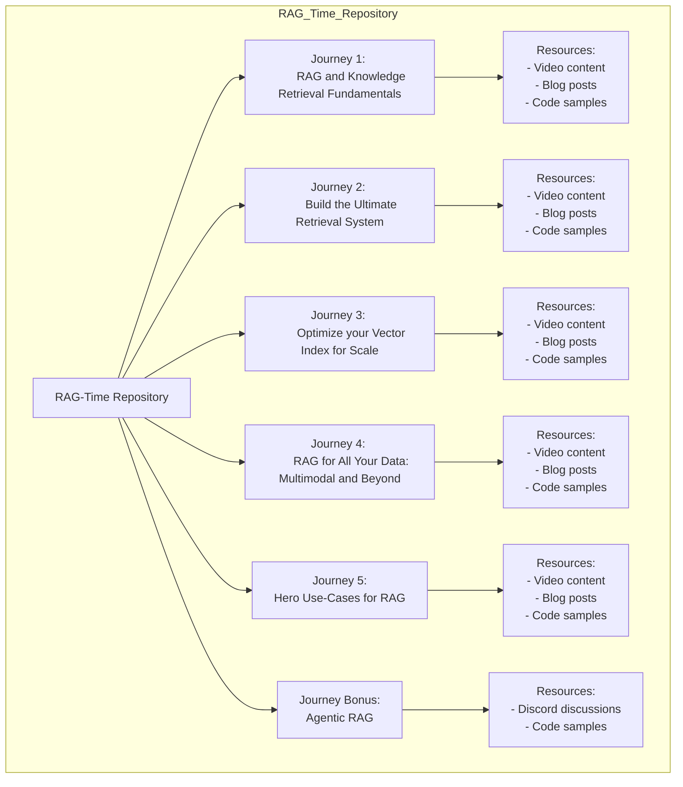
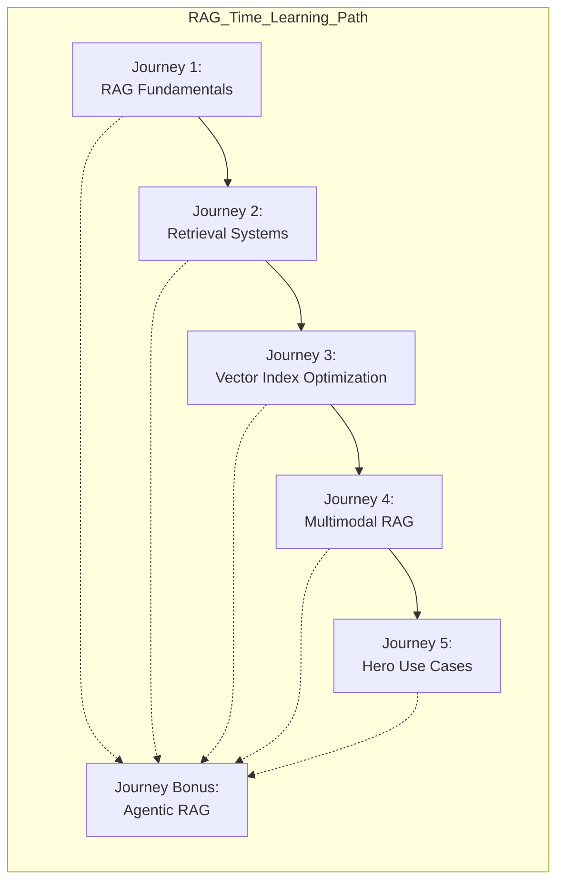
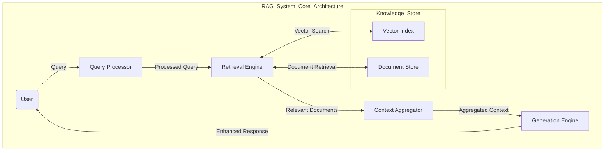
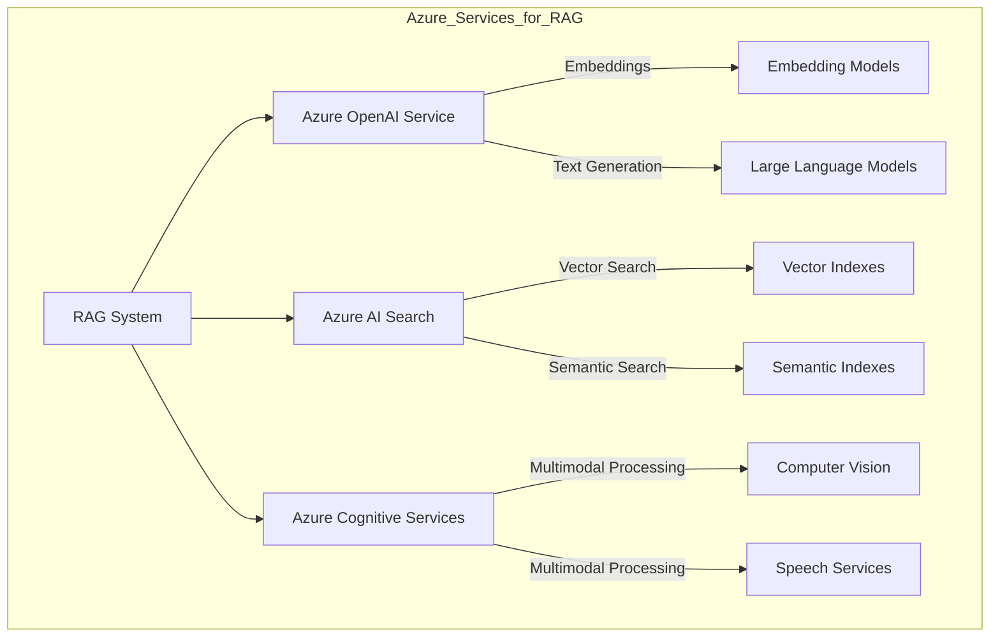

<!-- source: DeepWiki mcp.deepwiki.com · repo microsoft/rag-time · page 1 Overview · fetched 2026-10-26 -->

# Overview

Relevant source files

The following files were used as context for generating this wiki page:

- [README.md](README.md)

## Purpose and Scope

RAG-Time is a comprehensive learning repository focused on Retrieval Augmented Generation (RAG) systems. This repository serves as an educational resource to help developers, data scientists, and AI practitioners master RAG techniques through structured learning journeys. From fundamental concepts to advanced implementations, RAG-Time provides step-by-step guidance with expert insights, code samples, and practical demonstrations.

The material in this overview covers the repository's purpose, structure, and learning path organization. For detailed information about the learning journey structure, see [Learning Journey Structure](#1.1), and for getting started with the repository, see [Getting Started](#1.2).

Sources: [README.md:15-26]()

## Repository Organization

RAG-Time is organized into six distinct learning journeys, each building upon the knowledge from previous sections. The repository provides a structured path for mastering RAG systems, from basic concepts to advanced implementation techniques.

Each journey includes dedicated resources such as:
- Expert-led video content
- Technical blog posts
- Practical code samples
- Visual explanations

Sources: [README.md:37-46]()

## Learning Path Progression

The learning journeys in RAG-Time are designed to build upon each other, creating a logical progression from basic to advanced concepts. This structure ensures that learners develop a solid foundation before moving to more complex topics.

The progression follows this logical sequence:
1. Understanding core RAG concepts and knowledge retrieval fundamentals
2. Building effective retrieval systems using Azure AI Search
3. Optimizing vector indexes for scale with techniques like quantization
4. Extending RAG to handle multimodal data (images, audio, video)
5. Exploring real-world use cases across industries
6. Advanced concepts in Agentic RAG (bonus journey)

Sources: [README.md:37-46]()

## Core RAG System Architecture

RAG-Time explores the fundamental architecture of Retrieval Augmented Generation systems and their practical implementation. The following diagram illustrates the core components of a RAG system:

The key components include:
- **Query Processor**: Transforms user queries for optimal retrieval
- **Retrieval Engine**: Searches knowledge stores for relevant information
- **Context Aggregator**: Combines and formats retrieved information
- **Generation Engine**: Produces responses using retrieved context
- **Knowledge Store**: Contains vector indexes and document storage

Throughout the learning journeys, these components are explored in increasing depth and complexity.

Sources: [README.md:38-45]()

## Learning Journey Contents

Each journey in RAG-Time focuses on specific aspects of RAG systems with dedicated learning resources:

| Journey | Focus Area | Key Topics | Resources |
|---------|------------|------------|-----------|
| 1: RAG Fundamentals | Core concepts | Strategic importance, knowledge retrieval basics | Video, code sample, blog post |
| 2: Retrieval Systems | Building retrieval | Azure AI Search integration, vector search | Video, code sample, blog post |
| 3: Vector Optimization | Scaling techniques | Quantization, dimensionality reduction | Video, code sample, blog post |
| 4: Multimodal RAG | Diverse data types | Image, audio, video processing | Video, code sample, blog post |
| 5: Hero Use Cases | Industry applications | Real-world implementations | Video, code sample, blog post |
| Bonus: Agentic RAG | Advanced RAG | Multi-step reflection, iterative processing | Code sample, Discord discussions |

Each journey builds upon previous knowledge while introducing new concepts and practical implementations.

Sources: [README.md:38-46]()

## Advanced RAG Concepts: Agentic RAG

The bonus journey explores Agentic RAG, an advanced approach that enhances traditional RAG systems with reflective capabilities, automated reasoning, and improved decision-making.

```mermaid
flowchart LR
    subgraph "Agentic_RAG_Strategies"
        subgraph "Basic_RAG"
            BR_Q["Query"] --> BR_S["Search"]
            BR_S --> BR_G["Generate"]
            BR_G --> BR_A["Answer"]
        end
        
        subgraph "Single_Step_Reflection_RAG"
            SR_Q["Query"] --> SR_S["Search"]
            SR_S --> SR_G["Generate"]
            SR_G --> SR_E["Evaluate"]
            SR_E --> SR_D{"Decision"}
            SR_D -->|"Satisfactory"| SR_A["Answer"]
            SR_D -->|"Improve"| SR_R["Reflect"]
            SR_R --> SR_NS["New Search"]
            SR_NS --> SR_NG["New Generate"]
            SR_NG --> SR_A
        end
        
        subgraph "Multi_Step_Reflection_RAG"
            MR_Q["Query"] --> MR_Loop["Multi-Step Loop"]
            
            MR_Loop --> MR_S["Search"]
            MR_S --> MR_G["Generate"]
            MR_G --> MR_E["Evaluate"]
            MR_E --> MR_D{"Decision"}
            MR_D -->|"Satisfactory"| MR_A["Answer"]
            MR_D -->|"Improve"| MR_R["Reflect"]
            MR_R --> MR_NS["New Search"]
            MR_NS --> MR_G
        end
    end
```

The Agentic RAG journey covers three main strategies:
- **Basic RAG**: Standard query-search-generate workflow
- **Single-Step Reflection**: Adds evaluation and improvement through one reflection cycle
- **Multi-Step Reflection**: Implements iterative improvement through multiple reflection cycles

Sources: [README.md:46]()

## Azure Services Integration

RAG-Time demonstrates practical implementations of RAG systems using various Azure services:

Key Azure services utilized include:
- **Azure OpenAI Service**: Powers embeddings generation and text generation
- **Azure AI Search**: Provides vector and semantic search capabilities
- **Azure Cognitive Services**: Enables multimodal data processing

The integration of these services is explored throughout the learning journeys, with specific configuration details covered in [Azure Services Integration](#8).

Sources: [README.md:41-45]()

## Getting Started

To begin learning with RAG-Time:

1. Fork the repository: [https://github.com/microsoft/rag-time](https://github.com/microsoft/rag-time)
2. Clone the repository to your local machine
3. Navigate to your chosen journey and follow the README instructions
4. Access associated resources (videos, blog posts, code samples)

For more detailed information on getting started, including environment setup and prerequisites, see [Getting Started](#1.2).

Sources: [README.md:27-35]()

## Community Engagement

RAG-Time encourages community participation through:
- Discord discussions in the Azure AI Community
- GitHub issues and pull requests for suggestions or error reporting
- Weekly live sessions during the initial release period

For more information on how to engage with the community, join the [Azure AI Community Discord](https://discord.gg/REmjGvvFpW) mentioned in the repository.

Sources: [README.md:52-57]()

---

