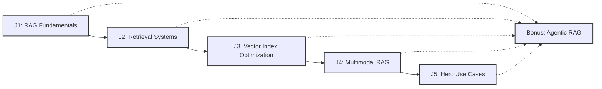
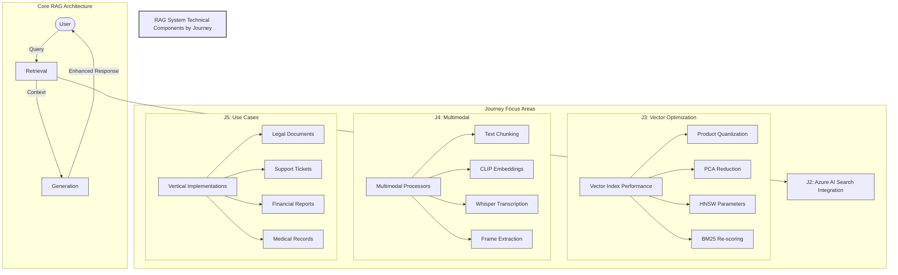
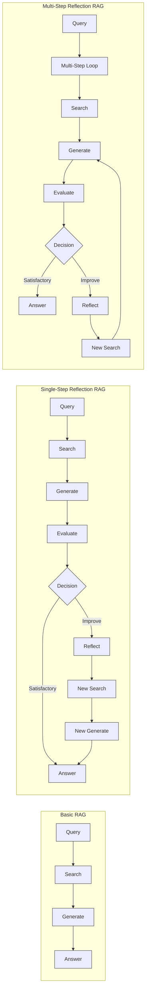

<!-- source: DeepWiki mcp.deepwiki.com · repo microsoft/rag-time · page 1.1 Learning Journey Structure · fetched 2026-10-26 -->

# Learning Journey Structure

<details>
<summary>Relevant source files</summary>

The following files were used as context for generating this wiki page:

- [README.md](README.md)
- [images/visuals/J1-recap.png](images/visuals/J1-recap.png)
- [images/visuals/J2-recap.png](images/visuals/J2-recap.png)
- [images/visuals/J3-recap.png](images/visuals/J3-recap.png)
- [images/visuals/J4-recap.png](images/visuals/J4-recap.png)
- [images/visuals/J5-recap.png](images/visuals/J5-recap.png)

</details>


This document explains how the learning content in the RAG-Time repository is organized into progressive journeys, detailing how they build upon each other and the technical components covered in each journey.

For information on how to set up the repository and begin using the materials, see [Getting Started](#1.2).

## Journey Organization

RAG-Time organizes content into 5 main learning journeys plus a bonus journey, each focusing on specific technical aspects of Retrieval Augmented Generation systems:

```mermaid
graph TD
    A["RAG Time Learning Structure"] --> B["Journey 1: RAG and Knowledge Retrieval Fundamentals"]
    A --> C["Journey 2: Build the Ultimate Retrieval System"]
    A --> D["Journey 3: Optimize your Vector Index for Scale"]
    A --> E["Journey 4: RAG for All Your Data Multimodal and Beyond"]
    A --> F["Journey 5: Hero Use-Cases for RAG"]
    A --> G["Journey Bonus: Agentic RAG"]
    
    B --> B1["Technical Presentations"]
    B --> B2["Implementation Articles"]
    B --> B3["Executable Notebooks"]
    
    C --> C1["Technical Presentations"]
    C --> C2["Implementation Articles"]
    C --> C3["Executable Notebooks"]
    
    D --> D1["Technical Presentations"]
    D --> D2["Implementation Articles"]
    D --> D3["Executable Notebooks"]
    
    E --> E1["Technical Presentations"]
    E --> E2["Implementation Articles"]
    E --> E3["Executable Notebooks"]
    
    F --> F1["Technical Presentations"]
    F --> F2["Implementation Articles"]
    F --> F3["Executable Notebooks"]
    
    G --> G1["Technical Discussions"]
    G --> G2["Implementation Code"]
    
    classDef primary stroke:#333,stroke-width:2px
    classDef journey stroke:#333
    classDef resource stroke:#333
    
    class A primary
    class B,C,D,E,F,G journey
    class B1,B2,B3,C1,C2,C3,D1,D2,D3,E1,E2,E3,F1,F2,F3,G1,G2 resource
```



Sources: [README.md:37-46]()

## Technical Progression Path

The journeys form a progressive learning path, with each building upon knowledge and techniques from previous journeys:



Sources: [README.md:37-46]()

## Technical Focus by Journey

Each journey addresses specific technical components and techniques within RAG systems:

| Journey | Technical Focus | Key Techniques |
|---------|-----------------|----------------|
| 1: RAG Fundamentals | Core RAG architecture, embedding models | Vector search, prompt engineering, knowledge retrieval |
| 2: Retrieval Systems | Azure AI Search integration, retrieval pipelines | Chunking strategies, hybrid search, query rewriting |
| 3: Vector Optimization | Scaling vector indexes | Quantization, dimensionality reduction, oversampling, re-scoring |
| 4: Multimodal RAG | Cross-modal content processing | Image, audio, video indexing and retrieval |
| 5: Use Cases | Industry-specific implementations | Legal, healthcare, finance, customer support |
| Bonus: Agentic RAG | Advanced RAG strategies | Basic RAG, Single-Step Reflection, Multi-Step Reflection |

Sources: [README.md:37-46]()

## Technical Components by Journey

This diagram illustrates the specific technical components focused on in each journey:



Sources: [README.md:37-46]()

## Repository Structure

The repository structure directly mirrors the journey organization:

```
RAG-Time/
├── Journey 1 - RAG and Knowledge Retrieval Fundamentals/
│   ├── README.md      # Journey overview and links
│   └── sample/
│       └── 1-RAG-Fundamentals.ipynb
├── Journey 2 - Build the Ultimate Retrieval System for RAG/
│   ├── README.md
│   └── sample/
│       └── 2-Build-The-Ultimate-Retrieval-System-For-RAG.ipynb
├── Journey 3 - Optimize your Vector Index for Scale/
│   ├── README.md
│   └── sample/
│       └── 3-Vector-Compression.ipynb
├── Journey 4 - RAG for All your Data Multimodal and Beyond/
│   ├── README.md
│   └── sample/
│       └── README.md  # Additional implementation details
├── Journey 5 - Hero use cases for RAG/
│   ├── README.md
│   └── sample/
│       └── README.md
└── Journey Bonus - Agentic RAG/
    ├── README.md
    └── sample/
        └── README.md
```

Sources: [README.md:27-36](), [README.md:37-46]()

## Content Types Within Journeys

Each journey contains a consistent set of technical content types:

| Content Type | Technical Format | Implementation Details |
|--------------|------------------|------------------------|
| Technical Presentations | Video lectures and demonstrations | Available on YouTube via journey-specific links |
| Implementation Articles | Technical blog posts | Accessible via journey README files |
| Executable Notebooks | Jupyter notebooks | Located in journey/sample/ directories |
| Technical Discussions | Discord community | For the Agentic RAG bonus journey |

Sources: [README.md:37-46]()

## Agentic RAG Strategies Comparison

The bonus journey specifically covers the progression of RAG strategies, from basic to more advanced approaches:



Sources: [README.md:46]()

## Content Release Schedule

The journeys were originally released on a weekly schedule, with each journey building upon the previous one:

| Week | Journey | Release Date |
|------|---------|--------------|
| Week 1 | RAG and Knowledge Retrieval Fundamentals | March 5, 2024 |
| Week 2 | Build the Ultimate Retrieval System | March 13, 2024 |
| Week 3 | Optimize your Vector Index for Scale | March 20, 2024 |
| Week 4 | RAG for All Your Data Multimodal and Beyond | March 27, 2024 |
| Week 5 | Hero Use-Cases for RAG | April 2, 2024 |
| Bonus | Agentic RAG | Post-series release |

Sources: [README.md:38-39](), [README.md:48-50]()

## Accessing Journey Content

Each journey's content can be accessed through multiple channels:

| Access Method | Description | URL Pattern |
|---------------|-------------|-------------|
| Video Presentations | Technical presentations and demonstrations | https://aka.ms/rag-time/journey[number] |
| Blog Posts | In-depth technical articles | https://aka.ms/rag-time/journey[number]-blog |
| Code Samples | Jupyter notebooks in repository | In journey/sample/ directories |
| Discord Discussions | Community engagement for Agentic RAG | https://aka.ms/rag-time/discord |

Sources: [README.md:13-17](), [README.md:37-46]()

---

