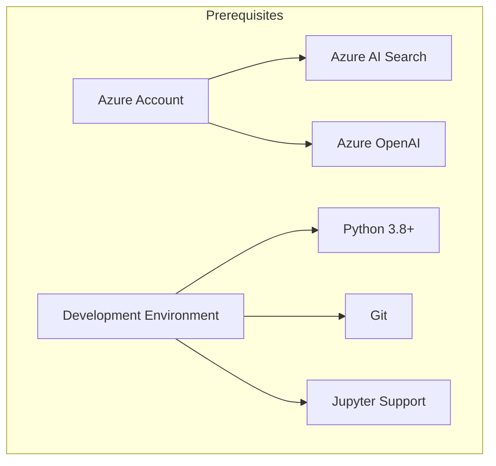
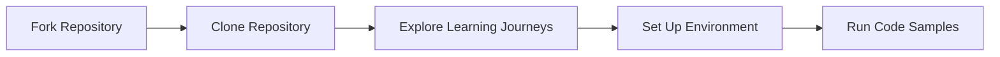
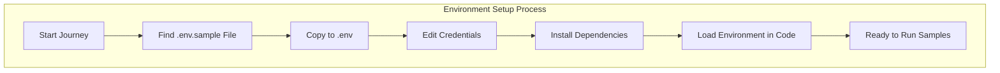
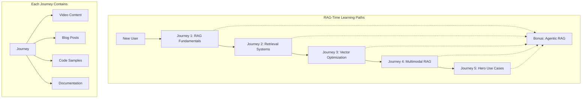
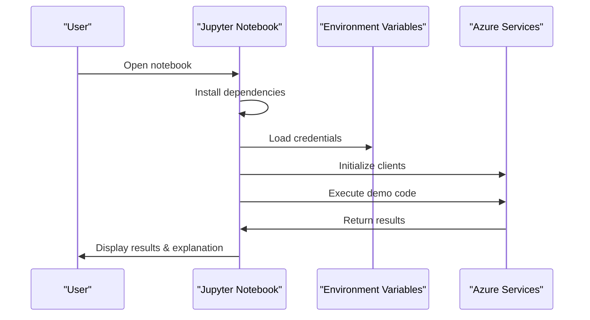
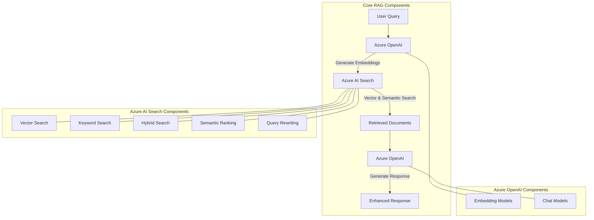
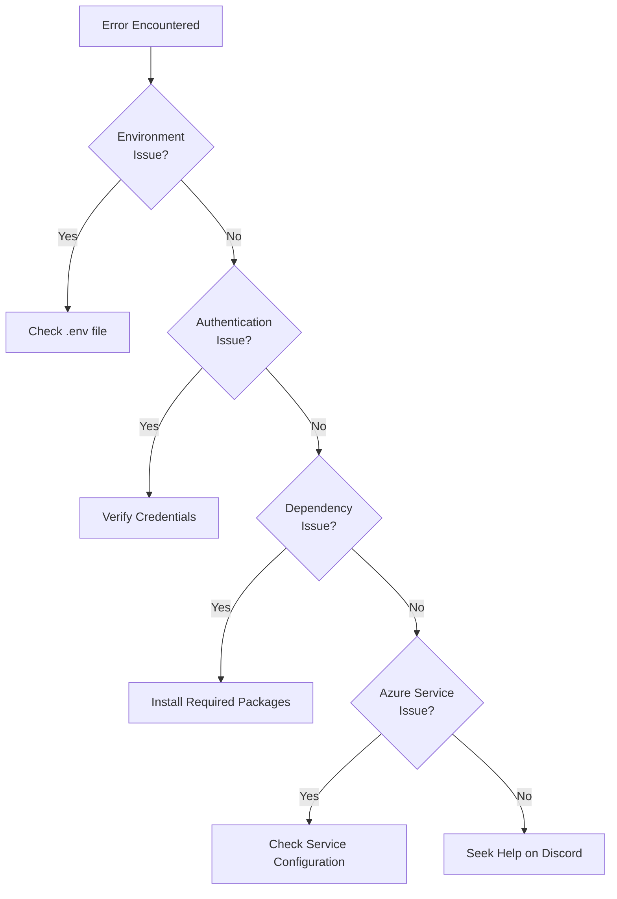
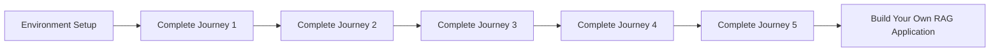

<!-- source: DeepWiki mcp.deepwiki.com · repo microsoft/rag-time · page 1.2 Getting Started · fetched 2026-10-26 -->

# Getting Started

<details>
<summary>Relevant source files</summary>

The following files were used as context for generating this wiki page:

- [Journey 2 - Build the Ultimate Retrieval System for RAG/sample/.env.sample](Journey 2 - Build the Ultimate Retrieval System for RAG/sample/.env.sample)
- [Journey 2 - Build the Ultimate Retrieval System for RAG/sample/2-Build-The-Ultimate-Retrieval-System-For-RAG.ipynb](Journey 2 - Build the Ultimate Retrieval System for RAG/sample/2-Build-The-Ultimate-Retrieval-System-For-RAG.ipynb)
- [Journey 3 - Optimize your Vector Index for Scale/sample/3-Vector-Compression.ipynb](Journey 3 - Optimize your Vector Index for Scale/sample/3-Vector-Compression.ipynb)
- [README.md](README.md)

</details>


This document provides instructions on how to set up and begin using the RAG-Time repository. It covers the environment setup, accessing learning resources, and running code samples. For information about the overall structure of learning journeys, see [Learning Journey Structure](#1.1).

## Prerequisites

Before working with the RAG-Time repository, ensure you have the following:

- An **Azure account** with appropriate permissions to access these services:
  - **Azure AI Search** for vector search capabilities
  - **Azure OpenAI** for embeddings and completions
- **Python 3.8** or later installed on your machine
- Basic knowledge of Python programming and Jupyter notebooks



Sources: [README.md:19-26](), [Journey 2 - Build the Ultimate Retrieval System for RAG/sample/2-Build-The-Ultimate-Retrieval-System-For-RAG.ipynb:7-24](), [Journey 3 - Optimize your Vector Index for Scale/sample/3-Vector-Compression.ipynb:7-24]()

## Repository Setup

Follow these steps to set up the RAG-Time repository:

1. **Fork the repository**:
   Visit https://github.com/microsoft/rag-time and click the "Fork" button to create your own copy.

2. **Clone your forked repository**:
   ```bash
   git clone https://github.com/your-org/rag-time.git
   cd rag-time
   ```

3. **Navigate to a specific journey**:
   Explore the repository structure and choose a learning journey to start with.



Sources: [README.md:27-36](), [Journey 2 - Build the Ultimate Retrieval System for RAG/sample/2-Build-The-Ultimate-Retrieval-System-For-RAG.ipynb:15-21]()

## Environment Setup

### Setting Up Python Environment

The code samples in RAG-Time require specific Python libraries. Each journey's sample code includes the necessary installation commands.

For example, in a Jupyter notebook, you can install required packages using:

```python
%pip install azure-search-documents azure-identity python-dotenv pandas openai
```

### Configuring Environment Variables

Code samples require access to Azure services, which need authentication credentials. Use environment variables to securely store these credentials:

1. Look for `.env.sample` files in the sample directories
2. Create a copy named `.env` in the same directory
3. Update with your own credentials

Example `.env` file for Azure AI Search:

```
AZURE_SEARCH_SERVICE_ENDPOINT="https://your-search-service.search.windows.net"
AZURE_SEARCH_INDEX="your-search-index-name"
AZURE_SEARCH_ADMIN_KEY="your-search-admin-key"
```

Your environment setup will vary depending on which learning journey you're working with.



Sources: [Journey 2 - Build the Ultimate Retrieval System for RAG/sample/2-Build-The-Ultimate-Retrieval-System-For-RAG.ipynb:35-62](), [Journey 2 - Build the Ultimate Retrieval System for RAG/sample/.env.sample:1-3](), [Journey 3 - Optimize your Vector Index for Scale/sample/3-Vector-Compression.ipynb:31-43]()

## Learning Journey Structure

The RAG-Time repository is organized into progressive learning journeys, each focusing on different aspects of Retrieval Augmented Generation:

| Journey | Focus | Key Components |
|---------|-------|----------------|
| 1. RAG Fundamentals | Core RAG concepts | Knowledge retrieval basics, RAG architecture |
| 2. Build Retrieval System | Creating effective retrieval systems | Azure AI Search, vector search, hybrid search |
| 3. Vector Index Optimization | Scaling vector search | Quantization, dimensionality reduction, re-scoring |
| 4. Multimodal RAG | Beyond text data | Images, audio, video processing |
| 5. Hero Use Cases | Real-world applications | Industry-specific implementations |
| Bonus: Agentic RAG | Advanced RAG approaches | Reflection mechanisms, multi-step RAG |

Each journey includes:
- Video content
- Blog posts
- Code samples
- Documentation

It's recommended to follow the journeys in sequence, as they build upon each other.



Sources: [README.md:37-46]()

## Running Code Samples

Each learning journey contains sample code that demonstrates the concepts covered:

1. Navigate to the journey directory (e.g., `Journey 2 - Build the Ultimate Retrieval System for RAG/sample/`)
2. Open the Jupyter notebook (`.ipynb` file)
3. Follow the setup instructions within the notebook
4. Run cells sequentially to understand the concepts

Most samples follow this general pattern:
- Install required libraries
- Load environment variables
- Set up clients for Azure services
- Execute demonstration code
- Explain results



Sources: [Journey 2 - Build the Ultimate Retrieval System for RAG/sample/2-Build-The-Ultimate-Retrieval-System-For-RAG.ipynb:31-258](), [Journey 3 - Optimize your Vector Index for Scale/sample/3-Vector-Compression.ipynb:45-604]()

## Common Code Patterns

Throughout the journeys, you'll encounter several recurring code patterns:

### Setting up Azure AI Search

```python
from azure.core.credentials import AzureKeyCredential
from azure.search.documents import SearchClient

# Initialize the search client
endpoint = os.environ["AZURE_SEARCH_SERVICE_ENDPOINT"]
index_name = os.environ["AZURE_SEARCH_INDEX"]
credential = AzureKeyCredential(os.environ["AZURE_SEARCH_ADMIN_KEY"])
search_client = SearchClient(endpoint, index_name, credential)
```

### Vector Search Operations

```python
from azure.search.documents.models import VectorizedQuery

# Perform vector search
results = search_client.search(
    vector_queries=[VectorizedQuery(text="your query", fields="embedding_field")],
    select=["title", "content"]
)
```

### Environment Loading

```python
import os
from dotenv import load_dotenv

# Load environment variables from .env file
load_dotenv(override=True)

# Access environment variables
endpoint = os.environ["AZURE_SEARCH_SERVICE_ENDPOINT"]
```

Sources: [Journey 2 - Build the Ultimate Retrieval System for RAG/sample/2-Build-The-Ultimate-Retrieval-System-For-RAG.ipynb:78-116](), [Journey 3 - Optimize your Vector Index for Scale/sample/3-Vector-Compression.ipynb:189-216]()

## Azure Service Components

The following diagram shows the key Azure services used in RAG-Time code samples and how they interact:



Sources: [Journey 2 - Build the Ultimate Retrieval System for RAG/sample/2-Build-The-Ultimate-Retrieval-System-For-RAG.ipynb:7-24](), [Journey 3 - Optimize your Vector Index for Scale/sample/3-Vector-Compression.ipynb:189-237]()

## Community and Support

The RAG-Time project provides several channels for learning, collaboration, and getting help:

- **Discord Community**: Join the [Azure AI Community Discord](https://discord.gg/REmjGvvFpW) for discussions about RAG
- **Issues and PRs**: Report issues or contribute improvements through [GitHub issues](https://github.com/microsoft/rag-time/issues) or [pull requests](https://github.com/microsoft/rag-time/pulls)
- **Video Content**: Watch the [full series on YouTube](https://aka.ms/rag-time/journeys)

## Troubleshooting

Common issues and their solutions:

| Issue | Solution |
|-------|----------|
| Missing environment variables | Ensure `.env` file is in the correct directory and properly formatted |
| Authentication errors | Verify Azure credentials are current and have necessary permissions |
| Module not found errors | Check if all required packages are installed with the correct versions |
| Azure AI Search errors | Confirm your search service has indexed vectorized data correctly |
| Rate limiting | If hitting API limits, implement retry logic or reduce request frequency |



Sources: [Journey 2 - Build the Ultimate Retrieval System for RAG/sample/2-Build-The-Ultimate-Retrieval-System-For-RAG.ipynb:264-270](), [README.md:52-57]()

## Next Steps

After setting up your environment and familiarizing yourself with the repository structure:

1. Begin with [Journey 1: RAG and Knowledge Retrieval Fundamentals](#2) to understand core concepts
2. Progress through the journeys in sequence
3. Experiment with the code samples, modifying them to suit your specific needs
4. Engage with the community to share your learnings and get help when needed
5. Consider building your own RAG applications using the patterns demonstrated



Sources: [README.md:37-46]()

---

