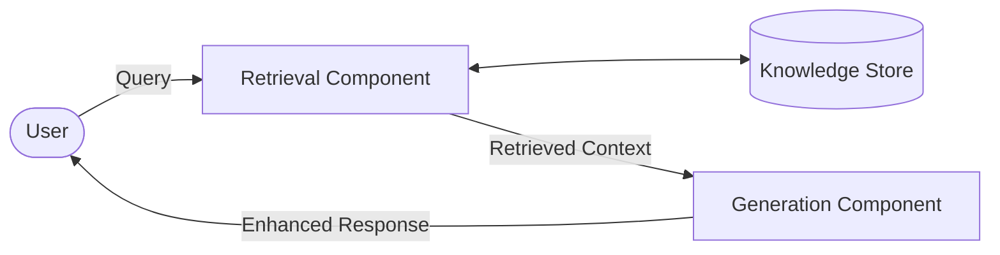
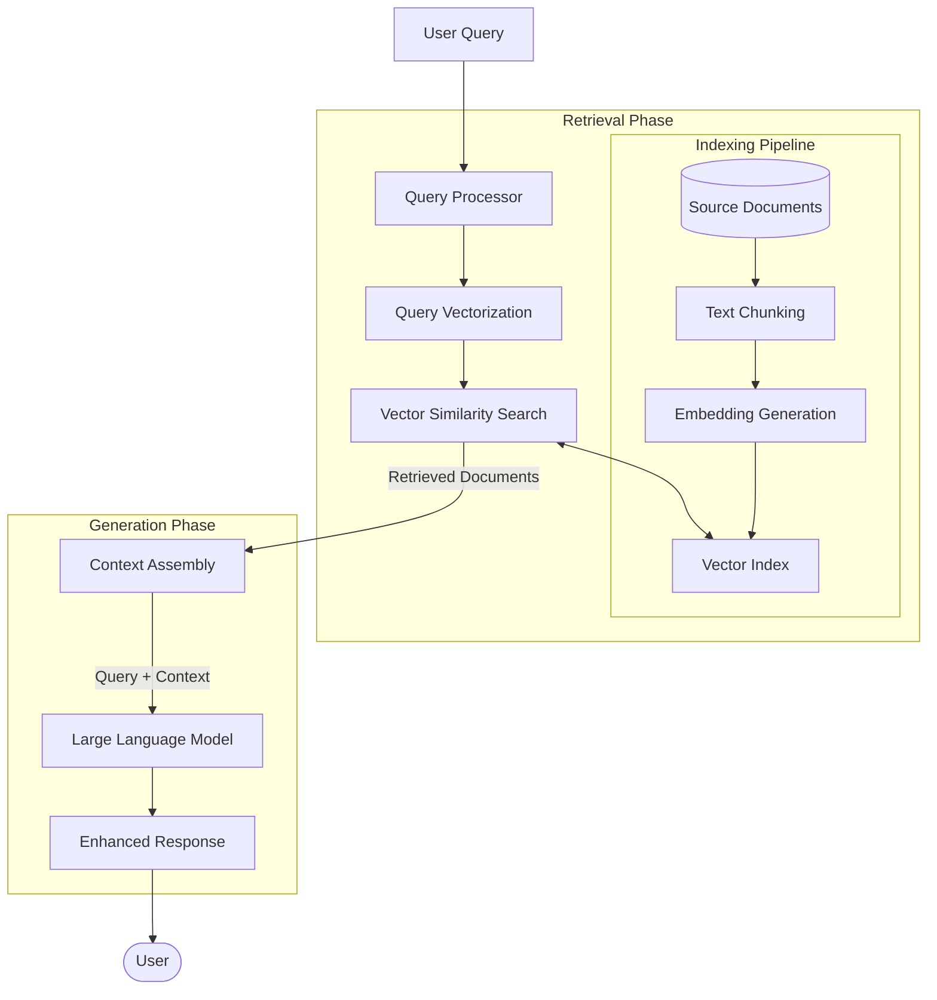
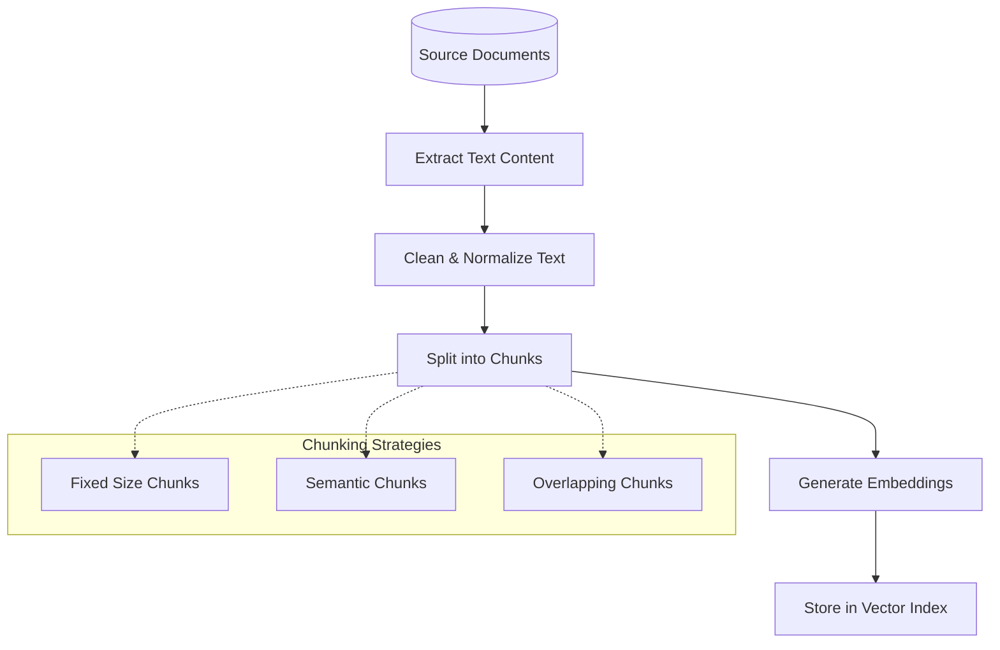
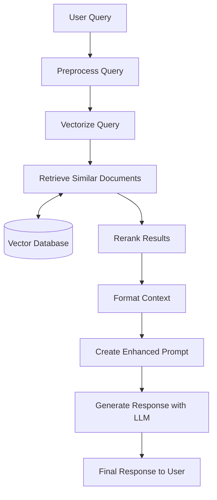
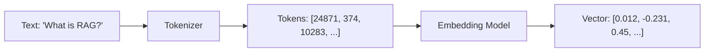
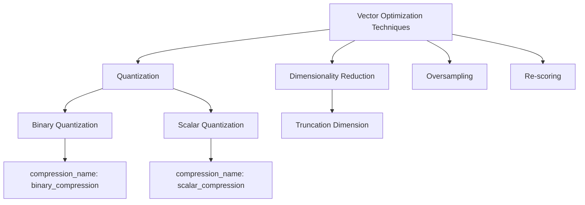

<!-- source: DeepWiki mcp.deepwiki.com · repo microsoft/rag-time · page 2 RAG Fundamentals · fetched 2026-10-26 -->

# RAG Fundamentals

Relevant source files

The following files were used as context for generating this wiki page:

- [Journey 2 - Build the Ultimate Retrieval System for RAG/sample/.env.sample](Journey 2 - Build the Ultimate Retrieval System for RAG/sample/.env.sample)
- [Journey 2 - Build the Ultimate Retrieval System for RAG/sample/2-Build-The-Ultimate-Retrieval-System-For-RAG.ipynb](Journey 2 - Build the Ultimate Retrieval System for RAG/sample/2-Build-The-Ultimate-Retrieval-System-For-RAG.ipynb)
- [Journey 2 - Build the Ultimate Retrieval System for RAG/sample/MSFT_cloud_architecture_contoso.pdf](Journey 2 - Build the Ultimate Retrieval System for RAG/sample/MSFT_cloud_architecture_contoso.pdf)
- [Journey 3 - Optimize your Vector Index for Scale/sample/3-Vector-Compression.ipynb](Journey 3 - Optimize your Vector Index for Scale/sample/3-Vector-Compression.ipynb)
- [README.md](README.md)

## Purpose and Scope

This document explains the core concepts of Retrieval Augmented Generation (RAG) and knowledge retrieval systems. It covers the fundamental architecture, components, and workflows that form the foundation of effective RAG implementations. For information on building practical retrieval systems with Azure AI Search, see [Building Retrieval Systems](#3).

Sources: [README.md:15-15]()

## What is Retrieval Augmented Generation?

Retrieval Augmented Generation (RAG) is an architecture pattern that enhances Large Language Model (LLM) outputs by retrieving and incorporating relevant external knowledge into the generation process. Unlike standard LLM approaches that rely solely on knowledge encoded in model parameters, RAG systems dynamically access external data sources to retrieve contextual information that grounds the model's responses in factual, up-to-date information.

The RAG approach addresses several key limitations of standalone LLMs:

- Knowledge cutoff constraints
- Hallucinations when responding about topics outside training data
- Inability to cite sources or provide evidence
- Limited access to proprietary or organization-specific information

### Core RAG Architecture

Sources: [README.md:15-15]()

## RAG System Components

A complete RAG system consists of several interconnected components that work together to retrieve relevant information and generate high-quality responses.

Sources: [README.md:15-15](), [Journey 2 - Build the Ultimate Retrieval System for RAG/sample/2-Build-The-Ultimate-Retrieval-System-For-RAG.ipynb:7-7]()

### Key Components

| Component | Function | Technical Implementation |
|-----------|----------|--------------------------|
| Query Processor | Analyzes and potentially reformulates user queries | Query rewriting, query expansion |
| Vectorization | Converts text to numerical vectors | Embedding models (text-embedding-3-large, etc.) |
| Vector Index | Stores and enables efficient searching of vectors | Vector databases with ANN algorithms |
| Text Chunking | Splits documents into manageable segments | Fixed-size, semantic, or overlapping chunking |
| Context Assembly | Combines retrieved information into LLM context | Prompt engineering and context formatting |
| LLM | Generates responses based on query and context | Azure OpenAI, OpenAI, or other LLM services |

Sources: [Journey 2 - Build the Ultimate Retrieval System for RAG/sample/2-Build-The-Ultimate-Retrieval-System-For-RAG.ipynb:7-30](), [Journey 3 - Optimize your Vector Index for Scale/sample/3-Vector-Compression.ipynb:7-22]()

## The RAG Process Flow

The RAG workflow is divided into two main phases: the indexing (offline) phase and the query (online) phase.

### Indexing Phase

Sources: [Journey 3 - Optimize your Vector Index for Scale/sample/3-Vector-Compression.ipynb:7-24]()

### Query Phase

Sources: [Journey 2 - Build the Ultimate Retrieval System for RAG/sample/2-Build-The-Ultimate-Retrieval-System-For-RAG.ipynb:139-257]()

## Vector Embeddings and Dimensionality

A core concept in RAG systems is the transformation of text into vector embeddings - numerical representations that capture semantic meaning in a high-dimensional space.

### Common Embedding Models

| Model | Dimensions | Characteristics |
|-------|------------|-----------------|
| text-embedding-3-large | 3072 | High performance, larger dimension size |
| text-embedding-3-small | 1536 | Balance of performance and efficiency |
| text-embedding-ada-002 | 1536 | Previous generation model |

Sources: [Journey 3 - Optimize your Vector Index for Scale/sample/3-Vector-Compression.ipynb:578-584]()

## Retrieval Methods

RAG systems can use various retrieval methods, each with different strengths:

### Search Methods Comparison

| Method | Description | Use Cases | Implementation |
|--------|-------------|-----------|----------------|
| Keyword Search | Traditional term matching | Precise term matching requirements | `search_client.search(search_text="What is Contoso")` |
| Vector Search | Semantic similarity via embeddings | Conceptual or semantic queries | `search_client.search(vector_queries=[VectorizableTextQuery(...)])` |
| Hybrid Search | Combines keyword and vector approaches | Balancing precision and recall | Combined parameters for both keyword and vector |
| Semantic Ranker | Reranks results based on semantic relevance | Improving precision of top results | `query_type="semantic", semantic_configuration_name="..."` |

Sources: [Journey 2 - Build the Ultimate Retrieval System for RAG/sample/2-Build-The-Ultimate-Retrieval-System-For-RAG.ipynb:152-258]()

## Vector Index Optimization Techniques

For production RAG systems, optimizing vector indexes is essential for performance and cost-efficiency:

### Optimization Approaches

Sources: [Journey 3 - Optimize your Vector Index for Scale/sample/3-Vector-Compression.ipynb:326-394]()

### Vector Compression Options

| Compression Type | Description | Storage Impact | Query Performance | Configuration |
|------------------|-------------|----------------|-------------------|---------------|
| No Compression | Full-precision vectors | Highest storage use | Best accuracy | None |
| Scalar Quantization | Lower precision (e.g., int8) | Medium storage | Good accuracy | `ScalarQuantizationCompression(parameters=ScalarQuantizationParameters(quantized_data_type="int8"))` |
| Binary Quantization | Binary representation | Lowest storage | Lower accuracy | `BinaryQuantizationCompression()` |

Sources: [Journey 3 - Optimize your Vector Index for Scale/sample/3-Vector-Compression.ipynb:326-394]()

## RAG Implementation Strategies

RAG systems can be implemented with varying levels of complexity:

```mermaid
flowchart TD
    subgraph "Basic RAG"
        BR_Q["Query"] --> BR_S["Search"]
        BR_S --> BR_G["Generate"]
        BR_G --> BR_A["Answer"]
    end
    
    subgraph "Single-Step Reflection RAG"
        SR_Q["Query"] --> SR_S["Search"]
        SR_S --> SR_G["Generate"]
        SR_G --> SR_E["Evaluate"]
        SR_E --> SR_D{"Decision"}
        SR_D -->|"Satisfactory"| SR_A["Answer"]
        SR_D -->|"Improve"| SR_R["Reflect"]
        SR_R --> SR_NS["New Search"]
        SR_NS --> SR_NG["New Generate"]
        SR_NG --> SR_A
    end
    
    subgraph "Multi-Step Reflection RAG"
        MR_Q["Query"] --> MR_Loop["Multi-Step Loop"]
        
        MR_Loop --> MR_S["Search"]
        MR_S --> MR_G["Generate"]
        MR_G --> MR_E["Evaluate"]
        MR_E --> MR_D{"Decision"}
        MR_D -->|"Satisfactory"| MR_A["Answer"]
        MR_D -->|"Improve"| MR_R["Reflect"]
        MR_R --> MR_NS["New Search"]
        MR_NS --> MR_G
    end
```

Sources: [README.md:15-15]()

### RAG vs. Fine-Tuning

| Aspect | RAG | Fine-Tuning |
|--------|-----|-------------|
| Implementation Complexity | Lower (no model training) | Higher (requires training infrastructure) |
| Data Updates | Immediate (update vector store) | Requires retraining |
| Customization Depth | Surface-level (via context) | Deep (modifies model weights) |
| Computational Cost | Runtime cost for retrieval | High upfront training cost |
| Explainability | High (can show retrieved sources) | Lower (knowledge in weights) |
| Best For | Factual Q&A, knowledge-heavy tasks | Style adaptation, specialized reasoning |

Sources: [README.md:15-21]()

## Evaluation Metrics for RAG Systems

Evaluating RAG systems requires assessing both retrieval and generation quality:

| Metric | Measures | Methodology |
|--------|----------|-------------|
| Retrieval Precision | Proportion of relevant documents in retrieved set | Relevant ∩ Retrieved / Retrieved |
| Retrieval Recall | Proportion of all relevant documents that were retrieved | Relevant ∩ Retrieved / Relevant |
| Answer Relevance | How well the answer addresses the query | Human evaluation or automated metrics |
| Factual Accuracy | Correctness of facts in the response | Human evaluation or fact-checking |
| Response Completeness | Whether all aspects of the query are addressed | Human evaluation or automated metrics |

Sources: [README.md:15-15]()

## Conclusion

Retrieval Augmented Generation represents a powerful approach for enhancing LLM capabilities by grounding responses in external knowledge. The core RAG architecture - combining retrieval and generation components - enables more accurate, factual, and up-to-date responses while providing greater transparency through source attribution.

As you progress through the RAG Time learning journeys, you'll build on these fundamentals to create increasingly sophisticated RAG systems with advanced retrieval capabilities, optimized vector indexes, multimodal support, and real-world applications.

For the next steps in your RAG learning journey, see [Building Retrieval Systems](#3) to learn how to implement effective retrieval systems using Azure AI Search.

Sources: [README.md:37-45]()

---

