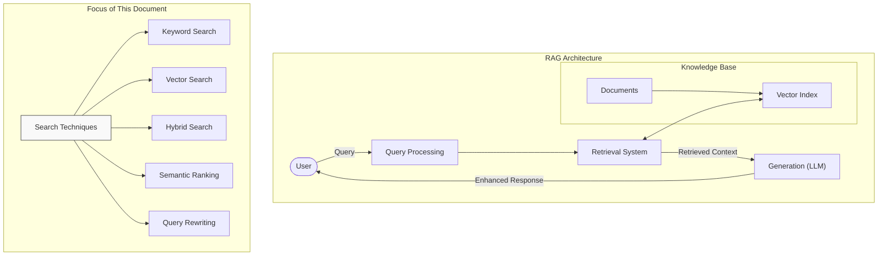
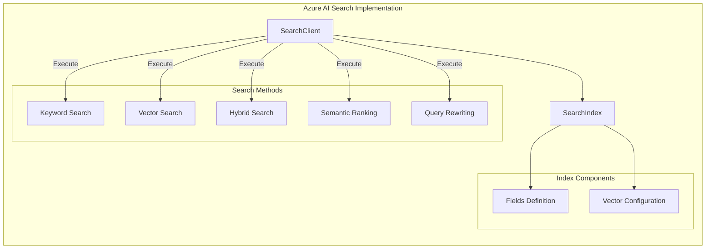
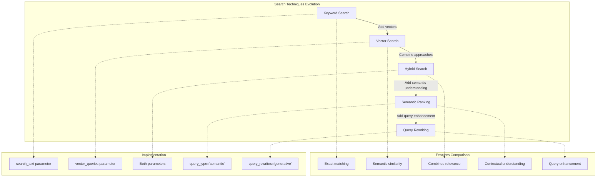
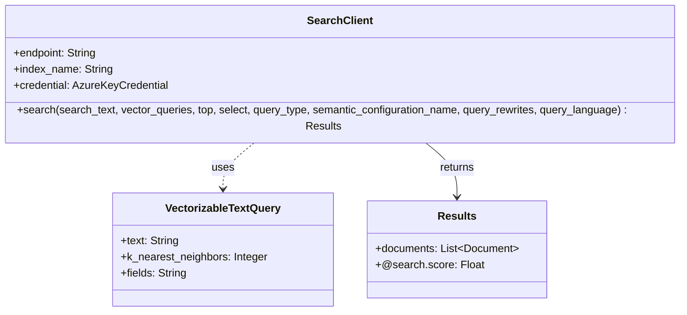

<!-- source: DeepWiki mcp.deepwiki.com · repo microsoft/rag-time · page 3 Building Retrieval Systems · fetched 2026-10-26 -->

# Building Retrieval Systems

<details>
<summary>Relevant source files</summary>

The following files were used as context for generating this wiki page:

- [Journey 2 - Build the Ultimate Retrieval System for RAG/README.md](Journey 2 - Build the Ultimate Retrieval System for RAG/README.md)
- [Journey 2 - Build the Ultimate Retrieval System for RAG/sample/.env.sample](Journey 2 - Build the Ultimate Retrieval System for RAG/sample/.env.sample)
- [Journey 2 - Build the Ultimate Retrieval System for RAG/sample/2-Build-The-Ultimate-Retrieval-System-For-RAG.ipynb](Journey 2 - Build the Ultimate Retrieval System for RAG/sample/2-Build-The-Ultimate-Retrieval-System-For-RAG.ipynb)
- [Journey 2 - Build the Ultimate Retrieval System for RAG/sample/MSFT_cloud_architecture_contoso.pdf](Journey 2 - Build the Ultimate Retrieval System for RAG/sample/MSFT_cloud_architecture_contoso.pdf)
- [Journey 3 - Optimize your Vector Index for Scale/sample/3-Vector-Compression.ipynb](Journey 3 - Optimize your Vector Index for Scale/sample/3-Vector-Compression.ipynb)

</details>


## Purpose and Scope

This document details how to build effective retrieval systems for Retrieval Augmented Generation (RAG) using Azure AI Search. It covers the key components of retrieval systems, including data ingestion, various search techniques (keyword, vector, hybrid, and semantic), and configuration patterns for optimal performance. For information about optimizing vector indexes for scale, see [Vector Index Optimization](#4).

Sources: [Journey 2 - Build the Ultimate Retrieval System for RAG/README.md:5-9]()

## Retrieval in RAG Architecture

Retrieval systems form the foundation of effective RAG applications. They are responsible for finding and ranking relevant information from a knowledge base to provide context for Large Language Models (LLMs). A well-designed retrieval system ensures that the LLM receives accurate and relevant information, significantly improving the quality of generated responses.



Sources: [Journey 2 - Build the Ultimate Retrieval System for RAG/README.md:17-24]()

## Azure AI Search Components

The retrieval system implemented in this codebase is built on Azure AI Search, which provides the infrastructure for both traditional keyword searches and modern vector searches.



Sources: [Journey 2 - Build the Ultimate Retrieval System for RAG/sample/2-Build-The-Ultimate-Retrieval-System-For-RAG.ipynb:113-116](), [Journey 2 - Build the Ultimate Retrieval System for RAG/sample/2-Build-The-Ultimate-Retrieval-System-For-RAG.ipynb:152-154]()

## Setting Up the Retrieval System

### Prerequisites

To build a retrieval system with Azure AI Search, you need:

1. An Azure account with access to Azure AI Search
2. A search index containing vectorized text data
3. Python environment with the required libraries

### Environment Configuration

The retrieval system uses environment variables for configuration, which can be stored in a `.env` file:

```
AZURE_SEARCH_SERVICE_ENDPOINT="<your_search_service_endpoint>"
AZURE_SEARCH_INDEX="<your_search_index_name>"
AZURE_SEARCH_ADMIN_KEY="<your_search_admin_key>"
```

Sources: [Journey 2 - Build the Ultimate Retrieval System for RAG/sample/.env.sample:1-3]()

### Required Libraries

The system depends on several Python libraries:

```
azure-search-documents==11.6.0b9
azure-identity
python-dotenv
pandas
jinja2
```

Sources: [Journey 2 - Build the Ultimate Retrieval System for RAG/sample/2-Build-The-Ultimate-Retrieval-System-For-RAG.ipynb:39]()

### Client Setup

The `SearchClient` is initialized with the endpoint, index name, and credentials:

```python
from azure.search.documents import SearchClient
from azure.core.credentials import AzureKeyCredential
from azure.identity import DefaultAzureCredential

# Use API key if available, otherwise use Azure managed identity
credential = AzureKeyCredential(os.getenv("AZURE_SEARCH_ADMIN_KEY")) if os.getenv("AZURE_SEARCH_ADMIN_KEY") else DefaultAzureCredential()

# Initialize search client
search_client = SearchClient(endpoint, index_name, credential)
```

Sources: [Journey 2 - Build the Ultimate Retrieval System for RAG/sample/2-Build-The-Ultimate-Retrieval-System-For-RAG.ipynb:79-88](), [Journey 2 - Build the Ultimate Retrieval System for RAG/sample/2-Build-The-Ultimate-Retrieval-System-For-RAG.ipynb:113-116]()

## Search Techniques

The system implements five key search techniques:

| Technique | Description | Implementation |
|-----------|-------------|----------------|
| Keyword Search | Traditional text-based search using keywords | Uses `search_text` parameter |
| Vector Search | Similarity search using vector embeddings | Uses `vector_queries` with `VectorizableTextQuery` |
| Hybrid Search | Combines keyword and vector search for better results | Uses both `search_text` and `vector_queries` |
| Semantic Ranking | Enhances results using semantic understanding | Adds `query_type="semantic"` and `semantic_configuration_name` |
| Query Rewriting | Improves query through automatic rewriting | Adds `query_rewrites="generative"` |

Sources: [Journey 2 - Build the Ultimate Retrieval System for RAG/sample/2-Build-The-Ultimate-Retrieval-System-For-RAG.ipynb:146-258]()

### Keyword Search Implementation

The most basic search technique uses keyword matching:

```python
results = search_client.search(
    search_text="What is Contoso", 
    top=5, 
    select=["title", "chunk"]
)
```

This approach uses traditional text-based search algorithms to find matches based on specific words.

Sources: [Journey 2 - Build the Ultimate Retrieval System for RAG/sample/2-Build-The-Ultimate-Retrieval-System-For-RAG.ipynb:152-154]()

### Vector Search Implementation

Vector search uses embeddings for semantic similarity:

```python
from azure.search.documents.models import VectorizableTextQuery

results = search_client.search(
    vector_queries=[
        VectorizableTextQuery(
            text="What is Contoso", 
            k_nearest_neighbors=50, 
            fields="text_vector"
        )
    ], 
    top=5, 
    select=["title", "chunk"]
)
```

The system converts the query text into a vector embedding and finds documents with similar vector representations.

Sources: [Journey 2 - Build the Ultimate Retrieval System for RAG/sample/2-Build-The-Ultimate-Retrieval-System-For-RAG.ipynb:172-176]()

### Hybrid Search Implementation

Hybrid search combines the strengths of both keyword and vector search:

```python
results = search_client.search(
    search_text="What is Contoso",
    vector_queries=[
        VectorizableTextQuery(
            text="What is Contoso", 
            k_nearest_neighbors=50, 
            fields="text_vector"
        )
    ],
    top=5,
    select=["title", "chunk"]
)
```

This approach balances literal matching with semantic similarity for more comprehensive results.

Sources: [Journey 2 - Build the Ultimate Retrieval System for RAG/sample/2-Build-The-Ultimate-Retrieval-System-For-RAG.ipynb:194-201]()

### Semantic Ranking

Adding semantic ranking further improves the results by using a deep learning model to understand context and meaning:

```python
results = search_client.search(
    search_text="What is Contoso",
    vector_queries=[
        VectorizableTextQuery(
            text="What is Contoso", 
            k_nearest_neighbors=50, 
            fields="text_vector"
        )
    ],
    top=5,
    select=["title", "chunk"],
    query_type="semantic",
    semantic_configuration_name="ragtime2-semantic-configuration"
)
```

Sources: [Journey 2 - Build the Ultimate Retrieval System for RAG/sample/2-Build-The-Ultimate-Retrieval-System-For-RAG.ipynb:219-228]()

### Query Rewriting

Query rewriting uses generative AI to transform the original query for better matches:

```python
results = search_client.search(
    search_text="What is Contoso",
    vector_queries=[
        VectorizableTextQuery(
            text="What is Contoso", 
            k_nearest_neighbors=50, 
            fields="text_vector"
        )
    ],
    top=5,
    select=["title", "chunk"],
    query_type="semantic",
    semantic_configuration_name="ragtime2-semantic-configuration",
    query_rewrites="generative",
    query_language="en"
)
```

This technique automatically expands or rephrases queries to improve relevance.

Sources: [Journey 2 - Build the Ultimate Retrieval System for RAG/sample/2-Build-The-Ultimate-Retrieval-System-For-RAG.ipynb:246-257]()

## Search Techniques Comparison

The following diagram illustrates how these search techniques build upon each other:



Sources: [Journey 2 - Build the Ultimate Retrieval System for RAG/sample/2-Build-The-Ultimate-Retrieval-System-For-RAG.ipynb:146-258]()

## Search Client Implementation Details

The Azure Search client handles connections to the search service and executes search operations. Here's a detailed view of the client architecture:



Sources: [Journey 2 - Build the Ultimate Retrieval System for RAG/sample/2-Build-The-Ultimate-Retrieval-System-For-RAG.ipynb:113-116](), [Journey 2 - Build the Ultimate Retrieval System for RAG/sample/2-Build-The-Ultimate-Retrieval-System-For-RAG.ipynb:172-176]()

## Display Format for Search Results

The system formats search results for readability using pandas:

```python
def display_results(results):
    df = pd.json_normalize(list(results)).dropna(axis=1, how='all')
    df["chunk"] = df["chunk"].apply(lambda c: c[:300] + '...' if len(c) > 300 else c)
    first_cols = ['title', 'chunk', '@search.score']
    df = df[first_cols + [col for col in df.columns if col not in first_cols]]

    df = df.style.set_properties(**{
        'max-width': '500px',
        'text-align': 'left',
        'white-space': 'normal',
        'word-wrap': 'break-word'
    }).hide(axis="index")

    return df
```

This function formats search results as a DataFrame for better visualization.

Sources: [Journey 2 - Build the Ultimate Retrieval System for RAG/sample/2-Build-The-Ultimate-Retrieval-System-For-RAG.ipynb:118-133]()

## Best Practices

When building retrieval systems for RAG using Azure AI Search:

1. **Use secure credential management**:
   - Store credentials in environment variables
   - Use managed identities when possible instead of API keys

2. **Implement progressive search techniques**:
   - Start with simpler techniques and add complexity as needed
   - Combine approaches for better results

3. **Optimize performance**:
   - Limit returned fields with `select`
   - Set appropriate `top` values to control result count
   - Configure vector dimensions and index parameters carefully

4. **Handle error conditions**:
   - Implement proper error handling for authentication issues
   - Check for empty results and provide fallbacks

5. **Process results efficiently**:
   - Format results for readability
   - Extract only the needed information for the LLM

Sources: [Journey 2 - Build the Ultimate Retrieval System for RAG/sample/2-Build-The-Ultimate-Retrieval-System-For-RAG.ipynb:264-275]()

## Integration with RAG Pipeline

The retrieval system is a critical component in the RAG pipeline. It bridges the gap between raw data and the generation system:

```mermaid
flowchart LR
    subgraph "RAG Pipeline Integration"
        User(["User"]) -->|"Query"| QP["Query Processing"]
        QP --> RS["Retrieval System"]
        RS -->|"Retrieved Context"| G["Generation"]
        G -->|"Enhanced Response"| User
        
        subgraph "Retrieval System Components"
            direction TB
            KS["Keyword Search"]
            VS["Vector Search"]
            HS["Hybrid Search"]
            SR["Semantic Ranking"]
            QR["Query Rewriting"]
            
            KS & VS --> HS
            HS --> SR
            SR --> QR
        end
        
        RS --- Retrieval System Components
    end
```

Sources: [Journey 2 - Build the Ultimate Retrieval System for RAG/README.md:17-24]()

## Troubleshooting

Common issues when working with Azure AI Search retrieval systems:

| Issue | Possible Cause | Solution |
|-------|----------------|----------|
| Environment variables not loaded | Incorrectly set .env file | Ensure .env file is correctly configured or manually export variables |
| Authentication issues | Missing or invalid credentials | Verify API key or ensure managed identity has proper role assignments |
| Empty search results | Missing data or incorrect queries | Ensure your index contains vectorized data and verify query syntax |
| Query rewriting issues | Configuration problems | Verify your search service supports semantic configurations and generative query rewrites |

Sources: [Journey 2 - Build the Ultimate Retrieval System for RAG/sample/2-Build-The-Ultimate-Retrieval-System-For-RAG.ipynb:264-271]()

## Summary

Building effective retrieval systems for RAG using Azure AI Search involves selecting and combining appropriate search techniques (keyword, vector, hybrid, semantic ranking, and query rewriting) to ensure the most relevant context is provided to the LLM. Each technique offers different advantages, and they can be progressively combined to create increasingly sophisticated retrieval capabilities.

Sources: [Journey 2 - Build the Ultimate Retrieval System for RAG/README.md:21-23](), [Journey 2 - Build the Ultimate Retrieval System for RAG/sample/2-Build-The-Ultimate-Retrieval-System-For-RAG.ipynb:273-274]()

---

