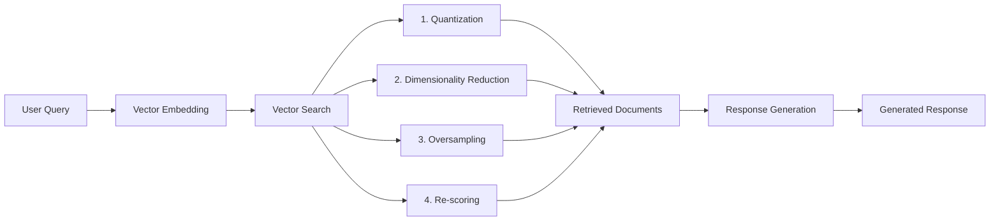
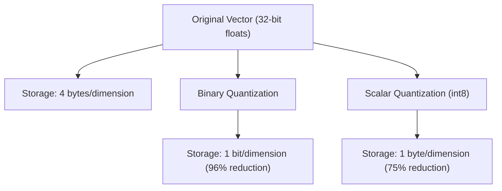
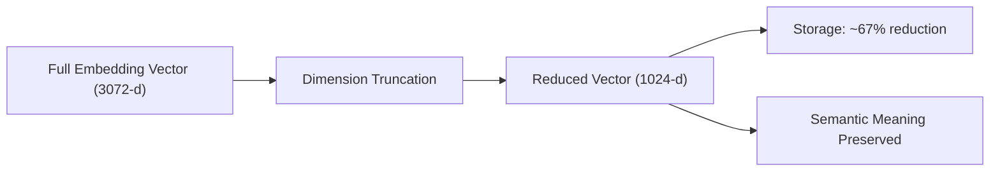
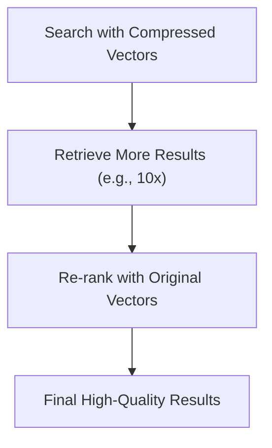
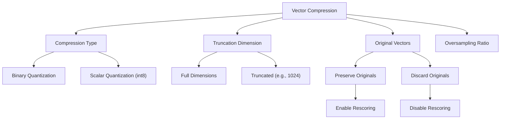
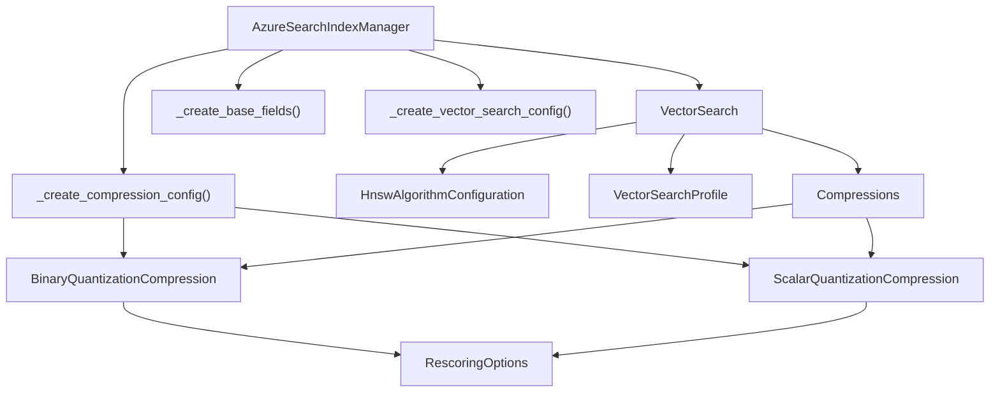
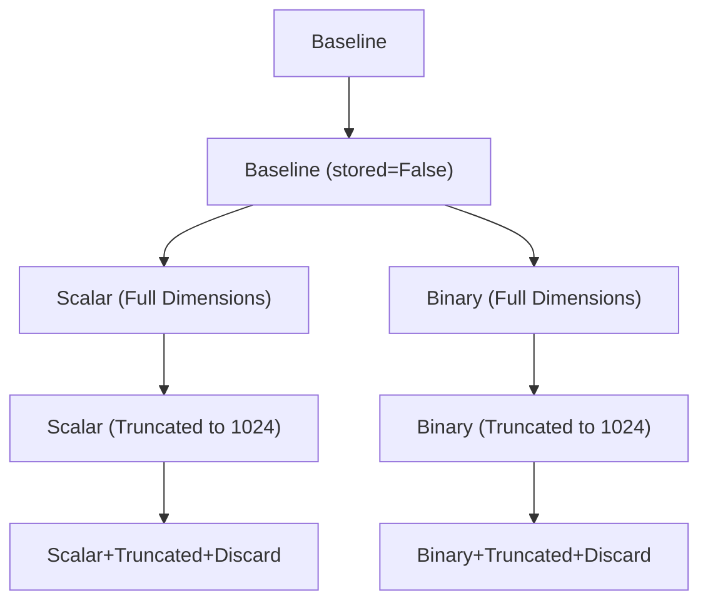
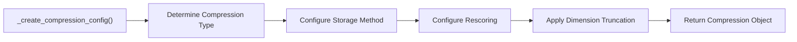

<!-- source: DeepWiki mcp.deepwiki.com · repo microsoft/rag-time · page 4 Vector Index Optimization · fetched 2026-10-26 -->

# Vector Index Optimization

<details>
<summary>Relevant source files</summary>

The following files were used as context for generating this wiki page:

- [Journey 2 - Build the Ultimate Retrieval System for RAG/sample/.env.sample](Journey 2 - Build the Ultimate Retrieval System for RAG/sample/.env.sample)
- [Journey 2 - Build the Ultimate Retrieval System for RAG/sample/2-Build-The-Ultimate-Retrieval-System-For-RAG.ipynb](Journey 2 - Build the Ultimate Retrieval System for RAG/sample/2-Build-The-Ultimate-Retrieval-System-For-RAG.ipynb)
- [Journey 3 - Optimize your Vector Index for Scale/README.md](Journey 3 - Optimize your Vector Index for Scale/README.md)
- [Journey 3 - Optimize your Vector Index for Scale/sample/3-Vector-Compression.ipynb](Journey 3 - Optimize your Vector Index for Scale/sample/3-Vector-Compression.ipynb)

</details>


## Purpose and Scope

Vector Index Optimization focuses on scaling Retrieval Augmented Generation (RAG) systems by enhancing the efficiency, performance, and cost-effectiveness of vector indexes. This document covers compression techniques, dimensionality reduction, and rescoring methods that enable high-quality retrieval while minimizing storage requirements and maintaining search performance, with implementation details for Azure AI Search.

For information about building basic retrieval systems without optimization, see [RAG Fundamentals](#2) and [Building Retrieval Systems](#3). For extensions to handle different data types, see [Multimodal RAG](#5).

## Core Optimization Techniques

### Optimization Pipeline in RAG Systems



Sources: [Journey 3 - Optimize your Vector Index for Scale/README.md:19-23]()

### Quantization

Quantization compresses vector data by reducing precision, resulting in significant storage savings with minimal impact on retrieval accuracy:

- **Binary Quantization**: Converts floating-point vectors to binary representation, reducing storage by up to 96%
- **Scalar Quantization**: Reduces precision (typically to 8-bit integers), offering approximately 75% storage reduction



Sources: [Journey 3 - Optimize your Vector Index for Scale/README.md:21-23](), [Journey 3 - Optimize your Vector Index for Scale/sample/3-Vector-Compression.ipynb:294-302]()

### Dimensionality Reduction

Dimensionality reduction techniques like Matryoshka Representation Learning (MRL) decrease the number of dimensions in vector embeddings while preserving semantic meaning:

- Reduces storage requirements by approximately 67% when truncating from 3072 to 1024 dimensions
- Implemented through the `truncation_dimension` parameter in compression configurations



Sources: [Journey 3 - Optimize your Vector Index for Scale/sample/3-Vector-Compression.ipynb:354-360](), [Journey 3 - Optimize your Vector Index for Scale/sample/3-Vector-Compression.ipynb:379-385]()

### Oversampling and Re-scoring

These techniques compensate for potential accuracy loss from compression:

- **Oversampling**: Retrieves more candidates than needed (controlled by `default_oversampling` parameter)
- **Re-scoring**: Re-ranks retrieved documents using original uncompressed vectors for final selection



Sources: [Journey 3 - Optimize your Vector Index for Scale/sample/3-Vector-Compression.ipynb:467-471](), [Journey 3 - Optimize your Vector Index for Scale/README.md:23]()

## Azure AI Search Implementation

### Compression Configuration Options

Azure AI Search provides several configuration options for vector compression:

| Option | Description | Implementation |
|--------|-------------|----------------|
| Compression Type | Binary or Scalar (int8) | `BinaryQuantizationCompression` or `ScalarQuantizationCompression` |
| Truncation Dimension | Reduce vector dimensions | `truncation_dimension` parameter |
| Original Vectors | Preserve or discard originals | `rescore_storage_method` parameter |
| Oversampling Ratio | Number of extra results to fetch | `default_oversampling` parameter |
| Rescoring | Re-rank with original vectors | `enable_rescoring` parameter |



Sources: [Journey 3 - Optimize your Vector Index for Scale/sample/3-Vector-Compression.ipynb:197-215](), [Journey 3 - Optimize your Vector Index for Scale/sample/3-Vector-Compression.ipynb:443-471]()

### Implementation Classes and Components



Sources: [Journey 3 - Optimize your Vector Index for Scale/sample/3-Vector-Compression.ipynb:424-534]()

### Test Scenarios

The sample code includes multiple test configurations to evaluate different optimization approaches:



Sources: [Journey 3 - Optimize your Vector Index for Scale/sample/3-Vector-Compression.ipynb:326-394]()

## Compression Configuration Implementation

The core of vector compression is implemented in the `_create_compression_config` method which configures different compression types with appropriate parameters:



Key implementation details:
- `rescoring_options` controls whether to re-rank results with original vectors
- `rescore_storage_method` determines whether to preserve or discard original vectors
- `truncation_dimension` reduces vector dimensions if specified
- `BinaryQuantizationCompression` and `ScalarQuantizationCompression` are the two main compression classes

Sources: [Journey 3 - Optimize your Vector Index for Scale/sample/3-Vector-Compression.ipynb:450-497]()

## Performance Trade-offs

When implementing vector index optimization, consider these trade-offs:

| Optimization Technique | Storage Benefit | Query Performance | Quality Impact | Use Case |
|------------------------|----------------|-------------------|---------------|----------|
| Binary Quantization | 96% reduction | Faster search | Moderate quality loss | Maximum storage savings |
| Scalar Quantization | 75% reduction | Faster search | Minor quality loss | Balance of quality/storage |
| Dimensionality Reduction | ~67% reduction | Faster search | Varies by dimension | MRL-trained embeddings |
| Oversampling | None | Slower search | Better quality | Quality-critical applications |
| Preserve Originals | None | Slower search | Better quality | When accuracy is crucial |
| Discard Originals | Additional reduction | Faster search | No rescoring possible | Maximum performance |

Sources: [Journey 3 - Optimize your Vector Index for Scale/README.md:21-27](), [Journey 3 - Optimize your Vector Index for Scale/sample/3-Vector-Compression.ipynb:326-394]()

## Implementation Steps

To implement vector index optimization in your own system:

1. **Create Search Index Client**: Initialize the Azure AI Search client
   ```python
   index_client = SearchIndexClient(endpoint=service_endpoint, credential=credential)
   ```

2. **Define Fields**: Create vector fields with appropriate dimensions and configurations
   ```python
   fields = [
       SimpleField(name="id", type=SearchFieldDataType.String, key=True),
       SearchField(
           name="embedding",
           type=SearchFieldDataType.Collection(SearchFieldDataType.Single),
           searchable=True,
           vector_search_dimensions=dimensions,
           vector_search_profile_name="profile-name",
           stored=stored_embedding
       )
   ]
   ```

3. **Configure Compression**: Choose compression type and parameters
   ```python
   compression = BinaryQuantizationCompression(
       compression_name="binary-compression",
       rescoring_options=RescoringOptions(
           enable_rescoring=not discard_originals,
           default_oversampling=10 if not discard_originals else None,
           rescore_storage_method=storage_method
       ),
       truncation_dimension=truncate_dims if truncate_dims else None
   )
   ```

4. **Configure Vector Search**: Set up the algorithm and profiles
   ```python
   vector_search = VectorSearch(
       profiles=[
           VectorSearchProfile(
               name="profile-name",
               algorithm_configuration_name="algorithm-name",
               compression_name=compression.compression_name
           )
       ],
       algorithms=[algorithm_config],
       compressions=[compression]
   )
   ```

5. **Create Index**: Create the search index with the configured options
   ```python
   index = SearchIndex(
       name=index_name,
       fields=fields,
       vector_search=vector_search
   )
   index_client.create_or_update_index(index)
   ```

Sources: [Journey 3 - Optimize your Vector Index for Scale/sample/3-Vector-Compression.ipynb:424-579]()

## Recommended Practices

1. **Start with baseline measurements** before applying optimizations
2. **Test different combinations** of techniques to find the optimal balance for your specific use case
3. **Consider your data characteristics** - some vector embeddings compress better than others
4. **Evaluate quality impact** using relevant metrics for your application
5. **Use oversampling and re-scoring** when preserving originals to mitigate quality loss
6. **For maximum storage savings**, combine binary quantization with dimensionality reduction and discard originals, but be prepared for some quality degradation

Sources: [Journey 3 - Optimize your Vector Index for Scale/README.md:21-27](), [Journey 3 - Optimize your Vector Index for Scale/sample/3-Vector-Compression.ipynb:326-394]()

---

