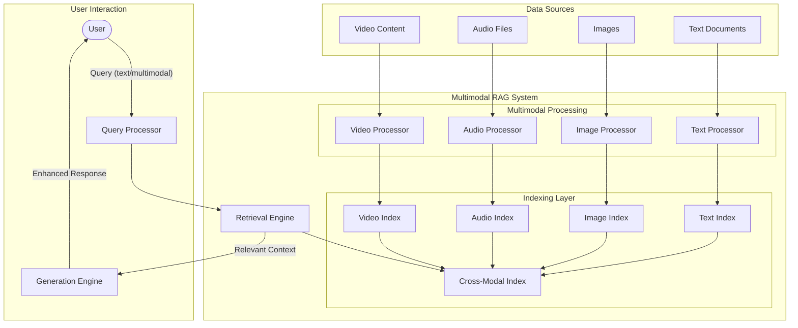
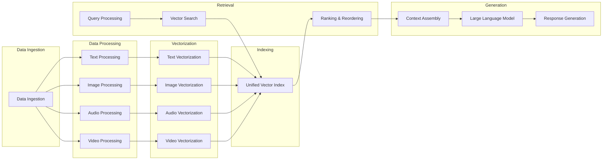
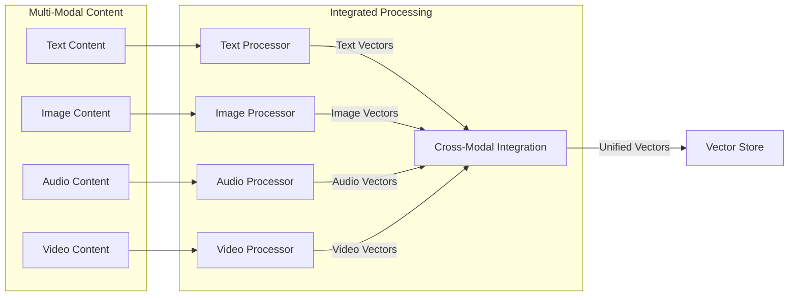
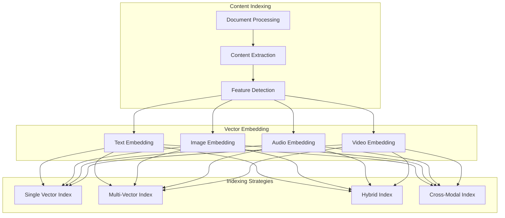
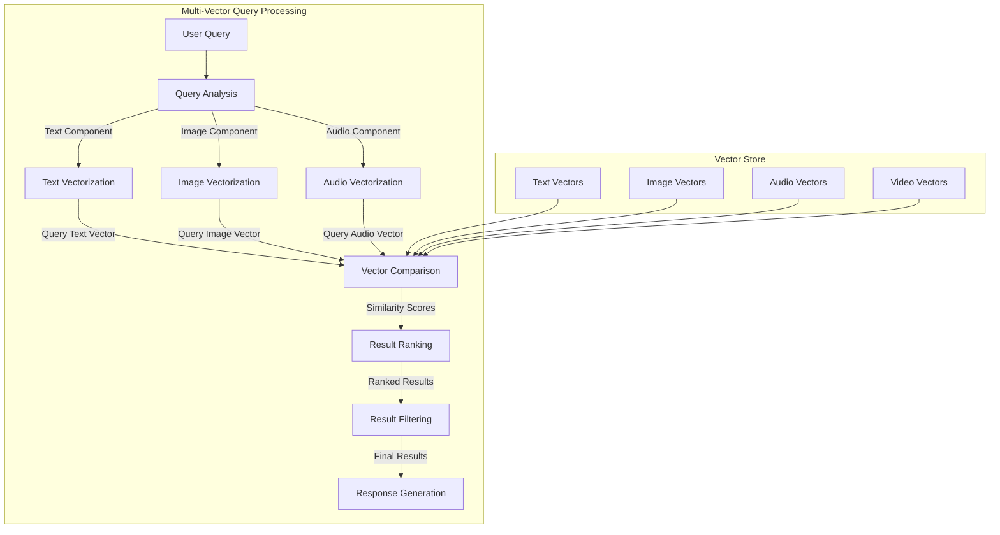
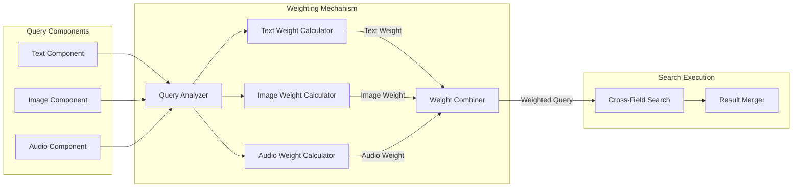
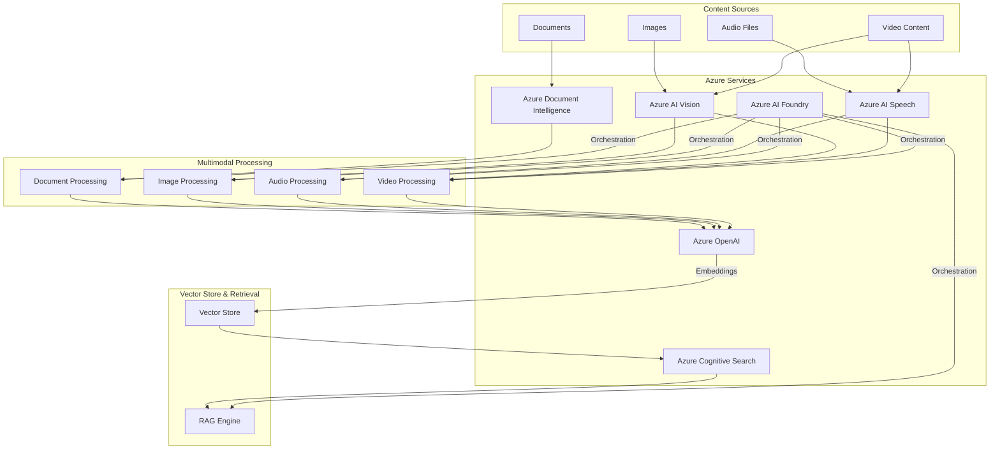

<!-- source: DeepWiki mcp.deepwiki.com · repo microsoft/rag-time · page 5 Multimodal RAG · fetched 2026-10-26 -->

# Multimodal RAG

Relevant source files

The following files were used as context for generating this wiki page:

- [Journey 4 - RAG for All your Data Multimodal and Beyond/README.md](Journey 4 - RAG for All your Data Multimodal and Beyond/README.md)
- [Journey 5 - Hero use cases for RAG/README.md](Journey 5 - Hero use cases for RAG/README.md)
- [images/visuals/J1-recap.png](images/visuals/J1-recap.png)
- [images/visuals/J2-recap.png](images/visuals/J2-recap.png)
- [images/visuals/J3-recap.png](images/visuals/J3-recap.png)
- [images/visuals/J4-recap.png](images/visuals/J4-recap.png)
- [images/visuals/J5-recap.png](images/visuals/J5-recap.png)

## Purpose and Scope

This document describes the architecture, components, and processes for implementing Multimodal Retrieval Augmented Generation (RAG) within the RAG-Time framework. Multimodal RAG extends traditional text-based RAG systems to handle diverse data types including images, audio, and video, enabling more comprehensive information retrieval and generation capabilities.

The content covers multimodal data processing, indexing strategies, query techniques, and integration with Azure services to build robust multimodal RAG solutions.

Sources: Journey 4 - RAG for All your Data Multimodal and Beyond/README.md

## Multimodal RAG in Context

Multimodal RAG represents the fourth journey in the RAG-Time learning progression, building upon the foundations established in previous journeys.

Sources: Journey 4 - RAG for All your Data Multimodal and Beyond/README.md

## Multimodal RAG Architecture

The Multimodal RAG architecture extends traditional RAG pipelines to process, index, and retrieve multiple data types.

### High-Level Architecture

Sources: Journey 4 - RAG for All your Data Multimodal and Beyond/README.md

### Data Flow Process

The following diagram illustrates the data flow within the multimodal RAG system, from ingestion to generation:

Sources: Journey 4 - RAG for All your Data Multimodal and Beyond/README.md

## Multimodal Data Processing

### Content Types and Processing Methods

Multimodal RAG systems process various content types using specialized techniques:

| Content Type | Processing Methods | Output | Use Cases |
|-------------|-------------------|--------|-----------|
| Text | Tokenization, embedding generation, semantic analysis | Text vectors | Documents, articles, knowledge bases |
| Images | Feature extraction, object detection, scene understanding | Image vectors, tags, descriptions | Photos, diagrams, charts, screenshots |
| Audio | Speech-to-text, audio feature extraction | Audio vectors, transcripts | Spoken content, music, environmental sounds |
| Video | Frame extraction, scene detection, video understanding | Video vectors, keyframes, transcripts | Educational content, presentations, demonstrations |

### Cross-Modal Integration

The system creates connections between different content types to enable unified search and retrieval:

Sources: Journey 4 - RAG for All your Data Multimodal and Beyond/README.md

## Indexing and Retrieval for Multimodal Data

### Multimodal Indexing Strategies

Multimodal RAG employs several indexing strategies to effectively store and retrieve information from various content types:

Sources: Journey 4 - RAG for All your Data Multimodal and Beyond/README.md

### Integrated Vectorization

Integrated vectorization enables the system to create uniform vector representations across different content types:

| Vectorization Method | Description | Application |
|---------------------|-------------|-------------|
| Text Vectorization | Generates embeddings from text using language models | Documents, metadata, transcripts |
| Image Vectorization | Creates embeddings from image features using vision models | Images, diagrams, charts |
| Audio Vectorization | Produces embeddings from audio signals or transcribed content | Audio recordings, voice notes |
| Video Vectorization | Generates embeddings from video frames and audio components | Video content, presentations |
| Cross-Modal Vectorization | Aligns vectors from different modalities into a shared embedding space | Mixed content types |

Sources: Journey 4 - RAG for All your Data Multimodal and Beyond/README.md

## Query Techniques for Multimodal RAG

### Multi-Vector Search

Sources: Journey 4 - RAG for All your Data Multimodal and Beyond/README.md

### Vector Weighting and Cross-Field Search

Vector weighting and cross-field search enhance the relevance of search results by assigning importance to different components of multimodal content:

Sources: Journey 4 - RAG for All your Data Multimodal and Beyond/README.md

## Azure Services Integration

### Azure AI Services for Multimodal RAG

The multimodal RAG system leverages several Azure services to process and understand different content types:

Sources: Journey 4 - RAG for All your Data Multimodal and Beyond/README.md

### Azure Document Intelligence and Content Understanding

Azure Document Intelligence and Content Understanding services enhance multimodal RAG by extracting structured information from various document types:

| Azure Service | Role in Multimodal RAG | Key Features |
|---------------|------------------------|--------------|
| Azure AI Foundry | Orchestrates multimodal workflows | Model deployment, workflow management, scaling |
| Azure Document Intelligence | Extracts text and structure from documents | Layout analysis, form recognition, table extraction |
| Azure OpenAI | Generates embeddings and responses | Text embeddings, multimodal understanding, content generation |
| Azure Cognitive Search | Indexes and retrieves multimodal content | Vector search, semantic search, hybrid retrieval |
| Azure AI Vision | Processes and understands images | Image analysis, object detection, OCR |
| Azure AI Speech | Processes audio content | Speech-to-text, voice recognition, sentiment analysis |

Sources: Journey 4 - RAG for All your Data Multimodal and Beyond/README.md

## Implementation Considerations

### Scalability Factors

When implementing multimodal RAG systems, consider these scalability factors:

1. **Storage Requirements**: Multimodal content requires significantly more storage than text-only data
2. **Processing Capacity**: Processing images, audio, and video demands higher computational resources
3. **Vector Dimensions**: Managing high-dimensional vectors across multiple modalities requires optimization
4. **Query Complexity**: Multimodal queries involve more complex processing and coordination
5. **Latency Management**: Balancing response time with comprehensive multimodal search

### Best Practices

| Area | Best Practice | Benefit |
|------|--------------|---------|
| Data Preparation | Pre-process and normalize content across modalities | Improves vector quality and search relevance |
| Indexing Strategy | Use hybrid indexes combining sparse and dense vectors | Balances precision and recall |
| Vector Management | Implement vector quantization and dimensionality reduction | Reduces storage and computational requirements |
| Query Processing | Apply modal-specific weights based on query intent | Enhances retrieval relevance |
| Response Generation | Provide context from multiple modalities to the LLM | Creates more comprehensive and accurate responses |
| Evaluation | Benchmark against both modal-specific and cross-modal metrics | Ensures balanced performance across content types |

Sources: Journey 4 - RAG for All your Data Multimodal and Beyond/README.md

## Summary

Multimodal RAG extends traditional RAG systems by incorporating multiple content types (text, images, audio, video) into a unified retrieval and generation framework. Key components include specialized processors for each content type, integrated vectorization, multimodal indexing strategies, and advanced query techniques like multi-vector search and vector weighting.

Azure services provide the foundation for implementing multimodal RAG at scale, with Azure AI Foundry orchestrating workflows and services like Azure Document Intelligence, Azure AI Vision, and Azure OpenAI handling content-specific processing and understanding.

By implementing multimodal RAG, applications can deliver more comprehensive, contextually relevant responses that leverage information across different media types.

Sources: Journey 4 - RAG for All your Data Multimodal and Beyond/README.md

---

