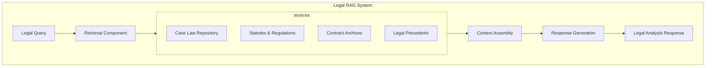
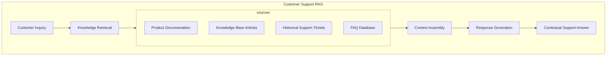
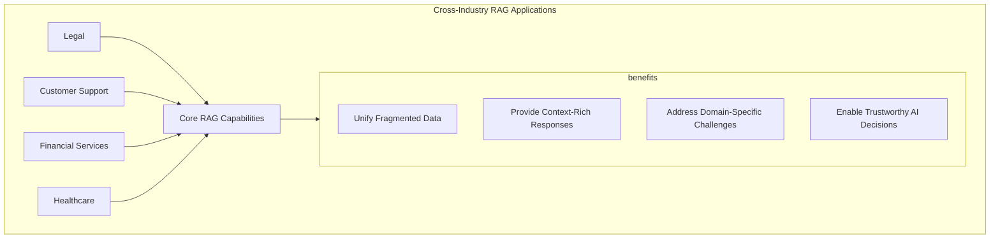
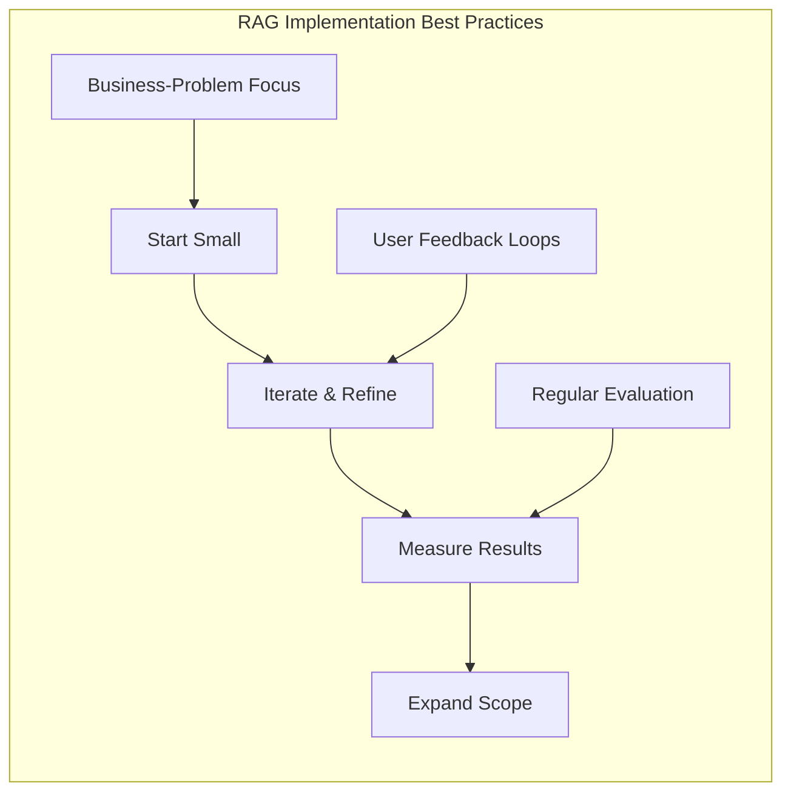
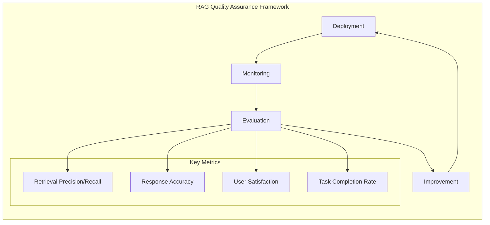
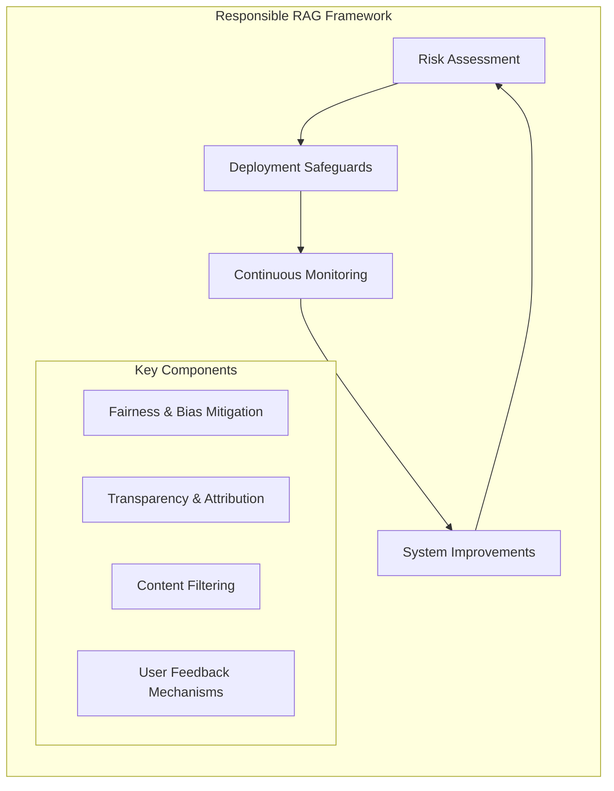
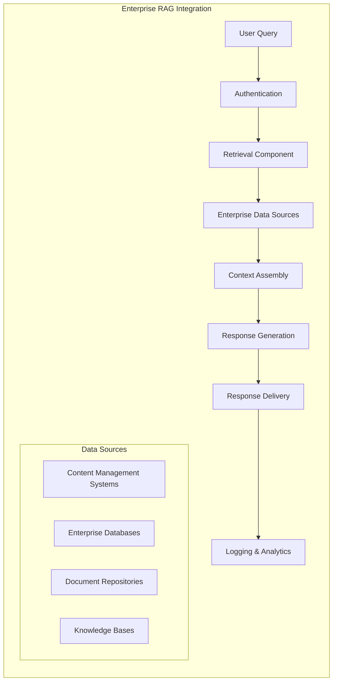

<!-- source: DeepWiki mcp.deepwiki.com · repo microsoft/rag-time · page 6 Real-World Use Cases · fetched 2026-10-26 -->

# Real-World Use Cases

Relevant source files

The following files were used as context for generating this wiki page:

- [Journey 4 - RAG for All your Data Multimodal and Beyond/README.md](Journey 4 - RAG for All your Data Multimodal and Beyond/README.md)
- [Journey 5 - Hero use cases for RAG/README.md](Journey 5 - Hero use cases for RAG/README.md)
- [images/j1.png](images/j1.png)
- [images/j2.png](images/j2.png)
- [images/j3.png](images/j3.png)
- [images/j4.png](images/j4.png)
- [images/j5.png](images/j5.png)

This document provides an overview of industry applications for Retrieval Augmented Generation (RAG) systems and best practices for deployment in production environments. It examines how RAG technology transforms various sectors by unifying fragmented data, providing context-rich responses, and addressing domain-specific challenges. For information about the technical implementation of RAG systems, see [RAG Fundamentals](#2).

## Industry Applications of RAG

RAG technology has demonstrated significant impact across multiple industries, each with unique data challenges and requirements.

### Legal Document Systems

The legal industry leverages RAG to handle vast repositories of case law, statutes, regulations, and contracts:

- Retrieving relevant precedents and statutes based on natural language queries
- Summarizing lengthy legal documents while maintaining factual accuracy
- Extracting key provisions from contracts with proper context
- Identifying contradictions or connections between different legal documents

Sources: [Journey 5 - Hero use cases for RAG/README.md:17-19]()

### Customer Support Solutions

RAG systems enhance customer support operations through:

- Technical support knowledge retrieval with product-specific grounding
- Self-service help centers with precise information access
- Agent assistance tools that surface relevant documentation
- Automated response generation with citations to support materials

Sources: [Journey 5 - Hero use cases for RAG/README.md:17-19]()

### Financial Services

Financial institutions implement RAG systems for:

- Investment research and analysis with regulatory compliance
- Financial advice generation grounded in market data
- Risk assessment documentation with proper attribution
- Regulatory compliance verification across document collections

Financial RAG implementations must maintain particularly high accuracy standards while incorporating multiple data sources for verification.

### Healthcare Applications

In healthcare, RAG systems assist with:

- Clinical decision support using medical literature and guidelines
- Patient information retrieval with privacy safeguards
- Treatment protocol guidance with evidence-based citations
- Medical research synthesis across multiple studies and journals

Sources: [Journey 5 - Hero use cases for RAG/README.md:17-19]()

## Best Practices for RAG Deployment

Successfully deploying RAG systems in production environments requires attention to implementation strategy, quality assurance, and continuous improvement.

### Implementation Strategy

Based on lessons from real-world deployments:

- Start small with focused use cases before scaling
- Leverage open-source tools for experimentation before committing to specific vendors
- Focus on business problems rather than technology-first approaches
- Build for iterative improvement with feedback loops

Sources: [Journey 5 - Hero use cases for RAG/README.md:21-23]()

### Strategies for Reducing Hallucinations

Hallucinations (incorrect or fabricated information) represent a key challenge in RAG deployments:

| Strategy | Implementation Approach |
|----------|-------------------------|
| Multiple-source verification | Retrieve from diverse document sources and cross-verify facts |
| Citation tracking | Maintain links between generated content and source documents |
| Confidence scoring | Apply confidence metrics to retrieved information |
| Post-generation validation | Verify factual claims in generated responses |

### Quality Assurance Framework

Maintaining high-quality RAG systems requires:

- Regular retraining of retrieval models with new data
- Index freshness monitoring and update mechanisms
- A/B testing of different retrieval strategies
- User feedback incorporation into system improvements

Sources: [Journey 5 - Hero use cases for RAG/README.md:21-23]()

## Responsible AI in RAG Workflows

Implementing RAG systems responsibly requires ethical considerations, bias mitigation, and appropriate safeguards.

### Risk and Safety Evaluations

Before deployment, organizations should conduct:

- Risk assessment for potential misuse or harmful outputs
- Data privacy impact analysis for sensitive information handling
- Bias evaluation in both retrieval and generation components
- Adversarial testing to identify vulnerabilities

### Content Filtering and Safeguards

RAG systems should implement:

- Source credibility evaluation for retrieved documents
- Content moderation for both retrieval and generation
- Output filtering for potentially harmful content
- Prompt injection protection mechanisms

Sources: [Journey 5 - Hero use cases for RAG/README.md:25-27]()

### Continuous Monitoring and Improvement

After deployment, responsible AI practices include:

- Regular auditing of system outputs for accuracy and appropriateness
- User feedback analysis to identify areas of concern
- Incident response procedures for addressing issues
- Continuous model and retrieval improvement based on findings

## Implementation Considerations for Enterprise RAG

### Data Source Integration

Enterprise RAG implementations typically need to integrate with:

- Content management systems and document repositories
- Structured and unstructured data sources
- Authentication and access control systems
- Data governance frameworks

Sources: [Journey 5 - Hero use cases for RAG/README.md:17-23]()

### Scalability and Performance

Production RAG systems must scale to handle:

- Large document collections with efficient indexing
- High query volumes during peak usage periods
- Concurrent generation requests with appropriate resource allocation
- Ongoing index updates and maintenance

Optimization strategies include chunking techniques, efficient vector storage, query caching, and load balancing across components.

### Cost Management

Production RAG deployments incur costs from multiple sources:

| Cost Component | Optimization Strategies |
|----------------|-------------------------|
| Vector database operations | Efficient indexing, caching, and query optimization |
| Embedding generation | Model quantization, batching, and selective updates |
| LLM inference | Prompt optimization, response caching, model selection |
| API services | Request batching, rate limiting, and service tier selection |

Sources: [Journey 5 - Hero use cases for RAG/README.md:21-23]()

## Conclusion

RAG technology provides significant benefits across industries by unlocking value from existing document repositories and knowledge bases. Successfully implementing RAG in production environments requires careful attention to best practices, responsible AI considerations, and enterprise integration requirements. By following the guidelines outlined in this document, organizations can deploy effective, ethical, and valuable RAG systems that address real business challenges.

For information about advancing RAG capabilities through agentic approaches, see [Agentic RAG](#7).

---

