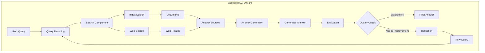
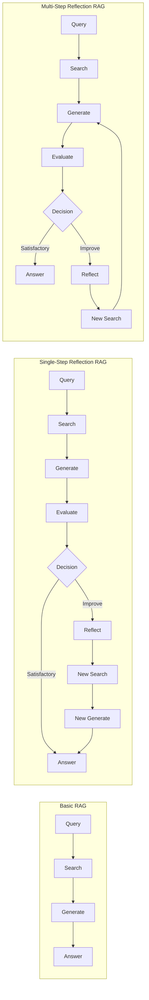
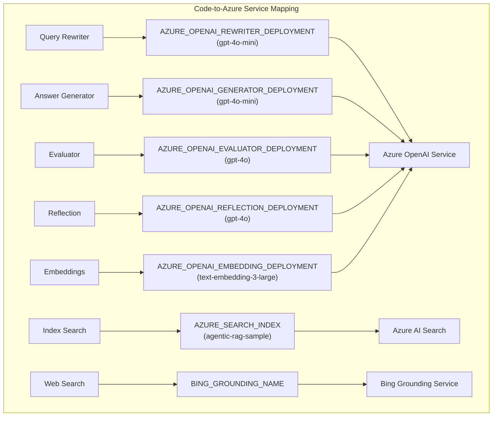
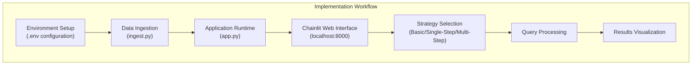

<!-- source: DeepWiki mcp.deepwiki.com · repo microsoft/rag-time · page 7 Agentic RAG · fetched 2026-10-26 -->

# Agentic RAG

<details>
<summary>Relevant source files</summary>

The following files were used as context for generating this wiki page:

- [Journey Bonus - Agentic RAG/README.md](Journey Bonus - Agentic RAG/README.md)
- [Journey Bonus - Agentic RAG/sample/README.md](Journey Bonus - Agentic RAG/sample/README.md)
- [Journey Bonus - Agentic RAG/sample/sample.env](Journey Bonus - Agentic RAG/sample/sample.env)

</details>


Agentic RAG represents an evolution of traditional Retrieval Augmented Generation by implementing autonomous capabilities that enable systems to iteratively improve answers through multiple retrieval-generation cycles. This document covers the architecture, implementation strategies, and technical components of Agentic RAG as demonstrated in the RAG-Time repository.

For information about basic RAG concepts, see [RAG Fundamentals](#2).

## System Overview

Agentic RAG enhances traditional RAG systems with several key technical capabilities:

1. Query rewriting to improve retrieval effectiveness
2. Multi-source information retrieval (combining index and web search)
3. Answer evaluation with quality assessment metrics
4. Reflection mechanisms to identify information gaps
5. Iterative improvement through multiple search-generate cycles

Sources: [Journey Bonus - Agentic RAG/README.md:3-9]()

## Architecture

The architecture of an Agentic RAG system consists of interconnected components that handle different stages of the question-answering process.



**Architecture Components:**

| Component | Function |
|-----------|----------|
| Query Rewriting | Reformulates user queries for more effective search |
| Index Search | Retrieves information from vector database |
| Web Search | Obtains up-to-date information from internet sources |
| Answer Generation | Creates responses based on retrieved documents |
| Evaluation | Assesses quality and completeness of generated answers |
| Reflection | Analyzes answer deficiencies and plans improvements |

Sources: [Journey Bonus - Agentic RAG/sample/README.md:1-6]()

## RAG Strategies

The repository implements three distinct RAG strategies with increasing levels of sophistication:

### Strategy Comparison



Sources: [Journey Bonus - Agentic RAG/sample/README.md:3-6]()

### Basic RAG (No Reflection)

The simplest implementation follows a linear flow without evaluation or reflection:
1. Process user query
2. Retrieve relevant documents
3. Generate answer
4. Return response

### Single-Step Reflection RAG

This strategy adds evaluation and a one-time reflection:
1. Process user query
2. Retrieve relevant documents
3. Generate initial answer
4. Evaluate answer quality
5. If quality is insufficient, perform reflection
6. Execute a new search based on reflection
7. Generate improved answer
8. Return final response

### Multi-Step Reflection RAG

The most advanced strategy implements an iterative improvement loop:
1. Process user query
2. Retrieve relevant documents
3. Generate answer
4. Evaluate answer quality
5. If quality is sufficient, return answer
6. If quality is insufficient, perform reflection
7. Execute a new search based on reflection
8. Return to step 3 and continue until quality threshold is met

Sources: [Journey Bonus - Agentic RAG/sample/README.md:3-6]()

## Azure Services Integration

The Agentic RAG implementation utilizes several Azure services working in conjunction:



Sources: [Journey Bonus - Agentic RAG/sample/sample.env:1-14]()

### Component Model Specialization

The implementation assigns different specialized models to specific tasks:

| Component | Azure Service | Model Deployment | Purpose |
|-----------|---------------|------------------|---------|
| Embeddings | Azure OpenAI | text-embedding-3-large | Generate vector embeddings for search |
| Query Rewriting | Azure OpenAI | gpt-4o-mini | Reformulate user queries for better results |
| Answer Generation | Azure OpenAI | gpt-4o-mini | Create responses from retrieved context |
| Evaluation | Azure OpenAI | gpt-4o | Assess answer quality and completeness |
| Reflection | Azure OpenAI | gpt-4o | Analyze deficiencies and plan improvements |
| Index Search | Azure AI Search | agentic-rag-sample | Perform vector and semantic search |
| Web Search | Bing Grounding | - | Retrieve up-to-date web information |

Sources: [Journey Bonus - Agentic RAG/sample/sample.env:8-13]()

## Technical Prerequisites

The Agentic RAG implementation requires:

1. Azure Services:
   - Azure subscription with access to Azure OpenAI
   - Azure AI Foundry Project
   - Bing Grounding
   - Azure AI Search (Basic tier or higher recommended)

2. Model Deployments:
   - `text-embedding-3-large`: For embedding generation
   - Chat completion models: `gpt-4o-mini` and `gpt-4o`

3. Development Requirements:
   - Python 3.11.x
   - Required packages as specified in `requirements.txt`

Sources: [Journey Bonus - Agentic RAG/sample/README.md:8-23]()

## Implementation and Execution

The sample code demonstrates all three RAG strategies through a Chainlit web interface:



### Setup and Execution Steps:

1. Configure environment variables in `.env` file using template from `sample.env`
2. Run the ingestion script to create and populate the search index:
   ```
   python ingest.py
   ```
3. Launch the Chainlit interface:
   ```
   chainlit run app.py
   ```
4. Access the UI at `http://localhost:8000` to interact with the system
5. Select the desired RAG strategy to process queries

Sources: [Journey Bonus - Agentic RAG/sample/README.md:26-39]()

## Use Cases and Applications

Agentic RAG is particularly valuable for scenarios requiring:

1. Complex question answering with multi-faceted information needs
2. Handling queries where information may be incomplete in the primary knowledge base
3. Applications requiring high accuracy and factually grounded responses
4. Scenarios where the query intent might need refinement or clarification
5. Systems that benefit from autonomous improvement of answers

Sources: [Journey Bonus - Agentic RAG/README.md:3-5]()

## Related Resources

For implementation details of specific RAG strategies, see [Agentic RAG Strategies](#7.1).
For technical implementation code, see [Implementing Agentic RAG](#7.2).

Sources: [Journey Bonus - Agentic RAG/README.md:15-17]()

---

