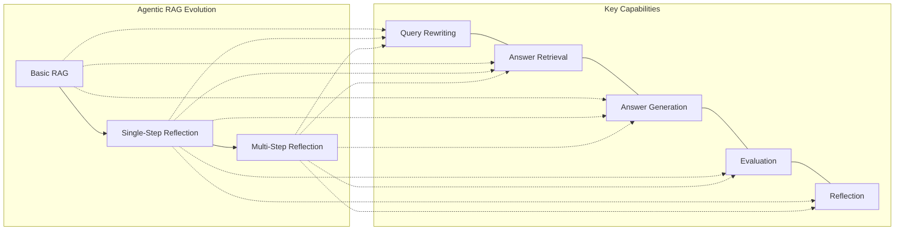
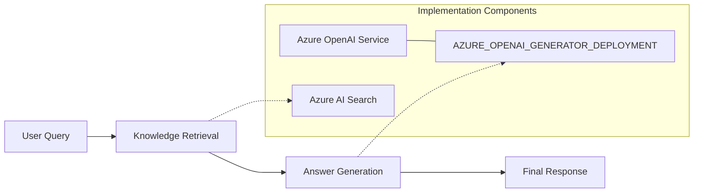
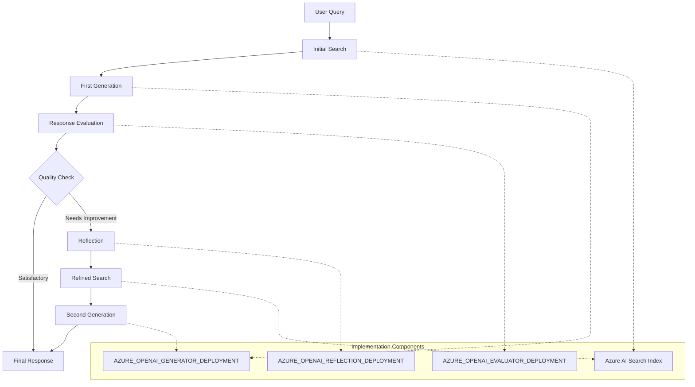
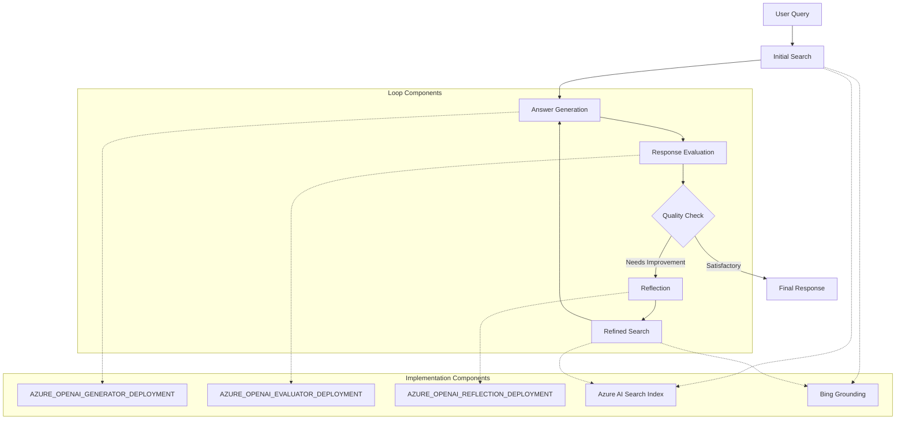
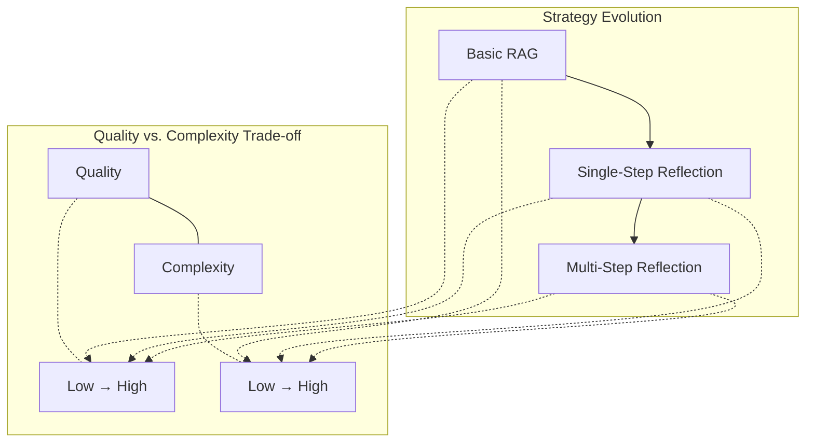
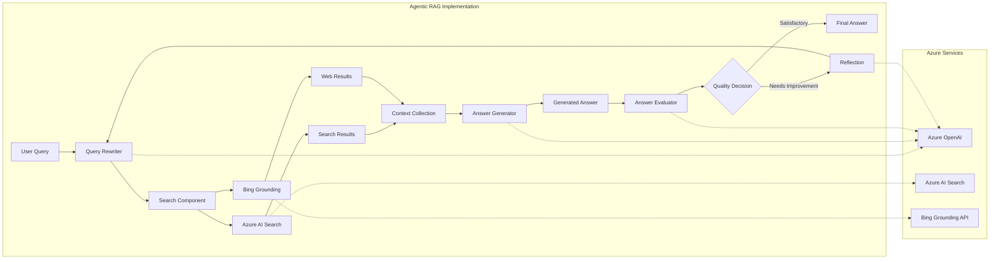

<!-- source: DeepWiki mcp.deepwiki.com · repo microsoft/rag-time · page 7.1 Agentic RAG Strategies · fetched 2026-10-26 -->

# Agentic RAG Strategies

Relevant source files

The following files were used as context for generating this wiki page:

- [Journey Bonus - Agentic RAG/README.md](Journey Bonus - Agentic RAG/README.md)
- [Journey Bonus - Agentic RAG/sample/README.md](Journey Bonus - Agentic RAG/sample/README.md)
- [Journey Bonus - Agentic RAG/sample/sample.env](Journey Bonus - Agentic RAG/sample/sample.env)

This document details the three primary strategies for implementing Agentic Retrieval Augmented Generation (RAG): Basic RAG, Single-Step Reflection RAG, and Multi-Step Reflection RAG. Each strategy represents an increasing level of sophistication in how the system retrieves information, generates responses, and refines its answers through reflection. For information about implementing these strategies in code, see [Implementing Agentic RAG](#7.2).

## 1. Overview of Agentic RAG

Agentic RAG combines traditional RAG systems with autonomous, agent-like capabilities that allow the system to actively seek out information, evaluate its responses, and improve them through reflection. Unlike standard RAG systems, which follow a fixed retrieval-then-generate pattern, Agentic RAG can make decisions about whether its answers are satisfactory and take additional steps to improve them when necessary.

Sources: [Journey Bonus - Agentic RAG/README.md:1-23](), [Journey Bonus - Agentic RAG/sample/README.md:1-7]()

## 2. Basic RAG Strategy

The Basic RAG strategy represents the foundational approach to retrieval-augmented generation with no reflection mechanisms included. This approach follows a linear flow from user query to response.

### 2.1 Process Flow

Sources: [Journey Bonus - Agentic RAG/sample/README.md:3-5](), [Journey Bonus - Agentic RAG/sample/sample.env:1-14]()

### 2.2 Characteristics of Basic RAG

| Feature | Description |
|---------|-------------|
| Process Flow | Linear, one-pass approach |
| Knowledge Source | Fixed retrieval from document index |
| Answer Generation | Single generation step |
| Result Quality | Dependent on initial retrieval quality |
| Implementation Complexity | Low |
| Computational Efficiency | High (fewest API calls) |

Sources: [Journey Bonus - Agentic RAG/sample/README.md:3-5]()

## 3. Single-Step Reflection RAG Strategy

Single-Step Reflection RAG enhances the basic strategy by adding evaluation and reflection mechanisms that can trigger a second retrieval and generation step if the initial response is deemed insufficient.

### 3.1 Process Flow

Sources: [Journey Bonus - Agentic RAG/sample/README.md:3-6](), [Journey Bonus - Agentic RAG/sample/sample.env:1-14]()

### 3.2 Characteristics of Single-Step Reflection RAG

| Feature | Description |
|---------|-------------|
| Process Flow | Two-stage with decision point |
| Knowledge Source | Initial retrieval with optional second retrieval |
| Answer Generation | Up to two generation steps |
| Result Quality | Better than Basic RAG due to quality check |
| Implementation Complexity | Medium |
| Computational Efficiency | Medium (more API calls than Basic) |

Sources: [Journey Bonus - Agentic RAG/sample/README.md:3-6]()

## 4. Multi-Step Reflection RAG Strategy

Multi-Step Reflection RAG represents the most advanced approach, implementing an iterative loop of evaluation, reflection, and retrieval until the system determines that the answer quality meets the required threshold.

### 4.1 Process Flow

Sources: [Journey Bonus - Agentic RAG/sample/README.md:3-7](), [Journey Bonus - Agentic RAG/sample/sample.env:1-14]()

### 4.2 Characteristics of Multi-Step Reflection RAG

| Feature | Description |
|---------|-------------|
| Process Flow | Iterative with evaluation loop |
| Knowledge Source | Multiple retrievals as needed |
| Answer Generation | Multiple generation steps |
| Result Quality | Highest among the three approaches |
| Implementation Complexity | High |
| Computational Efficiency | Low (potentially many API calls) |

Sources: [Journey Bonus - Agentic RAG/sample/README.md:3-7]()

## 5. Comparative Analysis

### 5.1 Strategy Comparison

### 5.2 Performance Comparison

| Strategy | Response Quality | Computational Cost | Latency | Best For |
|----------|------------------|-------------------|---------|----------|
| Basic RAG | Moderate | Low | Low | Simple queries, quick responses |
| Single-Step Reflection | Good | Medium | Medium | Balance of quality and speed |
| Multi-Step Reflection | Excellent | High | High | Complex questions requiring depth |

Sources: [Journey Bonus - Agentic RAG/sample/README.md:3-7]()

## 6. Technical Implementation Overview

The implementation of Agentic RAG strategies in the RAG-Time repository uses several Azure services:

Sources: [Journey Bonus - Agentic RAG/sample/README.md:8-40](), [Journey Bonus - Agentic RAG/sample/sample.env:1-14]()

### 6.1 Required Azure Services

| Service | Purpose | Environment Variable |
|---------|---------|---------------------|
| Azure OpenAI | Embeddings, completions, evaluations | `AZURE_OPENAI_ENDPOINT`, `AZURE_OPENAI_API_KEY` |
| Azure AI Search | Vector search index | `AZURE_SEARCH_ENDPOINT`, `AZURE_SEARCH_INDEX` |
| Azure AI Foundry Project | Project connection | `AI_PROJECT_CONN_STR` |
| Bing Grounding | Web search access | `BING_GROUNDING_NAME` |

### 6.2 OpenAI Model Deployments

| Purpose | Environment Variable | Recommended Model |
|---------|---------------------|------------------|
| Embeddings | `AZURE_OPENAI_EMBEDDING_DEPLOYMENT` | text-embedding-3-large |
| Answer Generation | `AZURE_OPENAI_GENERATOR_DEPLOYMENT` | gpt-4o-mini |
| Query Rewriting | `AZURE_OPENAI_REWRITER_DEPLOYMENT` | gpt-4o-mini |
| Answer Evaluation | `AZURE_OPENAI_EVALUATOR_DEPLOYMENT` | gpt-4o |
| Reflection | `AZURE_OPENAI_REFLECTION_DEPLOYMENT` | gpt-4o |

Sources: [Journey Bonus - Agentic RAG/sample/README.md:8-21](), [Journey Bonus - Agentic RAG/sample/sample.env:1-14]()

## 7. Summary

Agentic RAG strategies represent an evolution in RAG system capabilities, moving from simple one-shot retrieval and generation to sophisticated multi-step approaches that can refine their responses through evaluation and reflection. The three strategies—Basic RAG, Single-Step Reflection RAG, and Multi-Step Reflection RAG—offer different trade-offs between response quality, computational cost, and implementation complexity.

For real-world applications, the choice of strategy should be guided by:
- The complexity of user queries
- Required response quality
- Acceptable latency
- Available computational resources

The RAG-Time repository provides a practical implementation of these strategies using Azure services, allowing developers to experiment with different approaches and understand their relative advantages and limitations.

Sources: [Journey Bonus - Agentic RAG/README.md:1-23](), [Journey Bonus - Agentic RAG/sample/README.md:1-40]()

---

