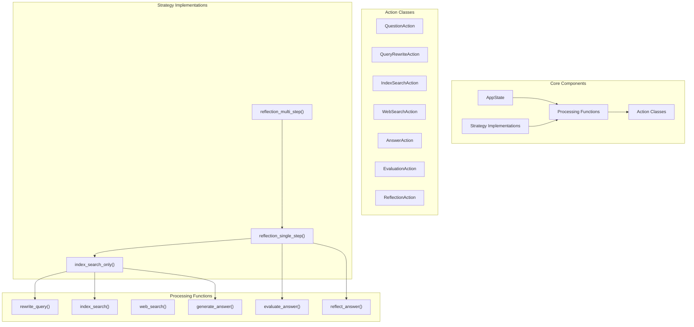
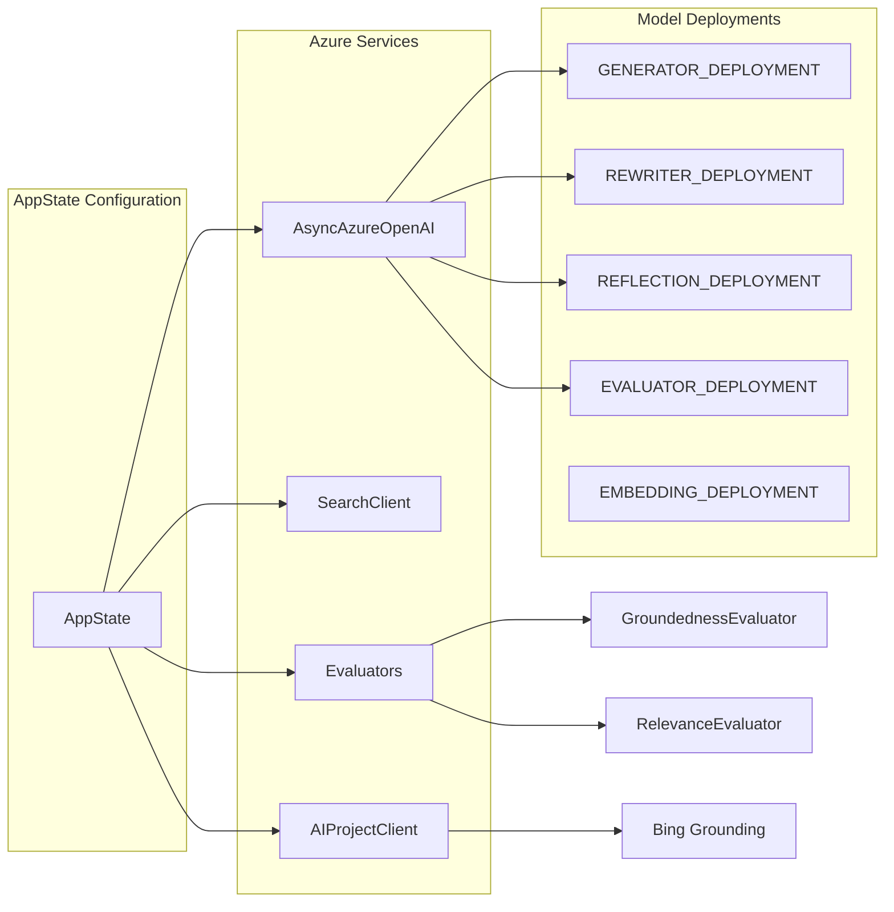
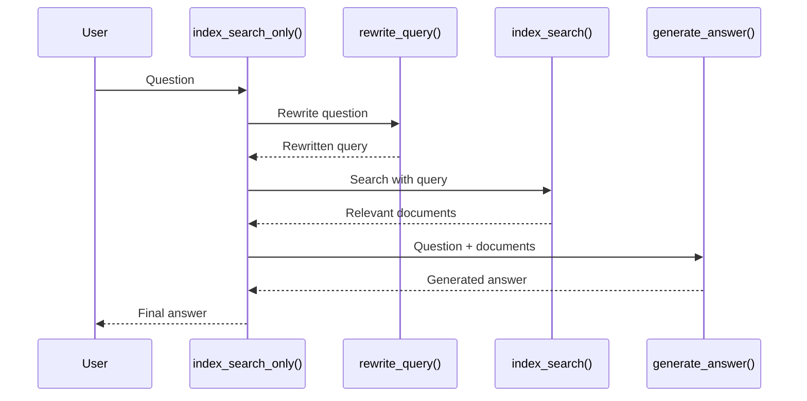
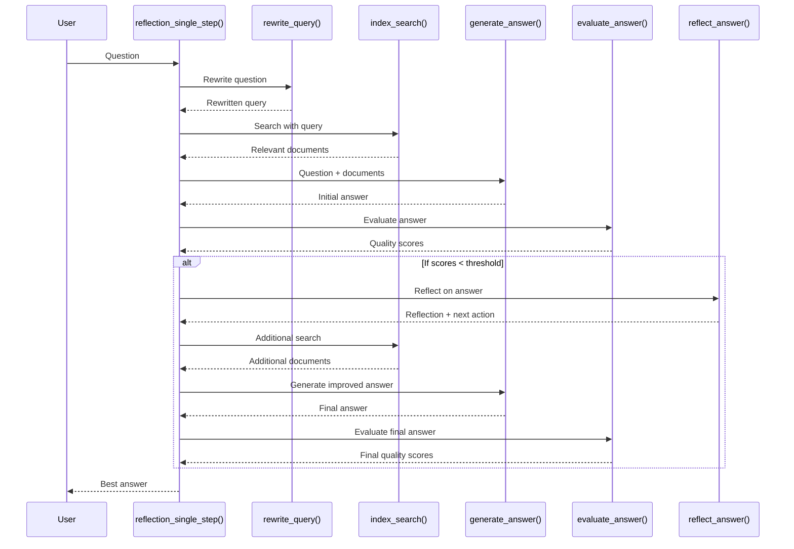
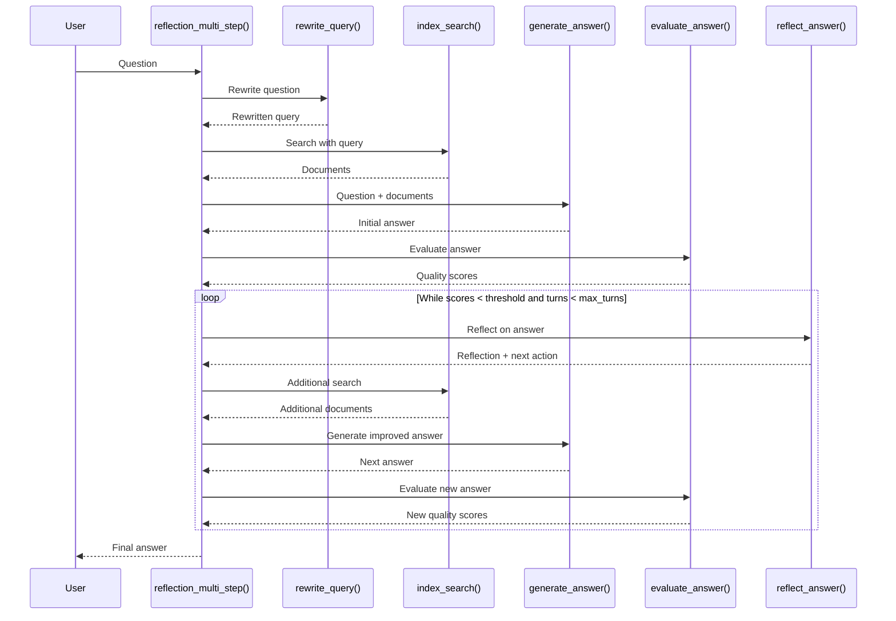

<!-- source: DeepWiki mcp.deepwiki.com · repo microsoft/rag-time · page 7.2 Implementing Agentic RAG · fetched 2026-10-26 -->

# Implementing Agentic RAG

<details>
<summary>Relevant source files</summary>

The following files were used as context for generating this wiki page:

- [Journey Bonus - Agentic RAG/.gitignore](Journey Bonus - Agentic RAG/.gitignore)
- [Journey Bonus - Agentic RAG/sample/README.md](Journey Bonus - Agentic RAG/sample/README.md)
- [Journey Bonus - Agentic RAG/sample/agents.py](Journey Bonus - Agentic RAG/sample/agents.py)
- [Journey Bonus - Agentic RAG/sample/app.py](Journey Bonus - Agentic RAG/sample/app.py)
- [Journey Bonus - Agentic RAG/sample/ingest.py](Journey Bonus - Agentic RAG/sample/ingest.py)
- [Journey Bonus - Agentic RAG/sample/requirements.txt](Journey Bonus - Agentic RAG/sample/requirements.txt)
- [Journey Bonus - Agentic RAG/sample/sample.env](Journey Bonus - Agentic RAG/sample/sample.env)

</details>


This technical documentation provides a detailed guide for implementing Agentic RAG (Retrieval Augmented Generation) capabilities in your applications. It covers the practical aspects of setting up and deploying the three progressive Agentic RAG strategies demonstrated in the RAG-Time repository: Basic RAG, Single-Step Reflection RAG, and Multi-Step Reflection RAG.

For information about the conceptual differences between these strategies, see [Agentic RAG Strategies](#7.1).

## System Architecture Overview

The Agentic RAG implementation consists of several interconnected components that work together to provide increasingly sophisticated retrieval and generation capabilities.

### Agentic RAG Component Architecture



Sources:
- [Journey Bonus - Agentic RAG/sample/agents.py:305-361]()
- [Journey Bonus - Agentic RAG/sample/app.py:121-126]()

### Integration with Azure Services



Sources:
- [Journey Bonus - Agentic RAG/sample/agents.py:29-41]()
- [Journey Bonus - Agentic RAG/sample/app.py:28-42]()
- [Journey Bonus - Agentic RAG/sample/sample.env:1-14]()

## Agentic RAG Strategies Implementation

The repository implements three RAG strategies with increasing levels of sophistication.

### Strategy Comparison

```mermaid
flowchart TD
    subgraph "Basic RAG"
        B_Q["QuestionAction"] --> B_QR["QueryRewriteAction"]
        B_QR --> B_IS["IndexSearchAction"]
        B_IS --> B_A["AnswerAction"]
    end
    
    subgraph "Single-Step Reflection"
        S_Q["QuestionAction"] --> S_QR["QueryRewriteAction"]
        S_QR --> S_IS["IndexSearchAction"]
        S_IS --> S_A["AnswerAction"]
        S_A --> S_E["EvaluationAction"]
        S_E --> S_R{"ReflectionAction"}
        S_R -->|"Needs improvement"| S_NA["Additional Search"]
        S_NA --> S_FA["Final AnswerAction"]
        S_FA --> S_FE["Final EvaluationAction"]
        S_R -->|"Satisfactory"| S_DONE["Done"]
    end
    
    subgraph "Multi-Step Reflection"
        M_Q["QuestionAction"] --> M_QR["QueryRewriteAction"]
        M_QR --> M_IS["IndexSearchAction"]
        M_IS --> M_A["AnswerAction"]
        M_A --> M_E["EvaluationAction"]
        M_E --> M_LOOP{"Quality Check"}
        M_LOOP -->|"Needs improvement"| M_R["ReflectionAction"]
        M_R --> M_NA["Additional Search"]
        M_NA --> M_A
        M_LOOP -->|"Satisfactory/Max turns"| M_DONE["Done"]
    end
```



Sources:
- [Journey Bonus - Agentic RAG/sample/agents.py:305-361]()

### Basic RAG (No Reflection)

The simplest implementation follows a linear process:



The basic RAG implementation is handled by the `index_search_only` function in [Journey Bonus - Agentic RAG/sample/agents.py:305-310]():

```python
async def index_search_only(app_state: AppState, message: str, message_history: Optional[List[ChatCompletionMessageParam]] = None) -> ActionList:
    question_action = QuestionAction(question_text=message)
    index_search_action = await index_search(app_state, message, message_history)
    answer_action = await generate_answer(app_state, message, AnswerSources.from_index_search(message_history, index_search_action))

    return ActionList(actions=[question_action, index_search_action, answer_action])
```

Sources:
- [Journey Bonus - Agentic RAG/sample/agents.py:305-310]()

### Single-Step Reflection RAG

This strategy adds evaluation and reflection steps to potentially improve the initial answer:



The single-step reflection implementation is in [Journey Bonus - Agentic RAG/sample/agents.py:324-338]():

```python
async def reflection_single_step(app_state: AppState, message: str, message_history: Optional[List[ChatCompletionMessageParam]] = None) -> ActionList:
    question_action = QuestionAction(question_text=message)
    index_search_action = await index_search(app_state, message, message_history)
    answer_action = await generate_answer(app_state, message, AnswerSources.from_index_search(message_history, index_search_action))
    evaluation_action = await evaluate_answer(app_state, answer_action)
    action_list = ActionList(actions=[question_action, index_search_action, answer_action, evaluation_action ])
    if any(evaluation.score < 4 for evaluation in evaluation_action.evaluations):
        reflection_action = await reflect_answer(app_state, action_list)
        next_action, next_sources = await reflect_next_action(app_state, reflection_action, answer_action.answer_sources)
        final_answer_action = await generate_answer(app_state, message, next_sources, previous_answer=answer_action.answer_text, previous_answer_reflection=reflection_action.answer_reflection, previous_answer_evaluations=evaluation_action.evaluations)
        final_evaluation_action = await evaluate_answer(app_state, final_answer_action)

        action_list.actions.extend([reflection_action, next_action, final_answer_action, final_evaluation_action])
    
    return action_list
```

Sources:
- [Journey Bonus - Agentic RAG/sample/agents.py:324-338]()

### Multi-Step Reflection RAG

The most sophisticated strategy can perform multiple iterations of reflection and improvement:



The multi-step reflection implementation is in [Journey Bonus - Agentic RAG/sample/agents.py:340-361]():

```python
async def reflection_multi_step(app_state: AppState, message: str, message_history: Optional[List[ChatCompletionMessageParam]]) -> ActionList:
    question_action = QuestionAction(question_text=message)
    index_search_action = await index_search(app_state, message, message_history)
    answer_action = await generate_answer(app_state, message, AnswerSources.from_index_search(message_history, index_search_action))
    evaluation_action = await evaluate_answer(app_state, answer_action)
    action_list = ActionList(actions=[question_action, index_search_action, answer_action, evaluation_action])
    max_turns = 3
    turn = 1
    while any(evaluation.score < 4 for evaluation in evaluation_action.evaluations):
        reflection_action = await reflect_answer(app_state, action_list)
        next_action, next_sources = await reflect_next_action(app_state, reflection_action, answer_action.answer_sources)
        next_answer_action = await generate_answer(app_state, message, next_sources, previous_answer=answer_action.answer_text, previous_answer_reflection=reflection_action.answer_reflection, previous_answer_evaluations=evaluation_action.evaluations)
        evaluation_action = await evaluate_answer(app_state, next_answer_action, reflection_action)
        action_list.actions.extend([reflection_action, next_action, next_answer_action, evaluation_action])

        if reflection_action.type == "stop":
            break
        turn += 1
        if turn > max_turns:
            break
    
    return action_list
```

Sources:
- [Journey Bonus - Agentic RAG/sample/agents.py:340-361]()

## Core Building Blocks

### AppState Configuration

The `AppState` class serves as a central container for all services and configurations required by the Agentic RAG system:

```python
@dataclass
class AppState:
    openai_client: AsyncAzureOpenAI
    search_client: SearchClient
    answer_generator_deployment: str
    query_rewriter_deployment: str
    reflection_deployment: str
    groundedness_evaluator: GroundednessEvaluator
    relevance_evaluator: RelevanceEvaluator
    ai_project_client: AIProjectClient
    bing_grounding_name: str
    bing_tool: Optional[BingGroundingTool] = None
```

An instance of this class is initialized in `app.py`:

```python
app_state = AppState(
    openai_client = AsyncAzureOpenAI(...),
    search_client = SearchClient(...),
    answer_generator_deployment = os.environ["AZURE_OPENAI_GENERATOR_DEPLOYMENT"],
    query_rewriter_deployment = os.environ["AZURE_OPENAI_REWRITER_DEPLOYMENT"],
    reflection_deployment = os.environ["AZURE_OPENAI_REFLECTION_DEPLOYMENT"],
    groundedness_evaluator = GroundednessEvaluator(evaluator_model_config),
    relevance_evaluator = RelevanceEvaluator(evaluator_model_config),
    ai_project_client = AIProjectClient.from_connection_string(...),
    bing_grounding_name = os.environ["BING_GROUNDING_NAME"],
)
```

Sources:
- [Journey Bonus - Agentic RAG/sample/agents.py:29-41]()
- [Journey Bonus - Agentic RAG/sample/app.py:28-42]()

### Step Decorator

The `step` decorator is a utility used throughout the codebase to integrate with the Chainlit UI and create visual steps for each operation:

```python
def step(func):
    @functools.wraps(func)
    async def step_wrapper(*args, **kwargs):
        cl_step: Optional[cl.Step] = None if not running_in_cl() else cl.Step(name=func.__name__)

        if cl_step:
            async with cl_step:
                cl_step.input = kwargs
                output = await func(*args, **kwargs)
                cl_step.output = output.model_dump()
                if isinstance(output, ActionBase) and output.render_during_step():
                    await output.render()
                return output
        else:
            return await func(*args, **kwargs)
    
    return step_wrapper
```

Sources:
- [Journey Bonus - Agentic RAG/sample/agents.py:51-67]()

### Key Processing Functions

The implementation includes several key functions that handle different aspects of the Agentic RAG process:

| Function | Purpose | Implementation Location |
|----------|---------|-------------------------|
| `rewrite_query` | Improves the original query for better search results | [agents.py:70-88]() |
| `filter_documents` | Filters search results based on a relevance threshold | [agents.py:90-97]() |
| `index_search` | Searches the Azure AI Search index for relevant documents | [agents.py:99-116]() |
| `web_search` | Retrieves information from the web using Bing Grounding | [agents.py:118-162]() |
| `generate_answer` | Produces an answer based on the retrieved information | [agents.py:164-203]() |
| `evaluate_answer` | Evaluates the quality of the generated answer | [agents.py:205-250]() |
| `reflect_answer` | Reflects on the answer quality and decides next steps | [agents.py:253-302]() |
| `reflect_next_action` | Determines what action to take based on reflection | [agents.py:312-322]() |

Sources:
- [Journey Bonus - Agentic RAG/sample/agents.py:70-302]()

## Setting Up the Environment

### Prerequisites

To implement Agentic RAG, you need:

1. An Azure subscription with access to Azure OpenAI
2. An Azure AI Foundry Project 
3. Bing Grounding configuration for web search
4. Azure AI Search service
5. The following Azure OpenAI model deployments:
   - `text-embedding-3-large` for embeddings
   - `gpt-4o-mini` for answer generation and query rewriting
   - `gpt-4o` for evaluation and reflection

Sources:
- [Journey Bonus - Agentic RAG/sample/README.md:8-23]()

### Environment Configuration

Create a `.env` file with the following variables:

```
AZURE_OPENAI_ENDPOINT=https://your-service.openai.azure.com
AZURE_OPENAI_API_VERSION=2025-03-01-preview
AZURE_OPENAI_API_KEY=your-openai-key
AZURE_SEARCH_ENDPOINT=https://your-service.search.windows.net
AZURE_SEARCH_INDEX=agentic-rag-sample
AZURE_SEARCH_KEY=
AI_PROJECT_CONN_STR="your-project-connection-string"
BING_GROUNDING_NAME=your-bing-grounding-connection-name
AZURE_OPENAI_EMBEDDING_DEPLOYMENT=text-embedding-3-large
AZURE_OPENAI_GENERATOR_DEPLOYMENT=gpt-4o-mini
AZURE_OPENAI_REWRITER_DEPLOYMENT=gpt-4o-mini
AZURE_OPENAI_EVALUATOR_DEPLOYMENT=gpt-4o
AZURE_OPENAI_REFLECTION_DEPLOYMENT=gpt-4o
```

Sources:
- [Journey Bonus - Agentic RAG/sample/sample.env:1-14]()

### Dependencies

Install the required Python packages:

```bash
pip install -r requirements.txt
```

The `requirements.txt` file contains:

```
azure-search-documents==11.5.2
azure-ai-evaluation
azure-ai-projects
azure-identity
aiohttp
openai
chainlit
python-dotenv
prompty
```

Sources:
- [Journey Bonus - Agentic RAG/sample/requirements.txt:1-9]()

## Data Ingestion

Before using the Agentic RAG system, you need to ingest data into your Azure AI Search index using the `ingest.py` script:

```python
async def main():
    load_dotenv()

    credential = AzureKeyCredential(os.getenv("AZURE_SEARCH_KEY")) if os.getenv("AZURE_SEARCH_KEY") else DefaultAzureCredential()
    index_client = SearchIndexClient(endpoint=os.environ["AZURE_SEARCH_ENDPOINT"], credential=credential)
    with open("sample-index/schema.json") as f:
        index = json.load(f)
    search_index = SearchIndex.deserialize(index)
    search_index.name = os.environ["AZURE_SEARCH_INDEX"]
    search_index.vector_search.vectorizers.append(
        AzureOpenAIVectorizer(
            vectorizer_name="vectorizer",
            parameters=AzureOpenAIVectorizerParameters(
                resource_url=os.environ["AZURE_OPENAI_ENDPOINT"],
                deployment_name=os.environ["AZURE_OPENAI_EMBEDDING_DEPLOYMENT"],
                model_name="text-embedding-3-large",
                api_key=os.environ["AZURE_OPENAI_API_KEY"]
            )
        )
    )
    search_index.vector_search.profiles[0].vectorizer_name = "vectorizer"
    await index_client.create_or_update_index(search_index)
    
    search_client = SearchClient(endpoint=os.environ["AZURE_SEARCH_ENDPOINT"], index_name=os.environ["AZURE_SEARCH_INDEX"], credential=credential)
    with open("sample-index/data.json") as f:
        documents = json.load(f)
    await search_client.upload_documents(documents)
```

Run the script with:

```bash
python ingest.py
```

Sources:
- [Journey Bonus - Agentic RAG/sample/ingest.py:11-39]()

## Running the Application

After setting up your environment and ingesting data, you can run the application using Chainlit:

```bash
chainlit run app.py
```

This will start a web server at `http://localhost:8000` where you can interact with the Agentic RAG system.

Sources:
- [Journey Bonus - Agentic RAG/sample/README.md:33-38]()

### Application Interface

The application allows you to:

1. Select which RAG strategy to use (Basic, Single-Step Reflection, or Multi-Step Reflection)
2. Load sample conversations
3. Ask questions and view the detailed steps of the RAG process

The RAG strategy selection is implemented in [Journey Bonus - Agentic RAG/sample/app.py:105-126]():

```python
@cl.on_message
async def on_message(msg: cl.Message):
    question = msg.content

    message_chat_type = chat_type
    if msg.command:
        message_chat_type = msg.command
    
    session_action_list: ActionList = cl.user_session.get("actions")
    last_answer_action = session_action_list.get_last_answer()
    # If there was a last answer action, append its message history to the new question
    message_history = []
    if last_answer_action:
        last_answer_action.append_qa_message_history()
        message_history = last_answer_action.answer_sources.message_history

    if message_chat_type == basic_chat_type:
        action_list = await index_search_only(app_state, question, message_history)
    elif message_chat_type == single_reflection_type:
        action_list = await reflection_single_step(app_state, msg.content, message_history)
    elif message_chat_type == multi_reflection_type:
        action_list = await reflection_multi_step(app_state, msg.content, message_history)
    else:
        action_list = ActionList(actions=[])

    session_action_list.actions.extend(action_list.actions)
```

Sources:
- [Journey Bonus - Agentic RAG/sample/app.py:105-126]()
- [Journey Bonus - Agentic RAG/sample/README.md:38-42]()

## Conclusion

This documentation has provided a detailed technical guide to implementing Agentic RAG using the RAG-Time repository. By following these instructions, you can set up and deploy a sophisticated RAG system that employs reflection and evaluation to improve answer quality through multiple iterations if necessary.

The key advantages of implementing Agentic RAG include:

1. Improved answer quality through systematic evaluation
2. Self-correction through reflection mechanisms
3. Flexible search capabilities including both index and web search
4. Transparency in the RAG process with step-by-step visualization

For more information about the conceptual aspects and strategies of Agentic RAG, see [Agentic RAG Strategies](#7.1).

Sources:
- [Journey Bonus - Agentic RAG/sample/README.md:1-7]()
- [Journey Bonus - Agentic RAG/sample/agents.py:305-361]()

---

