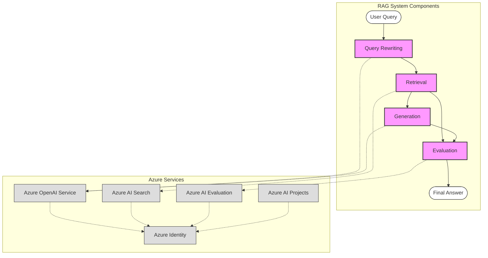
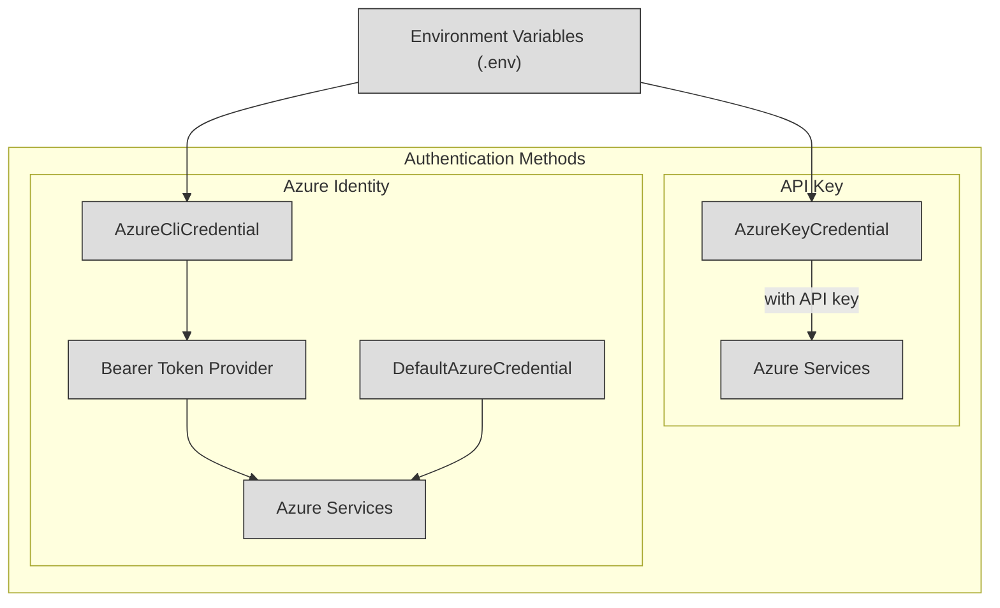
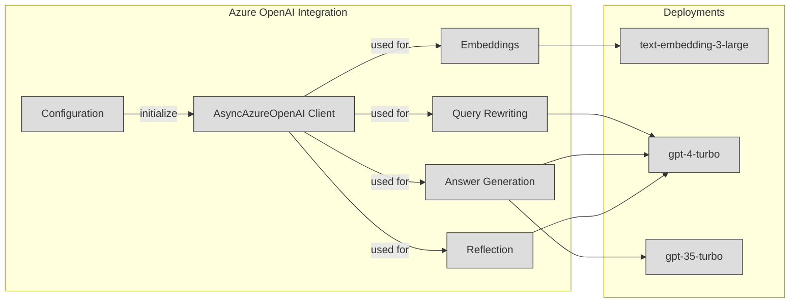
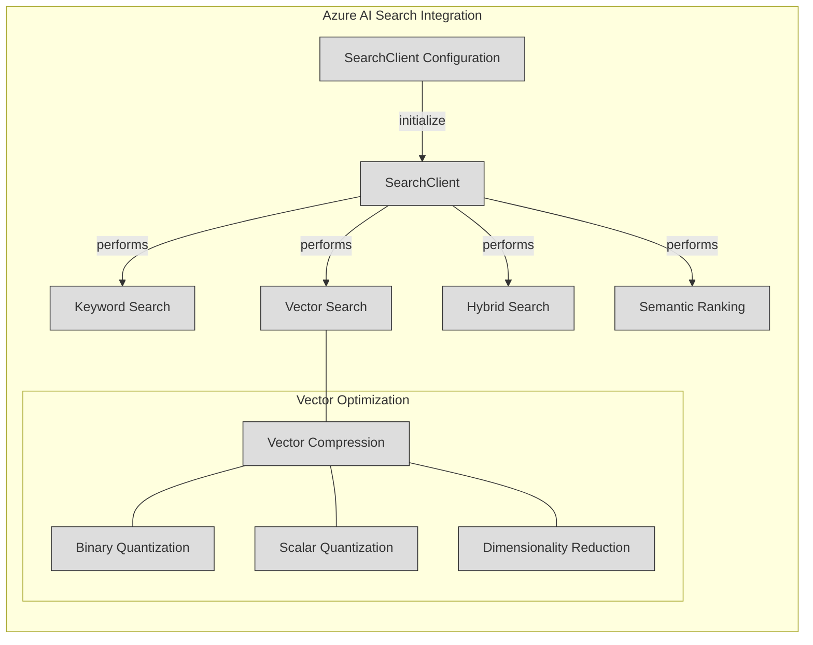
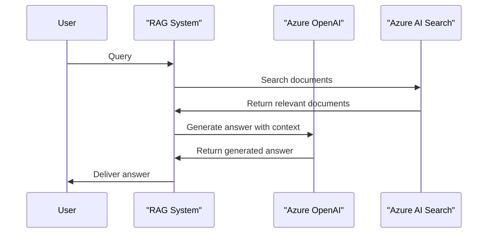
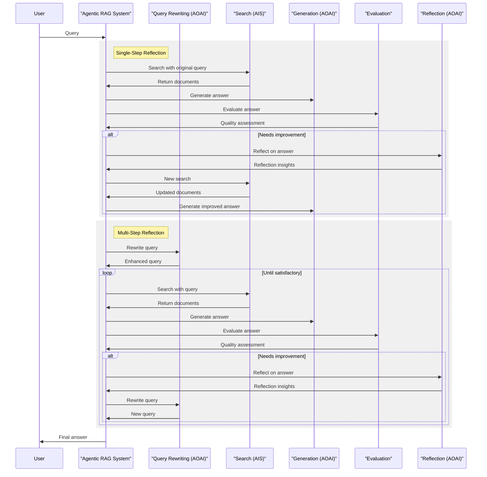

<!-- source: DeepWiki mcp.deepwiki.com · repo microsoft/rag-time · page 8 Azure Services Integration · fetched 2026-10-26 -->

# Azure Services Integration

<details>
<summary>Relevant source files</summary>

The following files were used as context for generating this wiki page:

- [Journey 2 - Build the Ultimate Retrieval System for RAG/sample/.env.sample](Journey 2 - Build the Ultimate Retrieval System for RAG/sample/.env.sample)
- [Journey 2 - Build the Ultimate Retrieval System for RAG/sample/2-Build-The-Ultimate-Retrieval-System-For-RAG.ipynb](Journey 2 - Build the Ultimate Retrieval System for RAG/sample/2-Build-The-Ultimate-Retrieval-System-For-RAG.ipynb)
- [Journey 2 - Build the Ultimate Retrieval System for RAG/sample/MSFT_cloud_architecture_contoso.pdf](Journey 2 - Build the Ultimate Retrieval System for RAG/sample/MSFT_cloud_architecture_contoso.pdf)
- [Journey 3 - Optimize your Vector Index for Scale/sample/3-Vector-Compression.ipynb](Journey 3 - Optimize your Vector Index for Scale/sample/3-Vector-Compression.ipynb)
- [Journey Bonus - Agentic RAG/sample/app.py](Journey Bonus - Agentic RAG/sample/app.py)
- [Journey Bonus - Agentic RAG/sample/requirements.txt](Journey Bonus - Agentic RAG/sample/requirements.txt)

</details>


This page provides a comprehensive overview of how various Azure services are integrated within the RAG-Time repository's workflows to build robust Retrieval Augmented Generation (RAG) systems. It focuses on the technical integration patterns, authentication mechanisms, and service interactions that enable the RAG capabilities demonstrated throughout the learning journeys.

For specific details on Azure AI Search configuration, see [Azure AI Search Configuration](#8.1). For information on Azure OpenAI integration specifics, see [Azure OpenAI Integration](#8.2).

## Azure Services Overview

The RAG-Time repository leverages several Azure services to implement different components of a RAG system. These services work together to provide a complete end-to-end solution for retrieval, generation, and evaluation.



Sources: [Journey Bonus - Agentic RAG/sample/app.py:4-41]()

## Core Azure Services

The RAG-Time repository integrates the following Azure services:

| Azure Service | Primary Role | Used In |
|---------------|--------------|---------|
| Azure OpenAI | Text generation, embeddings, query rewriting | Generation, reflection, evaluation |
| Azure AI Search | Document storage, vector search, semantic ranking | Retrieval, vector compression |
| Azure AI Evaluation | Evaluating result quality, groundedness | Answer validation |
| Azure Identity | Authentication to Azure services | Service access |
| Azure AI Projects | Project-level AI orchestration | Advanced scenarios |

### Authentication and Configuration

RAG-Time systems use two main approaches for authenticating with Azure services:

1. **API Key Authentication**: Using direct API keys stored in environment variables
2. **Azure Identity Authentication**: Using Azure Active Directory authentication through mechanisms like Azure CLI credentials



Sources: [Journey Bonus - Agentic RAG/sample/app.py:19-25](), [Journey 2 - Build the Ultimate Retrieval System for RAG/sample/2-Build-The-Ultimate-Retrieval-System-For-RAG.ipynb:79-88]()

Configuration for Azure services is typically managed through environment variables loaded from `.env` files, which contain service endpoints, keys, and deployment names. The sample configuration includes:

```
AZURE_OPENAI_ENDPOINT=https://your-openai-service.openai.azure.com/
AZURE_OPENAI_API_VERSION=2023-05-15
AZURE_OPENAI_API_KEY=your-api-key

AZURE_SEARCH_ENDPOINT=https://your-search-service.search.windows.net
AZURE_SEARCH_INDEX=your-index-name
AZURE_SEARCH_KEY=your-search-admin-key
```

Sources: [Journey 2 - Build the Ultimate Retrieval System for RAG/sample/.env.sample:1-3]()

## Service Integration Patterns

### Azure OpenAI Integration

Azure OpenAI is integrated for multiple functions within the RAG workflows:

1. **Embeddings Generation**: Converting text to vector representations
2. **Query Rewriting**: Enhancing user queries to improve retrieval
3. **Answer Generation**: Generating responses based on retrieved context
4. **Reflection**: Analyzing and improving responses in agentic RAG

The client is typically initialized with appropriate authentication and endpoint configuration:



Sources: [Journey Bonus - Agentic RAG/sample/app.py:28-37]()

### Azure AI Search Integration

Azure AI Search provides the vector database and search functionality crucial for RAG systems:

1. **Keyword Search**: Traditional text-based search
2. **Vector Search**: Similarity search using embeddings
3. **Hybrid Search**: Combining keyword and vector search
4. **Semantic Ranking**: Enhancing results with semantic understanding
5. **Vector Compression**: Optimizing vector storage and search



Sources: [Journey 2 - Build the Ultimate Retrieval System for RAG/sample/2-Build-The-Ultimate-Retrieval-System-For-RAG.ipynb:108-132](), [Journey 3 - Optimize your Vector Index for Scale/sample/3-Vector-Compression.ipynb:189-215]()

### Azure AI Evaluation Integration

Azure AI Evaluation services are integrated to assess the quality of generated responses:

1. **Groundedness Evaluation**: Ensures responses are grounded in the retrieved context
2. **Relevance Evaluation**: Measures how well responses address the original query

These evaluators are initialized with model configurations and used to validate responses in the RAG pipeline, particularly in agentic scenarios.

Sources: [Journey Bonus - Agentic RAG/sample/app.py:21-25](), [Journey Bonus - Agentic RAG/sample/app.py:37-39]()

## RAG Implementation Architectures

The repository demonstrates different RAG architectures with varying levels of complexity:

### 1. Basic RAG Architecture



Sources: [Journey 2 - Build the Ultimate Retrieval System for RAG/sample/2-Build-The-Ultimate-Retrieval-System-For-RAG.ipynb:152-155](), [Journey Bonus - Agentic RAG/sample/app.py:121-122]()

### 2. Agentic RAG Architecture with Reflection



Sources: [Journey Bonus - Agentic RAG/sample/app.py:124-126]()

## Code Structure for Azure Service Integration

The following table outlines the core code components for Azure service integration:

| Component | Purpose | File Location |
|-----------|---------|--------------|
| `AppState` | Centralized configuration for all Azure services | [Journey Bonus - Agentic RAG/sample/app.py:28-42]() |
| `SearchClient` | Client for Azure AI Search interactions | [Journey Bonus - Agentic RAG/sample/app.py:34](), [Journey 2 - Build the Ultimate Retrieval System for RAG/sample/2-Build-The-Ultimate-Retrieval-System-For-RAG.ipynb:113-116]() |
| `AsyncAzureOpenAI` | Client for Azure OpenAI interactions | [Journey Bonus - Agentic RAG/sample/app.py:29-33]() |
| `GroundednessEvaluator`, `RelevanceEvaluator` | Evaluators for response quality | [Journey Bonus - Agentic RAG/sample/app.py:38-39]() |
| `AIProjectClient` | Client for Azure AI Project capabilities | [Journey Bonus - Agentic RAG/sample/app.py:40]() |

## Required Dependencies

To integrate with Azure services, the following Python packages are required:

```
azure-search-documents==11.5.2
azure-ai-evaluation
azure-ai-projects
azure-identity
openai
python-dotenv
```

Sources: [Journey Bonus - Agentic RAG/sample/requirements.txt:1-6](), [Journey Bonus - Agentic RAG/sample/requirements.txt:7-9]()

## Troubleshooting Common Issues

When working with Azure services integration, you might encounter these common issues:

1. **Authentication Failures**: Ensure your credentials are correctly configured in environment variables
2. **Service Limits**: Be aware of rate limits and quotas for Azure OpenAI and Azure AI Search
3. **Deployment Names**: Verify that deployment names match exactly those in your Azure OpenAI service
4. **Index Configuration**: Ensure your search index is properly configured for vector search
5. **CORS Issues**: For web applications, configure CORS settings on Azure services

Sources: [Journey 2 - Build the Ultimate Retrieval System for RAG/sample/2-Build-The-Ultimate-Retrieval-System-For-RAG.ipynb:262-269]()

## Summary

The RAG-Time repository demonstrates sophisticated integration of Azure services to build end-to-end RAG systems. By leveraging Azure OpenAI for generation and embeddings, Azure AI Search for retrieval, and Azure AI Evaluation for quality assessment, the system showcases both basic retrieval patterns and advanced agentic behaviors with reflection capabilities.

This integration pattern enables a scalable, enterprise-ready approach to RAG systems that can benefit from Azure's security, compliance, and performance capabilities while maintaining flexibility for different use cases.

---

