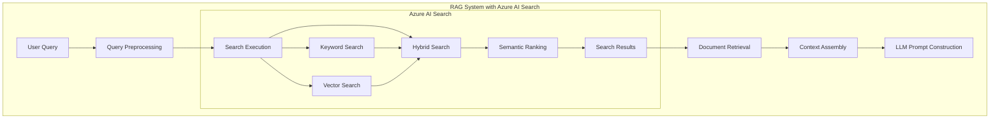
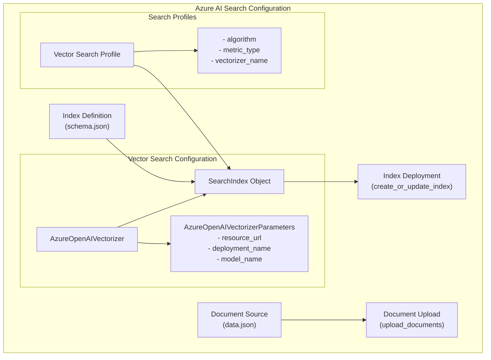
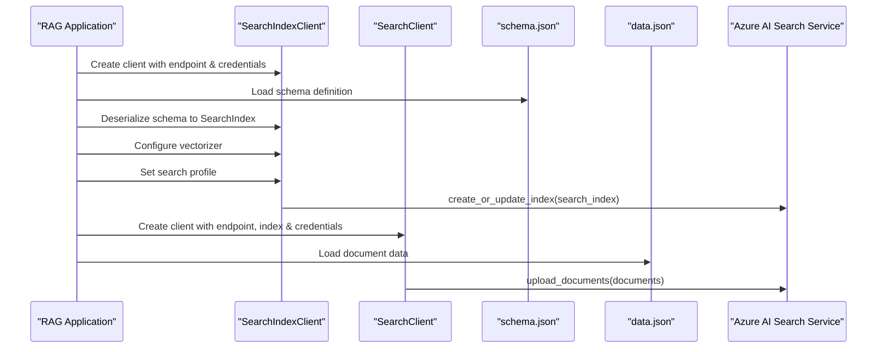
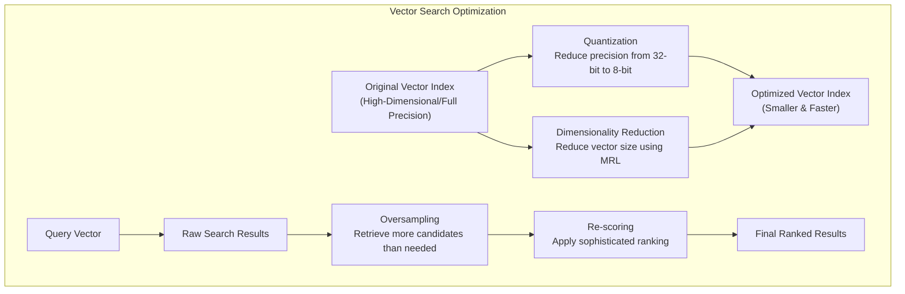

<!-- source: DeepWiki mcp.deepwiki.com · repo microsoft/rag-time · page 8.1 Azure AI Search Configuration · fetched 2026-10-26 -->

# Azure AI Search Configuration

<details>
<summary>Relevant source files</summary>

The following files were used as context for generating this wiki page:

- [Journey 2 - Build the Ultimate Retrieval System for RAG/README.md](Journey 2 - Build the Ultimate Retrieval System for RAG/README.md)
- [Journey 3 - Optimize your Vector Index for Scale/README.md](Journey 3 - Optimize your Vector Index for Scale/README.md)
- [Journey Bonus - Agentic RAG/sample/ingest.py](Journey Bonus - Agentic RAG/sample/ingest.py)

</details>


This page details the configuration and usage of Azure AI Search for vector and semantic search within the RAG-Time project. It covers index setup, vectorization configuration, search capabilities, and optimization techniques. For information about Azure OpenAI integration in the RAG workflow, see [Azure OpenAI Integration](#8.2).

## Overview of Azure AI Search in RAG Systems

Azure AI Search serves as the retrieval foundation in RAG systems, enabling sophisticated document discovery through multiple search paradigms. In the RAG-Time architecture, it functions as the primary knowledge retrieval mechanism, bridging user queries to relevant context documents that inform the large language model's responses.



Sources: [Journey 2 - Build the Ultimate Retrieval System for RAG/README.md:17-23]()

## Core Configuration Components

Setting up Azure AI Search for RAG applications involves configuring several interdependent components:



Sources: [Journey Bonus - Agentic RAG/sample/ingest.py:15-39]()

### Index Schema Configuration

The search index schema defines the structure of documents, including fields, data types, and searchable properties. In RAG-Time, the schema is typically defined in a JSON file and loaded into a `SearchIndex` object.

Key index configuration elements include:

- **Field definitions**: Document structure, types, and search properties
- **Analyzers**: Text processing rules for language-specific handling
- **Scoring profiles**: Rules for relevance scoring
- **Vector search configuration**: Settings for vector search capabilities

Sources: [Journey Bonus - Agentic RAG/sample/ingest.py:16-19]()

### Vectorizer Configuration

The vectorizer is responsible for converting text to vector embeddings. RAG-Time uses Azure OpenAI embeddings for vectorization:

```python
# Vectorizer configuration
search_index.vector_search.vectorizers.append(
    AzureOpenAIVectorizer(
        vectorizer_name="vectorizer",
        parameters=AzureOpenAIVectorizerParameters(
            resource_url=os.environ["AZURE_OPENAI_ENDPOINT"],
            deployment_name=os.environ["AZURE_OPENAI_EMBEDDING_DEPLOYMENT"],
            model_name="text-embedding-3-large",
            api_key=os.environ["AZURE_OPENAI_API_KEY"]
        )
    )
)
```

Key vectorizer configuration parameters:
- **vectorizer_name**: Identifier for the vectorizer
- **resource_url**: Azure OpenAI endpoint
- **deployment_name**: Name of the embedding model deployment
- **model_name**: Embedding model name (e.g., "text-embedding-3-large")
- **api_key**: Authentication key for Azure OpenAI

Sources: [Journey Bonus - Agentic RAG/sample/ingest.py:20-31]()

### Search Profiles

Search profiles define how vector search is executed, including:

- **Algorithm**: The search algorithm (e.g., "hnsw" for Hierarchical Navigable Small World)
- **Metric type**: Distance measurement (e.g., "cosine", "euclidean", "dot")
- **Vectorizer name**: Reference to the vectorizer to use

In RAG-Time, the search profile is linked to the vectorizer:

```python
search_index.vector_search.profiles[0].vectorizer_name = "vectorizer"
```

Sources: [Journey Bonus - Agentic RAG/sample/ingest.py:31-32]()

## Document Ingestion Process

The document ingestion process in RAG-Time involves:

1. Creating or updating the search index with proper schema
2. Preparing documents with appropriate structure
3. Uploading documents to the index



Sources: [Journey Bonus - Agentic RAG/sample/ingest.py:11-39]()

## Search Capabilities

Azure AI Search in RAG-Time offers several search paradigms that can be used individually or in combination:

### Keyword Search

Traditional text-based search using inverted indexes. This approach:
- Matches specific words or phrases in documents
- Supports operators like AND, OR, NOT
- Can use analyzers for language-specific processing
- Works well for explicit information retrieval

Sources: [Journey 2 - Build the Ultimate Retrieval System for RAG/README.md:22-23]()

### Vector Search

Semantic search using vector embeddings to find similar content:
- Converts queries and documents to vector embeddings
- Finds documents with embeddings close to query embedding
- Excels at understanding intent and conceptual similarity
- Works well for implicit or related information

Sources: [Journey 2 - Build the Ultimate Retrieval System for RAG/README.md:22-23]()

### Hybrid Search

Combines keyword and vector search for comprehensive results:
- Leverages strengths of both approaches
- Weighted combination of traditional and vector similarity
- Can be configured to prioritize either approach
- Provides better coverage across search scenarios

Sources: [Journey 2 - Build the Ultimate Retrieval System for RAG/README.md:22-23]()

### Semantic Ranking

Reorders search results based on semantic understanding:
- Applies deep learning models to rerank initial results
- Improves relevance by understanding query intent
- Can be applied to keyword, vector, or hybrid results
- Helps surface truly relevant content at the top

Sources: [Journey 2 - Build the Ultimate Retrieval System for RAG/README.md:22-23]()

## Vector Search Optimization Techniques

For scaling vector search efficiently, RAG-Time implements several optimization techniques:



Sources: [Journey 3 - Optimize your Vector Index for Scale/README.md:17-23]()

### Quantization

Reduces storage requirements by compressing vectors:
- Converts 32-bit floating point to lower precision (e.g., 8-bit)
- Can reduce storage by up to 96% (from 32-bit to 1-bit)
- Trade-off between precision and efficiency
- Minimal impact on search quality with proper implementation

Sources: [Journey 3 - Optimize your Vector Index for Scale/README.md:21-23]()

### Dimensionality Reduction

Decreases vector size while preserving semantic information:
- Matryoshka Representation Learning (MRL) creates nested embeddings
- Smaller vectors require less storage and processing
- Faster distance calculations during search
- Can be combined with quantization for compounded benefits

Sources: [Journey 3 - Optimize your Vector Index for Scale/README.md:21-23]()

### Oversampling and Re-scoring

Improves result quality when using optimized indexes:
- **Oversampling**: Retrieve more candidates than needed initially
- **Re-scoring**: Apply more sophisticated ranking to the candidate set
- Compensates for precision loss from optimization techniques
- Balances efficiency with result quality

Sources: [Journey 3 - Optimize your Vector Index for Scale/README.md:21-23]()

## Implementation Example

The following table illustrates the key components and environment variables required for Azure AI Search configuration in RAG-Time:

| Component | Environment Variable | Description |
|-----------|---------------------|-------------|
| Search Endpoint | `AZURE_SEARCH_ENDPOINT` | The URL of your Azure AI Search service |
| Authentication | `AZURE_SEARCH_KEY` | API key for Azure AI Search (or use DefaultAzureCredential) |
| Index Name | `AZURE_SEARCH_INDEX` | Name of the search index |
| OpenAI Endpoint | `AZURE_OPENAI_ENDPOINT` | Endpoint for Azure OpenAI service |
| Embedding Model | `AZURE_OPENAI_EMBEDDING_DEPLOYMENT` | Name of the embedding model deployment |
| OpenAI Authentication | `AZURE_OPENAI_API_KEY` | API key for Azure OpenAI |

Sources: [Journey Bonus - Agentic RAG/sample/ingest.py:11-15]()

## Best Practices

When configuring Azure AI Search for RAG applications:

1. **Index Design**:
   - Choose appropriate field types and analyzers
   - Mark only necessary fields as searchable to reduce index size
   - Consider field-specific boost values for relevance

2. **Vector Search**:
   - Select embedding dimension based on model and performance needs
   - Configure appropriate similarity metrics (cosine, dot product)
   - Use exhaustive search for small indexes, HNSW for larger ones

3. **Optimization**:
   - Apply quantization for large indexes to reduce storage costs
   - Consider dimensionality reduction for performance-critical applications
   - Test different optimization levels to find the right quality/performance balance

4. **Query Handling**:
   - Implement hybrid search with appropriate weights
   - Use semantic ranking for high-value queries
   - Consider query rewriting for better vector search results

Sources: [Journey 2 - Build the Ultimate Retrieval System for RAG/README.md:22-23](), [Journey 3 - Optimize your Vector Index for Scale/README.md:19-23]()

---

