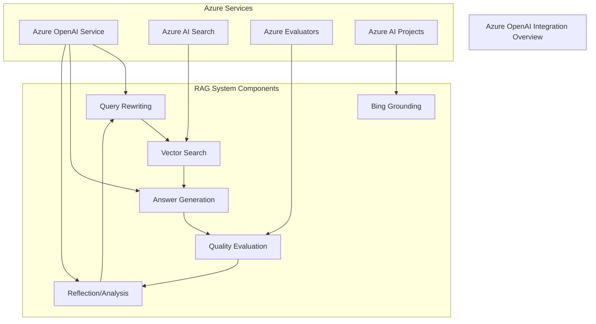
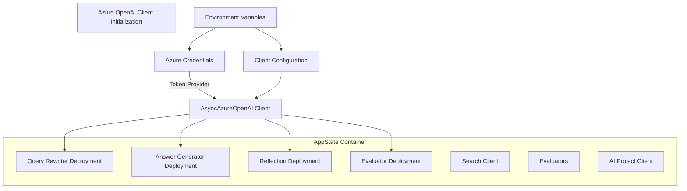
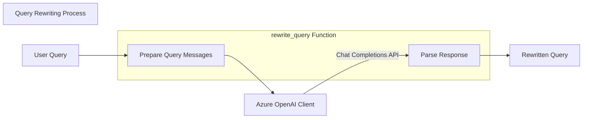
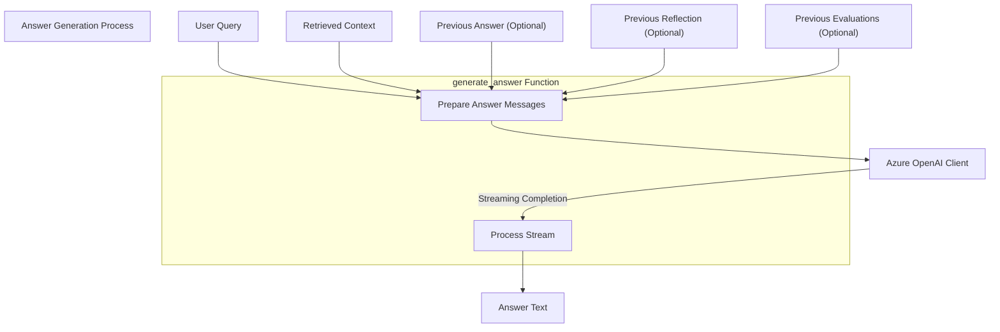
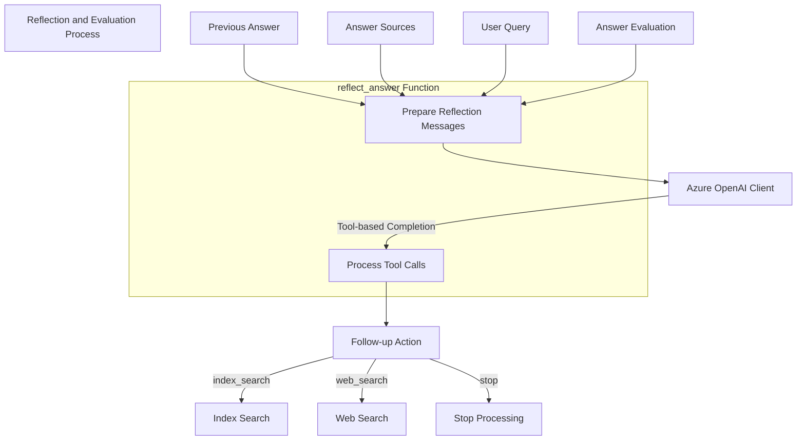
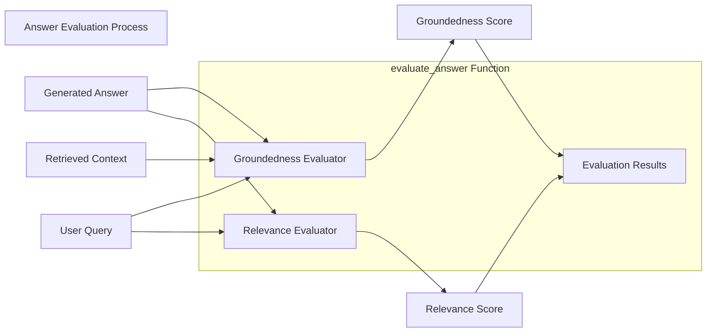
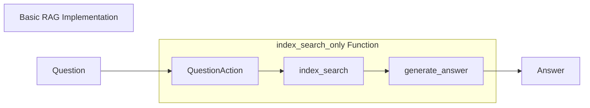
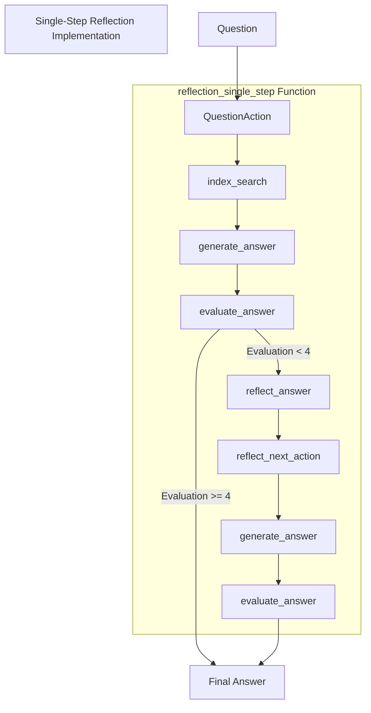
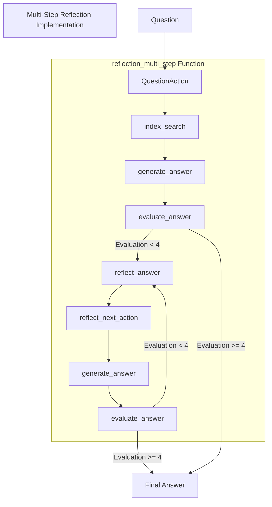
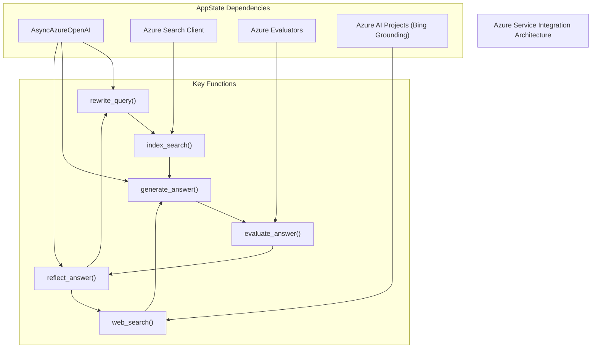

<!-- source: DeepWiki mcp.deepwiki.com · repo microsoft/rag-time · page 8.2 Azure OpenAI Integration · fetched 2026-10-26 -->

# Azure OpenAI Integration

<details>
<summary>Relevant source files</summary>

The following files were used as context for generating this wiki page:

- [Journey 2 - Build the Ultimate Retrieval System for RAG/sample/.env.sample](Journey 2 - Build the Ultimate Retrieval System for RAG/sample/.env.sample)
- [Journey 2 - Build the Ultimate Retrieval System for RAG/sample/2-Build-The-Ultimate-Retrieval-System-For-RAG.ipynb](Journey 2 - Build the Ultimate Retrieval System for RAG/sample/2-Build-The-Ultimate-Retrieval-System-For-RAG.ipynb)
- [Journey 3 - Optimize your Vector Index for Scale/sample/3-Vector-Compression.ipynb](Journey 3 - Optimize your Vector Index for Scale/sample/3-Vector-Compression.ipynb)
- [Journey Bonus - Agentic RAG/.gitignore](Journey Bonus - Agentic RAG/.gitignore)
- [Journey Bonus - Agentic RAG/sample/agents.py](Journey Bonus - Agentic RAG/sample/agents.py)
- [Journey Bonus - Agentic RAG/sample/app.py](Journey Bonus - Agentic RAG/sample/app.py)
- [Journey Bonus - Agentic RAG/sample/requirements.txt](Journey Bonus - Agentic RAG/sample/requirements.txt)

</details>


This document provides technical details about the Azure OpenAI service integration within the RAG-time framework. It focuses on how Azure OpenAI is configured, initialized, and utilized for embeddings generation, query rewriting, answer generation, and reflection processes in Retrieval Augmented Generation (RAG) systems. For information about Azure AI Search configuration, see [Azure AI Search Configuration](#8.1).

## Overview of Azure OpenAI in RAG-time

Azure OpenAI provides the foundation for several critical components of the RAG system:

1. **Embeddings generation** - Creating vector representations of text for semantic search
2. **Query rewriting** - Reformulating user queries for better retrieval results
3. **Answer generation** - Creating human-readable responses from retrieved content
4. **Reflection and evaluation** - Analyzing and improving generated responses



Sources: [Journey Bonus - Agentic RAG/sample/agents.py:1-362](), [Journey Bonus - Agentic RAG/sample/app.py:1-145]()

## Client Setup and Configuration

The Azure OpenAI client is configured in the system through the `AppState` class, which serves as a container for all necessary Azure service clients.

### Environment Variables

The following environment variables are required for Azure OpenAI configuration:

| Environment Variable | Description |
|----------------------|-------------|
| AZURE_OPENAI_API_VERSION | API version for Azure OpenAI service |
| AZURE_OPENAI_ENDPOINT | Endpoint URL for Azure OpenAI service |
| AZURE_OPENAI_GENERATOR_DEPLOYMENT | Model deployment name for answer generation |
| AZURE_OPENAI_REWRITER_DEPLOYMENT | Model deployment name for query rewriting |
| AZURE_OPENAI_REFLECTION_DEPLOYMENT | Model deployment name for reflection tasks |
| AZURE_OPENAI_EVALUATOR_DEPLOYMENT | Model deployment for evaluation tasks |
| AZURE_OPENAI_API_KEY | API key for authentication (when not using Azure AD) |

### Client Initialization



Sources: [Journey Bonus - Agentic RAG/sample/app.py:16-42]()

The client initialization code creates an `AsyncAzureOpenAI` client instance using Azure AD token authentication:

```python
openai_client = AsyncAzureOpenAI(
    api_version=os.environ["AZURE_OPENAI_API_VERSION"],
    azure_endpoint=os.environ["AZURE_OPENAI_ENDPOINT"],
    azure_ad_token_provider=token_provider
)
```

For evaluator models, a separate configuration is used with API key authentication:

```python
evaluator_model_config = {
    "azure_endpoint": os.environ["AZURE_OPENAI_ENDPOINT"],
    "azure_deployment": os.environ["AZURE_OPENAI_EVALUATOR_DEPLOYMENT"],
    "api_version": os.environ["AZURE_OPENAI_API_VERSION"],
    "api_key": os.environ["AZURE_OPENAI_API_KEY"],
}
```

Sources: [Journey Bonus - Agentic RAG/sample/app.py:16-42]()

## Core Functionalities

### Query Rewriting

Query rewriting improves retrieval performance by reformulating user queries into more effective search queries. The `rewrite_query` function uses the Azure OpenAI service to transform the user's original question into a search-optimized query:



Sources: [Journey Bonus - Agentic RAG/sample/agents.py:70-88]()

The query rewriting implementation uses a custom prompt template loaded from `prompts/chat_query_rewrite.prompty` and the OpenAI completion parsing functionality:

```python
result = await app_state.openai_client.beta.chat.completions.parse(
    messages=query_messages,
    response_format=SearchSources,
    model=app_state.query_rewriter_deployment,
    temperature=0
)
```

Sources: [Journey Bonus - Agentic RAG/sample/agents.py:70-88]()

### Answer Generation

Answer generation creates human-readable responses based on retrieved content. The `generate_answer` function combines the user's query with context from retrieved documents to produce a coherent answer:



Sources: [Journey Bonus - Agentic RAG/sample/agents.py:164-203]()

The answer generation implementation uses streaming to provide real-time responses:

```python
stream: AsyncStream[ChatCompletionChunk] = await app_state.openai_client.chat.completions.create(
    messages=messages,
    stream=True,
    model=app_state.answer_generator_deployment,
    temperature=0.3
)
```

Sources: [Journey Bonus - Agentic RAG/sample/agents.py:164-203]()

### Reflection and Evaluation

Reflection allows the system to critique its own answers and decide on follow-up actions. The `reflect_answer` function analyzes previously generated answers and evaluation results to determine next steps:



Sources: [Journey Bonus - Agentic RAG/sample/agents.py:253-302]()

The reflection implementation uses tool-calling functionality in the Azure OpenAI service:

```python
result: ChatCompletion = await app_state.openai_client.chat.completions.create(
    messages=reflect_messages,
    tools=[pydantic_function_tool(ToolChoiceReflection)],
    model=app_state.reflection_deployment
)
```

Sources: [Journey Bonus - Agentic RAG/sample/agents.py:253-302]()

### Evaluation

Evaluation assesses the quality of generated answers using specialized Azure OpenAI models. The system uses two evaluators:

1. **GroundednessEvaluator** - Checks if the answer is grounded in the provided context
2. **RelevanceEvaluator** - Determines if the answer is relevant to the user's query



Sources: [Journey Bonus - Agentic RAG/sample/agents.py:205-250]()

The evaluation implementation uses Azure AI evaluation tools:

```python
groundedness_result = app_state.groundedness_evaluator(
    **{
        "query": answer.question_text,
        "context": evaluator_context,
        "response": answer.answer_text
    }
)

relevance_result = app_state.relevance_evaluator(
    **{
        "query": answer.question_text,
        "response": answer.answer_text
    }
)
```

Sources: [Journey Bonus - Agentic RAG/sample/agents.py:205-250]()

## RAG Strategy Implementation

The Azure OpenAI integration powers three different RAG strategies implemented in the system:

### 1. Basic RAG Strategy



Sources: [Journey Bonus - Agentic RAG/sample/agents.py:305-310]()

### 2. Single-Step Reflection Strategy



Sources: [Journey Bonus - Agentic RAG/sample/agents.py:324-338]()

### 3. Multi-Step Reflection Strategy



Sources: [Journey Bonus - Agentic RAG/sample/agents.py:340-361]()

## Integration with Other Azure Services

Azure OpenAI is integrated with several other Azure services to form a complete RAG system:



Sources: [Journey Bonus - Agentic RAG/sample/app.py:28-42](), [Journey Bonus - Agentic RAG/sample/agents.py:1-362]()

## Configuration Best Practices

For optimal performance when using Azure OpenAI in RAG systems, consider the following configurations:

| Component | Recommended Model | Temperature | Use Case |
|-----------|------------------|-------------|----------|
| Query Rewriting | GPT-4 (smaller context) | 0.0 | Precise query reformulation |
| Answer Generation | GPT-4 or GPT-3.5 | 0.3-0.5 | Balanced creativity and accuracy |
| Reflection | GPT-4 | 0.0 | Precise analysis and decision-making |
| Evaluation | GPT-4 | 0.0 | Consistent and accurate evaluation |

### Required Dependencies

The following dependencies are necessary to implement Azure OpenAI integration:

```
azure-search-documents
azure-ai-evaluation
azure-ai-projects
azure-identity
openai
python-dotenv
```

Sources: [Journey Bonus - Agentic RAG/sample/requirements.txt:1-9]()

## Error Handling and Retries

The implementation includes retry logic for API calls to handle rate limits and transient errors:

```python
async for run_attempt in AsyncRetrying(
    retry=retry_if_exception_type(ValueError), 
    wait=wait_exponential(min=4, max=60), 
    stop=stop_after_attempt(10)
):
    # API call implementation
```

Sources: [Journey Bonus - Agentic RAG/sample/agents.py:137-162]()

This approach allows the system to handle Azure OpenAI service throttling gracefully during high-load scenarios.