# Page: Overview

# Overview

<details>
<summary>Relevant source files</summary>

The following files were used as context for generating this wiki page:

- [README.md](README.md)

</details>


## Purpose and Scope

RAG-Time is a comprehensive learning repository focused on Retrieval Augmented Generation (RAG) systems. This repository serves as an educational resource to help developers, data scientists, and AI practitioners master RAG techniques through structured learning journeys. From fundamental concepts to advanced implementations, RAG-Time provides step-by-step guidance with expert insights, code samples, and practical demonstrations.

The material in this overview covers the repository's purpose, structure, and learning path organization. For detailed information about the learning journey structure, see [Learning Journey Structure](#1.1), and for getting started with the repository, see [Getting Started](#1.2).

Sources: [README.md:15-26]()

## Repository Organization

RAG-Time is organized into six distinct learning journeys, each building upon the knowledge from previous sections. The repository provides a structured path for mastering RAG systems, from basic concepts to advanced implementation techniques.

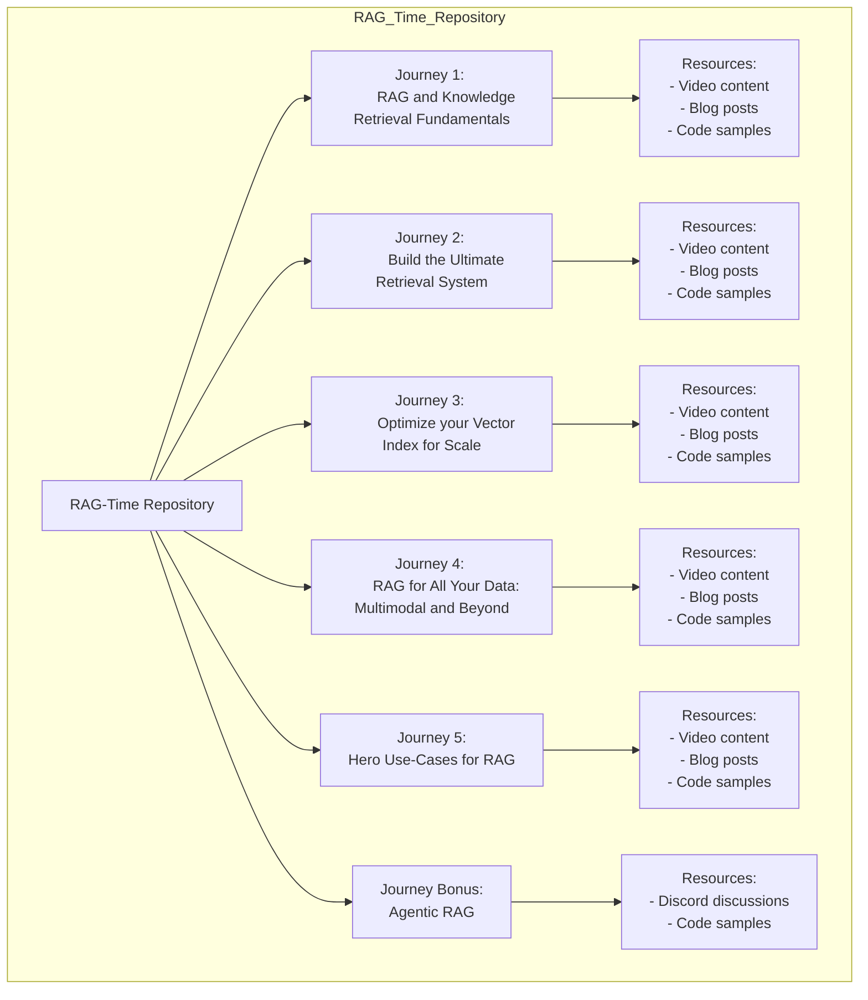

Each journey includes dedicated resources such as:
- Expert-led video content
- Technical blog posts
- Practical code samples
- Visual explanations

Sources: [README.md:37-46]()

## Learning Path Progression

The learning journeys in RAG-Time are designed to build upon each other, creating a logical progression from basic to advanced concepts. This structure ensures that learners develop a solid foundation before moving to more complex topics.

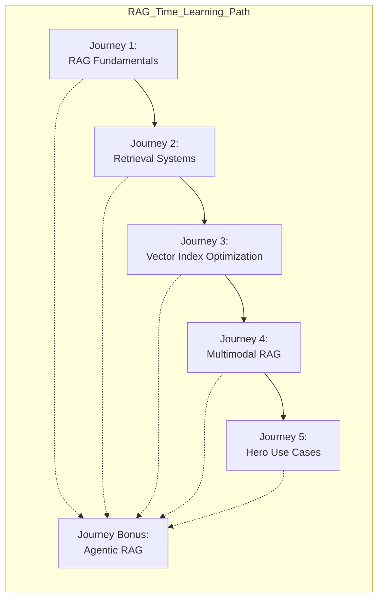

The progression follows this logical sequence:
1. Understanding core RAG concepts and knowledge retrieval fundamentals
2. Building effective retrieval systems using Azure AI Search
3. Optimizing vector indexes for scale with techniques like quantization
4. Extending RAG to handle multimodal data (images, audio, video)
5. Exploring real-world use cases across industries
6. Advanced concepts in Agentic RAG (bonus journey)

Sources: [README.md:37-46]()

## Core RAG System Architecture

RAG-Time explores the fundamental architecture of Retrieval Augmented Generation systems and their practical implementation. The following diagram illustrates the core components of a RAG system:

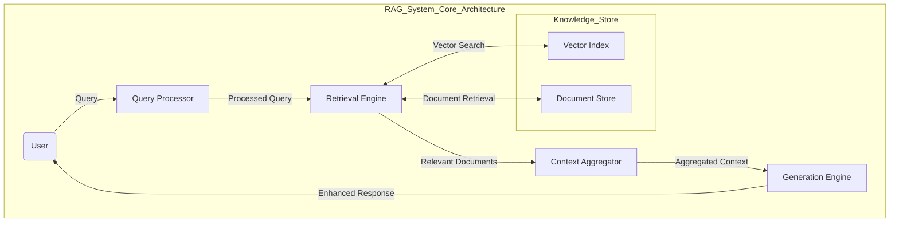

The key components include:
- **Query Processor**: Transforms user queries for optimal retrieval
- **Retrieval Engine**: Searches knowledge stores for relevant information
- **Context Aggregator**: Combines and formats retrieved information
- **Generation Engine**: Produces responses using retrieved context
- **Knowledge Store**: Contains vector indexes and document storage

Throughout the learning journeys, these components are explored in increasing depth and complexity.

Sources: [README.md:38-45]()

## Learning Journey Contents

Each journey in RAG-Time focuses on specific aspects of RAG systems with dedicated learning resources:

| Journey | Focus Area | Key Topics | Resources |
|---------|------------|------------|-----------|
| 1: RAG Fundamentals | Core concepts | Strategic importance, knowledge retrieval basics | Video, code sample, blog post |
| 2: Retrieval Systems | Building retrieval | Azure AI Search integration, vector search | Video, code sample, blog post |
| 3: Vector Optimization | Scaling techniques | Quantization, dimensionality reduction | Video, code sample, blog post |
| 4: Multimodal RAG | Diverse data types | Image, audio, video processing | Video, code sample, blog post |
| 5: Hero Use Cases | Industry applications | Real-world implementations | Video, code sample, blog post |
| Bonus: Agentic RAG | Advanced RAG | Multi-step reflection, iterative processing | Code sample, Discord discussions |

Each journey builds upon previous knowledge while introducing new concepts and practical implementations.

Sources: [README.md:38-46]()

## Advanced RAG Concepts: Agentic RAG

The bonus journey explores Agentic RAG, an advanced approach that enhances traditional RAG systems with reflective capabilities, automated reasoning, and improved decision-making.

```mermaid
flowchart LR
    subgraph "Agentic_RAG_Strategies"
        subgraph "Basic_RAG"
            BR_Q["Query"] --> BR_S["Search"]
            BR_S --> BR_G["Generate"]
            BR_G --> BR_A["Answer"]
        end
        
        subgraph "Single_Step_Reflection_RAG"
            SR_Q["Query"] --> SR_S["Search"]
            SR_S --> SR_G["Generate"]
            SR_G --> SR_E["Evaluate"]
            SR_E --> SR_D{"Decision"}
            SR_D -->|"Satisfactory"| SR_A["Answer"]
            SR_D -->|"Improve"| SR_R["Reflect"]
            SR_R --> SR_NS["New Search"]
            SR_NS --> SR_NG["New Generate"]
            SR_NG --> SR_A
        end
        
        subgraph "Multi_Step_Reflection_RAG"
            MR_Q["Query"] --> MR_Loop["Multi-Step Loop"]
            
            MR_Loop --> MR_S["Search"]
            MR_S --> MR_G["Generate"]
            MR_G --> MR_E["Evaluate"]
            MR_E --> MR_D{"Decision"}
            MR_D -->|"Satisfactory"| MR_A["Answer"]
            MR_D -->|"Improve"| MR_R["Reflect"]
            MR_R --> MR_NS["New Search"]
            MR_NS --> MR_G
        end
    end
```

The Agentic RAG journey covers three main strategies:
- **Basic RAG**: Standard query-search-generate workflow
- **Single-Step Reflection**: Adds evaluation and improvement through one reflection cycle
- **Multi-Step Reflection**: Implements iterative improvement through multiple reflection cycles

Sources: [README.md:46]()

## Azure Services Integration

RAG-Time demonstrates practical implementations of RAG systems using various Azure services:

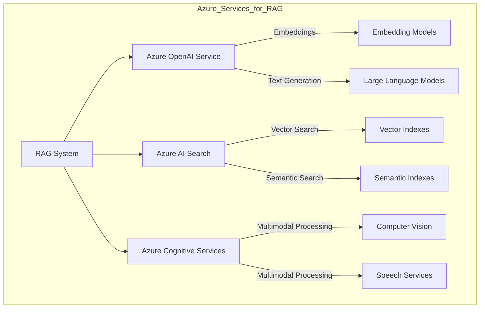

Key Azure services utilized include:
- **Azure OpenAI Service**: Powers embeddings generation and text generation
- **Azure AI Search**: Provides vector and semantic search capabilities
- **Azure Cognitive Services**: Enables multimodal data processing

The integration of these services is explored throughout the learning journeys, with specific configuration details covered in [Azure Services Integration](#8).

Sources: [README.md:41-45]()

## Getting Started

To begin learning with RAG-Time:

1. Fork the repository: [https://github.com/microsoft/rag-time](https://github.com/microsoft/rag-time)
2. Clone the repository to your local machine
3. Navigate to your chosen journey and follow the README instructions
4. Access associated resources (videos, blog posts, code samples)

For more detailed information on getting started, including environment setup and prerequisites, see [Getting Started](#1.2).

Sources: [README.md:27-35]()

## Community Engagement

RAG-Time encourages community participation through:
- Discord discussions in the Azure AI Community
- GitHub issues and pull requests for suggestions or error reporting
- Weekly live sessions during the initial release period

For more information on how to engage with the community, join the [Azure AI Community Discord](https://discord.gg/REmjGvvFpW) mentioned in the repository.

Sources: [README.md:52-57]()

---

# Page: Learning Journey Structure

# Learning Journey Structure

<details>
<summary>Relevant source files</summary>

The following files were used as context for generating this wiki page:

- [README.md](README.md)
- [images/visuals/J1-recap.png](images/visuals/J1-recap.png)
- [images/visuals/J2-recap.png](images/visuals/J2-recap.png)
- [images/visuals/J3-recap.png](images/visuals/J3-recap.png)
- [images/visuals/J4-recap.png](images/visuals/J4-recap.png)
- [images/visuals/J5-recap.png](images/visuals/J5-recap.png)

</details>


This document explains how the learning content in the RAG-Time repository is organized into progressive journeys, detailing how they build upon each other and the technical components covered in each journey.

For information on how to set up the repository and begin using the materials, see [Getting Started](#1.2).

## Journey Organization

RAG-Time organizes content into 5 main learning journeys plus a bonus journey, each focusing on specific technical aspects of Retrieval Augmented Generation systems:

```mermaid
graph TD
    A["RAG Time Learning Structure"] --> B["Journey 1: RAG and Knowledge Retrieval Fundamentals"]
    A --> C["Journey 2: Build the Ultimate Retrieval System"]
    A --> D["Journey 3: Optimize your Vector Index for Scale"]
    A --> E["Journey 4: RAG for All Your Data Multimodal and Beyond"]
    A --> F["Journey 5: Hero Use-Cases for RAG"]
    A --> G["Journey Bonus: Agentic RAG"]
    
    B --> B1["Technical Presentations"]
    B --> B2["Implementation Articles"]
    B --> B3["Executable Notebooks"]
    
    C --> C1["Technical Presentations"]
    C --> C2["Implementation Articles"]
    C --> C3["Executable Notebooks"]
    
    D --> D1["Technical Presentations"]
    D --> D2["Implementation Articles"]
    D --> D3["Executable Notebooks"]
    
    E --> E1["Technical Presentations"]
    E --> E2["Implementation Articles"]
    E --> E3["Executable Notebooks"]
    
    F --> F1["Technical Presentations"]
    F --> F2["Implementation Articles"]
    F --> F3["Executable Notebooks"]
    
    G --> G1["Technical Discussions"]
    G --> G2["Implementation Code"]
    
    classDef primary stroke:#333,stroke-width:2px
    classDef journey stroke:#333
    classDef resource stroke:#333
    
    class A primary
    class B,C,D,E,F,G journey
    class B1,B2,B3,C1,C2,C3,D1,D2,D3,E1,E2,E3,F1,F2,F3,G1,G2 resource
```

Sources: [README.md:37-46]()

## Technical Progression Path

The journeys form a progressive learning path, with each building upon knowledge and techniques from previous journeys:

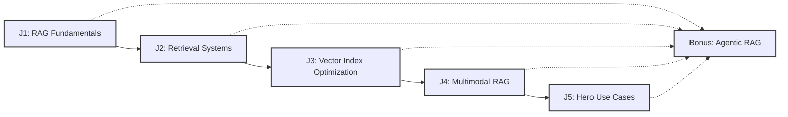

Sources: [README.md:37-46]()

## Technical Focus by Journey

Each journey addresses specific technical components and techniques within RAG systems:

| Journey | Technical Focus | Key Techniques |
|---------|-----------------|----------------|
| 1: RAG Fundamentals | Core RAG architecture, embedding models | Vector search, prompt engineering, knowledge retrieval |
| 2: Retrieval Systems | Azure AI Search integration, retrieval pipelines | Chunking strategies, hybrid search, query rewriting |
| 3: Vector Optimization | Scaling vector indexes | Quantization, dimensionality reduction, oversampling, re-scoring |
| 4: Multimodal RAG | Cross-modal content processing | Image, audio, video indexing and retrieval |
| 5: Use Cases | Industry-specific implementations | Legal, healthcare, finance, customer support |
| Bonus: Agentic RAG | Advanced RAG strategies | Basic RAG, Single-Step Reflection, Multi-Step Reflection |

Sources: [README.md:37-46]()

## Technical Components by Journey

This diagram illustrates the specific technical components focused on in each journey:

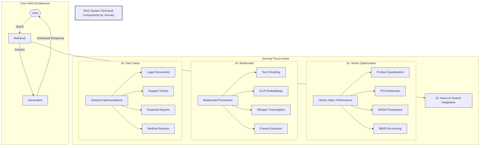

Sources: [README.md:37-46]()

## Repository Structure

The repository structure directly mirrors the journey organization:

```
RAG-Time/
├── Journey 1 - RAG and Knowledge Retrieval Fundamentals/
│   ├── README.md      # Journey overview and links
│   └── sample/
│       └── 1-RAG-Fundamentals.ipynb
├── Journey 2 - Build the Ultimate Retrieval System for RAG/
│   ├── README.md
│   └── sample/
│       └── 2-Build-The-Ultimate-Retrieval-System-For-RAG.ipynb
├── Journey 3 - Optimize your Vector Index for Scale/
│   ├── README.md
│   └── sample/
│       └── 3-Vector-Compression.ipynb
├── Journey 4 - RAG for All your Data Multimodal and Beyond/
│   ├── README.md
│   └── sample/
│       └── README.md  # Additional implementation details
├── Journey 5 - Hero use cases for RAG/
│   ├── README.md
│   └── sample/
│       └── README.md
└── Journey Bonus - Agentic RAG/
    ├── README.md
    └── sample/
        └── README.md
```

Sources: [README.md:27-36](), [README.md:37-46]()

## Content Types Within Journeys

Each journey contains a consistent set of technical content types:

| Content Type | Technical Format | Implementation Details |
|--------------|------------------|------------------------|
| Technical Presentations | Video lectures and demonstrations | Available on YouTube via journey-specific links |
| Implementation Articles | Technical blog posts | Accessible via journey README files |
| Executable Notebooks | Jupyter notebooks | Located in journey/sample/ directories |
| Technical Discussions | Discord community | For the Agentic RAG bonus journey |

Sources: [README.md:37-46]()

## Agentic RAG Strategies Comparison

The bonus journey specifically covers the progression of RAG strategies, from basic to more advanced approaches:

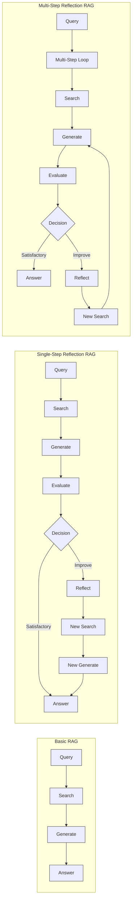

Sources: [README.md:46]()

## Content Release Schedule

The journeys were originally released on a weekly schedule, with each journey building upon the previous one:

| Week | Journey | Release Date |
|------|---------|--------------|
| Week 1 | RAG and Knowledge Retrieval Fundamentals | March 5, 2024 |
| Week 2 | Build the Ultimate Retrieval System | March 13, 2024 |
| Week 3 | Optimize your Vector Index for Scale | March 20, 2024 |
| Week 4 | RAG for All Your Data Multimodal and Beyond | March 27, 2024 |
| Week 5 | Hero Use-Cases for RAG | April 2, 2024 |
| Bonus | Agentic RAG | Post-series release |

Sources: [README.md:38-39](), [README.md:48-50]()

## Accessing Journey Content

Each journey's content can be accessed through multiple channels:

| Access Method | Description | URL Pattern |
|---------------|-------------|-------------|
| Video Presentations | Technical presentations and demonstrations | https://aka.ms/rag-time/journey[number] |
| Blog Posts | In-depth technical articles | https://aka.ms/rag-time/journey[number]-blog |
| Code Samples | Jupyter notebooks in repository | In journey/sample/ directories |
| Discord Discussions | Community engagement for Agentic RAG | https://aka.ms/rag-time/discord |

Sources: [README.md:13-17](), [README.md:37-46]()

---

# Page: Getting Started

# Getting Started

<details>
<summary>Relevant source files</summary>

The following files were used as context for generating this wiki page:

- [Journey 2 - Build the Ultimate Retrieval System for RAG/sample/.env.sample](Journey 2 - Build the Ultimate Retrieval System for RAG/sample/.env.sample)
- [Journey 2 - Build the Ultimate Retrieval System for RAG/sample/2-Build-The-Ultimate-Retrieval-System-For-RAG.ipynb](Journey 2 - Build the Ultimate Retrieval System for RAG/sample/2-Build-The-Ultimate-Retrieval-System-For-RAG.ipynb)
- [Journey 3 - Optimize your Vector Index for Scale/sample/3-Vector-Compression.ipynb](Journey 3 - Optimize your Vector Index for Scale/sample/3-Vector-Compression.ipynb)
- [README.md](README.md)

</details>


This document provides instructions on how to set up and begin using the RAG-Time repository. It covers the environment setup, accessing learning resources, and running code samples. For information about the overall structure of learning journeys, see [Learning Journey Structure](#1.1).

## Prerequisites

Before working with the RAG-Time repository, ensure you have the following:

- An **Azure account** with appropriate permissions to access these services:
  - **Azure AI Search** for vector search capabilities
  - **Azure OpenAI** for embeddings and completions
- **Python 3.8** or later installed on your machine
- Basic knowledge of Python programming and Jupyter notebooks

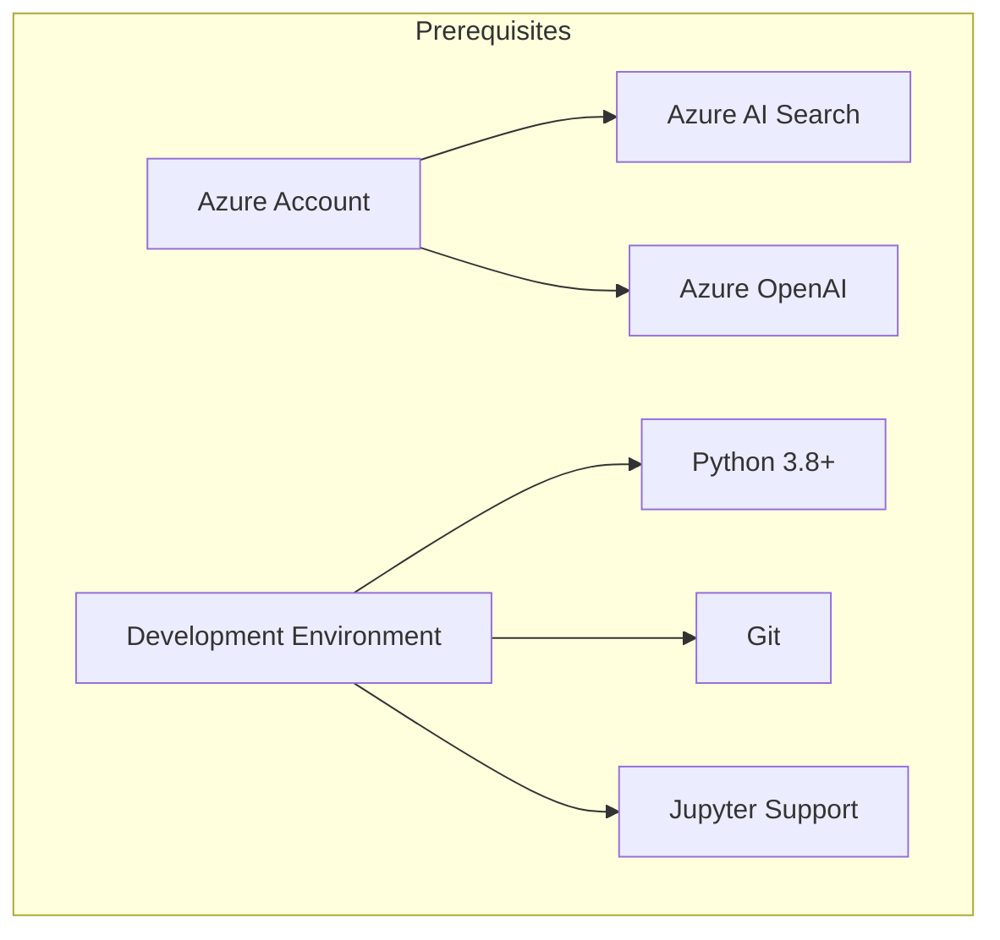

Sources: [README.md:19-26](), [Journey 2 - Build the Ultimate Retrieval System for RAG/sample/2-Build-The-Ultimate-Retrieval-System-For-RAG.ipynb:7-24](), [Journey 3 - Optimize your Vector Index for Scale/sample/3-Vector-Compression.ipynb:7-24]()

## Repository Setup

Follow these steps to set up the RAG-Time repository:

1. **Fork the repository**:
   Visit https://github.com/microsoft/rag-time and click the "Fork" button to create your own copy.

2. **Clone your forked repository**:
   ```bash
   git clone https://github.com/your-org/rag-time.git
   cd rag-time
   ```

3. **Navigate to a specific journey**:
   Explore the repository structure and choose a learning journey to start with.

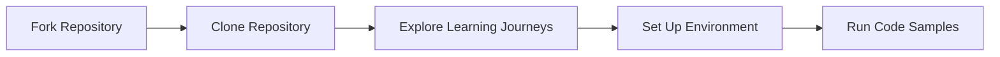

Sources: [README.md:27-36](), [Journey 2 - Build the Ultimate Retrieval System for RAG/sample/2-Build-The-Ultimate-Retrieval-System-For-RAG.ipynb:15-21]()

## Environment Setup

### Setting Up Python Environment

The code samples in RAG-Time require specific Python libraries. Each journey's sample code includes the necessary installation commands.

For example, in a Jupyter notebook, you can install required packages using:

```python
%pip install azure-search-documents azure-identity python-dotenv pandas openai
```

### Configuring Environment Variables

Code samples require access to Azure services, which need authentication credentials. Use environment variables to securely store these credentials:

1. Look for `.env.sample` files in the sample directories
2. Create a copy named `.env` in the same directory
3. Update with your own credentials

Example `.env` file for Azure AI Search:

```
AZURE_SEARCH_SERVICE_ENDPOINT="https://your-search-service.search.windows.net"
AZURE_SEARCH_INDEX="your-search-index-name"
AZURE_SEARCH_ADMIN_KEY="your-search-admin-key"
```

Your environment setup will vary depending on which learning journey you're working with.

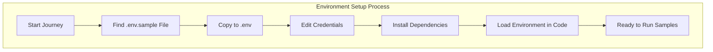

Sources: [Journey 2 - Build the Ultimate Retrieval System for RAG/sample/2-Build-The-Ultimate-Retrieval-System-For-RAG.ipynb:35-62](), [Journey 2 - Build the Ultimate Retrieval System for RAG/sample/.env.sample:1-3](), [Journey 3 - Optimize your Vector Index for Scale/sample/3-Vector-Compression.ipynb:31-43]()

## Learning Journey Structure

The RAG-Time repository is organized into progressive learning journeys, each focusing on different aspects of Retrieval Augmented Generation:

| Journey | Focus | Key Components |
|---------|-------|----------------|
| 1. RAG Fundamentals | Core RAG concepts | Knowledge retrieval basics, RAG architecture |
| 2. Build Retrieval System | Creating effective retrieval systems | Azure AI Search, vector search, hybrid search |
| 3. Vector Index Optimization | Scaling vector search | Quantization, dimensionality reduction, re-scoring |
| 4. Multimodal RAG | Beyond text data | Images, audio, video processing |
| 5. Hero Use Cases | Real-world applications | Industry-specific implementations |
| Bonus: Agentic RAG | Advanced RAG approaches | Reflection mechanisms, multi-step RAG |

Each journey includes:
- Video content
- Blog posts
- Code samples
- Documentation

It's recommended to follow the journeys in sequence, as they build upon each other.

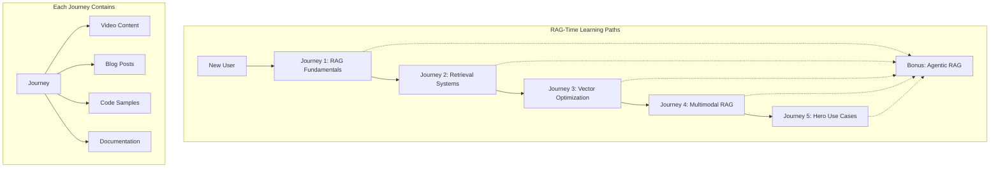

Sources: [README.md:37-46]()

## Running Code Samples

Each learning journey contains sample code that demonstrates the concepts covered:

1. Navigate to the journey directory (e.g., `Journey 2 - Build the Ultimate Retrieval System for RAG/sample/`)
2. Open the Jupyter notebook (`.ipynb` file)
3. Follow the setup instructions within the notebook
4. Run cells sequentially to understand the concepts

Most samples follow this general pattern:
- Install required libraries
- Load environment variables
- Set up clients for Azure services
- Execute demonstration code
- Explain results

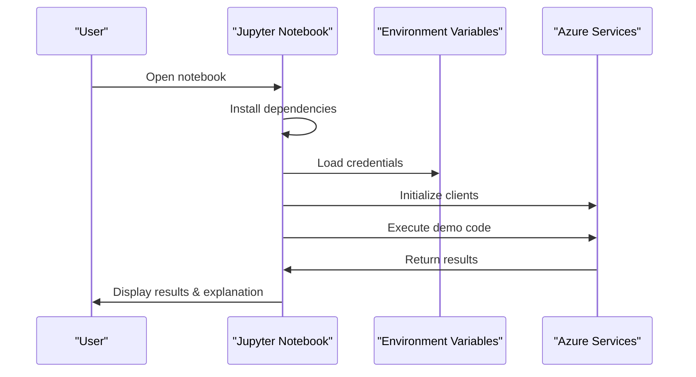

Sources: [Journey 2 - Build the Ultimate Retrieval System for RAG/sample/2-Build-The-Ultimate-Retrieval-System-For-RAG.ipynb:31-258](), [Journey 3 - Optimize your Vector Index for Scale/sample/3-Vector-Compression.ipynb:45-604]()

## Common Code Patterns

Throughout the journeys, you'll encounter several recurring code patterns:

### Setting up Azure AI Search

```python
from azure.core.credentials import AzureKeyCredential
from azure.search.documents import SearchClient

# Initialize the search client
endpoint = os.environ["AZURE_SEARCH_SERVICE_ENDPOINT"]
index_name = os.environ["AZURE_SEARCH_INDEX"]
credential = AzureKeyCredential(os.environ["AZURE_SEARCH_ADMIN_KEY"])
search_client = SearchClient(endpoint, index_name, credential)
```

### Vector Search Operations

```python
from azure.search.documents.models import VectorizedQuery

# Perform vector search
results = search_client.search(
    vector_queries=[VectorizedQuery(text="your query", fields="embedding_field")],
    select=["title", "content"]
)
```

### Environment Loading

```python
import os
from dotenv import load_dotenv

# Load environment variables from .env file
load_dotenv(override=True)

# Access environment variables
endpoint = os.environ["AZURE_SEARCH_SERVICE_ENDPOINT"]
```

Sources: [Journey 2 - Build the Ultimate Retrieval System for RAG/sample/2-Build-The-Ultimate-Retrieval-System-For-RAG.ipynb:78-116](), [Journey 3 - Optimize your Vector Index for Scale/sample/3-Vector-Compression.ipynb:189-216]()

## Azure Service Components

The following diagram shows the key Azure services used in RAG-Time code samples and how they interact:

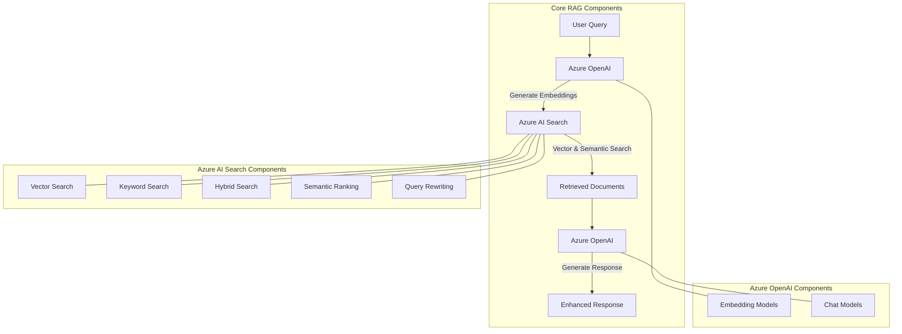

Sources: [Journey 2 - Build the Ultimate Retrieval System for RAG/sample/2-Build-The-Ultimate-Retrieval-System-For-RAG.ipynb:7-24](), [Journey 3 - Optimize your Vector Index for Scale/sample/3-Vector-Compression.ipynb:189-237]()

## Community and Support

The RAG-Time project provides several channels for learning, collaboration, and getting help:

- **Discord Community**: Join the [Azure AI Community Discord](https://discord.gg/REmjGvvFpW) for discussions about RAG
- **Issues and PRs**: Report issues or contribute improvements through [GitHub issues](https://github.com/microsoft/rag-time/issues) or [pull requests](https://github.com/microsoft/rag-time/pulls)
- **Video Content**: Watch the [full series on YouTube](https://aka.ms/rag-time/journeys)

## Troubleshooting

Common issues and their solutions:

| Issue | Solution |
|-------|----------|
| Missing environment variables | Ensure `.env` file is in the correct directory and properly formatted |
| Authentication errors | Verify Azure credentials are current and have necessary permissions |
| Module not found errors | Check if all required packages are installed with the correct versions |
| Azure AI Search errors | Confirm your search service has indexed vectorized data correctly |
| Rate limiting | If hitting API limits, implement retry logic or reduce request frequency |

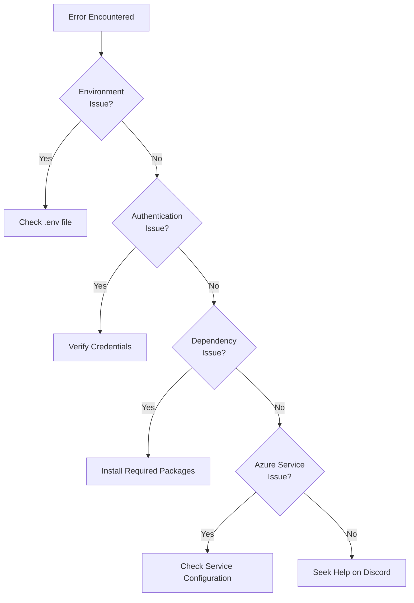

Sources: [Journey 2 - Build the Ultimate Retrieval System for RAG/sample/2-Build-The-Ultimate-Retrieval-System-For-RAG.ipynb:264-270](), [README.md:52-57]()

## Next Steps

After setting up your environment and familiarizing yourself with the repository structure:

1. Begin with [Journey 1: RAG and Knowledge Retrieval Fundamentals](#2) to understand core concepts
2. Progress through the journeys in sequence
3. Experiment with the code samples, modifying them to suit your specific needs
4. Engage with the community to share your learnings and get help when needed
5. Consider building your own RAG applications using the patterns demonstrated

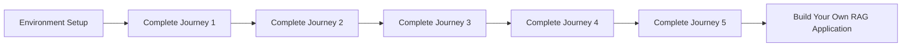

Sources: [README.md:37-46]()

---

# Page: RAG Fundamentals

# RAG Fundamentals

<details>
<summary>Relevant source files</summary>

The following files were used as context for generating this wiki page:

- [Journey 2 - Build the Ultimate Retrieval System for RAG/sample/.env.sample](Journey 2 - Build the Ultimate Retrieval System for RAG/sample/.env.sample)
- [Journey 2 - Build the Ultimate Retrieval System for RAG/sample/2-Build-The-Ultimate-Retrieval-System-For-RAG.ipynb](Journey 2 - Build the Ultimate Retrieval System for RAG/sample/2-Build-The-Ultimate-Retrieval-System-For-RAG.ipynb)
- [Journey 2 - Build the Ultimate Retrieval System for RAG/sample/MSFT_cloud_architecture_contoso.pdf](Journey 2 - Build the Ultimate Retrieval System for RAG/sample/MSFT_cloud_architecture_contoso.pdf)
- [Journey 3 - Optimize your Vector Index for Scale/sample/3-Vector-Compression.ipynb](Journey 3 - Optimize your Vector Index for Scale/sample/3-Vector-Compression.ipynb)
- [README.md](README.md)

</details>


## Purpose and Scope

This document explains the core concepts of Retrieval Augmented Generation (RAG) and knowledge retrieval systems. It covers the fundamental architecture, components, and workflows that form the foundation of effective RAG implementations. For information on building practical retrieval systems with Azure AI Search, see [Building Retrieval Systems](#3).

Sources: [README.md:15-15]()

## What is Retrieval Augmented Generation?

Retrieval Augmented Generation (RAG) is an architecture pattern that enhances Large Language Model (LLM) outputs by retrieving and incorporating relevant external knowledge into the generation process. Unlike standard LLM approaches that rely solely on knowledge encoded in model parameters, RAG systems dynamically access external data sources to retrieve contextual information that grounds the model's responses in factual, up-to-date information.

The RAG approach addresses several key limitations of standalone LLMs:

- Knowledge cutoff constraints
- Hallucinations when responding about topics outside training data
- Inability to cite sources or provide evidence
- Limited access to proprietary or organization-specific information

### Core RAG Architecture

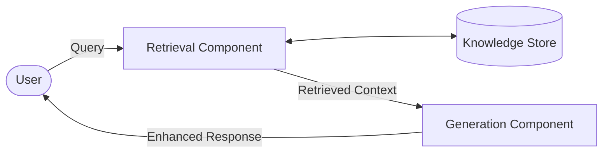

Sources: [README.md:15-15]()

## RAG System Components

A complete RAG system consists of several interconnected components that work together to retrieve relevant information and generate high-quality responses.

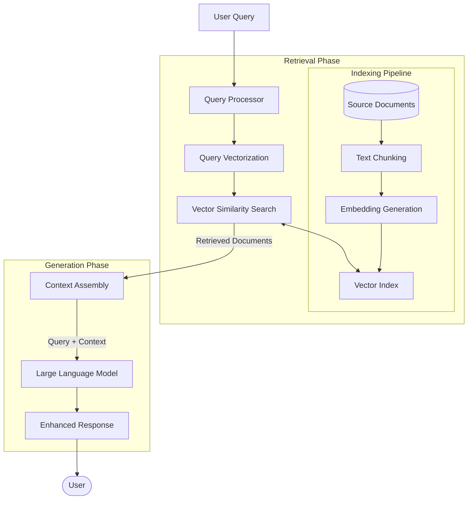

Sources: [README.md:15-15](), [Journey 2 - Build the Ultimate Retrieval System for RAG/sample/2-Build-The-Ultimate-Retrieval-System-For-RAG.ipynb:7-7]()

### Key Components

| Component | Function | Technical Implementation |
|-----------|----------|--------------------------|
| Query Processor | Analyzes and potentially reformulates user queries | Query rewriting, query expansion |
| Vectorization | Converts text to numerical vectors | Embedding models (text-embedding-3-large, etc.) |
| Vector Index | Stores and enables efficient searching of vectors | Vector databases with ANN algorithms |
| Text Chunking | Splits documents into manageable segments | Fixed-size, semantic, or overlapping chunking |
| Context Assembly | Combines retrieved information into LLM context | Prompt engineering and context formatting |
| LLM | Generates responses based on query and context | Azure OpenAI, OpenAI, or other LLM services |

Sources: [Journey 2 - Build the Ultimate Retrieval System for RAG/sample/2-Build-The-Ultimate-Retrieval-System-For-RAG.ipynb:7-30](), [Journey 3 - Optimize your Vector Index for Scale/sample/3-Vector-Compression.ipynb:7-22]()

## The RAG Process Flow

The RAG workflow is divided into two main phases: the indexing (offline) phase and the query (online) phase.

### Indexing Phase

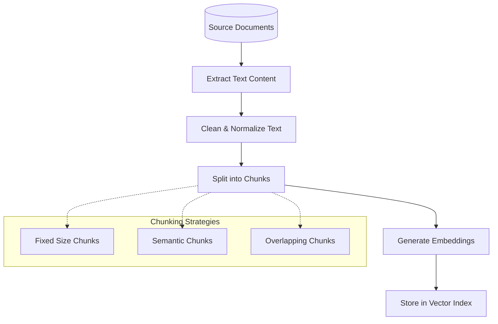

Sources: [Journey 3 - Optimize your Vector Index for Scale/sample/3-Vector-Compression.ipynb:7-24]()

### Query Phase

```mermaid
flowchart TD
    Query["User Query"] --> PreProcess["Preprocess Query"]
    PreProcess --> VectorizeQuery["Vectorize Query"]
    VectorizeQuery --> Retrieve["Retrieve Similar Documents"]
    Retrieve <--> VectorDB[("Vector Database")]
    Retrieve --> Rerank["Rerank Results"]
    Rerank --> Format["Format Context"]
    Format --> EnhancedPrompt["Create Enhanced Prompt"]
    EnhancedPrompt --> Generate["Generate Response with LLM"]
    Generate --> FinalResponse["Final Response to User"]
```

Sources: [Journey 2 - Build the Ultimate Retrieval System for RAG/sample/2-Build-The-Ultimate-Retrieval-System-For-RAG.ipynb:139-257]()

## Vector Embeddings and Dimensionality

A core concept in RAG systems is the transformation of text into vector embeddings - numerical representations that capture semantic meaning in a high-dimensional space.

```mermaid
flowchart LR
    Text["Text: 'What is RAG?'"] --> Tokenizer["Tokenizer"]
    Tokenizer --> Tokens["Tokens: [24871, 374, 10283, ...]"]
    Tokens --> EmbeddingModel["Embedding Model"]
    EmbeddingModel --> Vector["Vector: [0.012, -0.231, 0.45, ...]"]
```

### Common Embedding Models

| Model | Dimensions | Characteristics |
|-------|------------|-----------------|
| text-embedding-3-large | 3072 | High performance, larger dimension size |
| text-embedding-3-small | 1536 | Balance of performance and efficiency |
| text-embedding-ada-002 | 1536 | Previous generation model |

Sources: [Journey 3 - Optimize your Vector Index for Scale/sample/3-Vector-Compression.ipynb:578-584]()

## Retrieval Methods

RAG systems can use various retrieval methods, each with different strengths:

### Search Methods Comparison

| Method | Description | Use Cases | Implementation |
|--------|-------------|-----------|----------------|
| Keyword Search | Traditional term matching | Precise term matching requirements | `search_client.search(search_text="What is Contoso")` |
| Vector Search | Semantic similarity via embeddings | Conceptual or semantic queries | `search_client.search(vector_queries=[VectorizableTextQuery(...)])` |
| Hybrid Search | Combines keyword and vector approaches | Balancing precision and recall | Combined parameters for both keyword and vector |
| Semantic Ranker | Reranks results based on semantic relevance | Improving precision of top results | `query_type="semantic", semantic_configuration_name="..."` |

Sources: [Journey 2 - Build the Ultimate Retrieval System for RAG/sample/2-Build-The-Ultimate-Retrieval-System-For-RAG.ipynb:152-258]()

## Vector Index Optimization Techniques

For production RAG systems, optimizing vector indexes is essential for performance and cost-efficiency:

### Optimization Approaches

```mermaid
flowchart TD
    VectorOpt["Vector Optimization Techniques"]
    VectorOpt --> Quant["Quantization"]
    VectorOpt --> Dim["Dimensionality Reduction"]
    VectorOpt --> Over["Oversampling"]
    VectorOpt --> Resc["Re-scoring"]
    
    Quant --> BinaryQ["Binary Quantization"]
    Quant --> ScalarQ["Scalar Quantization"]
    
    BinaryQ --> BinConfig["compression_name: binary_compression"]
    ScalarQ --> ScalarConfig["compression_name: scalar_compression"]
    
    Dim --> Truncate["Truncation Dimension"]
```

Sources: [Journey 3 - Optimize your Vector Index for Scale/sample/3-Vector-Compression.ipynb:326-394]()

### Vector Compression Options

| Compression Type | Description | Storage Impact | Query Performance | Configuration |
|------------------|-------------|----------------|-------------------|---------------|
| No Compression | Full-precision vectors | Highest storage use | Best accuracy | None |
| Scalar Quantization | Lower precision (e.g., int8) | Medium storage | Good accuracy | `ScalarQuantizationCompression(parameters=ScalarQuantizationParameters(quantized_data_type="int8"))` |
| Binary Quantization | Binary representation | Lowest storage | Lower accuracy | `BinaryQuantizationCompression()` |

Sources: [Journey 3 - Optimize your Vector Index for Scale/sample/3-Vector-Compression.ipynb:326-394]()

## RAG Implementation Strategies

RAG systems can be implemented with varying levels of complexity:

```mermaid
flowchart TD
    subgraph "Basic RAG"
        BR_Q["Query"] --> BR_S["Search"]
        BR_S --> BR_G["Generate"]
        BR_G --> BR_A["Answer"]
    end
    
    subgraph "Single-Step Reflection RAG"
        SR_Q["Query"] --> SR_S["Search"]
        SR_S --> SR_G["Generate"]
        SR_G --> SR_E["Evaluate"]
        SR_E --> SR_D{"Decision"}
        SR_D -->|"Satisfactory"| SR_A["Answer"]
        SR_D -->|"Improve"| SR_R["Reflect"]
        SR_R --> SR_NS["New Search"]
        SR_NS --> SR_NG["New Generate"]
        SR_NG --> SR_A
    end
    
    subgraph "Multi-Step Reflection RAG"
        MR_Q["Query"] --> MR_Loop["Multi-Step Loop"]
        
        MR_Loop --> MR_S["Search"]
        MR_S --> MR_G["Generate"]
        MR_G --> MR_E["Evaluate"]
        MR_E --> MR_D{"Decision"}
        MR_D -->|"Satisfactory"| MR_A["Answer"]
        MR_D -->|"Improve"| MR_R["Reflect"]
        MR_R --> MR_NS["New Search"]
        MR_NS --> MR_G
    end
```

Sources: [README.md:15-15]()

### RAG vs. Fine-Tuning

| Aspect | RAG | Fine-Tuning |
|--------|-----|-------------|
| Implementation Complexity | Lower (no model training) | Higher (requires training infrastructure) |
| Data Updates | Immediate (update vector store) | Requires retraining |
| Customization Depth | Surface-level (via context) | Deep (modifies model weights) |
| Computational Cost | Runtime cost for retrieval | High upfront training cost |
| Explainability | High (can show retrieved sources) | Lower (knowledge in weights) |
| Best For | Factual Q&A, knowledge-heavy tasks | Style adaptation, specialized reasoning |

Sources: [README.md:15-21]()

## Evaluation Metrics for RAG Systems

Evaluating RAG systems requires assessing both retrieval and generation quality:

| Metric | Measures | Methodology |
|--------|----------|-------------|
| Retrieval Precision | Proportion of relevant documents in retrieved set | Relevant ∩ Retrieved / Retrieved |
| Retrieval Recall | Proportion of all relevant documents that were retrieved | Relevant ∩ Retrieved / Relevant |
| Answer Relevance | How well the answer addresses the query | Human evaluation or automated metrics |
| Factual Accuracy | Correctness of facts in the response | Human evaluation or fact-checking |
| Response Completeness | Whether all aspects of the query are addressed | Human evaluation or automated metrics |

Sources: [README.md:15-15]()

## Conclusion

Retrieval Augmented Generation represents a powerful approach for enhancing LLM capabilities by grounding responses in external knowledge. The core RAG architecture - combining retrieval and generation components - enables more accurate, factual, and up-to-date responses while providing greater transparency through source attribution.

As you progress through the RAG Time learning journeys, you'll build on these fundamentals to create increasingly sophisticated RAG systems with advanced retrieval capabilities, optimized vector indexes, multimodal support, and real-world applications.

For the next steps in your RAG learning journey, see [Building Retrieval Systems](#3) to learn how to implement effective retrieval systems using Azure AI Search.

Sources: [README.md:37-45]()

---

# Page: Building Retrieval Systems

# Building Retrieval Systems

<details>
<summary>Relevant source files</summary>

The following files were used as context for generating this wiki page:

- [Journey 2 - Build the Ultimate Retrieval System for RAG/README.md](Journey 2 - Build the Ultimate Retrieval System for RAG/README.md)
- [Journey 2 - Build the Ultimate Retrieval System for RAG/sample/.env.sample](Journey 2 - Build the Ultimate Retrieval System for RAG/sample/.env.sample)
- [Journey 2 - Build the Ultimate Retrieval System for RAG/sample/2-Build-The-Ultimate-Retrieval-System-For-RAG.ipynb](Journey 2 - Build the Ultimate Retrieval System for RAG/sample/2-Build-The-Ultimate-Retrieval-System-For-RAG.ipynb)
- [Journey 2 - Build the Ultimate Retrieval System for RAG/sample/MSFT_cloud_architecture_contoso.pdf](Journey 2 - Build the Ultimate Retrieval System for RAG/sample/MSFT_cloud_architecture_contoso.pdf)
- [Journey 3 - Optimize your Vector Index for Scale/sample/3-Vector-Compression.ipynb](Journey 3 - Optimize your Vector Index for Scale/sample/3-Vector-Compression.ipynb)

</details>


## Purpose and Scope

This document details how to build effective retrieval systems for Retrieval Augmented Generation (RAG) using Azure AI Search. It covers the key components of retrieval systems, including data ingestion, various search techniques (keyword, vector, hybrid, and semantic), and configuration patterns for optimal performance. For information about optimizing vector indexes for scale, see [Vector Index Optimization](#4).

Sources: [Journey 2 - Build the Ultimate Retrieval System for RAG/README.md:5-9]()

## Retrieval in RAG Architecture

Retrieval systems form the foundation of effective RAG applications. They are responsible for finding and ranking relevant information from a knowledge base to provide context for Large Language Models (LLMs). A well-designed retrieval system ensures that the LLM receives accurate and relevant information, significantly improving the quality of generated responses.

```mermaid
flowchart TD
    subgraph "RAG Architecture"
        User([User]) -->|"Query"| QP["Query Processing"]
        QP --> Retrieval["Retrieval System"]
        Retrieval -->|"Retrieved Context"| Generation["Generation (LLM)"]
        Generation -->|"Enhanced Response"| User
        
        subgraph "Knowledge Base"
            D1["Documents"]
            VectorIndex["Vector Index"]
            D1 --> VectorIndex
        end
        
        Retrieval <--> VectorIndex
    end
    
    subgraph "Focus of This Document"
        style Focus fill:#f9f9f9,stroke:#333
        
        Focus["Search Techniques"] --> KW["Keyword Search"]
        Focus --> VS["Vector Search"]
        Focus --> HS["Hybrid Search"]
        Focus --> SR["Semantic Ranking"]
        Focus --> QR["Query Rewriting"]
    end
```

Sources: [Journey 2 - Build the Ultimate Retrieval System for RAG/README.md:17-24]()

## Azure AI Search Components

The retrieval system implemented in this codebase is built on Azure AI Search, which provides the infrastructure for both traditional keyword searches and modern vector searches.

```mermaid
flowchart LR
    subgraph "Azure AI Search Implementation"
        SearchClient["SearchClient"]
        SearchIndex["SearchIndex"]
        
        subgraph "Search Methods"
            KS["Keyword Search"]
            VS["Vector Search"]
            HS["Hybrid Search"]
            SR["Semantic Ranking"]
            QR["Query Rewriting"]
        end
        
        subgraph "Index Components"
            Fields["Fields Definition"]
            VectorConfig["Vector Configuration"]
        end
        
        SearchClient --> SearchIndex
        SearchIndex --> Fields
        SearchIndex --> VectorConfig
        
        SearchClient -->|"Execute"| KS
        SearchClient -->|"Execute"| VS
        SearchClient -->|"Execute"| HS
        SearchClient -->|"Execute"| SR
        SearchClient -->|"Execute"| QR
    end
```

Sources: [Journey 2 - Build the Ultimate Retrieval System for RAG/sample/2-Build-The-Ultimate-Retrieval-System-For-RAG.ipynb:113-116](), [Journey 2 - Build the Ultimate Retrieval System for RAG/sample/2-Build-The-Ultimate-Retrieval-System-For-RAG.ipynb:152-154]()

## Setting Up the Retrieval System

### Prerequisites

To build a retrieval system with Azure AI Search, you need:

1. An Azure account with access to Azure AI Search
2. A search index containing vectorized text data
3. Python environment with the required libraries

### Environment Configuration

The retrieval system uses environment variables for configuration, which can be stored in a `.env` file:

```
AZURE_SEARCH_SERVICE_ENDPOINT="<your_search_service_endpoint>"
AZURE_SEARCH_INDEX="<your_search_index_name>"
AZURE_SEARCH_ADMIN_KEY="<your_search_admin_key>"
```

Sources: [Journey 2 - Build the Ultimate Retrieval System for RAG/sample/.env.sample:1-3]()

### Required Libraries

The system depends on several Python libraries:

```
azure-search-documents==11.6.0b9
azure-identity
python-dotenv
pandas
jinja2
```

Sources: [Journey 2 - Build the Ultimate Retrieval System for RAG/sample/2-Build-The-Ultimate-Retrieval-System-For-RAG.ipynb:39]()

### Client Setup

The `SearchClient` is initialized with the endpoint, index name, and credentials:

```python
from azure.search.documents import SearchClient
from azure.core.credentials import AzureKeyCredential
from azure.identity import DefaultAzureCredential

# Use API key if available, otherwise use Azure managed identity
credential = AzureKeyCredential(os.getenv("AZURE_SEARCH_ADMIN_KEY")) if os.getenv("AZURE_SEARCH_ADMIN_KEY") else DefaultAzureCredential()

# Initialize search client
search_client = SearchClient(endpoint, index_name, credential)
```

Sources: [Journey 2 - Build the Ultimate Retrieval System for RAG/sample/2-Build-The-Ultimate-Retrieval-System-For-RAG.ipynb:79-88](), [Journey 2 - Build the Ultimate Retrieval System for RAG/sample/2-Build-The-Ultimate-Retrieval-System-For-RAG.ipynb:113-116]()

## Search Techniques

The system implements five key search techniques:

| Technique | Description | Implementation |
|-----------|-------------|----------------|
| Keyword Search | Traditional text-based search using keywords | Uses `search_text` parameter |
| Vector Search | Similarity search using vector embeddings | Uses `vector_queries` with `VectorizableTextQuery` |
| Hybrid Search | Combines keyword and vector search for better results | Uses both `search_text` and `vector_queries` |
| Semantic Ranking | Enhances results using semantic understanding | Adds `query_type="semantic"` and `semantic_configuration_name` |
| Query Rewriting | Improves query through automatic rewriting | Adds `query_rewrites="generative"` |

Sources: [Journey 2 - Build the Ultimate Retrieval System for RAG/sample/2-Build-The-Ultimate-Retrieval-System-For-RAG.ipynb:146-258]()

### Keyword Search Implementation

The most basic search technique uses keyword matching:

```python
results = search_client.search(
    search_text="What is Contoso", 
    top=5, 
    select=["title", "chunk"]
)
```

This approach uses traditional text-based search algorithms to find matches based on specific words.

Sources: [Journey 2 - Build the Ultimate Retrieval System for RAG/sample/2-Build-The-Ultimate-Retrieval-System-For-RAG.ipynb:152-154]()

### Vector Search Implementation

Vector search uses embeddings for semantic similarity:

```python
from azure.search.documents.models import VectorizableTextQuery

results = search_client.search(
    vector_queries=[
        VectorizableTextQuery(
            text="What is Contoso", 
            k_nearest_neighbors=50, 
            fields="text_vector"
        )
    ], 
    top=5, 
    select=["title", "chunk"]
)
```

The system converts the query text into a vector embedding and finds documents with similar vector representations.

Sources: [Journey 2 - Build the Ultimate Retrieval System for RAG/sample/2-Build-The-Ultimate-Retrieval-System-For-RAG.ipynb:172-176]()

### Hybrid Search Implementation

Hybrid search combines the strengths of both keyword and vector search:

```python
results = search_client.search(
    search_text="What is Contoso",
    vector_queries=[
        VectorizableTextQuery(
            text="What is Contoso", 
            k_nearest_neighbors=50, 
            fields="text_vector"
        )
    ],
    top=5,
    select=["title", "chunk"]
)
```

This approach balances literal matching with semantic similarity for more comprehensive results.

Sources: [Journey 2 - Build the Ultimate Retrieval System for RAG/sample/2-Build-The-Ultimate-Retrieval-System-For-RAG.ipynb:194-201]()

### Semantic Ranking

Adding semantic ranking further improves the results by using a deep learning model to understand context and meaning:

```python
results = search_client.search(
    search_text="What is Contoso",
    vector_queries=[
        VectorizableTextQuery(
            text="What is Contoso", 
            k_nearest_neighbors=50, 
            fields="text_vector"
        )
    ],
    top=5,
    select=["title", "chunk"],
    query_type="semantic",
    semantic_configuration_name="ragtime2-semantic-configuration"
)
```

Sources: [Journey 2 - Build the Ultimate Retrieval System for RAG/sample/2-Build-The-Ultimate-Retrieval-System-For-RAG.ipynb:219-228]()

### Query Rewriting

Query rewriting uses generative AI to transform the original query for better matches:

```python
results = search_client.search(
    search_text="What is Contoso",
    vector_queries=[
        VectorizableTextQuery(
            text="What is Contoso", 
            k_nearest_neighbors=50, 
            fields="text_vector"
        )
    ],
    top=5,
    select=["title", "chunk"],
    query_type="semantic",
    semantic_configuration_name="ragtime2-semantic-configuration",
    query_rewrites="generative",
    query_language="en"
)
```

This technique automatically expands or rephrases queries to improve relevance.

Sources: [Journey 2 - Build the Ultimate Retrieval System for RAG/sample/2-Build-The-Ultimate-Retrieval-System-For-RAG.ipynb:246-257]()

## Search Techniques Comparison

The following diagram illustrates how these search techniques build upon each other:

```mermaid
flowchart TB
    subgraph "Search Techniques Evolution"
        KS["Keyword Search"] -->|"Add vectors"| VS["Vector Search"]
        VS -->|"Combine approaches"| HS["Hybrid Search"]
        HS -->|"Add semantic understanding"| SR["Semantic Ranking"]
        SR -->|"Add query enhancement"| QR["Query Rewriting"]
    end
    
    subgraph "Features Comparison"
        KS -.-> F1["Exact matching"]
        VS -.-> F2["Semantic similarity"]
        HS -.-> F3["Combined relevance"]
        SR -.-> F4["Contextual understanding"]
        QR -.-> F5["Query enhancement"]
    end
    
    subgraph "Implementation"
        KS -.-> I1["search_text parameter"]
        VS -.-> I2["vector_queries parameter"]
        HS -.-> I3["Both parameters"]
        SR -.-> I4["query_type='semantic'"]
        QR -.-> I5["query_rewrites='generative'"]
    end
```

Sources: [Journey 2 - Build the Ultimate Retrieval System for RAG/sample/2-Build-The-Ultimate-Retrieval-System-For-RAG.ipynb:146-258]()

## Search Client Implementation Details

The Azure Search client handles connections to the search service and executes search operations. Here's a detailed view of the client architecture:

```mermaid
classDiagram
    class SearchClient {
        +endpoint: String
        +index_name: String
        +credential: AzureKeyCredential
        +search(search_text, vector_queries, top, select, query_type, semantic_configuration_name, query_rewrites, query_language) Results
    }
    
    class VectorizableTextQuery {
        +text: String
        +k_nearest_neighbors: Integer
        +fields: String
    }
    
    class Results {
        +documents: List~Document~
        +@search.score: Float
    }
    
    SearchClient ..> VectorizableTextQuery : uses
    SearchClient --> Results : returns
```

Sources: [Journey 2 - Build the Ultimate Retrieval System for RAG/sample/2-Build-The-Ultimate-Retrieval-System-For-RAG.ipynb:113-116](), [Journey 2 - Build the Ultimate Retrieval System for RAG/sample/2-Build-The-Ultimate-Retrieval-System-For-RAG.ipynb:172-176]()

## Display Format for Search Results

The system formats search results for readability using pandas:

```python
def display_results(results):
    df = pd.json_normalize(list(results)).dropna(axis=1, how='all')
    df["chunk"] = df["chunk"].apply(lambda c: c[:300] + '...' if len(c) > 300 else c)
    first_cols = ['title', 'chunk', '@search.score']
    df = df[first_cols + [col for col in df.columns if col not in first_cols]]

    df = df.style.set_properties(**{
        'max-width': '500px',
        'text-align': 'left',
        'white-space': 'normal',
        'word-wrap': 'break-word'
    }).hide(axis="index")

    return df
```

This function formats search results as a DataFrame for better visualization.

Sources: [Journey 2 - Build the Ultimate Retrieval System for RAG/sample/2-Build-The-Ultimate-Retrieval-System-For-RAG.ipynb:118-133]()

## Best Practices

When building retrieval systems for RAG using Azure AI Search:

1. **Use secure credential management**:
   - Store credentials in environment variables
   - Use managed identities when possible instead of API keys

2. **Implement progressive search techniques**:
   - Start with simpler techniques and add complexity as needed
   - Combine approaches for better results

3. **Optimize performance**:
   - Limit returned fields with `select`
   - Set appropriate `top` values to control result count
   - Configure vector dimensions and index parameters carefully

4. **Handle error conditions**:
   - Implement proper error handling for authentication issues
   - Check for empty results and provide fallbacks

5. **Process results efficiently**:
   - Format results for readability
   - Extract only the needed information for the LLM

Sources: [Journey 2 - Build the Ultimate Retrieval System for RAG/sample/2-Build-The-Ultimate-Retrieval-System-For-RAG.ipynb:264-275]()

## Integration with RAG Pipeline

The retrieval system is a critical component in the RAG pipeline. It bridges the gap between raw data and the generation system:

```mermaid
flowchart LR
    subgraph "RAG Pipeline Integration"
        User(["User"]) -->|"Query"| QP["Query Processing"]
        QP --> RS["Retrieval System"]
        RS -->|"Retrieved Context"| G["Generation"]
        G -->|"Enhanced Response"| User
        
        subgraph "Retrieval System Components"
            direction TB
            KS["Keyword Search"]
            VS["Vector Search"]
            HS["Hybrid Search"]
            SR["Semantic Ranking"]
            QR["Query Rewriting"]
            
            KS & VS --> HS
            HS --> SR
            SR --> QR
        end
        
        RS --- Retrieval System Components
    end
```

Sources: [Journey 2 - Build the Ultimate Retrieval System for RAG/README.md:17-24]()

## Troubleshooting

Common issues when working with Azure AI Search retrieval systems:

| Issue | Possible Cause | Solution |
|-------|----------------|----------|
| Environment variables not loaded | Incorrectly set .env file | Ensure .env file is correctly configured or manually export variables |
| Authentication issues | Missing or invalid credentials | Verify API key or ensure managed identity has proper role assignments |
| Empty search results | Missing data or incorrect queries | Ensure your index contains vectorized data and verify query syntax |
| Query rewriting issues | Configuration problems | Verify your search service supports semantic configurations and generative query rewrites |

Sources: [Journey 2 - Build the Ultimate Retrieval System for RAG/sample/2-Build-The-Ultimate-Retrieval-System-For-RAG.ipynb:264-271]()

## Summary

Building effective retrieval systems for RAG using Azure AI Search involves selecting and combining appropriate search techniques (keyword, vector, hybrid, semantic ranking, and query rewriting) to ensure the most relevant context is provided to the LLM. Each technique offers different advantages, and they can be progressively combined to create increasingly sophisticated retrieval capabilities.

Sources: [Journey 2 - Build the Ultimate Retrieval System for RAG/README.md:21-23](), [Journey 2 - Build the Ultimate Retrieval System for RAG/sample/2-Build-The-Ultimate-Retrieval-System-For-RAG.ipynb:273-274]()

---

# Page: Vector Index Optimization

# Vector Index Optimization

<details>
<summary>Relevant source files</summary>

The following files were used as context for generating this wiki page:

- [Journey 2 - Build the Ultimate Retrieval System for RAG/sample/.env.sample](Journey 2 - Build the Ultimate Retrieval System for RAG/sample/.env.sample)
- [Journey 2 - Build the Ultimate Retrieval System for RAG/sample/2-Build-The-Ultimate-Retrieval-System-For-RAG.ipynb](Journey 2 - Build the Ultimate Retrieval System for RAG/sample/2-Build-The-Ultimate-Retrieval-System-For-RAG.ipynb)
- [Journey 3 - Optimize your Vector Index for Scale/README.md](Journey 3 - Optimize your Vector Index for Scale/README.md)
- [Journey 3 - Optimize your Vector Index for Scale/sample/3-Vector-Compression.ipynb](Journey 3 - Optimize your Vector Index for Scale/sample/3-Vector-Compression.ipynb)

</details>


## Purpose and Scope

Vector Index Optimization focuses on scaling Retrieval Augmented Generation (RAG) systems by enhancing the efficiency, performance, and cost-effectiveness of vector indexes. This document covers compression techniques, dimensionality reduction, and rescoring methods that enable high-quality retrieval while minimizing storage requirements and maintaining search performance, with implementation details for Azure AI Search.

For information about building basic retrieval systems without optimization, see [RAG Fundamentals](#2) and [Building Retrieval Systems](#3). For extensions to handle different data types, see [Multimodal RAG](#5).

## Core Optimization Techniques

### Optimization Pipeline in RAG Systems

```mermaid
graph LR
    Query["User Query"] --> Embed["Vector Embedding"]
    Embed --> Search["Vector Search"]
    Search --> Quant["1. Quantization"]
    Search --> Dims["2. Dimensionality Reduction"]
    Search --> Over["3. Oversampling"]
    Search --> Rescore["4. Re-scoring"]
    Quant & Dims & Over & Rescore --> Results["Retrieved Documents"]
    Results --> Generate["Response Generation"]
    Generate --> Response["Generated Response"]
```

Sources: [Journey 3 - Optimize your Vector Index for Scale/README.md:19-23]()

### Quantization

Quantization compresses vector data by reducing precision, resulting in significant storage savings with minimal impact on retrieval accuracy:

- **Binary Quantization**: Converts floating-point vectors to binary representation, reducing storage by up to 96%
- **Scalar Quantization**: Reduces precision (typically to 8-bit integers), offering approximately 75% storage reduction

```mermaid
graph TD
    Original["Original Vector (32-bit floats)"] --> Storage1["Storage: 4 bytes/dimension"]
    Original --> Binary["Binary Quantization"]
    Original --> Scalar["Scalar Quantization (int8)"]
    Binary --> Storage2["Storage: 1 bit/dimension (96% reduction)"]
    Scalar --> Storage3["Storage: 1 byte/dimension (75% reduction)"]
```

Sources: [Journey 3 - Optimize your Vector Index for Scale/README.md:21-23](), [Journey 3 - Optimize your Vector Index for Scale/sample/3-Vector-Compression.ipynb:294-302]()

### Dimensionality Reduction

Dimensionality reduction techniques like Matryoshka Representation Learning (MRL) decrease the number of dimensions in vector embeddings while preserving semantic meaning:

- Reduces storage requirements by approximately 67% when truncating from 3072 to 1024 dimensions
- Implemented through the `truncation_dimension` parameter in compression configurations

```mermaid
graph LR
    FullVector["Full Embedding Vector (3072-d)"] --> Truncation["Dimension Truncation"]
    Truncation --> ReducedVector["Reduced Vector (1024-d)"]
    ReducedVector --> StorageReduction["Storage: ~67% reduction"]
    ReducedVector --> SemanticPreservation["Semantic Meaning Preserved"]
```

Sources: [Journey 3 - Optimize your Vector Index for Scale/sample/3-Vector-Compression.ipynb:354-360](), [Journey 3 - Optimize your Vector Index for Scale/sample/3-Vector-Compression.ipynb:379-385]()

### Oversampling and Re-scoring

These techniques compensate for potential accuracy loss from compression:

- **Oversampling**: Retrieves more candidates than needed (controlled by `default_oversampling` parameter)
- **Re-scoring**: Re-ranks retrieved documents using original uncompressed vectors for final selection

```mermaid
graph TD
    CompressedSearch["Search with Compressed Vectors"] --> MoreResults["Retrieve More Results (e.g., 10x)"]
    MoreResults --> Rescoring["Re-rank with Original Vectors"]
    Rescoring --> HighQuality["Final High-Quality Results"]
```

Sources: [Journey 3 - Optimize your Vector Index for Scale/sample/3-Vector-Compression.ipynb:467-471](), [Journey 3 - Optimize your Vector Index for Scale/README.md:23]()

## Azure AI Search Implementation

### Compression Configuration Options

Azure AI Search provides several configuration options for vector compression:

| Option | Description | Implementation |
|--------|-------------|----------------|
| Compression Type | Binary or Scalar (int8) | `BinaryQuantizationCompression` or `ScalarQuantizationCompression` |
| Truncation Dimension | Reduce vector dimensions | `truncation_dimension` parameter |
| Original Vectors | Preserve or discard originals | `rescore_storage_method` parameter |
| Oversampling Ratio | Number of extra results to fetch | `default_oversampling` parameter |
| Rescoring | Re-rank with original vectors | `enable_rescoring` parameter |

```mermaid
graph TD
    Compression["Vector Compression"] --> Type["Compression Type"]
    Compression --> Dimensions["Truncation Dimension"]
    Compression --> Originals["Original Vectors"]
    Compression --> Sampling["Oversampling Ratio"]
    Type --> Binary["Binary Quantization"]
    Type --> Scalar["Scalar Quantization (int8)"]
    Dimensions --> Full["Full Dimensions"]
    Dimensions --> Truncated["Truncated (e.g., 1024)"]
    Originals --> Keep["Preserve Originals"]
    Originals --> Discard["Discard Originals"]
    Keep --> Enable["Enable Rescoring"]
    Discard --> Disable["Disable Rescoring"]
```

Sources: [Journey 3 - Optimize your Vector Index for Scale/sample/3-Vector-Compression.ipynb:197-215](), [Journey 3 - Optimize your Vector Index for Scale/sample/3-Vector-Compression.ipynb:443-471]()

### Implementation Classes and Components

```mermaid
graph TD
    Manager["AzureSearchIndexManager"] --> Search["VectorSearch"]
    Manager --> Fields["_create_base_fields()"]
    Manager --> Config["_create_compression_config()"]
    Manager --> VectorConfig["_create_vector_search_config()"]
    Config --> Binary["BinaryQuantizationCompression"]
    Config --> Scalar["ScalarQuantizationCompression"]
    Binary --> Options["RescoringOptions"]
    Scalar --> Options
    Search --> Algorithm["HnswAlgorithmConfiguration"]
    Search --> Profile["VectorSearchProfile"]
    Search --> Compress["Compressions"]
    Compress --> Binary
    Compress --> Scalar
```

Sources: [Journey 3 - Optimize your Vector Index for Scale/sample/3-Vector-Compression.ipynb:424-534]()

### Test Scenarios

The sample code includes multiple test configurations to evaluate different optimization approaches:

```mermaid
graph TD
    Base["Baseline"] --> BaseNoStore["Baseline (stored=False)"]
    BaseNoStore --> ScalarFull["Scalar (Full Dimensions)"]
    BaseNoStore --> BinaryFull["Binary (Full Dimensions)"]
    ScalarFull --> ScalarTrunc["Scalar (Truncated to 1024)"]
    BinaryFull --> BinaryTrunc["Binary (Truncated to 1024)"]
    ScalarTrunc --> ScalarDiscard["Scalar+Truncated+Discard"]
    BinaryTrunc --> BinaryDiscard["Binary+Truncated+Discard"]
```

Sources: [Journey 3 - Optimize your Vector Index for Scale/sample/3-Vector-Compression.ipynb:326-394]()

## Compression Configuration Implementation

The core of vector compression is implemented in the `_create_compression_config` method which configures different compression types with appropriate parameters:

```mermaid
graph LR
    CompConfig["_create_compression_config()"] --> CompType["Determine Compression Type"]
    CompType --> Storage["Configure Storage Method"]
    Storage --> Rescoring["Configure Rescoring"]
    Rescoring --> Truncate["Apply Dimension Truncation"]
    Truncate --> Object["Return Compression Object"]
```

Key implementation details:
- `rescoring_options` controls whether to re-rank results with original vectors
- `rescore_storage_method` determines whether to preserve or discard original vectors
- `truncation_dimension` reduces vector dimensions if specified
- `BinaryQuantizationCompression` and `ScalarQuantizationCompression` are the two main compression classes

Sources: [Journey 3 - Optimize your Vector Index for Scale/sample/3-Vector-Compression.ipynb:450-497]()

## Performance Trade-offs

When implementing vector index optimization, consider these trade-offs:

| Optimization Technique | Storage Benefit | Query Performance | Quality Impact | Use Case |
|------------------------|----------------|-------------------|---------------|----------|
| Binary Quantization | 96% reduction | Faster search | Moderate quality loss | Maximum storage savings |
| Scalar Quantization | 75% reduction | Faster search | Minor quality loss | Balance of quality/storage |
| Dimensionality Reduction | ~67% reduction | Faster search | Varies by dimension | MRL-trained embeddings |
| Oversampling | None | Slower search | Better quality | Quality-critical applications |
| Preserve Originals | None | Slower search | Better quality | When accuracy is crucial |
| Discard Originals | Additional reduction | Faster search | No rescoring possible | Maximum performance |

Sources: [Journey 3 - Optimize your Vector Index for Scale/README.md:21-27](), [Journey 3 - Optimize your Vector Index for Scale/sample/3-Vector-Compression.ipynb:326-394]()

## Implementation Steps

To implement vector index optimization in your own system:

1. **Create Search Index Client**: Initialize the Azure AI Search client
   ```python
   index_client = SearchIndexClient(endpoint=service_endpoint, credential=credential)
   ```

2. **Define Fields**: Create vector fields with appropriate dimensions and configurations
   ```python
   fields = [
       SimpleField(name="id", type=SearchFieldDataType.String, key=True),
       SearchField(
           name="embedding",
           type=SearchFieldDataType.Collection(SearchFieldDataType.Single),
           searchable=True,
           vector_search_dimensions=dimensions,
           vector_search_profile_name="profile-name",
           stored=stored_embedding
       )
   ]
   ```

3. **Configure Compression**: Choose compression type and parameters
   ```python
   compression = BinaryQuantizationCompression(
       compression_name="binary-compression",
       rescoring_options=RescoringOptions(
           enable_rescoring=not discard_originals,
           default_oversampling=10 if not discard_originals else None,
           rescore_storage_method=storage_method
       ),
       truncation_dimension=truncate_dims if truncate_dims else None
   )
   ```

4. **Configure Vector Search**: Set up the algorithm and profiles
   ```python
   vector_search = VectorSearch(
       profiles=[
           VectorSearchProfile(
               name="profile-name",
               algorithm_configuration_name="algorithm-name",
               compression_name=compression.compression_name
           )
       ],
       algorithms=[algorithm_config],
       compressions=[compression]
   )
   ```

5. **Create Index**: Create the search index with the configured options
   ```python
   index = SearchIndex(
       name=index_name,
       fields=fields,
       vector_search=vector_search
   )
   index_client.create_or_update_index(index)
   ```

Sources: [Journey 3 - Optimize your Vector Index for Scale/sample/3-Vector-Compression.ipynb:424-579]()

## Recommended Practices

1. **Start with baseline measurements** before applying optimizations
2. **Test different combinations** of techniques to find the optimal balance for your specific use case
3. **Consider your data characteristics** - some vector embeddings compress better than others
4. **Evaluate quality impact** using relevant metrics for your application
5. **Use oversampling and re-scoring** when preserving originals to mitigate quality loss
6. **For maximum storage savings**, combine binary quantization with dimensionality reduction and discard originals, but be prepared for some quality degradation

Sources: [Journey 3 - Optimize your Vector Index for Scale/README.md:21-27](), [Journey 3 - Optimize your Vector Index for Scale/sample/3-Vector-Compression.ipynb:326-394]()

---

# Page: Multimodal RAG

# Multimodal RAG

<details>
<summary>Relevant source files</summary>

The following files were used as context for generating this wiki page:

- [Journey 4 - RAG for All your Data Multimodal and Beyond/README.md](Journey 4 - RAG for All your Data Multimodal and Beyond/README.md)
- [Journey 5 - Hero use cases for RAG/README.md](Journey 5 - Hero use cases for RAG/README.md)
- [images/visuals/J1-recap.png](images/visuals/J1-recap.png)
- [images/visuals/J2-recap.png](images/visuals/J2-recap.png)
- [images/visuals/J3-recap.png](images/visuals/J3-recap.png)
- [images/visuals/J4-recap.png](images/visuals/J4-recap.png)
- [images/visuals/J5-recap.png](images/visuals/J5-recap.png)

</details>


## Purpose and Scope

This document describes the architecture, components, and processes for implementing Multimodal Retrieval Augmented Generation (RAG) within the RAG-Time framework. Multimodal RAG extends traditional text-based RAG systems to handle diverse data types including images, audio, and video, enabling more comprehensive information retrieval and generation capabilities.

The content covers multimodal data processing, indexing strategies, query techniques, and integration with Azure services to build robust multimodal RAG solutions.

Sources: Journey 4 - RAG for All your Data Multimodal and Beyond/README.md

## Multimodal RAG in Context

Multimodal RAG represents the fourth journey in the RAG-Time learning progression, building upon the foundations established in previous journeys.

```mermaid
flowchart LR
    J1["Journey 1: 
    RAG Fundamentals"] --> J2["Journey 2: 
    Retrieval Systems"]
    J2 --> J3["Journey 3: 
    Vector Index Optimization"]
    J3 --> J4["Journey 4: 
    Multimodal RAG"]
    J4 --> J5["Journey 5: 
    Hero Use Cases"]
    
    style J4 stroke-width:3px
```

Sources: Journey 4 - RAG for All your Data Multimodal and Beyond/README.md

## Multimodal RAG Architecture

The Multimodal RAG architecture extends traditional RAG pipelines to process, index, and retrieve multiple data types.

### High-Level Architecture

```mermaid
flowchart TD
    subgraph "User Interaction"
        User([User]) -->|"Query (text/multimodal)"| QueryProcessor
        GenerationEngine -->|"Enhanced Response"| User
    end
    
    subgraph "Multimodal RAG System"
        QueryProcessor["Query Processor"] --> Retrieval
        
        subgraph "Multimodal Processing"
            TextProcessor["Text Processor"]
            ImageProcessor["Image Processor"]
            AudioProcessor["Audio Processor"]
            VideoProcessor["Video Processor"]
        end
        
        subgraph "Indexing Layer"
            TextIndex["Text Index"]
            ImageIndex["Image Index"]
            AudiIndex["Audio Index"]
            VideoIndex["Video Index"]
            CrossModalIndex["Cross-Modal Index"]
        end
        
        TextProcessor --> TextIndex
        ImageProcessor --> ImageIndex
        AudioProcessor --> AudiIndex
        VideoProcessor --> VideoIndex
        
        TextIndex & ImageIndex & AudiIndex & VideoIndex --> CrossModalIndex
        
        Retrieval["Retrieval Engine"] --> CrossModalIndex
        Retrieval -->|"Relevant Context"| GenerationEngine["Generation Engine"]
    end
    
    subgraph "Data Sources"
        DS_Text["Text Documents"]
        DS_Image["Images"]
        DS_Audio["Audio Files"]
        DS_Video["Video Content"]
        
        DS_Text --> TextProcessor
        DS_Image --> ImageProcessor
        DS_Audio --> AudioProcessor
        DS_Video --> VideoProcessor
    end
```

Sources: Journey 4 - RAG for All your Data Multimodal and Beyond/README.md

### Data Flow Process

The following diagram illustrates the data flow within the multimodal RAG system, from ingestion to generation:

```mermaid
flowchart LR
    subgraph "Data Ingestion"
        DI["Data Ingestion"]
    end
    
    subgraph "Data Processing"
        DP_Text["Text Processing"]
        DP_Image["Image Processing"]
        DP_Audio["Audio Processing"]
        DP_Video["Video Processing"]
    end
    
    subgraph "Vectorization"
        Vec_T["Text Vectorization"]
        Vec_I["Image Vectorization"]
        Vec_A["Audio Vectorization"]
        Vec_V["Video Vectorization"]
    end
    
    subgraph "Indexing"
        Idx["Unified Vector Index"]
    end
    
    subgraph "Retrieval"
        Query["Query Processing"]
        VSearch["Vector Search"]
        RankReorder["Ranking & Reordering"]
    end
    
    subgraph "Generation"
        Context["Context Assembly"]
        LLM["Large Language Model"]
        Response["Response Generation"]
    end
    
    DI --> DP_Text & DP_Image & DP_Audio & DP_Video
    
    DP_Text --> Vec_T
    DP_Image --> Vec_I
    DP_Audio --> Vec_A
    DP_Video --> Vec_V
    
    Vec_T & Vec_I & Vec_A & Vec_V --> Idx
    
    Query --> VSearch
    VSearch --> Idx
    Idx --> RankReorder
    
    RankReorder --> Context
    Context --> LLM
    LLM --> Response
```

Sources: Journey 4 - RAG for All your Data Multimodal and Beyond/README.md

## Multimodal Data Processing

### Content Types and Processing Methods

Multimodal RAG systems process various content types using specialized techniques:

| Content Type | Processing Methods | Output | Use Cases |
|-------------|-------------------|--------|-----------|
| Text | Tokenization, embedding generation, semantic analysis | Text vectors | Documents, articles, knowledge bases |
| Images | Feature extraction, object detection, scene understanding | Image vectors, tags, descriptions | Photos, diagrams, charts, screenshots |
| Audio | Speech-to-text, audio feature extraction | Audio vectors, transcripts | Spoken content, music, environmental sounds |
| Video | Frame extraction, scene detection, video understanding | Video vectors, keyframes, transcripts | Educational content, presentations, demonstrations |

### Cross-Modal Integration

The system creates connections between different content types to enable unified search and retrieval:

```mermaid
flowchart LR
    subgraph "Multi-Modal Content"
        Text["Text Content"]
        Image["Image Content"]
        Audio["Audio Content"]
        Video["Video Content"]
    end
    
    subgraph "Integrated Processing"
        TextProc["Text Processor"]
        ImageProc["Image Processor"]
        AudioProc["Audio Processor"]
        VideoProc["Video Processor"]
        
        TextProc -->|"Text Vectors"| Integration
        ImageProc -->|"Image Vectors"| Integration
        AudioProc -->|"Audio Vectors"| Integration
        VideoProc -->|"Video Vectors"| Integration
        
        Integration["Cross-Modal Integration"]
    end
    
    Text --> TextProc
    Image --> ImageProc
    Audio --> AudioProc
    Video --> VideoProc
    
    Integration -->|"Unified Vectors"| VectorStore["Vector Store"]
```

Sources: Journey 4 - RAG for All your Data Multimodal and Beyond/README.md

## Indexing and Retrieval for Multimodal Data

### Multimodal Indexing Strategies

Multimodal RAG employs several indexing strategies to effectively store and retrieve information from various content types:

```mermaid
flowchart TD
    subgraph "Content Indexing"
        direction LR
        DocumentProcessing["Document Processing"]
        ContentExtraction["Content Extraction"]
        FeatureDetection["Feature Detection"]
        
        DocumentProcessing --> ContentExtraction
        ContentExtraction --> FeatureDetection
    end
    
    subgraph "Vector Embedding"
        direction LR
        TextEmbedding["Text Embedding"]
        ImageEmbedding["Image Embedding"]
        AudioEmbedding["Audio Embedding"]
        VideoEmbedding["Video Embedding"]
    end
    
    subgraph "Indexing Strategies"
        direction LR
        SingleVectorIndex["Single Vector Index"]
        MultiVectorIndex["Multi-Vector Index"]
        HybridIndex["Hybrid Index"]
        CrossModalIndex["Cross-Modal Index"]
    end
    
    FeatureDetection --> TextEmbedding & ImageEmbedding & AudioEmbedding & VideoEmbedding
    
    TextEmbedding & ImageEmbedding & AudioEmbedding & VideoEmbedding --> SingleVectorIndex
    TextEmbedding & ImageEmbedding & AudioEmbedding & VideoEmbedding --> MultiVectorIndex
    TextEmbedding & ImageEmbedding & AudioEmbedding & VideoEmbedding --> HybridIndex
    TextEmbedding & ImageEmbedding & AudioEmbedding & VideoEmbedding --> CrossModalIndex
```

Sources: Journey 4 - RAG for All your Data Multimodal and Beyond/README.md

### Integrated Vectorization

Integrated vectorization enables the system to create uniform vector representations across different content types:

| Vectorization Method | Description | Application |
|---------------------|-------------|-------------|
| Text Vectorization | Generates embeddings from text using language models | Documents, metadata, transcripts |
| Image Vectorization | Creates embeddings from image features using vision models | Images, diagrams, charts |
| Audio Vectorization | Produces embeddings from audio signals or transcribed content | Audio recordings, voice notes |
| Video Vectorization | Generates embeddings from video frames and audio components | Video content, presentations |
| Cross-Modal Vectorization | Aligns vectors from different modalities into a shared embedding space | Mixed content types |

Sources: Journey 4 - RAG for All your Data Multimodal and Beyond/README.md

## Query Techniques for Multimodal RAG

### Multi-Vector Search

```mermaid
flowchart TD
    subgraph "Multi-Vector Query Processing"
        Query["User Query"] --> QueryAnalysis["Query Analysis"]
        
        QueryAnalysis -->|"Text Component"| TextVectorization["Text Vectorization"]
        QueryAnalysis -->|"Image Component"| ImageVectorization["Image Vectorization"]
        QueryAnalysis -->|"Audio Component"| AudioVectorization["Audio Vectorization"]
        
        TextVectorization -->|"Query Text Vector"| VectorComparison
        ImageVectorization -->|"Query Image Vector"| VectorComparison
        AudioVectorization -->|"Query Audio Vector"| VectorComparison
        
        VectorComparison["Vector Comparison"] -->|"Similarity Scores"| ResultRanking["Result Ranking"]
        
        ResultRanking -->|"Ranked Results"| ResultFiltering["Result Filtering"]
        
        ResultFiltering -->|"Final Results"| ResponseGeneration["Response Generation"]
    end
    
    subgraph "Vector Store"
        TextVectors["Text Vectors"]
        ImageVectors["Image Vectors"]
        AudioVectors["Audio Vectors"]
        VideoVectors["Video Vectors"]
        
        TextVectors & ImageVectors & AudioVectors & VideoVectors --> VectorComparison
    end
```

Sources: Journey 4 - RAG for All your Data Multimodal and Beyond/README.md

### Vector Weighting and Cross-Field Search

Vector weighting and cross-field search enhance the relevance of search results by assigning importance to different components of multimodal content:

```mermaid
flowchart LR
    subgraph "Query Components"
        TC["Text Component"]
        IC["Image Component"]
        AC["Audio Component"]
    end
    
    subgraph "Weighting Mechanism"
        QA["Query Analyzer"]
        
        TW["Text Weight Calculator"]
        IW["Image Weight Calculator"]
        AW["Audio Weight Calculator"]
        
        Combiner["Weight Combiner"]
    end
    
    subgraph "Search Execution"
        CrossFieldSearch["Cross-Field Search"]
        ResultMerger["Result Merger"]
    end
    
    TC --> QA
    IC --> QA
    AC --> QA
    
    QA --> TW & IW & AW
    
    TW -->|"Text Weight"| Combiner
    IW -->|"Image Weight"| Combiner
    AW -->|"Audio Weight"| Combiner
    
    Combiner -->|"Weighted Query"| CrossFieldSearch
    CrossFieldSearch --> ResultMerger
```

Sources: Journey 4 - RAG for All your Data Multimodal and Beyond/README.md

## Azure Services Integration

### Azure AI Services for Multimodal RAG

The multimodal RAG system leverages several Azure services to process and understand different content types:

```mermaid
flowchart TD
    subgraph "Content Sources"
        Documents["Documents"]
        Images["Images"]
        AudioFiles["Audio Files"]
        VideoContent["Video Content"]
    end
    
    subgraph "Azure Services"
        AzureAI["Azure AI Foundry"]
        AzureDocIntel["Azure Document Intelligence"]
        AzureOpenAI["Azure OpenAI"]
        AzureCogSearch["Azure Cognitive Search"]
        AzureAIVision["Azure AI Vision"]
        AzureAISpeech["Azure AI Speech"]
    end
    
    subgraph "Multimodal Processing"
        DocProcessor["Document Processing"]
        ImageProcessor["Image Processing"]
        AudioProcessor["Audio Processing"]
        VideoProcessor["Video Processing"]
    end
    
    subgraph "Vector Store & Retrieval"
        VectorStore["Vector Store"]
        RAGEngine["RAG Engine"]
    end
    
    Documents --> AzureDocIntel
    AzureDocIntel --> DocProcessor
    
    Images --> AzureAIVision
    AzureAIVision --> ImageProcessor
    
    AudioFiles --> AzureAISpeech
    AzureAISpeech --> AudioProcessor
    
    VideoContent --> AzureAIVision & AzureAISpeech
    AzureAIVision & AzureAISpeech --> VideoProcessor
    
    DocProcessor & ImageProcessor & AudioProcessor & VideoProcessor --> AzureOpenAI
    AzureOpenAI -->|"Embeddings"| VectorStore
    
    VectorStore --> AzureCogSearch
    AzureCogSearch --> RAGEngine
    
    AzureAI -->|"Orchestration"| DocProcessor & ImageProcessor & AudioProcessor & VideoProcessor & RAGEngine
```

Sources: Journey 4 - RAG for All your Data Multimodal and Beyond/README.md

### Azure Document Intelligence and Content Understanding

Azure Document Intelligence and Content Understanding services enhance multimodal RAG by extracting structured information from various document types:

| Azure Service | Role in Multimodal RAG | Key Features |
|---------------|------------------------|--------------|
| Azure AI Foundry | Orchestrates multimodal workflows | Model deployment, workflow management, scaling |
| Azure Document Intelligence | Extracts text and structure from documents | Layout analysis, form recognition, table extraction |
| Azure OpenAI | Generates embeddings and responses | Text embeddings, multimodal understanding, content generation |
| Azure Cognitive Search | Indexes and retrieves multimodal content | Vector search, semantic search, hybrid retrieval |
| Azure AI Vision | Processes and understands images | Image analysis, object detection, OCR |
| Azure AI Speech | Processes audio content | Speech-to-text, voice recognition, sentiment analysis |

Sources: Journey 4 - RAG for All your Data Multimodal and Beyond/README.md

## Implementation Considerations

### Scalability Factors

When implementing multimodal RAG systems, consider these scalability factors:

1. **Storage Requirements**: Multimodal content requires significantly more storage than text-only data
2. **Processing Capacity**: Processing images, audio, and video demands higher computational resources
3. **Vector Dimensions**: Managing high-dimensional vectors across multiple modalities requires optimization
4. **Query Complexity**: Multimodal queries involve more complex processing and coordination
5. **Latency Management**: Balancing response time with comprehensive multimodal search

### Best Practices

| Area | Best Practice | Benefit |
|------|--------------|---------|
| Data Preparation | Pre-process and normalize content across modalities | Improves vector quality and search relevance |
| Indexing Strategy | Use hybrid indexes combining sparse and dense vectors | Balances precision and recall |
| Vector Management | Implement vector quantization and dimensionality reduction | Reduces storage and computational requirements |
| Query Processing | Apply modal-specific weights based on query intent | Enhances retrieval relevance |
| Response Generation | Provide context from multiple modalities to the LLM | Creates more comprehensive and accurate responses |
| Evaluation | Benchmark against both modal-specific and cross-modal metrics | Ensures balanced performance across content types |

Sources: Journey 4 - RAG for All your Data Multimodal and Beyond/README.md

## Summary

Multimodal RAG extends traditional RAG systems by incorporating multiple content types (text, images, audio, video) into a unified retrieval and generation framework. Key components include specialized processors for each content type, integrated vectorization, multimodal indexing strategies, and advanced query techniques like multi-vector search and vector weighting.

Azure services provide the foundation for implementing multimodal RAG at scale, with Azure AI Foundry orchestrating workflows and services like Azure Document Intelligence, Azure AI Vision, and Azure OpenAI handling content-specific processing and understanding.

By implementing multimodal RAG, applications can deliver more comprehensive, contextually relevant responses that leverage information across different media types.

Sources: Journey 4 - RAG for All your Data Multimodal and Beyond/README.md

---

# Page: Real-World Use Cases

# Real-World Use Cases

<details>
<summary>Relevant source files</summary>

The following files were used as context for generating this wiki page:

- [Journey 4 - RAG for All your Data Multimodal and Beyond/README.md](Journey 4 - RAG for All your Data Multimodal and Beyond/README.md)
- [Journey 5 - Hero use cases for RAG/README.md](Journey 5 - Hero use cases for RAG/README.md)
- [images/j1.png](images/j1.png)
- [images/j2.png](images/j2.png)
- [images/j3.png](images/j3.png)
- [images/j4.png](images/j4.png)
- [images/j5.png](images/j5.png)

</details>


This document provides an overview of industry applications for Retrieval Augmented Generation (RAG) systems and best practices for deployment in production environments. It examines how RAG technology transforms various sectors by unifying fragmented data, providing context-rich responses, and addressing domain-specific challenges. For information about the technical implementation of RAG systems, see [RAG Fundamentals](#2).

## Industry Applications of RAG

RAG technology has demonstrated significant impact across multiple industries, each with unique data challenges and requirements.

### Legal Document Systems

The legal industry leverages RAG to handle vast repositories of case law, statutes, regulations, and contracts:

- Retrieving relevant precedents and statutes based on natural language queries
- Summarizing lengthy legal documents while maintaining factual accuracy
- Extracting key provisions from contracts with proper context
- Identifying contradictions or connections between different legal documents

```mermaid
flowchart TD
    subgraph "Legal RAG System"
        query["Legal Query"] --> retrieval["Retrieval Component"]
        retrieval --> sources
        
        subgraph "sources"
            case["Case Law Repository"] 
            statutes["Statutes & Regulations"]
            contracts["Contract Archives"]
            precedents["Legal Precedents"]
        end
        
        sources --> context["Context Assembly"]
        context --> generation["Response Generation"]
        generation --> answer["Legal Analysis Response"]
    end
```

Sources: [Journey 5 - Hero use cases for RAG/README.md:17-19]()

### Customer Support Solutions

RAG systems enhance customer support operations through:

- Technical support knowledge retrieval with product-specific grounding
- Self-service help centers with precise information access
- Agent assistance tools that surface relevant documentation
- Automated response generation with citations to support materials

```mermaid
flowchart TD
    subgraph "Customer Support RAG"
        query["Customer Inquiry"] --> retrieval["Knowledge Retrieval"]
        retrieval --> sources
        
        subgraph "sources"
            docs["Product Documentation"]
            kb["Knowledge Base Articles"]
            tickets["Historical Support Tickets"]
            faqs["FAQ Database"]
        end
        
        sources --> context["Context Assembly"]
        context --> generation["Response Generation"]
        generation --> answer["Contextual Support Answer"]
    end
```

Sources: [Journey 5 - Hero use cases for RAG/README.md:17-19]()

### Financial Services

Financial institutions implement RAG systems for:

- Investment research and analysis with regulatory compliance
- Financial advice generation grounded in market data
- Risk assessment documentation with proper attribution
- Regulatory compliance verification across document collections

Financial RAG implementations must maintain particularly high accuracy standards while incorporating multiple data sources for verification.

### Healthcare Applications

In healthcare, RAG systems assist with:

- Clinical decision support using medical literature and guidelines
- Patient information retrieval with privacy safeguards
- Treatment protocol guidance with evidence-based citations
- Medical research synthesis across multiple studies and journals

```mermaid
flowchart TD
    subgraph "Cross-Industry RAG Applications"
        direction LR
        legal["Legal"] --> common["Core RAG Capabilities"]
        support["Customer Support"] --> common
        finance["Financial Services"] --> common
        healthcare["Healthcare"] --> common
        
        common --> benefits
        
        subgraph "benefits"
            unify["Unify Fragmented Data"]
            context["Provide Context-Rich Responses"]
            domain["Address Domain-Specific Challenges"]
            trust["Enable Trustworthy AI Decisions"]
        end
    end
```

Sources: [Journey 5 - Hero use cases for RAG/README.md:17-19]()

## Best Practices for RAG Deployment

Successfully deploying RAG systems in production environments requires attention to implementation strategy, quality assurance, and continuous improvement.

### Implementation Strategy

Based on lessons from real-world deployments:

- Start small with focused use cases before scaling
- Leverage open-source tools for experimentation before committing to specific vendors
- Focus on business problems rather than technology-first approaches
- Build for iterative improvement with feedback loops

```mermaid
flowchart LR
    subgraph "RAG Implementation Best Practices"
        direction TB
        start["Start Small"] --> iterate["Iterate & Refine"]
        iterate --> measure["Measure Results"]
        measure --> expand["Expand Scope"]
        
        business["Business-Problem Focus"] --> start
        feedback["User Feedback Loops"] --> iterate
        evaluation["Regular Evaluation"] --> measure
    end
```

Sources: [Journey 5 - Hero use cases for RAG/README.md:21-23]()

### Strategies for Reducing Hallucinations

Hallucinations (incorrect or fabricated information) represent a key challenge in RAG deployments:

| Strategy | Implementation Approach |
|----------|-------------------------|
| Multiple-source verification | Retrieve from diverse document sources and cross-verify facts |
| Citation tracking | Maintain links between generated content and source documents |
| Confidence scoring | Apply confidence metrics to retrieved information |
| Post-generation validation | Verify factual claims in generated responses |

### Quality Assurance Framework

Maintaining high-quality RAG systems requires:

- Regular retraining of retrieval models with new data
- Index freshness monitoring and update mechanisms
- A/B testing of different retrieval strategies
- User feedback incorporation into system improvements

```mermaid
flowchart TD
    subgraph "RAG Quality Assurance Framework"
        direction TB
        deploy["Deployment"] --> monitor["Monitoring"]
        monitor --> evaluate["Evaluation"]
        evaluate --> improve["Improvement"]
        improve --> deploy
        
        subgraph "Key Metrics"
            metrics1["Retrieval Precision/Recall"]
            metrics2["Response Accuracy"]
            metrics3["User Satisfaction"]
            metrics4["Task Completion Rate"]
        end
        
        evaluate --> metrics1
        evaluate --> metrics2
        evaluate --> metrics3
        evaluate --> metrics4
    end
```

Sources: [Journey 5 - Hero use cases for RAG/README.md:21-23]()

## Responsible AI in RAG Workflows

Implementing RAG systems responsibly requires ethical considerations, bias mitigation, and appropriate safeguards.

### Risk and Safety Evaluations

Before deployment, organizations should conduct:

- Risk assessment for potential misuse or harmful outputs
- Data privacy impact analysis for sensitive information handling
- Bias evaluation in both retrieval and generation components
- Adversarial testing to identify vulnerabilities

### Content Filtering and Safeguards

RAG systems should implement:

- Source credibility evaluation for retrieved documents
- Content moderation for both retrieval and generation
- Output filtering for potentially harmful content
- Prompt injection protection mechanisms

```mermaid
flowchart TD
    subgraph "Responsible RAG Framework"
        direction TB
        assess["Risk Assessment"] --> deploy["Deployment Safeguards"]
        deploy --> monitor["Continuous Monitoring"]
        monitor --> improve["System Improvements"]
        improve --> assess
        
        subgraph "Key Components"
            comp1["Fairness & Bias Mitigation"]
            comp2["Transparency & Attribution"]
            comp3["Content Filtering"]
            comp4["User Feedback Mechanisms"]
        end
    end
```

Sources: [Journey 5 - Hero use cases for RAG/README.md:25-27]()

### Continuous Monitoring and Improvement

After deployment, responsible AI practices include:

- Regular auditing of system outputs for accuracy and appropriateness
- User feedback analysis to identify areas of concern
- Incident response procedures for addressing issues
- Continuous model and retrieval improvement based on findings

## Implementation Considerations for Enterprise RAG

### Data Source Integration

Enterprise RAG implementations typically need to integrate with:

- Content management systems and document repositories
- Structured and unstructured data sources
- Authentication and access control systems
- Data governance frameworks

```mermaid
flowchart TD
    subgraph "Enterprise RAG Integration"
        direction TB
        query["User Query"] --> auth["Authentication"]
        auth --> retrieve["Retrieval Component"]
        retrieve --> sources["Enterprise Data Sources"]
        
        subgraph "Data Sources"
            cms["Content Management Systems"]
            db["Enterprise Databases"]
            docs["Document Repositories"]
            kb["Knowledge Bases"]
        end
        
        sources --> context["Context Assembly"]
        context --> generate["Response Generation"]
        generate --> deliver["Response Delivery"]
        deliver --> log["Logging & Analytics"]
    end
```

Sources: [Journey 5 - Hero use cases for RAG/README.md:17-23]()

### Scalability and Performance

Production RAG systems must scale to handle:

- Large document collections with efficient indexing
- High query volumes during peak usage periods
- Concurrent generation requests with appropriate resource allocation
- Ongoing index updates and maintenance

Optimization strategies include chunking techniques, efficient vector storage, query caching, and load balancing across components.

### Cost Management

Production RAG deployments incur costs from multiple sources:

| Cost Component | Optimization Strategies |
|----------------|-------------------------|
| Vector database operations | Efficient indexing, caching, and query optimization |
| Embedding generation | Model quantization, batching, and selective updates |
| LLM inference | Prompt optimization, response caching, model selection |
| API services | Request batching, rate limiting, and service tier selection |

Sources: [Journey 5 - Hero use cases for RAG/README.md:21-23]()

## Conclusion

RAG technology provides significant benefits across industries by unlocking value from existing document repositories and knowledge bases. Successfully implementing RAG in production environments requires careful attention to best practices, responsible AI considerations, and enterprise integration requirements. By following the guidelines outlined in this document, organizations can deploy effective, ethical, and valuable RAG systems that address real business challenges.

For information about advancing RAG capabilities through agentic approaches, see [Agentic RAG](#7).

---

# Page: Agentic RAG

# Agentic RAG

<details>
<summary>Relevant source files</summary>

The following files were used as context for generating this wiki page:

- [Journey Bonus - Agentic RAG/README.md](Journey Bonus - Agentic RAG/README.md)
- [Journey Bonus - Agentic RAG/sample/README.md](Journey Bonus - Agentic RAG/sample/README.md)
- [Journey Bonus - Agentic RAG/sample/sample.env](Journey Bonus - Agentic RAG/sample/sample.env)

</details>


Agentic RAG represents an evolution of traditional Retrieval Augmented Generation by implementing autonomous capabilities that enable systems to iteratively improve answers through multiple retrieval-generation cycles. This document covers the architecture, implementation strategies, and technical components of Agentic RAG as demonstrated in the RAG-Time repository.

For information about basic RAG concepts, see [RAG Fundamentals](#2).

## System Overview

Agentic RAG enhances traditional RAG systems with several key technical capabilities:

1. Query rewriting to improve retrieval effectiveness
2. Multi-source information retrieval (combining index and web search)
3. Answer evaluation with quality assessment metrics
4. Reflection mechanisms to identify information gaps
5. Iterative improvement through multiple search-generate cycles

Sources: [Journey Bonus - Agentic RAG/README.md:3-9]()

## Architecture

The architecture of an Agentic RAG system consists of interconnected components that handle different stages of the question-answering process.

```mermaid
graph TD
    subgraph "Agentic RAG System"
        Q["User Query"] --> R["Query Rewriting"]
        R --> S["Search Component"]
        
        S --> IS["Index Search"]
        S --> WS["Web Search"]
        
        IS --> D["Documents"]
        WS --> W["Web Results"]
        
        D & W --> AS["Answer Sources"]
        AS --> G["Answer Generation"]
        G --> A["Generated Answer"]
        
        A --> E["Evaluation"]
        E --> P{"Quality Check"}
        
        P -->|"Satisfactory"| Final["Final Answer"]
        P -->|"Needs Improvement"| Ref["Reflection"]
        Ref --> NQ["New Query"]
        NQ --> R
    end
```

**Architecture Components:**

| Component | Function |
|-----------|----------|
| Query Rewriting | Reformulates user queries for more effective search |
| Index Search | Retrieves information from vector database |
| Web Search | Obtains up-to-date information from internet sources |
| Answer Generation | Creates responses based on retrieved documents |
| Evaluation | Assesses quality and completeness of generated answers |
| Reflection | Analyzes answer deficiencies and plans improvements |

Sources: [Journey Bonus - Agentic RAG/sample/README.md:1-6]()

## RAG Strategies

The repository implements three distinct RAG strategies with increasing levels of sophistication:

### Strategy Comparison

```mermaid
flowchart LR
    subgraph "Basic RAG"
        BR_Q["Query"] --> BR_S["Search"]
        BR_S --> BR_G["Generate"]
        BR_G --> BR_A["Answer"]
    end
    
    subgraph "Single-Step Reflection RAG"
        SR_Q["Query"] --> SR_S["Search"]
        SR_S --> SR_G["Generate"]
        SR_G --> SR_E["Evaluate"]
        SR_E --> SR_D{"Decision"}
        SR_D -->|"Satisfactory"| SR_A["Answer"]
        SR_D -->|"Improve"| SR_R["Reflect"]
        SR_R --> SR_NS["New Search"]
        SR_NS --> SR_NG["New Generate"]
        SR_NG --> SR_A
    end
    
    subgraph "Multi-Step Reflection RAG"
        MR_Q["Query"] --> MR_S["Search"]
        MR_S --> MR_G["Generate"]
        MR_G --> MR_E["Evaluate"]
        MR_E --> MR_D{"Decision"}
        MR_D -->|"Satisfactory"| MR_A["Answer"]
        MR_D -->|"Improve"| MR_R["Reflect"]
        MR_R --> MR_NS["New Search"]
        MR_NS --> MR_G
    end
```

Sources: [Journey Bonus - Agentic RAG/sample/README.md:3-6]()

### Basic RAG (No Reflection)

The simplest implementation follows a linear flow without evaluation or reflection:
1. Process user query
2. Retrieve relevant documents
3. Generate answer
4. Return response

### Single-Step Reflection RAG

This strategy adds evaluation and a one-time reflection:
1. Process user query
2. Retrieve relevant documents
3. Generate initial answer
4. Evaluate answer quality
5. If quality is insufficient, perform reflection
6. Execute a new search based on reflection
7. Generate improved answer
8. Return final response

### Multi-Step Reflection RAG

The most advanced strategy implements an iterative improvement loop:
1. Process user query
2. Retrieve relevant documents
3. Generate answer
4. Evaluate answer quality
5. If quality is sufficient, return answer
6. If quality is insufficient, perform reflection
7. Execute a new search based on reflection
8. Return to step 3 and continue until quality threshold is met

Sources: [Journey Bonus - Agentic RAG/sample/README.md:3-6]()

## Azure Services Integration

The Agentic RAG implementation utilizes several Azure services working in conjunction:

```mermaid
graph TD
    subgraph "Code-to-Azure Service Mapping"
        QR["Query Rewriter"] --> AOI_R["AZURE_OPENAI_REWRITER_DEPLOYMENT<br>(gpt-4o-mini)"]
        IS["Index Search"] --> AIS["AZURE_SEARCH_INDEX<br>(agentic-rag-sample)"]
        WS["Web Search"] --> BG["BING_GROUNDING_NAME"]
        AG["Answer Generator"] --> AOI_G["AZURE_OPENAI_GENERATOR_DEPLOYMENT<br>(gpt-4o-mini)"]
        EV["Evaluator"] --> AOI_E["AZURE_OPENAI_EVALUATOR_DEPLOYMENT<br>(gpt-4o)"]
        RF["Reflection"] --> AOI_RF["AZURE_OPENAI_REFLECTION_DEPLOYMENT<br>(gpt-4o)"]
        EMB["Embeddings"] --> AOI_EMB["AZURE_OPENAI_EMBEDDING_DEPLOYMENT<br>(text-embedding-3-large)"]
        
        AOI_R & AOI_G & AOI_E & AOI_RF & AOI_EMB --> AOI["Azure OpenAI Service"]
        AIS --> AS["Azure AI Search"]
        BG --> BG_S["Bing Grounding Service"]
    end
```

Sources: [Journey Bonus - Agentic RAG/sample/sample.env:1-14]()

### Component Model Specialization

The implementation assigns different specialized models to specific tasks:

| Component | Azure Service | Model Deployment | Purpose |
|-----------|---------------|------------------|---------|
| Embeddings | Azure OpenAI | text-embedding-3-large | Generate vector embeddings for search |
| Query Rewriting | Azure OpenAI | gpt-4o-mini | Reformulate user queries for better results |
| Answer Generation | Azure OpenAI | gpt-4o-mini | Create responses from retrieved context |
| Evaluation | Azure OpenAI | gpt-4o | Assess answer quality and completeness |
| Reflection | Azure OpenAI | gpt-4o | Analyze deficiencies and plan improvements |
| Index Search | Azure AI Search | agentic-rag-sample | Perform vector and semantic search |
| Web Search | Bing Grounding | - | Retrieve up-to-date web information |

Sources: [Journey Bonus - Agentic RAG/sample/sample.env:8-13]()

## Technical Prerequisites

The Agentic RAG implementation requires:

1. Azure Services:
   - Azure subscription with access to Azure OpenAI
   - Azure AI Foundry Project
   - Bing Grounding
   - Azure AI Search (Basic tier or higher recommended)

2. Model Deployments:
   - `text-embedding-3-large`: For embedding generation
   - Chat completion models: `gpt-4o-mini` and `gpt-4o`

3. Development Requirements:
   - Python 3.11.x
   - Required packages as specified in `requirements.txt`

Sources: [Journey Bonus - Agentic RAG/sample/README.md:8-23]()

## Implementation and Execution

The sample code demonstrates all three RAG strategies through a Chainlit web interface:

```mermaid
graph TD
    subgraph "Implementation Workflow"
        ENV["Environment Setup<br>(.env configuration)"] --> ING["Data Ingestion<br>(ingest.py)"]
        ING --> APP["Application Runtime<br>(app.py)"]
        APP --> UI["Chainlit Web Interface<br>(localhost:8000)"]
        UI --> STRAT["Strategy Selection<br>(Basic/Single-Step/Multi-Step)"]
        STRAT --> QUERY["Query Processing"]
        QUERY --> RESULTS["Results Visualization"]
    end
```

### Setup and Execution Steps:

1. Configure environment variables in `.env` file using template from `sample.env`
2. Run the ingestion script to create and populate the search index:
   ```
   python ingest.py
   ```
3. Launch the Chainlit interface:
   ```
   chainlit run app.py
   ```
4. Access the UI at `http://localhost:8000` to interact with the system
5. Select the desired RAG strategy to process queries

Sources: [Journey Bonus - Agentic RAG/sample/README.md:26-39]()

## Use Cases and Applications

Agentic RAG is particularly valuable for scenarios requiring:

1. Complex question answering with multi-faceted information needs
2. Handling queries where information may be incomplete in the primary knowledge base
3. Applications requiring high accuracy and factually grounded responses
4. Scenarios where the query intent might need refinement or clarification
5. Systems that benefit from autonomous improvement of answers

Sources: [Journey Bonus - Agentic RAG/README.md:3-5]()

## Related Resources

For implementation details of specific RAG strategies, see [Agentic RAG Strategies](#7.1).
For technical implementation code, see [Implementing Agentic RAG](#7.2).

Sources: [Journey Bonus - Agentic RAG/README.md:15-17]()

---

# Page: Agentic RAG Strategies

# Agentic RAG Strategies

<details>
<summary>Relevant source files</summary>

The following files were used as context for generating this wiki page:

- [Journey Bonus - Agentic RAG/README.md](Journey Bonus - Agentic RAG/README.md)
- [Journey Bonus - Agentic RAG/sample/README.md](Journey Bonus - Agentic RAG/sample/README.md)
- [Journey Bonus - Agentic RAG/sample/sample.env](Journey Bonus - Agentic RAG/sample/sample.env)

</details>


This document details the three primary strategies for implementing Agentic Retrieval Augmented Generation (RAG): Basic RAG, Single-Step Reflection RAG, and Multi-Step Reflection RAG. Each strategy represents an increasing level of sophistication in how the system retrieves information, generates responses, and refines its answers through reflection. For information about implementing these strategies in code, see [Implementing Agentic RAG](#7.2).

## 1. Overview of Agentic RAG

Agentic RAG combines traditional RAG systems with autonomous, agent-like capabilities that allow the system to actively seek out information, evaluate its responses, and improve them through reflection. Unlike standard RAG systems, which follow a fixed retrieval-then-generate pattern, Agentic RAG can make decisions about whether its answers are satisfactory and take additional steps to improve them when necessary.

```mermaid
flowchart LR
    subgraph "Agentic RAG Evolution"
        direction LR
        BR["Basic RAG"] --> SR["Single-Step Reflection"]
        SR --> MR["Multi-Step Reflection"]
    end
    
    subgraph "Key Capabilities"
        direction TB
        QR["Query Rewriting"]
        AR["Answer Retrieval"]
        AG["Answer Generation"]
        EV["Evaluation"]
        RF["Reflection"]
        
        QR --- AR
        AR --- AG
        AG --- EV
        EV --- RF
    end
    
    BR -.-> QR & AR & AG
    SR -.-> QR & AR & AG & EV & RF
    MR -.-> QR & AR & AG & EV & RF
```

Sources: [Journey Bonus - Agentic RAG/README.md:1-23](), [Journey Bonus - Agentic RAG/sample/README.md:1-7]()

## 2. Basic RAG Strategy

The Basic RAG strategy represents the foundational approach to retrieval-augmented generation with no reflection mechanisms included. This approach follows a linear flow from user query to response.

### 2.1 Process Flow

```mermaid
flowchart LR
    Query["User Query"] --> Search["Knowledge Retrieval"]
    Search --> Generate["Answer Generation"]
    Generate --> Answer["Final Response"]
    
    subgraph "Implementation Components"
        direction TB
        AZOS["Azure OpenAI Service"]
        AZAIS["Azure AI Search"]
        AZOAI["AZURE_OPENAI_GENERATOR_DEPLOYMENT"]
        
        AZOS --- AZOAI
    end
    
    Search -.-> AZAIS
    Generate -.-> AZOAI
```

Sources: [Journey Bonus - Agentic RAG/sample/README.md:3-5](), [Journey Bonus - Agentic RAG/sample/sample.env:1-14]()

### 2.2 Characteristics of Basic RAG

| Feature | Description |
|---------|-------------|
| Process Flow | Linear, one-pass approach |
| Knowledge Source | Fixed retrieval from document index |
| Answer Generation | Single generation step |
| Result Quality | Dependent on initial retrieval quality |
| Implementation Complexity | Low |
| Computational Efficiency | High (fewest API calls) |

Sources: [Journey Bonus - Agentic RAG/sample/README.md:3-5]()

## 3. Single-Step Reflection RAG Strategy

Single-Step Reflection RAG enhances the basic strategy by adding evaluation and reflection mechanisms that can trigger a second retrieval and generation step if the initial response is deemed insufficient.

### 3.1 Process Flow

```mermaid
flowchart TD
    Query["User Query"] --> Search["Initial Search"]
    Search --> Generate["First Generation"]
    Generate --> Evaluate["Response Evaluation"]
    Evaluate --> Decision{"Quality Check"}
    Decision -->|"Satisfactory"| Answer["Final Response"]
    Decision -->|"Needs Improvement"| Reflect["Reflection"]
    Reflect --> NewSearch["Refined Search"]
    NewSearch --> NewGenerate["Second Generation"]
    NewGenerate --> Answer
    
    subgraph "Implementation Components"
        direction TB
        AZOAI_GEN["AZURE_OPENAI_GENERATOR_DEPLOYMENT"]
        AZOAI_EVAL["AZURE_OPENAI_EVALUATOR_DEPLOYMENT"]
        AZOAI_REF["AZURE_OPENAI_REFLECTION_DEPLOYMENT"]
        AZAIS["Azure AI Search Index"]
    end
    
    Search & NewSearch -.-> AZAIS
    Generate & NewGenerate -.-> AZOAI_GEN
    Evaluate -.-> AZOAI_EVAL
    Reflect -.-> AZOAI_REF
```

Sources: [Journey Bonus - Agentic RAG/sample/README.md:3-6](), [Journey Bonus - Agentic RAG/sample/sample.env:1-14]()

### 3.2 Characteristics of Single-Step Reflection RAG

| Feature | Description |
|---------|-------------|
| Process Flow | Two-stage with decision point |
| Knowledge Source | Initial retrieval with optional second retrieval |
| Answer Generation | Up to two generation steps |
| Result Quality | Better than Basic RAG due to quality check |
| Implementation Complexity | Medium |
| Computational Efficiency | Medium (more API calls than Basic) |

Sources: [Journey Bonus - Agentic RAG/sample/README.md:3-6]()

## 4. Multi-Step Reflection RAG Strategy

Multi-Step Reflection RAG represents the most advanced approach, implementing an iterative loop of evaluation, reflection, and retrieval until the system determines that the answer quality meets the required threshold.

### 4.1 Process Flow

```mermaid
flowchart TD
    Query["User Query"] --> InitialSearch["Initial Search"]
    InitialSearch --> Generate["Answer Generation"]
    Generate --> Evaluate["Response Evaluation"]
    Evaluate --> Decision{"Quality Check"}
    Decision -->|"Satisfactory"| Answer["Final Response"]
    Decision -->|"Needs Improvement"| Reflect["Reflection"]
    
    Reflect --> RefineSearch["Refined Search"]
    RefineSearch --> Generate
    
    subgraph "Loop Components"
        direction TB
        Evaluate
        Decision
        Reflect
        RefineSearch
        Generate
    end
    
    subgraph "Implementation Components"
        direction TB
        AZOAI_GEN["AZURE_OPENAI_GENERATOR_DEPLOYMENT"]
        AZOAI_EVAL["AZURE_OPENAI_EVALUATOR_DEPLOYMENT"]
        AZOAI_REF["AZURE_OPENAI_REFLECTION_DEPLOYMENT"]
        AZAIS["Azure AI Search Index"]
        BING["Bing Grounding"]
    end
    
    InitialSearch & RefineSearch -.-> AZAIS
    InitialSearch & RefineSearch -.-> BING
    Generate -.-> AZOAI_GEN
    Evaluate -.-> AZOAI_EVAL
    Reflect -.-> AZOAI_REF
```

Sources: [Journey Bonus - Agentic RAG/sample/README.md:3-7](), [Journey Bonus - Agentic RAG/sample/sample.env:1-14]()

### 4.2 Characteristics of Multi-Step Reflection RAG

| Feature | Description |
|---------|-------------|
| Process Flow | Iterative with evaluation loop |
| Knowledge Source | Multiple retrievals as needed |
| Answer Generation | Multiple generation steps |
| Result Quality | Highest among the three approaches |
| Implementation Complexity | High |
| Computational Efficiency | Low (potentially many API calls) |

Sources: [Journey Bonus - Agentic RAG/sample/README.md:3-7]()

## 5. Comparative Analysis

### 5.1 Strategy Comparison

```mermaid
graph TD
    subgraph "Strategy Evolution"
        B["Basic RAG"] --> S["Single-Step Reflection"]
        S --> M["Multi-Step Reflection"]
    end
    
    subgraph "Quality vs. Complexity Trade-off"
        direction LR
        Q["Quality"] --- C["Complexity"]
        Q -.- QL["Low → High"]
        C -.- CL["Low → High"]
    end
    
    B -.-> QL & CL
    S -.-> QL & CL
    M -.-> QL & CL
```

### 5.2 Performance Comparison

| Strategy | Response Quality | Computational Cost | Latency | Best For |
|----------|------------------|-------------------|---------|----------|
| Basic RAG | Moderate | Low | Low | Simple queries, quick responses |
| Single-Step Reflection | Good | Medium | Medium | Balance of quality and speed |
| Multi-Step Reflection | Excellent | High | High | Complex questions requiring depth |

Sources: [Journey Bonus - Agentic RAG/sample/README.md:3-7]()

## 6. Technical Implementation Overview

The implementation of Agentic RAG strategies in the RAG-Time repository uses several Azure services:

```mermaid
flowchart LR
    subgraph "Agentic RAG Implementation"
        USER["User Query"] --> REWRITE["Query Rewriter"]
        REWRITE --> SEARCH["Search Component"]
        
        SEARCH --> INDEX["Azure AI Search"]
        SEARCH --> BING["Bing Grounding"]
        
        INDEX --> RESULTS["Search Results"]
        BING --> WEB["Web Results"]
        
        RESULTS & WEB --> CONTEXT["Context Collection"]
        CONTEXT --> GENERATE["Answer Generator"]
        GENERATE --> ANSWER["Generated Answer"]
        
        ANSWER --> EVALUATE["Answer Evaluator"]
        EVALUATE --> DECISION{"Quality Decision"}
        
        DECISION -->|"Satisfactory"| FINAL["Final Answer"]
        DECISION -->|"Needs Improvement"| REFLECT["Reflection"]
        
        REFLECT --> REWRITE
    end
    
    subgraph "Azure Services"
        AZOAI["Azure OpenAI"]
        AZAIS["Azure AI Search"]
        BINGAPI["Bing Grounding API"]
    end
    
    REWRITE & GENERATE & EVALUATE & REFLECT -.-> AZOAI
    INDEX -.-> AZAIS
    BING -.-> BINGAPI
```

Sources: [Journey Bonus - Agentic RAG/sample/README.md:8-40](), [Journey Bonus - Agentic RAG/sample/sample.env:1-14]()

### 6.1 Required Azure Services

| Service | Purpose | Environment Variable |
|---------|---------|---------------------|
| Azure OpenAI | Embeddings, completions, evaluations | `AZURE_OPENAI_ENDPOINT`, `AZURE_OPENAI_API_KEY` |
| Azure AI Search | Vector search index | `AZURE_SEARCH_ENDPOINT`, `AZURE_SEARCH_INDEX` |
| Azure AI Foundry Project | Project connection | `AI_PROJECT_CONN_STR` |
| Bing Grounding | Web search access | `BING_GROUNDING_NAME` |

### 6.2 OpenAI Model Deployments

| Purpose | Environment Variable | Recommended Model |
|---------|---------------------|------------------|
| Embeddings | `AZURE_OPENAI_EMBEDDING_DEPLOYMENT` | text-embedding-3-large |
| Answer Generation | `AZURE_OPENAI_GENERATOR_DEPLOYMENT` | gpt-4o-mini |
| Query Rewriting | `AZURE_OPENAI_REWRITER_DEPLOYMENT` | gpt-4o-mini |
| Answer Evaluation | `AZURE_OPENAI_EVALUATOR_DEPLOYMENT` | gpt-4o |
| Reflection | `AZURE_OPENAI_REFLECTION_DEPLOYMENT` | gpt-4o |

Sources: [Journey Bonus - Agentic RAG/sample/README.md:8-21](), [Journey Bonus - Agentic RAG/sample/sample.env:1-14]()

## 7. Summary

Agentic RAG strategies represent an evolution in RAG system capabilities, moving from simple one-shot retrieval and generation to sophisticated multi-step approaches that can refine their responses through evaluation and reflection. The three strategies—Basic RAG, Single-Step Reflection RAG, and Multi-Step Reflection RAG—offer different trade-offs between response quality, computational cost, and implementation complexity.

For real-world applications, the choice of strategy should be guided by:
- The complexity of user queries
- Required response quality
- Acceptable latency
- Available computational resources

The RAG-Time repository provides a practical implementation of these strategies using Azure services, allowing developers to experiment with different approaches and understand their relative advantages and limitations.

Sources: [Journey Bonus - Agentic RAG/README.md:1-23](), [Journey Bonus - Agentic RAG/sample/README.md:1-40]()

---

# Page: Implementing Agentic RAG

# Implementing Agentic RAG

<details>
<summary>Relevant source files</summary>

The following files were used as context for generating this wiki page:

- [Journey Bonus - Agentic RAG/.gitignore](Journey Bonus - Agentic RAG/.gitignore)
- [Journey Bonus - Agentic RAG/sample/README.md](Journey Bonus - Agentic RAG/sample/README.md)
- [Journey Bonus - Agentic RAG/sample/agents.py](Journey Bonus - Agentic RAG/sample/agents.py)
- [Journey Bonus - Agentic RAG/sample/app.py](Journey Bonus - Agentic RAG/sample/app.py)
- [Journey Bonus - Agentic RAG/sample/ingest.py](Journey Bonus - Agentic RAG/sample/ingest.py)
- [Journey Bonus - Agentic RAG/sample/requirements.txt](Journey Bonus - Agentic RAG/sample/requirements.txt)
- [Journey Bonus - Agentic RAG/sample/sample.env](Journey Bonus - Agentic RAG/sample/sample.env)

</details>


This technical documentation provides a detailed guide for implementing Agentic RAG (Retrieval Augmented Generation) capabilities in your applications. It covers the practical aspects of setting up and deploying the three progressive Agentic RAG strategies demonstrated in the RAG-Time repository: Basic RAG, Single-Step Reflection RAG, and Multi-Step Reflection RAG.

For information about the conceptual differences between these strategies, see [Agentic RAG Strategies](#7.1).

## System Architecture Overview

The Agentic RAG implementation consists of several interconnected components that work together to provide increasingly sophisticated retrieval and generation capabilities.

### Agentic RAG Component Architecture

```mermaid
graph TD
    subgraph "Core Components"
        AppState["AppState"]
        Actions["Action Classes"]
        Functions["Processing Functions"]
        Strategies["Strategy Implementations"]
    end
    
    subgraph "Action Classes"
        QuestionAction["QuestionAction"]
        QueryRewriteAction["QueryRewriteAction"]
        IndexSearchAction["IndexSearchAction"]
        WebSearchAction["WebSearchAction"]
        AnswerAction["AnswerAction"]
        EvaluationAction["EvaluationAction"]
        ReflectionAction["ReflectionAction"]
    end
    
    subgraph "Processing Functions"
        rewrite_query["rewrite_query()"]
        index_search["index_search()"]
        web_search["web_search()"]
        generate_answer["generate_answer()"]
        evaluate_answer["evaluate_answer()"]
        reflect_answer["reflect_answer()"]
    end
    
    subgraph "Strategy Implementations"
        basic["index_search_only()"]
        singleStep["reflection_single_step()"]
        multiStep["reflection_multi_step()"]
    end
    
    AppState --> Functions
    Functions --> Actions
    Strategies --> Functions
    
    basic --> rewrite_query & index_search & generate_answer
    singleStep --> basic & evaluate_answer & reflect_answer
    multiStep --> singleStep
```

Sources:
- [Journey Bonus - Agentic RAG/sample/agents.py:305-361]()
- [Journey Bonus - Agentic RAG/sample/app.py:121-126]()

### Integration with Azure Services

```mermaid
graph LR
    subgraph "AppState Configuration"
        AppState["AppState"]
    end
    
    subgraph "Azure Services"
        AzureOpenAI["AsyncAzureOpenAI"]
        AzureSearch["SearchClient"]
        AIProjectClient["AIProjectClient"]
        Evaluators["Evaluators"]
    end
    
    subgraph "Model Deployments"
        Generator["GENERATOR_DEPLOYMENT"]
        Rewriter["REWRITER_DEPLOYMENT"]
        Reflection["REFLECTION_DEPLOYMENT"]
        Evaluator["EVALUATOR_DEPLOYMENT"]
        Embedding["EMBEDDING_DEPLOYMENT"]
    end
    
    AppState --> AzureOpenAI
    AppState --> AzureSearch
    AppState --> AIProjectClient
    AppState --> Evaluators
    
    AzureOpenAI --> Generator & Rewriter & Reflection & Evaluator
    Evaluators --> GroundednessEval["GroundednessEvaluator"]
    Evaluators --> RelevanceEval["RelevanceEvaluator"]
    
    AIProjectClient --> BingGrounding["Bing Grounding"]
```

Sources:
- [Journey Bonus - Agentic RAG/sample/agents.py:29-41]()
- [Journey Bonus - Agentic RAG/sample/app.py:28-42]()
- [Journey Bonus - Agentic RAG/sample/sample.env:1-14]()

## Agentic RAG Strategies Implementation

The repository implements three RAG strategies with increasing levels of sophistication.

### Strategy Comparison

```mermaid
flowchart TD
    subgraph "Basic RAG"
        B_Q["QuestionAction"] --> B_QR["QueryRewriteAction"]
        B_QR --> B_IS["IndexSearchAction"]
        B_IS --> B_A["AnswerAction"]
    end
    
    subgraph "Single-Step Reflection"
        S_Q["QuestionAction"] --> S_QR["QueryRewriteAction"]
        S_QR --> S_IS["IndexSearchAction"]
        S_IS --> S_A["AnswerAction"]
        S_A --> S_E["EvaluationAction"]
        S_E --> S_R{"ReflectionAction"}
        S_R -->|"Needs improvement"| S_NA["Additional Search"]
        S_NA --> S_FA["Final AnswerAction"]
        S_FA --> S_FE["Final EvaluationAction"]
        S_R -->|"Satisfactory"| S_DONE["Done"]
    end
    
    subgraph "Multi-Step Reflection"
        M_Q["QuestionAction"] --> M_QR["QueryRewriteAction"]
        M_QR --> M_IS["IndexSearchAction"]
        M_IS --> M_A["AnswerAction"]
        M_A --> M_E["EvaluationAction"]
        M_E --> M_LOOP{"Quality Check"}
        M_LOOP -->|"Needs improvement"| M_R["ReflectionAction"]
        M_R --> M_NA["Additional Search"]
        M_NA --> M_A
        M_LOOP -->|"Satisfactory/Max turns"| M_DONE["Done"]
    end
```

Sources:
- [Journey Bonus - Agentic RAG/sample/agents.py:305-361]()

### Basic RAG (No Reflection)

The simplest implementation follows a linear process:

```mermaid
sequenceDiagram
    participant User
    participant App as index_search_only()
    participant Query as rewrite_query()
    participant Search as index_search()
    participant Generator as generate_answer()
    
    User->>App: Question
    App->>Query: Rewrite question
    Query-->>App: Rewritten query
    App->>Search: Search with query
    Search-->>App: Relevant documents
    App->>Generator: Question + documents
    Generator-->>App: Generated answer
    App-->>User: Final answer
```

The basic RAG implementation is handled by the `index_search_only` function in [Journey Bonus - Agentic RAG/sample/agents.py:305-310]():

```python
async def index_search_only(app_state: AppState, message: str, message_history: Optional[List[ChatCompletionMessageParam]] = None) -> ActionList:
    question_action = QuestionAction(question_text=message)
    index_search_action = await index_search(app_state, message, message_history)
    answer_action = await generate_answer(app_state, message, AnswerSources.from_index_search(message_history, index_search_action))

    return ActionList(actions=[question_action, index_search_action, answer_action])
```

Sources:
- [Journey Bonus - Agentic RAG/sample/agents.py:305-310]()

### Single-Step Reflection RAG

This strategy adds evaluation and reflection steps to potentially improve the initial answer:

```mermaid
sequenceDiagram
    participant User
    participant App as reflection_single_step()
    participant Query as rewrite_query()
    participant Search as index_search()
    participant Generator as generate_answer()
    participant Evaluator as evaluate_answer()
    participant Reflector as reflect_answer()
    
    User->>App: Question
    App->>Query: Rewrite question
    Query-->>App: Rewritten query
    App->>Search: Search with query
    Search-->>App: Relevant documents
    App->>Generator: Question + documents
    Generator-->>App: Initial answer
    App->>Evaluator: Evaluate answer
    Evaluator-->>App: Quality scores
    
    alt If scores < threshold
        App->>Reflector: Reflect on answer
        Reflector-->>App: Reflection + next action
        App->>Search: Additional search
        Search-->>App: Additional documents
        App->>Generator: Generate improved answer
        Generator-->>App: Final answer
        App->>Evaluator: Evaluate final answer
        Evaluator-->>App: Final quality scores
    end
    
    App-->>User: Best answer
```

The single-step reflection implementation is in [Journey Bonus - Agentic RAG/sample/agents.py:324-338]():

```python
async def reflection_single_step(app_state: AppState, message: str, message_history: Optional[List[ChatCompletionMessageParam]] = None) -> ActionList:
    question_action = QuestionAction(question_text=message)
    index_search_action = await index_search(app_state, message, message_history)
    answer_action = await generate_answer(app_state, message, AnswerSources.from_index_search(message_history, index_search_action))
    evaluation_action = await evaluate_answer(app_state, answer_action)
    action_list = ActionList(actions=[question_action, index_search_action, answer_action, evaluation_action ])
    if any(evaluation.score < 4 for evaluation in evaluation_action.evaluations):
        reflection_action = await reflect_answer(app_state, action_list)
        next_action, next_sources = await reflect_next_action(app_state, reflection_action, answer_action.answer_sources)
        final_answer_action = await generate_answer(app_state, message, next_sources, previous_answer=answer_action.answer_text, previous_answer_reflection=reflection_action.answer_reflection, previous_answer_evaluations=evaluation_action.evaluations)
        final_evaluation_action = await evaluate_answer(app_state, final_answer_action)

        action_list.actions.extend([reflection_action, next_action, final_answer_action, final_evaluation_action])
    
    return action_list
```

Sources:
- [Journey Bonus - Agentic RAG/sample/agents.py:324-338]()

### Multi-Step Reflection RAG

The most sophisticated strategy can perform multiple iterations of reflection and improvement:

```mermaid
sequenceDiagram
    participant User
    participant App as reflection_multi_step()
    participant Query as rewrite_query()
    participant Search as index_search()
    participant Generator as generate_answer()
    participant Evaluator as evaluate_answer()
    participant Reflector as reflect_answer()
    
    User->>App: Question
    App->>Query: Rewrite question
    Query-->>App: Rewritten query
    App->>Search: Search with query
    Search-->>App: Documents
    App->>Generator: Question + documents
    Generator-->>App: Initial answer
    App->>Evaluator: Evaluate answer
    Evaluator-->>App: Quality scores
    
    loop While scores < threshold and turns < max_turns
        App->>Reflector: Reflect on answer
        Reflector-->>App: Reflection + next action
        App->>Search: Additional search
        Search-->>App: Additional documents
        App->>Generator: Generate improved answer
        Generator-->>App: Next answer
        App->>Evaluator: Evaluate new answer
        Evaluator-->>App: New quality scores
    end
    
    App-->>User: Final answer
```

The multi-step reflection implementation is in [Journey Bonus - Agentic RAG/sample/agents.py:340-361]():

```python
async def reflection_multi_step(app_state: AppState, message: str, message_history: Optional[List[ChatCompletionMessageParam]]) -> ActionList:
    question_action = QuestionAction(question_text=message)
    index_search_action = await index_search(app_state, message, message_history)
    answer_action = await generate_answer(app_state, message, AnswerSources.from_index_search(message_history, index_search_action))
    evaluation_action = await evaluate_answer(app_state, answer_action)
    action_list = ActionList(actions=[question_action, index_search_action, answer_action, evaluation_action])
    max_turns = 3
    turn = 1
    while any(evaluation.score < 4 for evaluation in evaluation_action.evaluations):
        reflection_action = await reflect_answer(app_state, action_list)
        next_action, next_sources = await reflect_next_action(app_state, reflection_action, answer_action.answer_sources)
        next_answer_action = await generate_answer(app_state, message, next_sources, previous_answer=answer_action.answer_text, previous_answer_reflection=reflection_action.answer_reflection, previous_answer_evaluations=evaluation_action.evaluations)
        evaluation_action = await evaluate_answer(app_state, next_answer_action, reflection_action)
        action_list.actions.extend([reflection_action, next_action, next_answer_action, evaluation_action])

        if reflection_action.type == "stop":
            break
        turn += 1
        if turn > max_turns:
            break
    
    return action_list
```

Sources:
- [Journey Bonus - Agentic RAG/sample/agents.py:340-361]()

## Core Building Blocks

### AppState Configuration

The `AppState` class serves as a central container for all services and configurations required by the Agentic RAG system:

```python
@dataclass
class AppState:
    openai_client: AsyncAzureOpenAI
    search_client: SearchClient
    answer_generator_deployment: str
    query_rewriter_deployment: str
    reflection_deployment: str
    groundedness_evaluator: GroundednessEvaluator
    relevance_evaluator: RelevanceEvaluator
    ai_project_client: AIProjectClient
    bing_grounding_name: str
    bing_tool: Optional[BingGroundingTool] = None
```

An instance of this class is initialized in `app.py`:

```python
app_state = AppState(
    openai_client = AsyncAzureOpenAI(...),
    search_client = SearchClient(...),
    answer_generator_deployment = os.environ["AZURE_OPENAI_GENERATOR_DEPLOYMENT"],
    query_rewriter_deployment = os.environ["AZURE_OPENAI_REWRITER_DEPLOYMENT"],
    reflection_deployment = os.environ["AZURE_OPENAI_REFLECTION_DEPLOYMENT"],
    groundedness_evaluator = GroundednessEvaluator(evaluator_model_config),
    relevance_evaluator = RelevanceEvaluator(evaluator_model_config),
    ai_project_client = AIProjectClient.from_connection_string(...),
    bing_grounding_name = os.environ["BING_GROUNDING_NAME"],
)
```

Sources:
- [Journey Bonus - Agentic RAG/sample/agents.py:29-41]()
- [Journey Bonus - Agentic RAG/sample/app.py:28-42]()

### Step Decorator

The `step` decorator is a utility used throughout the codebase to integrate with the Chainlit UI and create visual steps for each operation:

```python
def step(func):
    @functools.wraps(func)
    async def step_wrapper(*args, **kwargs):
        cl_step: Optional[cl.Step] = None if not running_in_cl() else cl.Step(name=func.__name__)

        if cl_step:
            async with cl_step:
                cl_step.input = kwargs
                output = await func(*args, **kwargs)
                cl_step.output = output.model_dump()
                if isinstance(output, ActionBase) and output.render_during_step():
                    await output.render()
                return output
        else:
            return await func(*args, **kwargs)
    
    return step_wrapper
```

Sources:
- [Journey Bonus - Agentic RAG/sample/agents.py:51-67]()

### Key Processing Functions

The implementation includes several key functions that handle different aspects of the Agentic RAG process:

| Function | Purpose | Implementation Location |
|----------|---------|-------------------------|
| `rewrite_query` | Improves the original query for better search results | [agents.py:70-88]() |
| `filter_documents` | Filters search results based on a relevance threshold | [agents.py:90-97]() |
| `index_search` | Searches the Azure AI Search index for relevant documents | [agents.py:99-116]() |
| `web_search` | Retrieves information from the web using Bing Grounding | [agents.py:118-162]() |
| `generate_answer` | Produces an answer based on the retrieved information | [agents.py:164-203]() |
| `evaluate_answer` | Evaluates the quality of the generated answer | [agents.py:205-250]() |
| `reflect_answer` | Reflects on the answer quality and decides next steps | [agents.py:253-302]() |
| `reflect_next_action` | Determines what action to take based on reflection | [agents.py:312-322]() |

Sources:
- [Journey Bonus - Agentic RAG/sample/agents.py:70-302]()

## Setting Up the Environment

### Prerequisites

To implement Agentic RAG, you need:

1. An Azure subscription with access to Azure OpenAI
2. An Azure AI Foundry Project 
3. Bing Grounding configuration for web search
4. Azure AI Search service
5. The following Azure OpenAI model deployments:
   - `text-embedding-3-large` for embeddings
   - `gpt-4o-mini` for answer generation and query rewriting
   - `gpt-4o` for evaluation and reflection

Sources:
- [Journey Bonus - Agentic RAG/sample/README.md:8-23]()

### Environment Configuration

Create a `.env` file with the following variables:

```
AZURE_OPENAI_ENDPOINT=https://your-service.openai.azure.com
AZURE_OPENAI_API_VERSION=2025-03-01-preview
AZURE_OPENAI_API_KEY=your-openai-key
AZURE_SEARCH_ENDPOINT=https://your-service.search.windows.net
AZURE_SEARCH_INDEX=agentic-rag-sample
AZURE_SEARCH_KEY=
AI_PROJECT_CONN_STR="your-project-connection-string"
BING_GROUNDING_NAME=your-bing-grounding-connection-name
AZURE_OPENAI_EMBEDDING_DEPLOYMENT=text-embedding-3-large
AZURE_OPENAI_GENERATOR_DEPLOYMENT=gpt-4o-mini
AZURE_OPENAI_REWRITER_DEPLOYMENT=gpt-4o-mini
AZURE_OPENAI_EVALUATOR_DEPLOYMENT=gpt-4o
AZURE_OPENAI_REFLECTION_DEPLOYMENT=gpt-4o
```

Sources:
- [Journey Bonus - Agentic RAG/sample/sample.env:1-14]()

### Dependencies

Install the required Python packages:

```bash
pip install -r requirements.txt
```

The `requirements.txt` file contains:

```
azure-search-documents==11.5.2
azure-ai-evaluation
azure-ai-projects
azure-identity
aiohttp
openai
chainlit
python-dotenv
prompty
```

Sources:
- [Journey Bonus - Agentic RAG/sample/requirements.txt:1-9]()

## Data Ingestion

Before using the Agentic RAG system, you need to ingest data into your Azure AI Search index using the `ingest.py` script:

```python
async def main():
    load_dotenv()

    credential = AzureKeyCredential(os.getenv("AZURE_SEARCH_KEY")) if os.getenv("AZURE_SEARCH_KEY") else DefaultAzureCredential()
    index_client = SearchIndexClient(endpoint=os.environ["AZURE_SEARCH_ENDPOINT"], credential=credential)
    with open("sample-index/schema.json") as f:
        index = json.load(f)
    search_index = SearchIndex.deserialize(index)
    search_index.name = os.environ["AZURE_SEARCH_INDEX"]
    search_index.vector_search.vectorizers.append(
        AzureOpenAIVectorizer(
            vectorizer_name="vectorizer",
            parameters=AzureOpenAIVectorizerParameters(
                resource_url=os.environ["AZURE_OPENAI_ENDPOINT"],
                deployment_name=os.environ["AZURE_OPENAI_EMBEDDING_DEPLOYMENT"],
                model_name="text-embedding-3-large",
                api_key=os.environ["AZURE_OPENAI_API_KEY"]
            )
        )
    )
    search_index.vector_search.profiles[0].vectorizer_name = "vectorizer"
    await index_client.create_or_update_index(search_index)
    
    search_client = SearchClient(endpoint=os.environ["AZURE_SEARCH_ENDPOINT"], index_name=os.environ["AZURE_SEARCH_INDEX"], credential=credential)
    with open("sample-index/data.json") as f:
        documents = json.load(f)
    await search_client.upload_documents(documents)
```

Run the script with:

```bash
python ingest.py
```

Sources:
- [Journey Bonus - Agentic RAG/sample/ingest.py:11-39]()

## Running the Application

After setting up your environment and ingesting data, you can run the application using Chainlit:

```bash
chainlit run app.py
```

This will start a web server at `http://localhost:8000` where you can interact with the Agentic RAG system.

Sources:
- [Journey Bonus - Agentic RAG/sample/README.md:33-38]()

### Application Interface

The application allows you to:

1. Select which RAG strategy to use (Basic, Single-Step Reflection, or Multi-Step Reflection)
2. Load sample conversations
3. Ask questions and view the detailed steps of the RAG process

The RAG strategy selection is implemented in [Journey Bonus - Agentic RAG/sample/app.py:105-126]():

```python
@cl.on_message
async def on_message(msg: cl.Message):
    question = msg.content

    message_chat_type = chat_type
    if msg.command:
        message_chat_type = msg.command
    
    session_action_list: ActionList = cl.user_session.get("actions")
    last_answer_action = session_action_list.get_last_answer()
    # If there was a last answer action, append its message history to the new question
    message_history = []
    if last_answer_action:
        last_answer_action.append_qa_message_history()
        message_history = last_answer_action.answer_sources.message_history

    if message_chat_type == basic_chat_type:
        action_list = await index_search_only(app_state, question, message_history)
    elif message_chat_type == single_reflection_type:
        action_list = await reflection_single_step(app_state, msg.content, message_history)
    elif message_chat_type == multi_reflection_type:
        action_list = await reflection_multi_step(app_state, msg.content, message_history)
    else:
        action_list = ActionList(actions=[])

    session_action_list.actions.extend(action_list.actions)
```

Sources:
- [Journey Bonus - Agentic RAG/sample/app.py:105-126]()
- [Journey Bonus - Agentic RAG/sample/README.md:38-42]()

## Conclusion

This documentation has provided a detailed technical guide to implementing Agentic RAG using the RAG-Time repository. By following these instructions, you can set up and deploy a sophisticated RAG system that employs reflection and evaluation to improve answer quality through multiple iterations if necessary.

The key advantages of implementing Agentic RAG include:

1. Improved answer quality through systematic evaluation
2. Self-correction through reflection mechanisms
3. Flexible search capabilities including both index and web search
4. Transparency in the RAG process with step-by-step visualization

For more information about the conceptual aspects and strategies of Agentic RAG, see [Agentic RAG Strategies](#7.1).

Sources:
- [Journey Bonus - Agentic RAG/sample/README.md:1-7]()
- [Journey Bonus - Agentic RAG/sample/agents.py:305-361]()

---

# Page: Azure Services Integration

# Azure Services Integration

<details>
<summary>Relevant source files</summary>

The following files were used as context for generating this wiki page:

- [Journey 2 - Build the Ultimate Retrieval System for RAG/sample/.env.sample](Journey 2 - Build the Ultimate Retrieval System for RAG/sample/.env.sample)
- [Journey 2 - Build the Ultimate Retrieval System for RAG/sample/2-Build-The-Ultimate-Retrieval-System-For-RAG.ipynb](Journey 2 - Build the Ultimate Retrieval System for RAG/sample/2-Build-The-Ultimate-Retrieval-System-For-RAG.ipynb)
- [Journey 2 - Build the Ultimate Retrieval System for RAG/sample/MSFT_cloud_architecture_contoso.pdf](Journey 2 - Build the Ultimate Retrieval System for RAG/sample/MSFT_cloud_architecture_contoso.pdf)
- [Journey 3 - Optimize your Vector Index for Scale/sample/3-Vector-Compression.ipynb](Journey 3 - Optimize your Vector Index for Scale/sample/3-Vector-Compression.ipynb)
- [Journey Bonus - Agentic RAG/sample/app.py](Journey Bonus - Agentic RAG/sample/app.py)
- [Journey Bonus - Agentic RAG/sample/requirements.txt](Journey Bonus - Agentic RAG/sample/requirements.txt)

</details>


This page provides a comprehensive overview of how various Azure services are integrated within the RAG-Time repository's workflows to build robust Retrieval Augmented Generation (RAG) systems. It focuses on the technical integration patterns, authentication mechanisms, and service interactions that enable the RAG capabilities demonstrated throughout the learning journeys.

For specific details on Azure AI Search configuration, see [Azure AI Search Configuration](#8.1). For information on Azure OpenAI integration specifics, see [Azure OpenAI Integration](#8.2).

## Azure Services Overview

The RAG-Time repository leverages several Azure services to implement different components of a RAG system. These services work together to provide a complete end-to-end solution for retrieval, generation, and evaluation.

```mermaid
flowchart TB
    subgraph "RAG System Components"
        Query([User Query]) --> QueryRewrite[Query Rewriting]
        QueryRewrite --> Retrieval[Retrieval]
        Retrieval --> Generation[Generation]
        Retrieval --> Eval[Evaluation]
        Generation --> Eval
        Eval --> Final([Final Answer])
    end

    subgraph "Azure Services"
        AOAI["Azure OpenAI Service"]
        AIS["Azure AI Search"]
        AIE["Azure AI Evaluation"]
        AIP["Azure AI Projects"]
        AID["Azure Identity"]
    end

    QueryRewrite -.-> AOAI
    Retrieval -.-> AIS
    Generation -.-> AOAI
    Eval -.-> AIE
    
    AOAI & AIS & AIE & AIP -.-> AID

    classDef component fill:#f9f,stroke:#333,stroke-width:2px
    classDef service fill:#ddd,stroke:#333,stroke-width:1px
    classDef flow fill:#fff,stroke:#333,stroke-width:1px
    
    class Query,Final flow
    class QueryRewrite,Retrieval,Generation,Eval component
    class AOAI,AIS,AIE,AIP,AID service
```

Sources: [Journey Bonus - Agentic RAG/sample/app.py:4-41]()

## Core Azure Services

The RAG-Time repository integrates the following Azure services:

| Azure Service | Primary Role | Used In |
|---------------|--------------|---------|
| Azure OpenAI | Text generation, embeddings, query rewriting | Generation, reflection, evaluation |
| Azure AI Search | Document storage, vector search, semantic ranking | Retrieval, vector compression |
| Azure AI Evaluation | Evaluating result quality, groundedness | Answer validation |
| Azure Identity | Authentication to Azure services | Service access |
| Azure AI Projects | Project-level AI orchestration | Advanced scenarios |

### Authentication and Configuration

RAG-Time systems use two main approaches for authenticating with Azure services:

1. **API Key Authentication**: Using direct API keys stored in environment variables
2. **Azure Identity Authentication**: Using Azure Active Directory authentication through mechanisms like Azure CLI credentials

```mermaid
flowchart TB
    subgraph "Authentication Methods"
        direction LR
        subgraph "API Key"
            KEY["AzureKeyCredential"] --> |"with API key"| SVC1["Azure Services"]
        end
        
        subgraph "Azure Identity"
            CLI["AzureCliCredential"] --> TOKEN["Bearer Token Provider"]
            TOKEN --> SVC2["Azure Services"]
            AD["DefaultAzureCredential"] --> SVC2
        end
    end
    
    ENV["Environment Variables (.env)"] --> KEY
    ENV --> CLI
    
    classDef authmethods fill:#ddd,stroke:#333,stroke-width:1px
    classDef store fill:#ddd,stroke:#333,stroke-width:1px
    
    class KEY,CLI,TOKEN,AD,SVC1,SVC2 authmethods
    class ENV store
```

Sources: [Journey Bonus - Agentic RAG/sample/app.py:19-25](), [Journey 2 - Build the Ultimate Retrieval System for RAG/sample/2-Build-The-Ultimate-Retrieval-System-For-RAG.ipynb:79-88]()

Configuration for Azure services is typically managed through environment variables loaded from `.env` files, which contain service endpoints, keys, and deployment names. The sample configuration includes:

```
AZURE_OPENAI_ENDPOINT=https://your-openai-service.openai.azure.com/
AZURE_OPENAI_API_VERSION=2023-05-15
AZURE_OPENAI_API_KEY=your-api-key

AZURE_SEARCH_ENDPOINT=https://your-search-service.search.windows.net
AZURE_SEARCH_INDEX=your-index-name
AZURE_SEARCH_KEY=your-search-admin-key
```

Sources: [Journey 2 - Build the Ultimate Retrieval System for RAG/sample/.env.sample:1-3]()

## Service Integration Patterns

### Azure OpenAI Integration

Azure OpenAI is integrated for multiple functions within the RAG workflows:

1. **Embeddings Generation**: Converting text to vector representations
2. **Query Rewriting**: Enhancing user queries to improve retrieval
3. **Answer Generation**: Generating responses based on retrieved context
4. **Reflection**: Analyzing and improving responses in agentic RAG

The client is typically initialized with appropriate authentication and endpoint configuration:

```mermaid
flowchart LR
    subgraph "Azure OpenAI Integration"
        direction TB
        CONF["Configuration"] --> |"initialize"| CLIENT["AsyncAzureOpenAI Client"]
        CLIENT --> |"used for"| EMB["Embeddings"]
        CLIENT --> |"used for"| QR["Query Rewriting"]
        CLIENT --> |"used for"| GEN["Answer Generation"]
        CLIENT --> |"used for"| REF["Reflection"]
    end
    
    subgraph "Deployments"
        EMBED["text-embedding-3-large"]
        GPT["gpt-4-turbo"]
        GPT35["gpt-35-turbo"]
    end
    
    EMB --> EMBED
    QR & GEN & REF --> GPT
    GEN --> GPT35
    
    classDef components fill:#ddd,stroke:#333,stroke-width:1px
    classDef models fill:#ddd,stroke:#333,stroke-width:1px
    
    class CONF,CLIENT,EMB,QR,GEN,REF components
    class EMBED,GPT,GPT35 models
```

Sources: [Journey Bonus - Agentic RAG/sample/app.py:28-37]()

### Azure AI Search Integration

Azure AI Search provides the vector database and search functionality crucial for RAG systems:

1. **Keyword Search**: Traditional text-based search
2. **Vector Search**: Similarity search using embeddings
3. **Hybrid Search**: Combining keyword and vector search
4. **Semantic Ranking**: Enhancing results with semantic understanding
5. **Vector Compression**: Optimizing vector storage and search

```mermaid
flowchart TB
    subgraph "Azure AI Search Integration"
        direction TB
        CONF["SearchClient Configuration"] --> |"initialize"| CLIENT["SearchClient"]
        CLIENT --> |"performs"| KS["Keyword Search"]
        CLIENT --> |"performs"| VS["Vector Search"]
        CLIENT --> |"performs"| HS["Hybrid Search"]
        CLIENT --> |"performs"| SR["Semantic Ranking"]
        
        subgraph "Vector Optimization"
            VC["Vector Compression"]
            BQ["Binary Quantization"]
            SQ["Scalar Quantization"]
            DR["Dimensionality Reduction"]
        end
        
        VS --- VC
        VC --- BQ
        VC --- SQ
        VC --- DR
    end
    
    classDef components fill:#ddd,stroke:#333,stroke-width:1px
    classDef methods fill:#ddd,stroke:#333,stroke-width:1px
    
    class CONF,CLIENT components
    class KS,VS,HS,SR,VC,BQ,SQ,DR methods
```

Sources: [Journey 2 - Build the Ultimate Retrieval System for RAG/sample/2-Build-The-Ultimate-Retrieval-System-For-RAG.ipynb:108-132](), [Journey 3 - Optimize your Vector Index for Scale/sample/3-Vector-Compression.ipynb:189-215]()

### Azure AI Evaluation Integration

Azure AI Evaluation services are integrated to assess the quality of generated responses:

1. **Groundedness Evaluation**: Ensures responses are grounded in the retrieved context
2. **Relevance Evaluation**: Measures how well responses address the original query

These evaluators are initialized with model configurations and used to validate responses in the RAG pipeline, particularly in agentic scenarios.

Sources: [Journey Bonus - Agentic RAG/sample/app.py:21-25](), [Journey Bonus - Agentic RAG/sample/app.py:37-39]()

## RAG Implementation Architectures

The repository demonstrates different RAG architectures with varying levels of complexity:

### 1. Basic RAG Architecture

```mermaid
sequenceDiagram
    participant User
    participant App as "RAG System"
    participant AOAI as "Azure OpenAI"
    participant AIS as "Azure AI Search"
    
    User->>App: Query
    App->>AIS: Search documents
    AIS->>App: Return relevant documents
    App->>AOAI: Generate answer with context
    AOAI->>App: Return generated answer
    App->>User: Deliver answer
```

Sources: [Journey 2 - Build the Ultimate Retrieval System for RAG/sample/2-Build-The-Ultimate-Retrieval-System-For-RAG.ipynb:152-155](), [Journey Bonus - Agentic RAG/sample/app.py:121-122]()

### 2. Agentic RAG Architecture with Reflection

```mermaid
sequenceDiagram
    participant User
    participant App as "Agentic RAG System"
    participant QR as "Query Rewriting (AOAI)"
    participant S as "Search (AIS)"
    participant G as "Generation (AOAI)"
    participant E as "Evaluation"
    participant R as "Reflection (AOAI)"
    
    User->>App: Query
    
    rect rgb(240, 240, 240)
        Note right of App: Single-Step Reflection
        App->>S: Search with original query
        S->>App: Return documents
        App->>G: Generate answer
        App->>E: Evaluate answer
        E->>App: Quality assessment
        
        alt Needs improvement
            App->>R: Reflect on answer
            R->>App: Reflection insights
            App->>S: New search
            S->>App: Updated documents
            App->>G: Generate improved answer
        end
    end
    
    rect rgb(240, 240, 240)
        Note right of App: Multi-Step Reflection
        App->>QR: Rewrite query
        QR->>App: Enhanced query
        loop Until satisfactory
            App->>S: Search with query
            S->>App: Return documents
            App->>G: Generate answer
            App->>E: Evaluate answer
            E->>App: Quality assessment
            
            alt Needs improvement
                App->>R: Reflect on answer
                R->>App: Reflection insights
                App->>QR: Rewrite query
                QR->>App: New query
            end
        end
    end
    
    App->>User: Final answer
```

Sources: [Journey Bonus - Agentic RAG/sample/app.py:124-126]()

## Code Structure for Azure Service Integration

The following table outlines the core code components for Azure service integration:

| Component | Purpose | File Location |
|-----------|---------|--------------|
| `AppState` | Centralized configuration for all Azure services | [Journey Bonus - Agentic RAG/sample/app.py:28-42]() |
| `SearchClient` | Client for Azure AI Search interactions | [Journey Bonus - Agentic RAG/sample/app.py:34](), [Journey 2 - Build the Ultimate Retrieval System for RAG/sample/2-Build-The-Ultimate-Retrieval-System-For-RAG.ipynb:113-116]() |
| `AsyncAzureOpenAI` | Client for Azure OpenAI interactions | [Journey Bonus - Agentic RAG/sample/app.py:29-33]() |
| `GroundednessEvaluator`, `RelevanceEvaluator` | Evaluators for response quality | [Journey Bonus - Agentic RAG/sample/app.py:38-39]() |
| `AIProjectClient` | Client for Azure AI Project capabilities | [Journey Bonus - Agentic RAG/sample/app.py:40]() |

## Required Dependencies

To integrate with Azure services, the following Python packages are required:

```
azure-search-documents==11.5.2
azure-ai-evaluation
azure-ai-projects
azure-identity
openai
python-dotenv
```

Sources: [Journey Bonus - Agentic RAG/sample/requirements.txt:1-6](), [Journey Bonus - Agentic RAG/sample/requirements.txt:7-9]()

## Troubleshooting Common Issues

When working with Azure services integration, you might encounter these common issues:

1. **Authentication Failures**: Ensure your credentials are correctly configured in environment variables
2. **Service Limits**: Be aware of rate limits and quotas for Azure OpenAI and Azure AI Search
3. **Deployment Names**: Verify that deployment names match exactly those in your Azure OpenAI service
4. **Index Configuration**: Ensure your search index is properly configured for vector search
5. **CORS Issues**: For web applications, configure CORS settings on Azure services

Sources: [Journey 2 - Build the Ultimate Retrieval System for RAG/sample/2-Build-The-Ultimate-Retrieval-System-For-RAG.ipynb:262-269]()

## Summary

The RAG-Time repository demonstrates sophisticated integration of Azure services to build end-to-end RAG systems. By leveraging Azure OpenAI for generation and embeddings, Azure AI Search for retrieval, and Azure AI Evaluation for quality assessment, the system showcases both basic retrieval patterns and advanced agentic behaviors with reflection capabilities.

This integration pattern enables a scalable, enterprise-ready approach to RAG systems that can benefit from Azure's security, compliance, and performance capabilities while maintaining flexibility for different use cases.

---

# Page: Azure AI Search Configuration

# Azure AI Search Configuration

<details>
<summary>Relevant source files</summary>

The following files were used as context for generating this wiki page:

- [Journey 2 - Build the Ultimate Retrieval System for RAG/README.md](Journey 2 - Build the Ultimate Retrieval System for RAG/README.md)
- [Journey 3 - Optimize your Vector Index for Scale/README.md](Journey 3 - Optimize your Vector Index for Scale/README.md)
- [Journey Bonus - Agentic RAG/sample/ingest.py](Journey Bonus - Agentic RAG/sample/ingest.py)

</details>


This page details the configuration and usage of Azure AI Search for vector and semantic search within the RAG-Time project. It covers index setup, vectorization configuration, search capabilities, and optimization techniques. For information about Azure OpenAI integration in the RAG workflow, see [Azure OpenAI Integration](#8.2).

## Overview of Azure AI Search in RAG Systems

Azure AI Search serves as the retrieval foundation in RAG systems, enabling sophisticated document discovery through multiple search paradigms. In the RAG-Time architecture, it functions as the primary knowledge retrieval mechanism, bridging user queries to relevant context documents that inform the large language model's responses.

```mermaid
flowchart TB
    subgraph "RAG System with Azure AI Search"
        Query["User Query"] --> Preprocessing["Query Preprocessing"]
        Preprocessing --> SearchExecution["Search Execution"]
        
        subgraph "Azure AI Search"
            SearchExecution --> KeywordSearch["Keyword Search"]
            SearchExecution --> VectorSearch["Vector Search"]
            SearchExecution --> HybridSearch["Hybrid Search"]
            
            KeywordSearch & VectorSearch --> HybridSearch
            
            HybridSearch --> SemanticRanking["Semantic Ranking"]
            SemanticRanking --> SearchResults["Search Results"]
        end
        
        SearchResults --> DocumentRetrieval["Document Retrieval"]
        DocumentRetrieval --> ContextAssembly["Context Assembly"]
        ContextAssembly --> LLMPrompt["LLM Prompt Construction"]
    end
```

Sources: [Journey 2 - Build the Ultimate Retrieval System for RAG/README.md:17-23]()

## Core Configuration Components

Setting up Azure AI Search for RAG applications involves configuring several interdependent components:

```mermaid
flowchart TB
    subgraph "Azure AI Search Configuration"
        IndexDefinition["Index Definition<br>(schema.json)"] --> SearchIndex["SearchIndex Object"]
        
        subgraph "Vector Search Configuration"
            VectorizerConfig["AzureOpenAIVectorizer"] --> VectorizerParams["AzureOpenAIVectorizerParameters<br>- resource_url<br>- deployment_name<br>- model_name"]
            VectorizerConfig --> SearchIndex
        end
        
        subgraph "Search Profiles"
            VectorSearchProfile["Vector Search Profile"] --> ProfileConfig["- algorithm<br>- metric_type<br>- vectorizer_name"]
            VectorSearchProfile --> SearchIndex
        end
        
        SearchIndex --> IndexDeployment["Index Deployment<br>(create_or_update_index)"]
        
        DocumentSource["Document Source<br>(data.json)"] --> DocumentUpload["Document Upload<br>(upload_documents)"]
    end
```

Sources: [Journey Bonus - Agentic RAG/sample/ingest.py:15-39]()

### Index Schema Configuration

The search index schema defines the structure of documents, including fields, data types, and searchable properties. In RAG-Time, the schema is typically defined in a JSON file and loaded into a `SearchIndex` object.

Key index configuration elements include:

- **Field definitions**: Document structure, types, and search properties
- **Analyzers**: Text processing rules for language-specific handling
- **Scoring profiles**: Rules for relevance scoring
- **Vector search configuration**: Settings for vector search capabilities

Sources: [Journey Bonus - Agentic RAG/sample/ingest.py:16-19]()

### Vectorizer Configuration

The vectorizer is responsible for converting text to vector embeddings. RAG-Time uses Azure OpenAI embeddings for vectorization:

```python
# Vectorizer configuration
search_index.vector_search.vectorizers.append(
    AzureOpenAIVectorizer(
        vectorizer_name="vectorizer",
        parameters=AzureOpenAIVectorizerParameters(
            resource_url=os.environ["AZURE_OPENAI_ENDPOINT"],
            deployment_name=os.environ["AZURE_OPENAI_EMBEDDING_DEPLOYMENT"],
            model_name="text-embedding-3-large",
            api_key=os.environ["AZURE_OPENAI_API_KEY"]
        )
    )
)
```

Key vectorizer configuration parameters:
- **vectorizer_name**: Identifier for the vectorizer
- **resource_url**: Azure OpenAI endpoint
- **deployment_name**: Name of the embedding model deployment
- **model_name**: Embedding model name (e.g., "text-embedding-3-large")
- **api_key**: Authentication key for Azure OpenAI

Sources: [Journey Bonus - Agentic RAG/sample/ingest.py:20-31]()

### Search Profiles

Search profiles define how vector search is executed, including:

- **Algorithm**: The search algorithm (e.g., "hnsw" for Hierarchical Navigable Small World)
- **Metric type**: Distance measurement (e.g., "cosine", "euclidean", "dot")
- **Vectorizer name**: Reference to the vectorizer to use

In RAG-Time, the search profile is linked to the vectorizer:

```python
search_index.vector_search.profiles[0].vectorizer_name = "vectorizer"
```

Sources: [Journey Bonus - Agentic RAG/sample/ingest.py:31-32]()

## Document Ingestion Process

The document ingestion process in RAG-Time involves:

1. Creating or updating the search index with proper schema
2. Preparing documents with appropriate structure
3. Uploading documents to the index

```mermaid
sequenceDiagram
    participant App as "RAG Application"
    participant IndexClient as "SearchIndexClient"
    participant SearchClient as "SearchClient"
    participant Schema as "schema.json"
    participant Data as "data.json"
    participant AzSearch as "Azure AI Search Service"
    
    App->>IndexClient: Create client with endpoint & credentials
    App->>Schema: Load schema definition
    App->>IndexClient: Deserialize schema to SearchIndex
    App->>IndexClient: Configure vectorizer
    App->>IndexClient: Set search profile
    IndexClient->>AzSearch: create_or_update_index(search_index)
    
    App->>SearchClient: Create client with endpoint, index & credentials
    App->>Data: Load document data
    SearchClient->>AzSearch: upload_documents(documents)
```

Sources: [Journey Bonus - Agentic RAG/sample/ingest.py:11-39]()

## Search Capabilities

Azure AI Search in RAG-Time offers several search paradigms that can be used individually or in combination:

### Keyword Search

Traditional text-based search using inverted indexes. This approach:
- Matches specific words or phrases in documents
- Supports operators like AND, OR, NOT
- Can use analyzers for language-specific processing
- Works well for explicit information retrieval

Sources: [Journey 2 - Build the Ultimate Retrieval System for RAG/README.md:22-23]()

### Vector Search

Semantic search using vector embeddings to find similar content:
- Converts queries and documents to vector embeddings
- Finds documents with embeddings close to query embedding
- Excels at understanding intent and conceptual similarity
- Works well for implicit or related information

Sources: [Journey 2 - Build the Ultimate Retrieval System for RAG/README.md:22-23]()

### Hybrid Search

Combines keyword and vector search for comprehensive results:
- Leverages strengths of both approaches
- Weighted combination of traditional and vector similarity
- Can be configured to prioritize either approach
- Provides better coverage across search scenarios

Sources: [Journey 2 - Build the Ultimate Retrieval System for RAG/README.md:22-23]()

### Semantic Ranking

Reorders search results based on semantic understanding:
- Applies deep learning models to rerank initial results
- Improves relevance by understanding query intent
- Can be applied to keyword, vector, or hybrid results
- Helps surface truly relevant content at the top

Sources: [Journey 2 - Build the Ultimate Retrieval System for RAG/README.md:22-23]()

## Vector Search Optimization Techniques

For scaling vector search efficiently, RAG-Time implements several optimization techniques:

```mermaid
graph TB
    subgraph "Vector Search Optimization"
        Original["Original Vector Index<br>(High-Dimensional/Full Precision)"]
        
        Original --> Quantization["Quantization<br>Reduce precision from 32-bit to 8-bit"]
        Original --> Dimensionality["Dimensionality Reduction<br>Reduce vector size using MRL"]
        
        Quantization --> OptimizedIndex["Optimized Vector Index<br>(Smaller & Faster)"]
        Dimensionality --> OptimizedIndex
        
        Query["Query Vector"] --> RawResults["Raw Search Results"]
        RawResults --> Oversampling["Oversampling<br>Retrieve more candidates than needed"]
        Oversampling --> Rescoring["Re-scoring<br>Apply sophisticated ranking"]
        Rescoring --> FinalResults["Final Ranked Results"]
    end
```

Sources: [Journey 3 - Optimize your Vector Index for Scale/README.md:17-23]()

### Quantization

Reduces storage requirements by compressing vectors:
- Converts 32-bit floating point to lower precision (e.g., 8-bit)
- Can reduce storage by up to 96% (from 32-bit to 1-bit)
- Trade-off between precision and efficiency
- Minimal impact on search quality with proper implementation

Sources: [Journey 3 - Optimize your Vector Index for Scale/README.md:21-23]()

### Dimensionality Reduction

Decreases vector size while preserving semantic information:
- Matryoshka Representation Learning (MRL) creates nested embeddings
- Smaller vectors require less storage and processing
- Faster distance calculations during search
- Can be combined with quantization for compounded benefits

Sources: [Journey 3 - Optimize your Vector Index for Scale/README.md:21-23]()

### Oversampling and Re-scoring

Improves result quality when using optimized indexes:
- **Oversampling**: Retrieve more candidates than needed initially
- **Re-scoring**: Apply more sophisticated ranking to the candidate set
- Compensates for precision loss from optimization techniques
- Balances efficiency with result quality

Sources: [Journey 3 - Optimize your Vector Index for Scale/README.md:21-23]()

## Implementation Example

The following table illustrates the key components and environment variables required for Azure AI Search configuration in RAG-Time:

| Component | Environment Variable | Description |
|-----------|---------------------|-------------|
| Search Endpoint | `AZURE_SEARCH_ENDPOINT` | The URL of your Azure AI Search service |
| Authentication | `AZURE_SEARCH_KEY` | API key for Azure AI Search (or use DefaultAzureCredential) |
| Index Name | `AZURE_SEARCH_INDEX` | Name of the search index |
| OpenAI Endpoint | `AZURE_OPENAI_ENDPOINT` | Endpoint for Azure OpenAI service |
| Embedding Model | `AZURE_OPENAI_EMBEDDING_DEPLOYMENT` | Name of the embedding model deployment |
| OpenAI Authentication | `AZURE_OPENAI_API_KEY` | API key for Azure OpenAI |

Sources: [Journey Bonus - Agentic RAG/sample/ingest.py:11-15]()

## Best Practices

When configuring Azure AI Search for RAG applications:

1. **Index Design**:
   - Choose appropriate field types and analyzers
   - Mark only necessary fields as searchable to reduce index size
   - Consider field-specific boost values for relevance

2. **Vector Search**:
   - Select embedding dimension based on model and performance needs
   - Configure appropriate similarity metrics (cosine, dot product)
   - Use exhaustive search for small indexes, HNSW for larger ones

3. **Optimization**:
   - Apply quantization for large indexes to reduce storage costs
   - Consider dimensionality reduction for performance-critical applications
   - Test different optimization levels to find the right quality/performance balance

4. **Query Handling**:
   - Implement hybrid search with appropriate weights
   - Use semantic ranking for high-value queries
   - Consider query rewriting for better vector search results

Sources: [Journey 2 - Build the Ultimate Retrieval System for RAG/README.md:22-23](), [Journey 3 - Optimize your Vector Index for Scale/README.md:19-23]()

---

# Page: Azure OpenAI Integration

# Azure OpenAI Integration

<details>
<summary>Relevant source files</summary>

The following files were used as context for generating this wiki page:

- [Journey 2 - Build the Ultimate Retrieval System for RAG/sample/.env.sample](Journey 2 - Build the Ultimate Retrieval System for RAG/sample/.env.sample)
- [Journey 2 - Build the Ultimate Retrieval System for RAG/sample/2-Build-The-Ultimate-Retrieval-System-For-RAG.ipynb](Journey 2 - Build the Ultimate Retrieval System for RAG/sample/2-Build-The-Ultimate-Retrieval-System-For-RAG.ipynb)
- [Journey 3 - Optimize your Vector Index for Scale/sample/3-Vector-Compression.ipynb](Journey 3 - Optimize your Vector Index for Scale/sample/3-Vector-Compression.ipynb)
- [Journey Bonus - Agentic RAG/.gitignore](Journey Bonus - Agentic RAG/.gitignore)
- [Journey Bonus - Agentic RAG/sample/agents.py](Journey Bonus - Agentic RAG/sample/agents.py)
- [Journey Bonus - Agentic RAG/sample/app.py](Journey Bonus - Agentic RAG/sample/app.py)
- [Journey Bonus - Agentic RAG/sample/requirements.txt](Journey Bonus - Agentic RAG/sample/requirements.txt)

</details>


This document provides technical details about the Azure OpenAI service integration within the RAG-time framework. It focuses on how Azure OpenAI is configured, initialized, and utilized for embeddings generation, query rewriting, answer generation, and reflection processes in Retrieval Augmented Generation (RAG) systems. For information about Azure AI Search configuration, see [Azure AI Search Configuration](#8.1).

## Overview of Azure OpenAI in RAG-time

Azure OpenAI provides the foundation for several critical components of the RAG system:

1. **Embeddings generation** - Creating vector representations of text for semantic search
2. **Query rewriting** - Reformulating user queries for better retrieval results
3. **Answer generation** - Creating human-readable responses from retrieved content
4. **Reflection and evaluation** - Analyzing and improving generated responses

```mermaid
flowchart TD
    title["Azure OpenAI Integration Overview"]
    
    subgraph "Azure Services"
        AOI["Azure OpenAI Service"]
        AIS["Azure AI Search"]
        AEVAL["Azure Evaluators"]
        APROJ["Azure AI Projects"]
    end
    
    subgraph "RAG System Components"
        QR["Query Rewriting"]
        AG["Answer Generation"]
        RA["Reflection/Analysis"]
        VS["Vector Search"]
        BG["Bing Grounding"]
        EVAL["Quality Evaluation"]
    end
    
    AOI --> QR
    AOI --> AG
    AOI --> RA
    
    AIS --> VS
    AEVAL --> EVAL
    APROJ --> BG
    
    QR --> VS
    VS --> AG
    AG --> EVAL
    EVAL --> RA
    RA --> QR
```

Sources: [Journey Bonus - Agentic RAG/sample/agents.py:1-362](), [Journey Bonus - Agentic RAG/sample/app.py:1-145]()

## Client Setup and Configuration

The Azure OpenAI client is configured in the system through the `AppState` class, which serves as a container for all necessary Azure service clients.

### Environment Variables

The following environment variables are required for Azure OpenAI configuration:

| Environment Variable | Description |
|----------------------|-------------|
| AZURE_OPENAI_API_VERSION | API version for Azure OpenAI service |
| AZURE_OPENAI_ENDPOINT | Endpoint URL for Azure OpenAI service |
| AZURE_OPENAI_GENERATOR_DEPLOYMENT | Model deployment name for answer generation |
| AZURE_OPENAI_REWRITER_DEPLOYMENT | Model deployment name for query rewriting |
| AZURE_OPENAI_REFLECTION_DEPLOYMENT | Model deployment name for reflection tasks |
| AZURE_OPENAI_EVALUATOR_DEPLOYMENT | Model deployment for evaluation tasks |
| AZURE_OPENAI_API_KEY | API key for authentication (when not using Azure AD) |

### Client Initialization

```mermaid
flowchart TD
    title["Azure OpenAI Client Initialization"]
    
    ENV["Environment Variables"] --> CRED["Azure Credentials"]
    ENV --> CONF["Client Configuration"]
    
    CRED -->|"Token Provider"| CLIENT["AsyncAzureOpenAI Client"]
    CONF --> CLIENT
    
    CLIENT --> QRD["Query Rewriter Deployment"]
    CLIENT --> AGD["Answer Generator Deployment"]
    CLIENT --> RFD["Reflection Deployment"]
    CLIENT --> EVD["Evaluator Deployment"]
    
    subgraph "AppState Container"
        QRD
        AGD
        RFD
        EVD
        SEARCH["Search Client"]
        EVAL["Evaluators"]
        APROJ["AI Project Client"]
    end
```

Sources: [Journey Bonus - Agentic RAG/sample/app.py:16-42]()

The client initialization code creates an `AsyncAzureOpenAI` client instance using Azure AD token authentication:

```python
openai_client = AsyncAzureOpenAI(
    api_version=os.environ["AZURE_OPENAI_API_VERSION"],
    azure_endpoint=os.environ["AZURE_OPENAI_ENDPOINT"],
    azure_ad_token_provider=token_provider
)
```

For evaluator models, a separate configuration is used with API key authentication:

```python
evaluator_model_config = {
    "azure_endpoint": os.environ["AZURE_OPENAI_ENDPOINT"],
    "azure_deployment": os.environ["AZURE_OPENAI_EVALUATOR_DEPLOYMENT"],
    "api_version": os.environ["AZURE_OPENAI_API_VERSION"],
    "api_key": os.environ["AZURE_OPENAI_API_KEY"],
}
```

Sources: [Journey Bonus - Agentic RAG/sample/app.py:16-42]()

## Core Functionalities

### Query Rewriting

Query rewriting improves retrieval performance by reformulating user queries into more effective search queries. The `rewrite_query` function uses the Azure OpenAI service to transform the user's original question into a search-optimized query:

```mermaid
flowchart LR
    title["Query Rewriting Process"]
    
    Q["User Query"] --> PREP["Prepare Query Messages"]
    PREP --> AOI["Azure OpenAI Client"]
    AOI -->|"Chat Completions API"| PARSE["Parse Response"]
    PARSE --> RQ["Rewritten Query"]
    
    subgraph "rewrite_query Function"
        PREP
        PARSE
    end
```

Sources: [Journey Bonus - Agentic RAG/sample/agents.py:70-88]()

The query rewriting implementation uses a custom prompt template loaded from `prompts/chat_query_rewrite.prompty` and the OpenAI completion parsing functionality:

```python
result = await app_state.openai_client.beta.chat.completions.parse(
    messages=query_messages,
    response_format=SearchSources,
    model=app_state.query_rewriter_deployment,
    temperature=0
)
```

Sources: [Journey Bonus - Agentic RAG/sample/agents.py:70-88]()

### Answer Generation

Answer generation creates human-readable responses based on retrieved content. The `generate_answer` function combines the user's query with context from retrieved documents to produce a coherent answer:

```mermaid
flowchart TD
    title["Answer Generation Process"]
    
    Q["User Query"] --> PREP["Prepare Answer Messages"]
    CTX["Retrieved Context"] --> PREP
    PREV_ANS["Previous Answer (Optional)"] --> PREP
    PREV_REFL["Previous Reflection (Optional)"] --> PREP
    PREV_EVAL["Previous Evaluations (Optional)"] --> PREP
    
    PREP --> AOI["Azure OpenAI Client"]
    AOI -->|"Streaming Completion"| STREAM["Process Stream"]
    STREAM --> ANS["Answer Text"]
    
    subgraph "generate_answer Function"
        PREP
        STREAM
    end
```

Sources: [Journey Bonus - Agentic RAG/sample/agents.py:164-203]()

The answer generation implementation uses streaming to provide real-time responses:

```python
stream: AsyncStream[ChatCompletionChunk] = await app_state.openai_client.chat.completions.create(
    messages=messages,
    stream=True,
    model=app_state.answer_generator_deployment,
    temperature=0.3
)
```

Sources: [Journey Bonus - Agentic RAG/sample/agents.py:164-203]()

### Reflection and Evaluation

Reflection allows the system to critique its own answers and decide on follow-up actions. The `reflect_answer` function analyzes previously generated answers and evaluation results to determine next steps:

```mermaid
flowchart TD
    title["Reflection and Evaluation Process"]
    
    ANS["Previous Answer"] --> PREP["Prepare Reflection Messages"]
    SRC["Answer Sources"] --> PREP
    QUERY["User Query"] --> PREP
    EVAL["Answer Evaluation"] --> PREP
    
    PREP --> AOI["Azure OpenAI Client"]
    AOI -->|"Tool-based Completion"| TOOL["Process Tool Calls"]
    TOOL --> ACTION["Follow-up Action"]
    
    subgraph "reflect_answer Function"
        PREP
        TOOL
    end
    
    ACTION -->|"index_search"| IS["Index Search"]
    ACTION -->|"web_search"| WS["Web Search"] 
    ACTION -->|"stop"| STOP["Stop Processing"]
```

Sources: [Journey Bonus - Agentic RAG/sample/agents.py:253-302]()

The reflection implementation uses tool-calling functionality in the Azure OpenAI service:

```python
result: ChatCompletion = await app_state.openai_client.chat.completions.create(
    messages=reflect_messages,
    tools=[pydantic_function_tool(ToolChoiceReflection)],
    model=app_state.reflection_deployment
)
```

Sources: [Journey Bonus - Agentic RAG/sample/agents.py:253-302]()

### Evaluation

Evaluation assesses the quality of generated answers using specialized Azure OpenAI models. The system uses two evaluators:

1. **GroundednessEvaluator** - Checks if the answer is grounded in the provided context
2. **RelevanceEvaluator** - Determines if the answer is relevant to the user's query

```mermaid
flowchart LR
    title["Answer Evaluation Process"]
    
    ANS["Generated Answer"] --> GROUND["Groundedness Evaluator"]
    ANS --> REL["Relevance Evaluator"]
    Q["User Query"] --> GROUND
    Q --> REL
    CTX["Retrieved Context"] --> GROUND
    
    GROUND --> GSCORE["Groundedness Score"]
    REL --> RSCORE["Relevance Score"]
    
    GSCORE --> RESULTS["Evaluation Results"]
    RSCORE --> RESULTS
    
    subgraph "evaluate_answer Function"
        GROUND
        REL
        RESULTS
    end
```

Sources: [Journey Bonus - Agentic RAG/sample/agents.py:205-250]()

The evaluation implementation uses Azure AI evaluation tools:

```python
groundedness_result = app_state.groundedness_evaluator(
    **{
        "query": answer.question_text,
        "context": evaluator_context,
        "response": answer.answer_text
    }
)

relevance_result = app_state.relevance_evaluator(
    **{
        "query": answer.question_text,
        "response": answer.answer_text
    }
)
```

Sources: [Journey Bonus - Agentic RAG/sample/agents.py:205-250]()

## RAG Strategy Implementation

The Azure OpenAI integration powers three different RAG strategies implemented in the system:

### 1. Basic RAG Strategy

```mermaid
flowchart LR
    title["Basic RAG Implementation"]
    
    Q["Question"] --> QA["QuestionAction"]
    QA --> IS["index_search"]
    IS --> AA["generate_answer"]
    AA --> RESULT["Answer"]
    
    subgraph "index_search_only Function"
        QA
        IS
        AA
    end
```

Sources: [Journey Bonus - Agentic RAG/sample/agents.py:305-310]()

### 2. Single-Step Reflection Strategy

```mermaid
flowchart TD
    title["Single-Step Reflection Implementation"]
    
    Q["Question"] --> QA["QuestionAction"]
    QA --> IS["index_search"]
    IS --> AA["generate_answer"]
    AA --> EA["evaluate_answer"]
    
    EA -->|"Evaluation < 4"| RA["reflect_answer"]
    RA --> RNA["reflect_next_action"]
    RNA --> FAA["generate_answer"]
    FAA --> FEA["evaluate_answer"]
    
    EA -->|"Evaluation >= 4"| RESULT["Final Answer"]
    FEA --> RESULT
    
    subgraph "reflection_single_step Function"
        QA
        IS
        AA
        EA
        RA
        RNA
        FAA
        FEA
    end
```

Sources: [Journey Bonus - Agentic RAG/sample/agents.py:324-338]()

### 3. Multi-Step Reflection Strategy

```mermaid
flowchart TD
    title["Multi-Step Reflection Implementation"]
    
    Q["Question"] --> QA["QuestionAction"]
    QA --> IS["index_search"]
    IS --> AA["generate_answer"]
    AA --> EA["evaluate_answer"]
    
    EA -->|"Evaluation < 4"| RA["reflect_answer"]
    RA --> RNA["reflect_next_action"]
    RNA --> NAA["generate_answer"]
    NAA --> NEA["evaluate_answer"]
    
    NEA -->|"Evaluation < 4"| RA
    NEA -->|"Evaluation >= 4"| RESULT["Final Answer"]
    
    EA -->|"Evaluation >= 4"| RESULT
    
    subgraph "reflection_multi_step Function"
        QA
        IS
        AA
        EA
        RA
        RNA
        NAA
        NEA
    end
```

Sources: [Journey Bonus - Agentic RAG/sample/agents.py:340-361]()

## Integration with Other Azure Services

Azure OpenAI is integrated with several other Azure services to form a complete RAG system:

```mermaid
flowchart TD
    title["Azure Service Integration Architecture"]
    
    subgraph "AppState Dependencies"
        AOI["AsyncAzureOpenAI"]
        AIS["Azure Search Client"]
        AEV["Azure Evaluators"]
        AIBG["Azure AI Projects (Bing Grounding)"]
    end
    
    subgraph "Key Functions"
        RQ["rewrite_query()"]
        IS["index_search()"]
        WS["web_search()"]
        GA["generate_answer()"]
        EA["evaluate_answer()"]
        RA["reflect_answer()"]
    end
    
    AOI --> RQ
    AOI --> GA
    AOI --> RA
    
    AIS --> IS
    
    AEV --> EA
    
    AIBG --> WS
    
    RQ --> IS
    IS --> GA
    GA --> EA
    EA --> RA
    RA --> RQ
    RA --> WS
    WS --> GA
```

Sources: [Journey Bonus - Agentic RAG/sample/app.py:28-42](), [Journey Bonus - Agentic RAG/sample/agents.py:1-362]()

## Configuration Best Practices

For optimal performance when using Azure OpenAI in RAG systems, consider the following configurations:

| Component | Recommended Model | Temperature | Use Case |
|-----------|------------------|-------------|----------|
| Query Rewriting | GPT-4 (smaller context) | 0.0 | Precise query reformulation |
| Answer Generation | GPT-4 or GPT-3.5 | 0.3-0.5 | Balanced creativity and accuracy |
| Reflection | GPT-4 | 0.0 | Precise analysis and decision-making |
| Evaluation | GPT-4 | 0.0 | Consistent and accurate evaluation |

### Required Dependencies

The following dependencies are necessary to implement Azure OpenAI integration:

```
azure-search-documents
azure-ai-evaluation
azure-ai-projects
azure-identity
openai
python-dotenv
```

Sources: [Journey Bonus - Agentic RAG/sample/requirements.txt:1-9]()

## Error Handling and Retries

The implementation includes retry logic for API calls to handle rate limits and transient errors:

```python
async for run_attempt in AsyncRetrying(
    retry=retry_if_exception_type(ValueError), 
    wait=wait_exponential(min=4, max=60), 
    stop=stop_after_attempt(10)
):
    # API call implementation
```

Sources: [Journey Bonus - Agentic RAG/sample/agents.py:137-162]()

This approach allows the system to handle Azure OpenAI service throttling gracefully during high-load scenarios.