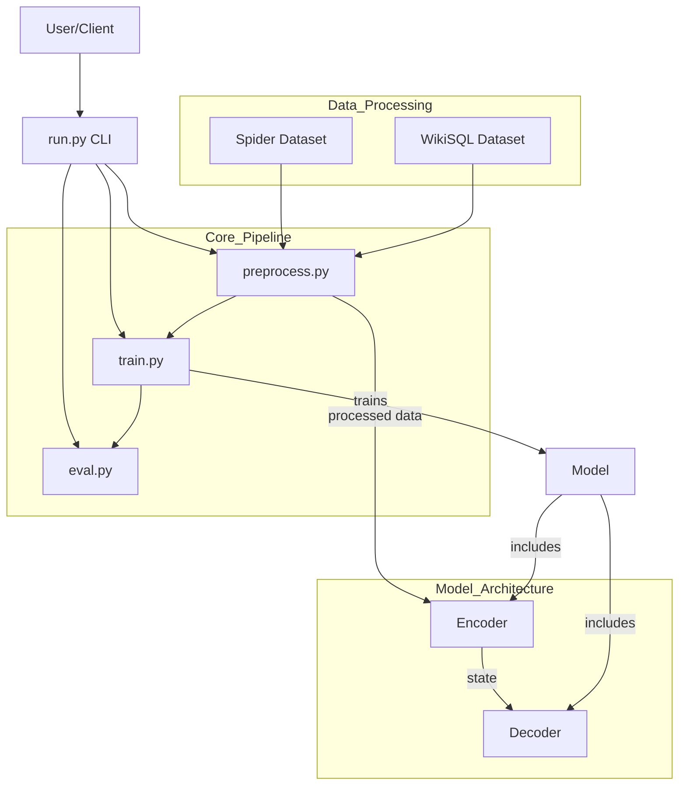
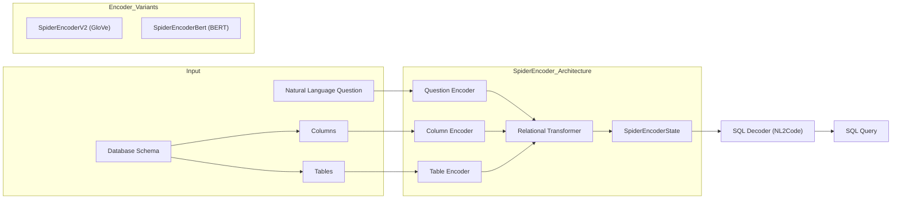
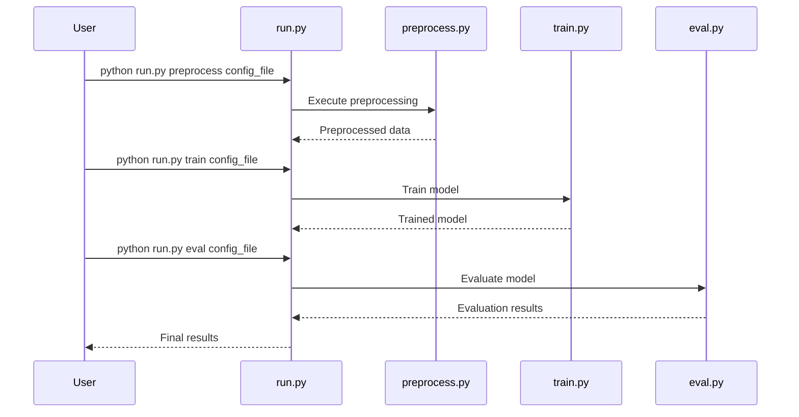
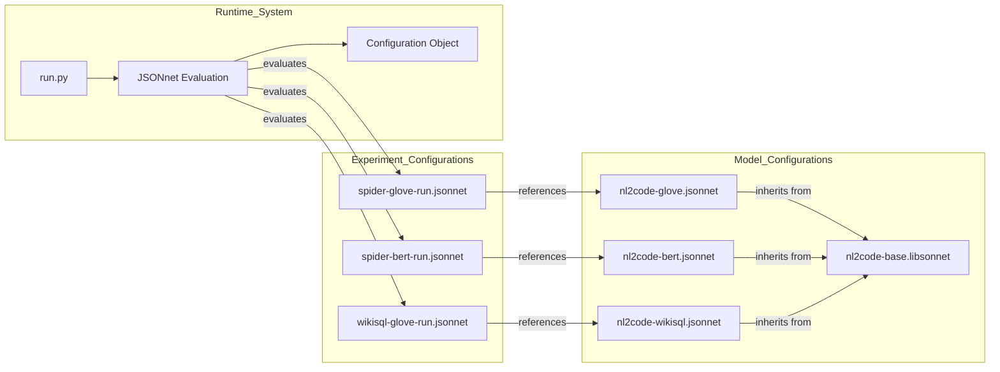
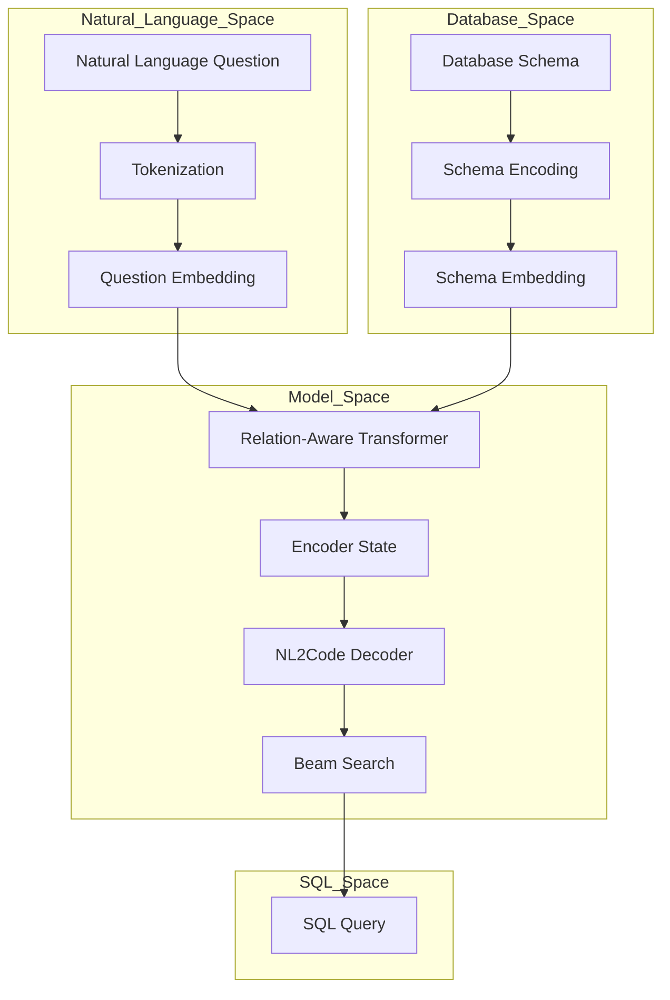

<!-- source: DeepWiki mcp.deepwiki.com · repo microsoft/rat-sql · page 1 Overview · fetched 2026-10-26 -->

# Overview

<details>
<summary>Relevant source files</summary>

The following files were used as context for generating this wiki page:

- [README.md](README.md)

</details>


This document provides a comprehensive introduction to RAT-SQL, a text-to-SQL parsing system developed by Microsoft Research that translates natural language questions into SQL queries. For detailed setup instructions, see [Installation and Setup](#2), and for deeper architectural details, see [System Architecture](#3).

## Purpose and Scope

RAT-SQL (Relation-Aware Schema Encoding and Linking for Text-to-SQL Parsers) is designed to bridge the gap between natural language questions and database queries by generating accurate SQL code. The system's primary innovation is its relation-aware schema encoding and linking mechanism that explicitly incorporates database structure into the neural architecture.

Key capabilities include:
- Processing natural language questions about a database
- Understanding database schema components (tables, columns, relationships)
- Creating appropriate linkages between question terms and schema elements
- Generating syntactically and semantically correct SQL queries

Sources: [README.md:3-17]()

## System Architecture

### High-Level Architecture



The system follows a modular architecture with a clear separation between preprocessing, training, and evaluation components. The command-line interface in `run.py` provides access to these components, allowing users to preprocess data, train models, and evaluate results.

Sources: [README.md:80-86]()

### Encoder-Decoder Framework



The core of RAT-SQL is its encoder-decoder architecture:
- The encoder processes both the natural language question and database schema
- Specialized encoders handle questions, columns, and tables
- A relational transformer combines these representations
- The decoder (NL2Code) generates SQL based on the encoder state

Sources: [README.md:88-93]()

## Workflow and Configuration

### User Workflow



RAT-SQL follows a three-step workflow:
1. **Preprocessing**: Converts raw dataset files into formats suitable for model training
2. **Training**: Trains the encoder-decoder model on the preprocessed data
3. **Evaluation**: Assesses model performance using standard text-to-SQL metrics

Sources: [README.md:80-86]()

### Configuration System



RAT-SQL uses a flexible configuration system based on JSONnet files:
- Experiment configuration files define execution parameters
- Model configuration files define architecture and hyperparameters
- Configurations follow an inheritance pattern for reusability

Sources: [README.md:88-93]()

## Supported Datasets and Models

RAT-SQL supports two primary datasets for text-to-SQL translation:

| Dataset | Description | Key Files |
|---------|-------------|-----------|
| Spider  | A complex cross-domain text-to-SQL dataset | train_spider.json, dev.json, tables.json |
| WikiSQL | A large-scale dataset of questions and SQL queries | train.jsonl, dev.jsonl, test.jsonl |

The system provides different model configurations for these datasets:

| Dataset | Model Variant | Configuration File | Description |
|---------|---------------|-------------------|-------------|
| Spider  | GloVE         | spider-glove-run.jsonnet | Uses GloVE word embeddings |
| Spider  | BERT          | spider-bert-run.jsonnet | Uses BERT contextual embeddings (requires GPU with 16GB+ memory) |
| WikiSQL | GloVE         | wikisql-glove-run.jsonnet | Uses GloVE word embeddings for WikiSQL dataset |

Sources: [README.md:30-53](), [README.md:88-93]()

## Environment and Dependencies

```mermaid
flowchart TB
    subgraph "Docker_Container"
        PyTorch["PyTorch 1.5 CUDA 10.1"]
        CoreNLP["Stanford CoreNLP"]
        BERT["BERT Models"]
        NLTK["NLTK"]
        
        RatSQL["RAT-SQL Code"]
        MountPoint["/mnt/data Volume"]
        
        PyTorch --> RatSQL
        CoreNLP --> RatSQL
        BERT --> RatSQL
        NLTK --> RatSQL
        
        MountPoint --> RatSQL
    end
    
    subgraph "Host_Machine"
        HostData["Spider & WikiSQL Datasets"]
        HostData --> |"mounted at"| MountPoint
    end
    
    User["User"] --> |"docker build/run"| DockerCommand["Docker Command"]
    DockerCommand --> "Docker_Container"
```

RAT-SQL is containerized using Docker to ensure a consistent environment:
- Based on PyTorch 1.5 with CUDA 10.1 support
- Includes Stanford CoreNLP for linguistic processing
- Supports both GloVE and BERT embeddings
- Requires at least 4GB of RAM for preprocessing
- Mounts datasets from the host machine to the container

Sources: [README.md:61-75](), [README.md:20-24]()

## From Question to SQL: End-to-End Process



The end-to-end process of RAT-SQL demonstrates how it bridges natural language to SQL:
1. **Input Processing**: Tokenizes the question and encodes the database schema
2. **Embedding**: Converts tokens and schema elements into embeddings (GloVE or BERT)
3. **Relation-Aware Encoding**: Applies transformers to capture relationships
4. **Decoding**: Generates SQL using the NL2Code decoder and beam search
5. **Output**: Produces the final SQL query that answers the original question

Sources: [README.md:3-17]()

---

