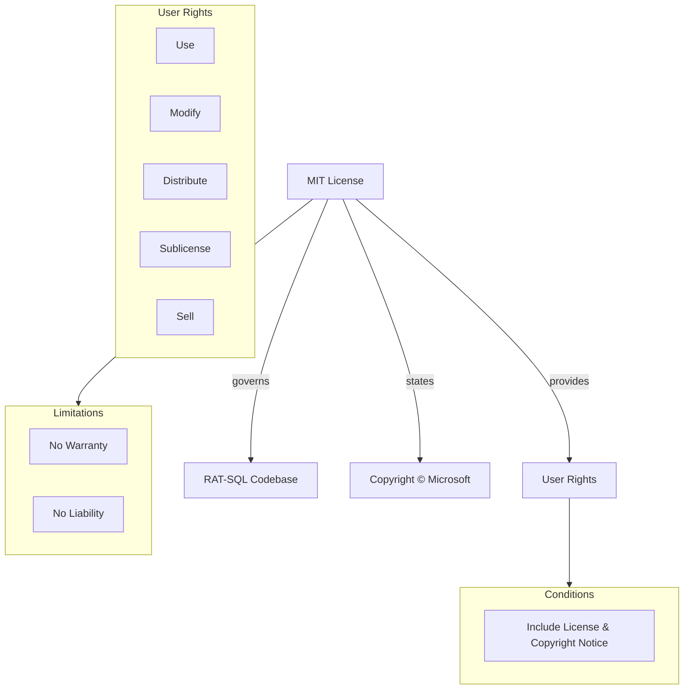
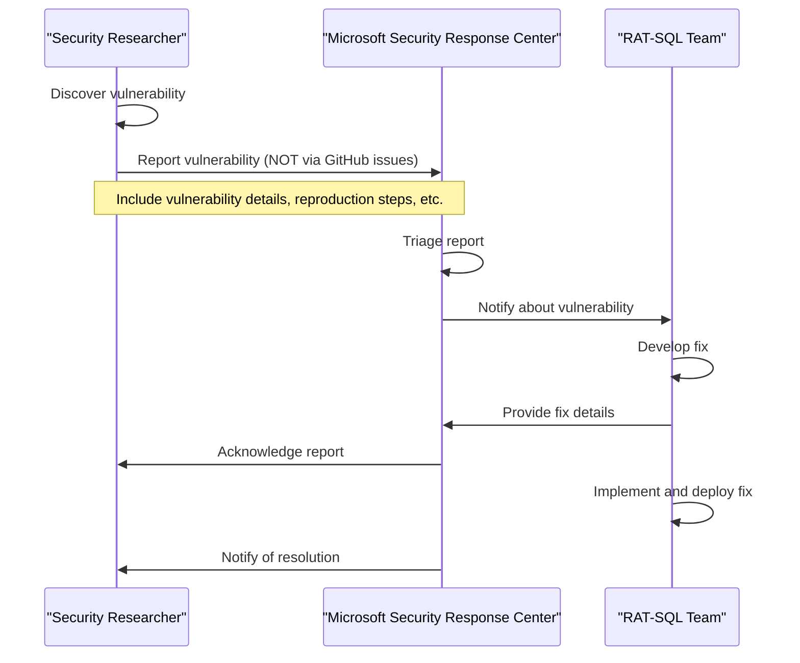
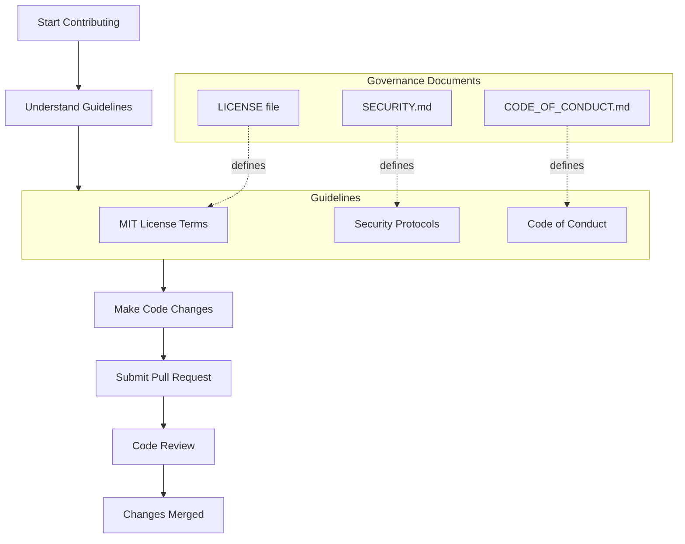

<!-- source: DeepWiki mcp.deepwiki.com · repo microsoft/rat-sql · page 10 License and Community Guidelines · fetched 2026-10-26 -->

# License and Community Guidelines

<details>
<summary>Relevant source files</summary>

The following files were used as context for generating this wiki page:

- [CODE_OF_CONDUCT.md](CODE_OF_CONDUCT.md)
- [LICENSE](LICENSE)
- [SECURITY.md](SECURITY.md)

</details>


This document outlines the licensing terms, security reporting procedures, and community conduct expectations for the RAT-SQL project. Understanding these guidelines is essential for anyone using, modifying, or contributing to the codebase.

## License Information

RAT-SQL is distributed under the MIT License, a permissive open-source license that allows for broad use while providing liability protection for the authors.

### MIT License Terms

The MIT License grants the following permissions:

- Use the software for any purpose
- Modify the software
- Distribute the software
- Sublicense the software
- Sell copies of the software

The only requirement is that the original copyright notice and license text must be included in all copies or substantial portions of the software.

#### License Application Diagram



Sources: [LICENSE:1-21]()

## Security Guidelines

Microsoft takes the security of its software products seriously, including all source code repositories managed through GitHub organizations.

### Security Reporting Process

**Important**: Do not report security vulnerabilities through public GitHub issues.

Instead, please report security vulnerabilities to the Microsoft Security Response Center (MSRC) through one of these channels:

- Submit at [https://msrc.microsoft.com/create-report](https://msrc.microsoft.com/create-report)
- Email secure@microsoft.com (optionally encrypted with MSRC's PGP key)

#### Security Reporting Workflow



When reporting a vulnerability, please include:
- Type of issue (e.g., SQL injection, cross-site scripting)
- Full paths of affected source files
- Location of affected code (tag/branch/commit)
- Special configuration required to reproduce
- Step-by-step reproduction instructions
- Proof-of-concept code (if possible)
- Potential impact and exploitation methods

Microsoft follows the principle of Coordinated Vulnerability Disclosure, working with reporters to address issues before public disclosure.

Sources: [SECURITY.md:1-40]()

## Code of Conduct

RAT-SQL has adopted the Microsoft Open Source Code of Conduct, which establishes expectations for participation in Microsoft-managed open source communities.

### Community Standards Framework

```mermaid
flowchart LR
    CoC["Microsoft Open Source\nCode of Conduct"] --> Governs["Governs All Interactions"]
    
    subgraph "Project Spaces"
        Issues["GitHub Issues"]
        PRs["Pull Requests"]
        Discussions["Discussions"]
        Code["Code Contributions"]
    end
    
    Governs --> Project Spaces
    
    CoC --> Resources["Resources"]
    
    subgraph "Resources"
        FAQ["Code of Conduct FAQ"]
        Contact["Contact: opencode@microsoft.com"]
    end
```

By participating in this project, you agree to abide by its terms. The Code of Conduct helps create a welcoming and inclusive environment for all contributors.

For more information:
- Microsoft Open Source Code of Conduct
- Microsoft Code of Conduct FAQ

Questions or concerns about the Code of Conduct can be directed to opencode@microsoft.com.

Sources: [CODE_OF_CONDUCT.md:1-10]()

## Contribution Process

When contributing to RAT-SQL, all contributors must adhere to the licensing terms, security guidelines, and code of conduct outlined above.

### Contribution Workflow Diagram



All contributions to RAT-SQL are subject to review by project maintainers to ensure they meet the project's standards and guidelines. All contributed code becomes part of the MIT-licensed codebase.

Sources: [LICENSE:1-21](), [SECURITY.md:1-40](), [CODE_OF_CONDUCT.md:1-10]()

## Summary

This document provides an overview of the three key governance documents for the RAT-SQL project:

| Document | Purpose | Key Points |
|----------|---------|------------|
| LICENSE | Define usage terms | MIT License: permissive with attribution requirement |
| SECURITY.md | Security processes | Report privately to MSRC, not via public issues |
| CODE_OF_CONDUCT.md | Community standards | Microsoft Open Source Code of Conduct applies |

Understanding and following these guidelines ensures a productive, secure, and respectful environment for all RAT-SQL users and contributors.