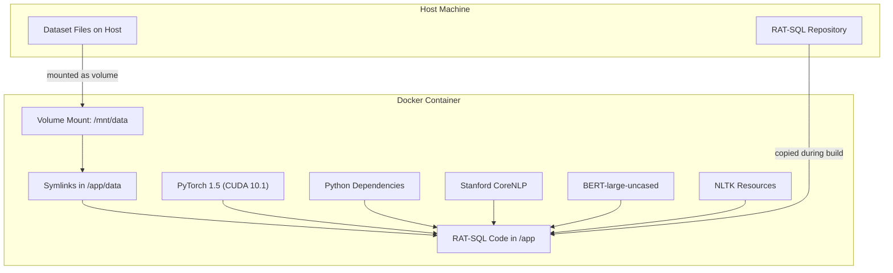
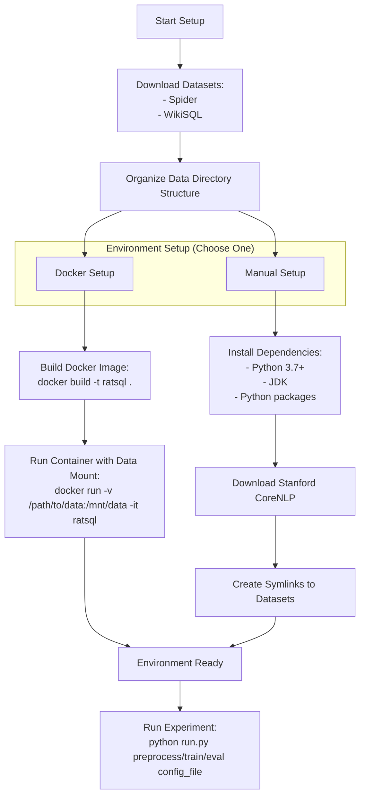

<!-- source: DeepWiki mcp.deepwiki.com · repo microsoft/rat-sql · page 2 Installation and Setup · fetched 2026-10-26 -->

# Installation and Setup

<details>
<summary>Relevant source files</summary>

The following files were used as context for generating this wiki page:

- [.dockerignore](.dockerignore)
- [.gitignore](.gitignore)
- [Dockerfile](Dockerfile)
- [README.md](README.md)

</details>


This document provides comprehensive instructions for setting up the RAT-SQL environment, including downloading necessary datasets, configuring the Docker environment, and preparing the system for running experiments. For information about the system architecture and components, see [System Architecture](#3), and for details on running experiments after installation, see [Command-Line Interface](#3.1).

## Prerequisites

Before installing RAT-SQL, ensure you have the following:

- **Hardware Requirements**:
  - At least 4GB of RAM for preprocessing
  - GPU with 16GB+ memory recommended for BERT models
  - Sufficient disk space for datasets (~1GB) and pretrained models

- **Software Requirements**:
  - [Docker](https://www.docker.com/products/docker-desktop) (recommended)
  - Git
  - If not using Docker: Python 3.7+ and JVM for Stanford CoreNLP

## Dataset Preparation

RAT-SQL requires specific datasets to function properly. These must be downloaded and organized before running the system.

### Downloading Datasets

1. **Spider Dataset**: Download from [Yale-LILY Spider page](https://yale-lily.github.io/spider)
   - Ensure you download version `08/03/2020` or newer

2. **WikiSQL Dataset**: Download from [WikiSQL GitHub repository](https://github.com/salesforce/WikiSQL)

3. **WikiSQL Evaluation Scripts**:
   ```bash
   mkdir -p third_party
   git clone https://github.com/salesforce/WikiSQL third_party/wikisql
   ```

### Dataset Organization

Organize the downloaded datasets in the following structure outside the project directory:

```
/path/to/data
├── spider
│   ├── database
│   │   └── ...
│   ├── dev.json
│   ├── dev_gold.sql
│   ├── tables.json
│   ├── train_gold.sql
│   ├── train_others.json
│   └── train_spider.json
└── wikisql
    ├── dev.db
    ├── dev.jsonl
    ├── dev.tables.jsonl
    ├── test.db
    ├── test.jsonl
    ├── test.tables.jsonl
    ├── train.db
    ├── train.jsonl
    └── train.tables.jsonl
```

Sources: [README.md:28-53]()

## Docker Environment Setup (Recommended)

Using Docker is the recommended approach for setting up RAT-SQL, as it ensures consistent environment configuration across different systems.

### 1. Docker Image Build

The provided Dockerfile sets up the complete environment with all dependencies:

```bash
# From the repository root
docker build -t ratsql .
```

### 2. Running the Docker Container

Mount your datasets directory as a volume and run the container:

```bash
docker run --rm -m4g -v /path/to/data:/mnt/data -it ratsql
```

> **Note**: The `-m4g` switch allocates 4GB of RAM to the container, which is required for preprocessing. If using Docker Desktop for Mac or Windows, you may need to increase the default memory limit in Docker settings.

Sources: [README.md:61-75](), [Dockerfile:1-50]()

## Docker Environment Structure

The Docker environment sets up a complete development environment for RAT-SQL:



Sources: [Dockerfile:1-50]()

## Key Components in Docker Image

The Docker image includes several important components:

| Component | Description | Location in Container |
|-----------|-------------|----------------------|
| PyTorch | Deep learning framework (v1.5 with CUDA 10.1) | Base image |
| Python Dependencies | Required Python packages | Installed via pip |
| Stanford CoreNLP | NLP toolkit for preprocessing | `/app/third_party/stanford-corenlp-full-2018-10-05/` |
| BERT Model | Pre-trained BERT model | Cached in transformers directory |
| NLTK Resources | Stopwords and tokenization data | Downloaded during build |
| RAT-SQL Code | The codebase itself | `/app/` |
| Dataset Symlinks | Links to mounted datasets | `/app/data/spider` and `/app/data/wikisql` |

Sources: [Dockerfile:18-48]()

## Manual Setup (Alternative)

If you prefer not to use Docker, you can set up the environment manually:

1. **Install system dependencies**:
   - Python 3.7 or higher
   - JDK for Stanford CoreNLP
   - Git

2. **Clone the repository**:
   ```bash
   git clone https://github.com/microsoft/rat-sql.git
   cd rat-sql
   ```

3. **Install Python dependencies**:
   ```bash
   pip install -r requirements.txt
   pip install entmax
   python -c "import nltk; nltk.download('stopwords'); nltk.download('punkt')"
   ```

4. **Download Stanford CoreNLP**:
   ```bash
   mkdir -p third_party
   cd third_party
   curl https://download.cs.stanford.edu/nlp/software/stanford-corenlp-full-2018-10-05.zip | jar xv
   cd ..
   ```

5. **Cache BERT model** (optional, speeds up first run):
   ```bash
   python -c "from transformers import BertModel; BertModel.from_pretrained('bert-large-uncased-whole-word-masking')"
   ```

6. **Set up dataset symlinks**:
   ```bash
   mkdir -p data
   cd data
   ln -s /path/to/data/spider spider
   ln -s /path/to/data/wikisql wikisql
   cd ..
   ```

7. **Set up WikiSQL evaluation scripts**:
   ```bash
   mkdir -p third_party
   git clone https://github.com/salesforce/WikiSQL third_party/wikisql
   export PYTHONPATH="$PWD/third_party/wikisql/:$PYTHONPATH"
   ```

Sources: [Dockerfile:7-48](), [README.md:74-75]()

## Setup Process Workflow

The complete setup process follows this workflow:



Sources: [README.md:26-93]()

## Verifying Installation

To verify that your installation is working properly, you can run a simple preprocessing step:

```bash
# Inside the Docker container or your manual setup environment
python run.py preprocess experiments/spider-glove-run.jsonnet
```

If successful, this will process the Spider dataset using GloVE embeddings and create preprocessed files in the specified output directory.

## Running Experiments

After completing the installation and setup, you can run experiments using the provided configurations:

```bash
# Preprocess the data
python run.py preprocess experiment_config_file

# Train a model
python run.py train experiment_config_file

# Evaluate results
python run.py eval experiment_config_file
```

Available experiment configurations:
- Spider with GloVE: `experiments/spider-glove-run.jsonnet`
- Spider with BERT: `experiments/spider-bert-run.jsonnet` (requires GPU with 16GB+ memory)
- WikiSQL with GloVE: `experiments/wikisql-glove-run.jsonnet`

For more details on the experiment running process, see [Training System](#5).

Sources: [README.md:80-94]()

## Troubleshooting

### Common Issues

1. **Insufficient Docker Memory**:
   - **Symptom**: Container crashes during preprocessing
   - **Solution**: Increase memory allocation to at least 4GB with `-m4g` flag or in Docker Desktop settings

2. **Dataset Mount Issues**:
   - **Symptom**: `FileNotFoundError` when running experiments
   - **Solution**: Verify the dataset paths and ensure the volume is correctly mounted in Docker

3. **CUDA Issues with BERT Model**:
   - **Symptom**: Out of memory errors when training BERT model
   - **Solution**: Ensure GPU has sufficient memory (16GB+) or use a smaller batch size in the configuration

### Requirements File

The requirements are specified in the repository's `requirements.txt` file, which is installed during the Docker build process. Key dependencies include:

- PyTorch
- Transformers (for BERT)
- AllenNLP
- TensorBoardX
- Jsonnet
- tqdm

Sources: [Dockerfile:18-22]()

---

