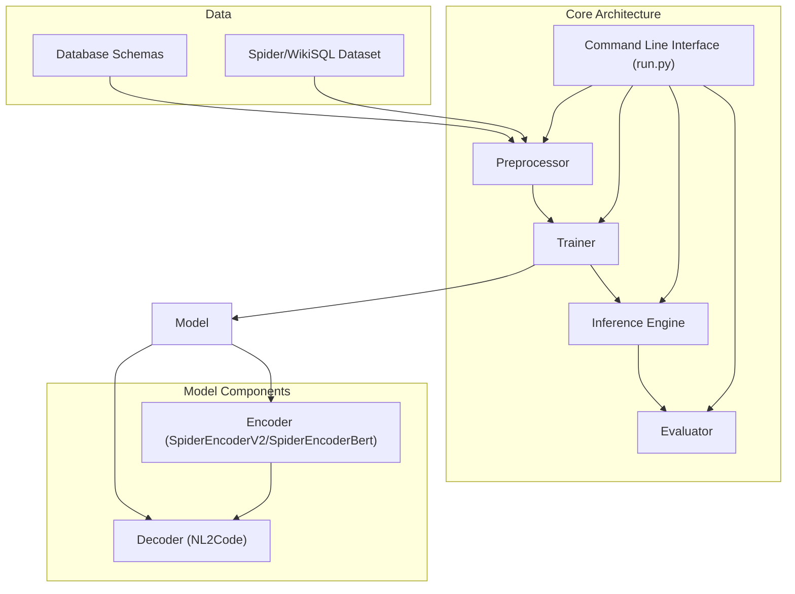
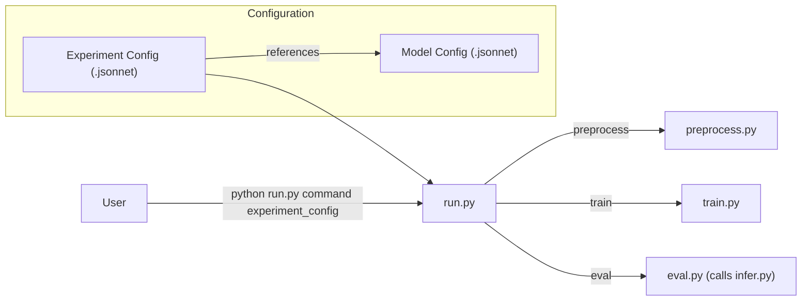
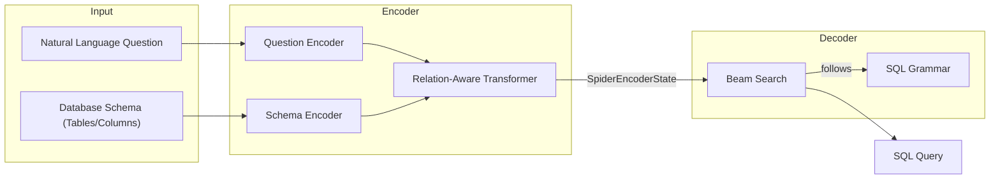
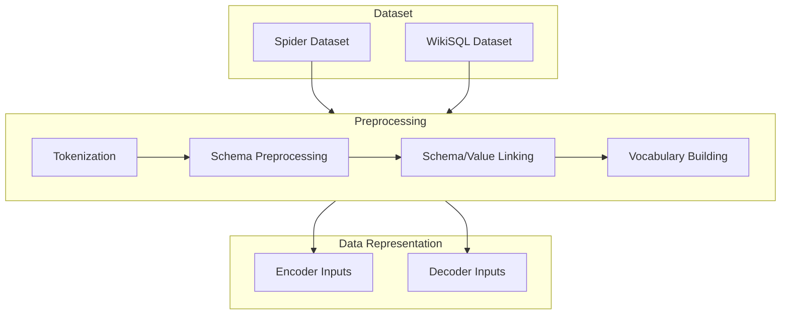
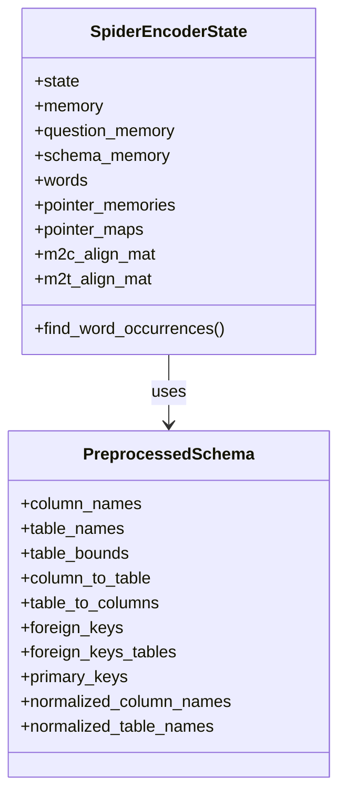
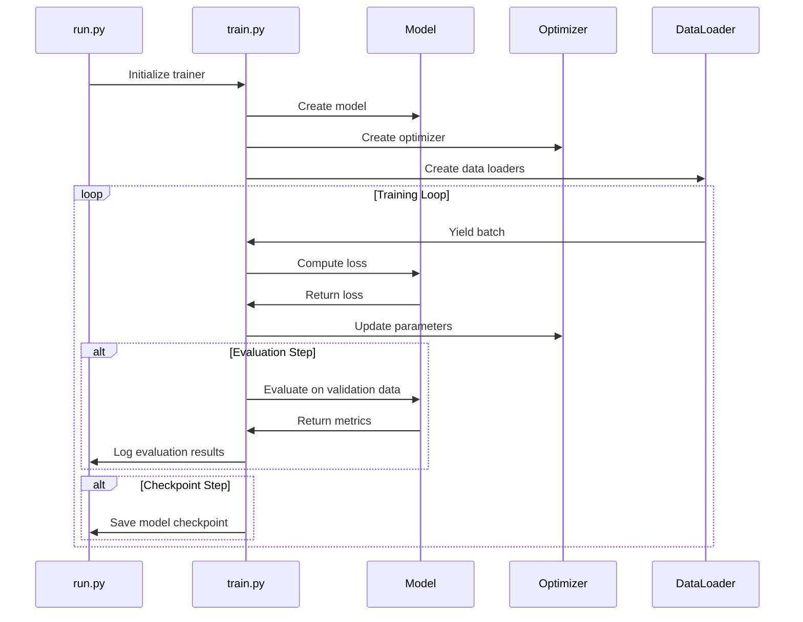
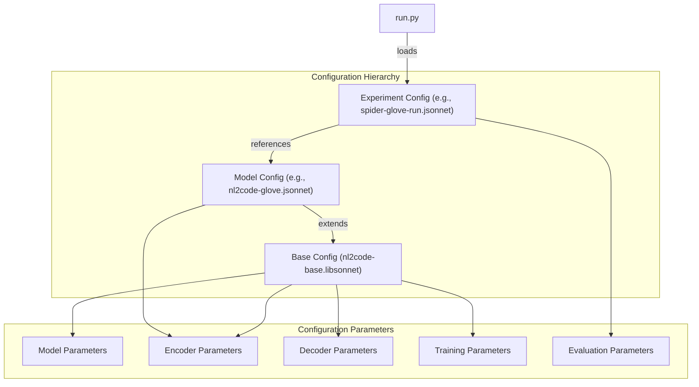
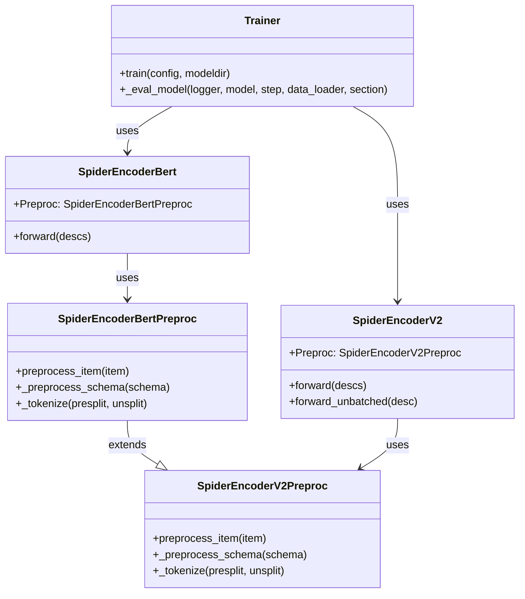
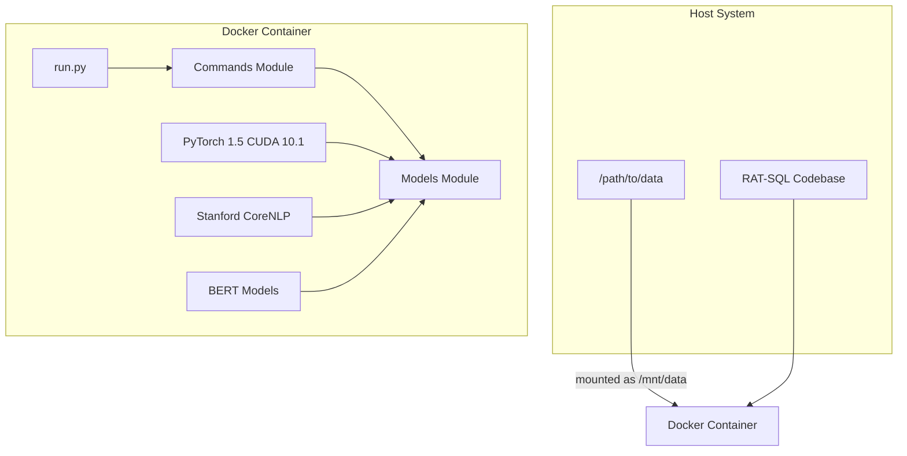
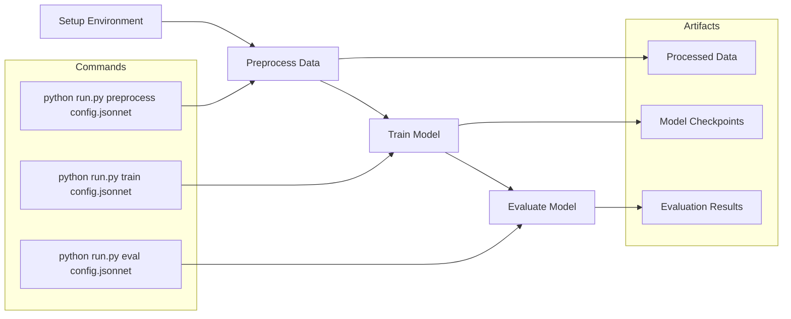

<!-- source: DeepWiki mcp.deepwiki.com · repo microsoft/rat-sql · page 3 System Architecture · fetched 2026-10-26 -->

# System Architecture

Relevant source files

The following files were used as context for generating this wiki page:

- [README.md](README.md)
- [ratsql/commands/train.py](ratsql/commands/train.py)
- [ratsql/models/spider/spider_enc.py](ratsql/models/spider/spider_enc.py)
- [run.py](run.py)

This document provides a comprehensive overview of the RAT-SQL system architecture. It covers the high-level structure of the codebase, its main components, and how they interact during the text-to-SQL translation process. For detailed information about the specific model architecture, refer to [Model Architecture](#4). For information about the command-line interface specifically, see [Command-Line Interface](#3.1).

## Overview

RAT-SQL (Relation-Aware Schema Encoding and Linking for Text-to-SQL Parsers) is a neural network-based system designed to translate natural language questions into SQL queries based on database schemas. The system follows a modular architecture with clear separation between preprocessing, training, inference, and evaluation components.

Sources: [run.py:1-109](), [README.md:1-109]()

## Key Components

The system is organized into several key components that work together to translate natural language questions into SQL queries:

### Command Line Interface

The command-line interface (`run.py`) serves as the main entry point to the system, providing a unified way to execute preprocessing, training, and evaluation operations.

Sources: [run.py:1-109](), [README.md:79-93]()

### Encoder-Decoder Architecture

RAT-SQL follows an encoder-decoder architecture:

1. **Encoder**: Processes natural language questions and database schemas, creating a joint representation that captures the relationships between them.
2. **Decoder**: Generates SQL queries based on the encoded representation.

The system provides two encoder variants:
- **SpiderEncoderV2**: Uses GloVe embeddings for token representation
- **SpiderEncoderBert**: Uses BERT for token representation

Sources: [ratsql/models/spider/spider_enc.py:264-542](), [ratsql/models/spider/spider_enc.py:751-948]()

## Data Processing Pipeline

RAT-SQL's data processing pipeline transforms raw text questions and database schemas into model-ready inputs.

Key preprocessing steps include:
- Tokenization of questions and schema elements
- Schema preprocessing to capture table/column relationships
- Schema linking to identify connections between question tokens and schema elements
- Value linking to match question tokens with database values

Sources: [ratsql/models/spider/spider_enc.py:129-263](), [ratsql/models/spider/spider_enc.py:645-749]()

## Encoder State Representation

The encoder produces a structured state representation that captures the question and schema information along with their relationships.

The `SpiderEncoderState` is a comprehensive representation that includes:
- Memory tensors for question and schema elements
- Alignment matrices between natural language and schema elements
- Pointer maps for efficient access to columns and tables

Sources: [ratsql/models/spider/spider_enc.py:23-39](), [ratsql/models/spider/spider_enc.py:41-55]()

## Training Process

RAT-SQL's training process orchestrates model training using a comprehensive workflow.

Key components of the training process:
- The `Trainer` class orchestrates the training loop
- Model training is driven by configuration parameters
- Periodic evaluation and checkpointing
- Support for various optimizers and learning rate schedulers

Sources: [ratsql/commands/train.py:78-244]()

## Configuration System

RAT-SQL uses a comprehensive configuration system based on JSONNET files to control all aspects of model training and evaluation.

The configuration system provides:
- Hierarchical configuration through JSONNET inheritance
- Different configurations for different experiments
- Separation of model architecture and training parameters
- Runtime parameter overrides via command line

Sources: [run.py:48-106]()

## Class Relationships

This diagram shows key class relationships in the RAT-SQL system:

Sources: [ratsql/models/spider/spider_enc.py:129-263](), [ratsql/models/spider/spider_enc.py:264-542](), [ratsql/models/spider/spider_enc.py:645-749](), [ratsql/models/spider/spider_enc.py:751-948](), [ratsql/commands/train.py:78-244]()

## Docker Execution Environment

RAT-SQL operates within a containerized Docker environment to ensure consistent execution across different platforms.

The Docker environment provides:
- All required dependencies (PyTorch, CoreNLP, BERT)
- Consistent execution environment
- Easy volume mounting for datasets
- GPU acceleration support

Sources: [README.md:55-76]()

## Execution Flow

This diagram illustrates the end-to-end execution flow for training and evaluating a model:

Sources: [README.md:79-93](), [run.py:48-106]()

## Summary

The RAT-SQL system architecture provides a flexible and modular approach to text-to-SQL translation. Key features include:

1. **Modular Design**: Clear separation between preprocessing, training, inference, and evaluation components
2. **Dual Encoder Support**: Support for both GloVe and BERT-based encoders
3. **Configuration-Driven**: Extensive use of JSONNET configuration files for experiment customization
4. **Relation-Aware Encoding**: Special handling of relationships between natural language and database schema elements
5. **Containerized Execution**: Docker-based execution environment for portability and reproducibility

This architecture enables RAT-SQL to achieve state-of-the-art performance on text-to-SQL translation tasks while maintaining flexibility for experimentation and extension.

---

