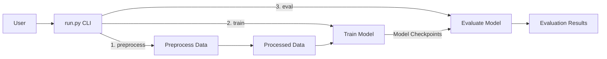
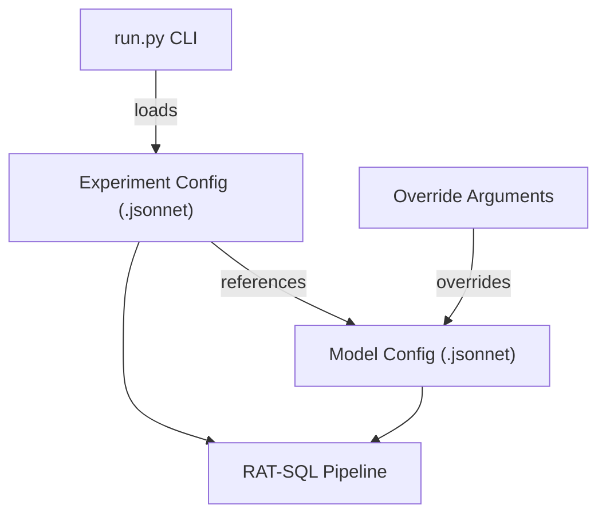
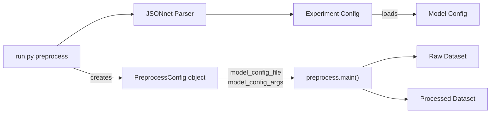
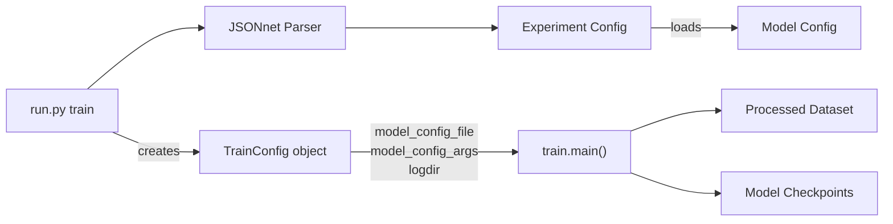
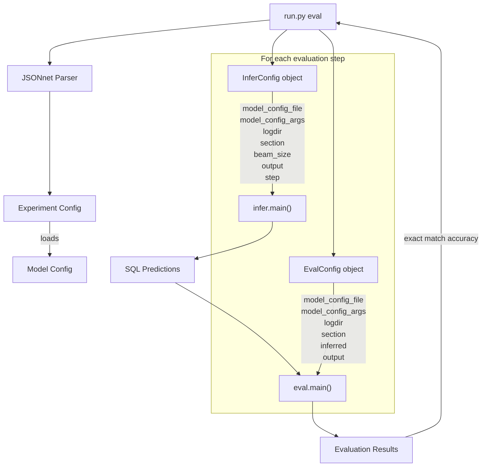
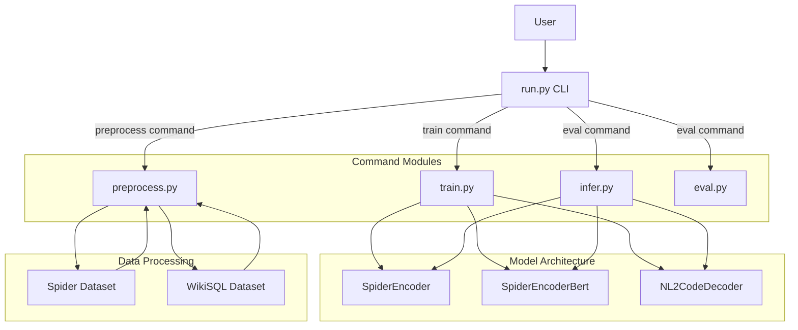
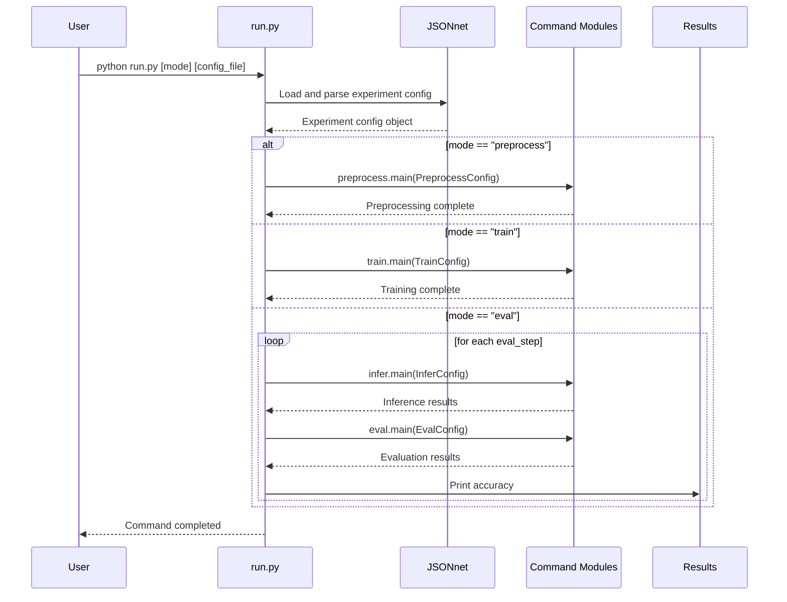

<!-- source: DeepWiki mcp.deepwiki.com · repo microsoft/rat-sql · page 3.1 Command-Line Interface · fetched 2026-10-26 -->

# Command-Line Interface

<details>
<summary>Relevant source files</summary>

The following files were used as context for generating this wiki page:

- [README.md](README.md)
- [run.py](run.py)

</details>


This page documents the command-line interface (CLI) of RAT-SQL, which serves as the primary entry point for interacting with the system. The CLI allows users to execute the three main pipeline stages: preprocessing data, training models, and evaluating trained models. Understanding the CLI is essential for effectively running experiments with RAT-SQL.

For information about the overall system architecture, see [System Architecture](#3).

## Overview

RAT-SQL's command-line interface is implemented in the `run.py` script, which parses arguments, loads configuration files, and dispatches commands to the appropriate modules. The CLI is designed around a three-stage workflow:



Sources: [run.py:1-109](), [README.md:80-86]()

## Command Line Syntax

The basic syntax for the RAT-SQL command-line interface is:

```
python run.py MODE EXPERIMENT_CONFIG_FILE [--model_config_args ARGS] [--logdir LOGDIR]
```

Where:
- `MODE` - One of: `preprocess`, `train`, or `eval`
- `EXPERIMENT_CONFIG_FILE` - Path to a JSONnet experiment configuration file
- `--model_config_args` (optional) - Overrides for model configuration arguments
- `--logdir` (optional) - Override for the log directory specified in the experiment config

Sources: [run.py:48-54]()

## Configuration System

The CLI uses a two-level configuration system:



### Experiment Configuration
The experiment configuration files (e.g., `spider-glove-run.jsonnet`) define high-level execution parameters:
- Model configuration file path
- Model configuration arguments
- Log directory
- Evaluation parameters (section, beam size, output paths)

### Model Configuration
Model configuration files define the model architecture and hyperparameters, which are consumed by the specific modules during execution.

Sources: [run.py:56-69](), [README.md:88-92]()

## Main Commands

### Preprocess Command

```
python run.py preprocess EXPERIMENT_CONFIG_FILE
```

This command prepares the dataset for training by:
1. Loading the experiment configuration
2. Creating a `PreprocessConfig` object with model configuration details
3. Calling the preprocess module's main function



Sources: [run.py:71-73]()

### Train Command

```
python run.py train EXPERIMENT_CONFIG_FILE
```

This command trains a model based on the processed data:
1. Loading the experiment configuration
2. Creating a `TrainConfig` object with model configuration details and log directory
3. Calling the train module's main function



Sources: [run.py:74-77]()

### Eval Command

```
python run.py eval EXPERIMENT_CONFIG_FILE
```

This command evaluates a trained model's performance:
1. Loading the experiment configuration
2. For each evaluation step specified in the config:
   a. Create an `InferConfig` object to generate SQL predictions
   b. Call the infer module's main function
   c. Create an `EvalConfig` object to evaluate the predictions
   d. Call the eval module's main function
   e. Output the exact match accuracy



Sources: [run.py:78-105]()

## Configuration Objects

The CLI creates several configuration objects to pass parameters to the different modules:

| Configuration Class | Purpose | Fields |
|---------------------|---------|--------|
| `PreprocessConfig` | Configuration for preprocessing data | `config`, `config_args` |
| `TrainConfig` | Configuration for training models | `config`, `config_args`, `logdir` |
| `InferConfig` | Configuration for inference | `config`, `config_args`, `logdir`, `section`, `beam_size`, `output`, `step`, `use_heuristic`, `mode`, `limit`, `output_history` |
| `EvalConfig` | Configuration for evaluation | `config`, `config_args`, `logdir`, `section`, `inferred`, `output` |

Sources: [run.py:10-46]()

## Example Workflow

A typical RAT-SQL workflow involves running the three main commands in sequence:

```bash
# Step 1: Preprocess the data
python run.py preprocess experiments/spider-glove-run.jsonnet

# Step 2: Train a model
python run.py train experiments/spider-glove-run.jsonnet

# Step 3: Evaluate the results
python run.py eval experiments/spider-glove-run.jsonnet
```

The system provides several predefined experiment configurations:
- `experiments/spider-glove-run.jsonnet` - Spider dataset with GloVE embeddings
- `experiments/spider-bert-run.jsonnet` - Spider dataset with BERT embeddings
- `experiments/wikisql-glove-run.jsonnet` - WikiSQL dataset with GloVE embeddings

Sources: [README.md:80-94]()

## Integration with RAT-SQL Architecture

The CLI serves as the entry point that coordinates the execution of RAT-SQL's core components:



Sources: [run.py:8](), [README.md:88-92]()

## Command Execution Flow

The diagram below shows the detailed flow of command execution in the CLI:



Sources: [run.py:48-109]()

## Implementation Details

The CLI implementation in `run.py` consists of:

1. Configuration classes decorated with `@attr.s` to create data classes:
   - `PreprocessConfig`
   - `TrainConfig`
   - `InferConfig`
   - `EvalConfig`

2. A `main()` function that:
   - Sets up argument parsing with `argparse`
   - Loads experiment configuration with `_jsonnet`
   - Processes any configuration overrides
   - Dispatches to the appropriate command module based on the mode

The command modules (`preprocess`, `train`, `infer`, `eval`) are imported from the `ratsql.commands` package.

Sources: [run.py:1-109]()

## Common Usage Patterns

### Overriding Model Configuration

```bash
python run.py train experiments/spider-glove-run.jsonnet --model_config_args '{"train": {"batch_size": 16}}'
```

### Specifying a Custom Log Directory

```bash
python run.py train experiments/spider-glove-run.jsonnet --logdir ./custom_logs
```

Sources: [run.py:53-69]()

---

